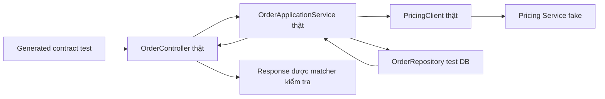

# Chọn fixture, matcher và mức độ ràng buộc

Một contract test có thể thất bại vì fixture không phản ánh trạng thái hợp lệ của producer, hoặc pass quá dễ vì matcher chấp nhận gần như mọi JSON. Ngược lại, một contract khóa cứng timestamp, UUID và mọi phần tử trong mảng có thể trở nên mong manh dù consumer chỉ quan tâm đến định dạng và một vài thuộc tính ổn định. Chất lượng kiểm thử hợp đồng không nằm ở việc **matcher càng chặt càng tốt** hay **fixture càng giống production càng tốt**. Chất lượng nằm ở việc chọn dữ liệu đại diện, quy tắc khớp đúng với cam kết API và mức ràng buộc đủ để phát hiện thay đổi không tương thích.

**Spring Cloud Contract** dùng Groovy/YAML DSL để mô tả hành vi HTTP hoặc message giữa producer và consumer. Contract Verifier sinh kiểm thử cho producer; plugin chuyển contract thành stubs; Stub Runner giúp consumer kiểm thử độc lập; CI kiểm tra tương thích trước khi phát hành. Bài học này thuộc chương **Lựa chọn chiến lược**, trong module **SPRING_CLOUD_CONTRACT**, với đề bài trực tiếp **Chọn fixture, matcher và mức độ ràng buộc**.

Bài viết sử dụng Order Service và Checkout Service làm ví dụ. Checkout gửi yêu cầu tạo đơn; Order Service xác thực, tính tổng, lưu đơn, sinh mã và thời gian. Bạn sẽ học cách chọn fixture cho producer, chọn dữ liệu mẫu cho stub, phân biệt equality/type/regex/date/array matchers, xác định khi nào nên kiểm tra chính xác và khi nào nên cho phép giá trị động, rồi chứng minh các lựa chọn đó có phát hiện breaking changes.

## 1. Bắt đầu từ điều consumer thực sự phụ thuộc

Trước khi tạo fixture hoặc viết matcher, hãy trả lời:

**Consumer cần dựa vào cam kết nào để hoạt động đúng?**

Ví dụ Checkout gửi:

```http
POST /api/orders
Content-Type: application/json
Accept: application/json

{
  "customerId": "CUS-000042",
  "clientRequestId": "A1B2C3D4E5F60708",
  "items": [
    {
      "sku": "SKU-42",
      "quantity": 2,
      "unitPrice": 62500
    }
  ]
}
```

Order Service trả:

```http
HTTP/1.1 201 Created
Content-Type: application/json
Location: /api/orders/ORD-100042

{
  "orderId": "ORD-100042",
  "clientRequestId": "A1B2C3D4E5F60708",
  "status": "CREATED",
  "createdAt": "2026-11-24T09:00:00Z",
  "totalAmount": 125000,
  "currency": "VND",
  "items": [
    {
      "sku": "SKU-42",
      "quantity": 2,
      "unitPrice": 62500
    }
  ]
}
```

Các cam kết consumer có thể phụ thuộc:

- API dùng `POST /api/orders` và trả `201 Created`.
- Response có `orderId` để Checkout tiếp tục xử lý.
- `orderId` là chuỗi có format được thống nhất.
- `clientRequestId` được echo để trace hoặc idempotency.
- `status` có giá trị nghiệp vụ `CREATED`.
- `createdAt` là timestamp parse được.
- `totalAmount` là JSON number, không phải string.
- `currency` là mã tiền tệ mà consumer hiểu.
- `items` chứa SKU, quantity và unit price theo cấu trúc đã công bố.
- `Location` trỏ tới resource vừa tạo.

Không phải mọi chi tiết nội bộ đều cần đưa vào contract. Consumer có thể không phụ thuộc database ID, tên bảng, implementation class hoặc thứ tự xử lý nội bộ. Hãy bảo vệ **observable behavior** mà consumer cần, đồng thời giữ các business invariants trong unit/integration tests phù hợp.

### 1.1. Phân biệt cam kết API và chi tiết triển khai

| Thuộc tính | Có nên nằm trong contract? | Lý do |
|---|---|---|
| HTTP method/path | Có | Consumer gọi trực tiếp |
| Status code | Có | Ảnh hưởng luồng xử lý |
| Content-Type | Có | Ảnh hưởng deserialization |
| Field `orderId` | Có | Consumer cần tham chiếu đơn |
| Kiểu JSON của `totalAmount` | Có | Consumer cần parse đúng kiểu |
| Giá trị `status` | Có nếu consumer phân nhánh theo enum | Thay đổi enum có thể phá logic |
| Timestamp có định dạng hợp lệ | Có nếu consumer parse timestamp | Bảo vệ format |
| Tên database table | Không | Chi tiết nội bộ |
| Thứ tự gọi repository methods | Không | Không phải cam kết HTTP |
| Số lần gọi private method | Không | Không quan sát từ consumer |
| Thuật toán sinh ID cụ thể | Thường không | Consumer thường chỉ cần format/uniqueness |
| Công thức tính total | Có thể cần assertion nghiệp vụ riêng | Contract có thể kiểm tra output mẫu; integration test bảo vệ quy tắc rộng hơn |

Một contract quá sâu vào chi tiết nội bộ khiến producer khó refactor. Một contract chỉ kiểm tra `201` lại không bảo vệ response schema. Hãy chọn đúng ranh giới giữa hai loại.

## 2. Ba quyết định phải tách riêng

**Fixture**, **matcher** và **mức độ ràng buộc** liên quan nhau nhưng không thay thế nhau.

| Quyết định | Câu hỏi | Ví dụ |
|---|---|---|
| Fixture | Test cần trạng thái đầu vào nào để chạy hành vi? | Customer tồn tại, SKU có giá, database sạch |
| Matcher | Giá trị thực tế được so với điều kiện nào? | `orderId` khớp regex, `totalAmount` bằng 125000 |
| Mức ràng buộc | Contract cho phép bao nhiêu biến thiên? | Exact value, type, regex, occurrence bounds |

Ví dụ, fixture tạo customer `CUS-000042` và một SKU có giá `62500`. Matcher response có thể kiểm tra `totalAmount` chính xác bằng `125000`. Nếu producer tự sinh `orderId`, fixture không nhất thiết phải cố định ID generator; matcher có thể kiểm tra format `ORD-[0-9]{6}`.

### 2.1. Không dùng matcher để bù cho fixture sai

Nếu test cần một customer hợp lệ nhưng fixture không tạo customer, việc nới matcher `customerId` thành `.*` không giải quyết lỗi. Generated producer test vẫn gửi request mà producer có thể từ chối vì dữ liệu không tồn tại.

### 2.2. Không dùng fixture để né một cam kết cần matcher

Nếu API phải trả `status: CREATED`, fixture có thể tạo đúng order ban đầu, nhưng vẫn cần assertion response. Việc seed một object `CREATED` vào database không chứng minh endpoint thực trả đúng status.

## 3. Chọn fixture theo mục tiêu của test

Fixture là dữ liệu và trạng thái môi trường được chuẩn bị để thực hiện một scenario. Trong producer contract tests, fixture thường nằm trong base test class mà generated tests kế thừa.

Một fixture hữu ích cần:

1. Tạo được điều kiện nghiệp vụ tối thiểu để request hợp lệ.
2. Có giá trị ổn định, tái lập giữa local và CI.
3. Độc lập với thứ tự chạy tests.
4. Không chia sẻ mutable state giữa tests chạy song song.
5. Kiểm soát external boundaries mà contract không cần kiểm tra.
6. Giữ implementation quan trọng của producer được thực thi.
7. Được reset hoặc cleanup rõ ràng.

**Fixture tốt là fixture tối thiểu nhưng đủ đại diện.** Không cần import toàn bộ dữ liệu production để test một API tạo đơn; cũng không nên dùng mock trả sẵn response để bỏ qua logic mà contract đang bảo vệ.

## 4. Bốn chiến lược fixture phổ biến

### 4.1. Fixture tối thiểu hợp lệ

Chỉ tạo dữ liệu bắt buộc để scenario chạy:

- Một customer đang hoạt động.
- Một SKU hợp lệ.
- Giá đơn vị xác định.
- Một request có một item.
- Không có order trùng idempotency key.

Phù hợp với producer contract tests tập trung vào HTTP request/response và business rules cơ bản.

**Ưu điểm:** nhanh, dễ đọc, ít phụ thuộc, ít dữ liệu thừa.

**Rủi ro:** có thể bỏ qua hành vi chỉ xuất hiện khi có nhiều items, nhiều trạng thái customer hoặc dữ liệu biên. Cần có contract/integration cases khác cho các nhánh quan trọng.

### 4.2. Fixture đại diện nghiệp vụ

Dùng một bộ dữ liệu gần với tình huống thật hơn:

- Customer có tier `GOLD`.
- Hai SKU với giá khác nhau.
- Một discount rule được kích hoạt.
- Một địa chỉ giao hàng hợp lệ.
- Một số field tùy chọn.

Phù hợp khi response phụ thuộc vào tương tác giữa nhiều phần nghiệp vụ. Giữ fixture nhỏ và đặt tên rõ để người review hiểu điều kiện nào tạo ra output.

**Rủi ro:** fixture phình to, khó xác định dữ liệu nào thật sự cần thiết. Khi một test fail vì fixture không đồng bộ, việc debug contract trở nên khó hơn.

### 4.3. Fixture biên và lỗi

Chuẩn bị riêng cho các scenario:

- Customer không tồn tại.
- SKU ngừng kinh doanh.
- Quantity bằng 0 hoặc âm.
- Mảng items rỗng.
- Tổng tiền vượt giới hạn.
- Idempotency key đã được sử dụng.
- User thiếu quyền.

Không gộp tất cả vào một fixture đa năng. Mỗi contract case nên thể hiện một điều kiện và một kết quả có ý nghĩa, ví dụ `400 INVALID_QUANTITY` hoặc `404 CUSTOMER_NOT_FOUND`.

### 4.4. Fixture bất biến và dữ liệu cô lập

Một fixture bất biến có thể được tái sử dụng mà không bị test khác sửa. Với database, tạo dữ liệu riêng cho từng test hoặc reset transaction theo chiến lược đã chọn. Với broker, dùng topic/queue hoặc correlation IDs riêng trong integration tests.

Không dùng chung một customer/order có mutable state nếu tests chạy song song và có thể cùng cập nhật. Điều đó gây flaky và khiến test pass/fail tùy thứ tự.

## 5. Chọn nơi lưu trạng thái fixture

Không có một loại test database phù hợp cho mọi contract. Chọn theo behavior cần kiểm tra.

| Cách chuẩn bị | Phù hợp khi | Giới hạn |
|---|---|---|
| In-memory repository/fake | Logic cần kiểm tra độc lập với database engine | Không kiểm tra SQL, transaction và mapping thật |
| H2/test database | Cần chạy repository và business logic với DB nhẹ | Có thể khác dialect/constraint production |
| Testcontainers database | Cần database engine gần production | Khởi động chậm và cần quản lý container |
| `@Sql` scripts | Fixture SQL nhỏ, rõ ràng | Khó tái sử dụng nếu schema thay đổi |
| Fixture factory/builder | Nhiều tests cần tạo domain object | Phải tránh builder che giấu business defaults |
| External fake/WireMock | Gọi payment, identity hoặc shipping provider | Chỉ kiểm tra adapter/request, không kiểm tra provider thật |

### 5.1. Fake đúng boundary

Giả sử Order Service gọi Pricing Service để lấy giá. Nếu contract đang bảo vệ response tạo đơn, có thể fake HTTP response của Pricing Service nhưng để các phần sau chạy thật:



Controller, service, client adapter, mapper và response serialization vẫn được kiểm tra. External Pricing Service được kiểm soát để kết quả tái lập.

Nếu mock `OrderApplicationService` và trả luôn `OrderResponse`, test không còn kiểm tra phần business implementation cần bảo vệ. Nếu contract chỉ là controller mapping slice và service đã được bảo vệ ở suite khác, mock service có thể hợp lý; cần mô tả đúng scope.

### 5.2. Tránh fixture trả sẵn đáp án

Phản ví dụ:

```java
OrderApplicationService service =
    Mockito.mock(OrderApplicationService.class);

Mockito.when(service.create(any()))
    .thenReturn(new OrderResponse(
        "ORD-100042",
        "CREATED",
        125000
    ));
```

Generated producer test có thể nhận đúng JSON và pass, dù logic tính tiền, sinh ID, lưu order và mapper thật không chạy. Đây chỉ chứng minh phần adapter còn lại trong phạm vi test.

Fixture tốt cung cấp **đầu vào**; implementation tạo **đầu ra**; matcher xác minh đầu ra. Tránh để fixture/mock cung cấp luôn đáp án mà test cần kiểm tra.

## 6. Dữ liệu ổn định: cố định thứ gì, để động thứ gì?

Không phải mọi giá trị đều cần random, cũng không phải mọi giá trị đều phải hard-code.

| Dữ liệu | Chiến lược thường phù hợp | Lý do |
|---|---|---|
| Customer ID trong request producer test | Giá trị cố định | Dễ seed và tái lập |
| Client request ID trong producer test | Giá trị cố định, format hợp lệ | Dễ trace request |
| Order ID do producer sinh | Dynamic + regex hoặc fixed generator tùy mục tiêu | Consumer thường cần format/uniqueness |
| Created timestamp | Fixed Clock nếu kiểm tra thời điểm cụ thể; timestamp matcher nếu chỉ cần format | Tránh test phụ thuộc đồng hồ |
| Status enum | Equality | Thay enum có thể phá consumer |
| Total amount | Equality khi fixture xác định; type/range bổ sung khi cần | Bảo vệ dữ liệu nghiệp vụ |
| Correlation header | Regex nếu ID biến thiên, equality nếu echo cụ thể | Phụ thuộc semantics |
| Array items | Fixture mẫu + occurrence bounds | Kiểm tra cấu trúc/cardinality |
| UUID do service sinh | Regex UUID hoặc equality nếu generator cố định | Tách format khỏi thuật toán sinh |

### 6.1. Fixed Clock hay timestamp matcher?

Chọn **Fixed Clock + equality** khi consumer cần một thời điểm chính xác hoặc nghiệp vụ dựa vào thời gian. Ví dụ contract bảo vệ ngày hiệu lực bắt đầu đúng `2026-11-24T09:00:00Z`.

Chọn **timestamp matcher** khi consumer chỉ cần timestamp parse được theo format đã cam kết. Producer được phép trả thời gian thực tại lúc tạo.

Không dùng timestamp matcher để bỏ qua timezone hoặc quy tắc thời gian mà consumer thực sự cần. Nếu API cam kết UTC, matcher chung cho ISO-8601 có offset có thể quá rộng; cần matcher/assertion phù hợp hơn.

### 6.2. Fixed ID generator hay regex?

Chọn fixed ID generator khi test cần xác minh quan hệ giữa nhiều resource hoặc một mã cụ thể. Ví dụ response `Location` phải kết thúc bằng đúng ID vừa tạo và DB phải chứa cùng ID.

Chọn regex khi contract chỉ cam kết format, chẳng hạn `ORD-` cộng sáu chữ số. Không bắt consumer biết thuật toán sequence/UUID nội bộ của producer.

## 7. Matcher là gì và nên chọn ở đâu?

Matcher xác định cách so sánh dữ liệu thực tế với dữ liệu hợp đồng. Trong Spring Cloud Contract, matcher có thể được khai báo cho request và response bằng Groovy DSL hoặc YAML DSL.

- **Request matcher:** giúp stub chấp nhận request consumer theo các điều kiện đã cam kết.
- **Response matcher:** giúp generated producer test kiểm tra response thật của producer.
- **Message matcher:** bảo vệ body/header/destination của message theo contract messaging.

Một matcher nên diễn tả **đúng mức cam kết**: field ổn định thì equality; field động nhưng có format thì regex; field cần đúng kiểu thì type; timestamp thì date/time matcher; collection thì occurrence constraints.

## 8. Thang mức độ ràng buộc

Có thể hình dung mức ràng buộc từ rộng đến chặt:

```text
Rộng hơn                                               Chặt hơn
   |                                                       |
   v                                                       v
Type only -> Format/regex -> Occurrence bounds -> Equality
   |              |                 |                |
Kiểu JSON      Định dạng         Số lượng         Giá trị cụ thể
```

Đây là cách tư duy lựa chọn, không phải thứ tự bắt buộc của framework. Một contract thường kết hợp nhiều loại matcher cho các field khác nhau.

| Mức | Kiểm tra | Khi dùng |
|---|---|---|
| Type | String/number/boolean/object/array | Giá trị thay đổi nhưng kiểu là cam kết |
| Format | Regex, date, timestamp, time | Consumer cần parse/validate format |
| Occurrence | Min/max số phần tử | Collection có cardinality được quy định |
| Equality | Giá trị chính xác | Enum, code, status hoặc hằng nghiệp vụ |
| Business assertion | Quan hệ giữa nhiều field/side effect | Invariant vượt quá matcher đơn lẻ |

### 8.1. Type matcher không thay business validation

Nếu `quantity` là integer, `byType()` có thể xác minh kiểu. Nó không đảm bảo quantity lớn hơn 0, không vượt stock và không làm tổng tiền vượt giới hạn.

Nếu business rule yêu cầu quantity dương, có thể dùng regex/typed matcher phù hợp cho format JSON, nhưng vẫn cần service tests cho stock/business state. Contract matcher không nên được xem là engine kiểm tra mọi quy tắc nghiệp vụ.

### 8.2. Regex không xác minh sự tồn tại

Matcher `ORD-[0-9]{6}` xác nhận format order ID. Nó không chứng minh order đó tồn tại trong database hoặc thuộc customer hiện tại. Quyền truy cập và tính tồn tại cần các test nghiệp vụ/security riêng.

### 8.3. Equality có thể quá chặt với dữ liệu động

Nếu contract response ghi timestamp chính xác nhưng producer dùng đồng hồ thực, generated producer test sẽ fail theo thời điểm chạy. Khi consumer chỉ cần format, hãy dùng timestamp matcher. Nếu consumer cần giá trị cố định trong scenario, inject Fixed Clock.

## 9. Quy tắc chọn matcher theo field

| Field | Lựa chọn mặc định gợi ý | Khi cần chặt hơn |
|---|---|---|
| `status` | Equality | Thêm contract cho mọi trạng thái consumer hỗ trợ |
| `orderId` | Regex có prefix/độ dài | Equality khi cần kiểm tra resource identity |
| `customerId` | Regex hoặc equality theo request semantics | Equality nếu fixture cụ thể cần kiểm tra authorization |
| `clientRequestId` | Regex cho format; equality khi kiểm tra echo | Thêm matcher response/reference từ request |
| `createdAt` | Timestamp matcher | Fixed Clock/equality nếu có cam kết thời gian |
| `totalAmount` | Equality với fixture deterministic | Type/range chỉ khi giá trị thật sự biến thiên |
| `currency` | Equality | Thêm contract riêng cho currency khác |
| `items` | Type + min/max occurrence | Kiểm tra item fields/ordering nếu consumer phụ thuộc |
| `email` | Regex format | Equality nếu là giá trị fixture cụ thể |
| `optionalNote` | Optional/null policy rõ ràng | Tách absent, null và non-null scenarios |
| `Location` | Regex nếu ID động | Equality nếu response ID cố định |

Không dùng bảng này như luật cứng. Chọn dựa trên **consumer behavior**, API policy và dữ liệu thực.

## 10. Groovy DSL: kết hợp fixture sample với dynamic matcher

Tạo contract:

```text
src/test/resources/contracts/checkout/create_order_201.groovy
```

Ví dụ:

```groovy
import org.springframework.cloud.contract.spec.Contract

Contract.make {
    name 'checkout_create_order_201'
    description 'Tạo đơn với request hợp lệ và order ID động'

    request {
        method POST()
        url '/api/orders'
        headers {
            contentType(applicationJson())
            accept(applicationJson())
        }

        body(
            customerId: $(
                consumer(regex('CUS-[0-9]{6}')),
                producer('CUS-000042')
            ),
            clientRequestId: $(
                consumer(regex('[A-F0-9]{16}')),
                producer('A1B2C3D4E5F60708')
            ),
            items: [
                [
                    sku: 'SKU-42',
                    quantity: 2,
                    unitPrice: 62500
                ]
            ]
        )

        bodyMatchers {
            jsonPath('$.items', byType {
                minOccurrence(1)
                maxOccurrence(5)
            })
        }
    }

    response {
        status CREATED()
        headers {
            contentType(applicationJson())
            header(
                'Location',
                $(
                    consumer('/api/orders/ORD-100042'),
                    producer(regex('/api/orders/ORD-[0-9]{6}'))
                )
            )
        }

        body(
            orderId: $(
                consumer('ORD-100042'),
                producer(regex('ORD-[0-9]{6}'))
            ),
            clientRequestId: fromRequest().body('$.clientRequestId'),
            status: 'CREATED',
            createdAt: $(
                consumer('2026-11-24T09:00:00Z'),
                producer(anyIso8601WithOffset())
            ),
            totalAmount: 125000,
            currency: 'VND',
            items: [
                [
                    sku: 'SKU-42',
                    quantity: 2,
                    unitPrice: 62500
                ]
            ]
        )

        bodyMatchers {
            jsonPath('$.totalAmount', byType())
            jsonPath('$.items', byType {
                minOccurrence(1)
                maxOccurrence(5)
            })
        }
    }
}
```

Đây là ví dụ học tập; helper DSL cần được xác nhận theo phiên bản plugin. Ý nghĩa chính:

- Request stub chấp nhận customer ID và client request ID theo format.
- Generated producer test gửi các sample cố định.
- Stub trả order ID cố định.
- Generated producer test kiểm tra order ID thực theo regex.
        - `status` và `currency` được bảo vệ bằng equality mặc định của body sample; `totalAmount` được kiểm tra kiểu bằng matcher `byType()`.
- `createdAt` được kiểm tra theo format ISO-8601 có offset.
- `items` có giới hạn số phần tử.

**Tránh áp dụng hai matcher mâu thuẫn cho cùng một field** nếu không có lý do rõ. Khi dùng direct dynamic value và `bodyMatchers`, kiểm tra generated test để biết quy tắc nào thực sự được áp dụng.

## 11. YAML DSL: tách body mẫu và matcher

YAML dùng body mẫu cộng phần `matchers`. Ví dụ thay thế cho Groovy:

```yaml
name: checkout_create_order_201
description: Tạo đơn với request matcher và response matcher

request:
  method: POST
  url: /api/orders
  headers:
    Content-Type: application/json
    Accept: application/json
  body:
    customerId: CUS-000042
    clientRequestId: A1B2C3D4E5F60708
    items:
      - sku: SKU-42
        quantity: 2
        unitPrice: 62500
  matchers:
    body:
      - path: $.customerId
        type: by_regex
        value: 'CUS-[0-9]{6}'
        regexType: as_string
      - path: $.clientRequestId
        type: by_regex
        value: '[A-F0-9]{16}'
        regexType: as_string
      - path: $.items
        type: by_type
        minOccurrence: 1
        maxOccurrence: 5

response:
  status: 201
  headers:
    Content-Type: application/json
  body:
    orderId: ORD-100042
    clientRequestId: A1B2C3D4E5F60708
    status: CREATED
    createdAt: '2026-11-24T09:00:00Z'
    totalAmount: 125000
    currency: VND
    items:
      - sku: SKU-42
        quantity: 2
        unitPrice: 62500
  matchers:
    body:
      - path: $.orderId
        type: by_regex
        value: 'ORD-[0-9]{6}'
        regexType: as_string
      - path: $.createdAt
        type: by_timestamp
      - path: $.totalAmount
        type: by_type
      - path: $.items
        type: by_type
        minOccurrence: 1
        maxOccurrence: 5
```

Đây là một contract YAML độc lập. Không đặt đồng thời bản Groovy và YAML đại diện cùng một scenario vào source directory nếu không muốn sinh hai contract/test/mapping.

### 11.1. Request matcher và response matcher không hoán đổi

- `request.matchers.body` điều khiển stub request matching.
- `response.matchers.body` điều khiển generated producer assertions cho response.
- Mẫu body vẫn là nguồn dữ liệu sample.
- JSONPath phải trỏ tới field có trong body mẫu.
- `regexType` giúp giữ kiểu phù hợp khi regex mô tả số hoặc boolean.

### 11.2. YAML không phải JSON Schema

YAML matchers hỗ trợ các loại matcher của Spring Cloud Contract; chúng không thay thế toàn bộ JSON Schema/OpenAPI hoặc business validation. Với điều kiện như tổng tiền bằng tổng item, hoặc quantity không vượt stock, hãy kiểm tra thêm trong implementation tests.

## 12. Equality: khi nào cần khóa chính xác?

Dùng equality cho giá trị mà consumer dựa vào như enum/status/error code hoặc một giá trị được contract cố định.

Ví dụ:

```groovy
response {
    status CREATED()
    body(
        status: 'CREATED',
        currency: 'VND',
        errorCode: 'NONE'
    )
}
```

Với body mẫu literal và không có matcher khác, generated test thường so sánh các giá trị này theo semantics equality.

**Nên dùng equality khi:**

- Consumer phân nhánh dựa trên enum.
- Giá trị có tập hữu hạn và thay đổi sẽ phá compatibility.
- Test fixture quyết định được giá trị một cách ổn định.
- Contract mô tả một mã lỗi hoặc trạng thái cụ thể.

**Tránh equality khi:**

- Giá trị do UUID generator sinh.
- Timestamp phản ánh thời gian thực nhưng consumer chỉ cần parse được.
- Correlation ID thay đổi mỗi request và contract chỉ cam kết format.
- Collection có số lượng phần tử thay đổi hợp lệ mà consumer không phụ thuộc exact contents.

Equality không tốt hay xấu tuyệt đối; nó phù hợp với cam kết có giá trị ổn định.

## 13. Type matcher: khi nào chỉ cần kiểu?

Nếu consumer chỉ deserialize field thành BigDecimal, String, Boolean hoặc list, type matcher có thể đủ cho một phần cam kết.

Ví dụ response:

```json
{
  "orderId": "ORD-100042",
  "totalAmount": 125000,
  "confirmed": true
}
```

Groovy:

```groovy
bodyMatchers {
    jsonPath('$.orderId', byType())
    jsonPath('$.totalAmount', byType())
    jsonPath('$.confirmed', byType())
}
```

YAML:

```yaml
matchers:
  body:
    - path: $.orderId
      type: by_type
    - path: $.totalAmount
      type: by_type
    - path: $.confirmed
      type: by_type
```

Type matcher không bảo vệ format ID, giá trị status hay business range. `totalAmount` có thể là number âm mà type matcher vẫn thấy kiểu number đúng. Nếu cần không âm, có thể dùng regex/typed matcher thích hợp và business tests; nếu giá trị được tính deterministic, equality thường rõ hơn.

## 14. Regex matcher: format động nhưng có giới hạn

Dùng regex khi dữ liệu thay đổi nhưng phải tuân theo pattern ổn định:

- Order ID: `ORD-[0-9]{6}`.
- Customer ID: `CUS-[0-9]{6}`.
- Correlation ID: `[A-F0-9]{16}`.
- UUID: predefined UUID matcher.
- Mã sự kiện: `ORDER_[A-Z]+`.

Groovy:

```groovy
bodyMatchers {
    jsonPath('$.orderId', byRegex('ORD-[0-9]{6}').asString())
    jsonPath('$.clientRequestId', byRegex('[A-F0-9]{16}').asString())
}
```

YAML:

```yaml
matchers:
  body:
    - path: $.orderId
      type: by_regex
      value: 'ORD-[0-9]{6}'
      regexType: as_string
```

Regex thường được áp dụng theo semantics khớp toàn bộ giá trị. `ORD-[0-9]{6}` khớp `ORD-100042`, không khớp `prefix-ORD-100042`.

Không dùng `.*` để giải quyết mọi test fail. Pattern quá rộng cho phép giá trị sai format đi qua. Regex cũng không chứng minh ID tồn tại, có quyền truy cập hay có quan hệ với request.

### 14.1. Regex có kiểu

YAML `regexType` có thể chỉ định string, integer, long, double, float, short hoặc boolean theo schema/version hỗ trợ. Groovy DSL có typed variants như `.asString()` và `.asInteger()`.

Ví dụ:

```groovy
bodyMatchers {
    jsonPath('$.quantity', byRegex('[1-9][0-9]*').asInteger())
    jsonPath('$.active', byRegex('true|false').asBooleanType())
}
```

Đảm bảo matcher bảo vệ đúng JSON type. JSON number `2` và JSON string `"2"` không tương đương với consumer deserializer.

## 15. Date, timestamp và time matcher

Dùng matcher thời gian theo kiểu field:

| Matcher | Dạng dữ liệu | Ví dụ |
|---|---|---|
| `byDate()` / `by_date` | Ngày | `2026-11-24` |
| `byTimestamp()` / `by_timestamp` | Ngày và thời gian | `2026-11-24T09:00:00Z` |
| `byTime()` / `by_time` | Giờ | `09:00:00` |

Groovy:

```groovy
bodyMatchers {
    jsonPath('$.effectiveDate', byDate())
    jsonPath('$.createdAt', byTimestamp())
    jsonPath('$.cutoffTime', byTime())
}
```

YAML:

```yaml
matchers:
  body:
    - path: $.effectiveDate
      type: by_date
    - path: $.createdAt
      type: by_timestamp
    - path: $.cutoffTime
      type: by_time
```

Matcher định dạng không tự xác minh timezone, ngày hết hạn, thứ tự thời gian hoặc business calendar. Nếu consumer yêu cầu UTC, hãy ràng buộc timezone bằng regex/assertion thích hợp. Nếu yêu cầu `createdAt < expiresAt`, bổ sung kiểm tra quan hệ đó trong test nghiệp vụ.

## 16. Array matcher và occurrence bounds

Khi consumer chấp nhận số item biến thiên, dùng body mẫu có phần tử đại diện và đặt occurrence bounds.

Groovy:

```groovy
bodyMatchers {
    jsonPath('$.items', byType {
        minOccurrence(1)
        maxOccurrence(10)
    })
}
```

YAML:

```yaml
matchers:
  body:
    - path: $.items
      type: by_type
      minOccurrence: 1
      maxOccurrence: 10
```

Chọn giới hạn theo API:

- Mảng bắt buộc có ít nhất một item: min 1.
- API giới hạn tối đa mười item: max 10.
- API cho phép mảng rỗng: min 0 hoặc scenario riêng, tùy semantics.
- API yêu cầu đúng hai item: min 2 và max 2, hoặc equality khi nội dung phải cố định.

Nếu consumer phụ thuộc `sku` hoặc `quantity` của từng phần tử, chỉ kiểm tra collection type là chưa đủ. Thêm matcher cho field cần thiết và kiểm tra JSONPath wildcard theo plugin version.

## 17. Null, absent và optional là ba trạng thái khác nhau

```json
{"note": "Leave at reception"}
```

```json
{"note": null}
```

```json
{}
```

- Non-null: field có giá trị.
- Null: field hiện diện nhưng giá trị null.
- Absent: field không có trong JSON.

Dùng `byNull()` khi contract cần field có giá trị null. Dùng optional behavior ở vị trí DSL hỗ trợ khi field có thể không xuất hiện. Đừng dùng optional để che lỗi serializer vô tình bỏ field bắt buộc.

Nếu consumer xử lý ba trạng thái khác nhau, hãy có scenario/matcher rõ ràng cho từng behavior. Đối chiếu cú pháp optional theo phiên bản Spring Cloud Contract.

## 18. Chọn matcher cho request hay response?

Một nhầm lẫn phổ biến là đặt matcher đúng loại nhưng sai phía.

| Vị trí | Mục tiêu | Câu hỏi review |
|---|---|---|
| Request method/path | Xác định endpoint | Consumer có gọi đúng resource không? |
| Request headers | Content negotiation/auth/correlation | Header nào consumer phải gửi? |
| Request body matcher | Stub nhận các request hợp lệ | Có đủ chặt để tránh match nhầm endpoint/scenario? |
| Response status | Điều khiển luồng consumer | Có đúng success/error semantics? |
| Response headers | Content type, Location, cache/correlation | Consumer có phụ thuộc header không? |
| Response body matcher | Generated producer test xác minh output | Có bắt được schema/type/format breaking changes? |
| Message destination/header/body | Producer/consumer messaging contract | Có đúng channel và event semantics? |

Request matcher quá chặt có thể làm stub trả 404 cho request hợp lệ chỉ vì field không quan trọng khác giá trị mẫu. Request matcher quá rộng có thể khiến request sai vẫn khớp mapping.

Response matcher quá chặt khiến producer bị khóa vào chi tiết ngẫu nhiên. Response matcher quá rộng cho phép producer đổi schema mà consumer không tương thích.

## 19. Ma trận lựa chọn fixture và matcher

| Trường hợp | Fixture nên chọn | Matcher nên chọn | Vì sao |
|---|---|---|---|
| Status enum cố định | Seed state tạo status rõ ràng | Equality | Thay enum ảnh hưởng consumer |
| Order ID tự sinh | Không cần cố định generator nếu chỉ kiểm tra format | Regex | Cho phép ID thay đổi |
| Timestamp hiện tại | Fixed Clock nếu cần exact time; nếu không, không seed đồng hồ | Timestamp matcher | Tránh phụ thuộc thời điểm chạy |
| Total từ item cố định | Item/price cố định | Equality | Xác minh phép tính cho scenario |
| Collection thay đổi số phần tử | Một vài item mẫu đại diện | Type + min/max | Bảo vệ cấu trúc/cardinality |
| Customer không tồn tại | Không seed customer đó | Equality cho status/error code | Kiểm tra nhánh not-found |
| External pricing | Fake response deterministic ở boundary | Equality cho total của scenario | Business calculation vẫn chạy thật |
| Correlation ID | Giá trị cố định trong producer sample | Regex + echo assertion | Cho phép nhiều ID hợp lệ |
| Optional note | Fixture tạo trường hợp có/không có | Optional/null scenario riêng | Không nhầm absent với null |
| Authorization | Principal có/không có quyền | Status equality + body fields | Bảo vệ 401/403 semantics |

Đây là ma trận gợi ý, không phải cấu hình mặc định cho mọi API. Nếu consumer có thêm dependency, tăng mức bảo vệ tương ứng.

## 20. Một fixture không nên đại diện cho mọi scenario

Tách contract cases theo kết quả nghiệp vụ:

```text
create_order_201
create_order_invalid_quantity_400
create_order_customer_not_found_404
create_order_duplicate_request_409
create_order_forbidden_403
```

Mỗi case có fixture và matcher riêng:

| Scenario | Fixture | Matcher response |
|---|---|---|
| Tạo đơn thành công | Customer và SKU hợp lệ | 201, orderId format, status CREATED |
| Quantity sai | Request quantity = 0 | 400, code INVALID_QUANTITY |
| Customer không tồn tại | Không seed customer | 404, code CUSTOMER_NOT_FOUND |
| Duplicate idempotency key | Seed/request key đã sử dụng | 409, code DUPLICATE_REQUEST |
| Thiếu quyền | Principal thiếu scope | 403, error schema |

Đừng viết một matcher regex rất rộng để chấp nhận mọi error body. Consumer cần biết mã lỗi để chọn hành động.

## 21. Tránh over-matching và under-matching

### 21.1. Over-matching: matcher quá rộng

Ví dụ:

```groovy
bodyMatchers {
    jsonPath('$.orderId', byRegex('.*').asString())
    jsonPath('$.status', byType())
}
```

Contract trên có thể chấp nhận order ID không có prefix hoặc status bất kỳ dạng string. Một breaking change `CREATED` thành `CANCELLED` có thể không bị phát hiện nếu consumer phân biệt hai trạng thái.

Cách sửa:

```groovy
bodyMatchers {
    jsonPath('$.orderId', byRegex('ORD-[0-9]{6}').asString())
}
```

Với `status`, dùng equality nếu giá trị phải là `CREATED`.

### 21.2. Under-matching: matcher quá chặt

Ví dụ producer trả timestamp thực:

```json
{"createdAt": "2026-11-24T09:15:22Z"}
```

Contract lại hard-code:

```json
{"createdAt": "2026-11-24T09:00:00Z"}
```

Nếu không có Fixed Clock, test sẽ fail dù timestamp hợp lệ và consumer không phụ thuộc giá trị cụ thể. Cách sửa là Fixed Clock nếu exact time có ý nghĩa, hoặc timestamp matcher nếu chỉ cần định dạng.

### 21.3. Chọn matcher vừa đủ

Một matcher tốt có ba thuộc tính:

1. Bảo vệ điều consumer dựa vào.
2. Cho phép biến thiên mà API thực sự cam kết.
3. Fail khi producer thay đổi một hành vi không tương thích.

Nếu không biết consumer phụ thuộc điều gì, hãy xem client code và hỏi nhóm consumer; đừng đoán bằng cách chọn equality cho mọi field.

## 22. Kiểm chứng matcher bằng mutation tests

Matcher nên được thử bằng các thay đổi sai có chủ đích trên implementation trong branch thử nghiệm.

| Mutation | Matcher/test phải phát hiện |
|---|---|
| `orderId` đổi thành `BAD-42` | Regex `ORD-[0-9]{6}` |
| `status` đổi `CREATED` thành `PENDING` | Equality |
| `totalAmount` từ number thành string | Type/equality |
| `createdAt` thành `yesterday` | Timestamp matcher |
| `items` thành mảng rỗng | minOccurrence = 1 |
| `Location` bị bỏ | Header assertion |
| `clientRequestId` không echo đúng | Request/response reference assertion |
| Error code đổi `INVALID_QUANTITY` thành `BAD_INPUT` | Equality cho code |

Quy trình:

1. Chạy baseline, xác nhận generated producer tests pass.
2. Thay một behavior liên quan contract.
3. Chạy đúng generated test.
4. Xác nhận test fail ở assertion mong đợi.
5. Khôi phục implementation.
6. Chạy lại, xác nhận pass.
7. Ghi nhận mutation nào được phát hiện.

Nếu mutation không làm test fail, kiểm tra generated source, matcher side, base class, test mode, test runner và fixture. Contract parse thành công chưa chứng minh matcher có tác dụng.

## 23. Đọc generated tests và stub mapping trước khi tin matcher

Sau khi chạy Maven producer build, generated tests thường ở thư mục tương tự:

```text
target/generated-test-sources/contracts/
```

Reports thường ở:

```text
target/surefire-reports/
target/failsafe-reports/
```

Tên và đường dẫn có thể khác theo plugin/version.

Hãy kiểm tra:

- Generated producer test gửi đúng producer-side request sample.
- Response assertions phản ánh matcher dự kiến.
- Request stub mapping nhận regex/field conditions đúng.
- Stub response dùng giá trị consumer-side sample ổn định.
- Status, headers, body fields được bảo vệ.
- Test runner thực thi generated tests, không skip.
- Stubs artifact được tạo từ đúng contracts revision.

Không sửa file generated trong `target/` trực tiếp. Nếu matcher sai, sửa contract DSL rồi generate lại.

## 24. Fixture và matcher trong base test class

Base class có thể seed dữ liệu trước mỗi generated test:

```java
@SpringBootTest
@AutoConfigureMockMvc
public abstract class OrderContractTestBase {

    @Autowired
    MockMvc mockMvc;

    @Autowired
    OrderContractFixture fixture;

    @BeforeEach
    void setUpContractFixture() {
        fixture.reset();
        fixture.insertCustomer("CUS-000042");
        fixture.insertSku("SKU-42", 62500);
        RestAssuredMockMvc.mockMvc(mockMvc);
    }
}
```

Đây là khung minh họa. `OrderContractFixture` phải được project triển khai và kết nối test database/repository. Nếu test cần kiểm tra service, mapper, security hoặc persistence, không mock những thành phần đó chỉ để fixture đơn giản hơn.

### 24.1. Clock và ID generator

Nếu contract cần exact timestamp, có thể inject Clock cố định trong test profile:

```java
@Bean
@Primary
Clock contractTestClock() {
    return Clock.fixed(
        Instant.parse("2026-11-24T09:00:00Z"),
        ZoneOffset.UTC
    );
}
```

Nếu cần exact order ID cho scenario, có thể inject deterministic ID generator trong test profile. Nhưng nếu contract chỉ bảo vệ format, hãy để producer sinh ID thật và dùng matcher regex. Chỉ cố định dependency khi điều đó giúp kiểm tra một cam kết cụ thể.

## 25. Maven/Gradle build: kiểm tra đúng giai đoạn

Maven producer thường cấu hình Spring Cloud Contract Maven plugin với `baseClassForTests`, `testMode` và test framework tương ứng. Ví dụ fragment:

```xml
<plugin>
    <groupId>org.springframework.cloud</groupId>
    <artifactId>spring-cloud-contract-maven-plugin</artifactId>
    <version>CONTRACT_VERSION_PHU_HOP</version>
    <extensions>true</extensions>
    <configuration>
        <baseClassForTests>
            com.example.order.contract.OrderContractTestBase
        </baseClassForTests>
        <testMode>MOCKMVC</testMode>
        <testFramework>JUNIT5</testFramework>
    </configuration>
</plugin>
```

Chạy producer:

```bash
./mvnw -B -ntp clean verify
```

`generateTests` sinh source; test lifecycle cần compile và thực thi generated tests. Không kết luận verification thành công chỉ vì có file dưới `target/generated-test-sources/contracts/`.

Với Gradle, task names và wiring phụ thuộc plugin version; kiểm tra task graph và reports của `contractTest`/`check` thay vì giả định mọi project đều cấu hình giống nhau.

## 26. Consumer Stub Runner: fixture mẫu cần ổn định

Consumer tests dùng stub response có giá trị cụ thể:

```java
@SpringBootTest
@AutoConfigureStubRunner(
    ids = "com.example:order-service:1.4.0:stubs:8085",
    stubsMode = StubRunnerProperties.StubsMode.LOCAL
)
class CheckoutOrderClientTest {
    // Gọi OrderClient thật qua HTTP stub server.
}
```

Đây là ví dụ cấu hình cần test dependencies và artifact đã cài/publish. Stub Runner không chạy Order Service implementation thật.

Consumer fixture nên tạo request data phù hợp matcher:

- `customerId` hợp lệ theo regex.
- `clientRequestId` hợp lệ.
- `items` trong occurrence bounds.
- Headers đúng.
- Dữ liệu Checkout cần để xây request được seed deterministic.

Stub response nên giữ các giá trị mẫu ổn định để assertion phía Checkout dễ đọc. Consumer không nên phụ thuộc order ID được producer sinh trong một lần chạy thật nếu contract chỉ cam kết format.

## 27. Chiến lược fixture cho consumer khác producer

| Producer test | Consumer Stub Runner test |
|---|---|
| Cần trạng thái database/domain để gọi implementation thật | Cần input khiến consumer tạo request đúng |
| Có thể dùng test DB/fake external boundary | Thường không cần producer database |
| Output được matcher kiểm tra | Response/message sample đến từ stub |
| Cần xác minh logic producer trong scope | Cần xác minh client/listener consumer |
| Có thể dùng Fixed Clock/ID generator nếu exact value cần thiết | Dùng stub response cố định để tái lập |

Đừng copy nguyên fixture producer sang consumer. Hai tests bảo vệ hai phía khác nhau.

## 28. Những lựa chọn matcher sai thường gặp

| Lựa chọn sai | Hậu quả | Điều chỉnh |
|---|---|---|
| Equality cho timestamp thực | Test phụ thuộc đồng hồ | Fixed Clock hoặc timestamp matcher |
| Regex `.*` cho order ID | Không bảo vệ format | Regex có prefix/độ dài |
| Type matcher cho status | Enum sai vẫn pass | Equality |
| Type matcher cho total amount khi cần exact calculation | Giá trị sai vẫn pass | Equality với fixture deterministic |
| Equality cho ID generator ngẫu nhiên | Test flaky | Regex hoặc deterministic generator |
| Matcher array chỉ kiểm tra array type | Không bảo vệ cardinality | Min/max occurrence |
| Optional cho field bắt buộc | Producer có thể bỏ field | Equality/type matcher |
| byNull cho field có thể absent | Nhầm null với missing | Scenario optional riêng |
| Request matcher quá rộng | Request sai match stub | Thêm method/path/header/body discriminator |
| Request matcher quá chặt | Request hợp lệ không match | Chỉ khóa field consumer cần bảo đảm |
| Response matcher chỉ kiểm tra status | Schema breaking change lọt qua | Assert body/header cần thiết |
| Matcher đặt sai request/response | Không bảo vệ phía mong muốn | Đọc generated tests/mapping |

## 29. Bài thực hành tổng hợp: chọn fixture và matcher

**Mục tiêu:** xây dựng contract cho `POST /api/orders` sao cho producer được kiểm tra thật, consumer dùng stub ổn định, và các matcher phát hiện thay đổi không tương thích.

### Giai đoạn A — xác định cam kết

1. Liệt kê request method/path/headers/body.
2. Liệt kê response status/headers/body.
3. Đánh dấu field cố định, field động và field tùy chọn.
4. Hỏi consumer field nào được dùng để phân nhánh.
5. Xác định invariant nào cần integration tests bổ sung.

### Giai đoạn B — chọn fixture producer

1. Tạo customer `CUS-000042`.
2. Tạo SKU `SKU-42` có giá `62500`.
3. Dùng quantity `2`.
4. Seed database hoặc fake đúng boundary.
5. Giữ service, mapper và response serialization thật.
6. Dùng Fixed Clock chỉ nếu cần exact timestamp.
7. Reset dữ liệu giữa tests và bảo đảm parallel isolation.

### Giai đoạn C — chọn matcher

1. `status`: equality `CREATED`.
2. `orderId`: regex `ORD-[0-9]{6}` nếu chỉ cần format.
3. `createdAt`: timestamp matcher nếu chỉ cần parse được.
4. `totalAmount`: equality `125000` với fixture deterministic.
5. `items`: type + min/max occurrence.
6. `clientRequestId`: regex request và kiểm tra echo.
7. `Location`: regex theo order ID hoặc equality nếu ID cố định.

### Giai đoạn D — viết Groovy/YAML

1. Viết Groovy contract dùng `consumer(...)`/`producer(...)`.
2. Viết YAML tương đương bằng body mẫu và `matchers`.
3. Chọn một bản làm source thực thi trong project.
4. Đảm bảo JSONPath trỏ field có trong body mẫu.
5. Không dùng matcher quá rộng để làm test xanh.

### Giai đoạn E — verify hai phía

1. Sinh producer tests.
2. Kiểm tra generated request và response assertions.
3. Chạy tests trên producer implementation thật trong scope.
4. Package stubs artifact.
5. Kiểm tra stub request mapping và response sample.
6. Chạy Checkout Stub Runner test.
7. Xác nhận consumer dùng đúng artifact version.

### Giai đoạn F — mutation

1. Đổi `status` sang `PENDING`; equality phải fail.
2. Đổi `orderId` thành `BAD-42`; regex phải fail.
3. Đổi `totalAmount` từ number thành string; type/equality phải fail.
4. Đổi `createdAt` sang `yesterday`; timestamp matcher phải fail.
5. Bỏ item; occurrence matcher phải fail.
6. Khôi phục code và chạy lại baseline.

**Tiêu chí hoàn thành:** người học giải thích được vì sao chọn từng fixture/matcher, chỉ ra request và response side khác nhau, chứng minh generated tests nhạy với mutation và consumer Stub Runner vẫn có dữ liệu ổn định.

## 30. Checklist review trước khi merge contract

### Fixture

- [ ] Fixture tối thiểu nhưng đủ để scenario hợp lệ.
- [ ] Dữ liệu đại diện cho business behavior đang bảo vệ.
- [ ] Test không phụ thuộc thứ tự chạy.
- [ ] Dữ liệu được reset/cô lập khi parallel.
- [ ] Fake chỉ nằm ở external boundary ngoài phạm vi contract.
- [ ] Service/mapper/security cần kiểm tra vẫn chạy thật.
- [ ] Clock/ID generator chỉ được cố định khi có mục đích rõ.

### Matcher

- [ ] Equality cho enum/code/giá trị nghiệp vụ ổn định.
- [ ] Regex cho format động có giới hạn.
- [ ] Type matcher cho kiểu consumer phụ thuộc.
- [ ] Date/time matcher cho format thời gian.
- [ ] Occurrence bounds cho collection.
- [ ] Null, absent và optional được phân biệt.
- [ ] Request matcher đủ chặt nhưng không over-match.
- [ ] Response matcher bảo vệ các field consumer cần.
- [ ] Không có matcher mâu thuẫn cho cùng field.
- [ ] JSONPath trỏ tới field có trong body sample.

### Verification và release

- [ ] Generated producer tests được sinh và thực thi.
- [ ] Base class không mock mất business behavior cần bảo vệ.
- [ ] Mutation tests phát hiện các sai lệch quan trọng.
- [ ] Stub mapping và response sample đã được inspect.
- [ ] Consumer Stub Runner dùng đúng GAV/classifier/version.
- [ ] CI chặn build khi generated tests không chạy hoặc bị skip.
- [ ] Stubs được publish từ cùng commit đã verify.

## 31. Câu hỏi tự kiểm tra

1. **Fixture có nhiệm vụ gì?** Tạo trạng thái đầu vào cần thiết để scenario chạy ổn định.
2. **Matcher có nhiệm vụ gì?** Xác định cách so sánh dữ liệu thực với contract.
3. **Fixture tốt có cần giống toàn bộ production data không?** Không; cần tối thiểu nhưng đại diện cho hành vi cần kiểm tra.
4. **Khi nào dùng in-memory repository?** Khi database engine không phải đối tượng kiểm tra và business logic vẫn chạy thật.
5. **Khi nào dùng Testcontainers database?** Khi cần xác minh SQL, dialect, constraints hoặc transaction gần production.
6. **Vì sao không mock service đang được contract bảo vệ?** Vì test có thể xác minh response dựng sẵn thay vì implementation.
7. **Khi nào dùng Fixed Clock?** Khi thời điểm chính xác là một phần scenario hoặc cần fixture tái lập.
8. **Khi nào dùng timestamp matcher?** Khi consumer chỉ cần timestamp đúng format.
9. **Khi nào equality phù hợp?** Với status, enum, error code và giá trị nghiệp vụ ổn định.
10. **Khi nào regex phù hợp?** Khi giá trị biến thiên nhưng format có cam kết.
11. **Regex `.*` có vấn đề gì?** Quá rộng và có thể bỏ lọt breaking changes.
12. **Type matcher có bảo vệ business range không?** Không; nó kiểm tra kiểu.
13. **Occurrence bounds dùng cho đâu?** Giới hạn số phần tử collection.
14. **Request matcher bảo vệ phía nào?** Stub nhận request consumer.
15. **Response matcher bảo vệ phía nào?** Generated producer test xác minh response thực.
16. **`consumer(...)` và `producer(...)` khác gì?** Chúng xác định giá trị/behavior tương ứng với hai phía stub và producer verification.
17. **Null khác absent thế nào?** Null là field hiện diện với giá trị null; absent là không có field.
18. **Optional có thay thế byNull không?** Không.
19. **Vì sao matcher phải dựa vào consumer needs?** Để bảo vệ cam kết có ý nghĩa và tránh coupling không cần thiết.
20. **Khi nào cần business integration test ngoài contract matcher?** Khi cần kiểm tra invariant phức tạp hoặc side effects.
21. **Vì sao fixture producer khác consumer fixture?** Producer cần trạng thái để chạy implementation; consumer cần input để gọi stub.
22. **Stub Runner có chạy producer thật không?** Không; nó phục vụ stub artifact.
23. **Mutation test chứng minh điều gì?** Matcher phát hiện một thay đổi sai cụ thể.
24. **Tại sao cần đọc generated source?** Để xác nhận matcher thực sự sinh thành assertions/mappings mong muốn.
25. **Tiêu chí chọn matcher tốt nhất là gì?** Bảo vệ điều consumer phụ thuộc, cho phép biến thiên hợp lệ và fail khi behavior không tương thích.

## 32. Tài liệu tham khảo và giới hạn phiên bản

Tham khảo tài liệu chính thức Spring Cloud Contract để đối chiếu cú pháp DSL và matcher theo release train:

- [Spring Cloud Contract — Dynamic Properties](https://docs.spring.io/spring-cloud-contract/reference/project-features-contract/dsl-dynamic-properties.html)
- [Spring Cloud Contract — Contract DSL](https://docs.spring.io/spring-cloud-contract/reference/project-features-contract.html)
- [Spring Cloud Contract — YAML Schema](https://docs.spring.io/spring-cloud-contract/reference/yml-schema.html)
- [Spring Cloud Contract — Maven Project](https://docs.spring.io/spring-cloud-contract/reference/maven-project.html)
- [Spring Cloud Contract — Gradle Project](https://docs.spring.io/spring-cloud-contract/reference/gradle-project.html)
- [Spring Cloud Contract — Stub Runner Core](https://docs.spring.io/spring-cloud-contract/reference/project-features-stubrunner/stub-runner-core.html)
- [Spring Framework — Testing](https://docs.spring.io/spring-framework/reference/testing.html)
- [Spring Boot — Testing](https://docs.spring.io/spring-boot/reference/testing/index.html)

Tên helper, matcher, YAML schema, generated test framework, plugin options và đường dẫn generated source có thể thay đổi giữa các phiên bản Spring Cloud Contract. Kiểm tra tài liệu của release train đã ghim; không trộn snippet từ các major versions khác nhau. Các ví dụ trong bài là hướng dẫn thực hành, không phải một project đã được build.

## Kết luận

Chọn fixture, matcher và mức độ ràng buộc bắt đầu từ **cam kết consumer thực sự phụ thuộc**. Fixture cung cấp trạng thái đầu vào tối thiểu nhưng đại diện; matcher xác định cách so sánh output; mức ràng buộc quyết định contract cho phép biến thiên đến đâu. Equality bảo vệ giá trị ổn định, regex bảo vệ format, type matcher bảo vệ kiểu, date/time matcher bảo vệ định dạng thời gian và occurrence bounds bảo vệ số lượng phần tử. Không matcher nào thay thế toàn bộ business validation.

Một producer contract test đáng tin cần để implementation trong phạm vi kiểm tra thực thi, sử dụng fixture cô lập, kiểm tra generated assertions và có mutation evidence. Consumer Stub Runner test cần response sample ổn định cùng request matcher đúng mức. Khi kết hợp hai phía với CI gate và artifact provenance, Spring Cloud Contract vừa phát hiện breaking changes vừa cho phép producer thay đổi các giá trị nội bộ vốn không phải cam kết của consumer.
