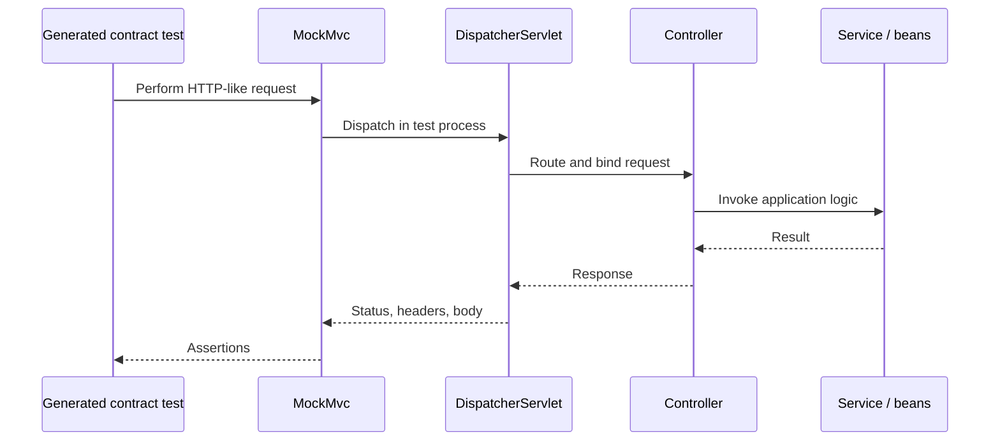
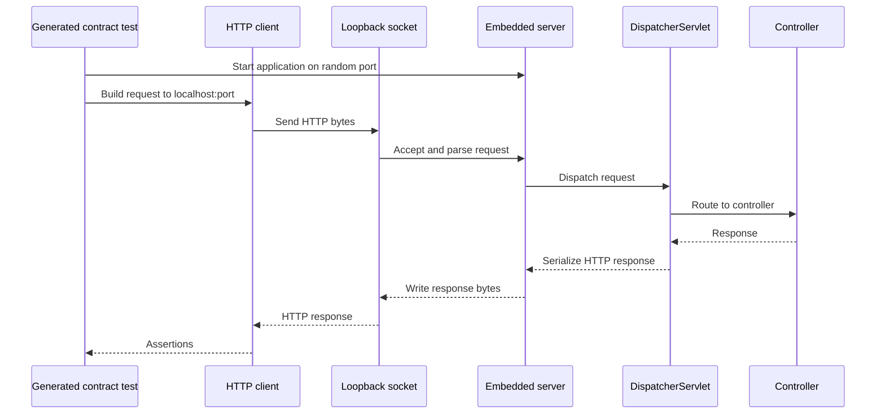
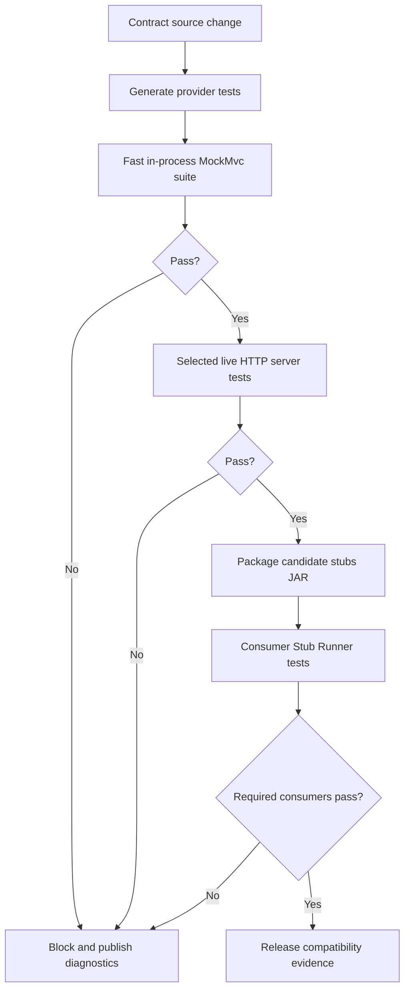

# Chọn chạy verifier trong tiến trình hay qua ứng dụng thật

Khi dùng **Spring Cloud Contract (SCC)**, producer có thể xác minh contract bằng những test gọi trực tiếp Spring MVC trong cùng tiến trình, hoặc khởi động ứng dụng trên một cổng HTTP rồi gửi request qua mạng loopback. Hai cách đều có thể kiểm tra cùng một contract, nhưng chúng quan sát những lớp khác nhau của ứng dụng.

**Verifier chạy trong tiến trình** thường dùng **MockMvc**: test gửi request qua Spring MVC test infrastructure mà không mở socket HTTP. Cách này nhanh, thuận tiện cho phần lớn request/response contracts và dễ chuẩn bị fixture. **Verifier qua ứng dụng đang chạy** thường khởi động embedded server trên cổng ngẫu nhiên rồi gửi HTTP thật bằng REST Assured hoặc client tương ứng. Cách này kiểm tra thêm server/container và đường đi HTTP thực tế trong ứng dụng.

Bài thuộc chương **Lựa chọn chiến lược**, với chủ đề **Chọn chạy verifier trong tiến trình hay qua ứng dụng thật**. Bài giúp chọn test mode theo rủi ro cần kiểm tra, cấu hình base class, phân biệt giới hạn của MockMvc với live HTTP server, xử lý WebTestClient, và tổ chức CI theo nhiều lớp. Ví dụ xuyên suốt là producer **order-producer** cung cấp **GET /api/orders/1001** cho **checkout-consumer**.

**Không có một mode tốt nhất cho mọi contract.** Hãy dùng mode nhanh để xác minh behavior ở Spring MVC, và dùng live server tests cho những rủi ro chỉ xuất hiện khi ứng dụng thực sự lắng nghe HTTP.

## 1. Hai cách chạy verifier khác nhau ở đâu?

### 1.1. In-process với MockMvc

Trong mode MockMvc, generated provider test gửi request qua Spring MVC test infrastructure:



Request được mô phỏng trong cùng JVM. Spring MVC vẫn thực hiện routing, argument binding, validation, controller advice và các thành phần web được cấu hình trong test context. Tuy nhiên, request **không đi qua TCP socket và embedded servlet container như một HTTP client bên ngoài**.

### 1.2. Live HTTP với embedded server

Với live server mode, test khởi động ứng dụng bằng embedded container, lấy cổng thực tế rồi gửi request qua HTTP:



Ứng dụng vẫn có thể chạy trong cùng JVM với test; “live” ở đây nghĩa là **đã khởi động server và gửi HTTP qua socket**, không nhất thiết phải triển khai ứng dụng sang một máy hoặc container độc lập.

### 1.3. So sánh nhanh

| Khía cạnh | In-process MockMvc | Live HTTP server |
| --- | --- | --- |
| Có khởi động Spring context | Có, theo test configuration | Có |
| Có embedded server/socket | Không | Có |
| Đi qua DispatcherServlet/controller | Có | Có |
| Kiểm tra request parsing của container | Không đầy đủ | Có |
| Kiểm tra port binding | Không | Có |
| Kiểm tra serialization qua HTTP stack | Qua Spring MVC test response | Qua HTTP client/server |
| Kiểm tra TLS thực | Không | Chỉ khi test server được cấu hình TLS |
| Tốc độ | Thường nhanh hơn | Thường chậm hơn |
| Độ nhạy với port/network | Thấp | Cao hơn |
| Phù hợp với | Nhiều contract cases, feedback nhanh | Behavior phụ thuộc server/HTTP stack |

Cả hai đều có thể kiểm tra controller behavior. Điểm khác là **mức độ hạ tầng HTTP được đưa vào bài test**.

## 2. Chọn mode theo câu hỏi cần trả lời

Hãy bắt đầu từ rủi ro cụ thể:

| Câu hỏi | Mode thường phù hợp |
| --- | --- |
| Controller có trả status/body/header theo contract? | MockMvc thường đủ |
| Bean Validation và ControllerAdvice có hoạt động? | MockMvc nếu test context nạp đúng thành phần |
| Security filter chain trong Spring MVC có chặn request? | MockMvc với filters được bật; live server nếu cần kiểm tra thêm server stack |
| Ứng dụng có bind được cổng và nhận request HTTP? | Live HTTP server |
| Context path, servlet container parsing hoặc multipart thực tế có đúng? | Live HTTP server |
| HTTP client/server serialization có đúng qua socket? | Live HTTP server |
| Reverse proxy/gateway có rewrite header/path đúng? | Test gateway hoặc môi trường tích hợp tương ứng |
| TLS/mTLS handshake có đúng? | HTTPS live server hoặc transport integration test |
| Broker delivery/ack/retry có đúng? | Messaging/broker integration test, không phải HTTP verifier mode |

### 2.1. Một quy tắc lựa chọn thực tế

- Chọn **MockMvc** làm mặc định cho phần lớn provider HTTP contracts nếu mục tiêu là behavior ở Spring MVC.
- Chọn **live HTTP** khi contract hoặc rủi ro phụ thuộc embedded server, request parsing, port, context path hoặc HTTP transport.
- Dùng **cả hai có chủ đích** nếu một số behavior quan trọng cần kiểm tra ở cả hai lớp.
- Dùng integration tests riêng cho gateway, TLS, broker và các thành phần nằm ngoài process của producer.

Không cần chạy toàn bộ hàng trăm contract cases bằng live server chỉ để tăng cảm giác “thật”. Nếu chúng chỉ kiểm tra controller response, chi phí startup và độ flaky có thể không tạo thêm bằng chứng đáng kể.

## 3. MockMvc không phải unit test của controller

Một hiểu nhầm thường gặp là gọi MockMvc đồng nghĩa với test một controller đơn lẻ. Điều đó phụ thuộc test context.

Với **@SpringBootTest** và **@AutoConfigureMockMvc**, ứng dụng Spring context có thể được nạp đầy đủ; request đi qua Spring MVC và gọi các bean thật được cấu hình. Nếu base test thay một số dependency bằng mock, những dependency đó không còn là implementation thật.

MockMvc có thể kiểm tra:

- Handler mapping và route.
- Binding path/query/header/body vào method arguments.
- Jackson conversion theo cấu hình MVC được nạp.
- Bean Validation.
- Controller advice và exception mapping.
- Servlet filters được đăng ký vào MockMvc.
- Spring Security filter chain nếu test cấu hình và nạp nó đúng.
- Response status, headers và body.

MockMvc không kiểm tra embedded server nhận byte từ socket, TCP behavior, TLS handshake, reverse proxy hay deployment network.

### 3.1. Base class MockMvc mẫu

Ví dụ base class cho generated provider tests:

```java
package com.example.order.contract;

import io.restassured.module.mockmvc.RestAssuredMockMvc;
import org.junit.jupiter.api.BeforeEach;
import org.springframework.beans.factory.annotation.Autowired;
import org.springframework.boot.test.autoconfigure.web.servlet.AutoConfigureMockMvc;
import org.springframework.boot.test.context.SpringBootTest;
import org.springframework.test.web.servlet.MockMvc;

@SpringBootTest
@AutoConfigureMockMvc(addFilters = true)
public abstract class OrderContractBase {

    @Autowired
    private MockMvc mockMvc;

    @BeforeEach
    void configureContractTest() {
        RestAssuredMockMvc.mockMvc(mockMvc);
    }
}
```

Đây là ví dụ cho generated tests dùng **RestAssuredMockMvc** và JUnit Jupiter. Package/API import có thể khác theo Spring Boot và SCC version của dự án.

### 3.2. Vì sao bật filters quan trọng?

**@AutoConfigureMockMvc(addFilters = true)** yêu cầu MockMvc đăng ký các servlet filters trong application context. Nếu vô tình tắt filters, provider contract test có thể pass dù production request bị Spring Security hoặc một filter khác chặn.

Tuy nhiên, bật filters cũng không tự xác minh mọi cấu hình security production. Hãy bảo đảm test nạp đúng SecurityFilterChain, test user/authorities và các dependency liên quan. Với JWT signature, issuer, audience hoặc authorization server, vẫn cần security integration tests có cấu hình phù hợp.

### 3.3. MockMvc không bảo vệ khỏi base class thiếu cấu hình

Generated test có thể biên dịch nhưng không sử dụng đúng MockMvc instance nếu base class chưa gán adapter, hoặc test context không nạp controller cần thiết. Khi test fail, xem generated class có kế thừa đúng base class, lifecycle setup có chạy và request có đến đúng handler hay không.

## 4. Live server: kiểm tra ứng dụng qua HTTP thật trong test

Live server test khởi động ứng dụng với embedded container. Trong Spring Boot, một lựa chọn phổ biến là:

```java
@SpringBootTest(
    webEnvironment = SpringBootTest.WebEnvironment.RANDOM_PORT
)
public abstract class OrderLiveHttpContractBase {
    // Cấu hình HTTP client tới cổng ngẫu nhiên của ứng dụng.
}
```

Cổng ngẫu nhiên giúp nhiều test process tránh tranh chấp một cổng cố định. Test cần lấy port được cấp bởi Spring Boot và cấu hình HTTP client tương ứng.

### 4.1. Base class với REST Assured

Ví dụ minh họa:

```java
package com.example.order.contract;

import io.restassured.RestAssured;
import org.junit.jupiter.api.BeforeEach;
import org.springframework.boot.test.context.SpringBootTest;
import org.springframework.boot.test.web.server.LocalServerPort;

@SpringBootTest(
    webEnvironment = SpringBootTest.WebEnvironment.RANDOM_PORT
)
public abstract class OrderLiveHttpContractBase {

    @LocalServerPort
    private int port;

    @BeforeEach
    void configureHttpClient() {
        RestAssured.baseURI = "http://localhost";
        RestAssured.port = port;
    }
}
```

Import **LocalServerPort** phụ thuộc Spring Boot version. Với các bản cũ, package của annotation có thể khác; hãy dùng API thuộc version dự án.

Nếu generated test dùng REST Assured explicit HTTP mode, base class cần cấu hình base URI, port, authentication hoặc các request defaults theo setup thực tế. Đừng giả định **@SpringBootTest** tự làm cho mọi generated test biết cổng server.

### 4.2. Điều live server giúp phát hiện

- Ứng dụng có khởi động được trong profile test không.
- Embedded servlet container có bind cổng thành công không.
- Request line, headers và body có được container parse như dự kiến.
- Context path và servlet mapping có hoạt động.
- Compression, multipart và một số HTTP behavior phụ thuộc container có đúng.
- HTTP client gửi request qua socket có nhận status/headers/body phù hợp.
- Các filter/interceptor được cấu hình trong ứng dụng thực có tham gia request.

### 4.3. Điều live server vẫn chưa chứng minh

Nếu test gọi **localhost** trực tiếp, nó vẫn có thể bỏ qua:

- API gateway và reverse proxy production.
- Service discovery và DNS nội bộ.
- Network policy, firewall và ingress.
- TLS termination ở load balancer.
- Identity provider hoặc secret manager production.
- Broker, database hoặc dependency bên ngoài chưa được dựng trong test.

**Live server test có độ trung thực HTTP cao hơn MockMvc, nhưng không đồng nghĩa end-to-end production test.**

## 5. Cấu hình SCC test mode: kiểm tra đúng plugin version

SCC hỗ trợ nhiều kiểu generated test tùy phiên bản plugin và framework. Các mode thường gặp gồm:

- **MockMvc:** generated tests dùng Spring MockMvc adapter.
- **EXPLICIT:** generated tests gọi HTTP endpoint được cấu hình rõ, thường qua REST Assured.
- **WebTestClient:** dùng WebTestClient theo cách binding phù hợp.
- **JAX-RS:** dùng adapter JAX-RS trong những cấu hình được hỗ trợ.

Tên mode, chữ hoa/thường, plugin property và dependency requirements có thể khác giữa các thế hệ SCC. Trước khi đổi cấu hình, đọc tài liệu của **đúng SCC plugin version** và xem các test class đã sinh ra.

### 5.1. Ví dụ Maven cấu hình MockMvc

Ví dụ cấu hình ý tưởng:

```xml
<plugin>
    <groupId>org.springframework.cloud</groupId>
    <artifactId>spring-cloud-contract-maven-plugin</artifactId>
    <configuration>
        <testMode>MockMvc</testMode>
        <baseClassForTests>
            com.example.order.contract.OrderContractBase
        </baseClassForTests>
    </configuration>
</plugin>
```

Đây là snippet cấu hình minh họa; version plugin, phase, dependencies và các thuộc tính khác cần theo build hiện tại. Mục tiêu là generated provider tests dùng MockMvc và kế thừa base class đã chuẩn bị.

### 5.2. Ví dụ Maven cấu hình explicit HTTP

Nếu muốn generated tests gửi request qua HTTP server:

```xml
<plugin>
    <groupId>org.springframework.cloud</groupId>
    <artifactId>spring-cloud-contract-maven-plugin</artifactId>
    <configuration>
        <testMode>EXPLICIT</testMode>
        <baseClassForTests>
            com.example.order.contract.OrderLiveHttpContractBase
        </baseClassForTests>
    </configuration>
</plugin>
```

Mode explicit chỉ tạo test client phù hợp; **base class và test application vẫn phải khởi động server, lấy port và cấu hình endpoint**. Xem generated source để xác nhận request thực sự được gửi qua HTTP thay vì một adapter in-process.

### 5.3. Với Gradle

SCC Gradle plugin cũng có cấu hình cho test mode và base class, nhưng DSL/property cụ thể phụ thuộc plugin version. Đừng sao chép tên thuộc tính Maven sang Gradle một cách máy móc.

Quy trình kiểm tra:

1. Xác định version SCC Gradle plugin đang dùng.
2. Đọc plugin DSL của version đó.
3. Kiểm tra task generation và test source set.
4. Generate một contract nhỏ.
5. Mở generated test để xác nhận adapter thực tế.
6. Chạy test và xem report để chứng minh nó được thực thi.

Tên task như **generateContractTests**, **contractTest** hoặc task đóng gói stubs có thể thay đổi theo version/plugin setup. Xác nhận bằng **./gradlew tasks --all** thay vì đoán.

## 6. Một contract mẫu dùng để so sánh hai mode

Groovy DSL:

```groovy
import org.springframework.cloud.contract.spec.Contract

Contract.make {
    description 'Đọc đơn hàng 1001'

    request {
        method GET()
        url '/api/orders/1001'
        headers {
            header('Accept', 'application/json')
        }
    }

    response {
        status OK()
        headers {
            contentType(applicationJson())
        }
        body(
            id: 1001,
            status: 'CREATED',
            currency: 'VND'
        )
    }
}
```

YAML DSL tương đương:

```yaml
description: "Đọc đơn hàng 1001"
request:
  method: GET
  url: /api/orders/1001
  headers:
    Accept: application/json
response:
  status: 200
  headers:
    Content-Type: application/json
  body:
    id: 1001
    status: CREATED
    currency: VND
```

Cùng contract source có thể được dùng để sinh provider tests theo mode phù hợp. Khi so sánh, giữ nguyên contract, fixtures và producer revision; chỉ thay test mode để biết sự khác biệt đến từ adapter hay implementation.

### 6.1. Assertions cần giống nhau ở cả hai mode

- Method và path đúng.
- Header request được gửi.
- Status response đúng.
- Content-Type đúng.
- Body field và kiểu dữ liệu đúng.
- Matcher động vẫn được thực thi.
- Error response quan trọng vẫn được xác minh.

Nếu MockMvc pass nhưng live HTTP fail, điều đó không tự chứng minh contract sai. Có thể server/container, context path, serialization, filter, port hoặc client setup khác nhau. Hãy dùng cùng một bộ assertions và tìm lớp phát sinh sai lệch.

## 7. WebTestClient: có thể in-process hoặc live server

WebTestClient là một HTTP client test API có thể được binding theo nhiều cách. Vì vậy **không nên phân loại mọi WebTestClient test là live server**.

Các kiểu binding thường gặp trong Spring testing:

| Cách binding | Đường đi | Ý nghĩa |
| --- | --- | --- |
| bindToController | Web test infrastructure gắn trực tiếp controller | Phạm vi hẹp |
| bindToApplicationContext | Qua WebFlux application context | In-process |
| bindToServer | Gửi request tới server đang chạy | Live HTTP |
| bindToServer với baseUrl | Client gọi URL server được cấu hình | Live HTTP |

SCC WebTestClient mode và cách generated test/base class khởi tạo client cần được xác minh theo plugin version. Chỉ thấy import WebTestClient chưa đủ kết luận test có dùng socket hay không.

### 7.1. Khi nào WebTestClient hữu ích?

- Ứng dụng dùng Spring WebFlux.
- Provider tests cần reactive client API.
- Muốn kiểm tra reactive request/response flow.
- Có thể binding vào application context để test nhanh.
- Hoặc binding vào server để kiểm tra HTTP transport thật.

Với WebFlux, in-process WebTestClient và live server WebTestClient vẫn có mức độ bao phủ khác nhau. Chọn binding theo rủi ro cần kiểm chứng.

## 8. So sánh tốc độ, độ tin cậy và phạm vi

| Tiêu chí | MockMvc | Live HTTP |
| --- | --- | --- |
| Startup | Thường ít overhead hơn sau khi context sẵn sàng | Phải khởi động embedded server |
| Request transport | Mock servlet request/response | HTTP qua socket |
| Container behavior | Không đầy đủ | Có |
| Port allocation | Không cần port server | Cần port |
| Parallel execution | Ít xung đột port | Cần cổng động và lifecycle rõ |
| Debug request | MockMvc result/log | HTTP client/server logs, port và wire behavior |
| TLS | Không phải transport test | Có thể kiểm tra nếu cấu hình HTTPS |
| Proxy/gateway | Không | Chỉ khi test thực sự đi qua proxy/gateway |
| Flakiness | Thường thấp hơn | Có thêm startup/network/timing failure |
| Contract case volume | Phù hợp chạy nhiều cases | Nên chọn lọc theo giá trị |

**Nhanh hơn không có nghĩa kiểm thử tốt hơn; gần production hơn cũng không có nghĩa luôn cần thiết.** Mục tiêu là chọn mức fidelity phù hợp với từng rủi ro.

## 9. Những trường hợp MockMvc thường đủ

MockMvc thường là lựa chọn hợp lý khi:

1. Contract bảo vệ request mapping, body binding và response.
2. Producer là Spring MVC application.
3. Không cần kiểm tra socket/container-specific behavior.
4. Các filters và MVC components cần thiết đã được nạp.
5. Test base chuẩn bị dependencies theo cách ổn định.
6. Muốn chạy nhiều generated tests nhanh trong mỗi pull request.

Ví dụ: consumer phụ thuộc status, currency, response status và Content-Type của GET /api/orders/1001. Nếu các yếu tố này được tạo trong Spring MVC layer, MockMvc thường kiểm tra đúng mục tiêu.

### 9.1. Không cần live server chỉ để “giống production”

Nếu test chỉ kiểm tra controller trả JSON đúng, khởi động Tomcat/Jetty/Undertow có thể chỉ thêm thời gian. Chỉ thêm live server khi có giả thuyết cụ thể rằng container/HTTP path có thể làm thay đổi kết quả.

## 10. Những trường hợp live HTTP đáng đầu tư

Live HTTP có giá trị khi contract hoặc implementation phụ thuộc vào:

- server.servlet.context-path hoặc servlet path.
- Container request parsing và header limits.
- Multipart hoặc streaming behavior thực tế.
- Compression/chunked transfer nếu ứng dụng dựa vào.
- Port binding và startup configuration.
- HTTP error handling ở server layer.
- Một số filter/container integration không thể mô phỏng tương đương trong MockMvc.
- Client/server behavior liên quan socket và connection.
- Embedded server SSL configuration, nếu test được thiết kế để kiểm tra TLS.

### 10.1. Live server không tự kiểm tra ingress production

Nếu production có Nginx, Kubernetes Ingress, API gateway hoặc service mesh, test localhost không đi qua các thành phần đó. Cần một integration environment riêng hoặc test proxy/gateway với cấu hình tương ứng.

### 10.2. Chọn test theo rủi ro, không theo số lượng

Có thể chạy tất cả provider contracts bằng MockMvc và chỉ một nhóm live HTTP smoke contracts cho các endpoints nhạy với context path, multipart hoặc server configuration. Cách này cân bằng feedback nhanh với kiểm chứng hạ tầng.

## 11. Security filters: điểm cần đặc biệt chú ý

MockMvc có thể chạy servlet filters nếu cấu hình đúng. Nhưng một base class vô tình bỏ filter sẽ tạo ra provider verification xanh giả.

Ví dụ:

```java
@SpringBootTest
@AutoConfigureMockMvc(addFilters = true)
public abstract class SecuredOrderContractBase {
    // Nạp SecurityFilterChain và fixture identity phù hợp.
}
```

Các câu hỏi cần trả lời:

- SecurityFilterChain nào được nạp?
- Request có gửi Authorization header theo contract không?
- Test principal/authorities được chuẩn bị như thế nào?
- CSRF có áp dụng cho method cần bảo vệ không?
- Có filter tenant/correlation ID không?
- Có custom servlet filter chỉ được đăng ký trong embedded container không?

Live HTTP test có thể kiểm tra thêm container integration, nhưng nếu cả hai mode đều dùng cùng test profile bỏ qua security thì live server cũng không cứu được coverage.

### 11.1. Tách xác minh auth thật khỏi matcher header

Một SCC contract có Authorization header hoặc WireMock mapping match header chỉ chứng minh request có header phù hợp. Nó không chứng minh JWT signature, issuer, audience, scope hoặc permission thật được kiểm tra.

Với auth behavior quan trọng, viết Spring Security integration tests và dùng test token/key phù hợp.

## 12. Database, message broker và external dependencies

Dù chọn MockMvc hay live HTTP, provider verification vẫn có thể dùng mock/stub cho database hoặc external dependencies. Vì vậy hai mode không tự quyết định **mức độ thật của dependency graph**.

| Dependency | Có thể dùng trong contract verification? | Khi nào cần integration test riêng? |
| --- | --- | --- |
| Service bean nội bộ | Thường dùng bean thật | Khi logic cần test sâu |
| Database | Có thể dùng test DB hoặc fixture | Transaction, locking, SQL, migration |
| External REST API | Có thể mock/stub | Khi cần xác minh integration với provider ngoài |
| Kafka/RabbitMQ | Message contract có thể dùng verifier/test binder | Broker delivery, ack, retry, ordering, DLQ |
| Identity provider | Có thể dùng test identity | OIDC/JWKS/network/issuer integration |
| Gateway | Thường nằm ngoài MockMvc và localhost app test | Route, auth, rate limit, rewrite |

Đừng đánh đồng **live HTTP server** với **live toàn bộ hệ thống**. Hai khái niệm có phạm vi rất khác.

## 13. Message contracts không được quyết định bởi HTTP test mode

SCC hỗ trợ cả HTTP và message contracts, nhưng lựa chọn MockMvc/EXPLICIT chủ yếu liên quan đến cách generated HTTP tests gọi producer endpoint. Message verification có lifecycle, trigger và message verifier riêng.

Ví dụ message contract:

```groovy
import org.springframework.cloud.contract.spec.Contract

Contract.make {
    description 'Producer phát OrderCreated'
    label 'order_created_v1'

    input {
        triggeredBy('publishOrderCreated()')
    }

    outputMessage {
        sentTo('orders.created')
        headers {
            messagingContentType(applicationJson())
        }
        body(
            eventId: 'EVT-1001',
            eventType: 'OrderCreated',
            schemaVersion: 1,
            orderId: 'ORD-1001'
        )
    }
}
```

Khi chọn cách chạy message verifier, hãy xem integration/binder đang dùng và liệu test có gọi producer trigger thật hay không. Một HTTP live server test không tự kiểm tra broker delivery. Nếu cần Kafka/RabbitMQ thật, dựng broker integration test riêng.

## 14. Cấu hình test data và môi trường cho hai mode

Cùng một contract nên nhận cùng fixture/assumptions khi so sánh hai mode:

- Test database được reset hoặc transaction được quản lý.
- Clock/timezone được cố định khi contract liên quan timestamp.
- Locale và serialization configuration thống nhất.
- Authentication fixture rõ ràng.
- External dependencies có response xác định.
- Random IDs được kiểm soát hoặc matcher phản ánh giá trị động.
- Không dùng dữ liệu production hoặc secrets thật.

### 14.1. In-process không có nghĩa không cần isolation

MockMvc test vẫn có thể chia sẻ Spring ApplicationContext, singleton beans, static state, database và message listener. Nếu test A thay đổi shared state, test B vẫn có thể fail. Cần quản lý fixture và lifecycle như các test khác.

### 14.2. Live HTTP cần quản lý port và cleanup

- Ưu tiên port ngẫu nhiên khi test framework hỗ trợ.
- Không hardcode cùng một port cho nhiều test process.
- Client phải dùng đúng port được cấp.
- Đóng server/context khi test kết thúc.
- Chờ background requests/retries hoàn tất trước cleanup.
- Không gọi một base URL cũ sau khi context đã restart.

## 15. Chẩn đoán khi MockMvc pass nhưng live HTTP fail

Đây là một dấu hiệu có giá trị vì hai mode đã cô lập được lớp khác nhau.

| Triệu chứng | Hướng điều tra |
| --- | --- |
| MockMvc 200, live HTTP 404 | Context path, servlet path, server route, client URL |
| MockMvc JSON đúng, live body khác | Message converters, serialization config, response filters |
| MockMvc pass, live 400 | HTTP parsing, content length, content type, request encoding |
| MockMvc pass, live 413 | Container/proxy request size limit |
| MockMvc pass, live timeout | Server startup, thread pool, blocking call, port/client |
| MockMvc pass, live 401/403 | Filter chain/profile/security config khác |
| MockMvc pass, live redirect | Context path, HTTPS redirect, forwarded headers |
| MockMvc pass, live connection refused | Server chưa start, port sai, startup failure |
| Live pass local, fail CI | Port collision, resource limits, environment/profile, parallelism |

### 15.1. Không sửa contract ngay khi live test fail

Trước tiên xác minh request có cùng method/path/headers/body ở cả hai mode không. Sau đó xem server log, resolved port, profile, filters và response thực tế.

Nếu live server trả 404 vì context-path là /orders, có thể contract đang gọi sai base path hoặc test client chưa cấu hình đúng. Điều đó không nhất thiết là API contract cần thay đổi.

## 16. Chẩn đoán khi cả hai mode đều pass nhưng production fail

Điều này có thể xảy ra nếu cả hai test mode cùng bỏ qua thành phần production:

- Gateway hoặc reverse proxy.
- TLS termination hoặc mTLS.
- Identity provider thật.
- External database hoặc broker.
- Service discovery.
- Network policy.
- Production-specific profile/configuration.

MockMvc và live embedded server đều có thể chạy cùng test profile với external dependencies giả. Cần so **đường đi thực tế của request production** với đường đi của test, rồi thêm integration test ở lớp thiếu.

## 17. Tổ chức CI theo nhiều lớp

Một pipeline thực tế có thể gồm:



Đây là một cách tổ chức pipeline; không phải SCC tự động tạo tất cả jobs.

### 17.1. Một chiến lược hai tầng

**Pull request feedback nhanh:**

- Generate contract tests.
- Chạy provider verifier bằng MockMvc.
- Kiểm tra số test thực thi, skipped và failures.
- Build stubs candidate.
- Chạy consumer tests bắt buộc với candidate nếu thời gian cho phép.

**CI/release hoặc scheduled pipeline:**

- Chạy live HTTP tests cho các behavior phụ thuộc embedded server.
- Chạy security/transport/gateway integration tests riêng.
- Chạy broker/message integration tests.
- Chạy consumer matrix đầy đủ.
- Lưu GAV/classifier/version/checksum và reports.

### 17.2. Đừng chạy cùng một suite live HTTP chỉ vì muốn tăng số test

Nếu một suite MockMvc đã kiểm tra controller behavior và không có rủi ro transport tương ứng, chạy toàn bộ suite lần nữa qua socket có thể làm pipeline chậm mà không tăng coverage đáng kể.

Hãy chọn live tests theo **risk register hoặc danh sách behavior cụ thể**.

## 18. So sánh kết quả hai mode một cách có kiểm soát

Khi quyết định chuyển mode hoặc bổ sung live test, giữ nguyên:

- Contract source revision.
- Producer source commit.
- Dependency versions.
- Test data/fixtures.
- Security profile.
- External dependency setup.
- Expected assertions.

Chỉ đổi cách generated test gọi producer. Sau đó so sánh:

| Bằng chứng | MockMvc | Live HTTP |
| --- | --- | --- |
| Contract cases discovered | Ghi số thực tế | Ghi số thực tế |
| Tests executed/skipped | Report | Report |
| Status/header/body assertions | PASS/FAIL | PASS/FAIL |
| Request path observed | MockMvc request | HTTP server request |
| Security filters | Cấu hình thực tế | Cấu hình thực tế |
| Startup/port | Không có server port | Có server port |
| Duration | Đo thực tế | Đo thực tế |
| Failures unique | Phân loại | Phân loại |

Nếu live test fail ở behavior mà MockMvc không thể quan sát, đó là bằng chứng cho việc cần giữ live test. Nếu cả hai luôn pass và không có rủi ro server-specific, có thể chỉ giữ MockMvc trong PR suite và chạy live smoke theo lịch hoặc release.

## 19. Những anti-pattern cần tránh

| Anti-pattern | Hậu quả | Cách xử lý |
| --- | --- | --- |
| Mặc định live HTTP cho mọi contract | CI chậm và nhiều lỗi môi trường | Chọn live tests theo rủi ro |
| Gọi MockMvc là unit test | Hiểu sai phạm vi Spring context | Mô tả rõ test context và filters |
| Tắt filters để provider test pass | Bỏ sót security behavior | Nạp filter chain hoặc tách security tests |
| Coi WebTestClient luôn là live | Phân loại sai mức fidelity | Xem binding thực tế |
| Hardcode port | Xung đột giữa tests/processes | Port ngẫu nhiên và truyền đúng URL |
| Generated test không kế thừa base class đúng | Setup client/server không chạy | Kiểm tra generated source |
| Chỉ generate, không execute | Không có verification evidence | Gate trên test reports |
| MockMvc pass nên bỏ E2E | Bỏ sót gateway/network/broker | Giữ integration/E2E smoke cần thiết |
| Live server pass nên coi TLS đã test | Test có thể đang dùng HTTP thuần | Cấu hình HTTPS và kiểm tra handshake |
| Chạy message contract bằng HTTP mode | Dùng sai verifier lifecycle | Cấu hình message verifier/binder riêng |

## 20. Checklist lựa chọn mode cho một service

Trước khi cấu hình, trả lời:

1. Contract đang bảo vệ controller behavior hay HTTP server behavior?
2. Ứng dụng dùng Spring MVC hay WebFlux?
3. Generated tests hiện dùng adapter nào?
4. Base class đã gán đúng MockMvc/WebTestClient/REST Assured chưa?
5. Filters và Spring Security có cần tham gia không?
6. Có context path, servlet path hoặc container behavior đặc thù không?
7. Có yêu cầu kiểm tra socket, HTTPS hoặc multipart không?
8. External gateway/proxy có nằm trong phạm vi không?
9. Test có thể lấy port động và cleanup an toàn không?
10. CI có đủ tài nguyên cho live server startup không?
11. Có message contracts cần binder/verifier riêng không?
12. Test reports có chứng minh các generated tests thực sự chạy không?

### 20.1. Decision guide

| Nếu mục tiêu chính là… | Chọn trước |
| --- | --- |
| Kiểm tra Spring MVC mapping, binding, response | MockMvc |
| Kiểm tra MVC filters trong test context | MockMvc với filters đúng |
| Kiểm tra embedded container và HTTP socket | Live HTTP |
| Kiểm tra context path hoặc parsing phụ thuộc server | Live HTTP |
| Kiểm tra TLS/mTLS | HTTPS transport integration |
| Kiểm tra WebFlux in-process | WebTestClient bind application context |
| Kiểm tra WebFlux qua server | WebTestClient bind server |
| Kiểm tra broker delivery | Broker integration tests |
| Kiểm tra gateway/ingress | Gateway/environment integration tests |

## 21. Bài thực hành: cùng một contract chạy ở hai mode

Chuẩn bị producer Spring Boot có endpoint **GET /api/orders/1001**, SCC plugin và JUnit Jupiter. Sử dụng cùng contract source trong hai nhánh build hoặc hai cấu hình test riêng.

1. Viết Groovy contract với request **Accept: application/json**.
2. Khai báo response **200**, **Content-Type** và body **id/status/currency**.
3. Tạo MockMvc base class với **@SpringBootTest** và **@AutoConfigureMockMvc(addFilters = true)**.
4. Cấu hình SCC generated tests dùng MockMvc theo plugin version.
5. Generate provider tests và xác nhận class kế thừa đúng base class.
6. Chạy test và lưu số tests executed, skipped và duration.
7. Chuyển sang explicit/live HTTP test mode được plugin hỗ trợ.
8. Dùng **RANDOM_PORT** và lấy port được cấp cho test client.
9. Xác minh generated tests gửi request qua HTTP client thật.
10. Giữ nguyên contract, producer commit và fixtures; chạy lại suite.
11. So status, headers, body và test reports giữa hai mode.
12. Thêm **server.servlet.context-path** trong test profile; xác minh live client URL được cấu hình đúng.
13. Tạm tắt một filter quan trọng trong nhánh thử; xác định test nào phát hiện behavior thay đổi.
14. Gửi request có body/content type sai để so sánh lỗi parse ở hai mode.
15. Nếu dùng WebFlux, tạo một test WebTestClient bind application context và một test bind live server.
16. Xác định test nào cần HTTPS/mTLS và viết transport integration test riêng nếu cần.
17. Xác định message contract **OrderCreated** và cấu hình message verifier/binder riêng.
18. Tạo một nhóm live HTTP smoke tests nhỏ cho behavior phụ thuộc container.
19. Đo thời gian chạy hai suite trong CI và ghi failure modes.
20. Viết decision record nêu mode mặc định, trường hợp ngoại lệ và owner.
21. Chạy candidate stubs/consumer tests để giữ bằng chứng compatibility phía consumer.
22. Lưu test reports, plugin version, producer commit và artifact identity.

### 21.1. Bảng tự đánh giá

| Năng lực | Bằng chứng đạt |
| --- | --- |
| Phân biệt mode | Giải thích được MockMvc và live HTTP |
| MockMvc | Generated test gọi đúng adapter và filters |
| Live server | Server khởi động, port động và HTTP client đúng |
| Plugin configuration | Xác nhận testMode theo version thực |
| WebTestClient | Phân biệt application-context binding và server binding |
| Security | Không bỏ qua filter chain quan trọng |
| Transport | Biết khi nào cần HTTPS/TLS integration |
| Messaging | Không nhầm HTTP mode với message verifier |
| CI | Có test count, reports và live tests chọn lọc |
| Decision | Chọn mode theo rủi ro và chi phí |

## 22. Kết luận: chọn mức fidelity vừa đủ cho behavior cần bảo vệ

**MockMvc** phù hợp cho phần lớn provider contract tests tập trung vào Spring MVC behavior: method, path, binding, validation, response status, headers và body. Nó thường nhanh, ít phụ thuộc port/network và phù hợp làm feedback mặc định trong pull request.

**Live HTTP server tests** đáng dùng khi cần xác minh embedded container, request parsing, port, context path, HTTP client/server interaction hoặc cấu hình chỉ xuất hiện khi ứng dụng thực sự lắng nghe request. Chúng có chi phí startup và vận hành cao hơn, nên chọn theo rủi ro cụ thể.

Khi quyết định:

1. **Xác định lớp cần kiểm tra:** MVC behavior hay HTTP server/transport behavior.
2. **Xác minh generated test thực tế:** đừng chỉ tin cấu hình plugin; mở source và xem adapter.
3. **Giữ base class đúng:** filters, port, client và fixtures phải được cấu hình có chủ đích.
4. **Tách các lớp ngoài phạm vi:** gateway, TLS, broker, database và E2E cần tests phù hợp.
5. **Đo chi phí và bằng chứng:** chỉ giữ live tests khi chúng phát hiện rủi ro mà in-process tests không thể bao phủ.

Một pipeline tốt có thể dùng **MockMvc cho phần lớn contract cases, live HTTP cho các behavior chọn lọc, và integration tests cho transport/hạ tầng bên ngoài**. Mục tiêu là có feedback nhanh mà vẫn kiểm chứng đúng những gì consumer phụ thuộc khi producer được triển khai thật.
