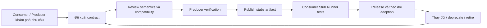
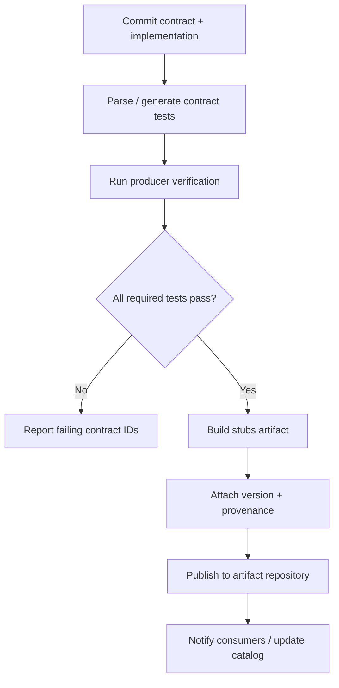

# Đánh giá chi phí phối hợp và duy trì hợp đồng

## 1. Vì sao phải tính chi phí trước khi mở rộng contract testing?

**Spring Cloud Contract (SCC)** giúp các nhóm producer và consumer thống nhất hành vi HTTP hoặc thông điệp bằng Groovy/YAML DSL. Từ hợp đồng, nhóm có thể sinh **producer verification tests**, đóng gói và phát hành **stubs artifacts**, dùng **Stub Runner** trong consumer tests, rồi tích hợp các bước này vào CI để phát hiện thay đổi API không tương thích.

Khi chỉ có một producer và một consumer, quy trình thường khá gọn: hai nhóm thống nhất một contract, producer xác minh implementation, consumer dùng stub để phát triển độc lập. Nhưng khi hệ thống có hàng chục producer, hàng trăm consumer và nhiều nhóm phát hành độc lập, chi phí không còn nằm chủ yếu ở việc viết vài dòng Groovy/YAML. Chi phí thực sự nằm ở:

- **Phối hợp:** ai đề xuất, ai review, ai phê duyệt và ai chịu trách nhiệm khi contract thay đổi?
- **Duy trì:** contract có còn phản ánh API thật sau nhiều lần release không?
- **Tích hợp:** producer verification, stubs publishing và consumer tests có chạy ổn định không?
- **Quản trị phiên bản:** consumer nào còn dùng contract cũ, producer nào được phép xóa behavior cũ?
- **Chẩn đoán:** khi CI đỏ, nhóm có phân biệt được lỗi implementation, contract, artifact hay môi trường không?

Một tổ chức có thể đạt tỷ lệ contract test rất cao nhưng vẫn tốn nhiều công sức nếu tạo quá nhiều contract ít giá trị, phải đồng bộ thủ công giữa nhiều nhóm hoặc thường xuyên sửa tests vì chi tiết nội bộ không ổn định.

**Mục tiêu của bài:** xây dựng cách đánh giá chi phí phối hợp và duy trì hợp đồng, chọn chiến lược contract phù hợp với mức độ rủi ro/phụ thuộc, ước lượng effort theo vòng đời và thiết kế quy trình SCC vừa đủ để kiểm soát thay đổi API mà không tạo gánh nặng vận hành không cần thiết.

## 2. Phân biệt chi phí tạo hợp đồng và chi phí sở hữu hợp đồng

Chi phí contract testing có ít nhất hai nhóm:

1. **Chi phí ban đầu:** khám phá API, viết contract, tạo producer base class, cấu hình verifier, dựng consumer tests và tích hợp registry.
2. **Chi phí lặp lại:** review thay đổi, chạy pipeline, phát hành stubs, hỗ trợ consumer migration, xử lý test flakiness, dọn contract cũ và cập nhật dependency/tooling.

Một hợp đồng có thể mất ít thời gian để viết nhưng rất đắt để duy trì nếu nó bao phủ một response thay đổi liên tục, có nhiều consumer phụ thuộc hoặc được dùng làm ranh giới phát hành cho nhiều nhóm.

### Vòng đời và chủ thể phát sinh chi phí



| Giai đoạn | Chi phí chính | Ai thường tham gia? |
| --- | --- | --- |
| Khám phá nhu cầu | Xác định consumer thực sự dùng field, status, event | Consumer, product/domain owner |
| Đề xuất contract | Viết DSL, examples, matchers, error cases | Consumer hoặc producer |
| Review | Thống nhất semantics, security, compatibility, approval | Cả hai nhóm |
| Producer verification | Base class, generated tests, sửa implementation | Producer |
| Publish stubs | Build, version, registry, provenance | Producer/platform |
| Consumer verification | Stub Runner setup, client assertions, test fixtures | Consumer |
| Adoption | Theo dõi version, migration, compatibility window | Consumer + producer |
| Retire | Xóa contract/mapping cũ và kiểm tra không còn consumer | Producer/platform |

**Không nên tính effort chỉ bằng số lượng file Groovy hoặc YAML.** Một contract nhỏ nhưng có 15 consumers và hai transport có thể tốn nhiều công phối hợp hơn mười contract nội bộ chỉ có một consumer.

## 3. Các chiến lược quản lý hợp đồng

SCC là công cụ thực thi contract tests; **chiến lược sở hữu và phối hợp** cần được tổ chức lựa chọn. Có thể kết hợp các cách sau:

| Chiến lược | Ai khởi xướng? | Ưu điểm | Chi phí/rủi ro |
| --- | --- | --- | --- |
| **Consumer-driven contracts (CDC)** | Consumer mô tả những gì mình cần | Hạn chế over-contract; producer thấy nhu cầu thật | Nhiều consumers có thể tạo yêu cầu chồng lặp hoặc mâu thuẫn |
| **Producer/provider-owned contracts** | Producer công bố behavior được hỗ trợ | Tập trung ownership, dễ kiểm soát API surface | Có nguy cơ mô tả những gì producer muốn cung cấp nhưng consumer không dùng |
| **Jointly-owned contracts** | Producer và consumer cùng review/đồng thuận | Tăng chất lượng semantics, giảm hiểu sai | Review có thể chậm nếu cần đồng bộ nhiều nhóm |
| **Contract catalog/central governance** | Platform/API governance duy trì quy ước và catalog | Có khả năng quan sát toàn hệ thống, version và ownership | Dễ trở thành bottleneck nếu mọi thay đổi phải xin một nhóm trung tâm |
| **Hybrid** | Consumer đề xuất, producer xác nhận; platform tự động hóa quy tắc | Cân bằng ownership và chuẩn hóa | Cần ranh giới trách nhiệm rõ ràng |

### Consumer-driven không có nghĩa consumer tự quyết định API

Consumer có thể viết contract mô tả **request/response thực sự phụ thuộc**. Producer vẫn chịu trách nhiệm xác nhận behavior đó phù hợp domain, security, performance và API roadmap. Contract không được biến thành yêu cầu buộc producer duy trì mọi assumption vô lý của một client.

### Producer-owned không có nghĩa producer kiểm tra được mọi consumer

Producer verification chứng minh implementation phù hợp các contract mà producer quản lý. Nó không tự chứng minh mọi consumer deserialize được response, xử lý error đúng hoặc không phụ thuộc vào một field ngoài contract. Consumer tests vẫn cần xác nhận cách client sử dụng stub.

### Chọn hybrid khi hệ thống có nhiều nhóm độc lập

Một mô hình thường cân bằng:

1. Consumer ghi nhận các request/response/event mà nó thực sự dùng.
2. Producer review semantics và xác nhận khả năng cung cấp.
3. Producer chạy Contract Verifier trên implementation.
4. Producer phát hành stubs artifact bất biến.
5. Consumer dùng đúng version stub trong tests.
6. Platform team cung cấp BOM, plugin template, registry, CI conventions và dashboard.

Platform team **hỗ trợ đường đi chuẩn**, không cần duyệt thủ công từng thay đổi business contract nếu policy đã rõ và automation có đủ bằng chứng.

## 4. Chi phí phối hợp tăng theo số quan hệ, không chỉ số service

Giả sử có P producer và C consumer. Nếu mọi consumer có thể phụ thuộc vào mọi producer, số quan hệ tối đa là:

\[
R_{\max}=P\times C
\]

Trong hệ thống thực tế, chỉ một phần các cặp có kết nối. Gọi E là số quan hệ producer–consumer đang tồn tại; E thường là chỉ số hữu ích hơn tổng số service.

Ví dụ:

| Mô hình | Producer | Consumer | Quan hệ thực tế | Nhận xét |
| --- | ---: | ---: | ---: | --- |
| Nhỏ | 2 | 3 | 3 | Dễ phối hợp trực tiếp |
| Vừa | 8 | 12 | 20 | Cần ownership và artifact version rõ |
| Lớn | 20 | 50 | 140 | Cần catalog, automation và adoption tracking |
| Dày đặc | 20 | 50 | 600 | Chi phí thay đổi liên nhóm rất cao nếu phụ thuộc chéo |

Các con số là **ví dụ giả định**, không phải benchmark chung. Hai hệ thống cùng có 20 producers và 50 consumers có thể có effort rất khác nhau nếu một hệ thống có 140 quan hệ còn hệ thống kia có 600.

### Một thay đổi producer có thể lan tới nhiều consumer

Nếu producer thay đổi response field hoặc event schema, chi phí phối hợp phụ thuộc:

- Bao nhiêu consumers đang dùng field/event đó?
- Consumer nào đang chạy version cũ?
- Thay đổi có backward-compatible không?
- Có consumer nào ngoài catalog hoặc đối tác bên ngoài không?
- Có thể phát hành song song version cũ và mới không?
- Thời gian hỗ trợ version cũ được cam kết bao lâu?

**Số consumers bị ảnh hưởng** thường dự báo effort migration tốt hơn số file contract của producer.

## 5. Những yếu tố quyết định chi phí duy trì

| Yếu tố | Chi phí tăng khi | Cách kiểm soát |
| --- | --- | --- |
| **Tần suất thay đổi API** | Field/status/event đổi thường xuyên | Tách contract stable khỏi experiment; versioning |
| **Số consumer** | Nhiều team/release cycles khác nhau | Consumer inventory, compatibility window |
| **Mức độ coupling** | Consumer phụ thuộc field nội bộ hoặc thứ tự không được cam kết | Contract semantics, schema discipline |
| **Độ phức tạp matcher** | Regex/JSONPath quá rộng hoặc quá phức tạp | Match đúng điều consumer cần; review examples |
| **Số transport** | HTTP, Kafka, AMQP/JMS cùng cần adapter | Chia ownership và test matrix theo transport |
| **Toolchain diversity** | Nhiều Boot/Cloud/JDK/SCC/WireMock versions | BOM, platform templates, compatibility matrix |
| **Artifact lifecycle** | Version mutable, registry thiếu retention/provenance | Pin version/digest, policy deprecation |
| **Test runtime** | Nhiều stubs, port cố định, shared mutable state | Random ports, isolation, lifecycle rõ |
| **Data fixtures** | Payload dài, nhạy cảm, khó tái lập | Synthetic fixtures, helper/builders có kiểm soát |
| **Ownership** | Không rõ ai sửa contract hoặc xử lý consumer break | CODEOWNERS/owner metadata/catalog |

### Contract churn và contract value

Một contract thay đổi thường xuyên không tự động là xấu. Nếu nó bảo vệ một payment flow có rủi ro cao, effort duy trì có thể xứng đáng. Ngược lại, một contract ít thay đổi nhưng kiểm tra implementation detail không được consumer quan tâm có thể là chi phí không tạo giá trị.

Nên xem cùng lúc:

- **Change frequency:** contract thay đổi bao nhiêu lần trong kỳ?
- **Consumer reach:** bao nhiêu consumers dùng nó?
- **Business criticality:** nếu sai, tác động tới tiền, dữ liệu, bảo mật hoặc vận hành thế nào?
- **Detection value:** contract test phát hiện loại lỗi nào mà unit/integration/E2E tests chưa phát hiện?
- **Maintenance effort:** nhóm mất bao nhiêu giờ review, sửa fixtures, cập nhật tooling và migration?

## 6. Mô hình ước lượng tổng chi phí sở hữu (TCO)

Có thể ước lượng effort theo tháng/quý bằng cách cộng các hoạt động chính:

\[
TCO = C_{\text{design}} + C_{\text{review}} + C_{\text{verify}} +
C_{\text{publish}} + C_{\text{consumer}} + C_{\text{maintain}} +
C_{\text{retire}}
\]

Trong đó:

| Thành phần | Nội dung |
| --- | --- |
| C_design | Khám phá behavior, viết/điều chỉnh DSL và examples |
| C_review | Thảo luận semantics, security, compatibility, approval |
| C_verify | Producer test base, generated tests, CI execution/failure triage |
| C_publish | Build, version, registry, provenance và retention |
| C_consumer | Stub Runner setup, consumer tests, migration/adoption |
| C_maintain | Sửa contract, dependency upgrades, flaky tests, fixture drift |
| C_retire | Deprecation, xác minh không còn consumers, xóa version cũ |

### Công thức effort thực dụng

Để ước lượng theo số lần thay đổi:

\[
TCO_{\text{period}} =
N_{\text{changes}}\times
(t_{\text{design}}+t_{\text{review}}+t_{\text{verify}}+
t_{\text{publish}}+t_{\text{consumer}})
+ t_{\text{maintenance}} + t_{\text{retirement}}
\]

Các t là **giờ công trung bình** theo hoạt động, N_changes là số thay đổi contract trong kỳ. Có thể tính theo person-hours; nếu cần quy đổi chi phí tài chính, nhân với cost rate nội bộ. Không dùng công thức này để giả vờ có độ chính xác cao: effort thực tế có thể lệch mạnh giữa thay đổi additive nhỏ và breaking change nhiều consumer.

### Ví dụ ước lượng cho một thay đổi

Giả sử thêm field optional deliveryWindow vào response:

| Hoạt động | Effort giả định |
| --- | ---: |
| Làm rõ semantics và consumer need | 1.0 giờ |
| Sửa DSL + examples | 0.5 giờ |
| Producer review và implementation | 1.0 giờ |
| Generated verification + CI triage | 0.5 giờ |
| Publish stubs | 0.25 giờ |
| Consumer update và test | 1.0 giờ |
| **Tổng** | **4.25 giờ** |

Nếu có 8 consumers và mỗi nhóm cần 0.5 giờ cập nhật/test, chi phí consumer thành 4 giờ; tổng sẽ tăng lên 7.25 giờ. Đây là **ví dụ định lượng minh họa**, không phải định mức chuẩn. Một consumer không sử dụng field mới có thể không cần thay đổi.

### Đừng bỏ qua chi phí vận hành nền tảng

Ngoài từng thay đổi contract, tổ chức còn có effort:

- Nâng SCC plugin, Spring Cloud BOM, WireMock, JDK và build images.
- Duy trì artifact repository, retention, permissions và credentials.
- Cập nhật templates, examples và documentation.
- Hỗ trợ các service ở nhiều release trains.
- Điều tra pipeline chậm, flaky hoặc không chạy generated tests.

Những chi phí này nên được tính vào **platform enablement**, không đẩy toàn bộ cho từng producer/consumer team.

## 7. Chọn contract nào đáng để duy trì?

Không phải mọi endpoint hoặc message đều cần cùng một mức contract testing. Nên đánh giá theo **rủi ro thay đổi và giá trị phát hiện lỗi**, không đặt mục tiêu số lượng contract đơn thuần.

### Ma trận giá trị và effort

| | Effort duy trì thấp | Effort duy trì cao |
| --- | --- | --- |
| **Rủi ro/giá trị phát hiện cao** | Ưu tiên tự động hóa và mở rộng | Đầu tư có chủ đích; giảm độ phức tạp, chia nhỏ contract |
| **Rủi ro/giá trị phát hiện thấp** | Dùng test đơn giản hoặc smoke checks | Cân nhắc không contract hóa; kiểm tra lại assumptions |

### Đánh giá một API trước khi viết contract

Chấm mỗi tiêu chí từ 1 đến 5:

| Tiêu chí | Điểm cao có nghĩa |
| --- | --- |
| Business impact | Sai behavior gây thiệt hại tài chính, dữ liệu, vận hành hoặc uy tín lớn |
| Consumer reach | Nhiều consumers hoặc nhiều nhóm độc lập phụ thuộc |
| Change risk | API thay đổi thường xuyên hoặc có lịch sử breaking changes |
| Release independence | Producer/consumer phát hành độc lập, khó kiểm thử đồng bộ |
| Detection gap | Unit/integration/E2E hiện tại khó phát hiện mismatch giữa hai service |

Một điểm tổng có thể dùng để **xếp hạng ưu tiên**, nhưng không nên biến thành tiêu chuẩn tự động bắt buộc cho mọi service. Ví dụ:

\[
Priority = BusinessImpact + ConsumerReach + ChangeRisk + ReleaseIndependence + DetectionGap
\]

Điểm cao ưu tiên contract test. Sau khi đánh giá, cần xem thêm effort thực tế: một endpoint ít rủi ro nhưng là ranh giới thanh toán có thể vẫn cần contract; một endpoint nội bộ tạm thời có thể chỉ cần integration test đơn giản.

### Ví dụ chọn phạm vi

| API/event | Rủi ro | Consumers | Đề xuất |
| --- | --- | ---: | --- |
| Tính phí thanh toán | Rất cao | 4 | Contract request/response + error cases; producer verification và consumer tests |
| Tra cứu cấu hình nội bộ | Thấp | 1 | Contract tối giản hoặc integration test |
| Event OrderConfirmed | Cao | 12 | Message contract, headers, payload/schema và consumer compatibility |
| Endpoint debug chỉ dùng local | Thấp | 0 production | Không cần phát hành stubs như API public |
| API partner bên ngoài | Cao | Nhiều đối tác | Contract/version policy rõ, kiểm thử sandbox và consumer-specific cases |

## 8. Chọn độ chi tiết của contract: đủ bảo vệ, không khóa implementation

Một nguồn chi phí duy trì lớn là **contract quá chi tiết**. Nếu consumer chỉ cần orderId và status, contract không nhất thiết phải kiểm tra mọi field audit, timestamp nội bộ, thứ tự key JSON hoặc implementation metadata.

### Contract đúng mức

```groovy
Contract.make {
    description 'Consumer cần trạng thái đơn hàng'
    request {
        method GET()
        url '/api/orders/42'
    }
    response {
        status OK()
        headers {
            contentType(applicationJson())
        }
        body([
            orderId: 'ord-42',
            status: 'CONFIRMED'
        ])
    }
}
```

Contract trên chỉ cam kết response có các trường quan trọng theo cách generator và matchers đã cấu hình. Nếu thêm nhiều field không thuộc nhu cầu consumer, ta có thể tạo một contract cứng hơn mức cần thiết, khiến producer không thể refactor hoặc thêm/bớt dữ liệu nội bộ mà không sửa nhiều tests.

### Tránh hai thái cực

| Thái cực | Hậu quả |
| --- | --- |
| **Contract quá hẹp** — chỉ assert status 200, không kiểm tra schema quan trọng | Producer có thể đổi field/type và consumer chỉ phát hiện ở runtime |
| **Contract quá rộng** — kiểm tra mọi field nội bộ, mọi header kỹ thuật, thứ tự hoặc giá trị biến thiên | Mỗi refactor nhỏ đều làm tests fail, tăng chi phí phối hợp |

Mức phù hợp là contract **đủ chặt với behavior consumer dựa vào**, nhưng **không khẳng định những chi tiết producer không cam kết**.

### Dùng matchers cho dữ liệu biến thiên

Ví dụ:

- ID cần đúng định dạng nhưng thay đổi theo lần tạo.
- Timestamp cần đúng format/kiểu nhưng không cố định thời gian.
- Collection có thể chứa nhiều phần tử, consumer chỉ cần schema của từng item.
- Header correlation ID cần có, nhưng giá trị không cần trùng literal trong mọi test.

Matcher quá rộng như `.*` có thể giảm chi phí sửa tests nhưng đồng thời giảm giá trị phát hiện lỗi. Matcher quá chặt cũng làm tăng churn. Hãy chọn pattern thể hiện **invariant có ý nghĩa**.

## 9. Chọn granularity: contract theo endpoint, use case hay consumer?

Số lượng contract không phải mục tiêu; cách nhóm chúng quyết định khả năng review và tái sử dụng.

| Granularity | Ưu điểm | Nhược điểm | Khi phù hợp |
| --- | --- | --- | --- |
| Một contract cho mỗi endpoint | Dễ tìm, scope nhỏ | Có thể tạo quá nhiều file nhỏ và trùng fixture | API có nhiều endpoints độc lập |
| Một contract cho mỗi use case | Gắn với nghiệp vụ và consumer flow | Có thể lặp endpoint behavior giữa các use cases | Consumer có các luồng rõ ràng |
| Một contract theo consumer | Thể hiện nhu cầu cụ thể từng client | Nhiều consumer có thể nhân bản behavior giống nhau | Consumer có semantics/permission khác nhau |
| Một contract lớn cho cả service | Dễ thấy API surface trong một nơi | Review khó, merge conflicts, blast radius lớn | Chỉ phù hợp service nhỏ và ổn định |
| Contract theo message/event | Phân biệt event semantics và consumer | Phải quản lý schema/version và delivery semantics | Event-driven systems |

### Không dùng một file lớn làm nơi chứa mọi consumer assumptions

Khi một producer có 20 consumers, một file contract tổng hợp có thể biến thành điểm xung đột. Ngược lại, tạo một contract độc lập cho mỗi consumer dù request/response hoàn toàn giống nhau cũng tạo duplication và chi phí review.

Nên gom theo **behavior/consumer need có ý nghĩa**, dùng helper/fixture chung có kiểm soát và giữ ownership rõ. Nếu nhiều consumer thật sự cần behavior khác nhau, hãy tách scenarios để CI chỉ ra nhóm nào bị ảnh hưởng.

## 10. Đánh giá CDC, provider-owned và hybrid theo bối cảnh

Không có một mô hình duy nhất phù hợp mọi tổ chức. Dùng ma trận sau để lựa chọn:

| Bối cảnh | Chiến lược nên cân nhắc | Lý do |
| --- | --- | --- |
| Một producer, một consumer, cùng team | Provider-owned hoặc jointly-owned đơn giản | Chi phí phối hợp thấp |
| Một producer, nhiều consumer độc lập | CDC có producer review, catalog theo dõi | Nhu cầu consumer đa dạng |
| Producer là platform API dùng bởi nhiều domain | Provider-owned core + CDC cho consumer-specific behavior | Producer cần giữ API ổn định; consumers xác nhận assumptions riêng |
| Nhiều teams phát hành độc lập | Hybrid với stubs artifact bất biến | Giảm phụ thuộc lịch release |
| Hệ thống legacy, test khó chạy | Bắt đầu bằng contract cho luồng quan trọng, tăng dần | Tránh migration big-bang |
| Partner/external consumers | Provider-owned published contract + consumer conformance tests | Cần quản lý compatibility window rõ |
| Event-driven nhiều subscribers | Producer schema/event contract + consumer-specific verification | Một event có nhiều consumers và delivery assumptions |

### Cách chọn theo mức độ trưởng thành

**Giai đoạn 1 — Nhóm nhỏ, cùng release cadence**

- Thống nhất contract trực tiếp giữa hai nhóm.
- Producer verifier và consumer stub test có thể chạy trong cùng pipeline.
- Chỉ cần ownership rõ và artifact local.

**Giai đoạn 2 — Nhóm độc lập, release riêng**

- Tách producer/consumer pipelines.
- Publish stubs lên Maven-compatible registry.
- Pin versions, lưu provenance và hỗ trợ migration.
- Có quy trình xử lý breaking change.

**Giai đoạn 3 — Nhiều domain và platform**

- Contract catalog, owner metadata, dependency graph.
- CI policy tự động kiểm tra contract compatibility.
- Theo dõi consumers còn dùng version cũ và thời hạn deprecation.
- Platform cung cấp templates/tooling; domain teams vẫn chịu trách nhiệm semantics.

Không cần xây catalog lớn khi hệ thống chỉ có vài quan hệ. Chỉ mở rộng governance khi chi phí tìm owner, theo dõi adoption và phối hợp thay đổi đã vượt chi phí vận hành catalog.

## 11. Tính backward compatibility để giảm chi phí phối hợp

Một thay đổi **backward-compatible** thường cho phép producer triển khai trước và consumer nâng cấp sau. Điều này giảm yêu cầu phải đồng bộ release.

| Thay đổi | Khả năng tương thích | Ghi chú |
| --- | --- | --- |
| Thêm field response optional | Thường compatible | Consumer strict deserializer có thể là ngoại lệ |
| Thêm enum value | Có thể breaking | Consumer dùng exhaustive switch/strict enum parsing có thể fail |
| Xóa field đang được consumer dùng | Breaking | Cần migration/deprecation |
| Đổi field type | Thường breaking | Ví dụ number thành string |
| Đổi HTTP method/path | Breaking với clients cũ | Có thể cần route/version song song |
| Thay status code | Có thể breaking | Client có thể có logic riêng cho 200/201/204 |
| Thêm request field bắt buộc | Breaking với consumers cũ | Producer cần default/optional hoặc version mới |
| Thêm header kỹ thuật không bắt buộc | Thường compatible | Phải xem proxy/security behavior |
| Đổi event destination | Breaking | Subscribers có thể không nhận event |
| Đổi message schema/semantics | Có thể breaking | Không chỉ kiểm tra JSON shape |

### Thêm field không luôn an toàn

Một consumer Java dùng DTO strict hoặc enum deserializer có thể fail khi producer thêm enum value. Vì vậy không nên kết luận compatibility chỉ dựa vào việc JSON field cũ vẫn còn. Hãy kiểm tra **consumer behavior thực tế** và các quy tắc deserialize.

### Chiến lược expand–migrate–contract

1. **Expand:** producer thêm field/endpoint/event mới, giữ behavior cũ.
2. **Migrate:** consumer cập nhật và test với stubs version mới.
3. **Observe:** theo dõi adoption, production usage và các consumer còn dùng path cũ.
4. **Contract:** chỉ xóa behavior cũ khi đã hết consumer được hỗ trợ và qua thời hạn deprecation.

SCC hỗ trợ xác minh từng bước bằng producer tests và stubs artifacts. Nhưng SCC **không tự biết mọi external consumer** nếu họ không đăng ký trong catalog hoặc không chạy consumer verification.

## 12. Tách chi phí phối hợp khỏi chi phí kỹ thuật

Khi CI đỏ, nhóm thường mất thời gian vì không biết phải liên hệ ai. Một mô hình ownership tối thiểu:

| Tác vụ | Accountable | Responsible | Consulted |
| --- | --- | --- | --- |
| Đề xuất consumer need | Consumer owner | Consumer developer | Producer owner |
| Xác nhận semantics | Producer API owner | Producer developer | Consumer/domain owner |
| Generated producer verification | Producer owner | Producer team | Platform khi lỗi toolchain |
| Publish stubs | Producer owner | Producer CI | Platform registry |
| Consumer Stub Runner tests | Consumer owner | Consumer team | Producer khi behavior không rõ |
| Breaking change/deprecation | Producer API owner | Producer team | Tất cả consumers liên quan |
| BOM/plugin template | Platform owner | Platform team | Service teams |

Đây là bảng trách nhiệm tham khảo; tổ chức có thể thay đổi vai trò nhưng cần **một người/nhóm chịu trách nhiệm cuối cùng** cho mỗi contract và quy trình deprecation.

### Thỏa thuận phối hợp (working agreement)

Một working agreement nên trả lời:

- Ai có quyền đề xuất contract?
- Producer phản hồi review trong thời gian nào?
- Ai quyết định matcher có quá rộng/quá chặt?
- Ai xử lý khi producer verification fail?
- Ai chịu trách nhiệm consumer adoption?
- Khi nào một contract/version được đánh dấu deprecated?
- Ai xác nhận không còn consumer trước khi xóa behavior?

Nếu câu trả lời là “mọi nhóm cùng chịu trách nhiệm”, thường sẽ không ai chủ động xử lý khi có breaking change.

## 13. Dùng SCC để tự động hóa phần lặp lại

Chi phí phối hợp giảm khi nhóm có thể tự trả lời phần lớn câu hỏi qua pipeline và artifact metadata thay vì họp hoặc nhắn tin thủ công.

### Producer pipeline



Các bước tự động hóa có giá trị:

- Sinh producer tests từ contract source.
- Chạy test trên implementation thật với base class/test mode đúng.
- Không publish stubs nếu producer verification fail.
- Đóng gói mappings và response resources thành artifact bất biến.
- Ghi version, commit, build URL và checksum/provenance.
- Phát hiện contract nào thay đổi và hiển thị diff trong review.

### Consumer pipeline

Consumer pipeline nên:

1. Resolve đúng stubs version được cấu hình hoặc version candidate.
2. Khởi động Stub Runner trong test scope.
3. Chạy consumer client tests trên behavior stub.
4. Báo rõ producer artifact và contract scenarios đã chạy.
5. Phân biệt lỗi resolve artifact, startup stub, unmatched mapping và business assertion.

Một log tổng quát như `BUILD FAILED` không đủ để phối hợp. Báo cáo cần chỉ ra **service, artifact coordinates, contract ID, request/response scenario và test owner**.

### Tách CI nhanh và CI đầy đủ

Không nhất thiết chạy mọi test cho mỗi thay đổi nhỏ:

| Pipeline | Khi chạy | Phạm vi |
| --- | --- | --- |
| Fast feedback | Mỗi pull request | Parse/generate, producer tests liên quan, consumer smoke scenarios |
| Full contract suite | Merge/release hoặc lịch định kỳ | Toàn bộ required producer/consumer scenarios |
| Compatibility matrix | Thay đổi BOM/SCC/WireMock hoặc major runtime | Các consumer platforms và versions còn hỗ trợ |
| Deprecation gate | Trước khi xóa API/event cũ | Adoption evidence và consumer inventory |

Test selection cần dựa trên dependency graph và contract ownership. Nếu chưa có graph đáng tin, chạy suite rộng hơn có thể an toàn hơn việc bỏ sót consumer bị ảnh hưởng.

## 14. Giảm duplication mà không tạo shared contract quá chặt

Một producer có thể có nhiều consumer cùng dùng behavior tương tự. Có thể tái sử dụng:

- Groovy helper methods hoặc DSL fragments.
- Test data builders và fixture factories.
- Common headers/schema definitions.
- CI templates, Maven/Gradle conventions.
- Consumer contract examples và assertion helpers.

Nhưng cần tránh một **shared contract module** chứa toàn bộ assumptions của mọi consumer rồi buộc tất cả cùng nâng cấp mỗi khi một client cần thêm field.

### Khi nào nên chia sẻ?

Chia sẻ nếu các consumer thực sự dựa vào **cùng một behavior ổn định** và muốn review nó như một đơn vị. Không chia sẻ chỉ vì hai JSON payload trông giống nhau; semantics và compatibility expectations có thể khác.

| Cách tái sử dụng | Giá trị | Rủi ro cần kiểm soát |
| --- | --- | --- |
| Helper tạo request/body | Giảm duplication trong DSL | Helper ẩn semantics hoặc làm matcher khó hiểu |
| Common response fixture | Dùng chung dữ liệu ổn định | Thay fixture ảnh hưởng nhiều contracts |
| Shared schema | Chuẩn hóa field/type | Schema có thể trở thành API lớn, khó version |
| Parent build/plugin config | Giảm drift toolchain | Nâng parent có thể tác động nhiều services |
| Central test library | Chuẩn hóa assertions | Coupling giữa test framework versions |

### Một quy tắc review

Người review phải có thể hiểu **một contract cụ thể cam kết gì** mà không cần mở quá nhiều helper hoặc tìm logic ẩn trong build plugin. Nếu helper làm mất khả năng đọc, hãy giữ phần behavior quan trọng ngay trong DSL và chỉ trừu tượng hóa dữ liệu lặp lại.

## 15. Quản lý artifact và phiên bản để tránh chi phí migration bất ngờ

Stubs artifact là đầu ra producer cung cấp cho consumer. Quản lý version tốt giúp nhóm biết test nào đang chạy với contract nào.

### Artifact policy tối thiểu

| Quy tắc | Lợi ích |
| --- | --- |
| Dùng version bất biến | Cùng coordinates luôn trỏ tới cùng nội dung |
| Publish sau producer verification | Stub có bằng chứng khớp producer implementation |
| Ghi commit/build provenance | Có thể truy ngược nguồn contract |
| Lưu digest/checksum | Phát hiện artifact bị thay thế ngoài ý muốn |
| Retention rõ | Giữ version còn được consumer sử dụng |
| Không publish mutable latest cho release gate | Build tái lập được |
| Phân quyền publish/read | Consumer không ghi đè producer artifacts |

### Stubs version không phải API version

Một producer có thể publish nhiều stubs artifacts theo release version, trong khi API wire version vẫn giữ nguyên. Ngược lại, API có thể versioned v2 nhưng artifact version tăng theo build/release policy. Cần quy ước rõ:

- Artifact version dùng để **resolve đúng stubs build**.
- API version dùng để **diễn đạt compatibility contract** nếu hệ thống có versioning trên wire.
- Git revision/build ID dùng để **truy vết source và provenance**.

Đừng dùng một version string cho cả ba ý nghĩa nếu nó không phản ánh chúng.

### Local cache không phải nguồn sự thật

Stub Runner ở LOCAL mode có thể dùng stubs trong Maven local repository. Điều này tiện cho phát triển, nhưng dễ làm consumer test chạy với artifact cũ nếu developer quên cài lại. Release CI nên dùng artifact đã publish hoặc đảm bảo local repository được tạo từ đúng build trong cùng job.

## 16. Theo dõi adoption và deprecation để không giữ contract vô thời hạn

Một contract/version cũ chỉ có thể retire an toàn khi biết **ai còn dùng nó**.

### Consumer inventory

Catalog hoặc manifest có thể lưu:

| Trường | Ý nghĩa |
| --- | --- |
| Producer service | Service phát hành contract/stubs |
| Consumer service | Service phụ thuộc |
| Contract ID | Scenario hoặc contract identity |
| Stubs coordinates | Artifact version đang resolve |
| Consumer owner | Nhóm chịu trách nhiệm migration |
| Last verified revision | Revision consumer gần nhất đã chạy |
| Deprecation deadline | Hạn cuối hỗ trợ behavior cũ |
| Status | Active / migrating / deprecated / retired |

Thông tin có thể được thu từ build manifests, registry metadata, dependency files hoặc CI results. **Không suy ra consumer đã migrate chỉ vì artifact mới đã được publish**; cần bằng chứng consumer test hoặc production adoption theo policy.

### Quy trình retire

1. Producer công bố deprecation và lý do.
2. Xác định tất cả consumers đang dùng contract/version cũ.
3. Đưa deadline và hướng migration.
4. Consumer cập nhật dependency, chạy tests với stubs mới.
5. Theo dõi consumer CI và production usage nếu có.
6. Xác nhận không còn consumer được hỗ trợ trên behavior cũ.
7. Xóa contract/mapping cũ trong một release có kiểm soát.

### Retention có thời hạn

Không cần giữ mọi stubs version mãi mãi. Có thể áp dụng:

- Giữ lâu hơn với release đang được support.
- Giữ một số bản gần nhất cho debug/rollback.
- Giữ artifact của release có audit/regulatory requirements theo policy.
- Xóa snapshot/temporary builds sau retention ngắn.

Retention cần phối hợp với rollback policy và consumer release cadence. Xóa artifact quá sớm khiến consumer không thể tái lập test; giữ mọi artifact vô hạn làm registry và catalog khó quản lý.

## 17. Đo hiệu quả contract testing bằng chỉ số có ý nghĩa

Không nên chỉ đo số contracts hoặc tỷ lệ build xanh. Một bộ chỉ số cân bằng có thể gồm:

| Nhóm | Chỉ số | Câu hỏi được trả lời |
| --- | --- | --- |
| Adoption | Số producer/consumer có contract tests chạy trong CI | Quy trình đã được áp dụng đến đâu? |
| Coverage | Số quan hệ quan trọng có producer verification và consumer tests | Ranh giới rủi ro nào còn thiếu? |
| Quality | Tỷ lệ contract failures phát hiện incompatibility thật | Tests có bắt được lỗi có giá trị không? |
| Noise | Tỷ lệ failure do flaky/tooling/configuration | Nhóm đang tốn effort vào false alarms bao nhiêu? |
| Lead time | Thời gian từ đề xuất contract đến consumer adoption | Phối hợp có làm chậm release không? |
| Maintenance | Person-hours cho sửa contract/tooling/fixtures | Chi phí duy trì đang tăng hay giảm? |
| Deprecation | Số consumers còn dùng behavior deprecated | Có thể retire version cũ chưa? |
| Reproducibility | Tỷ lệ tests dùng pinned artifact và provenance | Có thể tái lập kết quả không? |

### Phân biệt failure hữu ích và failure gây nhiễu

Một contract test fail vì producer xóa field mà consumer dùng là **detection value**. Một test fail vì WireMock port cố định bị chiếm hoặc local cache dùng nhầm JAR là **tooling noise**. Nếu hai loại được báo chung, nhóm sẽ dần mất niềm tin vào pipeline.

Nên gắn failure categories:

- Contract mismatch.
- Producer implementation failure.
- Consumer behavior failure.
- Stub artifact resolution/provenance failure.
- Toolchain/runtime incompatibility.
- Infrastructure/flakiness.

Mục tiêu là giảm noise mà không làm matcher lỏng đến mức bỏ sót incompatibility.

## 18. Case study: một producer có 12 consumers

### Bối cảnh

order-service cung cấp API tra cứu đơn hàng cho 12 consumers thuộc 7 nhóm. Các consumer phát hành độc lập; có nhóm dùng Spring Boot 2, nhóm dùng Boot 3, một consumer tích hợp qua message event. Producer thường xuyên bổ sung field và thay đổi error handling.

Trước khi có contract testing:

- Các nhóm trao đổi API qua tài liệu và chat.
- Producer đôi khi đổi status code mà không biết consumer có logic phụ thuộc.
- Consumer tests thường mock HTTP client trực tiếp, nên không kiểm tra wire format.
- Khi production có lỗi deserialize, mất thời gian tìm nhóm sở hữu behavior.

### Chọn chiến lược

Nhóm chọn **hybrid**:

1. Mỗi consumer mô tả những behavior quan trọng mà nó thực sự dùng.
2. Producer API owner review và gom những behavior giống nhau thành contract scenarios hợp lý.
3. Producer chạy Contract Verifier và phát hành stubs artifacts.
4. Mỗi consumer chạy Stub Runner với version artifact đã pin.
5. Platform team duy trì BOM/plugin templates, artifact registry và catalog.

Không tạo một contract riêng cho mọi HTTP request nếu behavior giống nhau; cũng không gom toàn bộ 12 consumers vào một contract duy nhất nếu semantics khác nhau.

### Ước lượng effort minh họa

Giả sử trong một tháng:

| Hoạt động | Effort |
| --- | ---: |
| 4 thay đổi contract × 2.0 giờ thiết kế/review/producer verification | 8 giờ |
| Consumer adoption: 5 nhóm × 1.5 giờ | 7.5 giờ |
| Platform CI/registry maintenance | 3 giờ |
| Điều tra failure và sửa flaky tests | 2.5 giờ |
| Deprecation/consumer inventory | 1 giờ |
| **Tổng** | **22 giờ/tháng** |

Đây là **số liệu giả định để thực hành mô hình**, không phải benchmark SCC. Nhóm cần đo effort thật sau vài chu kỳ để điều chỉnh.

### So với cách phối hợp thủ công

Giả sử trước đây mỗi thay đổi API gây 3 giờ trao đổi/kiểm tra cho mỗi nhóm bị ảnh hưởng, trung bình 4 nhóm:

\[
4\ \text{changes}\times4\ \text{teams}\times3\ \text{hours}=48\ \text{hours}
\]

Nếu contract testing giúp giảm phần effort trao đổi lặp lại, nhưng thêm 22 giờ vận hành/tháng, có thể tạo lợi ích. Tuy nhiên, không được mặc định **48 giờ cũ biến mất hoàn toàn**: review semantics, migration và release coordination vẫn cần người tham gia.

Một đánh giá công bằng nên đo:

- Person-hours trước/sau.
- Số incompatibilities được phát hiện trước production.
- Tỷ lệ false positives/flaky.
- Thời gian từ producer change đến consumer adoption.
- Số lần rollback/hotfix do contract mismatch.

### Bài học từ case study

Contract testing có giá trị lớn nhất khi **chi phí phối hợp thủ công cao và lỗi tương thích có tác động đáng kể**. Nếu chỉ tạo thêm pipeline mà không có ownership, artifact version và consumer adoption tracking, tổ chức có thể chỉ chuyển chi phí chat thành chi phí xử lý CI đỏ.

## 19. Quy trình ra quyết định trong một buổi design review

Trước khi áp dụng SCC cho một API/event mới, nhóm có thể dùng 8 câu hỏi:

1. **Ai là producer, ai là consumers?** Có external/unknown consumers không?
2. **Behavior nào thực sự được consumer sử dụng?** Request fields, response fields, status, headers, destination, event schema?
3. **Rủi ro nếu behavior đổi là gì?** Có thể mất tiền, dữ liệu, bảo mật hay availability không?
4. **Producer và consumer có phát hành độc lập không?** Có cần stub để tránh chờ nhau không?
5. **Ai sở hữu contract?** Ai review và xử lý deprecation?
6. **Cần loại test nào?** Producer verifier, consumer Stub Runner, messaging tests, security/integration/E2E?
7. **Artifact sẽ được version và phân phối ra sao?** LOCAL hay REMOTE, version pin, retention?
8. **Chi phí duy trì dự kiến có xứng đáng với detection value không?** Ai sẽ đo sau khi rollout?

### Decision record mẫu

```yaml
service: order-service
contractScope:
  transport: HTTP
  scenarios:
    - get-order-success
    - get-order-not-found
ownership:
  contractOwner: orders-platform
  consumerReviewRequired: true
verification:
  producer: spring-cloud-contract-verifier
  consumer: stub-runner
distribution:
  repository: internal-maven
  versionPolicy: immutable
  retention: supported-release-window
priority:
  businessImpact: 5
  consumerReach: 4
  releaseIndependence: 5
  detectionGap: 4
decision: adopt-hybrid-contract-testing
```

Đây là **decision record do tổ chức tự định nghĩa**, không phải schema mặc định của Spring Cloud Contract. Có thể lưu trong ADR/catalog nếu giúp theo dõi quyết định; không cần thêm một file quản trị riêng cho mọi contract nếu chi phí quản lý vượt giá trị.

## 20. Những anti-pattern làm chi phí contract tăng

| Anti-pattern | Vì sao tốn kém | Cách thay thế |
| --- | --- | --- |
| Contract cho mọi endpoint mà không đánh giá rủi ro | Nhiều file và review nhưng ít detection value | Ưu tiên các ranh giới quan trọng |
| Producer tự định nghĩa mọi assumptions của consumer | Client-specific needs bị bỏ sót | Cho consumer đề xuất, producer review |
| Consumer tự publish stubs thay producer | Mất bằng chứng stub khớp implementation | Producer verification trước publish |
| Một file contract khổng lồ cho nhiều nhóm | Merge conflicts và blast radius | Chia theo behavior/scenario/owner |
| Mỗi consumer copy toàn bộ contract giống nhau | Duplication và migration lặp lại | Chia sẻ behavior ổn định có kiểm soát |
| Matcher quá rộng để tests luôn pass | Bỏ sót schema incompatibility | Matcher theo invariant có ý nghĩa |
| Assert mọi field nội bộ | Refactor nhỏ làm tests fail | Chỉ assert behavior consumer dựa vào |
| Publish mutable stubs version | Consumer test không tái lập | Version bất biến và digest |
| Bỏ qua consumer adoption | Producer xóa behavior khi consumer còn dùng | Inventory và deprecation gate |
| Platform team duyệt mọi thay đổi | Governance thành bottleneck | Policy tự động, ownership ở domain teams |
| Không phân loại CI failures | Nhóm mất niềm tin vào tests | Phân biệt contract, tooling và infrastructure failures |
| Chỉ đo số lượng contracts | Khuyến khích tạo test ít giá trị | Đo detection value, maintenance effort và lead time |

## 21. Checklist đánh giá chiến lược và chi phí

### Phạm vi và giá trị

- [ ] Đã xác định producer, consumers và quan hệ phụ thuộc thực tế.
- [ ] Đã xếp hạng API/event theo business impact, consumer reach và change risk.
- [ ] Contract bảo vệ behavior consumer thật sự dựa vào.
- [ ] Đã quyết định contract nào cần producer verification và consumer Stub Runner tests.
- [ ] Không dùng số lượng contract làm KPI duy nhất.

### Ownership và phối hợp

- [ ] Có contract owner và consumer owner rõ ràng.
- [ ] Đã thống nhất ai đề xuất, review, phê duyệt và xử lý breaking changes.
- [ ] Producer review semantics, security và khả năng backward compatibility.
- [ ] Platform team cung cấp tooling/standards mà không trở thành bottleneck.
- [ ] Có consumer inventory hoặc dependency graph đủ tin cậy.

### Thiết kế và duy trì

- [ ] Contract có granularity phù hợp endpoint/use case/consumer.
- [ ] Matcher đủ chặt để phát hiện lỗi nhưng không khóa implementation detail.
- [ ] Fixtures synthetic, ngắn gọn và dễ tái lập.
- [ ] Shared helpers chỉ được dùng khi semantics thật sự giống nhau.
- [ ] Có policy versioning, artifact immutability, provenance và retention.
- [ ] Có quy trình expand–migrate–contract và deprecation deadline.

### CI và hiệu quả

- [ ] Producer tests thực sự chạy trước khi publish stubs.
- [ ] Consumer tests dùng đúng artifact version/digest.
- [ ] CI phân loại contract mismatch, toolchain, artifact và infrastructure failures.
- [ ] Test selection có dependency graph hoặc chạy suite đủ rộng.
- [ ] Theo dõi lead time, detection value, false positives và maintenance hours.
- [ ] Định kỳ xem lại chi phí và dừng những contracts không còn giá trị.

## 22. Tài liệu tham khảo và kết luận

Để lựa chọn và triển khai chiến lược, nên đối chiếu:

- [Spring Cloud Contract Reference](https://docs.spring.io/spring-cloud-contract/reference/): DSL, Contract Verifier, Stub Runner, messaging và build integration.
- [Spring Cloud Contract — Stub Runner](https://docs.spring.io/spring-cloud-contract/reference/project-features-stubrunner/stub-runner.html): cách consumer tải và sử dụng stubs.
- [Spring Cloud](https://spring.io/projects/spring-cloud/): release train và compatibility với Spring Boot.
- [Pact — Consumer-driven contract testing](https://docs.pact.io/): tham khảo thêm mô hình CDC, provider verification và quản lý consumer contracts; đây là công cụ khác SCC, không phải dependency bắt buộc.

**Ghi nhớ:** Chi phí contract testing không tỷ lệ đơn giản với số lượng file DSL. Nó phụ thuộc số quan hệ producer–consumer, mức độ độc lập release, rủi ro business, chất lượng ownership, cách quản lý artifact và thời gian hỗ trợ version cũ. Hãy bắt đầu từ các ranh giới có rủi ro cao, để consumer mô tả nhu cầu thực tế, để producer xác minh behavior và phát hành stubs bất biến, rồi dùng CI/catalog để theo dõi adoption. Mở rộng governance khi số quan hệ và chi phí phối hợp thật sự cần đến nó; đo cả detection value lẫn maintenance effort để biết chiến lược đang giảm rủi ro hay chỉ tạo thêm công việc.
