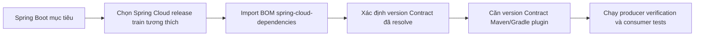
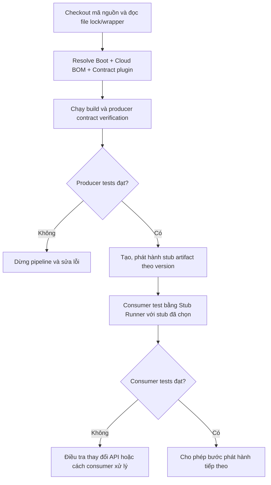

# Quản lý phiên bản bằng BOM và plugin tương ứng

## 1. Vì sao Spring Cloud Contract cần một chiến lược quản lý phiên bản?

Spring Cloud Contract là công cụ kiểm thử hợp đồng giữa **producer** (dịch vụ cung cấp HTTP API hoặc phát thông điệp) và **consumer** (dịch vụ sử dụng API hoặc nhận thông điệp). Nhóm phát triển có thể viết hợp đồng bằng Groovy/YAML DSL, sinh kiểm thử cho producer, tạo stub, chạy consumer test với Stub Runner và đưa các bước đó vào CI.

Các thành phần tham gia quá trình này thuộc nhiều lớp công nghệ:

- **Spring Boot** cung cấp nền tảng ứng dụng, plugin đóng gói và các thư viện kiểm thử của Boot.
- **Spring Cloud release train** gom các phiên bản Spring Cloud được kiểm tra cùng nhau, trong đó có các module của Spring Cloud Contract.
- **Spring Cloud Contract Verifier** là các thư viện phục vụ việc tạo và thực thi kiểm thử hợp đồng phía producer.
- **Spring Cloud Contract Stub Runner** hỗ trợ tìm, tải và chạy stub trong kiểm thử consumer.
- **Maven/Gradle plugin của Spring Cloud Contract** tham gia giai đoạn build, ví dụ sinh source kiểm thử và tạo artifact chứa stub.

Nếu dùng các phiên bản không tương thích, dự án có thể biên dịch lỗi, gặp `NoSuchMethodError` khi chạy test, không nhận ra cấu hình plugin hoặc sinh stub nhưng consumer không chạy được. Việc sửa hợp đồng DSL lúc đó không giải quyết được gốc vấn đề: **các thành phần build và runtime đang lệch phiên bản**.

Mục tiêu của bài này là quản lý các phiên bản bằng **BOM (Bill of Materials)** và chọn đúng **plugin tương ứng**, để producer và consumer có quy trình kiểm thử có thể tái lập.

## 2. BOM là gì và quản lý phần nào?

BOM là một POM tập hợp các phiên bản dependency tương thích. Trong Maven, BOM được `import` vào phần `dependencyManagement`. Khi một dependency đã có trong tập phiên bản được quản lý, dự án thường không cần ghi `<version>` tại từng khai báo dependency.

Ví dụ về vai trò:

| Thành phần | Công cụ quản lý | Dùng để làm gì? |
| --- | --- | --- |
| Spring Boot dependencies | `spring-boot-dependencies` (thường được quản lý qua `spring-boot-starter-parent`) | Đồng bộ nền tảng Boot, test starters và thư viện liên quan |
| Spring Cloud dependencies | `org.springframework.cloud:spring-cloud-dependencies` | Đồng bộ các module Spring Cloud thuộc một **release train** |
| Spring Cloud Contract dependencies | Phiên bản được quản lý bởi BOM Spring Cloud phù hợp | Thêm Verifier/Stub Runner không phải ghi phiên bản riêng cho từng dependency |
| Maven plugin của Spring Cloud Contract | Phiên bản **plugin** khai báo trong `build/plugins` hoặc `pluginManagement` | Sinh kiểm thử hợp đồng/stub trong Maven lifecycle |
| Gradle plugin của Spring Cloud Contract | Phiên bản khai báo trong `plugins { ... }` | Bổ sung task sinh kiểm thử/stub trong Gradle |

**Giới hạn quan trọng của BOM:** Maven `dependencyManagement` quản lý **dependencies**, không tự quản lý phiên bản **build plugins**. Tương tự, nhập một BOM vào Gradle không tự động đổi phiên bản các plugin trong khối `plugins`.

Ngoài ra, thuộc tính nằm bên trong POM của một BOM được import không đương nhiên trở thành một property có thể dùng trực tiếp trong POM của dự án. Nếu cấu hình Maven plugin dùng `${spring-cloud-contract.version}`, dự án hoặc parent POM của dự án phải định nghĩa được property này.

### BOM khác gì với một starter?

- BOM **không tự thêm thư viện vào classpath**: nó chỉ chọn phiên bản khi dự án yêu cầu dependency.
- Starter như `spring-cloud-starter-contract-verifier` hoặc `spring-cloud-starter-contract-stub-runner` **thêm một nhóm dependency cần thiết** để dùng tính năng.
- Build plugin thực hiện công việc trong quá trình build; nó không thay thế các test dependency mà ứng dụng cần.

Vì vậy, một cấu hình producer thực tế thường cần **đủ cả ba**: BOM, Verifier test dependency và Spring Cloud Contract plugin.

## 3. Xác định bộ phiên bản tương thích trước khi cấu hình

Không nên chọn phiên bản mới nhất của Spring Boot, Spring Cloud Contract và plugin một cách độc lập. Thay vào đó, đi theo thứ tự:

1. **Chọn phiên bản Spring Boot** đang được dự án sử dụng hoặc phiên bản Boot mục tiêu của đợt nâng cấp.
2. **Tra bảng tương thích Spring Cloud–Spring Boot** của Spring để chọn đúng Spring Cloud release train. Release train thường dùng dạng số có dấu chấm, ví dụ `202x.y.z`; đây là phiên bản của **BOM Cloud**, không phải phiên bản của từng thư viện Contract.
3. **Xác định phiên bản Spring Cloud Contract được release train đó quản lý** từ BOM hoặc dependency resolution.
4. **Chọn Spring Cloud Contract Maven/Gradle plugin ở cùng phiên bản Contract** với các thư viện Contract mà BOM đang quản lý. Nếu có chỉ dẫn phiên bản plugin riêng từ tài liệu phát hành, tuân theo chỉ dẫn đó.
5. **Kiểm tra yêu cầu Java, Maven/Gradle và plugin của Spring Boot**, vì tương thích Spring Cloud không loại bỏ yêu cầu về phiên bản JDK hoặc build tool.

Sơ đồ quyết định:



Tài liệu này dùng các ký hiệu **`BOOT_VERSION`**, **`CLOUD_TRAIN_VERSION`**, **`CONTRACT_VERSION`** và **`DEPENDENCY_MANAGEMENT_PLUGIN_VERSION`** trong ví dụ. Trước khi chạy lệnh, **thay toàn bộ ký hiệu bằng những phiên bản có thật và đã xác nhận tương thích** theo tài liệu của release train đang sử dụng. Không coi các ký hiệu là tọa độ Maven hợp lệ.

Một bảng quản lý phiên bản nội bộ nên ghi ít nhất:

| Thông số | Ví dụ cách ghi trong dự án | Quy tắc |
| --- | --- | --- |
| Spring Boot | `BOOT_VERSION` | Căn cứ version Boot đã duyệt |
| Spring Cloud BOM | `CLOUD_TRAIN_VERSION` | Release train hỗ trợ Boot đó |
| Spring Cloud Contract library | `CONTRACT_VERSION` | Version do Cloud BOM quản lý |
| Spring Cloud Contract plugin | `CONTRACT_VERSION` | Khớp Contract library hoặc tuân theo tài liệu bản phát hành |
| Java / Maven / Gradle | Phiên bản của CI và wrapper | Đáp ứng yêu cầu công cụ và bản Boot/Cloud đang dùng |

Khi thực hiện một đợt nâng cấp, nên review và cập nhật **cả bộ phiên bản**, thay vì chỉ nâng một dòng dependency.

## 4. Cấu hình Maven cho producer

Giả sử module `payment-service` cung cấp `GET /api/payments/{id}`; consumer `order-service` phụ thuộc vào các trường `paymentId` và `status`. Producer muốn viết hợp đồng trong `src/test/resources/contracts`, sinh kiểm thử xác minh API thực và tạo stub để chia sẻ cho consumer.

Một cấu hình Maven minh họa:

```xml
<project xmlns="http://maven.apache.org/POM/4.0.0"
         xmlns:xsi="http://www.w3.org/2001/XMLSchema-instance"
         xsi:schemaLocation="http://maven.apache.org/POM/4.0.0
                             https://maven.apache.org/xsd/maven-4.0.0.xsd">
    <modelVersion>4.0.0</modelVersion>

    <parent>
        <groupId>org.springframework.boot</groupId>
        <artifactId>spring-boot-starter-parent</artifactId>
        <version>BOOT_VERSION</version>
        <relativePath/>
    </parent>

    <groupId>com.example</groupId>
    <artifactId>payment-service</artifactId>
    <version>1.0.0</version>

    <properties>
        <java.version>17</java.version>
        <spring-cloud.version>CLOUD_TRAIN_VERSION</spring-cloud.version>
        <spring-cloud-contract.version>CONTRACT_VERSION</spring-cloud-contract.version>
    </properties>

    <dependencyManagement>
        <dependencies>
            <dependency>
                <groupId>org.springframework.cloud</groupId>
                <artifactId>spring-cloud-dependencies</artifactId>
                <version>${spring-cloud.version}</version>
                <type>pom</type>
                <scope>import</scope>
            </dependency>
        </dependencies>
    </dependencyManagement>

    <dependencies>
        <dependency>
            <groupId>org.springframework.boot</groupId>
            <artifactId>spring-boot-starter-web</artifactId>
        </dependency>
        <dependency>
            <groupId>org.springframework.boot</groupId>
            <artifactId>spring-boot-starter-test</artifactId>
            <scope>test</scope>
        </dependency>
        <dependency>
            <groupId>org.springframework.cloud</groupId>
            <artifactId>spring-cloud-starter-contract-verifier</artifactId>
            <scope>test</scope>
        </dependency>
    </dependencies>

    <build>
        <plugins>
            <plugin>
                <groupId>org.springframework.cloud</groupId>
                <artifactId>spring-cloud-contract-maven-plugin</artifactId>
                <version>${spring-cloud-contract.version}</version>
                <extensions>true</extensions>
                <configuration>
                    <testFramework>JUNIT5</testFramework>
                    <testMode>MOCKMVC</testMode>
                    <baseClassForTests>com.example.payment.BaseContractTest</baseClassForTests>
                </configuration>
            </plugin>
        </plugins>
    </build>
</project>
```

Trong ví dụ này:

- `spring-boot-starter-parent` quản lý nền tảng Boot. Phiên bản Java `17` chỉ là ví dụ; phải điều chỉnh theo yêu cầu của tổ hợp phiên bản Boot/Cloud đã chọn.
- `spring-cloud-dependencies` được import bằng `type=pom` và `scope=import` trong `dependencyManagement`.
- `spring-cloud-starter-contract-verifier` **không ghi version** vì sẽ lấy version được quản lý bởi BOM.
- `spring-cloud-contract-maven-plugin` **có version tường minh** qua property của dự án. Giá trị đó phải khớp với Contract dependency mà BOM resolve.
- `extensions=true` và cấu hình plugin tích hợp việc sinh kiểm thử/stub vào Maven build theo cách plugin hỗ trợ.
- `baseClassForTests` trỏ tới base class kiểm thử do producer cung cấp; base class cần cấu hình môi trường test thực tế, ví dụ MockMvc. Việc khai báo tên class chưa tự tạo class đó.

Với dự án không dùng `spring-boot-starter-parent`, có thể import Boot BOM bằng `dependencyManagement` và cấu hình phiên bản các Maven plugin liên quan riêng. Khi đó cần đặc biệt chú ý vì nhiều cấu hình mặc định của Boot parent sẽ không tự có sẵn.

### Lệnh kiểm tra cấu hình Maven

Sau khi thay các ký hiệu phiên bản, sử dụng Maven wrapper của dự án nếu có:

```bash
./mvnw help:effective-pom
./mvnw dependency:tree -Dincludes=org.springframework.cloud
./mvnw clean verify
```

Trên Windows có thể dùng `mvnw.cmd` tương ứng.

Đọc `effective-pom` để biết dependency, plugin và cấu hình cuối cùng sau khi áp dụng parent/management. Đọc `dependency:tree` để xem phiên bản thư viện Contract được chọn thực tế. `verify` giúp phát hiện lỗi biên dịch hoặc chạy kiểm thử do phiên bản lệch.

**Lưu ý:** Maven plugin có classpath và cơ chế resolve riêng; thấy dependency tree đúng **chưa đủ** để chứng minh plugin cũng đã đúng version. Phải kiểm tra thêm phần plugin trong effective POM.

## 5. Cấu hình Maven cho consumer

`order-service` thường **không cần plugin sinh producer test** nếu chỉ tiêu thụ stub. Module này cần Stub Runner trong test classpath:

```xml
<dependency>
    <groupId>org.springframework.cloud</groupId>
    <artifactId>spring-cloud-starter-contract-stub-runner</artifactId>
    <scope>test</scope>
</dependency>
```

Đoạn trên giả định consumer cũng đã import một **Spring Cloud BOM tương thích với Spring Boot của chính consumer**, giống cách quản lý dependency trong mục 4.

Consumer có thể tải hoặc khởi động stub của producer qua một định danh artifact, ví dụ:

```java
@SpringBootTest
@AutoConfigureStubRunner(
    ids = "com.example:payment-service:1.0.0:stubs:8085",
    stubsMode = StubRunnerProperties.StubsMode.LOCAL
)
class PaymentConsumerTest {
    // Gọi HTTP client tới stub trên cổng 8085 và kiểm tra kết quả.
}
```

`com.example:payment-service:1.0.0:stubs:8085` có ý nghĩa lần lượt là group ID, artifact ID, **phiên bản artifact của producer**, classifier `stubs`, và cổng chạy stub. `LOCAL` yêu cầu stub artifact đã có trong Maven local repository; trong CI thường cấu hình lấy stub từ repository từ xa, xác thực và chỉ định phiên bản cần kiểm thử.

**Không nhầm hai loại phiên bản:**

- `CONTRACT_VERSION` là phiên bản **công cụ/thư viện Spring Cloud Contract** mà BOM và plugin phải thống nhất.
- `1.0.0` trong ví dụ Stub Runner là phiên bản **artifact của Payment Service**, gắn với API/stub mà consumer muốn dùng.

Hai version này không cần và thường không nên có cùng giá trị. Một đợt phát hành API mới có thể đổi phiên bản stub của producer mà không đổi Spring Cloud Contract, và ngược lại.

## 6. Cấu hình Gradle: BOM quản lý dependency, plugin quản lý task build

Một cấu hình tương đương ở `build.gradle` dùng Groovy DSL có thể viết:

```groovy
plugins {
    id 'java'
    id 'org.springframework.boot' version 'BOOT_VERSION'
    id 'io.spring.dependency-management' version 'DEPENDENCY_MANAGEMENT_PLUGIN_VERSION'
    id 'org.springframework.cloud.contract' version 'CONTRACT_VERSION'
}

group = 'com.example'
version = '1.0.0'

ext {
    springCloudVersion = 'CLOUD_TRAIN_VERSION'
}

dependencyManagement {
    imports {
        mavenBom "org.springframework.cloud:spring-cloud-dependencies:${springCloudVersion}"
    }
}

dependencies {
    implementation 'org.springframework.boot:spring-boot-starter-web'
    testImplementation 'org.springframework.boot:spring-boot-starter-test'
    testImplementation 'org.springframework.cloud:spring-cloud-starter-contract-verifier'
}

contracts {
    baseClassForTests = 'com.example.payment.BaseContractTest'
}

tasks.named('test') {
    useJUnitPlatform()
}
```

Ở đây, `io.spring.dependency-management` giúp import BOM Spring Cloud cho các dependency; plugin Spring Boot phối hợp quản lý dependency nền tảng Boot; `org.springframework.cloud.contract` bổ sung chức năng build của Spring Cloud Contract. `CONTRACT_VERSION` phải được chọn phù hợp với thư viện Verifier theo BOM và phiên bản Gradle của dự án.

Nếu dự án dùng Gradle Kotlin DSL (`build.gradle.kts`), cú pháp sẽ khác; không nên sao chép nguyên đoạn Groovy trên. Với multi-module Gradle, chỉ áp dụng plugin Contract ở những module **thực sự sinh producer test/stub**, còn module consumer có thể chỉ cần Stub Runner test dependency.

Để xem dependency và các task hiện có:

```bash
./gradlew dependencyInsight --dependency spring-cloud-contract-verifier --configuration testRuntimeClasspath
./gradlew dependencies --configuration testRuntimeClasspath
./gradlew tasks --all
./gradlew test
```

`dependencyInsight` giúp biết phiên bản cuối cùng của một thư viện và đường đi dẫn đến phiên bản đó. `tasks --all` cho biết các task Contract do plugin cung cấp trong phiên bản đang dùng; tên task cụ thể cần đối chiếu với plugin của dự án. Nếu plugin chưa được resolve, Gradle có thể dừng **trước** khi chạy các lệnh kiểm tra dependency.

### Gradle có thể dùng `platform(...)` thay dependency-management plugin không?

Có. Gradle có hỗ trợ nhập Maven BOM qua cơ chế native `platform("group:artifact:version")`. Tuy nhiên, cần đặt `platform` vào các configuration phù hợp (`implementation`, `testImplementation`, v.v.) hoặc dùng convention chung để các test dependency đều nhận ràng buộc version. Hãy chọn **một chiến lược quản lý dependency nhất quán**, tránh vô tình thiết lập các BOM xung đột hoặc thêm version override rải rác.

Sử dụng native `platform` cũng **không tự chọn phiên bản build plugin**. Plugin trong `plugins { ... }` vẫn cần được căn tương thích.

## 7. Plugin Maven/Gradle khác nhau ở đâu?

| Công việc | Maven | Gradle |
| --- | --- | --- |
| Quản lý dependency Contract | Import Cloud BOM trong `dependencyManagement` | Import BOM qua dependency-management plugin hoặc `platform` |
| Kích hoạt công cụ sinh test/stub | `spring-cloud-contract-maven-plugin` | Plugin `org.springframework.cloud.contract` |
| Khai báo version plugin | `build/plugins`, hoặc `pluginManagement` ở parent rồi kích hoạt plugin | `plugins { id ... version ... }` hoặc convention/plugin management phù hợp |
| Căn version | So với Contract version được Maven resolve | So với Contract version được Gradle resolve |
| Kiểm tra đã tải đúng thư viện | `dependency:tree`, `help:effective-pom` | `dependencies`, `dependencyInsight` |
| Kiểm tra bước build | Maven lifecycle/goal và kết quả `verify` | Danh sách task Contract và kết quả chạy test |

Với Maven multi-module, nên đặt phiên bản BOM/property và cấu hình plugin trong parent POM để các module dùng chung giá trị. Nếu plugin chỉ nằm ở `pluginManagement`, module producer vẫn phải **khai báo sử dụng plugin** trong `plugins` để kích hoạt. Không áp plugin sinh test ở mọi module nếu module đó không sở hữu hợp đồng producer.

Với Gradle multi-project, có thể dùng convention plugin hoặc cấu hình chung để giữ version nhất quán. Cần bảo đảm plugin repositories cho phép Gradle tải Contract plugin và dependency repositories cho phép tải các thư viện Spring Cloud.

## 8. Vì sao “build xanh” chưa đủ để khẳng định version quản lý đúng?

Một dự án có thể chạy một số unit test thành công nhưng vẫn chưa thực hiện producer verification hoặc chưa sinh stub. Hãy phân biệt các trạng thái sau:

| Trạng thái | Có thể kết luận gì? | Chưa chứng minh được gì? |
| --- | --- | --- |
| Dependency resolve thành công | Các artifact yêu cầu có thể tải | Phiên bản tương thích tại runtime; plugin đã chạy |
| Unit test pass | Logic đã kiểm tra chạy đúng | Hợp đồng API giữa producer/consumer được bảo vệ |
| Producer contract tests pass | Producer đáp ứng các hợp đồng được thực thi | Consumer dùng stub đúng và xử lý đủ tình huống |
| Stub được tạo | Có artifact mô phỏng tương tác | Stub thực sự được xác minh và công bố đúng phiên bản |
| Consumer tests với Stub Runner pass | Consumer hoạt động với các stub đã chọn | Toàn bộ môi trường sản xuất hoặc luồng E2E chắc chắn đúng |

Quy trình hợp lý là: **xác minh dependency/plugin → chạy producer contract tests → tạo và phát hành stub đã kiểm chứng → consumer lấy đúng stub version và chạy tests**. Mỗi bước cần có đầu ra và điều kiện thất bại rõ ràng trong CI.

### Ví dụ chuỗi CI ở mức khái niệm



Việc phát hành artifact và cách các pipeline producer/consumer kích hoạt nhau phụ thuộc hệ thống CI cụ thể. Sơ đồ nhấn mạnh thứ tự kiểm chứng và không giả định mọi repo phải chạy chung một pipeline.

## 9. Các lỗi phiên bản thường gặp và cách chẩn đoán

### Trường hợp A: Có BOM nhưng Maven báo thiếu version của plugin

**Nguyên nhân:** `spring-cloud-dependencies` nằm ở `dependencyManagement`, trong khi Maven plugin không được quản lý bởi đó. Hoặc cấu hình plugin dùng `${spring-cloud-contract.version}` nhưng property chưa được khai báo trong project/parent POM.

**Xử lý:** Định nghĩa rõ `spring-cloud-contract.version` và dùng giá trị tương ứng với bản Contract do BOM resolve. Kiểm tra plugin trong `help:effective-pom`.

### Trường hợp B: `ClassNotFoundException` hoặc `NoSuchMethodError` khi chạy test

**Khả năng:** Có hai bản khác nhau của cùng một thư viện trên test classpath; có dependency override phiên bản BOM; plugin sinh mã không khớp với thư viện verifier đang chạy; hoặc Boot/Cloud không tương thích.

**Xử lý:** Dùng `dependency:tree` hoặc `dependencyInsight` để xác định phiên bản thật; xem version của plugin; đối chiếu bảng tương thích Boot/Cloud. Không nên chữa triệu chứng bằng cách thêm ngẫu nhiên một dependency có version khác.

### Trường hợp C: Gradle không tìm thấy plugin Spring Cloud Contract

**Khả năng:** Khai báo sai plugin ID/version, plugin repository chưa cấu hình đúng, hoặc bản plugin không hỗ trợ Gradle đang dùng.

**Xử lý:** Xác minh đúng plugin ID `org.springframework.cloud.contract`, version chính thức, `pluginManagement.repositories` trong `settings.gradle` khi cần, và phiên bản Gradle wrapper. BOM không thể giải quyết lỗi tải plugin.

### Trường hợp D: Producer test chạy nhưng consumer báo không tìm thấy stub

**Khả năng:** Stub chưa được đóng gói/phát hành, sai `groupId:artifactId:version:classifier`, chọn sai `LOCAL`/`REMOTE`, hoặc consumer trỏ tới artifact version chưa tồn tại.

**Xử lý:** Kiểm tra build producer tạo đúng artifact classifier `stubs`, repository chứa phiên bản cần dùng, thông tin xác thực và cấu hình Stub Runner. Lỗi này không nhất thiết liên quan đến phiên bản thư viện Spring Cloud Contract.

### Trường hợp E: Build vẫn chạy sau khi đổi API nhưng không phát hiện đứt hợp đồng

**Khả năng:** Plugin chưa thực sự sinh hoặc chạy contract tests, không có hợp đồng tương ứng, test base class sai, hoặc pipeline chỉ chạy unit tests rồi bỏ qua bước contract verification.

**Xử lý:** Kiểm tra log, source test được sinh, kết quả test và đường dẫn DSL. Giữ báo cáo số lượng test thực thi để phát hiện pipeline “xanh” khi toàn bộ contract tests bị bỏ qua.

### Trường hợp F: Đổi release train nhưng giữ plugin cũ

**Hệ quả:** Test sinh ra có thể dùng API hay thư viện không còn phù hợp với Contract verifier theo BOM mới.

**Xử lý:** Nâng plugin và verifier cùng đợt, xác minh các task/goal sinh test, chạy lại producer và consumer contract tests trước khi phát hành. Nếu repository có nhiều service ở các release train khác nhau, quản lý compatibility theo từng service và xác nhận stub vẫn dùng được ở consumer mục tiêu.

## 10. Quy trình nâng cấp an toàn

Khi cần nâng cấp Spring Boot hoặc Spring Cloud Contract:

1. **Ghi nhận phiên bản đang chạy:** Boot, Cloud BOM, Contract dependency, Maven/Gradle plugin, JDK và wrapper; kiểm tra dependency được resolve thay vì chỉ đọc version được viết trong file build.
2. **Chọn tổ hợp đích từ thông tin tương thích:** bắt đầu với Boot, chọn Cloud release train được hỗ trợ, rồi chọn Contract/plugin tương ứng.
3. **Cập nhật tập trung:** đổi một bộ version trong parent POM, version catalog hoặc convention plugin; hạn chế override lẻ tẻ trong các module.
4. **Resolve lại dependency và plugin:** kiểm tra `effective-pom`/`dependency:tree` hoặc `dependencyInsight`/`tasks`.
5. **Chạy đầy đủ producer contract tests và sinh stub:** xem lại matcher và code sinh nếu plugin đổi cách tạo test.
6. **Chạy consumer tests với stub mới:** kiểm tra các consumer đang sử dụng API, đặc biệt trường bắt buộc, mã lỗi và message format.
7. **Phát hành có kiểm soát:** lưu version của stub artifact gắn với producer; nếu cần thay đổi không tương thích, phối hợp consumer hoặc tạo phiên bản API mới.

Trong CI, nên pin phiên bản của build tool qua Maven/Gradle wrapper, đặt version dependency/plugin trong file được quản lý bằng Git, và tránh dùng version động như `latest.release` cho các bước cần tái lập.

## 11. Bài thực hành tự kiểm tra

Xét một dự án có các quyết định sau:

- Spring Boot đã được nâng lên một bản mới.
- Spring Cloud BOM vẫn giữ release train dành cho Boot cũ.
- `spring-cloud-starter-contract-verifier` không ghi version, nhờ BOM quản lý.
- Maven plugin `spring-cloud-contract-maven-plugin` được gắn version cũ.
- Consumer dùng Stub Runner để tải `payment-service:2.3.0:stubs`.

Hãy trả lời:

1. Vì sao chỉ nâng Spring Boot mà giữ Cloud BOM cũ là rủi ro?
2. BOM có tự cập nhật Spring Cloud Contract Maven plugin không?
3. Phiên bản `2.3.0` trong stub artifact có phải phiên bản của Spring Cloud Contract không?
4. Cần dùng công cụ nào để xem version dependency thực tế và version plugin Maven?
5. Trước khi publish stub mới, producer và consumer cần kiểm tra những gì?

**Gợi ý đáp án:** (1) Release train có phạm vi tương thích với Boot cụ thể; cần chọn lại train phù hợp. (2) Không, plugin phải được quản lý bằng cấu hình build/plugin management riêng. (3) Không, đó là version artifact của Payment Service. (4) Dùng `dependency:tree` và `help:effective-pom`. (5) Xác nhận producer contract tests thực sự chạy và pass, stub được sinh/phát hành đúng version, rồi consumer test bằng Stub Runner với chính stub đó.

**Ghi nhớ:** **BOM chọn phiên bản dependency; build plugin có vòng quản lý phiên bản riêng.** Trong Spring Cloud Contract, hãy chọn Spring Cloud release train tương thích với Boot, xác minh phiên bản Contract thực tế, căn phiên bản Maven/Gradle plugin tương ứng, rồi kiểm tra cả producer và consumer trong CI. Đồng thời luôn phân biệt phiên bản **công cụ Contract** với phiên bản **stub artifact của dịch vụ**.
