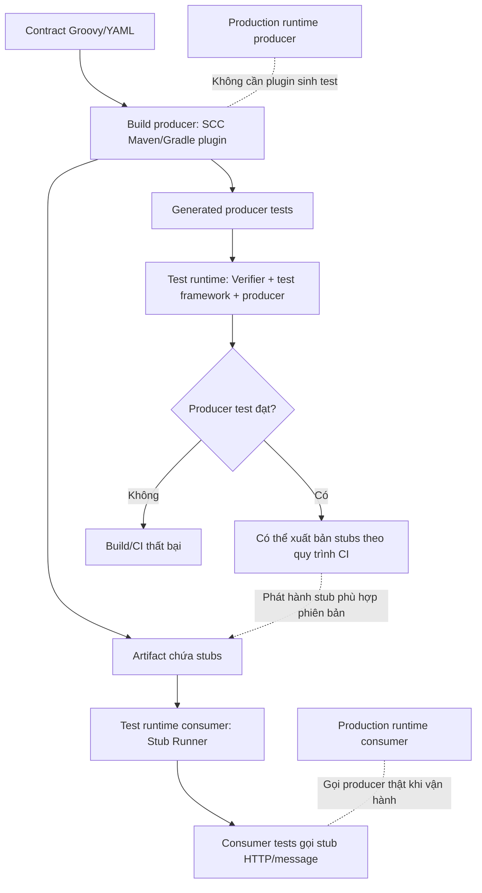
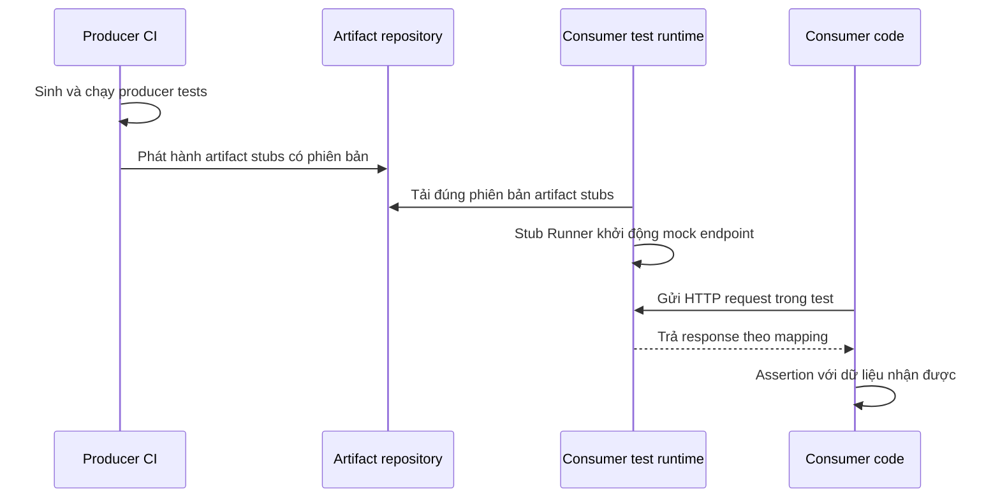

# Phân biệt thư viện runtime với công cụ sinh kiểm thử

## 1. Vì sao phải phân biệt ngay khi thiết lập dự án?

Khi bắt đầu dùng **Spring Cloud Contract (SCC)**, người học thường gặp đồng thời ba nhóm thành phần: thư viện ứng dụng sử dụng khi chạy, công cụ **sinh mã kiểm thử** trong quá trình build và thư viện hỗ trợ **chạy kiểm thử hoặc stub**. Nếu đưa tất cả vào cùng một nhóm dependency, có thể dẫn đến cấu hình cồng kềnh, đưa thư viện chỉ dành cho kiểm thử vào bản phát hành, hoặc hiểu nhầm rằng thêm một dependency là đủ để producer tự kiểm tra hợp đồng.

Trong mô hình này, **producer** cung cấp API HTTP hoặc phát thông điệp, còn **consumer** gọi API hoặc nhận thông điệp. Spring Cloud Contract giúp hai phía thỏa thuận hành vi giao tiếp bằng **Groovy DSL hoặc YAML DSL**; công cụ sinh **producer verification tests** và **stubs** từ hợp đồng, cho phép consumer chạy kiểm thử bằng **Stub Runner**, rồi kết hợp các bước vào **CI** để phát hiện thay đổi API không tương thích.

Điều cốt lõi của bài này là nhận diện **thành phần nào chạy ở giai đoạn nào**. Không nên đồng nhất ba chữ “runtime” sau:

- **Production runtime:** mã và thư viện cần cho ứng dụng khi được khởi động phục vụ người dùng.
- **Build time:** plugin và tác vụ được chạy bởi Maven hoặc Gradle để đọc hợp đồng, sinh nguồn kiểm thử và đóng gói stub.
- **Test runtime:** thư viện, test được sinh, ứng dụng được dựng cho kiểm thử và máy chủ stub chạy khi bộ test hoạt động.

**Mục tiêu học tập:** Sau bài này, bạn có thể chọn đúng dependency/plugin cho producer và consumer; giải thích vì sao generated test cần thư viện test nhưng không phải dependency production; phân biệt stub artifact với máy chủ stub đang chạy; và kiểm tra cách Maven/Gradle phân tách các classpath trước khi đưa contract testing vào CI.

## 2. Mô hình ba thời điểm thực thi

Giả sử producer cung cấp API lấy đơn hàng và consumer là ứng dụng giỏ hàng. Một YAML contract có thể mô tả hành vi sau:

```yaml
description: "Lấy đơn hàng đã thanh toán"
request:
  method: GET
  url: /api/orders/42
response:
  status: 200
  headers:
    Content-Type: application/json
  body:
    id: 42
    status: PAID
```

Từ một contract như vậy, các thành phần tham gia vào các thời điểm khác nhau:



Sơ đồ làm rõ hai nguyên tắc:

1. **Plugin sinh test/stub** chạy trong quá trình build; plugin không phải thành phần phục vụ HTTP của producer khi ứng dụng được triển khai.
2. **Verifier và Stub Runner** có thể thực thi mã trong lúc chạy bộ test. Đó là *test runtime*, không có nghĩa chúng cần được đóng gói vào *production runtime*.

Một ứng dụng Spring Boot dùng SCC vẫn cần các thư viện vận hành thông thường như Spring MVC/WebFlux, HTTP client, messaging client hoặc dependency nghiệp vụ tùy kiến trúc. Spring Cloud Contract **không thay thế** những thư viện làm nhiệm vụ phục vụ request hoặc gửi/nhận thông điệp trong production.

## 3. Bảng phân loại các thành phần thường gặp

| Thành phần | Chức năng chính | Nơi thường cấu hình | Có bắt buộc ở production runtime? |
|---|---|---|---|
| Spring Boot Web, WebFlux hoặc messaging starter | Producer thực sự xử lý HTTP/message; consumer thực sự gọi/gửi/nhận | Dependency `implementation`/`compile`, tùy ứng dụng | **Có**, nếu ứng dụng dùng chúng |
| Contract Groovy/YAML | Đặc tả hành vi cần kiểm tra | Tệp contract trong repo hoặc kho contract chung | **Không**; là đầu vào cho quy trình build/test |
| `spring-cloud-contract-maven-plugin` | Đọc contract, sinh producer tests và các đầu ra phục vụ đóng gói stub trong chu trình Maven | `<build><plugins>` | **Không**; là Maven build plugin |
| Gradle plugin `org.springframework.cloud.contract` | Tích hợp tác vụ sinh test/stub với Gradle | `plugins { ... }` | **Không**; là Gradle build plugin |
| `spring-cloud-starter-contract-verifier` | Cung cấp hỗ trợ cho việc chạy/kiểm tra producer tests do contract sinh ra | Dependency **test** của producer | **Không**, nếu chỉ dùng cho contract tests |
| Generated producer tests | Gửi/kích hoạt tương tác và xác minh producer tuân thủ contract | Generated test sources; chạy trong pha test | **Không** |
| Stub artifact, thường classifier `stubs` | Chứa các tương tác mô phỏng được tạo từ contract để consumer dùng | Artifact được xuất bản có phiên bản | **Không**; không phải service thực |
| `spring-cloud-starter-contract-stub-runner` | Tìm/tải và chạy stub phục vụ consumer tests | Dependency **test** của consumer | **Không**, trong mô hình test phổ biến |
| Máy chủ stub (thường do WireMock hỗ trợ đối với HTTP) | Nhận request và trả response mô phỏng theo stub | Được khởi động trong quá trình test | **Không**, trừ khi cố ý triển khai một mock server riêng |
| CI pipeline | Chạy producer tests, đóng gói/phát hành stub và consumer tests | Maven/Gradle tasks, workflow CI | Không phải dependency JVM của ứng dụng |

**Cẩn thận với từ “library”:** `spring-cloud-starter-contract-verifier` và `spring-cloud-starter-contract-stub-runner` thực sự là các thư viện JVM được nạp lúc chạy test. Chúng **không phải** plugin sinh mã. Trong khi đó, Maven/Gradle plugin là công cụ được Maven/Gradle gọi để **sinh** test; test đã sinh lại cần môi trường và thư viện test riêng để **chạy**. Vì thế, không thể đơn giản chia “Spring Cloud Contract” thành hai nhóm “runtime” và “không runtime” nếu chưa nói rõ *runtime nào*.

## 4. Minh họa producer: plugin sinh test khác với dependency chạy test

Giả sử ứng dụng `order-service` là producer, viết bằng Spring Boot. Ứng dụng vốn cần `spring-boot-starter-web` để phục vụ HTTP; đây là dependency production. Để xác minh contract, ta thêm **plugin build** và **thư viện test** cho hai nhiệm vụ khác nhau.

### 4.1. Ví dụ Maven (các đoạn cấu hình trọng tâm)

Trong `pom.xml`, dependency test có thể có dạng:

```xml
<dependencies>
    <!-- Ứng dụng production cần xử lý HTTP -->
    <dependency>
        <groupId>org.springframework.boot</groupId>
        <artifactId>spring-boot-starter-web</artifactId>
    </dependency>

    <!-- Chỉ dùng khi chạy producer contract tests -->
    <dependency>
        <groupId>org.springframework.cloud</groupId>
        <artifactId>spring-cloud-starter-contract-verifier</artifactId>
        <scope>test</scope>
    </dependency>
</dependencies>
```

Phần plugin là một cấu hình **khác**:

```xml
<build>
    <plugins>
        <plugin>
            <groupId>org.springframework.cloud</groupId>
            <artifactId>spring-cloud-contract-maven-plugin</artifactId>
            <version>${spring-cloud-contract.version}</version>
            <extensions>true</extensions>
            <configuration>
                <baseClassForTests>com.example.orders.ContractTestBase</baseClassForTests>
            </configuration>
        </plugin>
    </plugins>
</build>
```

Hai đoạn này là **phần minh họa của POM**, chưa phải toàn bộ dự án chạy được. Project cần parent/BOM và các phiên bản Spring Boot–Spring Cloud–Spring Cloud Contract **tương thích**, cùng lớp `ContractTestBase` và cấu hình môi trường test tương ứng. Thuộc tính `spring-cloud-contract.version` phải được khai báo bằng phiên bản đã chọn; không nên giả định BOM tự chọn phiên bản cho Maven plugin. Các cấu hình về framework test và base class có thể khác tùy phiên bản SCC.

Vì sao cần cả hai?

- **Maven plugin** tích hợp công việc đọc hợp đồng và sinh test vào vòng đời build. Nó chạy dưới quyền điều phối của Maven.
- **Verifier test dependency** hỗ trợ môi trường biên dịch/chạy generated tests. Thư viện này thuộc **test classpath**.
- **`ContractTestBase`** do nhóm tạo để dựng ứng dụng, fixture/mock cần thiết và cách kiểm thử HTTP/message. Chỉ có YAML không tự chuẩn bị database, broker hoặc trạng thái đơn hàng.

Khi dùng các mục tiêu plugin, luồng build thông dụng là đọc hợp đồng, sinh test, compile/run test, sinh/đóng gói stub và phát hành artifact theo cấu hình. Cần kiểm tra **lifecycle binding** và CI của chính dự án; việc khai báo plugin chưa chứng minh rằng mọi bước đã thực sự chạy thành công.

### 4.2. Ví dụ Gradle (Groovy DSL, các phần cốt lõi)

```groovy
plugins {
    id 'java'
    id 'org.springframework.boot' version '<boot-version>'
    id 'org.springframework.cloud.contract' version '<contract-plugin-version>'
}

dependencies {
    implementation 'org.springframework.boot:spring-boot-starter-web'
    testImplementation 'org.springframework.boot:spring-boot-starter-test'
    testImplementation 'org.springframework.cloud:spring-cloud-starter-contract-verifier'
}

contracts {
    baseClassForTests = 'com.example.orders.ContractTestBase'
}
```

Đây là **khung cấu hình để phân biệt vai trò**, không phải build script hoàn chỉnh có thể copy chạy ngay: thay placeholder bằng phiên bản phù hợp, khai báo repository và thiết lập dependency management/BOM cho các dependency Spring Cloud theo quy ước dự án. Plugin được áp dụng ở cấp Gradle; `testImplementation` đặt thư viện Verifier trong lớp dependency của test, còn `implementation` đưa Web starter vào classpath ứng dụng.

Trong dự án dùng **Gradle Kotlin DSL**, cú pháp sẽ khác (ví dụ `testImplementation(...)` và cách cấu hình extension). Không nên sao chép nguyên cú pháp Groovy vào `build.gradle.kts`.

### 4.3. Đặt contract và lớp cơ sở của test ở đâu?

Trong cách tổ chức phổ biến, contract HTTP được lưu tại:

```text
order-service/
  src/
    main/
      java/...              # Mã producer dùng khi ứng dụng chạy
    test/
      java/.../ContractTestBase.java
    test/
      resources/
        contracts/
          order-paid.yml
```

Đường dẫn contract mặc định và thư mục generated sources **có thể thay đổi theo plugin và cấu hình**. Trong dự án thật, hãy đối chiếu nơi plugin đọc contract, nơi test được sinh và nơi task test tìm generated tests. Không cần chép generated test thủ công vào `src/main/java`: generated test là **mã kiểm thử**, không phải mã nghiệp vụ production.

Ví dụ trên chưa bao gồm `ContractTestBase` vì thiết lập cụ thể phụ thuộc cách kiểm thử: MockMvc, Rest Assured, chạy server trên cổng thật hay messaging verification. Dù chọn cách nào, base class phải đảm bảo dữ liệu và cấu hình được lặp lại một cách ổn định để generated tests kiểm tra được hành vi producer.

## 5. Consumer cần Stub Runner khi nào?

Consumer muốn kiểm tra cách client của mình phản ứng với giao diện đã thống nhất nhưng **không cần dựng producer thật** trong mỗi lần chạy test. Lúc này, consumer dùng **stub artifact** chứa mapping được tạo từ contract và **Stub Runner** để khởi động một điểm cuối mô phỏng.

Trong producer, stub được **tạo và đóng gói**. Trong consumer, stub được **nạp và chạy**. Hai nhiệm vụ này diễn ra tại hai thời điểm khác nhau:



Consumer dùng Maven có thể bổ sung trong **test scope**:

```xml
<dependency>
    <groupId>org.springframework.cloud</groupId>
    <artifactId>spring-cloud-starter-contract-stub-runner</artifactId>
    <scope>test</scope>
</dependency>
```

Hoặc với Gradle Groovy DSL:

```groovy
dependencies {
    testImplementation 'org.springframework.cloud:spring-cloud-starter-contract-stub-runner'
}
```

Sau đó consumer cần cấu hình **tọa độ stub** (group, artifact, version, classifier), nguồn lấy stub (ví dụ local Maven repository hoặc remote repository) và endpoint mà client test phải gọi. Tùy phiên bản và cách thiết lập, có thể dùng `@AutoConfigureStubRunner` hoặc các cơ chế cấu hình Stub Runner phù hợp.

Ví dụ mô tả một stub artifact đã được phát hành với tọa độ:

```text
com.example:order-service:1.2.0:stubs
```

Đây là **artifact chứa mapping**, không phải URL của service thật. Khi được Stub Runner tải và khởi động, các mapping mới phục vụ request tại một địa chỉ trong môi trường test. Consumer test cần trỏ HTTP client của nó tới địa chỉ/cổng của stub và kiểm tra hành vi xử lý response; chỉ tải được artifact không đồng nghĩa client đã thực sự được kiểm thử.

**Không dùng phiên bản stub trôi nổi trong CI khi cần tái lập kết quả.** Nếu pipeline tự chọn “bản mới nhất” ở những thời điểm khác nhau, hai lần chạy có thể đang kiểm thử hai interface khác nhau. Nên cố định hoặc quản lý rõ phiên bản stub và đảm bảo nó tương ứng chính sách hỗ trợ phiên bản producer/consumer.

## 6. Stub artifact, stub server và producer thật là ba thứ khác nhau

Giả sử contract yêu cầu `GET /api/orders/42` trả `status: PAID`.

| Thành phần | Khi nào tồn tại? | Trả lời câu hỏi nào? |
|---|---|---|
| Contract file | Khi nhóm viết/thống nhất kỳ vọng | “Hai phía muốn thống nhất hành vi nào?” |
| Generated producer test | Khi plugin sinh và bộ test chạy | “Producer trong môi trường test có đáp ứng kỳ vọng này không?” |
| Stub artifact | Sau khi sinh/đóng gói artifact | “Có mô tả hành vi nào để consumer có thể mô phỏng?” |
| Stub server | Khi Stub Runner hoặc công cụ stub khởi động | “Consumer có thể gọi một điểm cuối mô phỏng theo contract không?” |
| Producer thật | Khi ứng dụng producer được khởi động | “Mã triển khai hiện tại trả kết quả gì?” |

Một tình huống đáng chú ý: producer đổi trường `status` thành `state`. Nếu consumer vẫn chạy với **stub cũ** chứa `status`, consumer test có thể vẫn xanh; bài **producer contract test** trên mã mới sẽ báo lỗi nếu contract cũ vẫn ràng buộc `status` và việc kiểm thử thực sự được chạy. Vì vậy hai nhánh kiểm thử bổ trợ nhau. Stub không tự bảo đảm phiên bản producer đang chạy ở production có hành vi giống stub.

Tương tự, plugin sinh test thành công chỉ xác nhận **có đầu ra được sinh ra**. Đó chưa phải bằng chứng rằng producer vượt qua test. CI cần chạy test được sinh ra và kiểm tra trạng thái thất bại; nếu bỏ qua tests hoặc loại chúng khỏi test task, chỉ có tác vụ sinh mã là chưa đủ.

## 7. Classpath và phạm vi dependency: đọc cấu hình thế nào?

Hãy tự hỏi ba câu cho từng thành phần:

1. **Ai gọi nó?** Maven/Gradle trong lúc build, JUnit khi test, hay JVM khi ứng dụng phục vụ request?
2. **Lúc nào nó phải tồn tại?** Khi generate source, khi test khởi tạo hoặc khi ứng dụng vận hành?
3. **Nó sẽ được đóng gói ở đâu?** Chỉ trong build environment, test classpath, artifact stub hay application artifact?

Trong Gradle, cách phân loại thường gặp:

| Cấu hình Gradle | Ý nghĩa ở mức khái quát | Ví dụ |
|---|---|---|
| `plugins { ... }` | Nạp plugin để bổ sung/tích hợp tác vụ build | Plugin SCC `org.springframework.cloud.contract` |
| `implementation` | Dependency của mã ứng dụng | Spring Boot web starter, HTTP client |
| `testImplementation` | Dependency cần cho biên dịch/chạy test | Verifier, Stub Runner, JUnit hỗ trợ |
| `testRuntimeOnly` | Dependency cần khi chạy test nhưng không cần trực tiếp khi biên dịch test | Một số runtime test engine hoặc driver theo thiết kế |

Trong Maven, có hai chỗ tách biệt:

- `<build><plugins>` dành cho **Maven plugin** điều phối tác vụ build.
- `<dependencies>` kèm `<scope>test</scope>` dành cho **thư viện được test code dùng**; các dependency không có test scope thích hợp có thể đi vào classpath của ứng dụng tùy cách đóng gói.

Một công cụ ở build time có thể **kéo theo các dependency phục vụ plugin** trong quá trình Maven/Gradle thực thi, nhưng điều đó không có nghĩa những thư viện ấy nằm trong application runtime classpath. Ngược lại, một starter ghi ở `implementation` thường có thể góp mặt trong classpath và gói ứng dụng tùy công cụ đóng gói. Vì vậy cần kiểm tra **classpath và artifact thực tế**, không kết luận chỉ từ tên thư viện.

### Cách xác minh trong dự án

Với Gradle, có thể xem hai cấu hình riêng:

```bash
./gradlew dependencies --configuration runtimeClasspath
./gradlew dependencies --configuration testRuntimeClasspath
```

Với Maven, có thể xem dependency tree và lọc các thư viện liên quan:

```bash
mvn dependency:tree -Dincludes=org.springframework.cloud
```

Lưu ý `dependency:tree` chủ yếu hiển thị **project dependencies**, không thay thế việc kiểm tra danh sách Maven build plugins. Hãy đọc thêm `pom.xml` hoặc effective POM khi cần biết plugin nào đang được áp dụng. Với Spring Boot executable JAR, có thể kiểm tra nội dung artifact được đóng gói để xác minh không vô tình mang theo các thư viện chỉ dành cho test.

Các lệnh này được nêu làm **ví dụ phương pháp kiểm tra**, không nhất thiết là lệnh áp dụng y nguyên cho mọi multi-module build hoặc hệ điều hành. Tên task/cấu hình thực tế phụ thuộc cấu trúc dự án và phiên bản plugin.

## 8. Vì sao thêm dependency vẫn chưa đủ để có contract testing?

Xét bốn cách cấu hình chưa hoàn chỉnh:

### A. Chỉ thêm `spring-cloud-starter-contract-verifier` vào producer

Verifier cung cấp thành phần hỗ trợ **chạy** test, nhưng nếu không có plugin hoặc cơ chế tạo generated tests từ DSL và không tích hợp test lifecycle thì có thể **không có bài contract test nào thực sự chạy**. Điều cần kiểm tra là task sinh test, vị trí test sinh ra, khả năng compile, test base và kết quả CI.

### B. Chỉ thêm SCC Maven/Gradle plugin

Plugin có thể biết cách sinh test, nhưng project vẫn cần dependency test phù hợp, cách dựng producer và nguồn contract. Test sinh ra chưa được thực thi hoặc không kết nối với ứng dụng thật thì chưa chứng minh điều gì về triển khai.

### C. Chỉ thêm Stub Runner vào consumer

Consumer chưa có stub artifact/version và cấu hình nơi lấy stub, cách trỏ client đến stub, cũng như assertion cho hành vi cần bảo vệ. Kể cả Stub Runner khởi động thành công, bộ kiểm thử không gọi client hoặc không xác nhận giá trị quan trọng thì giá trị phát hiện lỗi rất hạn chế.

### D. Đưa Verifier và Stub Runner vào `implementation` vì “chạy lúc runtime”

Lỗi ở đây là hiểu **test runtime** thành **production runtime**. Nếu chúng chỉ được dùng trong test, dependency scope nên thể hiện đúng điều đó để giảm nguy cơ đưa thư viện kiểm thử vào ứng dụng phát hành. Việc một tổ chức chủ động triển khai stub server riêng cho môi trường thử nghiệm là trường hợp kiến trúc khác, cần được mô tả riêng thay vì lấy làm mặc định cho mọi production service.

## 9. Bố trí dự án và CI theo đúng vai trò

Một cách tổ chức dễ hiểu cho hai repository:

```text
producer-order-service/
  pom.xml hoặc build.gradle
    - Web/messaging dependencies (production)
    - SCC build plugin (generate tests/stubs)
    - Verifier (test dependency)
  src/main/...                  # Ứng dụng producer
  src/test/...                  # Test base và fixture
  src/test/resources/contracts/ # Groovy/YAML DSL

consumer-checkout-service/
  pom.xml hoặc build.gradle
    - HTTP/messaging client dependencies (production)
    - Stub Runner (test dependency)
  src/main/...                  # Ứng dụng consumer
  src/test/...                  # Test gọi client với stub
```

Pipeline tham khảo:

1. **Producer CI:** checkout đúng phiên bản contract, sinh/compile/run producer tests trong môi trường test phù hợp.
2. **Chặn khi sai lệch:** để lỗi verification làm CI thất bại; không bỏ qua test bằng cờ skip hoặc bắt lỗi rồi cho qua.
3. **Phát hành stub:** đóng gói artifact stubs có version gắn với mã producer/contract đã được kiểm chứng.
4. **Consumer CI:** tải đúng version stub, khởi động Stub Runner và chạy test kiểm tra cách consumer xử lý các tình huống thực.
5. **Release:** quyết định dựa trên kết quả test của đúng commit/artifact và chính sách tương thích giữa các phiên bản thực sự được hỗ trợ.

Với HTTP contract, Stub Runner thường dùng máy chủ mô phỏng HTTP; với messaging contract, cách dựng và kích hoạt luồng thông điệp sẽ phụ thuộc cấu hình messaging của dự án. Dù ở dạng nào, cần phân biệt **hành vi được mô phỏng trong test** với khả năng liên lạc, giao hàng hoặc retry của môi trường production.

### Ma trận “thêm gì vào đâu?”

| Nhu cầu | Producer | Consumer |
|---|---|---|
| Phục vụ/gọi API trong production | Web/messaging library phù hợp | HTTP/messaging client phù hợp |
| Viết DSL mô tả hợp đồng | Lưu hợp đồng ở nơi nhóm thống nhất | Đóng góp/review kỳ vọng; không nhất thiết chạy plugin |
| Sinh producer verification tests | **SCC Maven/Gradle plugin** | Thông thường không cần |
| Chạy producer verification tests | **Verifier ở test scope** và cấu hình test base | Thông thường không cần |
| Sinh, đóng gói stub | **Plugin và quy trình phát hành** | Thông thường không cần |
| Chạy consumer tests với stubs | Cung cấp artifact stubs phù hợp | **Stub Runner ở test scope** và test assertions |

Hệ thống có thể có consumer và producer trong cùng một dự án, hoặc quản lý hợp đồng trong một repository riêng. Khi đó vị trí plugin/dependency khác đi, nhưng cách phân loại **build time – test runtime – production runtime** vẫn là cơ sở để quyết định.

## 10. Bài tập thực hành và tiêu chí tự kiểm tra

**Bối cảnh:** nhóm phát triển `payment-service` (producer) có endpoint `GET /api/payments/10`. Dịch vụ `invoice-service` (consumer) dùng endpoint này để kiểm tra trạng thái thanh toán trước khi phát hành hóa đơn. Nhóm muốn bổ sung Spring Cloud Contract, chạy producer test trong CI và dùng stub để test consumer.

Hãy thiết kế bảng cấu hình gồm bốn phần:

1. **Production:** hai ứng dụng cần các thư viện nào để thực hiện công việc HTTP bình thường?
2. **Producer build:** thành phần nào đọc Groovy/YAML DSL và sinh kiểm thử; khai báo ở đâu trong Maven/Gradle?
3. **Producer test:** thành phần nào hỗ trợ chạy generated tests; cần test base và dữ liệu mẫu thế nào?
4. **Consumer test:** artifact nào phải được phát hành trước, Stub Runner cần lấy artifact ở đâu và test cần khẳng định những gì?

Đối chiếu với đáp án gợi ý:

| Quyết định | Cách thiết lập phù hợp |
|---|---|
| HTTP server của `payment-service` | Dependency web production |
| HTTP client của `invoice-service` | Dependency client production |
| Sinh test/stub từ contract | Maven/Gradle SCC plugin trong producer build |
| Thực thi generated tests | Verifier và test framework trong producer test scope |
| Dựng response `PAID` cho ID `10` | Fixture hoặc mock hợp lệ trong producer test |
| Cung cấp dữ liệu cho consumer tests | Stub artifact có phiên bản, phát hành sau bước verification |
| Cho consumer gọi mock endpoint | Stub Runner và các assertion trong consumer test scope |

### Checklist trước khi gửi pull request thiết lập SCC

- [ ] Contract được lưu ở đường dẫn mà plugin thực sự đọc, với Groovy/YAML DSL hợp lệ.
- [ ] Có plugin sinh test/stub đúng loại build tool và phiên bản tương thích với Spring Boot/Spring Cloud.
- [ ] Producer có dependency Verifier ở test scope và test base/fixture cần thiết.
- [ ] Generated tests được compile và **chạy** trong CI; sai lệch hợp đồng làm job thất bại.
- [ ] Stub được đóng gói và phát hành với version truy vết được.
- [ ] Consumer dùng Stub Runner ở test scope, trỏ client đến stub thật sự được khởi động và kiểm tra response/message bằng assertion.
- [ ] Dependency chỉ phục vụ test không vô tình nằm trong production classpath/artifact.
- [ ] Cặp phiên bản producer, contract, stub và consumer được ghi nhận rõ.

## 11. Ghi nhớ

Trong Spring Cloud Contract, **Groovy/YAML DSL là dữ liệu đặc tả**, **Maven/Gradle plugin là công cụ build để sinh test/stub**, còn **Verifier và Stub Runner là thư viện phục vụ việc thực thi kiểm thử**. Producer và consumer vẫn sử dụng thư viện web/messaging phù hợp để hoạt động trong production; phần lớn công cụ SCC không cần đi vào runtime production.

Cấu hình đúng dependency mới chỉ là bước đầu. Kiểm thử hợp đồng có ích khi generated producer tests được chạy với điều kiện test đáng tin cậy, stub được phát hành có phiên bản, consumer thực sự chạy assertion với Stub Runner và CI chặn các sai lệch chưa được chấp thuận. Hãy luôn hỏi **“thành phần này chạy ở giai đoạn nào và kiểm chứng điều gì?”** trước khi quyết định đưa nó vào plugin, test scope hay production dependencies.
