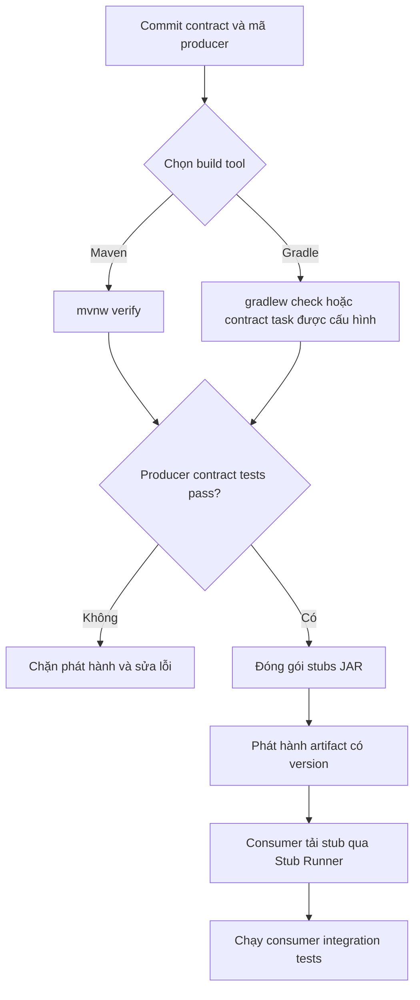

# Chọn Maven hoặc Gradle cho quy trình thực hành

## 1. Bài toán lựa chọn công cụ build trong Spring Cloud Contract

Khi học **Spring Cloud Contract**, ta cần nhiều hơn một dự án Spring Boot chạy được: phải có quy trình **đọc hợp đồng Groovy/YAML DSL**, **sinh và thực thi kiểm thử phía producer**, **sinh/đóng gói stub**, rồi cho consumer sử dụng stub bằng **Stub Runner**. Maven và Gradle đều có thể tổ chức quy trình đó; chúng khác nhau chủ yếu ở cách khai báo, cách chạy tác vụ và cách quản lý build.

Mục tiêu của việc chọn công cụ là làm cho một contract được kiểm chứng lặp lại trên máy cá nhân và CI, có artifact stub rõ phiên bản và ít bước thủ công. Nếu đang làm việc trong dự án có sẵn, **ưu tiên hệ build mà dự án/nhóm đã sử dụng**: không cần đổi từ Maven sang Gradle hoặc ngược lại chỉ để học hay áp dụng Spring Cloud Contract.

Sau bài này, người học có thể:

1. Phân biệt ưu điểm và chi phí vận hành của Maven với Gradle đối với contract testing.
2. Nhận diện những dependency/plugin cần thiết và điểm tích hợp của chúng trong vòng đời build.
3. Thực hiện chuỗi **contract → generated producer tests → stubs JAR → Stub Runner → consumer tests** với hệ build được chọn.
4. Kiểm tra khả năng tái lập kết quả tại CI và xử lý các vấn đề thường gặp như lệch version, thiếu base class hoặc không tìm thấy stub.

Các đoạn cấu hình minh họa dưới đây dùng tên phiên bản **placeholder**. Khi áp dụng, cần thay bằng phiên bản Spring Boot, Spring Cloud release train và Spring Cloud Contract tương thích theo tài liệu của phiên bản dự án. Không ghép tùy ý version chỉ vì từng dependency có thể tải được.

## 2. Những thành phần bắt buộc, bất kể Maven hay Gradle

Một bài thực hành HTTP cơ bản thường có hai ứng dụng: **producer** (ví dụ `order-service`) định nghĩa endpoint thật và **consumer** (ví dụ `checkout-service`) gọi endpoint đó. Trong producer:

```text
order-service/
├── src/main/java/...              # Controller và logic API
├── src/test/java/...              # Base class và test hỗ trợ
└── src/test/resources/contracts/
    └── orders/
        └── get-confirmed-order.groovy
```

| Thành phần | Tác dụng | Điều cần quyết định |
| --- | --- | --- |
| Spring Boot | Chạy API thật cho producer | JDK và phiên bản Boot của nhóm |
| Spring Cloud BOM | Đồng bộ phiên bản thư viện Spring Cloud | Release train tương thích với Boot |
| Spring Cloud Contract Verifier | Hỗ trợ sinh và chạy contract tests | Dependency test và plugin cùng nhánh tương thích |
| Contract Groovy/YAML | Định nghĩa request, response, quy tắc đối sánh | Vị trí nguồn contract và quy trình review |
| Test base class | Thiết lập ứng dụng, controller/mock và dữ liệu cho generated tests | Test mode, JUnit, cấu hình web |
| Stubs JAR | Đóng gói mapping và response mô phỏng | Version, classifier, artifact repository |
| Stub Runner ở consumer | Khởi chạy stub theo tọa độ artifact | Nơi lấy artifact, port, version cần kiểm thử |

Một bản hợp đồng có thể dùng cho cả hai hệ build; khi chuyển hệ build, về nguyên tắc **nội dung DSL không cần đổi**. Thứ thay đổi là cách plugin đọc file, sinh code, đưa generated tests vào lifecycle và công bố artifact.

### Ví dụ hợp đồng dùng xuyên suốt

Lưu trong `src/test/resources/contracts/orders/get-confirmed-order.groovy` của producer:

```groovy
import org.springframework.cloud.contract.spec.Contract

Contract.make {
    description 'Tra cứu đơn hàng đã xác nhận'
    request {
        method GET()
        url '/api/orders/42'
        headers {
            accept(applicationJson())
        }
    }
    response {
        status OK()
        headers {
            contentType(applicationJson())
        }
        body([
            orderId: 42,
            status : 'CONFIRMED'
        ])
    }
}
```

Kịch bản này cam kết rằng request `GET /api/orders/42` với header `Accept: application/json` nhận HTTP `200` và JSON chứa `orderId` cùng `status`. Giá trị `42` và `CONFIRMED` là ví dụ cho trường hợp xác nhận; để bảo vệ nhiều trạng thái khác nhau, cần bổ sung contract tương ứng. Mỗi phiên bản plugin sẽ sinh producer tests và stub mapping theo cách riêng, nhưng hai đầu ra cần phản ánh cùng hành vi.

## 3. So sánh Maven và Gradle theo nhu cầu thực hành

| Tiêu chí | Maven | Gradle |
| --- | --- | --- |
| Mô hình build | Lifecycle quy ước sẵn (`validate`, `test`, `verify`, `install`, `deploy`) | Task graph, dependency giữa các task và cấu hình plugin |
| Cấu hình | XML trong `pom.xml` | Groovy DSL (`build.gradle`) hoặc Kotlin DSL (`build.gradle.kts`) |
| Cách chạy | `./mvnw clean verify` | `./gradlew clean check` / task tương ứng |
| Plugin Contract | `spring-cloud-contract-maven-plugin` | Plugin Gradle `org.springframework.cloud.contract` |
| Dependency management | Parent POM và/hoặc BOM trong `dependencyManagement` | BOM/platform hoặc dependency-management plugin |
| Điều chỉnh build đặc thù | Goal, phase, profile và cấu hình plugin | Khai báo và kết nối task; linh hoạt cho multi-module |
| Khả năng tối ưu build | Phụ thuộc cấu hình plugin, cache CI và tác vụ | Có thể tận dụng incremental build/build cache nếu task hỗ trợ |
| Độ dễ tiếp cận | Thường dễ học nếu đã quen convention Maven | Thuận tiện nếu nhóm đang dùng Gradle và hiểu task graph |
| Rủi ro phổ biến | Goal/plugin không gắn đúng lifecycle, cấu hình dài | Task không nối vào `check/build`, cấu hình task sai thời điểm |

**Không có quy tắc “Gradle luôn nhanh hơn” hoặc “Maven luôn ổn định hơn”.** Thời gian thực tế phụ thuộc kích thước mã nguồn, plugin, CI cache, mạng, JDK và cấu hình test. Với một lab nhỏ, chênh lệch thời gian build thường không đáng để đánh đổi tính nhất quán với dự án hiện hữu.

### Khi nên chọn Maven

- Dự án đang quản lý bằng `pom.xml`, các nhóm quen `mvn test`/`mvn verify`.
- Muốn bám vòng đời chuẩn để minh họa thứ tự **sinh test → chạy test → đóng gói → phát hành**.
- Hạ tầng CI và kho artifact đã có sẵn cấu hình Maven; người mới dễ quan sát các phase.

### Khi nên chọn Gradle

- Producer/consumer của nhóm đã dùng `build.gradle` hoặc `build.gradle.kts`.
- Dự án đa module cần quản lý task và dependency theo cấu trúc hiện hữu.
- Nhóm đã có Gradle Wrapper, cơ chế cache và conventions thống nhất.

**Quy tắc đề xuất:** Nếu bắt đầu một bài thực hành độc lập và chưa có ràng buộc nào, chọn công cụ mà người học đã biết để tập trung vào contract testing. Nếu chuẩn bị tích hợp vào sản phẩm đang vận hành, chọn đúng hệ build sản phẩm hiện có.

## 4. Thiết lập theo hướng Maven

Trong dự án Spring Boot dùng Maven, cần phần dependency cho Contract Verifier và plugin sinh code. Cấu hình rút gọn sau minh họa các phần liên quan trong `pom.xml`; các phần như parent, thông tin artifact, Java version và dependency của ứng dụng được giả định đã tồn tại.

```xml
<properties>
    <spring-cloud.version>REPLACE_WITH_COMPATIBLE_TRAIN</spring-cloud.version>
    <spring-cloud-contract.version>REPLACE_WITH_COMPATIBLE_VERSION</spring-cloud-contract.version>
</properties>

<dependencyManagement>
    <dependencies>
        <dependency>
            <groupId>org.springframework.cloud</groupId>
            <artifactId>spring-cloud-dependencies</artifactId>
            <version>${spring-cloud.version}</version>
            <type>pom</type>
            <scope>import</scope>
        </dependency>
    </dependencies>
</dependencyManagement>

<dependencies>
    <dependency>
        <groupId>org.springframework.cloud</groupId>
        <artifactId>spring-cloud-starter-contract-verifier</artifactId>
        <scope>test</scope>
    </dependency>
</dependencies>

<build>
    <plugins>
        <plugin>
            <groupId>org.springframework.cloud</groupId>
            <artifactId>spring-cloud-contract-maven-plugin</artifactId>
            <version>${spring-cloud-contract.version}</version>
            <extensions>true</extensions>
            <configuration>
                <baseClassForTests>com.example.orders.ContractTestBase</baseClassForTests>
            </configuration>
        </plugin>
    </plugins>
</build>
```

`spring-cloud-dependencies` giúp quản lý phiên bản các thư viện Spring Cloud; plugin Maven vẫn cần version plugin phù hợp. Trong dự án thực tế, quản lý tập trung version qua parent/BOM theo quy ước nhóm và tránh khai báo thêm những version xung đột.

`baseClassForTests` chỉ đến một lớp Java **phải tồn tại** trong source test của producer. Lớp này chuẩn bị môi trường cho generated tests. Ví dụ, nếu chọn kiểm thử controller với MockMvc, base class sẽ cấu hình ứng dụng hoặc controller cho Rest Assured MockMvc; nếu chọn chạy qua HTTP thật, cách thiết lập sẽ khác. Không được chỉ khai báo một tên lớp rồi kỳ vọng generated tests tự biết cách chạy endpoint.

### Trình tự chạy Maven

```bash
# Dùng Maven Wrapper của chính dự án (trên Windows: mvnw.cmd)
./mvnw clean verify

# Kiểm tra artifact và cài vào Maven local repository
./mvnw clean install

# Chỉ dùng khi dự án có cấu hình repository và quyền phát hành
./mvnw clean deploy
```

- `verify` chạy đến phase xác minh của Maven. Khi plugin và test runner được cấu hình đúng, generated producer tests phải được tạo, biên dịch và thực thi trong build này.
- `install` đưa artifact của build vào kho Maven cục bộ, phù hợp để thử consumer với `StubRunnerProperties.StubsMode.LOCAL` nếu stub classifier cũng được attach.
- `deploy` phát hành artifact lên repository đã cấu hình. Nó không thay thế việc cấu hình plugin, `distributionManagement`, credentials hay kiểm soát test pass.

Sau build, kiểm tra log sinh test, báo cáo kiểm thử và artifact có classifier `stubs`. Không nên chỉ nhìn exit code của `package` nếu chưa xác nhận generated contract tests thực sự đã chạy.

## 5. Thiết lập theo hướng Gradle

Trong Gradle, cơ chế tương đương được khai báo qua plugin và dependencies. Ví dụ dưới đây dùng **Groovy DSL** ở `build.gradle`, đồng thời giả định dự án đã có các phần Boot, Java, repository và test framework. Các giá trị `BOOT_VERSION`, `CONTRACT_VERSION` và `DEPENDENCY_MANAGEMENT_PLUGIN_VERSION` là placeholder phải được thay trước khi build:

```groovy
plugins {
    id 'java'
    id 'org.springframework.boot' version 'BOOT_VERSION'
    id 'io.spring.dependency-management' version 'DEPENDENCY_MANAGEMENT_PLUGIN_VERSION'
    id 'org.springframework.cloud.contract' version 'CONTRACT_VERSION'
}

group = 'com.example'
version = '1.0.0'

ext {
    springCloudVersion = 'REPLACE_WITH_COMPATIBLE_TRAIN'
}

repositories {
    mavenCentral()
}

dependencyManagement {
    imports {
        mavenBom "org.springframework.cloud:spring-cloud-dependencies:${springCloudVersion}"
    }
}

dependencies {
    testImplementation 'org.springframework.cloud:spring-cloud-starter-contract-verifier'
}

contracts {
    baseClassForTests = 'com.example.orders.ContractTestBase'
}
```

Ví dụ dùng plugin dependency-management vì đây là cách tổ chức quen thuộc với nhiều dự án Spring. Một dự án Gradle hiện đại cũng có thể dùng `platform(...)` để import BOM, tùy conventions của nhóm. Không nên kết hợp nhiều chiến lược version management nếu không biết cách chúng tác động lẫn nhau.

Nếu dự án sử dụng **Kotlin DSL**, cú pháp `plugins { ... }`, khai báo dependency và khối `contracts` cần đổi theo API Kotlin DSL của plugin đang dùng; không thể sao chép nguyên Groovy DSL sang `build.gradle.kts`. Cả hai đều có thể phục vụ Spring Cloud Contract, nên chọn ngôn ngữ cấu hình cùng hệ build hiện hữu.

### Trình tự chạy Gradle

```bash
# Xem các task mà plugin đã đăng ký
./gradlew tasks --all

# Build và kiểm tra producer theo lifecycle của dự án
./gradlew clean check

# Kiểm tra các task liên quan tới contract và stub
./gradlew tasks --all

# Khi dự án đã cấu hình maven-publish và artifact stubs
./gradlew publish
```

Trên Windows, dùng `gradlew.bat`. Các task do plugin Spring Cloud Contract cung cấp thường liên quan tới sinh contract tests, chạy contract tests và tạo stubs; **tên task và việc task đó được nối vào `check` hoặc `build` có thể khác theo phiên bản plugin và cấu hình dự án**. Vì vậy, hãy xem `./gradlew tasks --all` và log build để xác nhận generated tests thực sự đã chạy, thay vì mặc định mọi tác vụ cần thiết đều nằm trong `check`.

Để phát hành stub qua Gradle, cần thêm cấu hình publishing thích hợp (chẳng hạn `maven-publish`, repository, credentials và artifact/classifier mà plugin tạo). Chạy `publish` khi chưa khai báo publication cho stubs JAR có thể chỉ phát hành artifact chính hoặc không tạo ra output mong muốn.

## 6. Tổ chức base class và dữ liệu test để hai hệ build cùng chạy được

Maven hoặc Gradle chỉ phụ trách tổ chức build. **Generated producer tests cần một môi trường xác minh có thể lặp lại**. Đặc biệt, hợp đồng `/api/orders/42` giả định producer có dữ liệu trả về đơn hàng 42.

Một chiến lược đơn giản trong lab là dùng MockMvc với controller hoặc service giả lập dữ liệu cố định. Một chiến lược khác là khởi tạo Spring Boot test context, database thử nghiệm và seed một bản ghi đơn hàng. Dù chọn cách nào, cần giữ những điều kiện sau:

1. **Chọn test mode rõ ràng:** MockMvc khi muốn xác minh tầng web mà không mở cổng HTTP thật; HTTP integration test khi cần chạy qua server thực, tùy tính năng và plugin version.
2. **Base class khớp với test mode:** thiết lập Rest Assured MockMvc hoặc HTTP client tương ứng; các generated tests phải kế thừa hoặc sử dụng đúng lớp cấu hình.
3. **Dữ liệu xác định:** record `42` tồn tại với trạng thái `CONFIRMED` trong mỗi lần test; tránh phụ thuộc vào dữ liệu của môi trường dev.
4. **Không phụ thuộc thứ tự test:** mỗi kịch bản có setup và cleanup cần thiết, không dựa trên test chạy trước.
5. **JUnit và dependency đồng bộ:** test engine/runner phải nhận diện generated tests; class được sinh mà không được chạy là một lỗ hổng kiểm thử.

Maven thường cấu hình test qua Surefire/Failsafe và plugin liên quan; Gradle thường dùng task kiểu `Test` cùng JUnit Platform. Với dự án dùng JUnit 5, kiểm tra cấu hình tương ứng của generated contract-test task. Thông báo “BUILD SUCCESS” **không đủ** nếu log cho thấy 0 contract test đã thực thi.

## 7. Sinh và dùng stubs JAR: phần cần thống nhất khi chọn công cụ

Giả sử producer có tọa độ Maven:

```text
group    = com.example
artifact = order-service
version  = 1.0.0
classifier = stubs
```

Artifact thường có tên tương tự `order-service-1.0.0-stubs.jar`. Với HTTP contract, nó thường chứa WireMock mappings và dữ liệu phản hồi tương ứng. Dù artifact được build bằng Maven hay Gradle, consumer cần biết **tọa độ, nơi lưu trữ và version** để dùng đúng stub.

Ở consumer, một kiểm thử Spring Boot có thể chạy Stub Runner theo hướng minh họa:

```java
import org.junit.jupiter.api.Test;
import org.springframework.boot.test.context.SpringBootTest;
import org.springframework.cloud.contract.stubrunner.StubRunnerProperties;
import org.springframework.cloud.contract.stubrunner.spring.AutoConfigureStubRunner;

@SpringBootTest(properties = "orders.base-url=http://localhost:9090")
@AutoConfigureStubRunner(
    ids = "com.example:order-service:1.0.0:stubs:9090",
    stubsMode = StubRunnerProperties.StubsMode.LOCAL
)
class OrderClientContractTest {
    @Test
    void shouldHandleConfirmedOrder() {
        // Gọi OrderClient thật, được cấu hình truy cập orders.base-url.
        // Kiểm tra orderId=42 và status=CONFIRMED.
    }
}
```

Đoạn trên là **khung cấu hình**, chưa phải một test hoàn chỉnh: cần dependency Stub Runner phù hợp, `OrderClient` thật và assertion cụ thể. Chế độ `LOCAL` yêu cầu stubs JAR đã có trong Maven local repository. CI hoặc hệ thống có kho artifact riêng thường cần chế độ lấy từ xa và cấu hình URL repository phù hợp. Cổng `9090` có thể thay bằng cổng động để tránh xung đột khi chạy song song; consumer phải lấy đúng cổng thực tế mà Stub Runner mở.

Từ góc nhìn consumer, công cụ build của producer không nhất thiết phải giống công cụ build của consumer. Ví dụ **Maven producer → stubs JAR → Gradle consumer** vẫn khả thi nếu hai phía hiểu cùng định danh artifact và dùng định dạng stub tương thích.

## 8. So sánh quy trình CI tương ứng



Ví dụ lệnh ở pipeline (mang tính minh họa; thay theo CI của nhóm):

| Mục tiêu | Maven | Gradle |
| --- | --- | --- |
| Cố định bản build tool | Commit `mvnw`, `mvnw.cmd` và Wrapper config | Commit `gradlew`, `gradlew.bat` và Wrapper config |
| Verify producer | `./mvnw -B clean verify` | `./gradlew clean check` cùng task contract cần thiết |
| Lưu artifact cục bộ | `./mvnw -B install` | Task publication/installation đã cấu hình |
| Phát hành stub | `./mvnw -B deploy` sau khi cấu hình repository | `./gradlew publish` sau khi cấu hình publication cho stubs |
| Debug dependency | `./mvnw dependency:tree` | `./gradlew dependencies` |
| Debug contract output | Xem report test, generated tests và artifact trong `target/` | Xem report test, generated tests và artifact trong `build/` |

Các lệnh trên không nên được chạy mù quáng trong pipeline: trước hết cần bảo đảm artifact `stubs` thực sự được attach và producer tests có chạy. Với đa module, chỉ định đúng module producer (ví dụ Maven `-pl` hoặc Gradle task theo tên module) và xác nhận dependency giữa các job.

Một cổng chất lượng CI đủ dùng nên kiểm tra:

- Contract DSL được parse và generated producer tests biên dịch được.
- Producer tests pass khi chạy với controller/service hoặc HTTP server thực tế đã cấu hình.
- Artifact `stubs` của **cùng commit và version** được tạo thành công, không bị thay bằng file stub viết tay.
- Consumer test tải đúng artifact, sử dụng endpoint stub thực sự và kiểm tra kết quả nghiệp vụ.
- Thay đổi phá vỡ API (ví dụ `status` đổi thành `state` trong producer mà contract chưa đổi) làm pipeline producer thất bại.
- Cấu hình build, dependency lock/version và artifact repository đủ để tái hiện pipeline.

Nếu cần giảm thời gian CI, nên đo thời gian từng bước trước khi áp dụng caching; không cache kết quả generated tests theo cách khiến thay đổi contract hoặc producer bị bỏ qua.

## 9. Quy trình quyết định trong một dự án thật

Trả lời những câu hỏi sau theo thứ tự:

1. **Dự án đang dùng Maven hay Gradle?** Có → giữ nguyên, thêm plugin Contract vào build đó.
2. **Tổ chức đã chuẩn hóa Wrapper, repository và CI chưa?** Có → ưu tiên chuẩn nội bộ để tránh tạo một đường phát hành riêng.
3. **Team có hiểu vòng đời build không?** Nếu là workshop mới, Maven thuận tiện để giải thích các phase; nếu team quen Gradle, task graph lại trực quan hơn.
4. **Có nhiều module và pipeline phức tạp không?** Chọn hệ hiện tại của nhóm có cách quản lý dependency, cache và publishing phù hợp.
5. **Có yêu cầu publish stub cho nhiều consumer không?** Cả hai đáp ứng được; quyết định theo mức hoàn thiện của pipeline xuất bản artifact, không dựa vào tên công cụ.

### Ba tình huống tiêu biểu

**Tình huống A — Microservice đã chạy Maven:** Producer có `pom.xml`, CI đang dùng `mvnw verify`. Thêm dependency/plugin của Contract Verifier, một base class và contract. Giữ nguyên pipeline Maven để giảm thay đổi không cần thiết.

**Tình huống B — Monorepo Gradle đa module:** Producer thuộc module `:services:orders`, nhiều quy tắc build dùng chung. Thêm plugin vào module producer, xác minh các task sinh test và artifact, gắn chúng vào pipeline kiểm tra của module. Không chuyển riêng module đó sang Maven.

**Tình huống C — Khóa học độc lập:** Học viên chưa biết công cụ nào; giảng viên đã có một starter Maven hoàn chỉnh. Bắt đầu với Maven để tập trung vào DSL, generated tests và Stub Runner. Khi đã hiểu luồng, có thể lặp lại bằng Gradle để thấy hai hệ tương đương về mục đích.

## 10. Những lỗi thường gặp và cách kiểm tra

| Hiện tượng | Nguyên nhân có thể | Bước kiểm tra đầu tiên |
| --- | --- | --- |
| Không thấy generated contract tests | Plugin không chạy, sai thư mục contracts hoặc task chưa được nối vào lifecycle | Xem log plugin/task, cấu hình đường dẫn và output sinh test |
| Build báo thiếu base class | Sai `baseClassForTests`, package/class không tồn tại hoặc source set chưa được nhận | Kiểm tra tên đầy đủ và mã test sinh ra |
| Test chạy nhưng endpoint không trả mẫu | Chưa seed data, cấu hình MockMvc/HTTP sai, request không khớp contract | Chạy từng generated test và xem request thực tế |
| Test không chạy dù build xanh | Runner/JUnit config không phù hợp hoặc task contract không được gọi | Kiểm tra số lượng contract tests thực thi |
| Consumer không tìm thấy stub | Sai tọa độ, classifier, version, mode hoặc repository | Xác nhận stubs JAR tồn tại và Stub Runner dùng đúng tọa độ |
| Consumer gọi stub nhưng nhận `404` | Sai path, method, header, query hoặc port | So request client gửi với mapping thực tế |
| Cả Maven và Gradle tải dependency khác nhau | BOM/versions khác hoặc repository/caching chưa nhất quán | So sánh dependency tree và version được resolve |
| Build local pass, CI fail | Wrapper/JDK khác, dữ liệu test phụ thuộc môi trường, thiếu artifact hoặc credential | Kiểm tra JDK, Wrapper, cấu hình CI và stub version |

Khi phân tích lỗi, nên tách rõ **lỗi cấu hình build**, **lỗi producer không đáp ứng contract**, **lỗi phân phối stub** và **lỗi logic consumer**. Chuyển Maven sang Gradle hoặc ngược lại hiếm khi giải quyết một thay đổi hành vi API.

## 11. Bài thực hành: chọn hệ build và chứng minh một nguồn hợp đồng

**Đề bài:** Có hai dịch vụ Spring Boot. `order-service` đã dùng Maven, `checkout-service` đã dùng Gradle. Consumer cần gọi `GET /api/orders/42` và hiển thị `status`.

**Nhiệm vụ:**

1. Giải thích vì sao nên giữ Maven cho producer và Gradle cho consumer, rồi chọn version Spring Boot/Spring Cloud/Contract tương thích.
2. Thêm contract mẫu ở mục 2 vào producer, tạo base class đúng với test mode đang dùng và chạy generated producer tests bằng Maven.
3. Đóng gói stubs JAR với classifier `stubs`, cài vào local repository hoặc phát hành lên kho dùng chung.
4. Ở consumer Gradle, thêm dependency Stub Runner và viết integration test gọi HTTP client qua stub. Kiểm tra `orderId = 42` và `status = CONFIRMED`.
5. Đổi producer trả `state` thay vì `status` nhưng giữ contract cũ. Dự đoán và kiểm tra producer tests có phát hiện thay đổi không.
6. Sau khi khôi phục producer, đổi version stub đang dùng ở consumer để quan sát tầm quan trọng của việc ghim phiên bản artifact.

**Tiêu chí hoàn thành:**

- Generated producer tests thực sự chạy và pass với triển khai đúng contract.
- Có stubs JAR chứa định nghĩa phản hồi đúng và consumer tải được nó.
- Consumer integration test chạy bằng Gradle, không cần producer thật hoạt động cùng lúc.
- Thay đổi API phá vỡ contract làm producer test thất bại.
- Ghi lại version plugin, JDK, Wrapper và stubs JAR để người khác tái hiện.

**Câu hỏi tự đánh giá:** Nếu producer Maven và consumer Gradle đã giao tiếp bằng stubs JAR hợp lệ, có lý do kỹ thuật nào buộc hai dịch vụ sử dụng cùng build tool không? **Không**: tính tương thích ở đây được quyết định bởi contract, artifact stub và phiên bản giao tiếp. Công cụ build mỗi phía là lựa chọn triển khai.

## 12. Checklist trước khi chốt Maven hoặc Gradle

- [ ] Hệ build được chọn phù hợp repository hiện tại và kỹ năng nhóm.
- [ ] JDK, Spring Boot, Spring Cloud release train và Contract plugin tương thích.
- [ ] Wrapper của build tool được commit để local/CI dùng cùng phiên bản.
- [ ] Contract nằm tại đường dẫn mà plugin đọc, Groovy/YAML DSL parse được.
- [ ] Generated producer tests có base class, test engine và dữ liệu phù hợp.
- [ ] Pipeline xác nhận **có test chạy** và test pass, không chỉ dựa vào build xanh.
- [ ] Stubs JAR được sinh từ **cùng phiên bản contract**, có classifier và version kiểm chứng được.
- [ ] Consumer dùng Stub Runner với đúng repository/mode/port, có test kiểm tra hành vi thực.
- [ ] CI chặn phát hành stub không được producer test xác minh và ghi nhận version artifact sử dụng.

**Kết luận:** Maven và Gradle đều đáp ứng quy trình thực hành Spring Cloud Contract. Quyết định hợp lý thường là giữ công cụ build hiện hữu, thiết lập plugin theo đúng hệ đó và dùng cùng một nguồn contract để sinh cả producer tests lẫn stub. Khả năng xác minh tương thích đến từ hợp đồng có ý nghĩa, kiểm thử được chạy thực sự và quy trình phát hành artifact có thể tái tạo — không đến từ việc chọn một tên công cụ build cụ thể.
