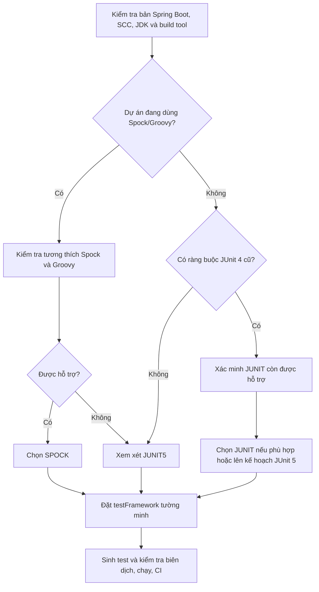
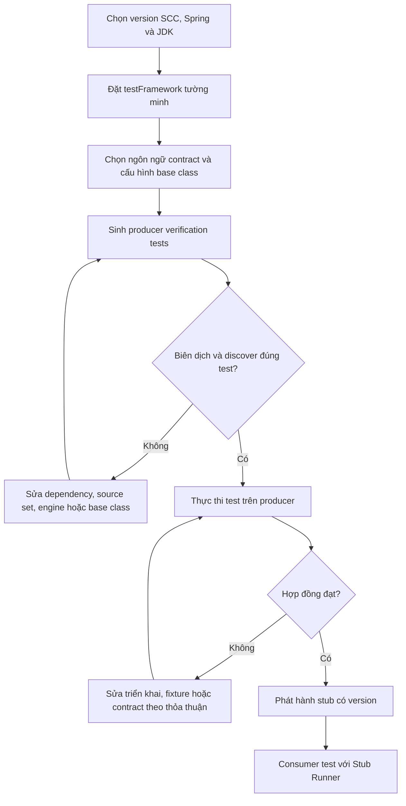

# Chọn JUnit, Spock và ngôn ngữ kiểm thử theo khả năng hỗ trợ

## 1. Vì sao chọn test framework là một quyết định khi thiết lập dự án?

Trong hệ thống microservices, `producer` cung cấp HTTP API hoặc phát thông điệp, còn `consumer` dựa vào hành vi của producer để xử lý nghiệp vụ. **Spring Cloud Contract** giúp hai bên định nghĩa hành vi bằng **Groovy DSL/YAML DSL**, sinh bài kiểm thử phía producer, đóng gói stub và cho consumer dùng **Stub Runner** để kiểm thử trước khi tích hợp thật. Việc chạy các bước này trong CI giúp phát hiện những thay đổi API không tương thích.

Khi cấu hình producer verification, nhóm phát triển phải quyết định **bộ kiểm thử được sinh sẽ sử dụng JUnit hay Spock**. Quyết định này ảnh hưởng đến mã test sinh ra, thư viện cần cài, lớp base test, cách build nhận diện và thực thi test. Nếu chọn sai, contract hợp lệ nhưng bài test sinh ra có thể không biên dịch hoặc không được CI thực thi.

Ví dụ, một nhóm viết mã sản phẩm bằng Java và đã có nhiều test JUnit Jupiter. Họ muốn xác minh hợp đồng:

```http
GET /api/payments/PAY-1001
Accept: application/json
```

Producer phải trả:

```json
{
  "paymentId": "PAY-1001",
  "orderId": "ORD-2001",
  "status": "PAID",
  "currency": "VND"
}
```

Nhóm có thể giữ nguyên nội dung contract và sinh test **JUnit 5 (Java)**; một nhóm sử dụng Groovy/Spock có thể dùng cùng contract nhưng sinh test **Spock (Groovy)**. Chọn framework không thay đổi ý nghĩa cam kết nghiệp vụ; nó thay đổi **cách xác minh cam kết trên producer**.

Sau bài này, bạn cần tự lựa chọn được JUnit 5/JUnit 4/Spock phù hợp, phân biệt ngôn ngữ viết contract với ngôn ngữ test sinh ra, cấu hình Maven/Gradle ở mức cần thiết, và biết kiểm tra những điểm dễ sai trước khi đưa vào CI.

## 2. Tách bốn quyết định thường bị nhầm với nhau

Một dự án dùng Spring Cloud Contract thực tế có ít nhất bốn trục cấu hình độc lập:

| Quyết định | Ví dụ | Tác động |
| --- | --- | --- |
| **Ngôn ngữ sản phẩm** | Java, Kotlin, Groovy | Ngôn ngữ mà code của producer/consumer được viết. |
| **Ngôn ngữ định nghĩa contract** | YAML DSL (`.yml`), Groovy DSL (`.groovy`); các DSL khác khi bản phát hành hỗ trợ | Cú pháp mô tả request/response hoặc thông điệp. |
| **Framework của test được sinh** | `JUNIT5`, `JUNIT` (JUnit 4 trong bản hỗ trợ), `SPOCK` | Import, annotation/cấu trúc test và runtime dùng để thực thi producer verification. |
| **Cách test HTTP** | MockMvc, WebTestClient hoặc cách gọi HTTP khác theo `testMode` | Cơ chế gửi request đến producer trong test; **khác** với việc chọn JUnit hay Spock. |

Ví dụ tổ hợp hoàn toàn hợp lý:

- Producer viết bằng **Java**; contract viết bằng **Groovy DSL**; bài test sinh ra là **JUnit 5, mã Java**, dùng **MockMvc**.
- Producer viết bằng **Java**; contract viết bằng **YAML DSL**; bài test sinh ra là **Spock, mã Groovy**, dùng **MockMvc**.
- Producer viết bằng **Kotlin**; contract viết bằng **YAML**; bài test sinh ra là **JUnit 5, mã Java**, nếu trình sinh test và cấu hình build của phiên bản dùng hỗ trợ tổ hợp này.

**Không được suy ra “contract viết Groovy thì phải chọn Spock”.** Groovy DSL là cú pháp của **đầu vào**; `testFramework` quyết định **đầu ra**. Cũng không được suy ra ứng dụng Kotlin sẽ tự động nhận các producer verification test được sinh thành Kotlin. Cần kiểm tra khả năng của generator và bố trí base class phù hợp.

Các phần sau tập trung vào các lựa chọn phổ biến của Spring Cloud Contract Verifier. Khả năng và mặc định có thể khác giữa các bản Spring Cloud Contract, Maven plugin và Gradle plugin; **chọn framework tường minh** giúp tránh sai khác do nâng cấp.

## 3. JUnit 5: lựa chọn khởi đầu phổ biến cho dự án Java

**JUnit 5** gồm các thành phần như JUnit Platform và Jupiter. Với dự án Spring Boot hiện đại đã sử dụng `spring-boot-starter-test` và JUnit Jupiter, đây thường là lựa chọn tự nhiên cho test producer được sinh từ contract.

Đặc điểm:

- Test thường được sinh dưới dạng lớp **Java**, dùng annotation `org.junit.jupiter.api.Test`.
- Có thể dùng `@BeforeEach`, `@AfterEach`, `@BeforeAll` và các extension theo mô hình Jupiter.
- Build Maven/Gradle cần có JUnit Jupiter tương thích và **test engine được cấu hình để phát hiện test**.
- Base test class có thể cung cấp Spring context, MockMvc/RestAssuredMockMvc, fixture dữ liệu hoặc cấu hình messaging cho những test được sinh.

Ví dụ một bài test JUnit 5 *được viết tay để minh họa cú pháp*, không phải kết quả nguyên văn của generator:

```java
import org.junit.jupiter.api.Test;
import static org.assertj.core.api.Assertions.assertThat;

class PaymentDecisionTest {

    @Test
    void paidPaymentCanConfirmOrder() {
        String paymentStatus = "PAID";
        assertThat(paymentStatus).isEqualTo("PAID");
    }
}
```

Test thực tế do Spring Cloud Contract Verifier sinh sẽ gọi endpoint hoặc xác minh thông điệp của producer theo contract; ví dụ ngắn trên chỉ giúp nhận diện **cú pháp JUnit Jupiter**, không thay thế một producer verification test.

### Khi nên chọn JUnit 5

Chọn `JUNIT5` khi nhóm đã có hạ tầng Java/Jupiter, muốn tận dụng cấu hình test Spring Boot hiện có, không cần các tính năng đặc trưng của Spock và phiên bản Spring Cloud Contract đang dùng hỗ trợ sinh test JUnit 5. Với dự án mới, **ưu tiên xem xét JUnit 5 trước** rồi xác minh compatibility matrix của Spring Boot, JDK và Spring Cloud Contract mà nhóm đang sử dụng.

## 4. JUnit 4: chủ yếu dành cho hệ thống còn ràng buộc legacy

Một số phiên bản Spring Cloud Contract Verifier cho phép cấu hình `JUNIT` để sinh **JUnit 4**. Đó là lựa chọn có thể phù hợp với dự án lâu năm đang sử dụng `org.junit.Test`, `@Before` hoặc những runner cũ chưa chuyển sang Jupiter.

| Khía cạnh | JUnit 4 | JUnit 5 (Jupiter) |
| --- | --- | --- |
| Annotation test | `org.junit.Test` | `org.junit.jupiter.api.Test` |
| Chuẩn bị trước mỗi test | `@Before` | `@BeforeEach` |
| Tích hợp Spring kiểu cũ | Thường gặp `@RunWith(SpringRunner.class)` | Thường dùng Spring TestContext với Jupiter/`SpringExtension` |
| Thực thi trên JUnit Platform | Cần hỗ trợ chạy JUnit 4 thích hợp, ví dụ Vintage trong cấu hình có hỗ trợ | Jupiter engine |
| Khuyến nghị cho dự án mới | Chỉ khi có ràng buộc rõ ràng | Thường là điểm xuất phát phù hợp hơn |

**Đừng nhầm `JUNIT` với `JUNIT5`.** Đây là hai giá trị cấu hình khác nhau trong những phiên bản cung cấp cả hai lựa chọn. Không nên trông chờ việc thêm dependency JUnit 5 sẽ tự biến test sinh theo JUnit 4 thành test Jupiter.

Nếu cần giữ JUnit 4, kiểm tra phiên bản plugin có hỗ trợ `JUNIT`, thư viện tương ứng, quá trình phát hiện test của Maven Surefire/Gradle và khả năng cùng tồn tại với JUnit 5. Không tự thêm Vintage nếu không có test JUnit 4 cần chạy.

## 5. Spock: lựa chọn dựa trên Groovy và cách mô tả hành vi

**Spock** là testing framework JVM sử dụng Groovy và cách viết kịch bản `given/when/then`. Nó hữu ích khi nhóm đã quen Groovy, thích viết kiểm thử theo hành vi và có cấu hình Spock phù hợp với phiên bản JDK/Spring của dự án.

Một ví dụ Spock **viết tay để minh họa ngôn ngữ**, không phải test được sinh nguyên văn:

```groovy
import spock.lang.Specification

class PaymentDecisionSpec extends Specification {

    def "đơn hàng chỉ được xác nhận khi thanh toán thành công"() {
        given:
        def paymentStatus = 'PAID'

        when:
        def allowed = (paymentStatus == 'PAID')

        then:
        allowed
    }
}
```

Khi cấu hình `testFramework = 'SPOCK'`, Spring Cloud Contract có thể sinh kiểm thử producer dùng **Spock/Groovy**. Bạn cần bổ sung `spock-core`, thường thêm `spock-spring` khi cần Spring TestContext, và bảo đảm build biên dịch Groovy test sources. Với Spock 2.x, test được chạy trên **JUnit Platform**; vì vậy Gradle thường cần `useJUnitPlatform()`. Phải chọn bản Spock tương thích với **Groovy và JDK** thực tế của dự án, thay vì chỉ xét phiên bản Spring Cloud Contract.

### Khi nên chọn Spock

Spock phù hợp khi nhóm đã có test Groovy/Spock, muốn đồng bộ cách viết và có khả năng duy trì toolchain Groovy. Trong một dự án Java, **vẫn có thể** sử dụng Spock để kiểm thử code Java nếu dependency và build được cấu hình đúng; không cần viết lại producer sang Groovy.

Chi phí cần tính đến: thêm compiler/runtime Groovy, Spock và các ràng buộc phiên bản; cấu hình build phức tạp hơn đối với nhóm chỉ dùng Java. Vì thế không nên chuyển sang Spock chỉ vì contract được viết bằng Groovy DSL.

## 6. Chọn framework bằng ma trận quyết định

| Bối cảnh dự án | Khuyến nghị khởi đầu | Điều kiện phải xác minh |
| --- | --- | --- |
| Spring Boot/Java mới, test hiện có là Jupiter | `JUNIT5` | Plugin sinh test JUnit 5, Jupiter được build chạy và base class đúng. |
| Dự án Java dùng Kotlin cho một số module | `JUNIT5` nếu generator phù hợp | Generated Java tests có biên dịch được và gọi được base class/Kotlin code không. |
| Nhóm sử dụng Groovy/Spock 2.x thường xuyên | `SPOCK` | Bản Groovy, Spock, JDK và Spring tương thích; Groovy test được compile và discover. |
| Monolith/microservice legacy đang dùng JUnit 4 | `JUNIT` **nếu phiên bản plugin còn hỗ trợ** | JUnit 4 runner/engine, Spring test setup và kế hoạch nâng cấp. |
| Consumer chỉ dùng Stub Runner để kiểm thử HTTP client | Framework **của consumer** có thể độc lập | Consumer phải chạy được stub đúng version; không cần trùng framework producer. |
| Hợp đồng là messaging thay vì HTTP | Dùng framework phù hợp bộ test hiện có | Thêm tích hợp messaging/test mode và test base đúng; chỉ đổi JUnit sang Spock không đủ. |

Một quy trình chọn ngắn gọn:



Đừng lấy “framework nào quen tay hơn” làm tiêu chí duy nhất. **Khả năng sinh test của phiên bản Spring Cloud Contract đang dùng là ràng buộc đầu tiên**; tiếp đó là sự tương thích của engine, thư viện, nguồn test và build tool.

## 7. Ví dụ hợp đồng dùng chung cho cả JUnit và Spock

Định nghĩa YAML đơn giản cho dịch vụ `payment-service`:

```yaml
description: Tra cứu giao dịch đã thanh toán
name: should_return_paid_payment
request:
  method: GET
  url: /api/payments/PAY-1001
response:
  status: 200
  headers:
    Content-Type: application/json
  body:
    paymentId: PAY-1001
    orderId: ORD-2001
    status: PAID
    currency: VND
```

Từ **cùng nội dung YAML** này, generator sẽ tạo dạng test producer phụ thuộc `testFramework`. Nếu là JUnit 5, mã được sinh thường chứa phương thức có `@Test` của Jupiter và kiểm tra HTTP response; nếu là Spock, nó dùng cấu trúc specification/feature method Groovy. **Nội dung contract không phải đổi chỉ để chuyển framework**.

Hợp đồng Groovy DSL cũng có thể mô tả cùng tương tác:

```groovy
import org.springframework.cloud.contract.spec.Contract

Contract.make {
    name 'should_return_paid_payment'
    request {
        method 'GET'
        url '/api/payments/PAY-1001'
    }
    response {
        status 200
        headers {
            contentType(applicationJson())
        }
        body([
            paymentId: 'PAY-1001',
            orderId: 'ORD-2001',
            status: 'PAID',
            currency: 'VND'
        ])
    }
}
```

Hai đoạn chỉ là **hai biểu diễn thay thế** cho cùng kịch bản; trong dự án thật, không cần giữ cả hai thành hai contract trùng nhau. Ngôn ngữ mô tả hợp đồng không phải ngôn ngữ của test mà nhóm viết thủ công, và cũng không quyết định framework của test sinh ra.

## 8. Thiết lập JUnit 5 với Maven

Với một Maven producer dùng Spring Boot, bạn cần:

1. Quản lý các phiên bản Spring Boot, Spring Cloud Contract và thư viện test tương thích theo release train/phụ thuộc của dự án.
2. Thêm dependency kiểm thử, thường bao gồm `spring-boot-starter-test` và `spring-cloud-starter-contract-verifier`.
3. Cấu hình Spring Cloud Contract Maven plugin với `testFramework = JUNIT5` và một base test class phù hợp.
4. Đảm bảo Maven Surefire/Failsafe (tùy lifecycle) phát hiện và chạy các test sinh ra.

Ví dụ **các đoạn cấu hình cần ghép vào** `pom.xml` của dự án hiện có:

```xml
<!-- Bên trong <dependencies>: -->
<dependency>
    <groupId>org.springframework.boot</groupId>
    <artifactId>spring-boot-starter-test</artifactId>
    <scope>test</scope>
</dependency>
<dependency>
    <groupId>org.springframework.cloud</groupId>
    <artifactId>spring-cloud-starter-contract-verifier</artifactId>
    <scope>test</scope>
</dependency>

<!-- Bên trong <build><plugins>: -->
<plugin>
    <groupId>org.springframework.cloud</groupId>
    <artifactId>spring-cloud-contract-maven-plugin</artifactId>
    <version>REPLACE_WITH_COMPATIBLE_SCC_VERSION</version>
    <extensions>true</extensions>
    <configuration>
        <testFramework>JUNIT5</testFramework>
        <baseClassForTests>com.example.payment.ContractBase</baseClassForTests>
    </configuration>
</plugin>
```

Đây là **mảnh cấu hình minh họa**, không phải một file POM hoàn chỉnh. Khi dùng thật, thay placeholder phiên bản bằng bản tương thích, quản lý version của dependency qua BOM/parent thích hợp và thêm các plugin khác mà dự án yêu cầu. Không trộn tùy ý thư viện thuộc các dòng Spring Boot/Spring Cloud Contract khác nhau.

### Lớp base cho test HTTP theo MockMvc

Một base class Java minh họa cho producer Spring MVC:

```java
package com.example.payment;

import io.restassured.module.mockmvc.RestAssuredMockMvc;
import org.junit.jupiter.api.BeforeEach;
import org.springframework.beans.factory.annotation.Autowired;
import org.springframework.boot.test.autoconfigure.web.servlet.AutoConfigureMockMvc;
import org.springframework.boot.test.context.SpringBootTest;
import org.springframework.web.context.WebApplicationContext;

@SpringBootTest
@AutoConfigureMockMvc
public abstract class ContractBase {

    @Autowired
    protected WebApplicationContext context;

    @BeforeEach
    void setUpContractTests() {
        RestAssuredMockMvc.webAppContextSetup(context);
        // Chuẩn bị fixture kiểm thử nếu contract cần dữ liệu cố định.
    }
}
```

Lớp này minh họa việc khởi động Spring TestContext và nối RestAssuredMockMvc với ứng dụng. Trong dự án thực tế, cần có controller, bean và dữ liệu nền tương ứng với `PAY-1001`. Nếu generator sử dụng một `testMode` khác (ví dụ WebTestClient), cách thiết lập base class sẽ khác. Hãy kiểm tra source của test sinh ra trước khi chọn cách khởi tạo.

Với các phiên bản có bố cục Maven phổ biến, contract đặt trong `src/test/resources/contracts`. Plugin sẽ tạo mã test trong thư mục generated sources dưới `target/`; đây là **sản phẩm build** nên thông thường không sửa trực tiếp.

## 9. Thiết lập JUnit 5 hoặc Spock với Gradle

### 9.1. Một cấu hình JUnit 5 với Gradle Groovy DSL

Ví dụ các phần chính của `build.gradle` (plugin/dependency version phải được quản lý bằng tập phiên bản tương thích):

```groovy
plugins {
    id 'java'
    id 'org.springframework.cloud.contract' version 'REPLACE_WITH_COMPATIBLE_SCC_VERSION'
}

dependencies {
    testImplementation 'org.springframework.boot:spring-boot-starter-test'
    testImplementation 'org.springframework.cloud:spring-cloud-starter-contract-verifier'
}

contracts {
    testFramework = 'JUNIT5'
    baseClassForTests = 'com.example.payment.ContractBase'
}

tasks.withType(Test).configureEach {
    useJUnitPlatform()
}
```

Đây cũng là **mảnh cấu hình** cần kết hợp với các plugin Spring Boot/Dependency Management, repository và BOM thích hợp. Cách xác định source set cho contract thay đổi theo đời plugin: các tài liệu Gradle mới sử dụng `src/contractTest/resources/contracts` và `src/contractTest/java` hoặc `groovy` cho base class; các hướng dẫn cũ có thể dùng `src/test/resources/contracts`. Hãy theo đúng phiên bản plugin và cấu hình `contractsDslDir`/source set thực tế, không tự suy đoán rằng Maven và Gradle đặt file giống hệt nhau.

### 9.2. Đổi sang Spock cần thay đổi những gì?

Trong dự án Gradle có Groovy/Spock, các phần liên quan sẽ có dạng:

```groovy
plugins {
    id 'groovy'
    id 'org.springframework.cloud.contract' version 'REPLACE_WITH_COMPATIBLE_SCC_VERSION'
}

dependencies {
    testImplementation 'org.springframework.cloud:spring-cloud-starter-contract-verifier'
    testImplementation 'org.spockframework:spock-core:REPLACE_WITH_COMPATIBLE_SPOCK_VERSION'
    testImplementation 'org.spockframework:spock-spring:REPLACE_WITH_COMPATIBLE_SPOCK_VERSION'
}

contracts {
    testFramework = 'SPOCK'
    baseClassForTests = 'com.example.payment.ContractSpecification'
}

tasks.withType(Test).configureEach {
    useJUnitPlatform() // Cho Spock 2.x chạy trên JUnit Platform.
}
```

Ngoài các dependency trên, dự án phải có **Groovy runtime/compiler tương thích** với Spock và Spring Cloud Contract; cấu hình quản lý phiên bản tương ứng là bắt buộc. Nếu đang dùng Gradle Kotlin DSL (`build.gradle.kts`), cú pháp build script sẽ khác; không dán nguyên đoạn Groovy DSL vào Kotlin DSL.

Base specification Groovy minh họa:

```groovy
package com.example.payment

import io.restassured.module.mockmvc.RestAssuredMockMvc
import org.springframework.beans.factory.annotation.Autowired
import org.springframework.boot.test.autoconfigure.web.servlet.AutoConfigureMockMvc
import org.springframework.boot.test.context.SpringBootTest
import org.springframework.web.context.WebApplicationContext
import spock.lang.Specification

@SpringBootTest
@AutoConfigureMockMvc
abstract class ContractSpecification extends Specification {

    @Autowired
    WebApplicationContext context

    def setup() {
        RestAssuredMockMvc.webAppContextSetup(context)
    }
}
```

Khác với JUnit Jupiter, Spock có lifecycle method `setup()` và cấu trúc `Specification`. Chỉ định một base class Java dùng `@BeforeEach` rồi chuyển generator sang Spock không phải lúc nào cũng phù hợp; cần xem lại lifecycle, classpath và cách test sinh ra kế thừa base class. Ngược lại, JUnit 5 không tự hiểu các block `given/when/then` của Spock.

### 9.3. Maven + Spock cũng cần biên dịch Groovy

Khi producer dùng Maven và chọn:

```xml
<configuration>
    <testFramework>SPOCK</testFramework>
    <baseClassForTests>com.example.payment.ContractSpecification</baseClassForTests>
</configuration>
```

chưa thể coi cấu hình đã đủ. Maven cần các dependency Spock/Groovy phù hợp, plugin biên dịch Groovy test (ví dụ GMavenPlus với goal tương ứng), cấu hình source test và test runner hỗ trợ Spock đang dùng. Hãy xác minh trong lifecycle `test` hoặc `verify` có **biên dịch và thực thi thật** các specification được sinh; chỉ nhìn thấy file `.groovy` trong `target/` chưa chứng minh các test đã được chạy.

## 10. Dự án Kotlin, Groovy và Java nên tổ chức test thế nào?

### Java

Với dự án Java, JUnit 5/Java thường đơn giản về toolchain. Nếu muốn Spock, thêm Groovy/Spock cho test mà vẫn giữ mã production Java. Contract có thể là YAML hoặc Groovy DSL tùy nhóm thích đọc và khả năng của phiên bản.

### Groovy

Với dự án Groovy, Spock là lựa chọn quen thuộc, nhưng JUnit 5 vẫn có thể dùng khi test source và runtime hỗ trợ. **Không có quy tắc bắt buộc “Groovy phải Spock”**. Quyết định vẫn dựa trên generator, compiler và framework đã cài.

### Kotlin

Kotlin có thể dùng JUnit Jupiter cho các test viết tay; đồng thời Spring Cloud Contract có thể sinh producer verification test bằng **Java** trong những cấu hình được hỗ trợ. Nếu ứng dụng viết bằng Kotlin nhưng dùng base class cho generated Java tests, cần kiểm tra:

- Base class có thể được Java kế thừa và truy cập được không? Kotlin class thông thường là `final`; một `abstract class` hoặc `open class` phù hợp hơn khi cần kế thừa.
- Các method/bean mà Java generated test cần gọi có public/protected và kiểu tương thích không?
- Module test có biên dịch Java và Kotlin theo đúng thứ tự và source set không?
- Phiên bản Spring Cloud Contract có hỗ trợ DSL đầu vào mong muốn không? Nếu muốn viết contract bằng Kotlin DSL, có thể cần thêm artifact hoặc plugin riêng tùy đời sản phẩm.

Do đó, **ngôn ngữ viết ứng dụng**, **ngôn ngữ định nghĩa hợp đồng** và **ngôn ngữ code được sinh** cần được quyết định riêng. Chọn framework của test sinh ra từ khả năng toolchain hiện có, không suy diễn từ phần mở rộng `.kt` hay `.groovy` của mã nghiệp vụ.

## 11. HTTP test mode và messaging là những lựa chọn riêng

Spring Cloud Contract Verifier có thêm cấu hình **test mode**, đặc biệt đối với HTTP. Ví dụ:

| Test mode/mục đích | Khi xem xét |
| --- | --- |
| **MockMvc** | Producer là ứng dụng Spring MVC; test gọi controller thông qua Spring Test và MockMvc. |
| **WebTestClient** | Producer dùng WebFlux/reactive stack, phiên bản SCC hỗ trợ mode tương ứng. |
| **HTTP thực/explicit mode** | Muốn gửi request đến cổng HTTP của ứng dụng test thay vì chỉ chạy lớp MVC; cần cấu hình server/base URL và lifecycle phù hợp. |
| **Messaging verification** | Cần xác minh message, trigger, destination, payload; đòi hỏi test setup tích hợp hệ thống thông điệp. |

**`testFramework = JUNIT5` không tự có nghĩa `testMode = MOCKMVC`.** Chúng là hai quyết định khác nhau. Ví dụ một test JUnit 5 có thể sử dụng WebTestClient nếu generator/plugin và ứng dụng được cấu hình phù hợp.

Với messaging, test sinh ra có thể cần base class khởi tạo Spring context, messaging verifier, đầu vào và cấu hình broker/test binder theo công nghệ sử dụng. Chọn Spock hay JUnit 5 **không tự giải quyết** việc mô phỏng Kafka/RabbitMQ. Contract cần mô tả rõ thông điệp được phát hoặc tiếp nhận; các bước test phải thực sự quan sát hành vi đó.

## 12. Kiểm tra test sinh ra trước khi công bố stub

Sau khi chọn test framework, kiểm tra theo chu trình:



Với Maven, có thể dùng `./mvnw clean verify` (hoặc lifecycle publish phù hợp) để kích hoạt bước sinh và thực thi test; với Gradle, thường dùng `./gradlew clean check`. Các lệnh là **ví dụ thực hành**; task/goals cụ thể và vị trí generated sources phụ thuộc bản plugin và project setup.

Ở cả hai trường hợp, hãy xác minh **ba điều**:

1. Có test thực sự được sinh từ contract, với import/syntax đúng framework đã chọn.
2. Test được compiler chấp nhận, được engine phát hiện, và báo **có số lượng test đã chạy**. Build xanh khi không test nào được chạy là tín hiệu phải điều tra.
3. Test chạy với dữ liệu đúng và có thể thất bại có ý nghĩa khi producer thay đổi response trái hợp đồng (ví dụ đổi `status` thành `state`).

Chỉ sau khi producer verification đạt mới nên coi stub là biểu diễn của một phiên bản producer đã xác minh. Consumer dùng Stub Runner lấy artifact stub theo phiên bản; **framework test bên consumer có thể khác với producer**. Ví dụ producer sinh test Spock còn consumer kiểm thử client bằng JUnit 5 là hoàn toàn phù hợp nếu cả hai đều thực thi được.

### Lỗi thường gặp và cách khoanh vùng

| Triệu chứng | Nguyên nhân cần kiểm tra | Cách xử lý |
| --- | --- | --- |
| Không tìm thấy `org.junit.jupiter.api.Test` | Chọn `JUNIT5` nhưng thiếu Jupiter dependencies/phiên bản sai. | Kiểm tra test runtime và bộ quản lý dependencies. |
| Generated test dùng `org.junit.Test` nhưng dự án chỉ cấu hình Jupiter | Plugin sinh JUnit 4 do lựa chọn/mặc định khác. | Chỉ định `JUNIT5` nếu phiên bản hỗ trợ, hoặc cấu hình chạy JUnit 4 phù hợp. |
| Không thấy test Spock chạy | Thiếu Groovy compiler, Spock runtime hoặc JUnit Platform cho Spock 2.x. | Kiểm tra compileTests, source set, Test task/Surefire và số test chạy. |
| Không kế thừa được `ContractBase` | Sai FQN, class không truy cập được, Kotlin class `final`, hoặc mapping base sai. | Đối chiếu `baseClassForTests`/`packageWithBaseClasses` và lớp thực tế. |
| Test sinh ra gọi sai công cụ HTTP | `testMode` và lớp base setup không phù hợp. | Đồng bộ MockMvc/WebTestClient/HTTP mode với ứng dụng. |
| Test chạy nhưng phản hồi khác contract | Fixture không được nạp, endpoint sai, dữ liệu producer khác cam kết. | Xem request/response của generated test và trạng thái trước test. |
| Local chạy, CI không thấy test | Source set, include/exclude pattern, test engine hoặc plugin lifecycle khác. | Kiểm tra báo cáo test của CI và log task generate/compile/test. |
| Sau khi nâng cấp Spring Cloud Contract, test đổi framework bất ngờ | Dựa vào giá trị mặc định hoặc API plugin đã đổi. | Khai báo `testFramework` tường minh và kiểm tra compatibility/version notes. |

Lưu ý về **mặc định**: có tài liệu/phiên bản mô tả JUnit 4 là mặc định, trong khi trang tham số Maven plugin của một dòng phát hành khác ghi mặc định `JUNIT5`. Vì vậy đừng dựa trên một bài hướng dẫn cho phiên bản khác; hãy kiểm tra đúng bản plugin đang chạy và **đặt giá trị cụ thể** trong cấu hình dự án.

## 13. Bài tập tình huống

Một công ty có ba producer:

- **Payment API:** Spring Boot/Java, Gradle, toàn bộ test đã chuyển sang JUnit Jupiter.
- **Inventory API:** Spring Boot/Java, Maven, đội phát triển viết kiểm thử Groovy/Spock thường xuyên.
- **Legacy Shipping API:** Java/Spring cũ, dùng JUnit 4 và một runner tùy chỉnh; chưa thể nâng cấp JDK trong quý này.

Tất cả đều định nghĩa các tương tác HTTP bằng Spring Cloud Contract và xuất bản stub cho consumer khác dùng Stub Runner.

**Yêu cầu thực hành:**

1. Đề xuất `testFramework` cho từng producer và nêu rõ điều kiện compatibility phải xác minh trước khi cấu hình.
2. Với Payment API, viết cấu hình `JUNIT5`, thiết kế `ContractBase` để generator gửi request qua MockMvc, và dùng YAML contract trả `status: PAID`.
3. Với Inventory API, trình bày phần Gradle/Maven hoặc plugin biên dịch Groovy test cần thiết nếu chọn `SPOCK`. Giải thích vì sao producer vẫn có thể dùng code Java.
4. Với Legacy Shipping API, nêu phương án chạy JUnit 4 nếu plugin hỗ trợ và một lộ trình chuyển sang JUnit 5 khi tương thích.
5. Producer Payment sinh test JUnit 5 nhưng consumer Checkout dùng Spock: điều này có ngăn Stub Runner làm việc không? Hãy giải thích tính độc lập của hai bộ test.
6. Trong CI, thêm bước xác minh có bài test được sinh, được phát hiện, và **cố tình thay** response `status: PAID` thành `status: PENDING` để kiểm chứng rằng bài test sẽ thất bại.

**Gợi ý tự kiểm:** Một câu trả lời tốt tách rõ ngôn ngữ contract, framework test sinh ra, ngôn ngữ sản phẩm, HTTP mode và engine thực thi. Nó còn kiểm tra phiên bản tương thích, có base class hợp lệ và không kết luận build đạt nếu test producer chưa thực sự chạy.

## 14. Ghi nhớ

- **JUnit 5** thường phù hợp với dự án Java/Spring Boot hiện đại; **Spock** phù hợp khi nhóm sẵn dùng Groovy và toolchain tương thích; **JUnit 4** dành cho các hệ thống cần duy trì legacy nếu bản Spring Cloud Contract hỗ trợ.
- **Groovy/YAML DSL là ngôn ngữ hợp đồng**, không quyết định test được sinh là Java JUnit hay Groovy Spock.
- Khai báo `testFramework` **tường minh** (`JUNIT5`, `SPOCK` hoặc `JUNIT` khi được hỗ trợ) và xác minh tài liệu của phiên bản đang dùng, bởi mặc định có thể khác nhau.
- Spring Cloud Contract cần **base test class**, dependency, build source set và test engine phù hợp; `testMode` và messaging integration là các cấu hình riêng.
- Chỉ coi stub là đáng tin cậy khi **producer verification được sinh, biên dịch và chạy đạt**. Consumer có thể sử dụng framework kiểm thử khác với producer.

### Tài liệu tham khảo

- [Spring Cloud Contract — Maven Project](https://docs.spring.io/spring-cloud-contract/reference/maven-project.html): cấu hình Maven plugin và generated tests.
- [Spring Cloud Contract — Gradle Project](https://docs.spring.io/spring-cloud-contract/reference/gradle-project.html): cấu hình Gradle, Spock dependencies, source set và testFramework.
- [Spring Cloud Contract Maven Plugin — generateTests](https://docs.spring.io/spring-cloud-contract/docs/current/spring-cloud-contract-maven-plugin/generateTests-mojo.html): tham số của goal sinh test, gồm `testFramework` và `testMode` theo phiên bản plugin được công bố.
- [Spring Cloud Contract — Getting Started](https://docs.spring.io/spring-cloud-contract/reference/getting-started.html): hướng dẫn contract HTTP, producer verification và stub.
- [Spock Framework — Documentation](https://spockframework.org/spock/docs/2.4/index.html): điều kiện Groovy/JDK và cách chạy Spock trên JUnit Platform.
