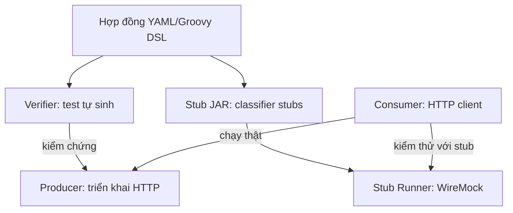
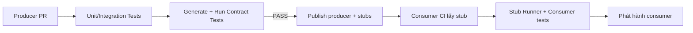

# Tạo producer và consumer tối thiểu

> **Chương:** Thiết lập dự án  
> **Công nghệ:** Spring Cloud Contract (`SPRING_CLOUD_CONTRACT`), Spring Boot, Maven, JUnit 5, Contract Verifier và Stub Runner.

## Mục tiêu học tập

Bài này hướng dẫn dựng **hai ứng dụng Spring Boot độc lập** để học kiểm thử hợp đồng giữa dịch vụ cung cấp (*producer*) và dịch vụ sử dụng (*consumer*). Sau bài học, bạn có thể:

1. Tạo API HTTP ở producer và HTTP client ở consumer.
2. Mô tả giao tiếp bằng **Spring Cloud Contract YAML DSL** (và nhận biết bản tương đương Groovy DSL).
3. Dùng **Contract Verifier** sinh và chạy test phía producer.
4. Đóng gói **stub JAR**, cài vào Maven local repository.
5. Dùng **Stub Runner** chạy stub cho consumer test mà không khởi động producer thật.
6. Chạy thử hai ứng dụng với HTTP thật và nêu cách đưa các bước trên vào CI.

## 1. Bức tranh tổng thể

Giả sử hệ thống bán hàng gồm:

- `inventory-producer`: trả lượng hàng còn lại.
- `checkout-consumer`: hỏi producer xem có đủ hàng cho một đơn đặt hay không.

Consumer gọi:

```http
GET /api/stock/SKU-001 HTTP/1.1
Accept: application/json
```

Producer hứa trả:

```http
HTTP/1.1 200 OK
Content-Type: application/json

{"sku":"SKU-001","available":true,"quantity":4}
```

Trong hợp đồng này, `available` là boolean và `quantity` là số nguyên. Consumer quyết định cho phép mua khi hai điều kiện `available == true` và `quantity >= requested` đều đúng.



**Điểm quan trọng:** test producer kiểm chứng **implementation** đối với hợp đồng; consumer test dùng stub được sinh từ hợp đồng. Hai loại test bổ sung cho nhau: consumer test không tự chứng minh producer mới nhất vẫn giữ đúng contract nếu producer verification bị bỏ qua.

## 2. Công cụ và cấu trúc thư mục

Chuẩn bị JDK 17 trở lên, Maven 3.9 trở lên, IDE Java và `curl`. Có thể dùng Maven Wrapper (`mvnw`) nếu từng dự án có wrapper riêng.

**Bộ phiên bản minh họa:** Spring Boot `4.0.0`, Spring Cloud BOM `2025.1.5` và Spring Cloud Contract Maven plugin `5.0.3`. Đây là bộ ví dụ cố định để người học theo dõi. Khi dùng phiên bản khác, kiểm tra [bảng tương thích Spring Cloud – Spring Boot](https://spring.io/projects/spring-cloud/) và cập nhật plugin tương ứng; phiên bản Maven plugin phải khai báo riêng, không được quản lý tự động bởi dependency BOM.

Tạo hai Maven project trong cùng thư mục:

```text
contract-demo/
├── inventory-producer/
│   ├── pom.xml
│   └── src/
│       ├── main/
│       │   ├── java/com/example/inventory/
│       │   │   ├── InventoryApplication.java
│       │   │   └── StockController.java
│       │   └── resources/application.properties
│       └── test/
│           ├── java/com/example/inventory/ContractTestBase.java
│           └── resources/contracts/stock_available.yml
└── checkout-consumer/
    ├── pom.xml
    └── src/
        ├── main/
        │   ├── java/com/example/checkout/
        │   │   ├── CheckoutApplication.java
        │   │   ├── InventoryClient.java
        │   │   └── CheckoutController.java
        │   └── resources/application.properties
        └── test/
            └── java/com/example/checkout/InventoryClientContractTest.java
```

Đây là hai dự án Maven riêng, không cần parent/aggregator chung. Tên `artifactId` của producer sẽ xuất hiện trong tọa độ stub mà consumer sử dụng.

## 3. Khởi tạo producer

### 3.1. Maven của inventory-producer

Tạo `inventory-producer/pom.xml`:

```xml
<?xml version="1.0" encoding="UTF-8"?>
<project xmlns="http://maven.apache.org/POM/4.0.0"
         xmlns:xsi="http://www.w3.org/2001/XMLSchema-instance"
         xsi:schemaLocation="http://maven.apache.org/POM/4.0.0
                             https://maven.apache.org/xsd/maven-4.0.0.xsd">
    <modelVersion>4.0.0</modelVersion>
    <parent>
        <groupId>org.springframework.boot</groupId>
        <artifactId>spring-boot-starter-parent</artifactId>
        <version>4.0.0</version>
        <relativePath/>
    </parent>

    <groupId>com.example</groupId>
    <artifactId>inventory-producer</artifactId>
    <version>1.0.0</version>

    <properties>
        <java.version>17</java.version>
        <spring-cloud.version>2025.1.5</spring-cloud.version>
        <spring-cloud-contract.version>5.0.3</spring-cloud-contract.version>
    </properties>

    <dependencyManagement>
        <dependencies>
            <dependency>
                <groupId>org.springframework.cloud</groupId>
                <artifactId>spring-cloud-dependencies</artifactId>
                <version>${spring-cloud.version}</version>
                <type>pom</type>
                <scope>import</scope>
            </dependency>
        </dependencies>
    </dependencyManagement>

    <dependencies>
        <dependency>
            <groupId>org.springframework.boot</groupId>
            <artifactId>spring-boot-starter-webmvc</artifactId>
        </dependency>
        <dependency>
            <groupId>org.springframework.boot</groupId>
            <artifactId>spring-boot-starter-test</artifactId>
            <scope>test</scope>
        </dependency>
        <dependency>
            <groupId>org.springframework.cloud</groupId>
            <artifactId>spring-cloud-starter-contract-verifier</artifactId>
            <scope>test</scope>
        </dependency>
    </dependencies>

    <build>
        <plugins>
            <plugin>
                <groupId>org.springframework.boot</groupId>
                <artifactId>spring-boot-maven-plugin</artifactId>
            </plugin>
            <plugin>
                <groupId>org.springframework.cloud</groupId>
                <artifactId>spring-cloud-contract-maven-plugin</artifactId>
                <version>${spring-cloud-contract.version}</version>
                <extensions>true</extensions>
                <configuration>
                    <testFramework>JUNIT5</testFramework>
                    <baseClassForTests>com.example.inventory.ContractTestBase</baseClassForTests>
                </configuration>
            </plugin>
        </plugins>
    </build>
</project>
```

Các thành phần chính:

| Thành phần | Vai trò |
| --- | --- |
| `spring-boot-starter-webmvc` | Cung cấp HTTP endpoint qua Spring MVC (tên starter trong Boot 4) |
| `spring-cloud-starter-contract-verifier` | Test-scoped dependency cho test được sinh ở producer |
| `spring-cloud-contract-maven-plugin` | Sinh test và stub từ file contract |
| `testFramework = JUNIT5` | Sinh test theo JUnit Jupiter |
| `baseClassForTests` | Chỉ lớp khởi tạo môi trường HTTP cho test được sinh |
| `extensions = true` | Cho plugin tham gia các phase của Maven lifecycle |

### 3.2. Tạo ứng dụng

File `src/main/java/com/example/inventory/InventoryApplication.java`:

```java
package com.example.inventory;

import org.springframework.boot.SpringApplication;
import org.springframework.boot.autoconfigure.SpringBootApplication;

@SpringBootApplication
public class InventoryApplication {
    public static void main(String[] args) {
        SpringApplication.run(InventoryApplication.class, args);
    }
}
```

File `src/main/java/com/example/inventory/StockController.java`:

```java
package com.example.inventory;

import org.springframework.http.HttpStatus;
import org.springframework.http.MediaType;
import org.springframework.web.bind.annotation.GetMapping;
import org.springframework.web.bind.annotation.PathVariable;
import org.springframework.web.bind.annotation.RequestMapping;
import org.springframework.web.bind.annotation.RestController;
import org.springframework.web.server.ResponseStatusException;

@RestController
@RequestMapping("/api/stock")
public class StockController {

    @GetMapping(value = "/{sku}", produces = MediaType.APPLICATION_JSON_VALUE)
    public StockResponse findStock(@PathVariable String sku) {
        if (!"SKU-001".equals(sku)) {
            throw new ResponseStatusException(
                HttpStatus.NOT_FOUND, "SKU not found"
            );
        }
        return new StockResponse(sku, true, 4);
    }

    public record StockResponse(
        String sku,
        boolean available,
        int quantity
    ) {}
}
```

Dữ liệu tồn kho được viết cứng để tập trung vào luồng contract. Với `SKU-001`, server trả `200` và JSON hợp lệ; SKU khác trả `404`. Chúng ta sẽ chỉ tạo contract cho `200` trước, sau đó mở rộng `404` trong bài tập.

File `src/main/resources/application.properties`:

```properties
server.port=8081
```

Producer thật sẽ nghe ở `8081` khi chạy ứng dụng. Test producer ở phần sau dùng MockMvc nên không cần mở cổng này.

## 4. Định nghĩa HTTP contract bằng YAML

Tạo `inventory-producer/src/test/resources/contracts/stock_available.yml`:

```yaml
description: "Consumer doc ton kho cua SKU-001"
name: stock_available
request:
  method: GET
  url: /api/stock/SKU-001
  headers:
    Accept: application/json
response:
  status: 200
  headers:
    Content-Type: application/json
  body:
    sku: SKU-001
    available: true
    quantity: 4
```

Đây là nguồn đầu vào chung cho **producer verification test** và **HTTP stub**:

- `request.method`, `request.url`, `request.headers` mô tả lời gọi được chấp nhận.
- `response.status`, `response.headers`, `response.body` mô tả câu trả lời đã cam kết.
- Kiểu YAML của `true` là boolean; kiểu của `4` là số nguyên. Giữ nguyên kiểu dữ liệu khi định nghĩa contract.
- Mặc định Maven plugin tìm contract trong `src/test/resources/contracts`.

Hợp đồng trên là một ví dụ đầu vào cụ thể. Với path, ID hoặc timestamp biến thiên, Spring Cloud Contract hỗ trợ **matcher** trong Groovy/YAML DSL để xác nhận cấu trúc và quy tắc mà không khóa tất cả giá trị.

### Biểu diễn tương đương bằng Groovy DSL

Nếu muốn thực hành Groovy, cùng hành vi trên có thể viết:

```groovy
org.springframework.cloud.contract.spec.Contract.make {
    name 'stock_available'

    request {
        method 'GET'
        url '/api/stock/SKU-001'
        headers {
            header 'Accept': 'application/json'
        }
    }

    response {
        status 200
        headers {
            contentType('application/json')
        }
        body(
            sku: 'SKU-001',
            available: true,
            quantity: 4
        )
    }
}
```

**Chỉ lưu một định nghĩa** (YAML hoặc Groovy) cho cùng trường hợp khi chạy ví dụ. Lưu cả hai dễ sinh test và stub trùng lặp. Các phần tiếp theo sử dụng `stock_available.yml`.

## 5. Sinh và chạy producer contract test

Contract Verifier cần biết cách chạy controller trong test. Tạo `inventory-producer/src/test/java/com/example/inventory/ContractTestBase.java`:

```java
package com.example.inventory;

import io.restassured.module.mockmvc.RestAssuredMockMvc;
import org.junit.jupiter.api.BeforeEach;

public abstract class ContractTestBase {

    @BeforeEach
    public void setUp() {
        RestAssuredMockMvc.standaloneSetup(new StockController());
    }
}
```

Lớp này được cấu hình ở `baseClassForTests` trong POM. Test Java sinh từ DSL kế thừa lớp cơ sở và gửi request vào `StockController` thông qua MockMvc.

Trong ví dụ nhỏ, `standaloneSetup` hợp lý vì controller không phụ thuộc repository, Spring Security hoặc bean khác. Khi tích hợp nhiều thành phần, có thể dùng `@SpringBootTest` với `WebApplicationContext` và thiết lập MockMvc dựa trên context để kiểm tra đúng cấu hình.

Từ thư mục `contract-demo`, chạy:

```bash
mvn -f inventory-producer/pom.xml clean install
```

Maven plugin sẽ đọc DSL, sinh acceptance test, chạy test trên producer và tạo stub artifact. Những file thường gặp trong `target`:

```text
inventory-producer/target/
├── generated-test-sources/contracts/          # Test Java sinh từ YAML
├── stubs/                                      # WireMock mappings
├── inventory-producer-1.0.0.jar                # JAR ứng dụng
└── inventory-producer-1.0.0-stubs.jar          # JAR stub
```

Các đường dẫn trung gian có thể khác đôi chút theo phiên bản/cấu hình. Sau lệnh `install` thành công, kiểm tra Maven local:

```text
~/.m2/repository/com/example/inventory-producer/1.0.0/
  inventory-producer-1.0.0.jar
  inventory-producer-1.0.0-stubs.jar
  inventory-producer-1.0.0.pom
```

**Không dùng `-DskipTests`** khi muốn chứng minh producer tuân thủ contract. Nếu bỏ qua producer verification, stub JAR có thể tồn tại nhưng chưa phản ánh implementation đã kiểm chứng.

### Thử làm hỏng contract để thấy tín hiệu test

Tạm thay dòng cuối trong controller:

```java
return new StockResponse(sku, true, 0); // Sai so voi quantity: 4
```

Giữ nguyên `stock_available.yml` rồi chạy:

```bash
mvn -f inventory-producer/pom.xml clean verify
```

Expected: test sinh từ hợp đồng **FAIL** vì response khác `quantity: 4`. Sau đó sửa lại `quantity = 4` và chạy `clean install` để artifact stub local là phiên bản đúng.

Nếu test không sinh ra, kiểm tra vị trí YAML, Maven plugin, package của `ContractTestBase`, tên class và phase Maven. Nếu fail vì status/header/body, đối chiếu expectation trong contract với phản hồi thực.

## 6. Tạo consumer dùng HTTP client

### 6.1. Maven của checkout-consumer

File `checkout-consumer/pom.xml`:

```xml
<?xml version="1.0" encoding="UTF-8"?>
<project xmlns="http://maven.apache.org/POM/4.0.0"
         xmlns:xsi="http://www.w3.org/2001/XMLSchema-instance"
         xsi:schemaLocation="http://maven.apache.org/POM/4.0.0
                             https://maven.apache.org/xsd/maven-4.0.0.xsd">
    <modelVersion>4.0.0</modelVersion>
    <parent>
        <groupId>org.springframework.boot</groupId>
        <artifactId>spring-boot-starter-parent</artifactId>
        <version>4.0.0</version>
        <relativePath/>
    </parent>

    <groupId>com.example</groupId>
    <artifactId>checkout-consumer</artifactId>
    <version>1.0.0</version>

    <properties>
        <java.version>17</java.version>
        <spring-cloud.version>2025.1.5</spring-cloud.version>
    </properties>

    <dependencyManagement>
        <dependencies>
            <dependency>
                <groupId>org.springframework.cloud</groupId>
                <artifactId>spring-cloud-dependencies</artifactId>
                <version>${spring-cloud.version}</version>
                <type>pom</type>
                <scope>import</scope>
            </dependency>
        </dependencies>
    </dependencyManagement>

    <dependencies>
        <dependency>
            <groupId>org.springframework.boot</groupId>
            <artifactId>spring-boot-starter-webmvc</artifactId>
        </dependency>
        <dependency>
            <groupId>org.springframework.boot</groupId>
            <artifactId>spring-boot-starter-test</artifactId>
            <scope>test</scope>
        </dependency>
        <dependency>
            <groupId>org.springframework.cloud</groupId>
            <artifactId>spring-cloud-starter-contract-stub-runner</artifactId>
            <scope>test</scope>
        </dependency>
    </dependencies>

    <build>
        <plugins>
            <plugin>
                <groupId>org.springframework.boot</groupId>
                <artifactId>spring-boot-maven-plugin</artifactId>
            </plugin>
        </plugins>
    </build>
</project>
```

Consumer cần `spring-cloud-starter-contract-stub-runner` ở test scope. Consumer **không cần Maven plugin Verifier** để sinh test producer: nhiệm vụ của nó là đọc stub và kiểm tra HTTP client của chính mình.

### 6.2. InventoryClient gọi HTTP thật

File `checkout-consumer/src/main/java/com/example/checkout/InventoryClient.java`:

```java
package com.example.checkout;

import org.springframework.web.client.RestClient;

public class InventoryClient {

    private final RestClient restClient;

    public InventoryClient(RestClient restClient) {
        this.restClient = restClient;
    }

    public boolean hasEnoughStock(String sku, int requested) {
        StockResponse response = restClient.get()
            .uri("/api/stock/{sku}", sku)
            .header("Accept", "application/json")
            .retrieve()
            .body(StockResponse.class);

        return response != null
            && response.available()
            && response.quantity() >= requested;
    }

    public record StockResponse(
        String sku,
        boolean available,
        int quantity
    ) {}
}
```

RestClient sẽ gửi HTTP request đến địa chỉ đã cấu hình. Với response `available=true, quantity=4`, yêu cầu mua `2` sản phẩm trả `true`; yêu cầu mua `5` sản phẩm trả `false`.

Khi producer trả `404`, `retrieve()` mặc định ném exception; ứng dụng production thường cần xử lý trường hợp hết hàng, SKU không tồn tại, timeout và retry theo chính sách riêng. Chưa thêm các nhánh này để giữ bài đầu tiên tối thiểu.

### 6.3. Khởi tạo ứng dụng consumer

File `checkout-consumer/src/main/java/com/example/checkout/CheckoutApplication.java`:

```java
package com.example.checkout;

import org.springframework.beans.factory.annotation.Value;
import org.springframework.boot.SpringApplication;
import org.springframework.boot.autoconfigure.SpringBootApplication;
import org.springframework.context.annotation.Bean;
import org.springframework.web.client.RestClient;

@SpringBootApplication
public class CheckoutApplication {

    public static void main(String[] args) {
        SpringApplication.run(CheckoutApplication.class, args);
    }

    @Bean
    InventoryClient inventoryClient(
            @Value("${inventory.base-url}") String baseUrl) {
        return new InventoryClient(
            RestClient.builder().baseUrl(baseUrl).build()
        );
    }
}
```

File `checkout-consumer/src/main/java/com/example/checkout/CheckoutController.java`:

```java
package com.example.checkout;

import org.springframework.web.bind.annotation.GetMapping;
import org.springframework.web.bind.annotation.PathVariable;
import org.springframework.web.bind.annotation.RequestMapping;
import org.springframework.web.bind.annotation.RequestParam;
import org.springframework.web.bind.annotation.RestController;

@RestController
@RequestMapping("/api/checkout")
public class CheckoutController {

    private final InventoryClient inventoryClient;

    public CheckoutController(InventoryClient inventoryClient) {
        this.inventoryClient = inventoryClient;
    }

    @GetMapping("/{sku}")
    public boolean canCheckout(
            @PathVariable String sku,
            @RequestParam int quantity) {
        return inventoryClient.hasEnoughStock(sku, quantity);
    }
}
```

File `checkout-consumer/src/main/resources/application.properties`:

```properties
server.port=8082
inventory.base-url=http://localhost:8081
```

Khi chạy thật, consumer ở `8082` sẽ gọi producer thật ở `8081`. Trong **consumer test**, ta ghi đè thuộc tính `inventory.base-url` để trỏ đến stub server.

## 7. Dùng Stub Runner trong consumer test

Tạo `checkout-consumer/src/test/java/com/example/checkout/InventoryClientContractTest.java`:

```java
package com.example.checkout;

import org.junit.jupiter.api.Test;
import org.springframework.beans.factory.annotation.Autowired;
import org.springframework.boot.test.context.SpringBootTest;
import org.springframework.cloud.contract.stubrunner.spring.AutoConfigureStubRunner;
import org.springframework.cloud.contract.stubrunner.spring.StubRunnerProperties;

import static org.junit.jupiter.api.Assertions.assertFalse;
import static org.junit.jupiter.api.Assertions.assertTrue;

@SpringBootTest(
    webEnvironment = SpringBootTest.WebEnvironment.NONE,
    properties = "inventory.base-url=http://localhost:8090"
)
@AutoConfigureStubRunner(
    ids = "com.example:inventory-producer:1.0.0:stubs:8090",
    stubsMode = StubRunnerProperties.StubsMode.LOCAL
)
class InventoryClientContractTest {

    @Autowired
    InventoryClient inventoryClient;

    @Test
    void coTheDocTonKhoTuStub() {
        assertTrue(inventoryClient.hasEnoughStock("SKU-001", 2));
        assertFalse(inventoryClient.hasEnoughStock("SKU-001", 5));
    }
}
```

Giải thích:

| Cấu hình | Công dụng |
| --- | --- |
| `SpringBootTest.WebEnvironment.NONE` | Tạo bean consumer nhưng không khởi động web server của consumer |
| `ids` | Tọa độ `groupId:artifactId:version:classifier:port` của stub JAR |
| `StubsMode.LOCAL` | Tìm artifact `stubs` trong Maven local repository |
| `8090` | Cổng WireMock mà Stub Runner dùng trong bài |
| `inventory.base-url` | Hướng REST client sang stub thay vì producer thật |

Test gọi **cùng mã InventoryClient** đã viết cho production. Stub Runner tải stub đã cài từ producer, mở WireMock ở `8090`, ánh xạ request theo YAML contract và trả JSON mẫu. Producer thật **không cần chạy** trong quá trình test consumer.

Cổng `8090` cần còn trống. Trong CI chạy nhiều test song song, nên dùng cổng động và cấu hình client từ cổng Stub Runner cung cấp (qua `@StubRunnerPort` hoặc thuộc tính `stubrunner.runningstubs...port`); bài tối thiểu dùng cổng cố định cho dễ theo dõi.

### 7.1. Chạy tuần tự

Từ thư mục `contract-demo`:

```bash
mvn -f inventory-producer/pom.xml clean install
mvn -f checkout-consumer/pom.xml clean test
```

Kết quả mong đợi:

1. Producer contract test **PASS** và artifact `inventory-producer-1.0.0-stubs.jar` được cài vào `~/.m2`.
2. Consumer nhận stub từ Maven local, khởi động WireMock rồi chạy assertion **PASS**.
3. Không có producer thật chạy ở cổng `8081` cũng không ảnh hưởng consumer test.

Nếu consumer không tìm thấy stub, hãy xác minh producer `install` đã chạy thành công và tọa độ trong `ids` chính xác; không dùng `-DskipTests` để bỏ qua bước kiểm chứng producer.

### 7.2. Chạy hai ứng dụng thật

Mở hai terminal riêng:

**Terminal 1 — producer:**

```bash
mvn -f inventory-producer/pom.xml spring-boot:run
```

**Terminal 2 — consumer:**

```bash
mvn -f checkout-consumer/pom.xml spring-boot:run
```

Kiểm tra:

```bash
curl -i http://localhost:8081/api/stock/SKU-001
curl -i "http://localhost:8082/api/checkout/SKU-001?quantity=2"
curl -i "http://localhost:8082/api/checkout/SKU-001?quantity=5"
```

Kết quả kỳ vọng: request đầu trả JSON tồn kho, request thứ hai trả `true`, request thứ ba trả `false`. Đây là đường đi với **producer thật** ở cổng `8081`. Nếu dừng producer, HTTP call của consumer thật sẽ lỗi; consumer contract test vẫn có thể chạy với stub đã cài local.

## 8. Tại sao cần producer verification lẫn Stub Runner?

Giả sử producer đổi response từ:

```json
{"sku":"SKU-001","available":true,"quantity":4}
```

sang:

```json
{"sku":"SKU-001","available":true,"stockCount":4}
```

Contract vẫn yêu cầu `quantity`. Khi chạy producer `mvn clean verify`, test được sinh phải báo sai khác body. Nhờ đó một thay đổi API phá vỡ giao tiếp có thể bị phát hiện **trước khi publish**.

Tuy nhiên, nếu consumer vẫn dùng stub phiên bản cũ `1.0.0`, test của consumer có thể **vẫn xanh**. Điều đó chỉ chứng minh consumer hoạt động với contract/stub đã chọn; nó không khẳng định producer mới đang triển khai đúng hợp đồng. Vì vậy **không publish stub mới nếu producer contract verification chưa thành công**.

Spring Cloud Contract xác nhận những hành vi **được mô tả trong contract**; nó không thay thế integration test của database/broker, unit test của logic nghiệp vụ hay end-to-end test của toàn luồng.

## 9. Tích hợp tối thiểu vào CI

Một quy trình tham khảo:



Trong bài local, `mvn install` tạo artifact ở cùng máy. Trong CI, mỗi runner thường có kho `.m2` riêng; consumer job không tự thấy stub của producer job trước. Có thể:

- Chạy cùng một workspace/cùng local Maven repository hoặc chuyển artifact giữa các job và cài stub trước consumer test.
- Publish stub JAR đến Nexus/Artifactory/Maven repository; cấu hình `StubsMode.REMOTE` và `repositoryRoot`/quyền truy cập để consumer tải artifact đã kiểm chứng.

Dùng **phiên bản cụ thể** khi muốn tái lập test cho một release. Ký hiệu `+` trong stub ID có thể tải một phiên bản mới nhất khác ở mỗi lần chạy; chỉ dùng khi đó thực sự là chiến lược kiểm thử mong muốn.

Trong pipeline, cần chặn bước publish nếu producer contract verification thất bại. Stub phát hành nên có thể truy ngược tới phiên bản hợp đồng và triển khai producer tương ứng.

## 10. Xử lý lỗi thường gặp

| Hiện tượng | Nguyên nhân hay gặp | Cách kiểm tra |
| --- | --- | --- |
| Không sinh test từ contract | YAML sai đường dẫn, plugin chưa cấu hình hoặc phase không chạy | `src/test/resources/contracts`, `pom.xml`, log Maven |
| Không tìm thấy `ContractTestBase` | FQN trong plugin khác package/class Java | Kiểm tra `baseClassForTests` và `package` |
| Test producer fail dù endpoint chạy được | Status, header, body hoặc kiểu dữ liệu khác hợp đồng | So sánh response thật và YAML; đọc assertion test sinh |
| Consumer báo không có stubs | Chưa cài producer, sai phiên bản hoặc classifier | Kiểm tra `~/.m2/.../inventory-producer-1.0.0-stubs.jar` |
| WireMock không mở được | Cổng `8090` bận | Đổi cổng hoặc dùng port động |
| Consumer test gọi nhầm `8081` | Không override `inventory.base-url` | Kiểm tra thuộc tính trong `@SpringBootTest` |
| Chạy ứng dụng thật bị connection refused | Producer chưa chạy ở `8081` | Dùng `curl` kiểm tra producer và properties |

**Phân biệt test đỏ với cấu hình sai:** test phản hồi sai contract là tín hiệu API không tương thích; còn không tìm được stub artifact hay cổng bị chiếm là lỗi thiết lập môi trường. Nên xác nhận nguyên nhân trước khi sửa contract.

## 11. Bài tập mở rộng

**Bài 1: API hết hàng.** Thêm trường hợp `available: false` và `quantity: 0`, tạo contract riêng cho request phân biệt được với `SKU-001`, rồi kiểm tra consumer trả `false`.

**Bài 2: SKU không tồn tại.** Viết contract `GET /api/stock/UNKNOWN` trả HTTP `404`. Bổ sung xử lý lỗi rõ ràng trong `InventoryClient` và test nhánh này.

**Bài 3: Thử breaking change.** Giữ contract hiện tại; đổi `quantity` thành `stockCount` trong producer. Chạy `verify` và ghi lại assertion fail trước khi phục hồi.

**Bài 4: Sử dụng Groovy DSL.** Chuyển contract YAML sang Groovy, thêm một matcher cho trường biến động và quan sát test/stub sinh ra. Tránh giữ hai contract giống hệt nhau trong cùng build.

**Bài 5: Tích hợp CI.** Đưa stub JAR vào artifact repository, chuyển consumer sang `REMOTE`, pin phiên bản và thiết kế điều kiện chặn publish khi producer verification đỏ.

## Tổng kết

Producer cung cấp endpoint thật, consumer viết HTTP client thật, **contract DSL** nối kỳ vọng của hai bên. **Contract Verifier** sinh test để đối chiếu triển khai producer; **stub JAR** đóng gói hành vi đã định nghĩa; **Stub Runner** giúp consumer gọi cùng hành vi đó mà không cần khởi động producer. Luồng trên tạo nền tảng để mở rộng sang contract Groovy/YAML nâng cao, message testing và kiểm soát thay đổi API trên CI.

## Tài liệu tham khảo

- [Spring Cloud Contract — Ứng dụng đầu tiên](https://docs.spring.io/spring-cloud-contract/reference/getting-started/first-application.html).
- [Spring Cloud Contract — Maven Project](https://docs.spring.io/spring-cloud-contract/reference/maven-project.html).
- [Spring Cloud Contract — Contract DSL](https://docs.spring.io/spring-cloud-contract/reference/project-features-contract.html).
- [Spring Cloud Contract — Stub Runner Core](https://docs.spring.io/spring-cloud-contract/reference/project-features-stubrunner/stub-runner-core.html).
- [Spring Cloud Contract — Stub Runner common properties](https://docs.spring.io/spring-cloud-contract/reference/project-features-stubrunner/stub-runner-common.html).
- [Spring Cloud: Spring Boot compatibility](https://spring.io/projects/spring-cloud/).
