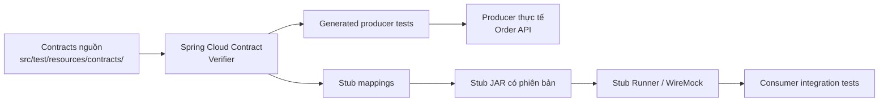
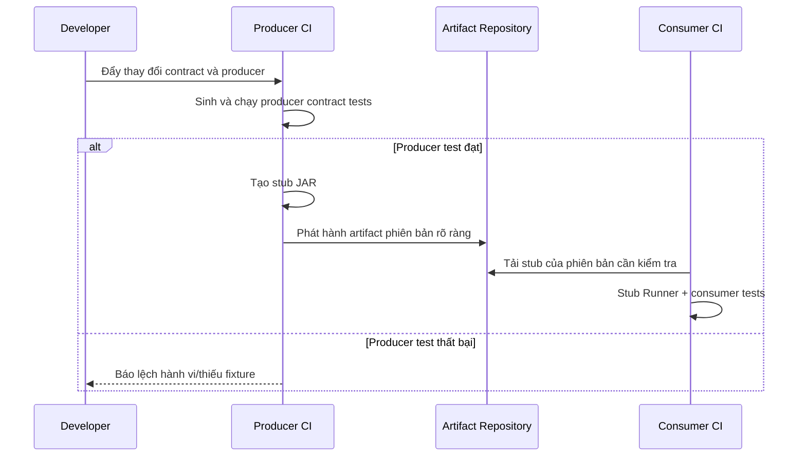

# Cấu trúc thư mục hợp đồng, base test và tài nguyên stub

## 1. Mục tiêu và bức tranh tổng thể

Trong **Spring Cloud Contract**, producer công bố những hành vi HTTP hoặc thông điệp mà consumer có thể dựa vào. Hợp đồng được viết bằng **Groovy DSL** hoặc **YAML DSL**, sau đó được dùng để:

1. **Sinh kiểm thử phía producer**: xác nhận ứng dụng thật đáp ứng những yêu cầu và phản hồi đã cam kết.
2. **Sinh stub**: tạo hành vi mô phỏng để consumer phát triển và kiểm thử độc lập.
3. **Phát hành stub theo phiên bản**: để **Stub Runner** tải đúng stub và chạy kiểm thử phía consumer, kể cả trong CI.

Bài này tập trung vào cách đặt ba nhóm tài nguyên quan trọng trong dự án: **file hợp đồng nguồn**, **base test cho kiểm thử sinh ra** và **tài nguyên stub đã tạo**. Ví dụ sử dụng một producer tên `order-service` và consumer tên `checkout-service`. Các class, endpoint và tọa độ artifact chỉ là ví dụ; khi áp dụng cần dùng tên thực tế của dự án.

## 2. Sơ đồ các thành phần và nơi chúng tồn tại



**Phân biệt ba loại file**:

| Loại | Tạo ở đâu? | Được chỉnh sửa trực tiếp? | Mục đích |
|---|---|---|---|
| **Contract nguồn** (`.yml`, `.yaml`, `.groovy`) | Thư mục `src/test/resources/contracts/` của producer theo cấu hình thông dụng | **Có**; đây là nơi thay đổi kỳ vọng và review | Mô tả request/response hoặc tương tác thông điệp |
| **Generated tests** | Thư mục build như `target/generated-test-sources/contracts/` với Maven | **Không**; sửa DSL hoặc cấu hình sinh test | Kiểm tra producer có thực hiện đúng hợp đồng |
| **Stub mappings / stub JAR** | Thư mục build và artifact `*-stubs.jar` sau khi đóng gói | **Không**; sinh lại từ hợp đồng nguồn | Phục vụ các phản hồi giả lập cho consumer |

Base test nằm riêng ở `src/test/java/` và **được lập trình viên viết, bảo trì**. Các generated test kế thừa base test để sử dụng cùng cách khởi tạo Spring context, controller, mock và dữ liệu test.

## 3. Cấu trúc thư mục gợi ý cho producer

Với dự án Java sử dụng Maven, có thể tổ chức như sau:

```text
order-service/
├── pom.xml
└── src/
    ├── main/
    │   ├── java/com/example/orders/
    │   │   ├── OrderServiceApplication.java
    │   │   ├── api/OrderController.java
    │   │   └── service/OrderService.java
    │   └── resources/application.yml
    └── test/
        ├── java/com/example/orders/
        │   ├── contract/ContractVerifierBase.java
        │   └── service/OrderServiceTest.java
        └── resources/
            ├── application-test.yml
            └── contracts/
                ├── orders/
                │   ├── get-paid-order.yml
                │   ├── get-order-not-found.yml
                │   └── create-order-invalid.yml
                └── payments/
                    └── publish-payment-confirmed.groovy
```

Đây là **quy ước đề xuất**, không phải cấu trúc bắt buộc duy nhất. Điểm cần giữ nhất quán là: hợp đồng nguồn nằm ở vị trí mà plugin được cấu hình để tìm; các kịch bản được nhóm theo API hoặc tính năng; base class nằm trong source set test; các artifact sinh ra nằm trong build directory.

### 3.1. Đặt tên và phân nhóm hợp đồng

- Dùng tên thể hiện **hành vi quan sát được**: `get-order-not-found.yml` rõ hơn `test2.yml`.
- Phân nhóm theo lĩnh vực như `orders/` và `payments/` để dễ tìm contract khi sửa API.
- Mỗi file nên mô tả một kịch bản có mục đích rõ ràng; có thể có nhiều file cho cùng endpoint để kiểm tra thành công, lỗi, phân quyền và trường hợp biên.
- Thống nhất cách dùng YAML hoặc Groovy trong nhóm. Hai DSL có thể cùng tồn tại, nhưng không nên vô tình định nghĩa trùng hai hợp đồng với cùng yêu cầu và phản hồi mà không có lý do.
- Với response chứa dữ liệu thay đổi như UUID, thời gian tạo và mã giao dịch, dùng matcher hợp lý thay vì khóa cứng giá trị không ổn định.

Nếu dự án dùng **Gradle**, cấu trúc nguồn ở `src/main` và `src/test` vẫn thường tương tự; thư mục kết quả build chuyển sang `build/` và cấu hình plugin dùng Gradle DSL.

## 4. Ví dụ file hợp đồng YAML và Groovy

### 4.1. Hợp đồng HTTP thành công bằng YAML

Đặt tại `src/test/resources/contracts/orders/get-paid-order.yml`:

```yaml
description: "Lấy đơn hàng đã thanh toán để hiển thị ở checkout"
request:
  method: GET
  url: /api/orders/42
  headers:
    Accept: application/json
response:
  status: 200
  headers:
    Content-Type: application/json
  body:
    id: 42
    status: PAID
    totalAmount: 120000
    currency: VND
```

Kịch bản này có một request HTTP `GET /api/orders/42` và kỳ vọng phản hồi `200` với những trường mà consumer cần. **ID `42` và số tiền là dữ liệu giả định dành cho test**: producer test phải chuẩn bị được đơn hàng tương ứng. Nếu producer không có dữ liệu đầu vào đó, generated test có thể thất bại dù cấu trúc hợp đồng đúng.

Stub sinh từ hợp đồng có thể trả đúng mẫu JSON này khi consumer gọi request tương ứng. Nhưng stub **không thay cho** producer test: stub có thể vẫn trả `200` trong khi producer thật đã vô tình đổi tên trường hoặc thay đổi hành vi.

### 4.2. Hợp đồng HTTP lỗi bằng Groovy

Đặt tại `src/test/resources/contracts/orders/get-order-not-found.groovy`:

```groovy
import org.springframework.cloud.contract.spec.Contract

Contract.make {
    description "Không tìm thấy đơn hàng"
    request {
        method GET()
        url "/api/orders/9999"
    }
    response {
        status NOT_FOUND()
        headers {
            contentType(applicationJson())
        }
        body(
            code: "ORDER_NOT_FOUND",
            message: "Order does not exist"
        )
    }
}
```

Groovy DSL cho phép dùng các phương thức hỗ trợ như `GET()`, `NOT_FOUND()`, `applicationJson()` và biểu thức linh hoạt hơn khi kiểm tra dữ liệu động. YAML thường dễ đọc, thuận tiện review; Groovy thích hợp khi cần đặc tả có logic matcher hoặc chuyển đổi phức tạp. Chọn DSL dựa trên nhu cầu bảo trì của nhóm, không phải vì một DSL tự động tạo stub “đúng hơn” DSL còn lại.

### 4.3. Contract khác với OpenAPI, mock và unit test

| Thành phần | Vai trò |
|---|---|
| **OpenAPI** | Mô tả bề mặt HTTP API và schema rộng hơn để khám phá/tạo client |
| **Contract DSL** | Chốt các kịch bản request/response hoặc thông điệp có thể kiểm chứng |
| **Producer generated test** | Gọi hoặc kiểm tra ứng dụng thật theo DSL |
| **Stub mapping** | Cung cấp request matching và phản hồi giả lập cho consumer |
| **Unit test** | Kiểm tra logic của từng lớp/hàm mà không nhất thiết liên quan giao diện giữa dịch vụ |

Không cần sao chép tất cả trường nội bộ của response vào hợp đồng nếu consumer không dựa vào chúng. Cũng không nên chỉ kiểm tra status `200` khi consumer cần định dạng hoặc giá trị nghiệp vụ cụ thể.

## 5. Base test: nền tảng cho generated test của producer

### 5.1. Base test là gì?

Spring Cloud Contract Verifier có thể sinh các lớp test Java/Kotlin từ hợp đồng. Những lớp test đó phải biết **khởi tạo producer và gọi API bằng phương thức phù hợp**. `ContractVerifierBase` là lớp cơ sở do nhóm phát triển viết để cung cấp phần chuẩn bị chung.

Base test thường đảm nhiệm:

1. Khởi tạo Spring application context hoặc controller cần kiểm tra.
2. Thiết lập Rest Assured MockMvc, WebTestClient hoặc cơ chế tương ứng với test mode đã chọn.
3. Tạo/mocking các dữ liệu cố định mà contract kỳ vọng.
4. Cấu hình bean, security test, database test, hoặc mock dịch vụ ngoài khi thật sự cần.

### 5.2. Ví dụ base class cho HTTP với MockMvc

Đặt tại `src/test/java/com/example/orders/contract/ContractVerifierBase.java`:

```java
package com.example.orders.contract;

import io.restassured.module.mockmvc.RestAssuredMockMvc;
import org.junit.jupiter.api.BeforeEach;
import org.springframework.beans.factory.annotation.Autowired;
import org.springframework.boot.test.autoconfigure.web.servlet.AutoConfigureMockMvc;
import org.springframework.boot.test.context.SpringBootTest;
import org.springframework.web.context.WebApplicationContext;

@SpringBootTest(webEnvironment = SpringBootTest.WebEnvironment.MOCK)
@AutoConfigureMockMvc
public abstract class ContractVerifierBase {

    @Autowired
    private WebApplicationContext context;

    @BeforeEach
    protected void setupContractTests() {
        RestAssuredMockMvc.webAppContextSetup(context);
    }
}
```

Ở đây, generated tests chạy trên **MockMvc**, dùng Spring context để gọi đường đi HTTP trong ứng dụng mà không cần mở cổng mạng thực. Với ví dụ `GET /api/orders/42`, ứng dụng test phải có dữ liệu hoặc mock cho đơn hàng `42` trả đúng phản hồi đã cam kết. Có thể bổ sung fixture vào base class hay cấu hình test theo cách nhất quán với dự án.

**Lưu ý về test mode:** ví dụ dùng Spring MVC, JUnit 5 và Rest Assured MockMvc. Nếu ứng dụng dùng WebFlux, JAX-RS, test mode khác hoặc không khởi động Spring context, base test và cấu hình verifier cần đổi tương ứng; không sao chép nguyên class MockMvc cho mọi hệ thống.

### 5.3. Không nhầm base test với generated test

| Base test do nhóm viết | Test do plugin sinh |
|---|---|
| Nằm trong `src/test/java/.../ContractVerifierBase.java` | Nằm trong thư mục build |
| Được giữ trong Git và thay đổi khi cách khởi tạo test thay đổi | Được tạo lại từ contract mỗi lần build |
| Chứa setup, fixture, mock và test infrastructure | Chứa request/response assertion từ DSL |
| Thường là `abstract class`, không có từng test case cụ thể | Kế thừa base class để chạy từng kịch bản |

Nếu generated test bị lỗi kết nối, lỗi khởi tạo Spring hoặc thiếu dữ liệu giả lập, hãy kiểm tra **base test, fixture và test mode**. Nếu assertion sai vì API đổi hành vi, hãy kiểm tra **hợp đồng nguồn và code producer**. Đừng chỉnh trực tiếp generated test vì lần build kế tiếp có thể ghi đè.

### 5.4. Khi có nhiều nhóm contract

Một base class chung là đủ nếu mọi contract dùng cùng cách setup. Với một producer có cả HTTP và message contracts, hoặc các nhóm controller cần fixture khác nhau, có thể cấu hình nhiều base class theo quy tắc ghép package trong plugin. Chỉ tạo thêm base class khi thật sự khác cách khởi tạo hoặc dữ liệu; quá nhiều lớp cơ sở với logic trùng nhau cũng làm bảo trì khó hơn.

## 6. Cấu hình Maven cho verifier và base test

Ví dụ dưới đây là **các phần liên quan trong `pom.xml` của producer**, giả định dự án đã có Spring Boot, Spring Cloud BOM và các dependency HTTP cần thiết:

```xml
<dependencies>
    <dependency>
        <groupId>org.springframework.cloud</groupId>
        <artifactId>spring-cloud-starter-contract-verifier</artifactId>
        <scope>test</scope>
    </dependency>
</dependencies>

<build>
    <plugins>
        <plugin>
            <groupId>org.springframework.cloud</groupId>
            <artifactId>spring-cloud-contract-maven-plugin</artifactId>
            <version>${spring-cloud-contract.version}</version>
            <extensions>true</extensions>
            <configuration>
                <baseClassForTests>
                    com.example.orders.contract.ContractVerifierBase
                </baseClassForTests>
                <testFramework>JUNIT5</testFramework>
                <testMode>MOCKMVC</testMode>
            </configuration>
        </plugin>
    </plugins>
</build>
```

Trong dự án thực tế, property `spring-cloud-contract.version` và BOM phải được chọn theo **tổ hợp Spring Boot/Spring Cloud tương thích**. Đoạn XML này không phải toàn bộ POM; nếu thiếu BOM, dependency hoặc cấu hình test phù hợp, dự án vẫn có thể không build được.

Các điểm cần đối chiếu:

- `baseClassForTests` phải là **tên class đầy đủ gồm package**, đúng với file base test.
- `testFramework` tương ứng với framework test đang dùng; ví dụ trên dùng `JUNIT5`.
- `testMode` phải phù hợp với cách base class khởi tạo HTTP test; ví dụ trên là `MOCKMVC`.
- Hợp đồng nằm trong đường dẫn plugin đang quét; nếu đổi thư mục mặc định, phải khai báo lại cấu hình và cập nhật hướng dẫn cho nhóm.
- Nếu chạy nhiều producer module trong một repository, cấu hình verifier và đầu ra stub cần gắn với **đúng Maven module** tạo API đó.

Với Gradle, có thể dùng plugin `org.springframework.cloud.contract`, khai báo dependency verifier trong cấu hình test và đặt `baseClassForTests` trong extension `contracts`. Không trộn cấu hình Maven vào `build.gradle`. Mục tiêu giống nhau: sinh test từ hợp đồng, chạy chúng và đóng gói stub.

## 7. Tài nguyên stub: nguồn, file sinh ra và artifact phát hành

### 7.1. Stub được tạo từ đâu?

Với hợp đồng HTTP, Spring Cloud Contract có thể tạo **WireMock request mappings** từ DSL: quy tắc nhận diện method, URL, header, body và phản hồi tương ứng. Khi response có nội dung lớn, mapping cũng có thể tham chiếu tới body file. Đối với message contracts, việc sinh và thực thi stub phụ thuộc thêm vào cách cấu hình hệ thống nhắn tin; không thể mặc nhiên coi mọi hợp đồng thông điệp là một HTTP WireMock mapping.

Một bản build Maven có thể tạo các tài nguyên ở khu vực `target/` rồi đóng gói chúng vào stub artifact. Bố cục tiêu biểu của JAR:

```text
order-service-1.0.0-stubs.jar
└── META-INF/
    └── com.example/
        └── order-service/
            └── 1.0.0/
                ├── contracts/
                │   └── orders/...
                ├── mappings/
                │   └── ... .json
                └── __files/          # có thể có, nếu mapping dùng body file
```

Đây là **minh họa cấu trúc logic thường gặp**; tên file bên trong và vị trí chính xác có thể thay đổi theo phiên bản/plugin và kiểu hợp đồng. Điều cần kiểm chứng là artifact chứa những mapping và tài nguyên mà Stub Runner cần. Trong repository nguồn, **không phải** duy trì bản sao thủ công của `target/` hoặc `build/`.

### 7.2. Định danh và phiên bản stub

Ví dụ artifact:

```text
groupId    = com.example
artifactId = order-service
version    = 1.0.0
classifier = stubs
```

Về mặt Maven, artifact thường có tên dạng `order-service-1.0.0-stubs.jar`. Phần `groupId:artifactId:version` phải khớp với những gì consumer yêu cầu ở Stub Runner. Dùng **phiên bản cố định có thể truy vết** trong pipeline tái lập, và cập nhật phiên bản rõ ràng khi consumer muốn thử API mới. Nếu dùng phiên bản động như `+`, cần hiểu rằng cùng một bài test có thể tải phiên bản stub khác ở những thời điểm khác nhau.

### 7.3. Phát hành và lưu trữ

- **LOCAL**: producer cài đặt stub artifact vào Maven local repository, thường là `~/.m2/repository`, để consumer test trên cùng máy sử dụng.
- **REMOTE**: producer công bố artifact lên kho Maven tương thích; consumer cấu hình Stub Runner tải artifact từ kho đó. Thông tin đăng nhập kho nên lấy từ secret của môi trường, không hard-code vào hợp đồng.
- **CLASSPATH**: dùng stub sẵn có trên classpath trong những cách thiết lập được hỗ trợ; phải tổ chức tài nguyên theo cấu trúc Stub Runner có thể nhận ra.

Khi CI chạy trên máy/container riêng, một lần `mvn install` trong máy phát triển **không** làm stub xuất hiện trên máy CI của consumer. Pipeline cần có bước xuất bản artifact hoặc truyền artifact có kiểm soát và cấu hình chế độ tải phù hợp.

## 8. Thư mục và cấu hình phía consumer với Stub Runner

Consumer thường **không cần sao chép contract nguồn vào repository của mình** khi đã sử dụng stub artifact do producer phát hành. Ví dụ:

```text
checkout-service/
├── pom.xml
└── src/
    ├── main/java/com/example/checkout/
    │   └── OrderClient.java
    └── test/
        ├── java/com/example/checkout/
        │   └── OrderClientContractTest.java
        └── resources/application-test.yml
```

Trong consumer Maven, thêm dependency test tương ứng:

```xml
<dependency>
    <groupId>org.springframework.cloud</groupId>
    <artifactId>spring-cloud-starter-contract-stub-runner</artifactId>
    <scope>test</scope>
</dependency>
```

Ví dụ test cấu hình Stub Runner chạy stub **đã cài local** của `order-service`. Các import ứng dụng như `OrderClient` và assertion được rút gọn để tập trung vào luồng:

```java
@SpringBootTest
@AutoConfigureStubRunner(
    ids = "com.example:order-service:1.0.0:stubs:8085",
    stubsMode = StubRunnerProperties.StubsMode.LOCAL
)
class OrderClientContractTest {

    @Autowired
    StubFinder stubFinder;

    @Test
    void checkoutReadsPaidOrder() {
        URL stubUrl = stubFinder.findStubUrl("com.example", "order-service");

        // OrderClient là client HTTP của ứng dụng, không phải API của Stub Runner.
        OrderClient orderClient = new OrderClient(stubUrl.toString());
        OrderDto order = orderClient.findById(42);

        assertThat(order.status()).isEqualTo("PAID");
        assertThat(order.currency()).isEqualTo("VND");
    }
}
```

Ví dụ minh họa sử dụng `@AutoConfigureStubRunner`, `StubRunnerProperties.StubsMode.LOCAL` và `StubFinder` trong test Spring Boot. Cần bổ sung import, `OrderClient`, `OrderDto` và cách inject base URL phù hợp với code thực tế. Cổng `8085` là cổng yêu cầu trong ví dụ; nếu máy có xung đột cổng, hãy chọn cách cấp phát cổng thích hợp.

**Điểm kiểm chứng quan trọng**: consumer test phải gọi logic consumer thật và assert rằng consumer hiểu phản hồi từ stub. Chỉ kiểm tra “Stub Runner khởi động được” chưa chứng minh `OrderClient` xử lý đúng hợp đồng.

## 9. Quy trình build và CI từ contract nguồn tới consumer

Luồng gợi ý cho producer và consumer sử dụng Maven:



Trình tự thao tác tham khảo:

1. **Producer**: thêm hoặc sửa `src/test/resources/contracts/...`, đảm bảo base test thiết lập controller/context và fixture đủ cho các kịch bản.
2. **Build producer**: chạy `mvn clean verify` để sinh và thực thi kiểm thử; xem lỗi assertion trước khi phát hành stub. Tùy plugin và lifecycle, các artifact cần đóng gói có thể được tạo trong giai đoạn package.
3. **Xuất bản stub**: dùng `mvn install` cho môi trường phát triển local hoặc bước `mvn deploy` thích hợp trong pipeline có quyền xuất bản. Build phải chạy đủ kiểm thử theo chính sách dự án.
4. **Consumer**: khai báo đúng `groupId:artifactId:version:stubs`, cấu hình Stub Runner chạy từ nguồn đã xuất bản.
5. **Test consumer**: gọi client tích hợp thật với URL/port của stub; xác nhận giá trị và nhánh xử lý nghiệp vụ.
6. **CI gate**: không cho phép thay đổi hoặc triển khai phá vỡ consumer đã biết mà chưa có kế hoạch tương thích.

Ví dụ: producer đổi field `status` thành `paymentState` mà không giữ `status`. Nếu hợp đồng cũ vẫn yêu cầu `status`, generated test của producer nên chỉ ra sai khác. Nếu hợp đồng được cập nhật theo API mới nhưng consumer vẫn đọc `status`, consumer test với stub phiên bản mới có thể phát hiện lỗi. Vì vậy, **producer contract test và consumer stub test bổ sung cho nhau**.

## 10. Những lỗi cấu hình thường gặp

| Hiện tượng | Khả năng xảy ra | Cách xử lý |
|---|---|---|
| Build không sinh contract test | DSL không ở thư mục đang quét; plugin chưa được kích hoạt đúng | Kiểm tra `src/test/resources/contracts/` và cấu hình plugin, xem log sinh test |
| Generated test không tìm thấy base class | `baseClassForTests` sai package/tên hoặc class không có trong test source set | Đối chiếu package, class name, `src/test/java` |
| Test trả `404` với ID mẫu | Producer chưa thiết lập fixture hoặc route không khớp | Chuẩn bị dữ liệu cố định; kiểm tra URL và test setup |
| Lỗi khởi tạo MockMvc hoặc context | Base test dùng chế độ không tương ứng hoặc thiếu bean/mock | Kiểm tra `testMode`, annotation và dependency test |
| Sinh stub nhưng consumer vẫn gọi API thật | Consumer chưa cấu hình base URL sang cổng Stub Runner | Inject URL do Stub Runner cung cấp vào HTTP client |
| Stub Runner không tải được artifact | Sai tọa độ, chưa `install/deploy`, chọn sai `LOCAL/REMOTE` hoặc thiếu quyền kho | Kiểm tra GAV/classifier, phiên bản, kho và log tải artifact |
| Consumer test xanh dù API đã đổi | Stub cũ, assertion quá yếu hoặc chỉ kiểm tra server khởi động | Dùng stub phiên bản cần xác minh; test các field consumer thật sự sử dụng |
| Test bất ổn theo thời điểm hoặc thứ tự | Fixture dùng dữ liệu chung, timestamp/ID cố định không hợp lý | Cô lập dữ liệu, dùng matcher thích hợp, tránh trạng thái chia sẻ |
| Repository có nhiều file mapping sinh sẵn | Đã commit thư mục build vào Git | Giữ contract nguồn trong Git và sinh artifact từ pipeline |

## 11. Checklist bàn giao một dự án hợp đồng

- [ ] Thư mục `src/test/resources/contracts/` tồn tại và chứa những kịch bản có tên rõ ràng, phân nhóm dễ tìm.
- [ ] Các contract được review như mã nguồn; không chứa credential, dữ liệu cá nhân thật hoặc URL production nhúng cứng.
- [ ] `ContractVerifierBase` được cấu hình đúng bằng FQN và khớp với `testMode`/test framework của dự án.
- [ ] Producer test chuẩn bị đầy đủ trạng thái/fixture và chạy lặp lại ổn định.
- [ ] Build sinh test và stub từ cùng contract nguồn; không chỉnh trực tiếp mã hoặc mapping đã sinh.
- [ ] Stub JAR có tọa độ và phiên bản rõ ràng, được lưu ở nơi consumer/CI truy cập được.
- [ ] Stub Runner dùng đúng nguồn tải và consumer thật sự gọi vào cổng stub.
- [ ] Consumer test kiểm tra hành vi ứng dụng phụ thuộc vào API, kể cả tình huống lỗi quan trọng.
- [ ] CI chạy producer verification trước khi phát hành, và consumer test dùng phiên bản stub mục tiêu.

Một cách kiểm tra nhanh khi tiếp nhận dự án là đi theo đường dẫn: **contract nguồn → generated test → base test → producer thật → stub artifact → Stub Runner → consumer test**. Nếu biết vị trí và trách nhiệm của từng mắt xích, nhóm có thể tìm đúng nguyên nhân khi test fail và duy trì kiểm thử hợp đồng lâu dài, kể cả khi code và API cùng phát triển.
