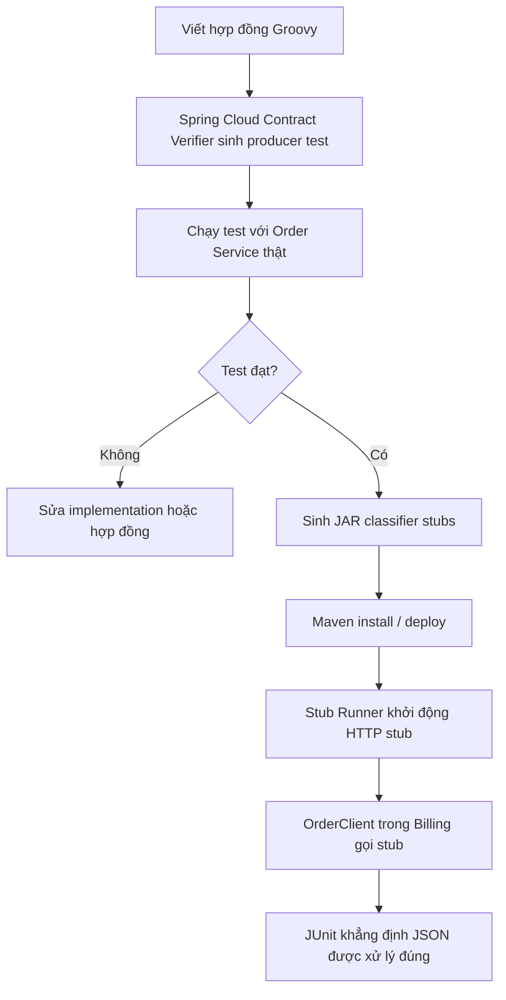

# Chạy quy trình đầu tiên từ hợp đồng đến consumer test

**Spring Cloud Contract** giúp hai dịch vụ thống nhất và kiểm tra hành vi giao tiếp mà không cần khởi chạy toàn bộ hệ thống mỗi lần thay đổi API. Bên **producer** mô tả hành vi HTTP hoặc thông điệp bằng hợp đồng Groovy/YAML DSL, sinh kiểm thử để xác nhận triển khai thực sự tuân thủ hợp đồng và đóng gói stub. Bên **consumer** lấy stub qua **Stub Runner** rồi chạy kiểm thử mã gọi API của chính mình. Khi đưa hai nhánh này vào CI, nhóm phát hiện sớm thay đổi có nguy cơ làm hỏng tích hợp.

Trong chương **Thiết lập dự án**, bài này dẫn bạn đi trọn một quy trình HTTP nhỏ, từ **một file hợp đồng đến một consumer test chạy thành công**. Ví dụ dùng Maven, Java 17, Spring Boot và Spring Cloud Contract; các bước được tổ chức sao cho bạn biết phải chạy lệnh ở dự án nào, kiểm tra đầu ra nào và sửa lỗi ở đâu.

## 1. Mục tiêu và kết quả sau bài thực hành

Ta xây dựng hai ứng dụng độc lập:

- **`order-service` (producer):** cung cấp `GET /api/orders/42`, trả JSON có mã đơn và trạng thái thanh toán.
- **`billing-service` (consumer):** dùng `OrderClient` để gọi endpoint đó, đọc trạng thái `PAID` và có một bài test chạy với stub của `order-service`.

Hành vi mà hai phía thống nhất:

```http
GET /api/orders/42
```

```http
HTTP/1.1 200 OK
Content-Type: application/json

{"id":42,"status":"PAID"}
```

Đến cuối bài, bạn sẽ tạo được file `order-service-1.0.0-stubs.jar`, xác nhận **generated producer test** đã chạy với ứng dụng producer, cài artifact stub vào Maven local, cho **Stub Runner** khởi động HTTP stub và chạy **consumer test** dùng mã `OrderClient` thật. Sau đó, bạn sẽ biết cách chuyển từ thử nghiệm local sang phát hành stub lên kho artifact để chạy trong CI.



**Hai loại test kiểm hai điều khác nhau:** generated producer test xác minh *producer thực có làm đúng điều đã cam kết không*; consumer test với stub xác minh *mã consumer có gọi và xử lý đúng hành vi đã cam kết không*. Chỉ nhìn consumer test xanh chưa đủ kết luận producer thật đang hoạt động đúng, vì stub mô phỏng theo hợp đồng chứ không phải mã producer.

## 2. Điều kiện tiên quyết và lựa chọn phiên bản

Máy thực hành cần có **JDK 17 trở lên**, Maven 3.9.x hoặc Maven Wrapper tương đương, một IDE có hỗ trợ Java và Maven, cùng quyền tải dependencies từ Maven repository. Các lệnh bên dưới có thể chạy trong terminal từ thư mục chứa hai dự án; nếu dự án sử dụng Maven Wrapper thì thay `mvn` bằng `./mvnw` hoặc `mvnw.cmd` tùy hệ điều hành.

**Phiên bản phải tương thích theo cùng một release train.** Để ví dụ cụ thể, các file POM dưới đây dùng một bộ phiên bản minh họa cho hệ Spring Boot 3.x:

| Thành phần | Phiên bản dùng trong ví dụ | Vai trò |
| --- | --- | --- |
| Java | 17 | Chạy ứng dụng và dùng cú pháp `record`. |
| Spring Boot | `3.3.5` | Dependency và runtime của cả hai ứng dụng. |
| Spring Cloud BOM | `2023.0.4` | Quản lý phiên bản các dependency Spring Cloud. |
| Spring Cloud Contract Maven Plugin | `4.1.5` | Sinh producer test và stub trên phía producer. |

Đây là **bộ ví dụ cố định để đọc và thực hành**, không phải khuyến nghị phiên bản mới nhất tại thời điểm đọc. Khi áp dụng vào dự án đang sử dụng, hãy chọn bộ Spring Boot, Spring Cloud BOM và Spring Cloud Contract plugin tương thích theo release train đang được dự án hỗ trợ; không tùy tiện nâng riêng một thành phần rồi giữ nguyên các thành phần còn lại. BOM quản lý dependency, còn **version của Maven plugin** được khai báo rõ trong POM.

Tạo hai thư mục Maven độc lập:

```text
contract-first-lab/
├── producer/
│   ├── pom.xml
│   └── src/
│       ├── main/java/com/acme/orders/
│       │   ├── OrderApplication.java
│       │   └── OrderController.java
│       └── test/
│           ├── java/com/acme/orders/ContractTestBase.java
│           └── resources/contracts/orders/get_paid_order.groovy
└── consumer/
    ├── pom.xml
    └── src/
        ├── main/java/com/acme/billing/
        │   ├── BillingApplication.java
        │   └── OrderClient.java
        └── test/java/com/acme/billing/OrderClientStubTest.java
```

Các đường dẫn nguồn ở dưới được tính từ `producer/` hoặc `consumer/` tương ứng. Hai dự án có `groupId` giống nhau nhưng `artifactId` riêng; build và test có thể chạy độc lập.

## 3. Khởi tạo Maven producer

Tạo `producer/pom.xml`:

```xml
<project xmlns="http://maven.apache.org/POM/4.0.0"
         xmlns:xsi="http://www.w3.org/2001/XMLSchema-instance"
         xsi:schemaLocation="http://maven.apache.org/POM/4.0.0
                             https://maven.apache.org/xsd/maven-4.0.0.xsd">
    <modelVersion>4.0.0</modelVersion>

    <parent>
        <groupId>org.springframework.boot</groupId>
        <artifactId>spring-boot-starter-parent</artifactId>
        <version>3.3.5</version>
        <relativePath/>
    </parent>

    <groupId>com.acme</groupId>
    <artifactId>order-service</artifactId>
    <version>1.0.0</version>
    <properties>
        <java.version>17</java.version>
        <spring-cloud.version>2023.0.4</spring-cloud.version>
        <spring-cloud-contract.version>4.1.5</spring-cloud-contract.version>
    </properties>

    <dependencyManagement>
        <dependencies>
            <dependency>
                <groupId>org.springframework.cloud</groupId>
                <artifactId>spring-cloud-dependencies</artifactId>
                <version>${spring-cloud.version}</version>
                <type>pom</type>
                <scope>import</scope>
            </dependency>
        </dependencies>
    </dependencyManagement>

    <dependencies>
        <dependency>
            <groupId>org.springframework.boot</groupId>
            <artifactId>spring-boot-starter-web</artifactId>
        </dependency>
        <dependency>
            <groupId>org.springframework.boot</groupId>
            <artifactId>spring-boot-starter-test</artifactId>
            <scope>test</scope>
        </dependency>
        <dependency>
            <groupId>org.springframework.cloud</groupId>
            <artifactId>spring-cloud-starter-contract-verifier</artifactId>
            <scope>test</scope>
        </dependency>
    </dependencies>

    <build>
        <plugins>
            <plugin>
                <groupId>org.springframework.boot</groupId>
                <artifactId>spring-boot-maven-plugin</artifactId>
            </plugin>
            <plugin>
                <groupId>org.springframework.cloud</groupId>
                <artifactId>spring-cloud-contract-maven-plugin</artifactId>
                <version>${spring-cloud-contract.version}</version>
                <extensions>true</extensions>
                <configuration>
                    <testFramework>JUNIT5</testFramework>
                    <testMode>MOCKMVC</testMode>
                    <baseClassForTests>com.acme.orders.ContractTestBase</baseClassForTests>
                </configuration>
            </plugin>
        </plugins>
    </build>
</project>
```

Ba cấu hình cần hiểu trước khi chạy:

- `spring-cloud-starter-contract-verifier` cung cấp những thư viện cần cho bài kiểm thử phía producer.
- `spring-cloud-contract-maven-plugin` cùng `extensions=true` gắn các bước sinh test và stub vào vòng đời Maven của dự án; test được sinh sẽ chạy khi Maven đến giai đoạn kiểm thử phù hợp.
- `testMode=MOCKMVC` cho phép kiểm endpoint Spring MVC bằng `MockMvc`, không bắt buộc mở một cổng HTTP thật; `baseClassForTests` cho biết các generated tests kế thừa lớp thiết lập kiểm thử nào.

### 3.1. Tạo ứng dụng và HTTP endpoint

Tạo `producer/src/main/java/com/acme/orders/OrderApplication.java`:

```java
package com.acme.orders;

import org.springframework.boot.SpringApplication;
import org.springframework.boot.autoconfigure.SpringBootApplication;

@SpringBootApplication
public class OrderApplication {
    public static void main(String[] args) {
        SpringApplication.run(OrderApplication.class, args);
    }
}
```

Tạo `producer/src/main/java/com/acme/orders/OrderController.java`:

```java
package com.acme.orders;

import org.springframework.http.HttpStatus;
import org.springframework.http.MediaType;
import org.springframework.web.bind.annotation.GetMapping;
import org.springframework.web.bind.annotation.PathVariable;
import org.springframework.web.bind.annotation.RequestMapping;
import org.springframework.web.bind.annotation.RestController;
import org.springframework.web.server.ResponseStatusException;

@RestController
@RequestMapping("/api/orders")
public class OrderController {

    @GetMapping(value = "/{id}", produces = MediaType.APPLICATION_JSON_VALUE)
    public OrderResponse getOrder(@PathVariable long id) {
        if (id != 42L) {
            throw new ResponseStatusException(HttpStatus.NOT_FOUND);
        }
        return new OrderResponse(42L, "PAID");
    }

    public record OrderResponse(long id, String status) {}
}
```

Đây là **fixture tối giản dành cho bài học**: đơn `42` luôn tồn tại và đã thanh toán, ID khác trả 404. Trong dự án thật, controller sẽ lấy dữ liệu từ service/repository và test phải chuẩn bị dữ liệu xác định được. Không nên đưa dữ liệu giả cố định như trên vào nghiệp vụ sản xuất.

## 4. Viết hợp đồng Groovy DSL

Tạo `producer/src/test/resources/contracts/orders/get_paid_order.groovy`:

```groovy
import org.springframework.cloud.contract.spec.Contract

Contract.make {
    description 'Đọc đơn hàng 42 đã thanh toán'

    request {
        method 'GET'
        url '/api/orders/42'
    }

    response {
        status 200
        headers {
            contentType(applicationJson())
        }
        body(
            id: 42,
            status: 'PAID'
        )
    }
}
```

Trong hợp đồng này, `request` mô tả **đầu vào producer phải chấp nhận**: HTTP `GET` tới `/api/orders/42`. `response` mô tả **đầu ra producer phải trả**: mã `200`, kiểu dữ liệu JSON và hai trường `id`, `status`. Cả producer test và HTTP stub sẽ được tạo từ **cùng một file**.

Đường dẫn `src/test/resources/contracts` là vị trí hợp đồng mặc định thường dùng với plugin. Thư mục con `orders/` giúp nhóm các tương tác; có thể bổ sung những trường hợp `404`, `400`, trạng thái `PENDING` hoặc biến thể request sau khi quy trình cơ bản đã chạy thành công.

**Có thể dùng YAML DSL** để diễn đạt cùng hành vi, nhưng bài thực hành này dùng Groovy để người học tập trung vào vòng đời build, test và stub. Không đặt đồng thời hai file trùng hành vi chỉ để thử cú pháp, vì mỗi file có thể sinh ra một kiểm thử/mapping riêng cần bảo trì.

## 5. Chuẩn bị lớp cơ sở cho generated producer tests

Plugin sinh mã kiểm thử; bạn **không chỉnh sửa trực tiếp file Java được sinh**. Thay vào đó, tạo lớp cơ sở để test được sinh có thể dùng Spring test context và `MockMvc`.

Tạo `producer/src/test/java/com/acme/orders/ContractTestBase.java`:

```java
package com.acme.orders;

import io.restassured.module.mockmvc.RestAssuredMockMvc;
import org.junit.jupiter.api.BeforeEach;
import org.springframework.beans.factory.annotation.Autowired;
import org.springframework.boot.test.autoconfigure.web.servlet.AutoConfigureMockMvc;
import org.springframework.boot.test.context.SpringBootTest;
import org.springframework.test.web.servlet.MockMvc;

@SpringBootTest(classes = OrderApplication.class)
@AutoConfigureMockMvc
public abstract class ContractTestBase {

    @Autowired
    private MockMvc mockMvc;

    @BeforeEach
    void setUp() {
        RestAssuredMockMvc.mockMvc(mockMvc);
    }
}
```

`ContractTestBase` không cần tự có `@Test`: nhiệm vụ của nó là cung cấp `MockMvc` được nối với ứng dụng producer. Các generated tests kế thừa lớp này và thực hiện request cũng như assertion được tạo từ hợp đồng. Đối với hợp đồng có dữ liệu động, đây cũng là nơi bạn có thể sắp xếp fixture hoặc mock phần tích hợp ngoài để kết quả kiểm thử ổn định.

**Vì sao phải chạy producer test?** Nếu hợp đồng yêu cầu trường `status` nhưng controller đổi thành `state`, một stub được sinh từ hợp đồng vẫn có thể trả `status` như cũ. Chỉ generated test chạy với producer thật mới phát hiện sai lệch này tại bước kiểm tra triển khai.

## 6. Build producer, xác minh test và tạo artifact stub

Từ thư mục gốc `contract-first-lab/`, chạy:

```shell
mvn -f producer/pom.xml clean install
```

Lệnh trên đi qua các giai đoạn Maven cần thiết, bao gồm sinh test từ hợp đồng, chạy test với mã producer, tạo gói và cài artifact vào Maven local. Khi thành công, hãy kiểm tra các nhóm đầu ra sau (tên thư mục chính xác có thể thay đổi theo cấu hình plugin):

| Đầu ra | Cần quan sát điều gì? |
| --- | --- |
| `producer/target/generated-test-sources/contracts/` | Có lớp Java kiểm thử được sinh từ `get_paid_order.groovy`. |
| Kết quả Surefire/test report | Generated producer test được chạy và **PASS**; chỉ thấy `BUILD SUCCESS` mà không thấy test nào được chạy thì phải kiểm lại cấu hình. |
| `producer/target/order-service-1.0.0-stubs.jar` | Có artifact stub với classifier `stubs`; thường chứa mapping/tài nguyên cho WireMock. |
| Maven local repository | Có artifact của `com.acme:order-service:1.0.0` cùng file `stubs` tương ứng, để consumer lấy bằng chế độ `LOCAL`. |

Đường dẫn Maven local mặc định nằm dưới `.m2/repository/com/acme/order-service/1.0.0/` của tài khoản chạy Maven, trừ khi `settings.xml` cấu hình lại. Bạn có thể xem nội dung JAR bằng `jar tf` với đường dẫn thực tế của file, hoặc xem file qua IDE; mục đích là xác nhận có mapping được đóng gói chứ không phải chỉ có một JAR ứng dụng.

**Cổng kiểm chứng đầu tiên:** nếu generated producer test thất bại, **chưa** chuyển sang consumer. Hãy kiểm HTTP method, URL, JSON, kiểu trả về, trạng thái và base test. Khi hợp đồng phản ánh đúng kỳ vọng đã thống nhất, phải sửa producer thực thi đúng hợp đồng; sửa hợp đồng chỉ để làm build xanh có thể che giấu breaking change.

Trong ví dụ này, `install` cài stub vào **Maven local của máy chạy lệnh**; đó là cách ngắn nhất để hoàn tất vòng lặp đầu tiên. Nó chưa phải công bố vào repository từ xa mà pipeline hoặc đội khác đều truy cập được. Phần 9 sẽ chuyển sang luồng publish thực tế.

## 7. Khởi tạo Maven consumer

Tạo `consumer/pom.xml` cùng bộ phiên bản, nhưng dependency kiểm thử là **Stub Runner** thay vì Contract Verifier:

```xml
<project xmlns="http://maven.apache.org/POM/4.0.0"
         xmlns:xsi="http://www.w3.org/2001/XMLSchema-instance"
         xsi:schemaLocation="http://maven.apache.org/POM/4.0.0
                             https://maven.apache.org/xsd/maven-4.0.0.xsd">
    <modelVersion>4.0.0</modelVersion>

    <parent>
        <groupId>org.springframework.boot</groupId>
        <artifactId>spring-boot-starter-parent</artifactId>
        <version>3.3.5</version>
        <relativePath/>
    </parent>

    <groupId>com.acme</groupId>
    <artifactId>billing-service</artifactId>
    <version>1.0.0</version>
    <properties>
        <java.version>17</java.version>
        <spring-cloud.version>2023.0.4</spring-cloud.version>
    </properties>

    <dependencyManagement>
        <dependencies>
            <dependency>
                <groupId>org.springframework.cloud</groupId>
                <artifactId>spring-cloud-dependencies</artifactId>
                <version>${spring-cloud.version}</version>
                <type>pom</type>
                <scope>import</scope>
            </dependency>
        </dependencies>
    </dependencyManagement>

    <dependencies>
        <dependency>
            <groupId>org.springframework.boot</groupId>
            <artifactId>spring-boot-starter-web</artifactId>
        </dependency>
        <dependency>
            <groupId>org.springframework.boot</groupId>
            <artifactId>spring-boot-starter-test</artifactId>
            <scope>test</scope>
        </dependency>
        <dependency>
            <groupId>org.springframework.cloud</groupId>
            <artifactId>spring-cloud-starter-contract-stub-runner</artifactId>
            <scope>test</scope>
        </dependency>
    </dependencies>

    <build>
        <plugins>
            <plugin>
                <groupId>org.springframework.boot</groupId>
                <artifactId>spring-boot-maven-plugin</artifactId>
            </plugin>
        </plugins>
    </build>
</project>
```

`spring-cloud-starter-contract-stub-runner` cung cấp cơ chế tìm artifact, đọc mapping và khởi động stub server phục vụ test. Không cần nhập source code, controller hay cơ sở dữ liệu của Order Service vào Billing Service.

### 7.1. Viết mã consumer thật

Tạo `consumer/src/main/java/com/acme/billing/BillingApplication.java`:

```java
package com.acme.billing;

import org.springframework.boot.SpringApplication;
import org.springframework.boot.autoconfigure.SpringBootApplication;

@SpringBootApplication
public class BillingApplication {
    public static void main(String[] args) {
        SpringApplication.run(BillingApplication.class, args);
    }
}
```

Tạo `consumer/src/main/java/com/acme/billing/OrderClient.java`:

```java
package com.acme.billing;

import org.springframework.beans.factory.annotation.Value;
import org.springframework.stereotype.Component;
import org.springframework.web.client.RestClient;

@Component
public class OrderClient {
    private final RestClient http;

    public OrderClient(RestClient.Builder builder,
                       @Value("${orders.base-url}") String baseUrl) {
        this.http = builder.baseUrl(baseUrl).build();
    }

    public OrderView getOrder(long id) {
        return http.get()
                .uri("/api/orders/{id}", id)
                .retrieve()
                .body(OrderView.class);
    }

    public record OrderView(Long id, String status) {}
}
```

`RestClient` là HTTP client đồng bộ của Spring Framework 6.1 trở lên. Đây là **mã dùng trong ứng dụng**, không phải bản mock cho bài test. Client lấy `orders.base-url` từ cấu hình: trong môi trường thật URL trỏ tới Order Service; trong test URL sẽ trỏ tới stub. Nếu bạn dùng `WebClient`, `RestTemplate` hoặc OpenFeign, hãy giữ cùng nguyên tắc là **base URL cấu hình được**.

Tạo `consumer/src/main/resources/application.yml` với URL mặc định cho một môi trường phát triển phù hợp, chẳng hạn:

```yaml
orders:
  base-url: http://localhost:8080
```

Giá trị này chỉ minh họa một Order Service thật đang chạy cổng `8080`. Test ở bước tiếp theo sẽ ghi đè thành địa chỉ stub, vì vậy không cần khởi động Order Service để kiểm thử consumer.

## 8. Chạy consumer test bằng Stub Runner

Tạo `consumer/src/test/java/com/acme/billing/OrderClientStubTest.java`:

```java
package com.acme.billing;

import org.junit.jupiter.api.Test;
import org.springframework.beans.factory.annotation.Autowired;
import org.springframework.boot.test.context.SpringBootTest;
import org.springframework.cloud.contract.stubrunner.spring.AutoConfigureStubRunner;
import org.springframework.cloud.contract.stubrunner.spring.StubRunnerProperties;

import static org.assertj.core.api.Assertions.assertThat;

@SpringBootTest(properties = "orders.base-url=http://localhost:8090")
@AutoConfigureStubRunner(
        ids = "com.acme:order-service:1.0.0:stubs:8090",
        stubsMode = StubRunnerProperties.StubsMode.LOCAL
)
class OrderClientStubTest {

    @Autowired
    private OrderClient orderClient;

    @Test
    void docTrangThaiDonHangTuStub() {
        OrderClient.OrderView order = orderClient.getOrder(42L);

        assertThat(order).isNotNull();
        assertThat(order.id()).isEqualTo(42L);
        assertThat(order.status()).isEqualTo("PAID");
    }
}
```

Giải thích từng cấu hình:

| Cấu hình | Tác dụng |
| --- | --- |
| `ids = "com.acme:order-service:1.0.0:stubs:8090"` | Tìm đúng group, artifact, version và classifier của stub; yêu cầu chạy HTTP stub ở cổng `8090`. |
| `stubsMode = LOCAL` | Lấy artifact đã được cài vào Maven local bởi bước `mvn install` của producer. |
| `orders.base-url=http://localhost:8090` | Ghi đè URL của `OrderClient` để mọi request trong test đến đúng HTTP stub server. |
| `orderClient.getOrder(42L)` | Thực thi **mã gọi thật của consumer**: tạo GET, nhận JSON, ánh xạ vào DTO. |
| AssertJ assertions | Xác minh kết quả mà code Billing đọc được, thay vì chỉ kiểm xem stub có mở cổng hay không. |

Từ thư mục `contract-first-lab/`, sau khi `mvn -f producer/pom.xml clean install` đã thành công, chạy:

```shell
mvn -f consumer/pom.xml test
```

Kết quả mong đợi là JUnit test `docTrangThaiDonHangTuStub` đạt. Không cần tự khởi động WireMock hoặc Order Service trong một terminal riêng: Stub Runner quản lý stub trong lifecycle của Spring test context.

Nếu cả producer test và consumer test đều đạt, bạn đã có một vòng **contract → generated producer test → stub JAR → Stub Runner → consumer test**. Đây là cột mốc đầu tiên, nhưng chưa bao gồm các tương tác khác như 404 nghiệp vụ, kiểm soát tương thích của phiên bản mới hay hành vi trong môi trường triển khai thực.

## 9. Từ bản cài local đến stub đã công bố trên CI

Để consumer trên máy khác hoặc CI dùng được stub, producer cần **publish** artifact có classifier `stubs` lên Maven repository mà consumer có quyền đọc. Có thể là Nexus, Artifactory hoặc kho artifact phù hợp với tổ chức. Trước bước này, consumer chỉ đang dùng bản **local** do mình vừa build.

Trong `producer/pom.xml`, thêm cấu hình `distributionManagement` ở cấp trực tiếp dưới `<project>` (địa chỉ dưới đây chỉ là ví dụ; thay bằng kho thật):

```xml
<distributionManagement>
    <repository>
        <id>internal-releases</id>
        <url>https://repo.example.org/repository/maven-releases</url>
    </repository>
</distributionManagement>
```

Cấu hình quyền ghi kho Maven trong `settings.xml` của tài khoản build/CI theo `id=internal-releases`, dùng secret của hệ thống CI thay vì ghi mật khẩu hoặc token vào POM. Sau khi producer test thành công, chạy:

```shell
mvn -f producer/pom.xml clean deploy
```

Lệnh `deploy` trên Maven project có cấu hình phát hành đúng sẽ đưa artifact chính cùng artifact stub được plugin gắn vào build lên kho. Hãy xác nhận kho có file tương ứng **`order-service-1.0.0-stubs.jar`** và consumer có quyền đọc bản đó. Một stub JAR tồn tại trên máy developer nhưng chưa publish sẽ không được một pipeline CI độc lập tìm thấy qua chế độ `REMOTE`.

Trong consumer test, đổi cấu hình sang phiên bản đọc từ repository:

```java
@AutoConfigureStubRunner(
        ids = "com.acme:order-service:1.0.0:stubs:8090",
        stubsMode = StubRunnerProperties.StubsMode.REMOTE,
        repositoryRoot = "https://repo.example.org/repository/maven-releases"
)
```

Giữ nguyên phần `@SpringBootTest(properties = "orders.base-url=http://localhost:8090")` và các assertions. Như vậy CI consumer tải cùng artifact đã công bố, Stub Runner khởi động mapping HTTP và bài test gọi chính `OrderClient` đang được sử dụng trong sản phẩm. Cấu hình thông tin xác thực tải artifact bằng phương thức được phiên bản Stub Runner và Maven/CI của dự án hỗ trợ; URL ví dụ không đại diện cho một kho đang hoạt động.

Quy trình CI nên đi theo thứ tự:

1. **Producer CI** đọc hợp đồng, sinh và chạy generated producer tests; chặn publish khi test thất bại.
2. **Producer CI** đóng gói, gắn classifier `stubs`, publish artifact với version có thể truy nguyên.
3. **Consumer CI** chọn version stub cần kiểm, tải từ repository bằng Stub Runner, chạy `OrderClientStubTest` và các tình huống consumer khác.
4. **Quản lý phát hành** chỉ chấp nhận thay đổi khi những consumer cần được bảo vệ đã vượt qua bài kiểm thử tương ứng; giữ lại các hợp đồng còn hiệu lực đối với consumer cũ.

Trong CI thực tế, cần bảo đảm artifact đã **publish xong và đọc được** trước khi consumer chạy, tránh lỗi ngẫu nhiên vì hai job thực hiện đồng thời. Nên ghim version rõ ràng khi kiểm định một bản release; dùng một tọa độ luôn trỏ đến "mới nhất" làm cho kết quả test khó tái lập.

## 10. Thử gây lỗi có kiểm soát

Để xác minh bài test thực sự bảo vệ hợp đồng, hãy thử ba thay đổi riêng biệt; sau mỗi lần, hoàn nguyên thay đổi trước khi tiếp tục.

### Trường hợp A — producer triển khai sai hợp đồng

Trong `OrderController`, đổi tên trường `status` của JSON thành `state` nhưng **giữ nguyên** file `get_paid_order.groovy`. Chạy lại:

```shell
mvn -f producer/pom.xml clean verify
```

**Kỳ vọng:** generated producer test thất bại vì hợp đồng vẫn yêu cầu `status: "PAID"`. Đây là lỗi producer vi phạm hành vi đã thống nhất; consumer test với một stub cũ vẫn có thể đạt, nên không thể thay producer test bằng consumer test.

### Trường hợp B — consumer gọi sai đường dẫn

Hoàn nguyên producer, sau đó đổi URL trong `OrderClient` từ `/api/orders/{id}` thành `/orders/{id}`. Chạy:

```shell
mvn -f consumer/pom.xml test
```

**Kỳ vọng:** request không khớp mapping hợp đồng, consumer test thất bại. WireMock thường trả 404 khi không tìm thấy mapping khớp, nhưng **404 do stub không nhận ra request** không tương đương phản hồi 404 nghiệp vụ do producer chủ động định nghĩa.

### Trường hợp C — consumer giải mã phản hồi sai

Hoàn nguyên đường dẫn, sau đó đổi tên trường trong `OrderView` từ `status` thành `state` và sửa phép đọc tương ứng mà không cập nhật hợp đồng. Chạy lại consumer test.

**Kỳ vọng:** tùy cấu hình Jackson, thuộc tính `state` không được điền hoặc phép giải mã thất bại vì JSON stub có `status`; assertion mong đợi `PAID` không đạt. Đây là lỗi consumer không sử dụng đúng phản hồi đã công bố. Nếu thay đổi loại DTO và mapper, hãy giữ một assertion nhắm đến trường thực sự mà Billing cần sử dụng, thay vì chỉ kiểm response không null.

Ba phép thử thể hiện ranh giới của hai lớp kiểm tra: **producer test phát hiện mã bên cung cấp lệch hợp đồng; consumer test phát hiện mã bên sử dụng không tương tác đúng với stub**. Không được đổi hợp đồng hay stub tùy tiện chỉ để bài test trở lại màu xanh; mọi thay đổi hợp đồng phải xem xét nhu cầu consumer còn được hỗ trợ.

## 11. Những lỗi thường gặp trong lần chạy đầu tiên

| Triệu chứng | Nguyên nhân có khả năng cao | Kiểm tra hoặc cách xử lý |
| --- | --- | --- |
| Không thấy generated producer test trong build. | Chưa đặt file vào `src/test/resources/contracts`, plugin chưa tham gia lifecycle, hoặc cấu hình test không đúng. | Kiểm đường dẫn hợp đồng, `extensions=true`, log goal sinh test và thư mục mã được sinh. |
| Generated test có nhưng không khởi tạo được Spring context. | Sai tên `baseClassForTests`, thiếu `@SpringBootTest`, `@AutoConfigureMockMvc`, thiếu dependency test. | So tên package đầy đủ của `ContractTestBase`, kiểm cấu hình Spring MVC và dependencies. |
| Test producer trả 404 hoặc không khớp JSON. | Controller sai route, status, content type, fixture hoặc cấu trúc trả về. | So các phần `request`/`response` với implementation; sửa đúng phía gây sai lệch. |
| Không tìm thấy `stubs.jar` sau build. | Plugin chưa sinh/gắn stub artifact hoặc build dừng trước giai đoạn package. | Kiểm log tạo stub, `target/`, kết quả `mvn clean install` và cấu hình plugin. |
| Consumer không tìm thấy artifact ở `LOCAL`. | Chưa chạy `install` producer, tọa độ Maven sai hoặc hai lệnh dùng local repository khác nhau. | So `com.acme:order-service:1.0.0:stubs` và vị trí Maven local. |
| Stub Runner không khởi động được ở `8090`. | Cổng bị ứng dụng khác chiếm hoặc stub không tải được. | Kiểm log Stub Runner; chọn cổng trống rồi cập nhật **cả** stub port và base URL. |
| Consumer báo `Connection refused`. | URL client không trỏ đến cổng stub, hoặc server stub chưa khởi động. | Kiểm `orders.base-url` thực tế và log khởi động Stub Runner. |
| Consumer nhận HTTP 404 từ stub. | Sai đường dẫn/method/header hoặc không có mapping phù hợp. | So request thật với mapping trong artifact; phân biệt 404 không khớp mapping với 404 nghiệp vụ. |
| Dev chạy đạt nhưng CI consumer tải stub lỗi. | Chỉ cài Maven local, chưa publish; repository URL, version hoặc credential sai. | Kiểm artifact đã công bố, quyền đọc, chế độ `REMOTE` và version cố định trên CI. |

Khi thấy `BUILD SUCCESS` ở consumer nhưng không thấy tên bài kiểm thử, hãy kiểm lại test discovery và Surefire reports. Tương tự, producer build xanh nhưng chưa thực thi bất kỳ **generated producer test** nào thì vòng xác minh hợp đồng chưa được chứng minh. Kết quả cần quan sát là **các bài test cụ thể thực sự chạy và PASS**.

## 12. Mở rộng sau khi quy trình cơ bản chạy được

Từ một tình huống trả 200, mở rộng dần theo những phụ thuộc thực của consumer:

- **Hợp đồng lỗi:** thêm trường hợp 404 có body lỗi theo chuẩn API. Consumer test phải kiểm cả hành vi chuyển lỗi sang ngoại lệ/giá trị miền; chỉ assert `404` có thể vô tình chấp nhận 404 do WireMock thiếu mapping.
- **Trường hợp dữ liệu khác:** bổ sung trạng thái `PENDING`, `CANCELLED`, danh sách trống hoặc dữ liệu tùy chọn mà Billing thực sự dùng.
- **Dữ liệu động:** sử dụng matcher/DSL theo khả năng của phiên bản Spring Cloud Contract đang dùng để mô tả mẫu request và response, thay vì hardcode tất cả ID.
- **Thay đổi không tương thích:** thử xóa `status`, đổi kiểu của `id` hoặc chuyển endpoint; giữ và chạy các hợp đồng còn hiệu lực để phát hiện consumer cũ bị ảnh hưởng.
- **Thông điệp bất đồng bộ:** Spring Cloud Contract cũng hỗ trợ hợp đồng messaging, nhưng sẽ cần cấu hình kiểm thử phát/nhận thông điệp thích hợp. Không áp dụng trực tiếp cấu hình HTTP WireMock trong bài này để khẳng định một luồng broker hoạt động đúng.

**Giới hạn cần nhớ:** hợp đồng chỉ bảo vệ các tương tác được mô tả và được kiểm thử. Producer test xanh cùng consumer test xanh vẫn chưa xác nhận mọi yếu tố như kết nối mạng thật, authentication, transaction, dữ liệu chạy thực tế hay tình huống nằm ngoài hợp đồng; những rủi ro đó cần các lớp kiểm thử tích hợp và vận hành khác.

## 13. Checklist hoàn thành và câu hỏi tự kiểm tra

Bạn có thể xem lần chạy đầu tiên thành công khi xác nhận được tất cả các điểm sau:

1. Trong producer có hợp đồng Groovy cho `GET /api/orders/42` và file đó được plugin đọc.
2. Generated producer test **thực sự chạy** với `OrderController` và PASS; sửa sai trường JSON làm test FAIL.
3. Build tạo artifact `order-service-1.0.0-stubs.jar` và `mvn install` đưa nó vào Maven local.
4. Stub Runner ở consumer tìm đúng classifier/version, khởi động stub HTTP trên cổng đã cấu hình.
5. Bài test gọi `OrderClient.getOrder(42L)` thật, nhận DTO có `id=42`, `status=PAID` và PASS.
6. Đổi URL client làm consumer test FAIL; hoàn nguyên thì PASS.
7. Khi cần chạy đa máy/CI, producer publish artifact lên kho chung, consumer dùng `REMOTE` và version cụ thể.

Tự trả lời: **Tại sao consumer test có thể đạt dù producer thật đã phá hợp đồng?** **Vì sao `mvn install` trên máy phát triển chưa đủ cho CI ở máy khác?** **Vì sao phải kiểm số test được chạy chứ không chỉ dựa vào `BUILD SUCCESS`?** **Nếu cả hai bên đổi hợp đồng mới và đều test xanh, còn việc gì cần làm để bảo vệ consumer phiên bản cũ?**

Quy trình cần ghi nhớ là: **định nghĩa hợp đồng → sinh và chạy test với producer → đóng gói/phát hành stub → Stub Runner cung cấp stub → chạy mã client thật của consumer với các assertion rõ ràng**. Hai nhánh cùng xuất phát từ một nguồn đặc tả, và phiên bản artifact cùng thứ tự kiểm thử trong CI quyết định khả năng phát hiện sớm thay đổi API không tương thích.
