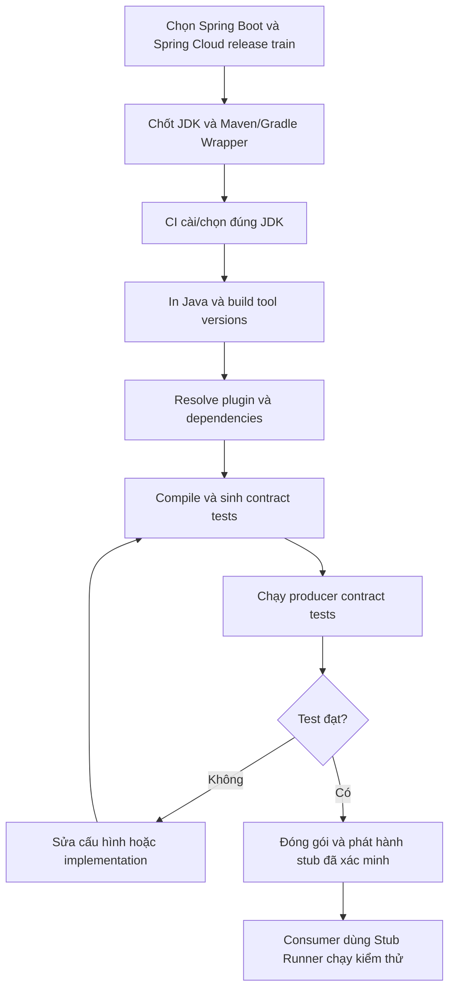

# Kiểm tra phiên bản Java và điều kiện của công cụ build

Trước khi viết hợp đồng HTTP hay message bằng **Groovy/YAML DSL**, người học Spring Cloud Contract cần biết môi trường có thể **biên dịch mã nguồn, sinh kiểm thử phía producer, chạy kiểm thử và đóng gói stub** hay chưa. Một lỗi xuất hiện ở bước `generateContractTests` đôi khi không liên quan đến nội dung hợp đồng: JDK quá cũ, Maven/Gradle chạy bằng Java khác với Java của IDE, hoặc phiên bản Spring Cloud Contract không tương thích với Spring Boot.

Bài này thuộc chương **Thiết lập dự án** của lộ trình **SPRING_CLOUD_CONTRACT**. Mục tiêu là tự kiểm tra được những điều kiện nền tảng trước khi học kiểm thử hợp đồng giữa producer và consumer, phát hành stub, dùng Stub Runner và đưa các kiểm tra tương thích API vào CI.

## 1. Cần xác minh những thành phần nào?

Một dự án Spring Cloud Contract có thể chịu ảnh hưởng bởi **nhiều phiên bản độc lập**, vì vậy chỉ nhìn kết quả `java -version` là chưa đủ.

| Thành phần | Vai trò | Cần xác minh |
|---|---|---|
| **JDK** | Chạy công cụ build, biên dịch Java, chạy kiểm thử | Phiên bản JDK đáp ứng Spring Boot, Spring Cloud Contract và công cụ build; có `javac` khi môi trường cần biên dịch |
| **Java runtime của build** | JVM thực sự chạy Maven hoặc Gradle daemon | Đúng bản Java dự kiến; không vô tình dùng bản khác từ `JAVA_HOME`, IDE hoặc PATH |
| **Maven/Gradle** | Chạy lifecycle, tải plugin/dependency, sinh test và stub | Phiên bản tương thích với Spring Boot và JDK; ưu tiên Wrapper của repository |
| **Spring Boot** | Nền ứng dụng producer/consumer | Phiên bản đã được dự án chọn và còn phù hợp với JDK/tool build |
| **Spring Cloud release train** | Quản lý nhóm phiên bản Spring Cloud | Được công bố là tương thích với dòng Spring Boot đang dùng |
| **Spring Cloud Contract** | DSL, plugin sinh producer tests, tạo stub, Stub Runner | Phiên bản thuộc hệ Spring Cloud tương ứng; plugin build tương thích với runtime |
| **Repository và mạng** | Tải BOM, plugin và dependency | Có quyền truy cập Maven Central/kho nội bộ, proxy hoặc credentials nếu cần |
| **CI** | Chạy lại build trên máy tự động | Sử dụng cùng JDK, Wrapper, cấu hình dependency và các bước kiểm thử với máy phát triển |

**Phân biệt ba khái niệm:** JDK được cài trên máy, JVM chạy Maven/Gradle và Java **toolchain** dùng để biên dịch có thể là các bản khác nhau. Cấu hình toolchain đúng không tự động bảo đảm Maven hoặc Gradle daemon đang chạy trên một Java tương thích.

## 2. Chọn phiên bản theo chuỗi tương thích

Spring Cloud Contract không nên được chọn độc lập với Spring Boot. Trình tự hợp lý khi tạo hoặc nhận một repository là:

1. Xác định phiên bản **Spring Boot** của producer hoặc consumer.
2. Đối chiếu tài liệu chính thức để chọn **Spring Cloud release train** tương thích với dòng Spring Boot đó.
3. Chọn phiên bản **Spring Cloud Contract** thuộc release train phù hợp và kiểm tra yêu cầu của plugin Maven/Gradle tương ứng.
4. Kiểm tra yêu cầu **Java tối thiểu** và **phiên bản Maven/Gradle được hỗ trợ** cho chính phiên bản Spring Boot/Cloud đang dùng.
5. Chốt JDK và Wrapper trong repository, rồi xác minh trên máy cá nhân và CI.

Ví dụ, **Spring Boot 3.x yêu cầu tối thiểu Java 17**. Tuy nhiên, điều đó **không có nghĩa** cứ Java 17 là mọi bản Spring Cloud Contract hoặc Gradle đều chạy được: các cặp phiên bản vẫn phải đáp ứng bảng tương thích của release được chọn. Java 21 là một lựa chọn thường gặp ở dự án mới nhưng chỉ dùng khi Spring Boot, build tool và plugin của dự án hỗ trợ.

Các nguồn nên kiểm tra trước khi chốt số phiên bản:

- [Spring Boot — System Requirements](https://docs.spring.io/spring-boot/system-requirements.html): Java và các phiên bản Maven/Gradle được hỗ trợ cho tài liệu đang chọn.
- [Spring Cloud — Release Trains](https://spring.io/projects/spring-cloud): quan hệ giữa Spring Boot và Spring Cloud.
- [Spring Cloud Contract — Reference](https://docs.spring.io/spring-cloud-contract/reference/): phiên bản plugin, cách sinh test/stub và yêu cầu cấu hình.
- [Gradle — Compatibility Matrix](https://docs.gradle.org/current/userguide/compatibility.html): Java nào dùng để **chạy Gradle**, Java nào dùng qua toolchain.
- [Apache Maven](https://maven.apache.org/docs/): phiên bản Maven, JDK và Maven Wrapper.

**Lưu ý về tài liệu phiên bản:** một địa chỉ `/current/` có thể dẫn tới phiên bản mới hơn dự án hiện tại. Khi dự án dùng Spring Boot hoặc Spring Cloud Contract phiên bản cũ, hãy mở **tài liệu đúng phiên bản đã ghim** và đối chiếu bản hỗ trợ tương ứng. Không đoán quan hệ tương thích chỉ từ số phiên bản gần nhau.

## 3. Kiểm tra Java trên máy phát triển

### 3.1. Linux hoặc macOS

Trong terminal tại thư mục dự án:

```bash
java -version
javac -version
echo "$JAVA_HOME"
command -v java
command -v javac
```

Ý nghĩa:

- `java -version` cho biết JVM được gọi đầu tiên theo `PATH`.
- `javac -version` cho biết trình biên dịch; nếu không tìm thấy, có thể chỉ có JRE hoặc cấu hình PATH chưa đúng.
- `JAVA_HOME` thường được Maven và nhiều công cụ Java sử dụng để xác định JDK.
- `command -v` giúp kiểm tra đường dẫn chương trình thực tế mà shell đang gọi.

Kết quả minh họa cho JDK 17:

```text
$ java -version
openjdk version "17.x" ...
$ javac -version
javac 17.x
$ echo "$JAVA_HOME"
/path/to/jdk-17
```

Đây chỉ là **mẫu cấu trúc kết quả**, không phải yêu cầu phải cài một bản vá cụ thể hay một thư mục cụ thể. Số phiên bản thực tế phải thỏa mãn ma trận tương thích ở mục 2.

Nếu `java` và `javac` thuộc hai bản khác nhau, hãy kiểm tra lại thứ tự PATH và cách cài JDK. Đừng sửa tùy tiện cấu hình hệ thống nếu dự án khác cần phiên bản Java khác; có thể dùng công cụ quản lý JDK hoặc cấu hình shell/IDE theo từng dự án.

### 3.2. Windows PowerShell

```powershell
java -version
javac -version
$env:JAVA_HOME
where.exe java
where.exe javac
```

Trong PowerShell, dùng `where.exe` để tìm đường dẫn thực thi; lệnh `where` đơn thuần có thể được hiểu theo alias khác. Nếu `JAVA_HOME` chỉ tới JDK 17 nhưng `where.exe java` ưu tiên một JDK cũ, cần xem lại PATH hoặc terminal/IDE đang mở từ trước khi thay đổi biến môi trường.

### 3.3. Kiểm tra đúng JDK mà IDE dùng

IntelliJ IDEA, Eclipse hoặc VS Code có thể có các thiết lập riêng cho:

- **Project SDK / Java language level** của nguồn Java.
- **Gradle JVM** hoặc **Maven runner JRE** dùng để chạy build.
- **JUnit/Test runner JRE** dùng khi chạy test trực tiếp từ IDE.

Nếu build ở terminal chạy được nhưng bấm Run Test trong IDE thất bại, hãy so sánh những thiết lập trên với kết quả của Maven/Gradle trong mục kế tiếp. Không nên kết luận hợp đồng Groovy/YAML sai khi hai môi trường đang dùng JVM khác nhau.

## 4. Ưu tiên Maven Wrapper hoặc Gradle Wrapper

**Wrapper** là script đi kèm repository để dùng phiên bản công cụ build mà dự án đã quy định. Wrapper giúp giảm chênh lệch giữa máy developer, máy CI và máy của consumer/producer.

| Công cụ | Linux/macOS | Windows PowerShell | Kiểm tra gì? |
|---|---|---|---|
| Maven Wrapper | `./mvnw -version` | `.\mvnw.cmd -version` | Phiên bản Maven **và Java runtime Maven đang dùng** |
| Gradle Wrapper | `./gradlew --version` | `.\gradlew.bat --version` | Phiên bản Gradle, JVM chạy Gradle và thông tin môi trường |

Chạy các lệnh này **ở thư mục có script Wrapper của dự án**. Nếu `mvnw`/`gradlew` không tồn tại, hãy xác định dự án có chủ đích sử dụng Maven/Gradle cài toàn cục hay chưa có Wrapper; không tự giả định script đang ở một thư mục khác.

Ví dụ Maven:

```bash
./mvnw -version
```

Trong thông tin trả về, tìm các mục tương đương:

```text
Apache Maven 3.x.x
Java version: 17.x
Java home: /path/to/jdk-17
```

Phiên bản Maven ở đây chỉ là **minh họa**. Điểm quan trọng là dòng `Java version` thực sự phù hợp với phiên bản Spring Boot và Spring Cloud Contract đang sử dụng. Nếu `java -version` nói Java 21 nhưng Maven hiển thị Java 17, hãy điều tra `JAVA_HOME`, runner của IDE và cơ chế chọn Java của công cụ.

Với Gradle:

```bash
./gradlew --version
```

Các dòng như `Gradle`, `Launcher JVM` và `Daemon JVM` (tên hiển thị tùy phiên bản Gradle) giúp biết phiên bản công cụ và Java được sử dụng để khởi động build. Khi dự án dùng Java toolchain, kiểm tra thêm:

```bash
./gradlew javaToolchains
```

Lệnh `javaToolchains` giúp xem Gradle đã phát hiện những JDK nào cho tác vụ biên dịch/test. Một bản JDK được khai báo trong toolchain vẫn có thể chưa được cài hoặc chưa được Gradle tìm thấy; các thiết lập tự tải JDK còn phụ thuộc cấu hình resolver và kết nối mạng.

### 4.1. Phân biệt phiên bản Wrapper với phiên bản cài toàn cục

Giả sử `gradle --version` báo Gradle 8.x nhưng `./gradlew --version` báo một phiên bản khác. Khi đang làm trong repository, **ưu tiên kết quả Wrapper** vì build và CI nên dùng phiên bản đã được dự án kiểm soát. Tương tự, `mvn -version` không tự thay thế kết quả `./mvnw -version`.

Wrapper **không tự chọn JDK phù hợp**: với Maven, cần kiểm tra `JAVA_HOME`; với Gradle, cần kiểm tra Java dùng để chạy Gradle và toolchain. Wrapper cũng có thể cần tải bản phân phối Maven/Gradle khi chạy lần đầu, vì vậy máy không có mạng có thể gặp lỗi tải phân phối dù Java đã đúng.

## 5. Kiểm tra thiết lập Java trong dự án Maven

Trong dự án Maven, tìm các cấu hình tương ứng trong `pom.xml` hiện có:

```xml
<properties>
    <java.version>17</java.version>
    <maven.compiler.release>17</maven.compiler.release>
</properties>
```

Đây là **ví dụ minh họa** cho dự án biên dịch theo Java 17; không phải yêu cầu mọi dự án Spring Cloud Contract phải dùng Java 17. Tùy parent/plugin, dự án có thể cấu hình compiler theo cách khác; không nên thêm hai thuộc tính một cách máy móc nếu hệ thống build đã quản lý chúng.

Phân biệt:

- `<java.version>` thường được hệ sinh thái Spring Boot dùng làm cấu hình phiên bản Java mong muốn.
- `<maven.compiler.release>` định hướng API và bytecode mục tiêu của Java compiler (khi plugin và JDK hỗ trợ).
- **JDK chạy Maven** phải đủ mới để chạy các plugin. Khai báo mục tiêu biên dịch 17 không làm một Maven process đang chạy dưới JDK cũ có thể dùng plugin đòi Java mới.

Để xem Maven đã tổng hợp parent, properties và plugin như thế nào, có thể chạy:

```bash
./mvnw help:effective-pom -Doutput=target/effective-pom.xml
```

Sau đó **xem** mục liên quan đến `maven-compiler-plugin`, Spring Boot, Spring Cloud BOM và Spring Cloud Contract plugin trong effective POM. Lệnh có thể phải tải `maven-help-plugin` và dependency nên cần cấu hình repository hợp lệ.

### 5.1. Kiểm tra dependency và plugin Spring Cloud Contract

Trong Maven, **BOM quản lý phiên bản dependency**; phiên bản **build plugin** không mặc nhiên được BOM dependency quản lý. Ví dụ cấu trúc cấu hình sau mô tả nơi cần xem, với giá trị placeholder phải thay theo bản tương thích đã xác nhận:

```xml
<properties>
    <spring-cloud.version>REPLACE_WITH_COMPATIBLE_TRAIN</spring-cloud.version>
    <spring-cloud-contract.version>REPLACE_WITH_MATCHING_CONTRACT_VERSION</spring-cloud-contract.version>
</properties>

<dependencyManagement>
    <dependencies>
        <dependency>
            <groupId>org.springframework.cloud</groupId>
            <artifactId>spring-cloud-dependencies</artifactId>
            <version>${spring-cloud.version}</version>
            <type>pom</type>
            <scope>import</scope>
        </dependency>
    </dependencies>
</dependencyManagement>

<build>
    <plugins>
        <plugin>
            <groupId>org.springframework.cloud</groupId>
            <artifactId>spring-cloud-contract-maven-plugin</artifactId>
            <version>${spring-cloud-contract.version}</version>
            <extensions>true</extensions>
        </plugin>
    </plugins>
</build>
```

Đây là **đoạn tham chiếu, không phải `pom.xml` hoàn chỉnh**. Các placeholder cố ý không phải phiên bản thật. Tùy dự án còn cần `spring-cloud-starter-contract-verifier` trong test dependencies, base class cho generated tests và cấu hình plugin khác. Hãy đối chiếu tài liệu chính xác của phiên bản Spring Cloud Contract đang dùng.

Đặc biệt, tránh việc **Spring Cloud Contract plugin dùng một dòng phiên bản nhưng thư viện verifier/stub runner lấy từ dòng không tương thích**. Cách đơn giản nhất là thống nhất phiên bản qua release train và kiểm tra kết quả dependency resolution.

## 6. Kiểm tra thiết lập Java trong dự án Gradle

Với Gradle dùng Groovy DSL, cấu hình Java toolchain thường có dạng:

```groovy
plugins {
    id 'java'
}

java {
    toolchain {
        languageVersion = JavaLanguageVersion.of(17)
    }
}
```

Với Kotlin DSL:

```kotlin
plugins {
    java
}

java {
    toolchain {
        languageVersion = JavaLanguageVersion.of(17)
    }
}
```

Các ví dụ cho thấy **yêu cầu Java 17 khi biên dịch/test bằng toolchain**. Chúng không bảo đảm mọi phiên bản Gradle có thể chạy trên Java 17 hoặc có sẵn JDK 17; phải đối chiếu Gradle Compatibility Matrix và kiểm tra bằng `./gradlew --version` cùng `./gradlew javaToolchains`.

Trong build sử dụng Spring Cloud Contract, cần xác minh:

1. Plugin `org.springframework.cloud.contract` được áp dụng bằng phiên bản tương thích với Spring Cloud của dự án.
2. Spring Boot plugin và dependency management (nếu dự án dùng) thuộc bộ phiên bản được hỗ trợ.
3. `testImplementation` có các dependency cần cho kiểm thử producer, chẳng hạn Contract Verifier theo tài liệu phiên bản tương ứng.
4. Tác vụ sinh contract tests được đăng ký và nối với quá trình chạy test đúng như dự án mong muốn.
5. Repository cung cấp được cả **Gradle plugin** lẫn **runtime/test dependencies**. Plugin repository và dependency repository có thể được cấu hình ở các vị trí khác nhau.

Để nhìn danh sách tác vụ sau khi build script được đánh giá:

```bash
./gradlew tasks --all
```

Khi plugin Spring Cloud Contract được áp dụng đúng, danh sách có thể chứa những tác vụ liên quan đến sinh kiểm thử hoặc stub, ví dụ `generateContractTests`. Nếu tác vụ không tồn tại, hãy kiểm tra plugin đã được áp dụng và phiên bản plugin có đúng với tài liệu đang theo hay không; không vội kết luận file hợp đồng sai.

## 7. Xác minh môi trường bằng một build tối thiểu

Sau khi xác nhận Java và tool build, nên chạy một chuỗi kiểm tra **từ ít phụ thuộc đến nhiều phụ thuộc**. Những lệnh dưới đây thực hiện trên máy học viên hoặc CI của dự án; chúng là ví dụ thao tác, không yêu cầu thay đổi file hệ thống trước khi biết nguyên nhân lỗi.

### 7.1. Dự án Maven

```bash
./mvnw -version
./mvnw -DskipTests compile
./mvnw test
./mvnw package
```

- `-version`: xác minh Maven/JDK thực thi.
- `compile`: kiểm tra dependency và khả năng biên dịch producer mà chưa cần chạy test.
- `test`: chạy kiểm thử theo lifecycle; khi Contract Verifier được cấu hình đúng, các kiểm thử sinh từ contract được tham gia vào quá trình này.
- `package`: kiểm tra đóng gói artifact; với cấu hình Spring Cloud Contract phù hợp, cần xác minh thêm stub artifact/mapping được sinh và đóng gói theo đúng dự kiến.

`-DskipTests` chỉ là cách **tạm bỏ qua việc thực thi test để khoanh vùng lỗi biên dịch**, không phải cách hoàn thành kiểm tra producer. Khi kết luận môi trường sẵn sàng cho phát hành, **bắt buộc chạy test thật**.

### 7.2. Dự án Gradle

```bash
./gradlew --version
./gradlew tasks --all
./gradlew compileJava
./gradlew test
./gradlew build
```

Tùy dự án, tác vụ compile có thể khác (`compileKotlin` chẳng hạn) và Spring Cloud Contract plugin có thể cung cấp tác vụ riêng. Lệnh `build` chỉ có ý nghĩa kiểm tra contract khi các tác vụ sinh/running producer tests và đóng gói stub **đã được kết nối đúng vào lifecycle**. Không mặc định rằng một build xanh chứng minh đã sinh stub hoặc đã chạy mọi contract nếu dự án chưa cấu hình plugin.

### 7.3. Đọc kết quả theo từng lớp

| Triệu chứng | Kiểm tra trước | Hướng khắc phục |
|---|---|---|
| `java: command not found` hoặc `java is not recognized` | PATH, cài JDK, terminal hiện tại | Cài/chọn JDK được hỗ trợ và cấu hình đúng PATH/JAVA_HOME |
| Có `java` nhưng không có `javac` | JDK vs JRE, compiler/toolchain | Chọn JDK đầy đủ hoặc cấu hình toolchain theo dự án |
| `Unsupported class file major version ...` | Java đang chạy Gradle/Maven, plugin, bytecode dependency | Đối chiếu JDK và ma trận hỗ trợ của Gradle/plugin; không chỉ đổi `sourceCompatibility` |
| `invalid target release: 17` | JDK thực tế mà compiler đang dùng | Bảo đảm compiler/toolchain hỗ trợ target đã khai báo |
| `Could not resolve ...` / `Plugin not found` | Repository, proxy, credentials, tọa độ artifact, phiên bản plugin | Kiểm tra tải plugin/BOM/dependency; phân biệt lỗi mạng và lỗi phiên bản không tồn tại |
| `generateContractTests` không xuất hiện | Cấu hình và phiên bản Spring Cloud Contract plugin | Áp dụng plugin đúng cách, kiểm tra plugin đã nạp trước khi tìm lỗi DSL |
| Producer contract tests không biên dịch | Generated sources, test dependencies, base test class, JDK | Kiểm tra cấu hình test source set và dependency tương ứng |
| Contract test chạy nhưng trả `404`/JSON sai | Endpoint, dữ liệu fixture, HTTP method/path, matcher | Xác minh hành vi triển khai đối chiếu hợp đồng; đây có thể là **lỗi hợp đồng thực sự** |

Tách **lỗi môi trường/build** khỏi **lỗi hành vi producer** là kỹ năng quan trọng. Khi plugin không tải được, chưa thể kết luận producer tuân thủ hay vi phạm hợp đồng. Khi generated test đã chạy và phản hồi sai kỳ vọng, nên điều tra implementation hoặc cách chuẩn bị dữ liệu test.

## 8. Kiểm tra các điều kiện ngoài phiên bản

Ngay cả khi JDK, Maven/Gradle và Spring Cloud Contract tương thích, việc sinh test/stub vẫn có thể thất bại vì điều kiện môi trường:

| Điều kiện | Cách kiểm tra | Rủi ro nếu bỏ qua |
|---|---|---|
| **Quyền truy cập repository** | Build có tải được parent, BOM, plugin, test dependency và WireMock/Stub Runner? | Lỗi resolution khi chạy CI dù mã đúng |
| **Proxy/SSL và credentials** | Cấu hình Maven `settings.xml` hoặc Gradle theo chính sách dự án | Lỗi handshake, HTTP 401/403 hoặc timeout |
| **Quyền ghi thư mục build** | Có quyền tạo `target/` hoặc `build/`? | Không sinh generated sources/mappings được |
| **Nguồn hợp đồng** | File Groovy/YAML nằm đúng thư mục mà plugin đã cấu hình? | Không sinh test nào, build có thể xanh giả |
| **Base test class và fixture** | Có lớp cơ sở, context và dữ liệu ổn định để generated tests chạy? | Test sinh được nhưng không chạy đúng |
| **Port test và tài nguyên phụ thuộc** | Stub Runner/HTTP mock có thể mở cổng; DB/broker test được cung cấp khi cần? | Tranh chấp cổng, test không ổn định |
| **Môi trường CI** | Runner dùng JDK/Wrapper, repository và secrets đúng? | Chạy được local nhưng thất bại trên CI |

Với kiểm thử **message contract**, ngoài Java và build tool còn có thể cần binder, broker hoặc cấu hình message verifier thích hợp. Một test HTTP chạy được không bảo đảm bài kiểm thử thông điệp đã được thiết lập đầy đủ.

## 9. Giữ kết quả nhất quán giữa máy cá nhân và CI

Trong pipeline, ghi rõ bộ phiên bản đã được chọn và cho CI chạy Wrapper giống developer. Quy trình tối thiểu:



Ví dụ phần kiểm tra đầu pipeline cho Linux runner sử dụng Maven Wrapper:

```bash
set -e
java -version
javac -version
./mvnw -version
./mvnw test
```

Với Gradle Wrapper:

```bash
set -e
java -version
javac -version
./gradlew --version
./gradlew test
```

Để chạy được các đoạn trên, **bước trước đó của pipeline phải chọn đúng JDK** và bảo đảm script Wrapper có thể thực thi trong runner. `set -e` giúp shell dừng khi lệnh lỗi, nhưng không thay cho cấu hình test/dependency đầy đủ.

**Không nên dùng `-DskipTests`, `-x test` hoặc tắt contract tests trong pipeline phát hành** chỉ vì môi trường đang sai phiên bản. Khi producer test không chạy, nhóm không có bằng chứng rằng stub phát hành phản ánh hành vi của implementation. Cũng cần ghim phiên bản stub và nguồn hợp đồng để consumer kiểm thử với artifact có thể truy vết, thay vì liên tục lấy một bản không xác định.

### 9.1. Ghi lại thông tin cần thiết khi báo lỗi

Khi build thất bại, một báo cáo hữu ích nên kèm:

```text
OS / CI runner:
Java (`java -version`):
Java compiler (`javac -version`):
JAVA_HOME (chỉ đường dẫn JDK, không chứa thông tin bí mật):
Maven Wrapper (`./mvnw -version`) hoặc Gradle Wrapper (`./gradlew --version`):
Spring Boot version:
Spring Cloud release train:
Spring Cloud Contract plugin version:
Lệnh gây lỗi:
Thông báo lỗi đầu tiên có ý nghĩa:
```

Tránh đăng log chứa token truy cập kho artifact, mật khẩu, private key hoặc nguyên văn file cấu hình có bí mật. Mục đích là tái hiện được môi trường kỹ thuật cần thiết để sửa lỗi.

## 10. Thực hành: đánh giá một máy mới nhận dự án Spring Cloud Contract

Giả sử một nhóm đã chọn Spring Boot 3.x, định biên dịch với Java 17 và có một repository producer dùng Maven Wrapper. Học viên vừa nhận máy mới, cài cả JDK 11 và JDK 17; IDE đặt Project SDK là 17 nhưng terminal chưa được cấu hình.

Thực hiện theo trình tự:

1. Chạy `java -version`, `javac -version` và kiểm tra `JAVA_HOME`/đường dẫn chương trình. Ghi rõ Java nào đang được shell dùng.
2. Chạy `./mvnw -version` (Windows: `.\mvnw.cmd -version`). So sánh Java runtime của Maven với yêu cầu của dự án, không suy đoán từ IDE.
3. Nếu Maven đang dùng JDK 11, điều chỉnh cách chọn JDK cho **phiên làm việc/dự án** sang 17 theo quy định nhóm rồi chạy lại bước 2.
4. Xác minh Spring Cloud release train tương thích với dòng Spring Boot hiện tại và Spring Cloud Contract plugin đúng phiên bản đã thống nhất.
5. Chạy compile và test bằng Wrapper. Nếu plugin sinh kiểm thử chưa được cấu hình, ghi nhận đây là **thiếu cấu hình contract testing**, không xem một build thường thành bằng chứng producer đã đạt hợp đồng.
6. Kiểm tra produced test/stub theo lifecycle đã cấu hình và đưa cùng các bước kiểm tra lên CI.

**Kết quả mong đợi:** học viên xác định đúng JDK chạy build, chọn đúng phiên bản công cụ, phân biệt lỗi Java/plugin với lỗi contract test, và biết điều kiện cần đạt trước khi đóng gói stub phát hành cho consumer.

## 11. Tự kiểm tra kiến thức

1. **`java -version` báo 17, nhưng `./mvnw -version` báo Java 11. Nên tin kết quả nào khi chẩn đoán lỗi Maven?** Tin phiên bản **Java mà Maven thực sự đang chạy**; sau đó kiểm tra `JAVA_HOME`, PATH và cấu hình runner.
2. **Đặt `sourceCompatibility = 17` có khiến Gradle chạy được trên mọi JDK không?** Không. Nó liên quan mục tiêu biên dịch; bản Gradle và JVM chạy Gradle vẫn phải tương thích.
3. **Vì sao phải kiểm tra Spring Boot trước khi chọn Spring Cloud Contract?** Vì Spring Cloud release train và các thành phần Contract có các cặp phiên bản được hỗ trợ; chọn tùy ý có thể gây lỗi dependency/plugin.
4. **Maven/Gradle Wrapper giải quyết việc gì?** Ghim công cụ build theo repository; Wrapper không mặc nhiên ghim hoặc cài sẵn JDK thích hợp.
5. **Tại sao build xanh nhưng không có generated contract test vẫn chưa đủ?** Có thể plugin hoặc đường dẫn nguồn hợp đồng chưa được cấu hình, khiến các kỳ vọng của consumer chưa từng được thực thi với producer.
6. **Producer test sai body sau khi đã chạy thành công là lỗi Java hay lỗi hợp đồng?** Nếu môi trường build/test đã hoạt động, cần điều tra implementation, fixture và DSL; lỗi có thể phản ánh sai khác hành vi thật.
7. **Có nên tắt producer contract tests để phát hành stub cho nhanh?** Không. Stub chưa được xác minh với producer chỉ nên được xem là bản phục vụ phát triển; bản phát hành cần qua cổng kiểm thử producer.

## Kết luận

Để bắt đầu học **Spring Cloud Contract** hiệu quả, cần kiểm tra không chỉ **phiên bản Java** mà cả **Java đang chạy công cụ build, phiên bản Maven/Gradle Wrapper, sự tương thích Spring Boot–Spring Cloud–Contract, khả năng tải plugin/dependency và điều kiện chạy test trên CI**. Khi các điều kiện này được xác minh, người học mới có cơ sở tin cậy để sinh producer tests từ Groovy/YAML DSL, phát hành stub, dùng Stub Runner và phát hiện sớm thay đổi API phá vỡ hợp đồng giữa producer và consumer.
