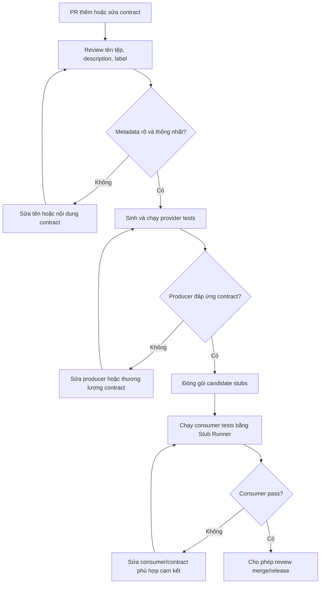

# Đặt tên hợp đồng, mô tả và nhãn nhận diện trong Spring Cloud Contract

Khi số lượng hợp đồng tăng từ vài tệp lên hàng trăm tệp, vấn đề khó không chỉ là viết đúng Groovy/YAML DSL. Nhóm phát triển còn phải **tìm được hợp đồng cần sửa, hiểu hành vi đang được cam kết, nhận diện được từng kịch bản khi chạy test/stub và biết thay đổi nào tác động đến consumer**. Tên tệp khó hiểu, mô tả mơ hồ hoặc nhãn thông điệp trùng nhau có thể làm quá trình review và xử lý lỗi mất nhiều thời gian, dù các contract vẫn hợp lệ về cú pháp.

Trong **Spring Cloud Contract (SCC)**, producer định nghĩa hành vi HTTP hoặc thông điệp bằng Groovy/YAML DSL; công cụ có thể sinh bài kiểm thử cho producer và tạo stub để consumer kiểm thử qua Stub Runner. Bài thuộc chương **Tổ chức hợp đồng** này tập trung vào ba thông tin phục vụ việc quản lý đó: **tên hợp đồng**, **mô tả** (`description`) và **nhãn nhận diện** (`label`). Ví dụ xuyên suốt là dịch vụ `order-producer`, cung cấp API đọc đơn hàng và phát sự kiện đơn hàng được tạo.

## 1. Phân biệt tên, mô tả và nhãn

Ba khái niệm liên quan nhau nhưng không có cùng mục đích:

| Thành phần | Gắn ở đâu? | Người hoặc công cụ sử dụng | Chức năng chính |
| --- | --- | --- | --- |
| Tên tệp và đường dẫn contract | Ví dụ `contracts/http/get-order-by-id-ok.groovy` | Developer, reviewer, build, công cụ sinh test/stub | Tổ chức và định vị kịch bản trong repository |
| `description` | Trường trong Groovy/YAML contract | Người đọc hợp đồng, reviewer, người xem kết quả test tùy cấu hình | Giải thích **vì sao** và **khi nào** hành vi được cam kết |
| `label` | Trường trong contract, đặc biệt hữu ích cho messaging | Consumer test dùng Stub Runner để kích hoạt message | Nhận diện **kịch bản thông điệp** bằng một tên logic |
| `request.method`, `request.url` | Nội dung hợp đồng HTTP | Contract Verifier và HTTP stub | Xác định lời gọi HTTP thật sự được kiểm tra |
| `outputMessage.sentTo` | Nội dung hợp đồng thông điệp | Message verifier, message transport/test adapter | Xác định destination mà producer phát message |
| Maven coordinates của `-stubs.jar` | Cấu hình artifact khi build và chạy Stub Runner | CI, consumer, artifact repository | Xác định **bộ stub** và phiên bản được dùng |

Một tệp tên `get-order-by-id-ok.groovy` có thể có mô tả tiếng Việt dài để làm rõ tình huống. Một contract thông điệp tên `order-created-v1.groovy` có thể dùng `label 'order_created_v1'`, còn message vẫn được gửi đến `orders.created`. Ba giá trị này **không tự động thay thế nhau**.

Đặc biệt, **`description` không phải điều kiện kiểm tra**: test kiểm tra các ràng buộc trong `request`, `response`, `input` và `outputMessage`. Nếu mô tả ghi “trả 404” nhưng cấu hình thực tế là `status: 200`, hợp đồng đã mâu thuẫn và cần sửa, dù build có thể vẫn chạy.

## 2. Nguyên tắc đặt tên tệp hợp đồng

### 2.1. Đặt tên theo hành vi có thể quan sát

Một tên hữu ích nên trả lời được phần lớn các câu hỏi: **kênh giao tiếp nào, thao tác gì, đối tượng nào, tình huống nào và kết quả gì**.

Quy ước gợi ý:

- HTTP: `<method>-<resource>-<scenario>-<expected-result>.<groovy|yml>`.
- Messaging: `<event-or-command>-<scenario-or-version>.<groovy|yml>`.
- Dùng chữ thường và dấu nối `-` cho tên tệp; nếu nhóm đã có quy ước khác thì giữ nhất quán trong cùng module.
- Đặt tên ổn định theo **ngữ nghĩa hành vi**, tránh đưa giá trị dữ liệu ngẫu nhiên vào tên.

Ví dụ:

| Tên đề xuất | Hành vi được nhận diện | Đánh giá |
| --- | --- | --- |
| `get-order-by-id-ok.groovy` | GET đơn hàng tồn tại, phản hồi thành công | Rõ ràng |
| `get-order-by-id-not-found.yml` | GET đơn hàng không tồn tại, phản hồi 404 | Rõ trường hợp lỗi |
| `post-order-invalid-body.yml` | POST tạo đơn hàng với payload không hợp lệ | Rõ điều kiện đầu vào |
| `order-created-v1.groovy` | Sự kiện đơn hàng được tạo, schema v1 | Dễ phân biệt với v2 |
| `test1.groovy` | Không biết nghiệp vụ hay tình huống | Không nên |
| `get.groovy` | Không biết tài nguyên hoặc kết quả | Không nên |
| `happy-path-final-v3-new.yml` | Tên mang lịch sử chỉnh sửa, thiếu ngữ nghĩa | Không nên |

`ok` hoặc `success` có thể dùng cho kết quả thành công; với lỗi, ưu tiên `not-found`, `unauthorized`, `validation-error` thay vì chỉ `error-1`. Không cần nhồi mọi thuộc tính vào tên: giá trị request, kiểu dữ liệu, matcher và các tiền điều kiện chi tiết thuộc về **nội dung contract**.

Tránh đưa số đơn hàng thật, email, access token, tên khách hàng hoặc dữ liệu nhạy cảm vào tên tệp. Dùng ID mẫu như `1001` trong body test khi thích hợp, nhưng tên tệp vẫn nên phản ánh hành vi: `get-order-by-id-ok` thay vì `get-order-1001`.

### 2.2. Tổ chức bằng đường dẫn

Ví dụ cách bố trí một producer:

```text
order-producer/
└── src/
    └── test/
        └── resources/
            └── contracts/
                ├── http/
                │   ├── get-order-by-id-ok.groovy
                │   ├── get-order-by-id-not-found.yml
                │   └── post-order-invalid-body.yml
                └── messaging/
                    ├── order-created-v1.groovy
                    └── order-cancelled-v1.groovy
```

`src/test/resources/contracts` là vị trí thường dùng trong dự án producer Maven với Spring Cloud Contract; build có thể cấu hình vị trí khác. Các thư mục `http` và `messaging` ở đây là **quy ước tổ chức của nhóm**, không phải hai loại thư mục bắt buộc của DSL.

Khi nhiều consumer phụ thuộc vào cùng producer, nhóm có thể dùng cách nhóm theo consumer hoặc nhóm theo chức năng nghiệp vụ tùy chiến lược lưu trữ contract. Điều quan trọng là quy tắc đường dẫn phải có tài liệu, tránh hai nhóm tạo hai tệp khác nhau cho cùng một cam kết mà không biết nhau.

**Một kịch bản quan sát được nên có một contract rõ ràng.** Ví dụ một response `200` và một response `404` là hai kịch bản khác nhau. Dù DSL cho phép nhiều cách biểu diễn, cách tách này giúp review, xác định test bị lỗi và theo dõi tiến hóa API.

### 2.3. Đặt tên không phụ thuộc vào chi tiết triển khai

Một consumer quan tâm rằng `GET /api/orders/{id}` trả thông tin đơn hàng, chứ không quan tâm controller dùng `findByPk()`, service dùng Redis hay database dùng bảng `ORD_MST`.

Không nên:

```text
order-controller-findByPk-test.groovy
redis-cache-hit-response.yml
methodA-success.groovy
```

Nên:

```text
get-order-by-id-ok.groovy
get-order-by-id-not-found.yml
```

Nhờ vậy, khi producer refactor nội bộ nhưng giữ nguyên hành vi công khai, tên và nội dung hợp đồng không cần thay đổi vô ích.

## 3. Viết `description` để người đọc hiểu đúng hành vi

### 3.1. Một mô tả tốt gồm những gì?

Mô tả nên ngắn, nhưng có đủ **bối cảnh, điều kiện và kết quả quan sát được**. Công thức dễ áp dụng:

> Khi [điều kiện hoặc yêu cầu], producer phải [hành vi cụ thể] để consumer có thể [mục đích sử dụng].

Ví dụ tốt:

- “Khi đơn hàng tồn tại, GET theo ID trả 200 và JSON chứa ID cùng trạng thái đơn hàng.”
- “Khi không tìm thấy đơn hàng, GET theo ID trả 404.”
- “Sau khi đơn hàng được tạo thành công, producer phát sự kiện `order_created_v1` chứa `orderId` và `status`.”

Ví dụ cần tránh:

- “Test GET.”
- “Check response.”
- “API đúng.”
- “Sửa bug ORDER-123.” — mã issue có thể bổ sung làm liên kết tham chiếu, nhưng không đủ để giải thích hợp đồng.

Bảng đối chiếu:

| Mô tả mơ hồ | Mô tả có thể review |
| --- | --- |
| “Lấy đơn hàng” | “Khi ID hợp lệ và tồn tại, GET đơn hàng trả HTTP 200 cùng dữ liệu JSON của đơn hàng đó” |
| “Không tìm thấy” | “Khi ID đơn hàng không tồn tại, GET theo ID trả HTTP 404” |
| “Gửi message” | “Khi tạo đơn hàng thành công, producer phát thông điệp OrderCreated v1 tới destination đã cam kết” |
| “Validation” | “Khi yêu cầu tạo đơn thiếu trường bắt buộc, POST trả HTTP 400 và mã lỗi validation” |

Mô tả không cần sao chép mọi dòng JSON; các điều kiện chính xác thuộc phần DSL bên dưới. Tuy nhiên mô tả phải khớp với DSL. Nếu giới thiệu `404` nhưng `response.status` lại là `200`, contract sai về nội dung diễn giải ngay cả trước khi chạy test.

### 3.2. Tiếng Việt và tính dễ đọc

`description` có thể viết tiếng Việt UTF-8 để sát với ngữ cảnh học tập hoặc ngôn ngữ tài liệu của nhóm; tên tệp và nhãn máy có thể giữ tiếng Anh ASCII để dễ dùng với build/script. Ví dụ:

```groovy
description 'Khi đơn hàng tồn tại, GET theo ID trả HTTP 200 và trạng thái hiện tại'
```

Nếu hệ thống build/tooling có hạn chế về encoding, thống nhất UTF-8 cho repository và CI. Không cần loại bỏ dấu tiếng Việt khỏi mô tả dành cho con người.

### 3.3. Mô tả nghiệp vụ thay vì kể lại chi tiết code

Một mô tả như “gọi `OrderServiceImpl.findOrder()` rồi map DTO” dễ lỗi thời sau refactor. Thay bằng hành vi từ góc nhìn consumer: “GET theo ID trả thông tin đơn hàng đã công bố”.

Có thể ghi điều kiện nghiệp vụ quan trọng như “chỉ đơn hàng thuộc tài khoản được phép truy cập mới trả 200”, nhưng hãy bảo đảm contract, test setup hoặc bài kiểm thử bảo mật liên quan thật sự chứng minh điều kiện đó; không để mô tả trở thành cam kết không được kiểm chứng.

## 4. Ví dụ HTTP: tên tệp và mô tả bằng Groovy DSL

Giả sử tạo tệp:

```text
src/test/resources/contracts/http/get-order-by-id-ok.groovy
```

Nội dung:

```groovy
import org.springframework.cloud.contract.spec.Contract

Contract.make {
    description 'Khi đơn hàng 1001 tồn tại, GET theo ID trả 200 và trạng thái CREATED'

    request {
        method GET()
        url '/api/orders/1001'
    }

    response {
        status OK()
        headers {
            contentType(applicationJson())
        }
        body(
            id: 1001,
            status: 'CREATED'
        )
    }
}
```

Ở đây:

1. **Tên tệp** `get-order-by-id-ok` cho biết kịch bản cần tìm trong repository.
2. **`description`** nêu điều kiện và hành vi cho người đọc.
3. **`request`** và **`response`** mới là dữ liệu dùng để sinh test xác minh producer và HTTP stub cho consumer.
4. Không cần `label` để consumer gọi HTTP stub: client gọi request phù hợp mapping bằng method, URL và điều kiện request được khai báo.

Nếu developer đổi tên tệp để dễ đọc nhưng không đổi request/response, ý nghĩa giao tiếp không nhất thiết thay đổi. Tuy vậy, tên test được sinh, vị trí artifact hoặc đường dẫn mà các công cụ của nhóm theo dõi có thể khác; hãy review việc rename như một thay đổi tổ chức có chủ đích.

### Ví dụ cùng kịch bản bằng YAML DSL

Trong nhóm chọn YAML, tệp `get-order-by-id-ok.yml` có thể mô tả tương đương:

```yaml
description: "Khi đơn hàng 1001 tồn tại, GET theo ID trả 200 và trạng thái CREATED"
request:
  method: GET
  url: /api/orders/1001
response:
  status: 200
  headers:
    Content-Type: application/json
  body:
    id: 1001
    status: CREATED
```

**Chọn Groovy hoặc YAML cho một kịch bản** trong bài thực hành. Đặt đồng thời cả hai bản tương đương dưới thư mục discovery có thể tạo hai contract trùng nhau, gây test/stub dư thừa và khó kiểm soát khi một bản được cập nhật nhưng bản kia bị quên.

### Tạo kịch bản lỗi với tên riêng

Để bảo vệ trường hợp không tìm thấy:

```yaml
# get-order-by-id-not-found.yml
description: "Khi không có đơn hàng mang ID 9999, GET theo ID trả HTTP 404"
request:
  method: GET
  url: /api/orders/9999
response:
  status: 404
```

Khi test cho `404` thất bại, đường dẫn `get-order-by-id-not-found.yml` giúp developer nhanh chóng nhận ra **kịch bản lỗi** bị thay đổi, thay vì phải đoán “test2” đại diện cho điều gì.

Trong API thực tế, những ID, timestamp hay dữ liệu động cần dùng **matcher** thích hợp; tên tệp không nên cố gắn với một giá trị test cố định. Điều quan trọng là contract bảo vệ quy tắc consumer dựa vào.

## 5. Nhãn `label` trong hợp đồng thông điệp

### 5.1. `label` giải quyết vấn đề nào?

Với HTTP, consumer phát request đến HTTP stub server rồi so sánh response. Với messaging, producer có thể phát sự kiện do một hành động nội bộ; consumer test cần cơ chế yêu cầu Stub Runner phát thông điệp mẫu. Khi đó **`label` dùng làm nhãn logic để kích hoạt message stub**.

Ví dụ tệp `messaging/order-created-v1.groovy`:

```groovy
import org.springframework.cloud.contract.spec.Contract

Contract.make {
    description 'Khi tạo đơn hàng thành công, producer phát sự kiện OrderCreated v1'
    label 'order_created_v1'

    input {
        triggeredBy('publishOrderCreated()')
    }

    outputMessage {
        sentTo('orders.created')
        headers {
            messagingContentType(applicationJson())
        }
        body(
            orderId: 1001,
            status: 'CREATED',
            schemaVersion: 1
        )
    }
}
```

Ý nghĩa từng thành phần:

| Phần khai báo | Giá trị ví dụ | Vai trò |
| --- | --- | --- |
| Tên tệp | `order-created-v1.groovy` | Tìm contract theo nghiệp vụ và phiên bản schema |
| `description` | “Khi tạo đơn hàng...” | Diễn giải tình huống |
| `label` | `order_created_v1` | Consumer test có thể yêu cầu Stub Runner phát message tương ứng |
| `input.triggeredBy` | `publishOrderCreated()` | Provider verification test gọi hook để kích hoạt producer phát sự kiện |
| `outputMessage.sentTo` | `orders.created` | Destination logic của message đầu ra |
| `outputMessage.body` | `orderId`, `status`, `schemaVersion` | Payload contract yêu cầu |

Phương thức `publishOrderCreated()` phải được cung cấp bởi lớp base/test setup phía producer và phải kích hoạt đường phát sự kiện phù hợp. Đây là hook kiểm thử, **không phải tên label** hoặc tên consumer listener.

### 5.2. Consumer test gọi nhãn ra sao?

Khi dự án consumer đã cấu hình Spring Cloud Contract Stub Runner và message transport tương thích, test có thể dùng `StubTrigger`:

```java
@Autowired
private StubTrigger stubTrigger;

@Test
void receivesOrderCreatedV1() {
    stubTrigger.trigger("order_created_v1");

    // Chờ có giới hạn rồi xác nhận listener đã xử lý orderId = 1001.
    // Assertion thực tế phụ thuộc queue/test binder và cách lưu trạng thái xử lý.
}
```

Đây là phần trích minh họa lời gọi trigger; để thành test hoàn chỉnh, phải cấu hình Stub Runner, message adapter/binder và assertion quan sát được kết quả xử lý của consumer. `trigger("order_created_v1")` **không tự động chứng minh** listener nhận và xử lý đúng thông điệp.

Tên `order_created_v1` là một **định danh dùng trong test**. Nó không tự động tạo topic `order_created_v1` và cũng không thay thế `sentTo('orders.created')`. Nếu đổi label mà quên sửa consumer test, lời gọi trigger theo label cũ có thể không tìm được kịch bản mong đợi, dù destination không hề đổi.

### 5.3. Quy ước đặt label

Một quy ước dễ dùng là `<domain>_<event>[_version][_scenario]`, ví dụ:

```text
order_created_v1
order_cancelled_v1
payment_authorized_v1
order_created_v2
```

Nhóm có thể chọn `snake_case` hoặc `kebab-case`; điều quan trọng là **nhất quán, dễ gõ, ổn định và tránh va chạm**. Khi cùng bộ stub có nhiều message contract, nên dùng label khác nhau cho những kịch bản cần kích hoạt riêng. Label trùng có thể dẫn tới việc kích hoạt không rõ kịch bản mong muốn, tùy cách Stub Runner và cấu hình message stubs xử lý nhãn.

Chỉ thêm phiên bản vào label khi việc phân biệt schema hoặc hành vi theo phiên bản thực sự có ý nghĩa. Chẳng hạn `order_created_v1` và `order_created_v2` có thể cùng tồn tại trong giai đoạn di chuyển consumer. Một thay đổi mô tả, format tệp hoặc comment không đòi hỏi đổi label.

Không dùng timestamp của mỗi build, số ticket ngẫu nhiên hay tên nhân viên làm label; điều đó gây churn trong consumer tests và không thể hiện ngữ nghĩa sự kiện.

## 6. Những nhầm lẫn giữa label, destination và phiên bản

Xét ba định danh:

```text
Tệp contract : messaging/order-created-v1.groovy
Label         : order_created_v1
Destination   : orders.created
```

Chúng liên quan nhưng khác phạm vi:

- **Tên tệp** thuộc tổ chức nguồn contract.
- **Label** thuộc cơ chế nhận diện message stub trong kiểm thử.
- **Destination** thuộc hành vi giao tiếp message mà producer cam kết, ví dụ topic/channel logic do binder cấu hình.

`label` cũng không đồng nghĩa với `artifactId` hoặc version của `-stubs.jar`. Consumer có thể cấu hình Stub Runner để chọn bộ stub phiên bản `2.4.0`, rồi mới dùng `label` để kích hoạt một message trong bộ stub đó:

```java
@AutoConfigureStubRunner(
    ids = "com.example:order-producer:2.4.0:stubs:8085",
    stubsMode = StubRunnerProperties.StubsMode.LOCAL
)
```

Chuỗi `com.example:order-producer:2.4.0:stubs:8085` xác định Maven coordinates và cổng phục vụ HTTP stubs theo cấu hình; `order_created_v1` vẫn là tên sự kiện dùng để trigger. Không thể dùng mỗi `label` để chỉ định phiên bản producer đang được mô phỏng.

**Chú ý về version:** `v1` trong tên event/label mô tả phiên bản hợp đồng hoặc schema theo quy ước nghiệp vụ; `2.4.0` trong stubs artifact là phiên bản phát hành của producer. Hai chu kỳ phiên bản có thể khác nhau. Một producer `2.4.0` vẫn có thể phát cả event schema v1 và v2 trong thời gian chuyển đổi.

## 7. Thiết kế quy ước cho nhóm nhiều producer và consumer

Nếu một nhóm bắt đầu từ dự án nhỏ, có thể chỉ cần viết contract ngay tại producer. Khi quy mô tăng, cần thống nhất từ sớm để giảm rename và nhầm phạm vi.

### 7.1. Bộ quy tắc tối thiểu

| Quy tắc | Ví dụ áp dụng | Lý do |
| --- | --- | --- |
| Tên tệp mô tả hành vi | `get-order-by-id-not-found.yml` | Tìm nhanh tình huống bị lỗi |
| Một kịch bản, một tên phân biệt | `get-order-by-id-ok`, `get-order-by-id-not-found` | Tránh các tệp mơ hồ hoặc trùng nội dung |
| Mô tả nêu điều kiện và kết quả | “Khi ID không tồn tại, GET trả 404” | Reviewer hiểu cam kết |
| Label message ổn định | `order_created_v1` | Consumer test trigger đúng kịch bản |
| Label khác destination | `order_created_v1` so với `orders.created` | Không nhầm test trigger với routing |
| Chỉ gắn version khi có lý do | `order-created-v2.groovy` cho schema mới | Tránh đổi tên vô ích |
| Không dùng dữ liệu nhạy cảm | `get-order-by-id-ok`, không dùng email thực | An toàn và dễ tái sử dụng |
| Cùng một quy ước trong repository | Toàn bộ tên tệp dùng `kebab-case` | Dễ tự động hóa và review |

### 7.2. Hợp đồng phục vụ nhiều consumer

Nếu nhiều consumer cùng sử dụng `GET /api/orders/{id}`, không nhất thiết phải tạo nhiều hợp đồng giống nhau chỉ để thêm tên từng consumer. Trước tiên xác định **cam kết hành vi nào là chung**, sau đó giữ một nguồn chân lý nếu quy trình chia sẻ cho phép.

Khi một consumer có yêu cầu khác, ví dụ API dành cho reporting được thêm projection hoặc header chuyên biệt, mô tả điều kiện ấy thành kịch bản riêng. Tên có thể gợi ý điều kiện nhưng **không nên mã hóa tên nhóm sở hữu như một chi tiết kỹ thuật bất biến**, trừ khi chính hợp đồng là consumer-specific theo chiến lược tổ chức đã chọn.

Ví dụ:

```text
get-order-by-id-ok.groovy
get-order-by-id-with-summary-projection.groovy
get-order-by-id-unauthorized.yml
```

Các contract có thể được lưu chung hoặc phân chia theo consumer trong repository hợp đồng riêng. Nếu có nhiều module producer, hãy đặt root/path đủ rõ để tránh tên tệp giống nhau xuất hiện trong cùng phạm vi sinh stubs mà không phân biệt được.

### 7.3. Quản lý thay đổi tên và mô tả

Không phải mọi chỉnh sửa metadata đều là breaking change:

| Thay đổi | Thường tác động tới đâu? | Cần kiểm tra gì? |
| --- | --- | --- |
| Sửa lỗi chính tả `description` | Người đọc/test report | DSL vẫn phản ánh cùng hành vi |
| Đổi tên tệp `get-order-ok` thành `get-order-by-id-ok` | Đường dẫn, tên/nhóm generated test tùy build | Discovery vẫn nhận contract, test/stub vẫn được sinh |
| Đổi label `order_created_v1` thành `order_created` | Consumer test gọi `StubTrigger` | Cập nhật các consumer tests và tài liệu nhãn |
| Đổi `sentTo('orders.created')` thành `sentTo('orders.v2')` | Routing thông điệp | Consumer subscriptions, broker binding, verification |
| Đổi `response.body.status` thành `state` | API contract HTTP | Provider verification và consumer parsing |
| Đổi version stubs JAR | Bộ contract mà consumer test sử dụng | Consumer test có pin đúng candidate version không |

Tên và description tốt **không bù được một contract thiếu điều kiện kiểm tra**. Những dữ liệu động nên dùng matcher, các tình huống lỗi cần contract tương ứng, và hành vi bất đồng bộ cần test đúng adapter/message transport.

## 8. Quy trình review và kiểm tra CI

Spring Cloud Contract giúp sinh test và stub từ nội dung hợp đồng, nhưng các quy tắc biên tập như “mô tả phải dễ hiểu” hoặc “tên tệp phải theo kebab-case” thường là **quy ước của nhóm**, cần review hoặc bổ sung kiểm tra riêng trong CI. Không nên mặc định Contract Verifier tự áp dụng mọi quy tắc đặt tên của tổ chức.

Một pull request thêm hoặc sửa contract nên đi qua các câu hỏi:

1. **Đúng phạm vi:** có đặt tệp trong root contracts mà build đang quét và đúng nhóm HTTP/messaging không?
2. **Tên phản ánh kịch bản:** đọc tên tệp có phân biệt được success, not-found, validation-error hay loại event không?
3. **Mô tả khớp DSL:** điều kiện, mã HTTP/destination và dữ liệu được mô tả có khớp phần request/response/message không?
4. **Message label đúng:** nếu consumer test kích hoạt message theo label, label đã ổn định và phân biệt với các label khác trong bộ stub chưa?
5. **Không trùng contract:** đã có tệp khác bảo vệ cùng hành vi chưa?
6. **Đã chạy cả hai phía:** producer verification pass và consumer dùng candidate stubs chạy được nếu thay đổi ảnh hưởng tương thích?

Sơ đồ kiểm tra:



Ví dụ pseudocode cho phần **kiểm tra quy ước bổ sung**, không phải lệnh SCC có sẵn:

```text
for each contract in changed_contract_files:
    require_filename_matches_team_convention(contract.path)
    require_description_is_present(contract)
    require_description_matches_expected_behavior_during_review(contract)

for each message_contract in candidate_stub_set:
    require_label_is_present_when_stub_trigger_needs_it(message_contract)
    require_label_is_unambiguous_within_intended_stub_scope(message_contract)

run_provider_contract_verification()
package_candidate_stubs()
run_consumer_contract_tests_against_candidate_stubs()
```

Trong dự án Maven có cấu hình `spring-cloud-contract-maven-plugin` và các dependency test phù hợp, bước kiểm chứng producer thường được chạy bằng:

```bash
mvn clean verify
```

Bước này không tự kiểm tra chất lượng tiếng Việt của `description`. Với messaging, producer test còn cần hook `triggeredBy` và message verifier/test binder thích hợp; consumer test cần Stub Runner và transport phù hợp để nhận message stub.

Nên rà soát log generated tests thực tế: một lệnh build xanh mà không có test contract được sinh hoặc chạy không chứng minh rằng hợp đồng đã được kiểm chứng.

## 9. Các lỗi thường gặp và cách khắc phục

**Tên file `contract-01`, `contract-02`...**

Khi test fail, người đọc không biết tình huống nào bị ảnh hưởng. Đổi tên theo kênh, hành vi, điều kiện và kết quả. Nếu đó là một lần rename trên repository đã dùng CI, kiểm tra lại discovery path, test output và quy trình review.

**Description chỉ ghi lại tên endpoint.**

“GET /orders” chưa cho biết khi nào thành công hay thất bại. Thêm điều kiện và kết quả quan sát được: “Khi đơn hàng tồn tại, GET theo ID trả 200 cùng trạng thái đơn hàng”.

**Description và response mâu thuẫn.**

Mô tả ghi 404 nhưng `response.status` ghi 200. Khi review, lấy phần DSL làm phép kiểm chứng máy; sửa cả mô tả và DSL để cùng thể hiện cam kết đã thống nhất.

**Dùng label để thay tên destination.**

`label 'order_created_v1'` không có nghĩa message được gửi tới topic `order_created_v1`. Destination nằm trong `outputMessage.sentTo`, còn label phục vụ nhận diện stub trigger.

**Hai message contract dùng cùng label nhưng cần kích hoạt độc lập.**

Dùng nhãn phân biệt theo loại sự kiện, phiên bản hoặc trường hợp nghiệp vụ để tránh mơ hồ cho consumer test. Đồng thời bảo đảm nhóm thống nhất phạm vi uniqueness khi phát hành nhiều stubs.

**Đổi label như một thao tác refactor “vô hại”.**

Consumer test đang gọi `StubTrigger.trigger("order_created_v1")` có thể phụ thuộc trực tiếp vào chuỗi này. Trước khi đổi, tìm và cập nhật các test liên quan, pin đúng artifact cần kiểm tra.

**Đưa version vào mọi tên vì số Maven artifact tăng.**

Artifact producer lên `2.4.0` không đồng nghĩa schema message phải chuyển từ `v1` sang `v2`. Chỉ tạo phiên bản hợp đồng mới khi có thay đổi ngữ nghĩa/schema cần tách biệt.

**Tên đẹp nhưng nội dung quá cứng hoặc quá lỏng.**

Nếu response có UUID sinh động, không nên khóa cứng một UUID trong mọi test khi chỉ cần kiểm tra đúng định dạng. Ngược lại, không xóa ràng buộc mà consumer thực sự cần chỉ để test pass. Chất lượng nhận diện và chất lượng contract đều quan trọng.

## 10. Bài thực hành có tiêu chí hoàn thành

Giả sử một dự án `order-producer` cần cam kết ba hành vi:

- GET `/api/orders/1001` khi tìm thấy đơn hàng: phản hồi `200` có `id` và `status`.
- GET `/api/orders/9999` khi không tìm thấy: phản hồi `404`.
- Sau khi tạo đơn hàng: phát `OrderCreated` schema v1 đến `orders.created`.

Thực hiện lần lượt:

1. Đặt tên ba tệp theo quy ước có thể phân biệt `ok`, `not-found` và event v1; tổ chức trong `contracts/http` và `contracts/messaging`.
2. Viết `description` theo khuôn “Khi... thì...” cho từng contract, nêu điều kiện và kết quả.
3. Viết hai hợp đồng HTTP bằng Groovy hoặc YAML DSL; đối chiếu mô tả với `method`, `url`, `status`, `body`.
4. Viết hợp đồng sự kiện với `label 'order_created_v1'`, `triggeredBy('publishOrderCreated()')`, `sentTo('orders.created')` và body có `orderId`, `status`.
5. Cấu hình producer verification test và consumer Stub Runner trong dự án thực hành. Consumer HTTP gọi stub theo method/URL; consumer message dùng đúng label để trigger và assertion xác nhận listener xử lý payload.
6. Thử đổi riêng description rồi xem contract có còn cùng hành vi không. Thử đổi riêng label và xem consumer test cần cập nhật chỗ nào. Cuối cùng thử đổi response body `status` thành `state` để thấy khác biệt giữa đổi metadata và đổi cam kết giao tiếp.
7. Thêm một quy tắc review hoặc kiểm tra CI để từ chối tệp tên `test1.groovy`, description trống hoặc label trùng trong nhóm message contract cần trigger độc lập.

Bảng tự đánh giá:

| Tiêu chí | Bằng chứng đạt |
| --- | --- |
| Tên contract có ý nghĩa | Nhìn tên tệp phân biệt được ba kịch bản |
| Description rõ và chính xác | Mỗi mô tả nêu điều kiện và kết quả khớp DSL |
| Hiểu nhãn message | Giải thích được vì sao `label` khác `sentTo` |
| Biết tác động của rename | Chỉ ra nơi cần sửa khi đổi tên tệp hoặc label |
| Producer được kiểm chứng | Generated tests thật sự chạy và đối chiếu hành vi |
| Consumer dùng đúng stub | Stub Runner dùng artifact/label phù hợp và có assertion |
| CI hỗ trợ quy ước nhóm | Có bước kiểm tra tính nhất quán của metadata và build |

Một hệ thống Spring Cloud Contract dễ duy trì cần **tên tệp mô tả đúng kịch bản, description nói rõ cam kết và label ổn định cho những message stub cần kích hoạt**. Đây là những lớp nhận diện bổ sung cho DSL request/response hoặc input/outputMessage, giúp cả producer và consumer đọc, kiểm thử, phát hành stub và xử lý thay đổi API một cách có kiểm soát.
