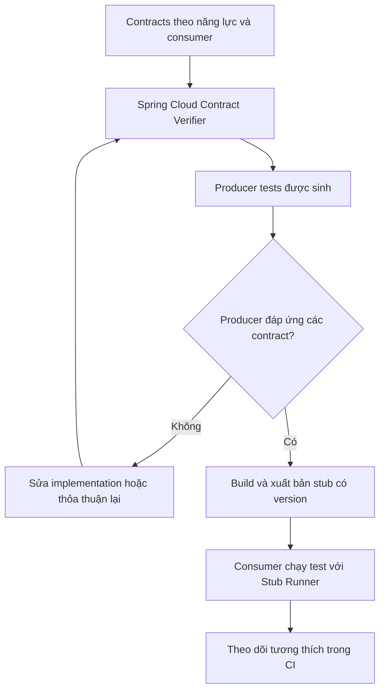

# Nhóm hợp đồng theo consumer và năng lực nghiệp vụ

Trong hệ thống microservices, một **producer** thường phục vụ nhiều **consumer**, và mỗi consumer chỉ phụ thuộc vào một phần hành vi của producer. Khi số lượng hợp đồng Spring Cloud Contract tăng lên, việc đặt tất cả file Groovy/YAML vào một thư mục phẳng khiến nhóm phát triển khó trả lời: *ai đang sử dụng hành vi này, đây là chức năng nghiệp vụ nào, sửa API sẽ ảnh hưởng đến những consumer nào và cần chạy những bài kiểm thử nào?*

Bài học thuộc chương **Tổ chức hợp đồng** của **Spring Cloud Contract**. Ta sẽ tổ chức các contract kiểm thử HTTP hoặc thông điệp theo **consumer** và **năng lực nghiệp vụ**, từ đó giúp producer sinh test chính xác, phát hành stub, hỗ trợ consumer chạy Stub Runner và phát hiện thay đổi API không tương thích trong CI. Trọng tâm không phải là đặt tên thư mục cho đẹp, mà là xây dựng **một hệ thống truy vết các cam kết** giữa các nhóm.

Sau bài học, bạn sẽ có thể:

- Phân biệt hai trục phân loại: consumer sử dụng và năng lực nghiệp vụ được cung cấp.
- Thiết kế cây thư mục contract dễ mở rộng cho một producer có nhiều consumer.
- Đặt tên file, kịch bản, nguồn sở hữu và quan hệ phụ thuộc theo quy tắc thống nhất.
- Xử lý hợp đồng dùng chung, hợp đồng riêng và các yêu cầu có nguy cơ xung đột.
- Hiểu ảnh hưởng của cách tổ chức đối với test sinh tự động, stub, Stub Runner và CI.
- Lập kế hoạch tái tổ chức các contract cũ mà vẫn bảo toàn các hành vi đã cam kết.

## 1. Vì sao một producer cần phân nhóm hợp đồng?

Giả sử hệ thống thương mại điện tử có producer `InventoryService` và ba consumer:

1. `OrderService` cần **giữ hàng** trước khi xác nhận đơn.
2. `StorefrontService` cần **hiển thị trạng thái còn hàng** cho người mua.
3. `PlanningService` cần **nhận sự kiện biến động tồn kho** để dự báo nhập hàng.

Ba consumer cùng liên quan đến tồn kho nhưng phụ thuộc vào **ba năng lực nghiệp vụ khác nhau**:

| Consumer | Năng lực sử dụng | Giao tiếp dự kiến | Kỳ vọng quan trọng |
| --- | --- | --- | --- |
| `OrderService` | Đặt giữ hàng (`reservation`) | HTTP `POST /api/v1/reservations` | Có mã lượt giữ và kết quả giữ hàng rõ ràng; nhận biết thiếu hàng |
| `StorefrontService` | Tra cứu sẵn có (`availability`) | HTTP `GET /api/v1/availability/{sku}` | Biết mặt hàng có thể bán; xử lý SKU không tồn tại |
| `PlanningService` | Nhận thay đổi tồn kho (`stock events`) | Message `stock.adjusted` | Nhận đúng loại sự kiện, SKU và lượng thay đổi |

*Các endpoint, topic và mã lỗi trong bài là ví dụ thiết kế; ứng dụng thực tế phải thống nhất chúng giữa producer và consumer.*

Nếu chỉ phân nhóm theo consumer, người quản lý năng lực `availability` có thể phải tìm nhiều thư mục để biết tất cả hành vi đang được cam kết. Nếu chỉ phân nhóm theo năng lực, nhóm phát triển sẽ khó nhìn ra consumer nào yêu cầu một nhánh lỗi hoặc một định dạng dữ liệu cụ thể. Hai trục này cần được thể hiện đồng thời.

### Trục consumer: ai phụ thuộc vào hành vi?

Phân loại theo consumer giúp trả lời:

- Ai sẽ bị ảnh hưởng nếu đổi status code, trường phản hồi hoặc định dạng message?
- Nhóm nào cần xác nhận khi một contract bị sửa hoặc loại bỏ?
- Consumer phiên bản cũ nào vẫn đang sử dụng một quy tắc đã được cam kết?
- Stub nào consumer phải dùng để kiểm tra đường đi thành công và lỗi?

Consumer là **người sử dụng hợp đồng**, không nhất thiết là người sở hữu repository chứa contract. Dù contract nằm cùng mã producer, yêu cầu nghiệp vụ của consumer vẫn là nguồn xác định hành vi cần bảo vệ.

### Trục năng lực nghiệp vụ: hành vi thuộc về đâu?

Năng lực nghiệp vụ là một nhóm hành vi cùng phục vụ một mục tiêu ổn định, chẳng hạn `reservations`, `availability`, `payments`, `shipping` hoặc `notifications`. Nhóm theo năng lực giúp:

- Tìm các contract mô tả cùng một quy tắc nghiệp vụ.
- Xem các nhánh thành công, đầu vào sai và lỗi nghiệp vụ của cùng một chức năng.
- Phân công nhóm chịu trách nhiệm thực thi năng lực ở phía producer.
- Đánh giá tác động của việc tách, gộp hoặc thay thế một năng lực trong kiến trúc.

Nên đặt tên bằng **ngôn ngữ nghiệp vụ** thay vì bằng tên lớp kỹ thuật. Ví dụ, `reservations` nói rõ chức năng hơn `ReservationController`; cấu trúc class trong producer có thể đổi mà cam kết với consumer vẫn giữ nguyên.

## 2. Chọn cấu trúc thư mục hai chiều

Một quy ước dễ đọc là **năng lực nghiệp vụ trước, consumer sau**. Ví dụ với dự án `InventoryService` dùng Maven:

```text
inventory-service/
└── src/
    └── test/
        └── resources/
            └── contracts/
                ├── reservations/
                │   └── order-service/
                │       ├── create-reservation-success.groovy
                │       ├── create-reservation-insufficient-stock.groovy
                │       └── cancel-reservation-success.groovy
                ├── availability/
                │   ├── storefront-service/
                │   │   ├── get-availability-success.yml
                │   │   └── get-availability-not-found.yml
                │   └── order-service/
                │       └── get-availability-for-checkout.groovy
                └── stock-events/
                    └── planning-service/
                        └── stock-adjusted.groovy
```

Đường dẫn `src/test/resources/contracts` là vị trí mặc định thông dụng của Spring Cloud Contract Verifier trong dự án Maven. Các thư mục con ở đây là **quy ước do nhóm thiết kế**, không phải các loại folder đặc biệt được framework định nghĩa sẵn. Nếu dự án đã cấu hình nguồn contract ở vị trí khác, hãy áp dụng cùng nguyên tắc bên trong nguồn đã được cấu hình.

Đọc một đường dẫn từ trái sang phải:

```text
contracts / reservations / order-service / create-reservation-success.groovy
              ^               ^                     ^
          Năng lực         Consumer          Kịch bản kiểm chứng
```

Ta biết ngay contract thuộc chức năng giữ hàng, đáp ứng nhu cầu của `OrderService` và mô tả nhánh thành công khi tạo lượt giữ.

Trong một tổ chức có trách nhiệm quản lý theo consumer, cấu trúc đảo lại cũng hợp lý:

```text
contracts/
  order-service/
    reservations/
      create-reservation-success.groovy
    availability/
      get-availability-for-checkout.groovy
  storefront-service/
    availability/
      get-availability-success.yml
```

**Cách chọn:** đặt trục được dùng thường xuyên nhất để review và quản lý thay đổi lên trước. Nếu producer tổ chức nhóm theo năng lực nghiệp vụ, ưu tiên `capability/consumer`. Nếu quy trình xem xét và tiếp nhận hợp đồng được tổ chức theo nhóm consumer, cân nhắc `consumer/capability`. Quan trọng hơn thứ tự là **tính nhất quán, khả năng truy vết và quy tắc xử lý hành vi dùng chung**.

### Không dùng vị trí file để suy ra một bảo đảm tự động

Spring Cloud Contract có thể đọc contract trong các thư mục con của nguồn được cấu hình và sinh kiểm thử cho các contract phù hợp. Nhưng việc đặt một file dưới `order-service/` **không tự động có nghĩa** chỉ `OrderService` được nhận stub ấy; cũng không có nghĩa mọi môi trường build chỉ chạy test của consumer đó.

Một build mặc định thường xử lý tập contract được tìm thấy trong nguồn đã cấu hình. Nếu cần tạo stub riêng cho từng consumer, phải nghiên cứu và cấu hình cơ chế phân phối stub tương ứng của phiên bản Spring Cloud Contract đang dùng, sau đó **kiểm chứng nội dung artifact thực tế**. Tên thư mục chỉ là một phần của quy ước tổ chức, không thay thế cho cấu hình build và phân phối.

## 3. Đặt tên hợp đồng sao cho phản ánh hành vi

Tên file nên thể hiện **hành động hoặc sự kiện + trường hợp có ý nghĩa với consumer**. Cần đủ cụ thể để xem tên file đã biết đang kiểm tra điều gì, nhưng không phụ thuộc vào tên phương thức Java.

| Tên khó hiểu | Tên đề xuất | Lý do |
| --- | --- | --- |
| `test1.groovy` | `create-reservation-success.groovy` | Biết hành vi và kết quả |
| `api-error.groovy` | `create-reservation-insufficient-stock.groovy` | Phân biệt lỗi nghiệp vụ cụ thể |
| `getData.yml` | `get-availability-not-found.yml` | Gắn với năng lực và nhánh lỗi |
| `KafkaTest.groovy` | `stock-adjusted.groovy` | Không buộc tên vào công nghệ truyền tải |
| `new-contract.groovy` | `cancel-reservation-success.groovy` | Hữu ích khi đọc lịch sử thay đổi |

Ngoài tên file, nên dùng trường `name` trong DSL để đặt định danh kịch bản rõ ràng và tránh va chạm ngoài ý muốn:

```groovy
Contract.make {
    name 'order_create_reservation_success'
    // request và response được định nghĩa bên dưới
}
```

Nếu quy tắc đặt tên đã được thống nhất trong repository, hãy nhất quán giữa tên file, `name` và mô tả kịch bản. Một convention thực tế:

```text
<consumer>_<action-or-event>_<expected-result>
```

Ví dụ: `order_create_reservation_insufficient_stock`, `storefront_get_availability_success`, `planning_stock_adjusted_event`.

Không cần nhét số phiên bản API vào mọi tên file khi phần lớn hợp đồng vẫn đang áp dụng chung. Chỉ đưa phiên bản vào đường dẫn hoặc tên khi thực sự có **hai hành vi cùng tồn tại** cần phân biệt, chẳng hạn `v1` và `v2` được hỗ trợ đồng thời.

## 4. Ví dụ Groovy DSL: contract dành cho OrderService

Với `reservations/order-service/create-reservation-success.groovy`, hai nhóm thống nhất rằng request giữ hai đơn vị hàng thành công phải trả `201` và có định danh lượt giữ.

```groovy
import org.springframework.cloud.contract.spec.Contract

Contract.make {
    name 'order_create_reservation_success'
    description 'OrderService tạo lượt giữ hàng để tiếp tục thanh toán'

    request {
        method 'POST'
        url '/api/v1/reservations'
        headers {
            contentType(applicationJson())
        }
        body([
            sku     : 'SKU-100',
            quantity: 2
        ])
    }

    response {
        status 201
        headers {
            contentType(applicationJson())
        }
        body([
            reservationId: 'RES-100',
            status       : 'HELD'
        ])
    }
}
```

Contract tiếp theo tại `reservations/order-service/create-reservation-insufficient-stock.groovy` mô tả nhánh nghiệp vụ:

```groovy
import org.springframework.cloud.contract.spec.Contract

Contract.make {
    name 'order_create_reservation_insufficient_stock'

    request {
        method 'POST'
        url '/api/v1/reservations'
        headers {
            contentType(applicationJson())
        }
        body([
            sku     : 'SKU-EMPTY',
            quantity: 2
        ])
    }

    response {
        status 409
        headers {
            contentType(applicationJson())
        }
        body([
            code: 'INSUFFICIENT_STOCK'
        ])
    }
}
```

Như vậy cả hai contract cùng thuộc năng lực `reservations` và cùng phục vụ `OrderService`, nhưng kiểm chứng **hai tình huống khác nhau**. Điều này giúp người review nhìn thấy liệu consumer có đủ thông tin để xử lý cả thành công lẫn thiếu hàng.

Để producer test chạy ổn định, cần chuẩn bị dữ liệu kiểm thử sao cho `SKU-100` đủ hàng và `SKU-EMPTY` không đủ hàng. Nếu `reservationId` trong triển khai thực tế được sinh ngẫu nhiên, dùng matcher phù hợp hoặc fixture xác định; việc đưa ID cố định vào ví dụ không có nghĩa API production luôn trả `RES-100`.

## 5. Ví dụ YAML DSL: contract dành cho StorefrontService

Đối với năng lực `availability`, `StorefrontService` cần biết mặt hàng đang có sẵn để hiển thị. File `availability/storefront-service/get-availability-success.yml` có thể viết bằng YAML DSL:

```yaml
name: storefront_get_availability_success
description: StorefrontService hiển thị khả năng bán của SKU
request:
  method: GET
  url: /api/v1/availability/SKU-100
response:
  status: 200
  headers:
    Content-Type: application/json
  body:
    sku: SKU-100
    available: true
```

Ở ví dụ này, consumer không cần `reservationId` hoặc trạng thái `HELD`, vì đang thực hiện một nhiệm vụ khác. Không nên sao chép các trường của `reservations` sang `availability` chỉ vì hai chức năng cùng thao tác trên dữ liệu tồn kho.

Nếu cùng endpoint này được `OrderService` gọi khi thanh toán, hãy hỏi **hai consumer có cùng cam kết ngữ nghĩa hay không**:

- Nếu cùng gửi request và cùng phụ thuộc vào một tập hành vi hoàn toàn tương đương, có thể quản lý một contract dùng chung với danh sách consumer được ghi nhận rõ.
- Nếu `OrderService` cần thêm một trạng thái hoặc header mà `StorefrontService` không dùng, cần thêm hợp đồng riêng hoặc điều chỉnh thiết kế API để diễn đạt đúng sự khác biệt.
- Nếu hai consumer yêu cầu kết quả **mâu thuẫn** cho cùng một request trong cùng điều kiện, không được giải quyết bằng cách giữ hai stub có response khác nhau rồi hi vọng chúng chạy đúng.

### Một hợp đồng dùng chung có thể đặt ở đâu?

Ví dụ khi cả hai consumer cùng thống nhất một hành vi `GET /api/v1/availability/SKU-100`, có thể dùng:

```text
contracts/
  availability/
    shared/
      get-availability-success.yml
```

Tên `shared` là **quy ước nhóm tự đặt**, không phải tính năng đặc biệt của DSL. Nhóm nên lưu được mối liên hệ: hợp đồng này đang được `StorefrontService` và `OrderService` sử dụng. Có thể thể hiện quan hệ đó trong mô tả contract, quy ước review hoặc bảng theo dõi dependency của nhóm.

Đừng tạo bản sao y hệt dưới hai folder consumer: sau vài lần chỉnh sửa, hai bản rất dễ lệch nhau, khiến một bên được bảo vệ còn bên kia vẫn dựa vào kỳ vọng cũ. Ngược lại, cũng đừng gộp những hợp đồng chỉ *trông giống nhau* nhưng có khác biệt thực sự về ngữ nghĩa và điều kiện nghiệp vụ.

## 6. Tổ chức contract cho giao tiếp bằng thông điệp

Phân loại theo consumer và năng lực nghiệp vụ vẫn hữu ích với giao tiếp bằng message. Ví dụ `PlanningService` nghe sự kiện biến động tồn kho do `InventoryService` phát, nên contract có thể đặt tại:

```text
contracts/stock-events/planning-service/stock-adjusted.groovy
```

Một ví dụ mô tả message bằng Groovy DSL:

```groovy
import org.springframework.cloud.contract.spec.Contract

Contract.make {
    name 'planning_stock_adjusted_event'

    input {
        triggeredBy('emitStockAdjusted()')
    }

    outputMessage {
        sentTo('stock.adjusted')
        headers {
            header('contentType', 'application/json')
        }
        body([
            sku     : 'SKU-100',
            delta   : -2,
            reason  : 'RESERVATION'
        ])
    }
}
```

Ví dụ này giả định producer có thể kích hoạt hành vi phát sự kiện bằng phương thức test `emitStockAdjusted()` và môi trường kiểm thử đã cấu hình cơ chế thu thập message tương ứng. Đây là một **ví dụ mô hình hóa contract**, không phải một bộ test tự chạy độc lập nếu chưa cấu hình Spring Cloud Contract message verification và lớp nền kiểm thử.

Việc đặt contract dưới `stock-events/planning-service` cho thấy ai phụ thuộc vào payload; nó **không quyết định** broker, topic vật lý hay routing key trong môi trường thật. Những giá trị đó phải được cấu hình và kiểm chứng theo hệ thống messaging được dùng.

Một thay đổi như đổi `delta` từ số nguyên sang chuỗi có thể khiến consumer đọc sai thông điệp. Việc nhóm hợp đồng theo năng lực `stock-events` giúp producer thấy những consumer bị ảnh hưởng khi cân nhắc đổi schema. Tuy nhiên, contract test cho một message chưa chứng minh được thứ tự sự kiện, độ bền phân phối hoặc khả năng chống xử lý trùng; cần các kiểm thử phù hợp khác.

## 7. Lập ma trận consumer × năng lực × tình huống

Cây thư mục cho phép tìm file nhanh; **ma trận hợp đồng** giúp phát hiện khoảng trống kiểm thử.

| Năng lực | Consumer | Tình huống cần cam kết | Contract ví dụ | Người xác nhận |
| --- | --- | --- | --- | --- |
| Reservations | `OrderService` | Tạo lượt giữ thành công | `create-reservation-success.groovy` | Chủ luồng đặt hàng |
| Reservations | `OrderService` | Không đủ hàng | `create-reservation-insufficient-stock.groovy` | Chủ luồng đặt hàng |
| Reservations | `OrderService` | Hủy lượt giữ | `cancel-reservation-success.groovy` | Chủ luồng đặt hàng |
| Availability | `StorefrontService` | Truy vấn SKU có hàng | `get-availability-success.yml` | Chủ trang sản phẩm |
| Availability | `StorefrontService` | SKU không tồn tại | `get-availability-not-found.yml` | Chủ trang sản phẩm |
| Availability | `OrderService` | Truy vấn tình trạng trước thanh toán | `get-availability-for-checkout.groovy` | Chủ luồng đặt hàng |
| Stock events | `PlanningService` | Phát sự kiện thay đổi tồn kho | `stock-adjusted.groovy` | Chủ quy trình dự báo |

Các file trong bảng là **bộ ví dụ về cách tổ chức**; bài học chỉ minh họa mã hoàn chỉnh cho một số kịch bản. Khi triển khai thật, cần bổ sung những kịch bản được nhóm xác nhận chứ không mặc nhiên coi ma trận này là bộ đặc tả đầy đủ.

Ma trận giúp nhóm trả lời ba câu hỏi trước khi chấp nhận một thay đổi API:

1. **Phạm vi:** thay đổi nằm trong năng lực nào và có thể ảnh hưởng đến consumer nào?
2. **Mức độ bảo vệ:** những kịch bản thành công và thất bại liên quan đã có contract chưa?
3. **Người duyệt:** ai có đủ ngữ cảnh để đồng ý thay đổi hợp đồng và kế hoạch nâng cấp consumer?

Một nhóm có thể quản lý ma trận trong quy trình review hoặc công cụ theo dõi công việc. Nó không nhất thiết phải là một file riêng trong repository, nhưng liên kết giữa consumer và hợp đồng phải có nơi truy xuất được, đặc biệt với folder `shared`.

## 8. Ranh giới giữa contract, test sinh tự động và stub

Spring Cloud Contract Verifier có thể đọc các contract Groovy/YAML thuộc nguồn đã cấu hình, rồi **sinh test phía producer** để kiểm tra mã ứng dụng. Trong quy trình build, các contract cũng là đầu vào để tạo **stub** mà consumer dùng với Stub Runner.



Điều cần phân biệt:

| Khái niệm | Cách phân nhóm có tác dụng | Giới hạn cần nhớ |
| --- | --- | --- |
| File contract | Giúp con người tìm kịch bản theo chức năng và consumer | Folder không tự xác minh nội dung đúng |
| Test phía producer | Dễ truy vết lỗi về nhóm contract | Các contract được phát hiện có thể được chạy trong cùng một build |
| Stub đóng gói | Có cấu trúc để truy vết nguồn hành vi | Folder không tự tạo artifact riêng cho mỗi consumer |
| Stub Runner | Consumer chọn artifact/version để chạy thử | Phải kiểm tra stub đã đóng gói chứa kịch bản mong muốn |
| CI | Có thể báo cáo thay đổi theo thư mục/owner | Các kiểm tra cần bao phủ toàn bộ phụ thuộc bị ảnh hưởng |

Trong dự án Maven, kiểm tra tập contract và các test sinh từ chúng bằng:

```bash
mvn -B -ntp clean verify
```

Các test chỉ có ý nghĩa khi thực sự chạy tới hành vi của producer (controller hoặc đường phát message được cấu hình). Nếu tất cả test đều được sinh nhưng không chạy, hoặc lớp cơ sở tự trả dữ liệu giả mà không đi qua producer, việc tổ chức folder tốt cũng không ngăn được regression.

**Điểm kiểm chứng quan trọng khi thay đổi cấu trúc thư mục:** so sánh danh sách contract được phát hiện, số test thực sự được thực thi và những tương tác trong stub trước/sau khi di chuyển. Đừng chỉ dựa vào kết quả `BUILD SUCCESS`.

## 9. Chọn phạm vi stub cho các consumer

Trong một producer có nhiều consumer, thường gặp hai nhu cầu:

- **Stub chung theo phiên bản producer:** consumer dùng cùng một artifact stub, chứa tập tương tác mà producer đã công bố.
- **Stub có phạm vi riêng cho consumer:** nhóm muốn một consumer chỉ nhìn thấy tập kịch bản phù hợp với mình, tránh các mapping không liên quan.

Hình thức thứ hai cần thiết kế và cấu hình cơ chế hỗ trợ tương ứng, chẳng hạn khả năng **stubs-per-consumer** khi dùng phiên bản Spring Cloud Contract có hỗ trợ. Việc chọn tên folder `order-service` chỉ tạo cách phân loại trên đĩa; không bảo đảm Stub Runner đã lọc đúng nội dung.

Nếu dùng stub chung, nên kiểm tra các mapping có thể bị xung đột. Ví dụ:

| Mapping A | Mapping B | Vấn đề |
| --- | --- | --- |
| `GET /api/v1/availability/SKU-100` trả `available=true` | Cùng request trả `available=false` | Một request khớp hai phản hồi khác nhau |
| `POST /api/v1/reservations` với `SKU-100` trả `201` | Cùng request và body trả `409` | Stub không thể đoán trạng thái nghiệp vụ ngoài điều kiện matching |
| `GET /api/v1/availability/SKU-100` | `GET /api/v1/availability/SKU-EMPTY` | Có đầu vào phân biệt rõ, thuận lợi cho stub |

Khi hai kịch bản thực sự khác nhau, hãy mô tả **điều kiện phân biệt quan sát được** bằng body, path, query, header hoặc trạng thái stub được mô hình hóa rõ ràng theo DSL/công cụ hỗ trợ. Dữ liệu trong contract phải nhất quán giữa producer test và stub. Không nên chỉ đặt hai file trong hai folder khác nhau rồi mong WireMock tự chọn theo tên consumer.

Đối với trường hợp khác biệt theo phiên bản API, cần quản lý version và chính sách chuyển đổi riêng. Chỉ đổi tên folder thành `v2` không tự làm producer có endpoint mới, cũng không tự buộc consumer nâng cấp.

## 10. Quy tắc sở hữu và quy trình thay đổi

Một cây contract bền vững cần trả lời rõ **ai đề xuất, ai xác minh và ai phê duyệt**:

| Hoạt động | Trách nhiệm khuyến nghị |
| --- | --- |
| Đề xuất hành vi mới | Consumer diễn tả nhu cầu và kịch bản |
| Xác nhận khả năng cung cấp | Producer rà soát ngữ nghĩa và khả năng triển khai |
| Viết/điều chỉnh DSL | Người được phân công; hai phía cùng review |
| Chạy generated tests | Pipeline và nhóm sở hữu producer |
| Phát hành stub | Quy trình release của producer |
| Xác minh luồng gọi bằng Stub Runner | Nhóm consumer |
| Chấp nhận bỏ hành vi cũ | Các consumer đang phụ thuộc cùng producer thống nhất kế hoạch |

Khi có pull request, reviewer nên nhìn được **danh sách file contract thay đổi theo năng lực/consumer**. Ví dụ, PR làm thay đổi `reservations/order-service/create-reservation-success.groovy` cần giải thích tác động với luồng giữ hàng, kiểm tra rằng producer test tương ứng đã chạy và xác định consumer có cần đổi mã gọi hay không.

Với contract dùng chung, không thể chỉ xin ý kiến consumer xuất hiện trong tên folder. Tất cả consumer đang dựa vào hành vi cần được xét tới. Nếu không có nơi ghi nhận danh sách consumer, nguy cơ vô tình phá vỡ tương thích vẫn rất cao.

### Khi producer muốn thay đổi một API

Giả sử producer dự định đổi phản hồi thành công từ:

```json
{
  "reservationId": "RES-100",
  "status": "HELD"
}
```

sang:

```json
{
  "holdId": "RES-100",
  "state": "HELD"
}
```

Nhìn vào thư mục `reservations/order-service`, nhóm biết ngay `OrderService` đang dùng contract về lượt giữ hàng. Thay đổi tên trường có nguy cơ phá vỡ mã đọc phản hồi. Quy trình phù hợp là xác nhận consumer có chấp nhận định dạng mới hay không; nếu còn consumer cũ, duy trì tương thích bằng chiến lược chuyển tiếp hoặc versioning đã được thống nhất. Chỉ khi các bên nhất trí và các phép kiểm tra phù hợp đạt yêu cầu mới loại bỏ hợp đồng cũ.

Thêm trường mới có thể tương thích với consumer hiện tại, nhưng vẫn cần xem kiểu dữ liệu, điều kiện bắt buộc và cách consumer deserialise JSON. Kết luận tương thích dựa trên **những gì consumer thực sự phụ thuộc**, chứ không chỉ dựa trên số dòng JSON thay đổi.

## 11. Gắn phân nhóm hợp đồng vào CI

Cấu trúc folder giúp CI hiển thị báo cáo và lọc thay đổi, nhưng cổng tương thích phải được thiết kế theo **phụ thuộc thật**. Ví dụ:

1. Khi PR thay đổi một contract, yêu cầu review từ producer và consumer liên quan.
2. CI chạy sinh test rồi kiểm tra toàn bộ contract áp dụng cho producer trên bản build đó.
3. Nếu contract test fail, chặn merge hoặc release; kiểm tra lỗi phát sinh do implementation, fixture hay thay đổi cam kết chưa được duyệt.
4. Sau khi các cổng kiểm tra bắt buộc đều đạt, đóng gói và phát hành stub với phiên bản rõ ràng.
5. Consumer dùng Stub Runner với đúng artifact/version và chạy test các luồng gọi mà mình thực hiện.

Ví dụ job CI tối thiểu trên GitHub Actions cho producer dùng Maven:

```yaml
name: Verify producer contracts

on:
  pull_request:
  push:
    branches: [main]

jobs:
  verify:
    runs-on: ubuntu-latest
    steps:
      - uses: actions/checkout@v4
      - uses: actions/setup-java@v4
        with:
          distribution: temurin
          java-version: '21'
          cache: maven
      - name: Run producer verification
        run: mvn -B -ntp clean verify
```

Ví dụ trên giả định dự án đã khai báo plugin Spring Cloud Contract Verifier và các dependency kiểm thử cần thiết. Job không tự làm thay bước duyệt contract hoặc bước publish stub; hai bước đó cần cấu hình riêng.

**Không tối ưu sớm bằng cách chỉ chạy test của folder vừa sửa.** Một thay đổi trong mã nghiệp vụ dùng chung, DTO hoặc controller có thể làm hỏng consumer khác dù contract của họ không thay đổi. Trên nhánh release, ưu tiên chạy đầy đủ các contract mà producer đang cam kết. Nếu pipeline lớn cần chia nhóm test, phải bảo đảm tổng các nhóm vẫn bao phủ tập hợp đồng liên quan.

## 12. Chuyển từ thư mục phẳng sang cấu trúc mới

Giả sử repository hiện có:

```text
contracts/
  contract1.groovy
  reserveFail.groovy
  getInventory.groovy
  event2.groovy
```

Có thể thực hiện tái tổ chức theo các bước sau:

1. **Kiểm kê:** đọc ngữ nghĩa từng contract và xác định consumer đang phụ thuộc, năng lực nghiệp vụ, kết quả thành công/lỗi và tình trạng sử dụng.
2. **Phân loại:** xây dựng ma trận consumer × năng lực × kịch bản. Các mục chưa rõ owner hoặc bị trùng cần được thảo luận, không tự đoán từ tên file.
3. **Đặt quy ước:** thống nhất thứ tự folder, tên `name`, cách xử lý shared, nhánh lỗi và quy tắc phiên bản.
4. **Di chuyển:** chuyển contract vào vị trí mới; giữ nguyên request/response nếu đây chỉ là thay đổi tổ chức. Chỉ sửa `name` hoặc nội dung DSL khi thật sự cần và đã kiểm tra tác động.
5. **Xác minh:** so sánh tập contract được nhận diện, test được sinh/chạy và nội dung stub trước/sau. Kiểm tra không mất kịch bản hoặc sinh xung đột do trùng tên/mapping.
6. **Cập nhật quy trình:** thông báo quy ước tìm file, review, version stub và các đường dẫn nguồn contract đã được cấu hình cho CI.

Việc di chuyển folder có thể ảnh hưởng tên package/lớp test sinh ra, quy tắc mapping lớp cơ sở kiểm thử hoặc cách build lấy contract theo đường dẫn. Vì thế cần kiểm tra các cấu hình liên quan trong dự án thật khi thực hiện di chuyển; không nên giả định đổi đường dẫn luôn là thao tác hoàn toàn không ảnh hưởng build.

### Bẫy thường gặp khi tổ chức

| Sai lầm | Hậu quả | Hướng xử lý |
| --- | --- | --- |
| Một thư mục phẳng chứa hàng trăm contract | Khó phân tích tác động và tìm người duyệt | Phân theo năng lực và consumer |
| Chỉ phân theo `Controller` hoặc `Repository` | Cấu trúc thay đổi theo implementation | Ưu tiên tên năng lực nghiệp vụ ổn định |
| Nhân bản cùng contract cho nhiều consumer | Các bản sao bị lệch theo thời gian | Chia sẻ contract nếu cam kết thật sự giống nhau |
| Gộp mọi consumer vào một contract quá rộng | Một consumer vô tình bị ràng buộc bởi nhu cầu của consumer khác | Chỉ cam kết hành vi thật sự được chia sẻ |
| Hai stub có request giống nhau nhưng response khác nhau | Stub chọn mapping không đoán trước được theo ý định nghiệp vụ | Phân biệt điều kiện request/state hoặc thiết kế lại kịch bản |
| Tưởng folder consumer tự lọc stub | Consumer nhận sai tập mapping | Cấu hình và kiểm chứng phạm vi stub được phát hành |
| Xóa contract cũ ngay khi đổi API | Consumer đang chạy phiên bản cũ có thể bị hỏng | Kiểm kê phụ thuộc và có kế hoạch chuyển đổi |
| Di chuyển file nhưng không kiểm tra generated tests | Test bị bỏ sót hoặc mất cấu hình base class | Đối chiếu danh sách test và stub trước/sau |

## 13. Checklist áp dụng cho repository thực tế

- [ ] Mỗi contract có năng lực nghiệp vụ và consumer sử dụng xác định, hoặc được đánh dấu shared có chủ đích.
- [ ] Quy ước folder có trật tự thống nhất, dễ tìm từ tên năng lực và tên consumer.
- [ ] Tên file và tên contract mô tả hành vi/kết quả, không chỉ tên công nghệ hoặc số thứ tự.
- [ ] Nhánh thành công và lỗi quan trọng nằm cạnh nhau trong cùng nhóm nghiệp vụ.
- [ ] Những contract dùng chung có danh sách consumer đang phụ thuộc để phục vụ review.
- [ ] Không có mapping mâu thuẫn cho cùng request trong cùng điều kiện stub.
- [ ] Producer sinh và chạy được đầy đủ test từ các contract trong nguồn đã cấu hình.
- [ ] Artifact stub có version và phạm vi nội dung phù hợp; consumer xác minh bằng Stub Runner.
- [ ] CI không bỏ sót kịch bản chỉ vì contract nằm ở một thư mục con.
- [ ] Quy trình sửa/xóa contract có bước đánh giá consumer và chiến lược tương thích.

### Bài tập thực hành

Bạn cần tổ chức hợp đồng của `InventoryService` cho ba consumer `OrderService`, `StorefrontService`, `PlanningService`.

**Yêu cầu:**

1. Vẽ cây folder dưới `src/test/resources/contracts` với ba năng lực `reservations`, `availability`, `stock-events` và từng consumer phù hợp.
2. Tạo một contract HTTP cho trường hợp giữ hàng thành công và một contract khác cho trường hợp thiếu hàng. Giải thích tại sao phải tách hai kịch bản.
3. Tạo một contract YAML cho `StorefrontService` lấy trạng thái sẵn có của sản phẩm và một message contract cho `PlanningService` nhận sự kiện thay đổi tồn kho.
4. Giả sử `OrderService` cũng đọc API availability. Quyết định dùng contract chung hay riêng, và viết lý do dựa trên hành vi thực sự cần, không dựa trên tên endpoint.
5. Xây dựng ma trận cho biết mỗi contract thuộc năng lực nào, consumer nào sử dụng và nhóm nào phải duyệt khi sửa.
6. Mô phỏng một PR đổi `reservationId` thành `holdId`: liệt kê contract liên quan, phân tích khả năng phá vỡ tương thích và xác định các test producer/consumer cần chạy.
7. Chạy quy trình sinh và thực thi test producer trong dự án đã cấu hình Spring Cloud Contract; xác minh tập contract được đọc và các kịch bản có trong stub. Sau đó dùng Stub Runner ở phía consumer để kiểm tra một luồng thành công và một luồng lỗi.

**Tiêu chí hoàn thành:** khi nhìn vào một contract bất kỳ, bạn trả lời được **consumer nào cần nó, nó thuộc năng lực nghiệp vụ nào, behavior nào được cam kết và thay đổi ra sao sẽ ảnh hưởng consumer**. Việc phân nhóm lúc đó trở thành một phần hữu ích của quản lý vòng đời hợp đồng, bảo vệ API và phối hợp phát hành giữa các nhóm.
