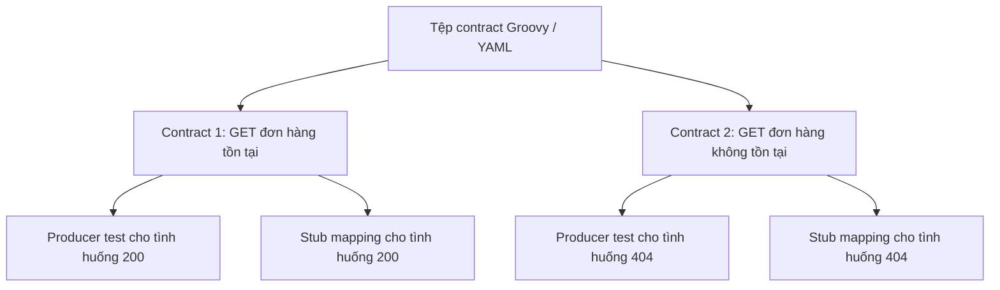
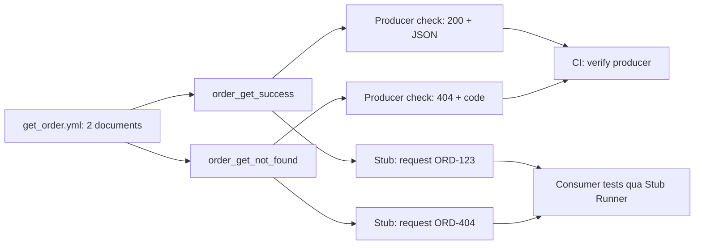

# Một tệp chứa một hoặc nhiều tương tác

## 1. Đặt vấn đề: một tệp contract có nhất thiết chỉ mô tả một tình huống?

Trong **Spring Cloud Contract**, producer (bên cung cấp HTTP API hoặc phát thông điệp) và consumer (bên sử dụng API hoặc nhận thông điệp) thỏa thuận về những hành vi mà consumer được phép dựa vào. Thỏa thuận đó được viết bằng **Contract DSL**, thường là Groovy hoặc YAML. Plugin có thể dùng các định nghĩa này để **sinh kiểm thử phía producer**, tạo **stub** cho consumer, và đưa việc xác minh tương thích vào **CI**.

Một điểm dễ gây nhầm lẫn khi tổ chức thư mục hợp đồng là mối quan hệ giữa **tệp** và **tương tác**:

- Một tệp có thể chứa **một** tương tác (một contract).
- Một tệp cũng có thể chứa **nhiều** tương tác (nhiều contract).
- Mỗi contract vẫn mô tả **một kịch bản giao tiếp xác định**, chẳng hạn một HTTP request và response dự kiến, hoặc hành vi phát/nhận message.

Chọn một hay nhiều contract trong cùng tệp là quyết định **tổ chức mã nguồn và khả năng bảo trì**, không phải cơ chế để gộp mọi nghiệp vụ của một endpoint thành một phép kiểm chứng duy nhất.

### Kết quả học tập

Sau bài học, bạn có thể:

1. Nhận diện sự khác nhau giữa tệp DSL, một định nghĩa `Contract`, một tương tác và test/stub được sinh.
2. Viết đúng cú pháp **một** hoặc **nhiều** contract trong tệp Groovy.
3. Viết đúng cú pháp **một** hoặc **nhiều** contract trong tệp YAML.
4. Chọn cách nhóm hợp đồng theo tính liên quan, owner, consumer, API và khả năng thay đổi.
5. Tránh trùng tên test/stub, trùng điều kiện khớp request và phụ thuộc không chủ ý vào thứ tự kịch bản.
6. Xác minh sau khi tổ chức lại các tệp rằng producer tests và stub vẫn đại diện đủ các tương tác.

## 2. Phân biệt bốn cấp độ trước khi tổ chức file

Xét `Order Service` cung cấp endpoint `GET /api/orders/{id}` cho `Web Client`.

| Khái niệm | Ví dụ | Trách nhiệm |
| --- | --- | --- |
| **Tệp contract** | `get_order.groovy`, `get_order.yml` | Đơn vị lưu trữ DSL trong repository |
| **Một contract** | Truy vấn đơn hàng tồn tại → HTTP 200 | Diễn tả một tình huống kiểm chứng cụ thể |
| **Tương tác** | `GET /api/orders/ORD-123` → JSON đơn hàng | Hành vi quan sát được tại ranh giới producer–consumer |
| **Generated test / stub mapping** | Một phép kiểm thử response và một cấu hình stub tương ứng | Sản phẩm do công cụ sinh từ contract để kiểm chứng hoặc giả lập |

Sơ đồ minh họa một tệp chứa hai contract. Plugin có thể đặt nhiều phương thức test vào cùng một lớp generated test hoặc tổ chức tên khác tùy cấu hình, nhưng **hai kịch bản vẫn có điều kiện và kết quả kiểm chứng độc lập**. Vì vậy, không được đếm số tệp thay cho số contract/test.

> Trong bài này, từ *tương tác* chỉ một kịch bản quan sát được được mô tả trong DSL. Nó không hàm ý một chuỗi nghiệp vụ nhiều bước, có state hay bắt buộc chạy theo thứ tự.

## 3. Một tệp Groovy chứa một tương tác

Cấu trúc tối giản:

~~~text
order-service/
└── src/
    └── test/
        └── resources/
            └── contracts/
                └── order/
                    └── get_order_success.groovy
~~~

Nội dung `src/test/resources/contracts/order/get_order_success.groovy`:

~~~groovy
import org.springframework.cloud.contract.spec.Contract

Contract.make {
    name('order_get_success')
    description('Consumer nhận đơn hàng tồn tại')

    request {
        method 'GET'
        url '/api/orders/ORD-123'
        headers {
            accept(applicationJson())
        }
    }

    response {
        status OK()
        headers {
            contentType(applicationJson())
        }
        body(
            orderId: 'ORD-123',
            status: 'CONFIRMED',
            totalAmount: 199000
        )
    }
}
~~~

Đây là **một đối tượng `Contract`** được tạo bởi `Contract.make { ... }`. Contract mô tả một tình huống: consumer gửi request có path và header phù hợp; producer phải đáp ứng mã `200` và các trường JSON được thống nhất.

Nếu muốn mô tả trường hợp không tìm thấy đơn hàng, có thể tạo **tệp Groovy thứ hai**:

~~~text
contracts/
└── order/
    ├── get_order_success.groovy
    └── get_order_not_found.groovy
~~~

Nội dung `get_order_not_found.groovy`:

~~~groovy
import org.springframework.cloud.contract.spec.Contract

Contract.make {
    name('order_get_not_found')
    description('Consumer nhận lỗi khi đơn hàng không tồn tại')

    request {
        method 'GET'
        url '/api/orders/ORD-404'
    }

    response {
        status NOT_FOUND()
        headers {
            contentType(applicationJson())
        }
        body(
            code: 'ORDER_NOT_FOUND'
        )
    }
}
~~~

**Ưu điểm** của mỗi tệp một contract: tệp nhỏ, dễ review, dễ tìm kịch bản và dễ sửa độc lập. **Đổi lại**, một endpoint có nhiều nhánh có thể phát sinh nhiều tệp, khiến việc xem toàn bộ các tình huống liên quan đòi hỏi mở nhiều nơi.

## 4. Một tệp Groovy chứa nhiều tương tác

Spring Cloud Contract cho phép **trả về danh sách các đối tượng `Contract`** ở cấp cao nhất của tệp Groovy. Đây là khác biệt cốt lõi so với cách viết một contract.

Tệp `src/test/resources/contracts/order/get_order.groovy`:

~~~groovy
import org.springframework.cloud.contract.spec.Contract

[
    Contract.make {
        name('order_get_success')
        description('Truy vấn một đơn hàng tồn tại')

        request {
            method 'GET'
            url '/api/orders/ORD-123'
            headers {
                accept(applicationJson())
            }
        }

        response {
            status OK()
            headers {
                contentType(applicationJson())
            }
            body(
                orderId: 'ORD-123',
                status: 'CONFIRMED',
                totalAmount: 199000
            )
        }
    },

    Contract.make {
        name('order_get_not_found')
        description('Truy vấn một đơn hàng không tồn tại')

        request {
            method 'GET'
            url '/api/orders/ORD-404'
        }

        response {
            status NOT_FOUND()
            headers {
                contentType(applicationJson())
            }
            body(
                code: 'ORDER_NOT_FOUND'
            )
        }
    }
]
~~~

Cách đọc đoạn mã:

1. Dấu `[` và `]` ngoài cùng tạo **danh sách Groovy**.
2. Mỗi phần tử danh sách là **một** `Contract.make { ... }`, với `request` và `response` riêng.
3. Mỗi contract có `name` riêng và có thể mô tả một nhánh khác của cùng endpoint.
4. Kết quả của cả tệp là **danh sách contract**, không phải một contract có hai khối `request` hoặc hai khối `response`.

Không viết hai lệnh `Contract.make { ... }` liên tiếp mà thiếu cấu trúc danh sách rồi mặc định plugin sẽ lấy cả hai. Trong Groovy, hãy trả về danh sách theo mẫu được Spring Cloud Contract hỗ trợ.

Hai nhánh thành công/thất bại trên cũng giúp test/stub phân biệt request rõ ràng qua `ORD-123` và `ORD-404`. Nếu muốn cả hai nhánh sử dụng **cùng URL** nhưng producer trả kết quả tùy trạng thái dữ liệu, test cần setup trạng thái phân biệt; các stub còn cần điều kiện request hoặc cơ chế scenario rõ ràng để tránh hai mapping cạnh tranh nhau.

### Vì sao nên đặt tên cho từng contract?

Trường `name` không chỉ là mô tả. Nó giúp công cụ đặt tên generated test/stub và giúp người review nhận diện tình huống. Ví dụ, một tên như `order_get_not_found` dễ hiểu hơn tên tự sinh phụ thuộc vị trí file hoặc chỉ số trong danh sách.

Tên nên:

- Duy nhất trong phạm vi sinh test/stub liên quan.
- Ổn định khi di chuyển contract giữa các tệp.
- Dùng ký tự an toàn cho mã nguồn generated test, chẳng hạn chữ cái, chữ số và dấu gạch dưới.
- Diễn tả hành vi, ví dụ `order_get_success`, `order_get_not_found` hoặc `payment_authorized_message`.

**Trùng `name` có thể gây lỗi biên dịch generated tests hoặc khiến các file stub ghi đè nhau.** Không nên dựa vào chỉ số contract trong một danh sách để tạo tên lâu dài, vì thêm một phần tử ở đầu danh sách có thể làm thay đổi tên tự sinh của phần tử sau.

## 5. Một tệp YAML chứa một tương tác

Cùng hành vi HTTP thành công, bạn có thể dùng YAML DSL:

~~~yaml
name: order_get_success
description: Truy vấn một đơn hàng tồn tại
request:
  method: GET
  url: /api/orders/ORD-123
  headers:
    Accept: application/json
response:
  status: 200
  headers:
    Content-Type: application/json
  body:
    orderId: ORD-123
    status: CONFIRMED
    totalAmount: 199000
~~~

Một tệp YAML với **một document** như trên mô tả một contract. Đây là lựa chọn gần với các nhóm ưa cấu hình khai báo và không cần dùng cú pháp Groovy.

Chú ý: **YAML contract DSL không phải YAML mô tả bài học**. Trong repository nội dung đào tạo, tệp metadata ba trường `menuLevel1`, `menuLevel2`, `status` có mục đích riêng; nó không phải file contract dùng để sinh test cho Spring Cloud Contract.

## 6. Một tệp YAML chứa nhiều tương tác

Để đặt nhiều contract vào cùng tệp YAML, Spring Cloud Contract hỗ trợ **nhiều YAML document phân cách bằng `---`**.

Tệp `src/test/resources/contracts/order/get_order.yml`:

~~~yaml
---
name: order_get_success
description: Truy vấn một đơn hàng tồn tại
request:
  method: GET
  url: /api/orders/ORD-123
  headers:
    Accept: application/json
response:
  status: 200
  headers:
    Content-Type: application/json
  body:
    orderId: ORD-123
    status: CONFIRMED
    totalAmount: 199000
---
name: order_get_not_found
description: Truy vấn một đơn hàng không tồn tại
request:
  method: GET
  url: /api/orders/ORD-404
response:
  status: 404
  headers:
    Content-Type: application/json
  body:
    code: ORDER_NOT_FOUND
~~~

Ở đây:

- `---` bắt đầu một **YAML document**; hai document được đọc như hai contract.
- Mỗi document có `name`, `request`, `response` riêng.
- Không gộp hai document bằng cách đặt hai khóa `request` trong cùng một mapping YAML: khóa lặp có thể bị parser từ chối hoặc ghi đè và làm mất tương tác.
- Đừng nhầm `---` với dấu `-` tạo phần tử của YAML sequence. Với cú pháp nhiều contract được tài liệu Spring Cloud Contract mô tả, hãy dùng **multi-document YAML**.

Bảng so sánh:

| Số tương tác | Groovy DSL | YAML DSL |
| --- | --- | --- |
| Một | `Contract.make { ... }` | Một YAML document với `request` và `response` |
| Nhiều | `[Contract.make { ... }, Contract.make { ... }]` | Nhiều YAML document phân cách bằng `---` |
| Đặt tên | `name('order_get_success')` | `name: order_get_success` |
| Thêm kịch bản mới | Thêm một phần tử `Contract.make` trong list | Thêm `---` và một document đầy đủ |
| Trường hợp lỗi | Contract riêng | Document riêng |
| Khả năng sinh test/stub | Mỗi contract được xử lý riêng | Mỗi document contract được xử lý riêng |

### Những điều không thay đổi khi gộp tệp

Việc chuyển từ hai file `get_order_success.yml` và `get_order_not_found.yml` thành một file `get_order.yml` có hai document **không tự thay đổi nghĩa nghiệp vụ** của hai kịch bản. Producer vẫn phải đáp ứng cả `200` và `404`; consumer vẫn cần stub tương ứng.

Tuy nhiên, **đường dẫn tệp nguồn và tên được công cụ tự tạo** có thể thay đổi nếu contract không có `name` tường minh. Sau khi gộp hoặc tách tệp, hãy kiểm tra generated test names và stub names, không chỉ nhìn số lượng file.

## 7. Tiêu chí chọn mỗi tệp một contract hay nhiều contract

Không có quy tắc “một tệp luôn tốt hơn nhiều tệp”. Hãy chọn sao cho người bảo trì dễ hiểu và pipeline phát hiện được thay đổi không tương thích.

| Tiêu chí | Một contract mỗi tệp | Nhiều contract mỗi tệp |
| --- | --- | --- |
| Kịch bản riêng biệt, ít liên quan | Dễ tìm và sửa từng tình huống | Có nguy cơ gom những thứ không liên quan |
| Một endpoint với vài nhánh đơn giản | Số lượng tệp có thể tăng | Dễ xem các nhánh thành công/lỗi cạnh nhau |
| Nhiều consumer/owner độc lập | Dễ phân quyền review và ownership | Một file chung dễ tạo xung đột khi nhiều nhóm sửa |
| Số kịch bản tăng nhanh | Thư mục có nhiều file, nhưng file vẫn ngắn | File dễ dài, khó theo dõi thay đổi |
| Cần tách phiên bản API hoặc event | Dễ nhóm theo version | Cần kỷ luật để không trộn v1/v2 khó kiểm soát |
| Diff và kiểm tra thay đổi trên PR | Thường tập trung vào một case | Review thuận lợi nếu các case thực sự là một nhóm |

**Quy tắc gợi ý:** Gộp khi các tình huống thuộc cùng một hành vi/endpoint, thay đổi cùng lúc, có chung owner và số lượng vẫn dễ đọc. Tách khi kịch bản có vòng đời, consumer, yêu cầu review hoặc cơ chế setup khác nhau.

Ví dụ hợp lý để gộp: một tệp `get_order.yml` với `200` và `404` của `GET /api/orders/{id}`.

Ví dụ nên tách: hợp đồng `POST /api/payments` của consumer `Order Service` và hợp đồng sự kiện `PaymentAuthorized` của consumer `Notification Service`, đặc biệt nếu hai nhóm có chính sách phát hành hoặc base test class khác nhau.

## 8. Tổ chức thư mục contract để quản lý lâu dài

Khi đặt contract trong producer, Spring Cloud Contract thường đọc từ thư mục nguồn contract được cấu hình. Với ví dụ Maven thông dụng, đó là `src/test/resources/contracts`; đường dẫn thực tế có thể thay bằng cấu hình build. Đừng suy đoán từ tên folder; kiểm tra cấu hình plugin đang chạy.

Một cấu trúc dễ quản lý:

~~~text
order-service/
└── src/test/resources/contracts/
    ├── orders/
    │   ├── get_order.yml
    │   └── create_order.yml
    ├── payments/
    │   └── request_payment.groovy
    └── events/
        └── order_confirmed.groovy
~~~

Có thể nhóm theo:

- **API hoặc domain:** `orders/`, `payments/`, `customers/`.
- **Consumer:** `web-client/`, `billing-service/`, khi hợp đồng phản ánh nhu cầu những consumer riêng biệt.
- **Phiên bản giao diện:** `v1/`, `v2/`, khi các phiên bản có cam kết khác nhau.
- **Loại giao tiếp:** `http/` và `events/`, nếu producer có cả REST API và messaging.

Hãy chọn **một nguyên tắc chính**, còn các tầng con chỉ thêm khi thực sự hữu ích. Nếu dự án thường xuyên phải di chuyển tệp vì cách nhóm quá phức tạp, cấu trúc ấy đang gây chi phí không cần thiết.

### Đặt tên tệp và tên contract là hai việc khác nhau

Ví dụ `get_order.yml` là **tên file nguồn** chứa hai document, trong khi `order_get_success` và `order_get_not_found` là **tên hai contract**. Tên file nên tóm tắt nhóm hành vi; tên contract nên chỉ rõ từng trường hợp.

Khi gộp nhiều contract, nên **giữ `name` ổn định** để tên test và stub không phụ thuộc chỉ số vị trí. Đổi tên file hoặc di chuyển folder cần kiểm tra lại build, đặc biệt nếu build có quy tắc ánh xạ thư mục nguồn sang base class hoặc vị trí artifact.

## 9. Tác động đến kiểm thử producer và stub cho consumer

Spring Cloud Contract có nhiệm vụ biến các contract thành các kiểm chứng và stub. Quyết định một hay nhiều file không làm mất nhu cầu kiểm tra **từng** hành vi.

### 9.1. Producer verification

Trong producer, plugin sinh các test theo DSL, sử dụng **base test class** và môi trường kiểm thử được cấu hình. Với ví dụ hai document, producer phải thực hiện được cả hai nhánh:

- `GET /api/orders/ORD-123` cho ra `200` và các trường JSON đã cam kết.
- `GET /api/orders/ORD-404` cho ra `404` với mã lỗi `ORDER_NOT_FOUND`.

Nếu test thành công chạy được nhưng test `404` không có fixture cho đơn hàng không tồn tại, đó là lỗi setup/test cần khắc phục. Nếu producer thực sự đổi API khiến consumer không còn xử lý đúng, đó là sai lệch hợp đồng cần phối hợp sửa.

### 9.2. Stub được phát hành

Sau khi producer verification đạt, quy trình build có thể đóng gói stub để consumer dùng qua **Spring Cloud Contract Stub Runner**. Các contract trong cùng file vẫn có thể tạo ra nhiều mapping tương ứng với nhiều trường hợp request.

Khi ghép contract, cần tránh trường hợp **hai stub cùng khớp một request nhưng trả nội dung trái ngược**. Ví dụ hai document cùng khai báo `GET /api/orders/ORD-123` nhưng một trả `200`, một trả `404` mà không có thêm điều kiện phân biệt. Khi đó consumer test có thể nhận phản hồi không mong muốn tùy cách mapping được lựa chọn. Cần phân biệt bằng path, query, header, body, hoặc thiết kế stateful scenario có chủ đích nếu thật sự cần trạng thái.

### 9.3. CI sau khi gộp hoặc tách

Ví dụ với Maven wrapper của producer:

~~~bash
./mvnw -B clean verify
~~~

Nếu dùng Gradle, chạy build/test task được cấu hình để bao gồm generated contract tests, chẳng hạn:

~~~bash
./gradlew clean build
~~~

Các lệnh trên là minh họa cho một dự án **đã cấu hình Spring Cloud Contract plugin, dependency và base class**; chỉ thêm DSL vào thư mục chưa đủ để test tự chạy.

Khi chuyển từ hai tệp sang một tệp, hãy xác nhận số lượng **contract**, generated test và stub mapping không bị giảm ngoài ý muốn; đảm bảo các test được thực thi, không bị skip. Đồng thời kiểm tra tên mới có ổn định và artifact được xuất bản đúng phiên bản để consumer test tiếp tục chạy.

## 10. Tương tác HTTP và messaging có nên để chung tệp?

Spring Cloud Contract hỗ trợ cả HTTP và messaging với Groovy/YAML DSL. Về cấu trúc, cách gom nhiều contract không chỉ giới hạn ở HTTP; tuy nhiên, **nên xem kỹ nhu cầu tổ chức riêng** vì cơ chế kiểm chứng có thể khác nhau.

Ví dụ một contract messaging Groovy riêng:

~~~groovy
import org.springframework.cloud.contract.spec.Contract

Contract.make {
    name('payment_authorized_message')
    description('Phát sự kiện sau khi thanh toán thành công')
    label 'paymentAuthorized'

    input {
        triggeredBy('publishAuthorizedPayment()')
    }

    outputMessage {
        sentTo('payments.authorized')
        headers {
            header('contentType', 'application/json')
        }
        body(
            eventType: 'PaymentAuthorized',
            orderId: 'ORD-123',
            paymentId: 'PAY-456'
        )
    }
}
~~~

Ở trường hợp messaging, base class và cơ chế xác minh message phải cung cấp trigger `publishAuthorizedPayment()` cũng như cách quan sát output. HTTP contract lại thường dùng MockMvc hoặc môi trường HTTP tương ứng.

Do vậy, nếu tổ chức nhiều contract:

- Nhóm các **sự kiện cùng vòng đời/producer** khi setup, destination và người sở hữu thống nhất.
- Tách HTTP và messaging khi cần **base class mapping** hoặc môi trường test khác nhau.
- Không gộp mọi message chỉ vì chúng được phát cùng broker: mục đích nghiệp vụ và consumer mới là tiêu chí quan trọng.

Với một hành trình có cả lệnh `POST /api/payments` và event `PaymentAuthorized`, có thể giữ chúng trong hai tệp dễ tra cứu. Một file duy nhất không khiến chúng trở thành **một** tương tác nguyên tử.

## 11. Các lỗi dễ gặp khi chứa nhiều tương tác trong một file

| Sai lầm | Hậu quả | Cách xử lý |
| --- | --- | --- |
| Viết hai `Contract.make` độc lập trong Groovy mà không trả về list | Parser chỉ nhận cấu trúc không như kỳ vọng hoặc bỏ sót hợp đồng | Bọc các `Contract.make` trong danh sách `[ ... ]` |
| Dùng hai `request` trong một mapping YAML | Khóa trùng bị từ chối hoặc ghi đè | Mỗi contract là một YAML document, ngăn bởi `---` |
| Dùng cùng `name` cho các contract | Generated test trùng tên hoặc stub bị ghi đè | Đặt tên duy nhất, ổn định và an toàn |
| Không đặt `name` cho các phần tử trong list | Tên tự sinh dựa vào file và thứ tự, dễ biến động | Đặt `name` rõ cho từng kịch bản |
| Hai stub khớp request y hệt nhưng trả khác nhau | Consumer test nhận response không xác định theo ý định | Thêm điều kiện phân biệt hoặc mô hình hóa stateful scenario có chủ đích |
| Gộp hàng chục tình huống không liên quan | Một file khó review, nhiều nhóm dễ xung đột | Chia theo endpoint, domain, consumer hoặc owner |
| Gộp kịch bản có setup hoàn toàn khác nhau | Base class phức tạp, test dễ nhiễm trạng thái | Tách nhóm hợp đồng và mapping base class phù hợp |
| Coi thứ tự trong danh sách/YAML là thứ tự chạy | Test không ổn định, phụ thuộc dữ liệu từ test trước | Thiết kế hợp đồng độc lập, setup dữ liệu cho từng test |
| Gộp file xong chỉ đếm số file | Bỏ sót hợp đồng bị mất khi thao tác | Kiểm tra số generated tests và stub mappings sau build |

### Thứ tự các contract không phải thứ tự chạy nghiệp vụ

Việc viết hai contract trong một danh sách Groovy hoặc hai document YAML **không tự tạo ra luồng “chạy tình huống 1, sau đó tình huống 2”**. Test framework có thể tổ chức thực thi theo cơ chế của nó; mỗi tình huống nên có fixture độc lập và không phụ thuộc trạng thái do test trước để lại.

Spring Cloud Contract có hỗ trợ mô hình **stateful contracts/scenarios** theo quy ước riêng, nhưng tài liệu của dự án khuyến nghị hạn chế sử dụng khi không cần thiết. Nếu consumer cần kiểm tra chuỗi thao tác nhiều bước như đăng nhập → thêm giỏ hàng → thanh toán, đừng suy ra thứ tự chỉ từ việc đặt nhiều hợp đồng trong một file; hãy cân nhắc contract độc lập và integration test cho cả luồng.

## 12. Ví dụ quyết định tổ chức trong dự án thực tế

Giả sử `Catalog Service` cung cấp:

| Tình huống | Consumer | Hành vi kỳ vọng |
| --- | --- | --- |
| Tra cứu sản phẩm tồn tại | Checkout Service | `GET /products/P-100` → `200` và `price`, `available` |
| Tra cứu sản phẩm không tồn tại | Checkout Service | `GET /products/P-404` → `404`, `PRODUCT_NOT_FOUND` |
| Tạo sản phẩm từ admin | Admin Web | `POST /products` → `201` |
| Phát sự kiện đổi giá | Pricing Consumer | `ProductPriceChanged` với `productId`, `price` |

Một cách tổ chức dễ hiểu:

~~~text
src/test/resources/contracts/
├── checkout-service/
│   └── get_product.yml              # 2 YAML documents: 200 và 404
├── admin-web/
│   └── create_product.groovy        # 1 Contract.make
└── events/
    └── product_price_changed.groovy # 1 message contract
~~~

Cách này nhóm hai nhánh của `GET /products/{id}` vì chúng cùng consumer, endpoint và ý định sử dụng. `POST /products` và sự kiện thay đổi giá tách ra vì consumer, hành vi hoặc thiết lập kiểm thử khác nhau.

**Điểm cần kiểm tra:** Nếu thêm consumer mới chỉ đọc `productId` và `name`, không nhất thiết sao chép toàn bộ contract của Checkout Service cho consumer đó; hãy xác định kỳ vọng riêng, áp dụng naming/ownership và quy trình review phù hợp.

## 13. Bài thực hành: chuyển từ một contract/tệp sang nhiều contract/tệp

Bạn đang làm với producer `Inventory Service`. Consumer gọi:

- `GET /api/inventory/SKU-1` → `200`, body có `sku: SKU-1`, `quantity: 8`.
- `GET /api/inventory/SKU-404` → `404`, body có `code: INVENTORY_NOT_FOUND`.

### Nhiệm vụ A — Mỗi tệp một tương tác

Tạo hai tệp:

~~~text
src/test/resources/contracts/inventory/
├── get_inventory_success.groovy
└── get_inventory_not_found.groovy
~~~

Viết mỗi file trả về một `Contract.make`, có `name` duy nhất. Cấu hình producer base class để có đủ dữ liệu cho trường hợp thành công và not found. Sinh và chạy generated tests, xác nhận hai tình huống được kiểm chứng.

### Nhiệm vụ B — Gộp thành một tệp nhiều tương tác

Thay hai tệp Groovy bằng một tệp `get_inventory.groovy`, trả về danh sách `[Contract.make { ... }, Contract.make { ... }]`. Giữ nguyên các giá trị `name` từ nhiệm vụ A.

Tiếp theo, thử biểu diễn cùng hành vi bằng **một tệp YAML** có hai document phân cách `---`. Khi chuyển DSL, hãy kiểm tra các contract tạo ra **kết quả test/stub tương đương**, tránh để cả hai bản Groovy và YAML cùng hoạt động mà không chủ đích vì sẽ tạo định nghĩa trùng lặp.

### Nhiệm vụ C — Kiểm chứng khả năng phát hiện thay đổi

Thay producer để `quantity` chuyển thành `stockCount` nhưng chưa cập nhật contract. Chạy producer verification và quan sát test nào thất bại. Sau đó khôi phục hành vi tương thích hoặc thương lượng thay đổi với consumer.

Các câu hỏi cần trả lời:

1. Tại sao sau khi gộp hai tệp thành một tệp, số contract và số trường hợp phải kiểm chứng vẫn là **hai**?
2. Nếu không có `name` tường minh, điều gì có thể xảy ra với tên test/stub khi đảo thứ tự hai phần tử?
3. Nếu hai document cùng khớp `GET /api/inventory/SKU-1` nhưng trả hai response khác nhau, cần sửa điều kiện khớp như thế nào?
4. Vì sao một tệp nhiều contract không được dùng để đảm bảo test thành công chạy trước test lỗi?

Gợi ý đáp án

1. File là đơn vị lưu trữ; mỗi `Contract` hoặc YAML document mới là một kịch bản giao tiếp riêng.
2. Tên mặc định có thể dựa trên tên file và chỉ số trong danh sách; thay thứ tự có thể làm tên tự sinh đổi. `name` tường minh giúp ổn định.
3. Phân biệt bằng path, header, query, body hoặc điều kiện khác mà consumer thực sự gửi; nếu đòi phản hồi khác nhau theo trạng thái, cần chiến lược kiểm thử/state phù hợp.
4. Thứ tự liệt kê không phải cam kết thứ tự thực thi của framework. Mỗi test cần setup độc lập.

## 14. Checklist review khi thêm hoặc gộp tương tác

- [ ] Mỗi contract mô tả một hành vi cụ thể mà consumer thực sự phụ thuộc.
- [ ] Nếu tệp Groovy có nhiều contract, đầu ra cấp cao nhất là **danh sách `Contract.make`**.
- [ ] Nếu tệp YAML có nhiều contract, chúng là các **document riêng**, phân cách bằng `---`.
- [ ] Mỗi contract có `name` duy nhất, ổn định và hợp lệ cho việc sinh mã.
- [ ] Các request/stub mappings phân biệt đủ rõ để tránh khớp chồng lấn ngoài ý muốn.
- [ ] Các nhánh thành công và lỗi có dữ liệu setup tương ứng trong producer verification.
- [ ] Cách nhóm tệp phản ánh nghiệp vụ, consumer/owner và mức độ thay đổi độc lập.
- [ ] Không dựa vào thứ tự phần tử trong tệp để quyết định thứ tự chạy test.
- [ ] Sau khi gộp/tách, generated tests và stub tương ứng vẫn xuất hiện và chạy đúng trong CI.
- [ ] Khi thay đổi tên hoặc vị trí tệp, đã kiểm tra base-class mapping và cách đóng gói stub theo cấu hình thực tế.

## 15. Tài liệu tham khảo

- [Spring Cloud Contract — Contract DSL, mục Multiple Contracts in One File](https://docs.spring.io/spring-cloud-contract/reference/project-features-contract.html): cú pháp danh sách Groovy và multi-document YAML.
- [Spring Cloud Contract — Common Top-Level Elements](https://docs.spring.io/spring-cloud-contract/reference/project-features-contract/common-top-elements.html): trường `name` và tác động tới generated tests/stubs.
- [Spring Cloud Contract — Developing Your First Application](https://docs.spring.io/spring-cloud-contract/reference/getting-started/first-application.html): thư mục nguồn contract, producer verification và luồng tạo stub.

**Ghi nhớ:** **Một tệp không đồng nghĩa một tương tác.** Groovy có thể trả về một `Contract` hoặc danh sách các `Contract`; YAML có thể chứa một hoặc nhiều document contract. Hãy nhóm theo tính liên quan để dễ bảo trì, đặt tên riêng từng tương tác và xác minh rằng mỗi kỳ vọng consumer vẫn được producer test và stub thể hiện sau khi thay đổi cấu trúc file.
