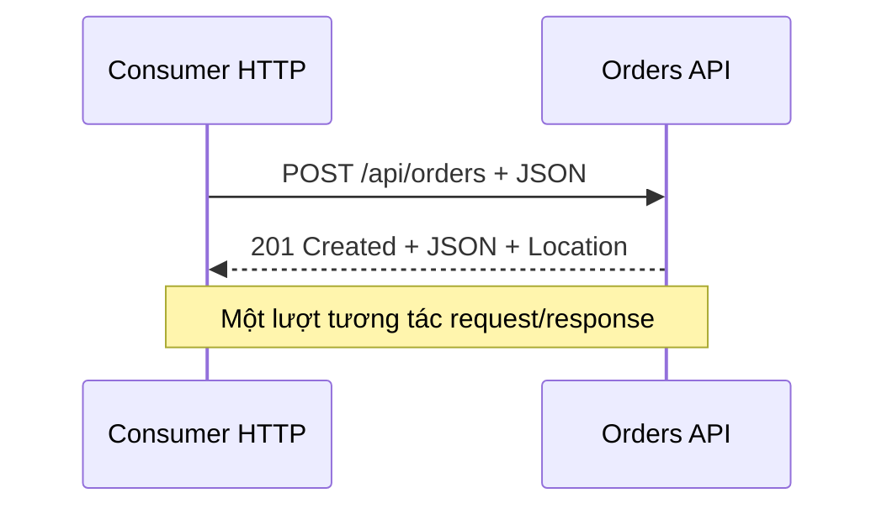
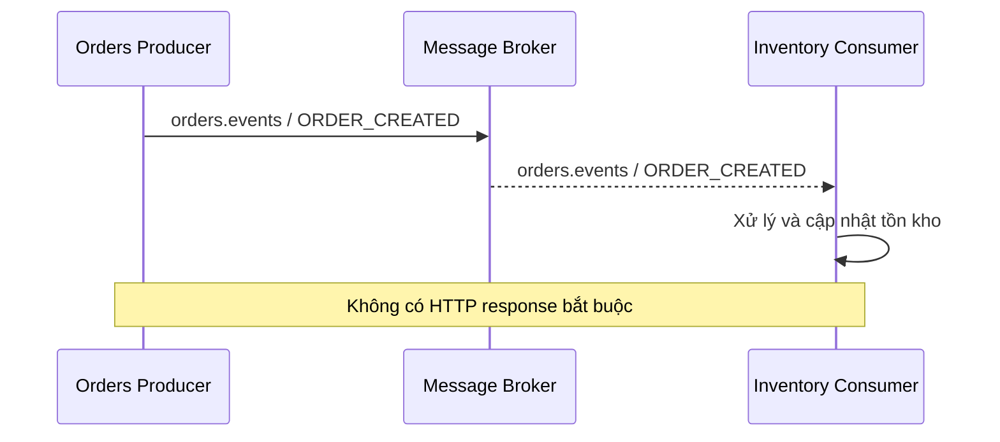

# Phân biệt hợp đồng HTTP với hợp đồng thông điệp

## 1. Hai loại tương tác, một mục tiêu kiểm thử hợp đồng

Trong module **SPRING_CLOUD_CONTRACT**, Spring Cloud Contract giúp producer và consumer thống nhất cách các dịch vụ tương tác qua **HTTP** hoặc **thông điệp**. Hợp đồng được khai báo bằng Groovy DSL hoặc YAML DSL, sau đó dùng để sinh kiểm thử phía producer và tạo stub cho consumer. Kết hợp Stub Runner và CI, nhóm phát hiện sớm thay đổi giao diện tích hợp có nguy cơ làm hỏng ứng dụng phụ thuộc.

Điều quan trọng khi **tổ chức hợp đồng** là hiểu hai kiểu giao tiếp này có ranh giới quan sát khác nhau:

- Với **HTTP**, consumer gửi một request đến producer và chờ response tương ứng trong cùng lượt gọi.
- Với **messaging**, một thành phần gửi hoặc phát message qua một kênh; thành phần khác nhận và xử lý theo thời điểm riêng. Một message không nhất thiết tạo ra phản hồi trực tiếp cho người gửi.

Vì thế, hai hợp đồng có thể cùng diễn tả việc “tạo đơn hàng” nhưng cần kiểm tra những điều khác nhau. Hợp đồng HTTP mô tả phương thức, URL, header, body, HTTP status và response. Hợp đồng thông điệp mô tả điều kiện kích hoạt hoặc message đầu vào, destination, header và payload message đầu ra.

Sau bài học, bạn có thể nhận diện loại hợp đồng từ đường đi của dữ liệu, đọc và viết những cấu trúc DSL cơ bản, chọn cách kiểm chứng producer phù hợp và tổ chức thư mục hợp đồng nhất quán để phục vụ việc đóng gói stub.

## 2. Mô hình tương tác và ranh giới của hợp đồng

### 2.1. HTTP: yêu cầu và phản hồi



Trong ví dụ này, consumer cần biết:

1. Gửi `POST /api/orders` với JSON hợp lệ như thế nào.
2. Khi thành công, producer trả trạng thái `201` và các trường nào.
3. Khi thất bại, producer trả `400`, `404` hoặc `409` trong điều kiện nào, nếu các nhánh đó là cam kết API.

Hợp đồng HTTP bảo vệ những hành vi có thể quan sát trực tiếp khi gửi request. Nó **không tự chứng minh** tác động xuống cơ sở dữ liệu, độ bền của giao dịch hay việc phát một sự kiện ngoài luồng nếu hợp đồng không mô tả và kiểm tra các tác động đó.

### 2.2. Thông điệp: phát, chuyển và nhận



Ở đây, inventory consumer không gọi endpoint của orders producer để nhận event. Nó đăng ký hoặc đọc một kênh theo cách hệ thống messaging hỗ trợ. Hợp đồng nên bảo vệ **cấu trúc và ý nghĩa message** mà inventory consumer sử dụng, ví dụ `eventType`, `orderId`, `items`, `destination` và header tương quan nếu có.

Một event `ORDER_CREATED` có thể được giao chậm, giao lại hoặc được xử lý sau khi request HTTP tạo đơn đã kết thúc. Hợp đồng dữ liệu message không tự bảo đảm thời gian giao, thứ tự toàn cục, xử lý đúng một lần hay tính nhất quán cuối cùng. Những tính chất đó cần thiết kế và kiểm thử riêng theo broker, cơ chế retry và hành vi ứng dụng.

### 2.3. Bảng so sánh nhanh

| Tiêu chí | Hợp đồng HTTP | Hợp đồng thông điệp |
| --- | --- | --- |
| Bối cảnh điển hình | Client gọi REST API để lấy/tạo tài nguyên | Service phát event hoặc nhận command qua broker |
| Đầu vào | Method, URL, query, headers, body | Trigger từ producer hoặc message đến một destination |
| Đầu ra cần bảo vệ | HTTP status, headers, response body | Destination, message headers, payload |
| Cặp tương tác | Request gắn với response cùng lượt gọi | Thường không có response trực tiếp; có thể là chuỗi các message riêng |
| Cách biểu diễn trong DSL | `request { ... }` và `response { ... }` | `input { ... }` và `outputMessage { ... }` |
| Hành vi thất bại thường thấy | `400`, `401`, `403`, `404`, `409`, timeout | Sự kiện từ chối, payload lỗi, dead-letter, retry tùy thiết kế |
| Producer verification | Gọi HTTP vào producer và assert response | Kích hoạt producer và quan sát message, hoặc đưa message vào và quan sát đầu ra |
| Dùng stub phía consumer | Stub HTTP trả response khi nhận request khớp | Stub/message trigger cung cấp message mẫu; cần tích hợp messaging phù hợp |
| Hành vi **không** được chứng minh mặc định | Giao dịch DB, toàn bộ side effect | Delivery guarantee, ordering, idempotency, broker availability |

> **Điểm phân biệt:** “Producer” là bên cung cấp hành vi được hợp đồng cam kết. Trong HTTP, đó thường là server nhận request. Trong messaging, đó thường là thành phần **phát message** mà consumer phụ thuộc, dù thành phần ấy có thể nhận một message khác trước khi phát output.

## 3. Ví dụ xuyên suốt: ứng dụng xử lý đơn hàng

Giả sử hệ thống gồm ba thành phần:

- **Ordering API** nhận yêu cầu tạo đơn hàng từ web/mobile qua HTTP.
- **Orders Service** xác nhận đơn và phát event `ORDER_CREATED` lên kênh `orders.events`.
- **Inventory Service** nhận event để cập nhật tồn kho.

Các tên, dữ liệu và destination trong bài là **giả định minh họa**, không phải quy ước Spring Cloud Contract bắt buộc.

| Tình huống | Người phụ thuộc | Thông tin họ cần | Loại hợp đồng |
| --- | --- | --- | --- |
| Tạo đơn thành công | Web/mobile | `POST /api/orders` trả `201`, `id`, `status` | HTTP |
| Số lượng không hợp lệ | Web/mobile | Trả `400` và `INVALID_QUANTITY` | HTTP |
| Đơn được tạo | Inventory Service | Nhận event `ORDER_CREATED` có `orderId` và `items` | Messaging |
| Tồn kho không đủ khi xử lý event | Orders Service hoặc downstream consumer của inventory | Nhận message `RESERVATION_REJECTED` với `reason` | Messaging, nếu đã thống nhất cơ chế phát sự kiện này |

Có thể tồn tại đồng thời hợp đồng HTTP và thông điệp cho cùng một hành động nghiệp vụ. Không nên viết một “hợp đồng tổng hợp” giả định rằng response `201` luôn đồng nghĩa message đã được broker giao thành công: hai sự kiện có thể xảy ra ở thời điểm khác nhau và cần những cơ chế đảm bảo riêng.

## 4. Viết hợp đồng HTTP

### 4.1. Groovy DSL: tạo đơn thành công

Ví dụ file `create_order_success.groovy`:

```groovy
import org.springframework.cloud.contract.spec.Contract

Contract.make {
    name 'create_order_success'
    description 'Tạo đơn với số lượng hợp lệ'

    request {
        method POST()
        url '/api/orders'
        headers {
            contentType(applicationJson())
        }
        body([
            productId: 'SKU-001',
            quantity : 2
        ])
    }

    response {
        status 201
        headers {
            contentType(applicationJson())
            header 'Location': '/api/orders/ord-1001'
        }
        body([
            id    : 'ord-1001',
            status: 'CREATED'
        ])
    }
}
```

**Cách đọc:**

1. `request` mô tả những gì consumer gửi: method, endpoint, content type và JSON đầu vào.
2. `response` mô tả những gì producer cam kết trả: mã trạng thái, header và JSON đầu ra.
3. Producer test sinh từ DSL có thể gọi producer thật và đối chiếu kết quả.
4. HTTP stub được sinh từ hợp đồng có thể chạy trong Stub Runner; khi consumer gửi request khớp, stub trả response đã khai báo.

Trong thực tế, ID đơn thường được sinh động. Việc cố định `ord-1001` chỉ phù hợp khi kiểm thử có fixture hoặc cách điều khiển ID ổn định. Nếu giá trị là động, có thể dùng **matcher** để kiểm tra định dạng thay vì cố định toàn bộ; matcher vẫn phải đủ chặt để phát hiện thay đổi sai hợp đồng.

### 4.2. YAML DSL tương đương

Ví dụ file `create_order_success.yml`:

```yaml
name: create_order_success
description: Tạo đơn với số lượng hợp lệ
request:
  method: POST
  url: /api/orders
  headers:
    Content-Type: application/json
  body:
    productId: SKU-001
    quantity: 2
response:
  status: 201
  headers:
    Content-Type: application/json
    Location: /api/orders/ord-1001
  body:
    id: ord-1001
    status: CREATED
```

Hai ví dụ trên mô tả **cùng một hành vi**. Khi đưa vào dự án, hãy chọn một biểu diễn theo quy ước nhóm; không đặt cả hai hợp đồng trùng nhau trong nơi build tự động quét, vì chúng có thể sinh kiểm thử và stub trùng lặp.

### 4.3. Nhánh lỗi cũng là một phần của hợp đồng HTTP

Khi `quantity = 0`, nếu API cam kết `400` và mã lỗi `INVALID_QUANTITY`, nên có hợp đồng riêng:

```yaml
name: create_order_invalid_quantity
request:
  method: POST
  url: /api/orders
  headers:
    Content-Type: application/json
  body:
    productId: SKU-001
    quantity: 0
response:
  status: 400
  headers:
    Content-Type: application/json
  body:
    code: INVALID_QUANTITY
```

Đây là **nhánh khác có ý nghĩa với consumer**, bởi ứng dụng có thể hiển thị lỗi nhập liệu thay vì chuyển sang trang đơn mới. Cần dùng dữ liệu đầu vào phân biệt rõ hai nhánh để Stub Runner không khớp nhầm mapping.

## 5. Viết hợp đồng thông điệp

Hợp đồng thông điệp sử dụng các khối khác HTTP:

- `input` mô tả cách gây ra hành vi: gọi một phương thức trong môi trường kiểm thử hoặc cung cấp message vào kênh đầu vào.
- `outputMessage` mô tả message producer cần phát, bao gồm destination, payload và những header được cam kết.
- `label` có thể đặt tên một thông điệp/luồng stub để kích hoạt trong kiểm thử consumer.

Không có `response.status` hay `request.url` theo nghĩa HTTP. Một message có thể có trường `status` trong **payload nghiệp vụ**, nhưng nó không trở thành HTTP status.

### 5.1. Producer phát event khi được kích hoạt

Ví dụ `order_created_event.groovy`:

```groovy
import org.springframework.cloud.contract.spec.Contract

Contract.make {
    name 'order_created_event'
    label 'order_created'
    description 'Phát sự kiện khi đơn hàng được tạo'

    input {
        triggeredBy('publishOrderCreated()')
    }

    outputMessage {
        sentTo('orders.events')
        body([
            eventType: 'ORDER_CREATED',
            orderId  : 'ord-1001',
            items    : [
                [productId: 'SKU-001', quantity: 2]
            ]
        ])
    }
}
```

Ý nghĩa từng phần:

| DSL | Vai trò |
| --- | --- |
| `label 'order_created'` | Nhãn giúp tham chiếu/kích hoạt mẫu message trong các tình huống stub hỗ trợ |
| `triggeredBy('publishOrderCreated()')` | Chỉ cách kích hoạt producer khi sinh kiểm thử |
| `sentTo('orders.events')` | Destination mà producer được kỳ vọng phát message tới |
| `body([...])` | Payload consumer cần nhận và hiểu |

`publishOrderCreated()` là **phương thức minh họa cần được hiện thực trong test base của producer**. Đây không phải hàm có sẵn của Spring Cloud Contract. Khi producer test chạy, bộ kiểm thử phải gọi được phương thức này, quan sát message đã gửi và so khớp destination/payload theo hợp đồng. Các chi tiết kết nối binder, broker hoặc message verifier phụ thuộc hạ tầng Spring Cloud Stream/Kafka/Rabbit/JMS mà dự án sử dụng.

### 5.2. YAML DSL cho sự kiện tương ứng

Nếu dự án ưu tiên YAML DSL, cùng ngữ nghĩa có thể diễn tả bằng:

```yaml
name: order_created_event
label: order_created
description: Phát sự kiện khi đơn hàng được tạo
input:
  triggeredBy: publishOrderCreated()
outputMessage:
  sentTo: orders.events
  body:
    eventType: ORDER_CREATED
    orderId: ord-1001
    items:
      - productId: SKU-001
        quantity: 2
```

Giống HTTP, chọn **một** biến thể Groovy hoặc YAML cho tình huống này. Khi chuyển ngôn ngữ DSL, hãy xác minh việc công cụ sinh test/mapping tương ứng có hoạt động trong phiên bản Spring Cloud Contract của dự án.

### 5.3. Producer nhận message và phát message khác

Không phải hợp đồng messaging nào cũng bắt đầu bằng `triggeredBy`. Ví dụ Inventory Service nhận command/event từ `orders.created`, xử lý rồi phát kết quả ở `inventory.reservations`:

```groovy
import org.springframework.cloud.contract.spec.Contract

Contract.make {
    name 'reserve_inventory_success'

    input {
        messageFrom('orders.created')
        messageBody([
            orderId  : 'ord-1001',
            productId: 'SKU-001',
            quantity : 2
        ])
    }

    outputMessage {
        sentTo('inventory.reservations')
        body([
            orderId: 'ord-1001',
            result : 'RESERVED'
        ])
    }
}
```

Ở đây, **message đầu vào** thay thế việc gọi trực tiếp một hàm kích hoạt; **message đầu ra** là sự kiện mà downstream consumer phụ thuộc. Kiểm thử producer cần môi trường gửi được message vào input tương ứng và quan sát được output. Ví dụ này không tự kiểm tra rằng hàng thực sự đã được trừ trong cơ sở dữ liệu; đó là trách nhiệm của kiểm thử nghiệp vụ hoặc tích hợp bổ sung.

Nếu inventory có nhánh hết hàng, hợp đồng cho kết quả `REJECTED` với `reason = OUT_OF_STOCK` là một nhánh riêng. Consumer không nên phải suy đoán thất bại chỉ từ việc “không thấy message”, bởi sự vắng mặt có thể do broker chậm, lỗi kết nối hoặc điều kiện thử nghiệm chưa đầy đủ.

## 6. Các trường quan trọng phải kiểm tra khác nhau thế nào?

### 6.1. HTTP: route, mã trạng thái và hình dạng phản hồi

Hợp đồng HTTP thường tập trung vào:

- **Request:** method, URL/path, query parameter, header như `Content-Type` hoặc `Authorization` nếu là thành phần giao diện đã thỏa thuận, và body đầu vào.
- **Response:** HTTP status, header quan trọng như `Location` và `Content-Type`, JSON/XML body, mã lỗi nghiệp vụ.
- **Các nhánh:** thành công, dữ liệu không hợp lệ, không tìm thấy, từ chối quyền, xung đột... theo hành vi thực sự công bố.

Trường hợp `GET /api/orders/{id}`, khác biệt giữa `200` và `404` là quan trọng vì consumer xử lý khác nhau. Trong khi đó, thay đổi cách lưu dữ liệu nội bộ mà không đổi giao diện HTTP không nhất thiết tạo ra hợp đồng mới.

### 6.2. Messaging: destination, sự kiện và cấu trúc payload

Hợp đồng thông điệp thường tập trung vào:

- **Destination:** topic, queue, channel hoặc tên binding mà consumer phụ thuộc.
- **Event type:** chẳng hạn `ORDER_CREATED` hoặc `RESERVATION_REJECTED`, nếu được định nghĩa trong payload/header.
- **Payload:** các thuộc tính bắt buộc, kiểu dữ liệu, cấu trúc nested, ý nghĩa các giá trị.
- **Headers:** content type, correlation ID, event type, schema version, routing key nếu các thông tin đó thuộc giao diện tích hợp.
- **Quy tắc đổi phiên bản:** thêm trường, bỏ trường, đổi tên sự kiện, đổi schema hay chuyển destination đều có thể ảnh hưởng consumer.

Header như `correlationId` rất hữu ích để lần dấu một luồng xử lý bất đồng bộ, nhưng chỉ nên đưa vào hợp đồng khi producer và consumer đã thống nhất cách sử dụng. Nếu giá trị được tạo ngẫu nhiên, nên dùng matcher đủ cụ thể để chấp nhận các giá trị hợp lệ mà vẫn bảo vệ kiểu/định dạng.

### 6.3. Điều gì nằm ngoài phạm vi của một hợp đồng?

| Câu hỏi | Hợp đồng mô tả được | Cần kiểm thử bổ sung |
| --- | --- | --- |
| API trả đúng JSON và HTTP status? | Có, bằng hợp đồng HTTP | Kiểm thử hiệu năng, bảo mật toàn diện, trạng thái DB |
| Event phát có đúng destination và payload? | Có, bằng hợp đồng thông điệp | Broker hoạt động thật, quyền truy cập, cấu hình mạng |
| Một event có được gửi đúng một lần tuyệt đối? | Hợp đồng dữ liệu không đủ chứng minh | Kiểm thử delivery/retry, idempotency |
| Hai event luôn đến đúng thứ tự? | Không tự bảo đảm | Kiểm thử phân vùng, ordering và quy tắc consumer |
| Tạo đơn HTTP `201` thì chắc chắn kho đã cập nhật? | Không tự bảo đảm | Kiểm thử xuyên dịch vụ, eventual consistency hoặc saga |
| Một trường JSON mới có tương thích? | Hợp đồng giúp phát hiện sai khác đã cam kết | Kiểm thử consumer cụ thể, đặc biệt với decoder nghiêm ngặt |

## 7. Khác biệt trong producer test và consumer stub

### 7.1. Kiểm chứng producer HTTP

Đối với hợp đồng HTTP, Spring Cloud Contract sinh test mô phỏng request và so sánh response của producer. Lớp nền kiểm thử phải khởi tạo ứng dụng hoặc lớp web thích hợp, thiết lập fixture, cấu hình client kiểm thử và bảo đảm test có thể chạy độc lập.

Ví dụ: hợp đồng `POST /api/orders` kỳ vọng `201` và `CREATED`. Nếu producer thật trả `200`, test sinh ra phải thất bại. Nếu dữ liệu fixture `SKU-001` không có trong môi trường kiểm thử, test có thể thất bại do thiết lập sai, nên cần phân biệt lỗi ứng dụng với lỗi môi trường kiểm thử.

### 7.2. Kiểm chứng producer messaging

Với hợp đồng messaging, framework sinh test để kích hoạt luồng message thông qua `triggeredBy` hoặc message input, sau đó quan sát output và kiểm tra nội dung/destination. Test base và hạ tầng messaging verifier phải được cấu hình phù hợp. Một hợp đồng DSL hợp lệ không tự tạo broker hoặc phương thức `publishOrderCreated()`.

Nếu producer phát message sai `eventType`, thiếu `orderId` hoặc gửi tới destination không đúng như cam kết, producer test cần phát hiện sự lệch này. Nếu broker thật cần thiết cho thiết kế, nên bổ sung integration test với môi trường broker có thể tái tạo.

### 7.3. Stub cho consumer HTTP

Với HTTP, artifact stub do Spring Cloud Contract tạo thường chứa mapping cho một server giả lập (thường dùng WireMock). Stub Runner tải artifact theo `groupId:artifactId:version:stubs`, nạp mapping và mở cổng HTTP. Consumer test gọi **mã client thật của mình** tới URL stub, rồi khẳng định client phản ứng đúng với `201`, `400`, `404`...

Ví dụ consumer test có thể kiểm tra rằng khi stub trả `400 INVALID_QUANTITY`, giao diện hiển thị lỗi nhập số lượng và không điều hướng sang đơn hàng mới.

### 7.4. Stub cho consumer messaging

Với messaging, một bài test có thể kích hoạt message stub bằng nhãn (chẳng hạn `order_created`) qua khả năng stub trigger được cung cấp, sau đó xác minh consumer đã nhận và xử lý payload. Việc gửi message tới ứng dụng consumer cần các adapter hoặc cấu hình messaging tương thích với công cụ và môi trường test.

**Không được suy luận** rằng chỉ thêm `@AutoConfigureStubRunner` cho một ứng dụng consumer sẽ khiến mọi message tự xuất hiện trên Kafka/RabbitMQ thực. Stub Runner cần được kết nối với môi trường messaging hoặc cơ chế giả lập phù hợp, đồng thời test phải kích hoạt kịch bản cần kiểm tra. Điều kiện tiêu thụ, consumer group và cơ chế nhận sự kiện vẫn do kiến trúc dự án quyết định.

### 7.5. Điểm chung của hai loại

Cả hai đều cần chuỗi xác minh:

```text
Contract DSL -> Generated producer test -> Producer verification
             -> Stub artifact đã kiểm chứng -> Stub Runner/consumer test
             -> CI xác nhận tương thích
```

Stub được sinh từ hợp đồng không bảo đảm producer đang chạy thực sự tuân thủ hợp đồng nếu producer verification bị bỏ qua. Cũng vậy, producer test đạt không chứng minh tất cả consumer sẽ xử lý được các thay đổi nếu consumer không có kiểm thử phù hợp.

## 8. Tổ chức thư mục khi hệ thống có cả HTTP và messaging

Trong một dự án Maven, cấu trúc thường dùng có thể là:

```text
orders-producer/
  src/
    test/
      resources/
        contracts/
          http/
            orders/
              create_order_success.groovy
              create_order_invalid_quantity.yml
          messaging/
            orders/
              order_created_event.groovy
```

Đây là **ví dụ về cách phân nhóm để con người dễ đọc**. Thư mục nguồn `src/test/resources/contracts` thường được plugin Spring Cloud Contract quét theo cấu hình mặc định; các thư mục con, quy tắc scan và đường dẫn gói artifact phụ thuộc cấu hình cụ thể của dự án. Không nên cho rằng mọi bộ sinh hoặc mọi phiên bản framework đều tự xử lý thư mục tùy ý giống nhau nếu chưa kiểm tra output.

Các nguyên tắc tổ chức hữu ích:

1. **Tách theo giao thức hoặc ranh giới tích hợp.** Có thể dùng `http/` và `messaging/`, sau đó chia theo domain để không trộn API response với event.
2. **Đặt tên theo hành vi.** `create_order_success`, `create_order_invalid_quantity`, `order_created_event` giúp nhận ra ai dùng hợp đồng và nhánh nào được mô tả.
3. **Một tình huống, một biểu diễn.** Tránh để cùng một hợp đồng vừa có Groovy vừa có YAML với nội dung giống hệt mà cả hai đều được build.
4. **Không chia cắt cùng một hợp đồng giữa hai file tùy tiện.** Một hợp đồng HTTP có request và response; một hợp đồng event có kích hoạt và output message. Liên kết nghiệp vụ giữa hai giao thức được giải thích ở tài liệu thiết kế hoặc bài kiểm thử tích hợp riêng.
5. **Giữ dữ liệu kiểm thử có chủ đích.** ID, SKU, event type và error code nên đại diện cho nhánh rõ ràng; tránh dữ liệu thật, token hoặc payload ngẫu nhiên gây khó tái lập.
6. **Nhất quán về ownership.** Nhóm vận hành producer chịu trách nhiệm duy trì hợp đồng được producer xác minh; consumer cần tham gia xác nhận những trường và nhánh mình thực sự phụ thuộc.

Đối với nhiều consumer, có thể tổ chức hợp đồng theo consumer, theo miền nghiệp vụ hoặc theo route/event, tùy quy ước và cơ chế phân phối. Điều kiện chọn cấu trúc là **mọi hợp đồng đều được phát hiện bởi build**, không bị trùng và có thể truy vết đến hành vi công khai. Một layout đẹp nhưng khiến plugin bỏ qua file sẽ không tạo ra bảo vệ kiểm thử.

## 9. Phiên bản, đóng gói stub và CI cho hai loại hợp đồng

Spring Cloud Contract có thể đưa các kết quả stub vào artifact dành cho consumer, thường là JAR có classifier `stubs`. Với ví dụ producer `com.example:orders-producer:1.4.2`, artifact stub thường có tọa độ:

```text
com.example:orders-producer:1.4.2:stubs
```

Consumer chọn **phiên bản producer stub** khi cấu hình Stub Runner. HTTP stub và message stub có thể cùng thuộc một artifact nếu quy trình build của producer cấu hình chúng như vậy; khả năng thực thi từng loại vẫn phụ thuộc môi trường và adapter tương ứng.

Một pipeline CI hợp lý:

1. Đọc hợp đồng mới hoặc thay đổi, kiểm tra cú pháp DSL và tên/đường dẫn.
2. Sinh và chạy producer tests cho cả HTTP lẫn message, với lớp nền kiểm thử và hạ tầng thích hợp.
3. Kiểm tra stub artifact có các mapping/message scenario mà consumer cần, rồi phát hành theo phiên bản rõ ràng.
4. Chạy consumer tests với stub version đã chọn; với HTTP gọi client thực, với messaging đưa event mẫu qua transport test phù hợp.
5. Nếu một thay đổi khiến producer hoặc consumer test thất bại, dừng pipeline hoặc yêu cầu phối hợp nâng phiên bản trước khi phát hành.

Với thay đổi **HTTP**, CI có thể phát hiện việc `201` thành `200` hoặc thiếu `Location`. Với thay đổi **message**, CI có thể phát hiện `eventType` đổi tên, `orderId` bị xóa hoặc destination bị đổi. Tuy nhiên, đây là những trường hợp được bảo vệ khi hợp đồng và test thực sự mô tả/kiểm tra các thuộc tính đó; CI không tự suy ra mọi consumer phụ thuộc vào điều gì.

Để dễ tái lập, consumer nên ghim stub version xác định trong kiểm thử chặn phát hành. Một bản `SNAPSHOT` thay đổi liên tục hoặc một ký hiệu “phiên bản mới nhất” có thể làm kết quả CI thay đổi khi mã consumer không đổi.

## 10. Những nhầm lẫn thường gặp

| Nhầm lẫn | Vì sao sai hoặc thiếu | Cách xử lý |
| --- | --- | --- |
| “HTTP và message đều có request và response.” | Event bất đồng bộ không bắt buộc có phản hồi trực tiếp | Dùng `request/response` cho HTTP; `input/outputMessage` cho message |
| “Field `status` trong event tương đương HTTP status.” | Đó là thuộc tính payload do ứng dụng định nghĩa | Tách status nghiệp vụ khỏi status của giao thức |
| “`201` nghĩa là event đã tới consumer.” | Response HTTP và delivery qua broker là hai giai đoạn khác nhau | Xác minh side effect và eventual consistency bằng kiểm thử bổ sung |
| “Message contract tự kiểm tra retry và đúng một lần.” | Hợp đồng thông điệp chủ yếu mô tả dữ liệu và đường phát/nhận | Kiểm thử retry, duplicate, idempotency và thứ tự riêng |
| “Chỉ cần viết `triggeredBy`, không cần phương thức thực.” | Generated test phải gọi được trigger trong môi trường kiểm thử | Hiện thực test base và cấu hình message verifier |
| “Có Stub Runner là event tự đến broker.” | Cần kích hoạt stub và tích hợp messaging thích hợp | Cấu hình adapter/transport test và trigger theo label |
| “Mọi nhánh lỗi đều dùng HTTP `400`.” | Messaging có thể dùng event lỗi hoặc cơ chế dead-letter | Thống nhất nhánh theo ngữ nghĩa từng kênh |
| “Cứ thay đổi bất kỳ field nào đều là breaking change.” | Tương thích phụ thuộc quy tắc schema và consumer thực tế | Đánh giá cả hợp đồng và kiểm thử consumer, nhất là trường bắt buộc |

## 11. Bài thực hành phân loại hợp đồng

**Đề bài:** Một hệ thống thanh toán có các hành vi sau:

1. Client gọi `POST /payments` và nhận `202 Accepted` với `paymentId`.
2. Service phát message `PAYMENT_REQUESTED` vào `payments.events`.
3. Worker nhận `PAYMENT_REQUESTED`, gọi nhà cung cấp thanh toán, rồi phát `PAYMENT_SUCCEEDED` hoặc `PAYMENT_FAILED`.
4. Client gọi `GET /payments/{id}` và nhận trạng thái thanh toán hiện tại.

Hãy lập bảng hợp đồng dự kiến:

| Hành vi | Hợp đồng cần viết | Ví dụ tiêu biểu |
| --- | --- | --- |
| Yêu cầu thanh toán được chấp nhận | HTTP | `POST /payments -> 202` với `paymentId` |
| Đọc thanh toán tồn tại | HTTP | `GET /payments/pay-1001 -> 200` với `status` |
| Service phát yêu cầu xử lý | Messaging | `PAYMENT_REQUESTED` với `paymentId` và `amount` |
| Worker báo thành công | Messaging | `PAYMENT_SUCCEEDED` với `paymentId` |
| Worker báo thất bại | Messaging | `PAYMENT_FAILED` với `paymentId` và `reason` |

Tiếp theo, tự trả lời bốn câu hỏi:

1. **HTTP `202` có bảo đảm `PAYMENT_SUCCEEDED` đã phát không?** Không. `202` chỉ thể hiện request đã được chấp nhận để xử lý theo ngữ nghĩa API này; kết quả cuối cùng đến sau.
2. **Nên dùng `response.status: 200` trong hợp đồng event không?** Không. Event dùng destination, headers và payload; `200` là mã HTTP.
3. **Làm sao kiểm tra nhánh `PAYMENT_FAILED`?** Tạo hợp đồng message riêng với điều kiện test đủ xác định, kiểm chứng producer phát payload lỗi đã thỏa thuận và chạy consumer test khi nhận event đó.
4. **Làm sao kiểm chứng trình tự “HTTP `202` rồi event rồi HTTP `200`”?** Dùng kiểm thử tích hợp hoặc end-to-end xuyên thành phần với điều kiện chờ và hạ tầng thích hợp; các hợp đồng đơn lẻ kiểm tra từng ranh giới, không tự bảo đảm toàn bộ chuỗi.

### Checklist khi chọn loại hợp đồng

- Consumer **gọi endpoint rồi nhận response** hay **nhận message từ channel**?
- Hợp đồng cần mô tả `method/url/status` hay `trigger/destination/payload`?
- Các nhánh lỗi của consumer được thể hiện dưới dạng HTTP code hay message/event?
- Producer test có đúng fixture, base class, transport và cơ chế quan sát cần thiết?
- Stub HTTP có request matcher phù hợp; stub message có nhãn và cách kích hoạt phù hợp?
- Artifact được đóng gói, gắn phiên bản và kiểm tra trong CI cùng với consumer?
- Có đang đòi hỏi hợp đồng chứng minh delivery, thứ tự, retry hoặc trạng thái liên dịch vụ mà nó không thể tự bảo đảm?

**Ghi nhớ:** hợp đồng HTTP bảo vệ lời hứa **trả gì khi được gọi**, còn hợp đồng thông điệp bảo vệ lời hứa **phát/nhận thông điệp gì tại ranh giới tích hợp**. Phân biệt đúng hai loại giúp đặt DSL đúng chỗ, sinh kiểm thử producer có ý nghĩa, cung cấp stub phù hợp cho consumer và phát hiện thay đổi không tương thích sớm trong CI.
