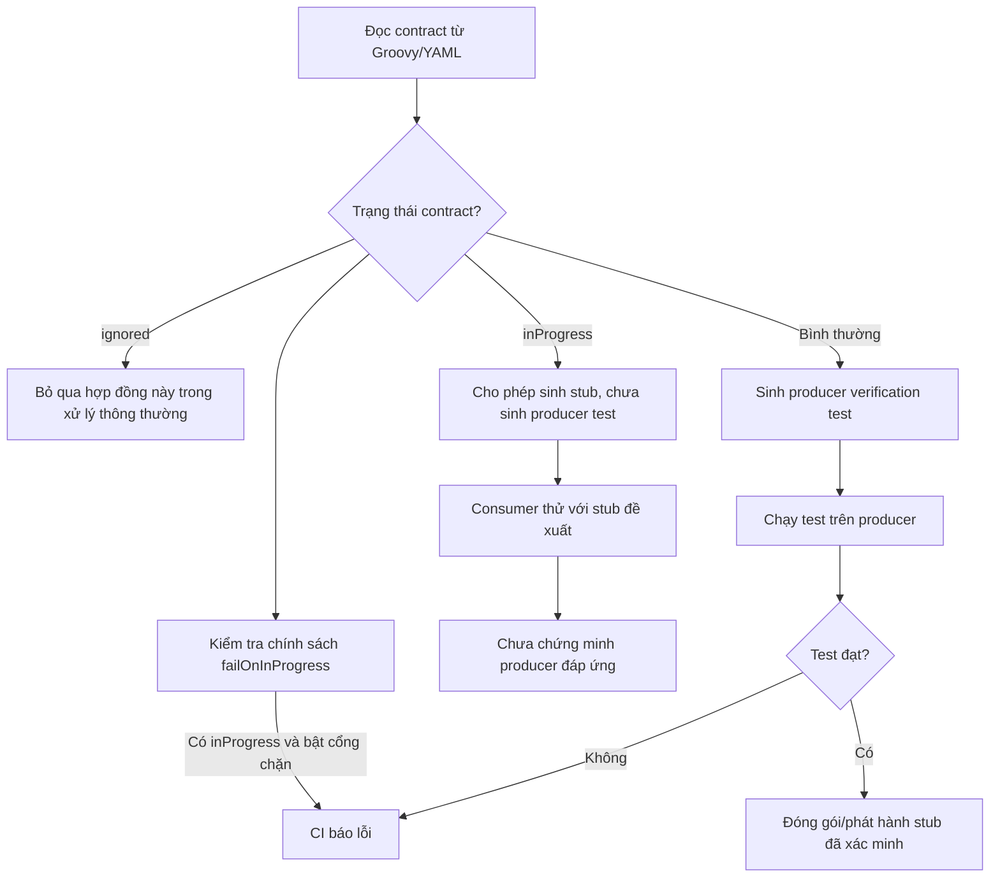

# Đánh dấu hợp đồng tạm bỏ qua hoặc đang phát triển khi được hỗ trợ

## 1. Bài toán: không phải hợp đồng nào cũng đã sẵn sàng kiểm chứng

Trong một hệ thống nhiều dịch vụ, nhóm **consumer** có thể đề xuất một tương tác HTTP mới trước khi nhóm **producer** hoàn tất triển khai. Ở trường hợp khác, một hợp đồng cũ có thể đang sai, không còn được dùng hoặc phải tạm thời ngừng kiểm thử trong lúc hai bên thống nhất cách sửa. Nếu xóa hợp đồng ngay, nhóm mất bối cảnh và khả năng review; nếu để nó được xác minh như bình thường, build có thể thất bại do một yêu cầu chưa được chấp thuận hoặc chưa được triển khai.

**Spring Cloud Contract (SCC)** cung cấp hai cách đánh dấu hữu ích trong những phiên bản DSL có hỗ trợ: **bỏ qua hợp đồng** (`ignored`) và **hợp đồng đang phát triển** (`inProgress`). Cả hai đều là trạng thái của **một định nghĩa contract**; chúng không thay thế việc trao đổi giữa producer và consumer hay chính sách release của dự án.

Đặt trong bức tranh chung của Spring Cloud Contract:

- Producer và consumer thỏa thuận hành vi HTTP hoặc thông điệp bằng **Groovy DSL/YAML DSL**.
- Công cụ có thể sinh **producer verification tests** để kiểm tra việc triển khai có đáp ứng hợp đồng.
- Từ contract có thể tạo **stub**; consumer dùng **Stub Runner** để kiểm tra cách gọi API, giải mã response hoặc xử lý thông điệp.
- CI ghép các bước trên để phát hiện thay đổi API không tương thích trước khi phát hành.

Khi một contract bị bỏ qua hoặc đang phát triển, **ý nghĩa của tín hiệu kiểm thử thay đổi**. Vì vậy, phải biết chính xác điều gì được tạo, điều gì không được kiểm tra và còn rủi ro nào trước khi đọc kết quả CI là “PASS”.

Sau bài này, bạn có thể chọn giữa `ignored` và `inProgress`, viết đúng cú pháp Groovy/YAML, hiểu tác động tới producer tests và stub, đặt điều kiện kiểm soát trong CI và xây dựng quy trình đưa một hợp đồng từ bản nháp trở thành hợp đồng được xác minh đầy đủ.

## 2. Hai dấu hiệu có ý nghĩa khác nhau

Các thuộc tính dưới đây được đặt ở **cấp cao nhất của contract**, không đặt trong `request`, `response`, `headers` hay `body`.

| Tiêu chí | `ignored: true` | `inProgress: true` | Hợp đồng bình thường |
|---|---|---|---|
| Ý định | Tạm thời loại một contract khỏi việc xử lý thông thường | Cho phép nhóm consumer bắt đầu với stub khi producer chưa triển khai xong | Xác minh hành vi đã thống nhất và được triển khai |
| Producer verification test | Bỏ qua contract được đánh dấu | **Không sinh test** cho contract đang phát triển | Sinh test nếu build được cấu hình đúng |
| Stub | Không coi contract bị bỏ qua là nguồn stub đang được xác nhận; cần kiểm tra artifact đầu ra theo cấu hình | **Có thể sinh stub** dù producer chưa được kiểm chứng | Sinh stub từ contract theo quy trình build |
| Tín hiệu đối với consumer | Không nên coi contract bị bỏ qua là giao diện đã được bảo vệ | Consumer có thể kiểm thử sớm với hành vi **được đề xuất**, chưa chắc producer làm được | Stub và producer verification cùng dựa trên contract đã xác nhận |
| Rủi ro chính | Che khuất một kỳ vọng quan trọng nếu quên bật lại | Stub “chạy xanh” trong khi producer chưa hỗ trợ | Chỉ bảo vệ những trường hợp và assertion có trong hợp đồng |
| Điều kiện quản trị | Ghi lý do, người chịu trách nhiệm, hạn xem xét | Có kế hoạch hoàn thiện, cổng CI ngăn release chưa được xác minh | Duy trì kiểm thử khi hành vi hoặc phiên bản thay đổi |

**Phân biệt ngắn gọn:** `ignored` thể hiện quyết định **tạm không dùng contract để xác minh**; `inProgress` thể hiện quyết định **dùng contract làm bản thiết kế để tạo stub trước khi producer sẵn sàng**. Hai trạng thái này không tương đương và không nên đặt đồng thời cho cùng một hợp đồng rồi dựa vào thứ tự ưu tiên chưa được kiểm tra.

Ở một số phiên bản hoặc cách tích hợp, khả năng xử lý các dấu hiệu có thể khác. Hãy kiểm tra **phiên bản SCC, Groovy/YAML DSL và plugin Maven/Gradle** đang dùng cùng kết quả sinh test/stub thực tế. Các ví dụ sau dựa trên những thuộc tính được nêu trong tài liệu tham khảo chính thức của Spring Cloud Contract.

## 3. Ví dụ xuyên suốt: API trạng thái đơn hàng

Giả sử `checkout-service` (consumer) gọi `order-service` (producer) để lấy trạng thái đơn hàng. Hợp đồng bình thường cho hành vi đã triển khai có thể là:

```yaml
name: order-status-existing
description: "Trả trạng thái đơn hàng hiện có"
request:
  method: GET
  url: /api/orders/42/status
response:
  status: 200
  headers:
    Content-Type: application/json
  body:
    orderId: 42
    status: PAID
```

Ví dụ này chỉ mô tả một request cụ thể: `GET /api/orders/42/status` trả `200` cùng JSON đã khai báo. Nếu contract được xác minh ở producer, test sẽ kiểm tra những điều đã ràng buộc. Nó **không tự chứng minh** mọi ID, trường hợp lỗi, phân quyền hoặc tính đúng đắn nghiệp vụ đều hoạt động.

### 3.1. Tạm bỏ qua một hợp đồng với `ignored`

Giả sử nhóm phát hiện contract cũ mô tả `status: PAID`, nhưng consumer thật đã chuyển sang dùng mô hình trạng thái khác. Hai nhóm cần rà soát và thống nhất trước khi tiếp tục xác minh contract ấy. Một cách đánh dấu trong **YAML DSL**:

```yaml
name: order-status-legacy
description: "Hợp đồng cũ đang chờ quyết định thay thế"
ignored: true
request:
  method: GET
  url: /api/orders/42/legacy-status
response:
  status: 200
  body:
    status: PAID
```

Thuộc tính `ignored: true` nằm cùng cấp với `name`, `request` và `response`. Nó **không** phải `response.status` và cũng không phải một trường trạng thái tự đặt trong metadata của hệ thống quản lý bài học.

Khi được công cụ hỗ trợ và xử lý như contract bị bỏ qua, hợp đồng này không tham gia luồng xác minh thông thường. Điều đó có thể hữu ích trong quá trình thay đổi, nhưng tuyệt đối **không được diễn giải thành “producer đã tương thích”**. Không có test thất bại có thể chỉ vì test đã bị loại khỏi phạm vi thực thi.

Nhóm nên ghi **lý do bỏ qua, liên kết issue, người phụ trách và thời điểm quyết định tiếp theo** trong pull request, issue tracker hoặc trường mô tả phù hợp với quy ước dự án. Đừng biến `ignored: true` thành cách che một regression mà không có kế hoạch khắc phục.

### 3.2. Đánh dấu hợp đồng đang phát triển bằng `inProgress`

Giả sử consumer muốn biết thời gian giao hàng dự kiến, trong khi producer chưa có endpoint này. Nhóm có thể thống nhất trước hành vi mong đợi để consumer lập trình và chạy test dựa trên stub:

```yaml
name: order-delivery-estimate
description: "Dự kiến thời gian giao hàng - API đang phát triển"
inProgress: true
request:
  method: GET
  url: /api/orders/42/delivery-estimate
response:
  status: 200
  headers:
    Content-Type: application/json
  body:
    orderId: 42
    estimatedDays: 3
```

Đây là điểm khác biệt quan trọng: **contract đang phát triển không sinh producer verification test nhưng vẫn cho phép sinh stub**. Consumer có thể gọi stub và kiểm tra rằng mình đọc `estimatedDays` đúng cách **trước khi producer hoàn thành API**. Đây là công cụ hỗ trợ phát triển song song, không phải bằng chứng triển khai producer đã đúng. <https://docs.spring.io/spring-cloud-contract/reference/project-features-contract/common-top-elements.html>

Nếu chỉ chạy consumer tests với stub, CI có thể xanh dù endpoint `/delivery-estimate` hoàn toàn chưa tồn tại trong producer. Đây là **false positive về mức độ sẵn sàng tích hợp**: bộ test consumer đang xác minh cách consumer tương tác với *hành vi giả lập*, chứ chưa kiểm tra producer thật.

### 3.3. Khi producer hoàn thiện thì làm gì?

Sau khi producer triển khai API, nhóm **bỏ** `inProgress: true` hoặc chuyển nó về `false` theo định dạng DSL và quy ước dự án, rồi chạy lại vòng kiểm chứng thông thường:

```yaml
name: order-delivery-estimate
description: "Lấy thời gian giao hàng dự kiến"
request:
  method: GET
  url: /api/orders/42/delivery-estimate
response:
  status: 200
  headers:
    Content-Type: application/json
  body:
    orderId: 42
    estimatedDays: 3
```

Khi không còn `inProgress`, generated producer test có thể được tạo và chạy trên ứng dụng trong môi trường kiểm thử thích hợp. Producer phải dựng dữ liệu cho đơn `42` và trả đúng các giá trị được ràng buộc. Chỉ nên phát hành stub như **giao diện đã xác minh** sau khi test producer thành công trên mã nguồn và artifact đúng phiên bản.

Đối với contract đánh dấu `ignored`, phải quyết định **khôi phục**, **thay thế** hoặc **xóa theo quy trình quản lý API**, rồi xác nhận tác động đến các consumer đang dùng endpoint cũ. Xóa flag một cách máy móc có thể làm CI thất bại trở lại nếu hợp đồng còn không phản ánh hành vi đã thống nhất.

## 4. Cùng ý nghĩa trong Groovy DSL

Spring Cloud Contract cũng hỗ trợ các phương thức top-level `ignored()` và `inProgress()` trong **Groovy DSL**. Chẳng hạn, file `order-status-legacy.groovy`:

```groovy
org.springframework.cloud.contract.spec.Contract.make {
    name('order-status-legacy')
    description('Hợp đồng cũ đang chờ quyết định thay thế')
    ignored()

    request {
        method GET()
        url '/api/orders/42/legacy-status'
    }

    response {
        status OK()
        body(status: 'PAID')
    }
}
```

Đối với hợp đồng đang phát triển, có thể dùng:

```groovy
org.springframework.cloud.contract.spec.Contract.make {
    name('order-delivery-estimate')
    description('API đang phát triển để consumer thử nghiệm với stub')
    inProgress()

    request {
        method GET()
        url '/api/orders/42/delivery-estimate'
    }

    response {
        status OK()
        headers {
            contentType(applicationJson())
        }
        body(orderId: 42, estimatedDays: 3)
    }
}
```

Hai phương thức `ignored()` và `inProgress()` là **đặc tính của contract**, không phải phương thức trên `request` hoặc `response`. Nếu phiên bản hoặc công cụ đang dùng không hiểu các thuộc tính này, không nên tự sáng tạo tên như `skip: true`, `pending: true` hoặc `status: IN_PROGRESS` rồi kỳ vọng SCC tự thực thi; những khóa tùy ý không tự động có ý nghĩa với plugin.

**Lưu ý về cú pháp:** YAML DSL và Groovy DSL có cách gọi khác nhau, dù cùng mục đích. Không chép trực tiếp `inProgress()` của Groovy vào YAML, hoặc dùng `inProgress: true` như một câu lệnh Groovy. Ngoài ra, không nhầm cờ bỏ qua **một hợp đồng** với cờ **bỏ qua toàn bộ task/test** của công cụ build.

## 5. Điều gì thực sự xảy ra trong pipeline?

Hãy đối chiếu ba cách dùng hợp đồng với các giai đoạn phổ biến của Spring Cloud Contract:



Sơ đồ là mô hình khái niệm của quy trình. Thứ tự và cách plugin thực hiện từng tác vụ có thể phụ thuộc Maven/Gradle và phiên bản SCC. **Không** suy ra rằng một contract `inProgress` sẽ tạo được artifact nếu cả build đã bị cổng `failOnInProgress` chặn trước đó; việc sinh stub chỉ xảy ra trong một đường chạy mà nhóm **có chủ đích cho phép** hợp đồng đang phát triển.

Trong tài liệu Spring Cloud Contract, thuộc tính plugin **`failOnInProgress` mặc định là `true`** đối với các plugin hiện được tài liệu hóa. Khi có contract đang phát triển, plugin có thể làm **build thất bại** để ngăn kết quả kiểm thử gây hiểu nhầm. Nếu muốn phát triển song song và sinh stub sớm, nhóm phải chủ động cho phép ở môi trường phù hợp bằng cách đặt `failOnInProgress` về `false`, rồi khôi phục cổng chặn trước release. <https://docs.spring.io/spring-cloud-contract/reference/howto/how-to-mark-contract-in-progress.html>

Do đó có hai nhận định đồng thời đúng:

1. `inProgress` **cho phép sinh stub mà không sinh producer test** cho hợp đồng đó.
2. **Build có thể bị chặn** bởi chính sách `failOnInProgress`, dù hợp đồng về mặt kỹ thuật cho phép sinh stub.

Nếu không tách hai tầng này, người học rất dễ nhận kết quả bất ngờ: “đã đặt `inProgress: true` nhưng build vẫn đỏ”. Đó có thể là **cổng an toàn được thiết kế có chủ đích**, không phải lỗi cú pháp hợp đồng.

## 6. Cấu hình `failOnInProgress`: mở khi phát triển, khóa khi phát hành

Với **Maven**, thuộc tính được hỗ trợ trong cấu hình Spring Cloud Contract Maven plugin. Đoạn cấu hình minh họa cho pipeline phát hành:

```xml
<build>
    <plugins>
        <plugin>
            <groupId>org.springframework.cloud</groupId>
            <artifactId>spring-cloud-contract-maven-plugin</artifactId>
            <version>${spring-cloud-contract.version}</version>
            <extensions>true</extensions>
            <configuration>
                <failOnInProgress>true</failOnInProgress>
            </configuration>
        </plugin>
    </plugins>
</build>
```

Ở pipeline phát triển/nhánh thử nghiệm **chủ đích cho phép stub chưa được xác minh**, có thể thiết lập `failOnInProgress` thành `false` trong cấu hình tương ứng:

```xml
<configuration>
    <failOnInProgress>false</failOnInProgress>
</configuration>
```

Hai đoạn này minh họa **giá trị của cùng một tùy chọn** ở hai ngữ cảnh cấu hình; không ghép chúng thành hai cấu hình có hiệu lực đồng thời trong một plugin. POM hoàn chỉnh còn phải có phiên bản plugin tương thích, phần dependency/test base và các thiết lập sinh test/stub thích hợp. Thông tin thuộc tính và mặc định được liệt kê trong tài liệu tham số của [Maven plugin `generateTests`](https://docs.spring.io/spring-cloud-contract/docs/current/spring-cloud-contract-maven-plugin/generateTests-mojo.html).

Với **Gradle**, Spring Cloud Contract Gradle plugin cũng có tùy chọn tương ứng, nhưng cú pháp khai báo và cách truyền cấu hình nên đối chiếu tài liệu **đúng phiên bản** đang dùng. Không suy ra từ ví dụ Maven rằng có thể đặt nguyên đoạn XML vào `build.gradle`, hoặc ngầm giả định mọi bản plugin đều có cùng thuộc tính và hành vi.

Một chiến lược CI dễ kiểm tra:

| Môi trường | Có cho `inProgress` tồn tại? | Mục tiêu và cổng kiểm soát |
|---|---|---|
| Nhánh tính năng / sandbox riêng | Có thể cho phép, có giới hạn | Consumer thử nghiệm sớm trên stub; ghi rõ chưa có producer verification |
| Pull request producer | Theo quy tắc nhóm | Review cờ, issue, owner, thời hạn; kiểm tra các contract đã ổn định |
| Nhánh release / production gate | Không nên cho phép | `failOnInProgress=true`, generated tests của contract bình thường phải chạy và đạt |
| Kiểm thử consumer bằng Stub Runner | Có thể sử dụng bản stub thử nghiệm riêng | Không nhầm consumer test xanh với producer đã triển khai; xác định phiên bản stub |

**Tách luồng artifact:** nếu nhóm chủ động phát hành stub thử nghiệm từ một contract `inProgress`, hãy dùng version, repository hoặc kênh phân phối đủ rõ để không lẫn với stub đã được producer xác minh. Việc phân biệt đó là **quy ước CI/release của nhóm**, không phải một bảo đảm tự động từ `inProgress`.

## 7. Quy trình quản trị một hợp đồng chưa sẵn sàng

Đánh dấu trạng thái trong DSL chỉ là một phần nhỏ của công việc. Có thể quản lý theo các bước:

1. **Ghi nguồn yêu cầu:** consumer nào cần tương tác, ca sử dụng nào, API/message và phiên bản nào chịu tác động.
2. **Xác định lý do chưa sẵn sàng:** hợp đồng sai hoặc đã cũ (`ignored`); hành vi mới được thống nhất trước khi triển khai xong (`inProgress`); hay trường hợp cần thay đổi thiết kế thay vì bật cờ.
3. **Ghi rõ trạng thái và người phụ trách:** link issue/PR, kế hoạch, ngày xem xét lại, tiêu chí gỡ cờ. Trường mô tả trong contract có thể tóm tắt lý do, còn thông tin quản lý dài hơn nên nằm ở nơi theo dõi công việc của nhóm.
4. **Xác định môi trường được phép sử dụng:** nhánh thử nghiệm có thể tạo stub từ `inProgress`; nhánh release không được coi stub ấy là đã được xác minh.
5. **Theo dõi cờ trong code review và CI:** kiểm tra mọi thay đổi `ignored`/`inProgress`, tránh để các cờ trở thành trạng thái mặc định bị quên.
6. **Hoàn thiện và gỡ cờ:** cập nhật contract đúng ngữ nghĩa, dựng fixture, chạy generated producer tests, xuất bản stub hợp lệ và chạy kiểm thử consumer phù hợp.
7. **Xác nhận sau thay đổi:** đối chiếu version stub, artifact producer và các consumer đang hỗ trợ; không dùng kết quả xanh của một stub cũ để suy ra phiên bản mới an toàn.

Ví dụ quy trình một tính năng:

| Giai đoạn | Hợp đồng `delivery-estimate` | Kiểm chứng hợp lý |
|---|---|---|
| Thiết kế | Bản nháp để hai nhóm review | Thống nhất request, response, ngữ nghĩa và ca sử dụng |
| Consumer bắt đầu triển khai | `inProgress: true` (nếu phiên bản hỗ trợ) | Consumer test với stub thử nghiệm, đánh dấu rõ mức độ tin cậy |
| Producer triển khai | Chuẩn bị gỡ `inProgress` | Tạo test base/fixture, sửa mã đáp ứng hợp đồng |
| Sẵn sàng tích hợp | Bỏ `inProgress` | Sinh và chạy producer tests; sửa nếu test thất bại |
| Phát hành | Contract bình thường, CI release chặn `inProgress` | Phát hành stub có version và chạy consumer tests với version được hỗ trợ |

Với hợp đồng `ignored`, nhánh quyết định sẽ khác: sau khi xác minh nhu cầu thực tế, nhóm **khôi phục nội dung hợp lệ**, **thay thế bằng contract mới**, hoặc **loại bỏ contract lỗi thời theo chính sách tương thích**. Không phải mọi contract bị bỏ qua đều nên được bật lại như cũ.

## 8. Những điều trạng thái này không bảo đảm

### Consumer test với stub chưa phải producer verification

Giả sử consumer dựa vào stub `inProgress` trả:

```json
{
  "orderId": 42,
  "estimatedDays": 3
}
```

Consumer parse dữ liệu thành công; Stub Runner trả response như mong đợi. Nhưng producer có thể chưa có endpoint, hoặc khi triển khai trả trường `deliveryDays` thay cho `estimatedDays`. Bài consumer test vẫn có thể xanh với stub đã phát hành trước đó. **Không có producer test được sinh ra cho contract đang `inProgress`**, nên một phần quan trọng của chuỗi xác minh bị thiếu.

Một lần release đáng tin cậy cần ít nhất một đường chứng minh **producer tuân thủ contract trên commit/artifact dự định phát hành**, cùng kiểm thử consumer trên stub/phiên bản liên quan. Nếu vẫn có `inProgress`, phải ghi rõ còn thiếu bằng chứng gì.

### `ignored` không chứng minh hợp đồng đã hết liên quan

Hợp đồng bị bỏ qua có thể vẫn mô tả hành vi mà consumer cũ phụ thuộc. Việc bỏ qua test không khiến client ngừng gọi API. Trước khi thay thế/xóa contract, hãy kiểm tra consumer và phiên bản đang được hỗ trợ; nếu API phải tiếp tục hoạt động, cần thiết lập hợp đồng đúng thay cho bản bị bỏ qua.

### Không có cờ nào thay thế các lớp kiểm thử khác

Hợp đồng bình thường cũng không tự kiểm chứng toàn bộ dữ liệu, bảo mật, phân quyền, hiệu năng, broker, retry hoặc triển khai thực tế. Các cờ `ignored`/`inProgress` chỉ điều chỉnh **cách công cụ xử lý định nghĩa hợp đồng**; chúng không phải chức năng feature flag ở production và không trực tiếp bật/tắt endpoint của ứng dụng.

## 9. Lỗi phổ biến và cách khắc phục

| Sai lầm | Hệ quả | Cách sửa |
|---|---|---|
| Đặt `inProgress: true` rồi coi consumer test xanh là API đã xong | Có stub dù producer chưa được xác minh | Bắt buộc gỡ cờ và chạy producer verification trước release |
| Bật `failOnInProgress=false` cho toàn bộ pipeline | Contract chưa hoàn thiện có thể lọt qua cổng phát hành | Chỉ cho phép trong nhánh/môi trường thử nghiệm; release gate bật lại |
| Đặt `ignored: true` để che lỗi sau khi đổi API | Mất kiểm tra tương thích với consumer cũ | Review thay đổi, xử lý breaking change có chủ đích |
| Dùng `ignored` và `inProgress` cùng lúc | Ý định mâu thuẫn, khó đánh giá kết quả build | Chọn một trạng thái có ý nghĩa và kiểm tra behavior theo phiên bản |
| Đặt khóa trong `response` thay vì top-level | DSL không diễn giải theo mong muốn | Đặt `ignored`/`inProgress` cùng cấp với `request` |
| Tự đặt `status: pending` trong YAML và chờ plugin hiểu | Trường không phải cờ chính thức sẽ không có tác dụng mong đợi | Dùng đúng khóa theo schema/tài liệu phiên bản |
| Tái sử dụng stub thử nghiệm làm artifact release | Consumer test với hành vi chưa được producer chứng minh | Quản lý artifact/version, phân biệt thử nghiệm và đã xác minh |
| Gỡ cờ nhưng không chạy generated tests | Không có bằng chứng producer đáp ứng | Kiểm tra task test, logs, test reports và fail khi sai lệch |
| Không ghi owner và hạn gỡ cờ | Cờ tạm thời trở thành tình trạng kéo dài | Thêm issue, người phụ trách và CI/code review theo dõi |

## 10. Thực hành: chọn trạng thái đúng cho từng hợp đồng

Đọc bốn tình huống sau và quyết định **giữ hợp đồng bình thường**, **đánh dấu `ignored`**, **đánh dấu `inProgress`**, hay **sửa hợp đồng thay vì bật cờ**.

| Tình huống | Hướng xử lý gợi ý | Lý do |
|---|---|---|
| A. Consumer đã thống nhất endpoint mới, producer chưa triển khai; consumer muốn thử sớm với stub | `inProgress` trong môi trường phát triển phù hợp | Sinh stub sớm; chưa có producer verification |
| B. Contract cũ hiện mô tả sai, cần tạm ngừng xử lý trong lúc review, có issue và người chịu trách nhiệm | Có thể dùng `ignored` có thời hạn | Tránh áp đặt kỳ vọng sai; phải giải quyết nguyên nhân |
| C. Producer vô tình đổi tên field nhưng consumer hiện tại vẫn cần tên cũ | Giữ contract bình thường, sửa producer hoặc thống nhất chuyển đổi tương thích | Đây có thể là regression phải được test phát hiện |
| D. Hợp đồng mới đã triển khai xong và producer test đạt | Gỡ `inProgress`, dùng hợp đồng bình thường | Giữ chuỗi kiểm chứng và phát hành stub đã xác minh |

### Bài tập nhỏ

Bạn có một hợp đồng YAML cho `POST /api/notifications` mà producer chưa triển khai, nhưng consumer cần kiểm tra việc xử lý response `202 Accepted`:

```yaml
name: create-notification
request:
  method: POST
  url: /api/notifications
  headers:
    Content-Type: application/json
  body:
    recipientId: 7
    message: Hello
response:
  status: 202
```

Hãy thực hiện ba yêu cầu:

1. Bổ sung đúng cờ cho phép consumer dùng stub trong lúc producer chưa hoàn thiện; xác định vì sao producer test chưa được sinh cho contract ấy.
2. Mô tả cách cấu hình **`failOnInProgress`** để nhánh thử nghiệm có thể sinh stub có chủ đích nhưng pipeline release vẫn chặn contract chưa được xác minh.
3. Khi producer đã hỗ trợ endpoint, mô tả các bước **gỡ cờ, chạy test phía producer, phát hành stub phiên bản hợp lệ và kiểm thử consumer**.

**Gợi ý tự kiểm:** Cờ phù hợp ở bước 1 là `inProgress: true` đặt **cùng cấp** với `name`, `request`, `response`. Việc consumer dùng Stub Runner và nhận `202` chưa chứng minh producer thật trả `202`. Để kết thúc giai đoạn phát triển, phải chạy producer verification trên implementation phù hợp và bảo đảm cổng release không còn chấp nhận contract `inProgress`.

## 11. Checklist trước khi merge hoặc phát hành

- [ ] Phiên bản Spring Cloud Contract hiện tại có hỗ trợ `ignored` và `inProgress` với đúng DSL đang dùng.
- [ ] Mỗi cờ được đặt top-level, dùng đúng kiểu boolean hoặc phương thức Groovy.
- [ ] Có lý do, issue, người chịu trách nhiệm và kế hoạch gỡ cờ.
- [ ] Không dùng `ignored` như cách mặc định để cho qua regression chưa được xử lý.
- [ ] Stubs từ hợp đồng `inProgress` được phân biệt rõ với stubs đã được producer xác minh.
- [ ] Pipeline release bật hoặc giữ mặc định cơ chế chặn `inProgress` (`failOnInProgress=true` theo tài liệu plugin hiện hành).
- [ ] Những contract bình thường đã được sinh **và chạy** producer tests; lỗi thực sự khiến CI thất bại.
- [ ] Stub và consumer tests sử dụng đúng artifact/version; không suy ra kết quả từ một stub cũ.
- [ ] Trước release, không còn hợp đồng quan trọng bị bỏ qua mà chưa có giải pháp tương thích được review.

## 12. Ghi nhớ và tài liệu tham khảo

Spring Cloud Contract cho phép đánh dấu một hợp đồng bằng `ignored()`/`ignored: true` để **tạm bỏ qua**, hoặc `inProgress()`/`inProgress: true` để **sinh stub sớm khi chưa sinh producer test**. Cờ `inProgress` đặc biệt hữu ích khi producer và consumer phát triển song song, nhưng dễ tạo cảm giác tích hợp đã an toàn trong khi producer chưa hề vượt qua kiểm thử hợp đồng.

Hãy dùng các cờ này như một **quyết định có thời hạn và có kiểm soát**. Trước khi công nhận một contract là sẵn sàng phát hành, cần gỡ trạng thái tạm, xác minh producer bằng test được sinh, phát hành stub truy vết được và kiểm thử consumer với đúng phiên bản. Việc bảo vệ CI bằng `failOnInProgress` giúp giới hạn rủi ro của quá trình phát triển sớm.

Tài liệu chính thức để đối chiếu theo phiên bản dự án:

- [Spring Cloud Contract — Common Top-Level Elements: Ignoring Contracts và Contracts in Progress](https://docs.spring.io/spring-cloud-contract/reference/project-features-contract/common-top-elements.html).
- [Spring Cloud Contract — How Can I Mark that a Contract Is in Progress](https://docs.spring.io/spring-cloud-contract/reference/howto/how-to-mark-contract-in-progress.html).
- [Spring Cloud Contract — Maven Plugin `generateTests`: tham số `failOnInProgress`](https://docs.spring.io/spring-cloud-contract/docs/current/spring-cloud-contract-maven-plugin/generateTests-mojo.html).
