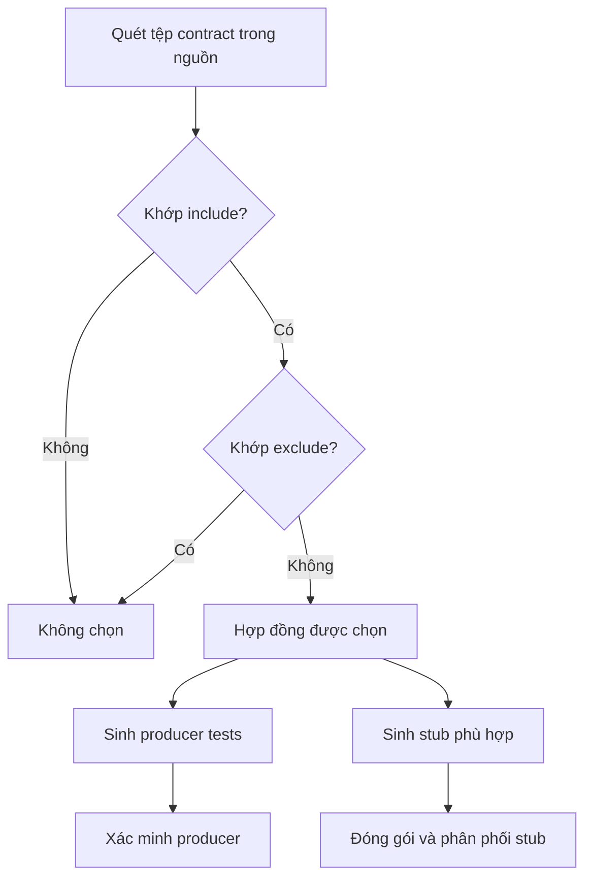
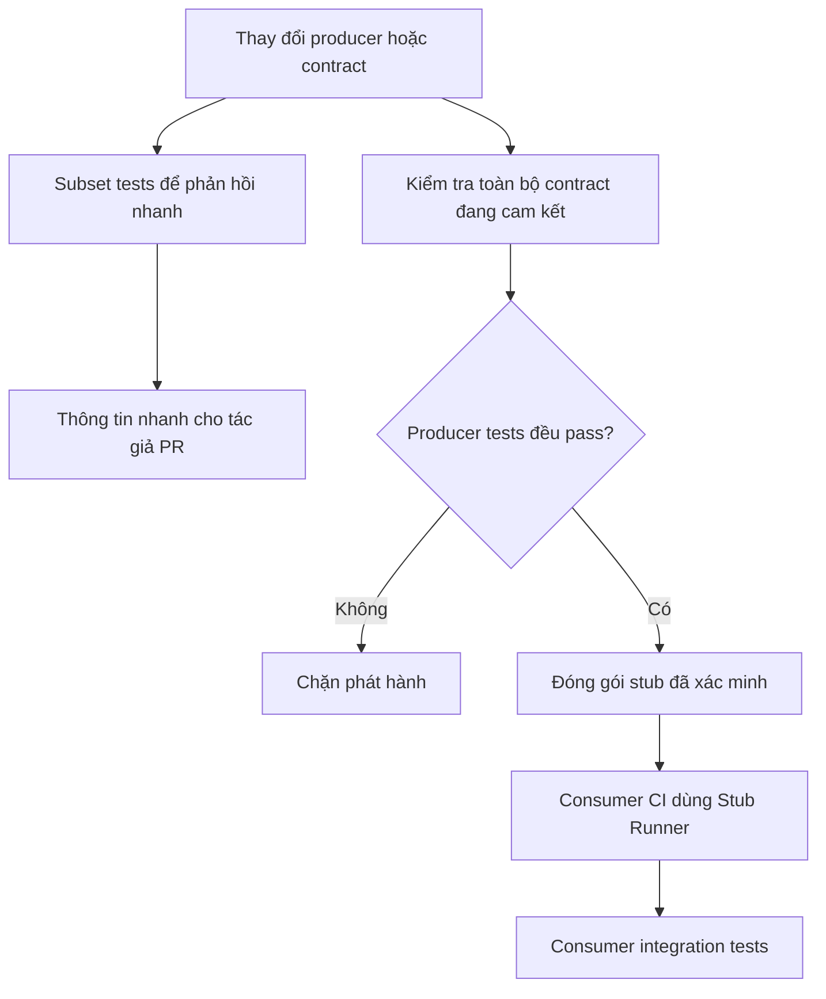

# Chọn hợp đồng bằng bộ lọc bao gồm và loại trừ

## 1. Tại sao cần chọn lọc hợp đồng?

Trong **Spring Cloud Contract**, hợp đồng (*contract*) mô tả hành vi được thống nhất giữa **producer** và **consumer**: request, response và quy tắc so khớp HTTP, hoặc dữ liệu và điều kiện của thông điệp. Các tệp Groovy/YAML DSL là nguồn để sinh **producer tests**, tạo **stub** cho **Stub Runner** và đưa kiểm tra tương thích API vào CI.

Một producer có thể phục vụ nhiều consumer và có rất nhiều hợp đồng. Ví dụ, hệ thống đặt hàng có kịch bản dành cho `checkout`, `backoffice`, mobile app, lỗi HTTP, API cũ và API đang thử nghiệm. Khi phát triển một nhóm API, người lập trình muốn chạy một phần hợp đồng để nhận phản hồi nhanh. Trước khi phát hành, hệ thống lại cần kiểm chứng **toàn bộ cam kết đang có hiệu lực**.

**Bộ lọc bao gồm** (*include*) chọn các tệp hợp đồng đủ điều kiện tham gia một lần xử lý; **bộ lọc loại trừ** (*exclude*) loại ra những tệp không thuộc phạm vi lần chạy đó. Chúng giúp kiểm soát tập input của bước **sinh test/stub**, nhưng không làm thay đổi hành vi thực tế của producer và không tự bảo đảm API tương thích.

Kết thúc bài học, bạn sẽ biết cách tổ chức thư mục theo phạm vi sử dụng, lập quy tắc include/exclude, kiểm tra chính xác các hợp đồng đã chọn và áp dụng bộ lọc có kiểm soát trong Maven/Gradle và CI.

## 2. Hiểu mô hình lọc trước khi cấu hình plugin

Giả sử:

- `D`: tập các tệp contract được công cụ phát hiện trong thư mục nguồn.
- `I`: tập các tệp khớp ít nhất một quy tắc include.
- `E`: tập các tệp khớp ít nhất một quy tắc exclude.
- `S`: tập các tệp cuối cùng được chọn.

Một chính sách lọc thông dụng được mô tả như sau:

```text
S = (D giao I) tru E
```

Trong chính sách này, nếu không cấu hình include thì `I = D`; nếu không có exclude thì `E` rỗng. Khi một tệp khớp cả include và exclude, **exclude thắng**. Đây là mô hình lựa chọn trong bài; phải xác nhận hành vi và giá trị mặc định của **phiên bản plugin cụ thể** đang dùng, vì cách diễn giải pattern/đường dẫn có thể khác nhau.



**Chú ý phân biệt các dạng pattern:**

| Dạng | Ví dụ ý tưởng | Ý nghĩa |
| --- | --- | --- |
| Glob đường dẫn | `checkout/**/*.groovy` | Tệp `.groovy` dưới `checkout` ở nhiều cấp |
| Regex | `checkout/.+\.groovy` | Chuỗi đường dẫn theo quy tắc biểu thức chính quy |
| Shell wildcard | `*.groovy` | Hành vi phụ thuộc shell và ngữ cảnh thực thi |

Không thể mặc định sao chép chuỗi giữa ba kiểu. Chẳng hạn `**` trong glob mang ý nghĩa khác với `**` trong regex; dấu `.` cũng khác. Đường dẫn trên Windows có `\`, trong khi nhiều matcher dùng `/`. Hãy xác định matcher của plugin so khớp **đường dẫn tương đối hay tuyệt đối**, có phân biệt chữ hoa–thường hay không và có chuẩn hóa dấu phân cách không.

## 3. Một cấu trúc thư mục để thực hành

Giả sử producer `order-service` chứa:

```text
src/test/resources/contracts/
├── checkout/
│   ├── orders/
│   │   ├── get-confirmed-order.groovy
│   │   ├── get-missing-order.groovy
│   │   └── experimental-discount.groovy
│   └── payments/
│       └── get-payment.yml
├── backoffice/
│   ├── orders/
│   │   └── search-orders.groovy
│   └── reports/
│       └── export-report.yml
└── shared/
    └── health/
        └── service-status.groovy
```

Đây là **cách tổ chức minh họa**, không phải cấu trúc mà Spring Cloud Contract bắt buộc. Các nhóm nên chọn một chiều phân loại dễ hiểu: theo consumer, bounded context, phiên bản API hoặc tính ổn định. Quy tắc đặt tên rõ ràng giúp người review nhận thấy khi một contract bị đưa sai vào nhóm.

Mục tiêu của lần chạy nhanh: chọn mọi hợp đồng dưới `checkout`, trừ file có tiền tố `experimental-`.

```yaml
# ĐẶC TẢ MINH HỌA THEO GLOB, CHƯA PHẢI CÚ PHÁP PLUGIN.
sourceRoot: src/test/resources/contracts
include:
  - "checkout/**/*"
exclude:
  - "checkout/**/experimental-*"
```

Áp dụng chính sách ở mục 2, kết quả cần là:

| Tệp tương đối với sourceRoot | Khớp include? | Khớp exclude? | Được chọn? |
| --- | :---: | :---: | :---: |
| `checkout/orders/get-confirmed-order.groovy` | Có | Không | **Có** |
| `checkout/orders/get-missing-order.groovy` | Có | Không | **Có** |
| `checkout/orders/experimental-discount.groovy` | Có | Có | **Không** |
| `checkout/payments/get-payment.yml` | Có | Không | **Có** |
| `backoffice/orders/search-orders.groovy` | Không | Không | **Không** |
| `backoffice/reports/export-report.yml` | Không | Không | **Không** |
| `shared/health/service-status.groovy` | Không | Không | **Không** |

Đường dẫn và kết quả trong bảng là **giá trị kỳ vọng để kiểm chứng**. Nếu plugin thực tế nhận regex hoặc đặt pattern trên đường dẫn khác, cần chuyển các quy tắc tương ứng trước khi chạy.

### Phân biệt thư mục nguồn với bộ lọc

Thư mục nguồn là nơi plugin **tìm** hợp đồng, còn include/exclude quyết định hợp đồng nào **tham gia sinh đầu ra**. Nếu contract nằm ngoài thư mục mà plugin quét, một include rất rộng cũng không lấy được nó. Nếu contract nằm đúng nơi nhưng bị exclude, việc có file vật lý cũng không bảo đảm sẽ có generated test tương ứng.

## 4. Chọn theo consumer, theo phiên bản hay theo độ ổn định?

### Theo consumer

Producer có các thư mục `checkout/`, `backoffice/` và `mobile/`. Một pipeline nhanh của checkout có thể chọn riêng `checkout/`. Nhưng nếu producer vẫn cam kết hỗ trợ backoffice và mobile, **pipeline release không được chỉ chạy checkout**: nó phải bảo vệ mọi contract còn hiệu lực.

Một số cơ chế của Spring Cloud Contract còn cho phép tổ chức hoặc phục vụ stub theo consumer. Chúng liên quan đến **cách tiêu thụ/phân phối stub**; không nên tự coi đó là cùng một tính năng với lọc tệp đầu vào khi sinh producer tests.

### Theo phiên bản API

Nếu `v1/orders/` và `v2/orders/` cùng tồn tại, chọn `v2` phù hợp cho thử nghiệm một luồng mới. Tuy nhiên, consumer cũ có thể còn dựa vào `v1`. Lọc bỏ `v1` khỏi mọi pipeline chỉ vì đã viết `v2` sẽ xóa mất tín hiệu kiểm thử tương thích.

### Theo mức độ sẵn sàng

Có thể tách `experimental/` ra khỏi các contract đã cam kết. Khi loại khỏi build release cần ghi rõ lý do và điều kiện đưa vào phạm vi chính thức. **Không dùng exclude để che một producer test đang thất bại** vì implementation phá vỡ hợp đồng đã được consumer sử dụng.

## 5. Đưa include/exclude vào Maven hoặc Gradle

Spring Cloud Contract tích hợp vào producer thông qua plugin build. Nhiều phiên bản có cơ chế chọn tệp với các thuộc tính thường được nhắc đến là `includedFiles` và `excludedFiles`. **Tên thuộc tính, kiểu dữ liệu, cú pháp matcher và cách khai báo trong Maven/Gradle cần được đối chiếu với tài liệu đúng phiên bản plugin của dự án**; tuyệt đối không coi YAML minh họa ở trên là cấu hình chạy được.

Một cách chuẩn bị cấu hình là ghi lại yêu cầu độc lập với cú pháp:

```text
contractsRoot = src/test/resources/contracts
include      = các contract checkout
exclude      = các contract checkout có tên experimental-*
expected     = 3 hợp đồng, gồm cả thành công, 404 và thanh toán
```

**Quy trình với Maven:**

1. Xác định plugin `spring-cloud-contract-maven-plugin` của producer và vị trí contract DSL mà plugin thực tế sử dụng.
2. Chuyển tiêu chí include/exclude sang cấu hình mà plugin/version hỗ trợ; làm rõ pattern là regex, Ant glob hay kiểu khác.
3. Chạy lifecycle phù hợp, ví dụ `./mvnw clean verify`, rồi đọc **generated test sources** và báo cáo số lượng test; khi đóng gói stub thì kiểm tra nội dung artifact.

**Quy trình với Gradle:**

1. Xác định plugin `org.springframework.cloud.contract`, source root và cấu hình chọn tệp theo `build.gradle` hoặc `build.gradle.kts`.
2. Liệt kê task bằng `./gradlew tasks --all`, xác minh task sinh contract test và stub có được nối vào `check`/`build` hay không.
3. Chạy các task cần thiết, xem mã test được sinh, report và stubs artifact. Một build xanh với **0 contract tests** không chứng minh filter đúng.

Không bắt buộc producer dùng Maven thì consumer cũng phải dùng Maven. Consumer dùng Gradle vẫn có thể lấy `stubs.jar` do Maven producer phát hành, miễn là artifact và version tương thích.

Nếu phiên bản plugin không hỗ trợ kiểu lọc mong muốn, có thể tổ chức tập contract thành các module hoặc build riêng có cấu hình rõ ràng. Tránh xóa, di chuyển tệp hoặc sửa hợp đồng chỉ để ép chúng vượt qua một bộ lọc.

## 6. Đối chiếu ba kết quả sau khi lọc

Một bộ lọc chỉ thật sự đáng tin khi biết **đã chọn những gì**, **đã sinh test cho những gì**, và **đã đóng gói stub nào**.

| Lớp kiểm tra | Câu hỏi cần trả lời | Bằng chứng |
| --- | --- | --- |
| Tệp nguồn | Những contract nào thuộc tập chọn? | Danh sách đường dẫn nguồn sau khi tính include/exclude |
| Producer tests | Những kịch bản nào được kiểm chứng với producer? | Generated sources, log, báo cáo test đã chạy |
| Stub artifact | Consumer có thể giả lập những request nào? | Mapping/response trong stubs JAR |

Đối với artifact HTTP đã được đóng gói, có thể xem danh sách các mục bằng JDK:

```bash
jar tf order-service-1.2.0-stubs.jar
```

Tên file có thể khác tùy version, classifier và build plugin. Kiểm tra mapping, response và kịch bản tương ứng, không dựa hoàn toàn vào tên file. **Số tệp DSL không nhất thiết bằng số method test hoặc số mapping** vì một DSL có thể biểu diễn nhiều hợp đồng hoặc công cụ sinh cấu trúc output khác nhau.

Với ví dụ ở mục 3, phải tìm được bằng chứng cho cả `get-confirmed-order`, `get-missing-order` và `get-payment` trong các đầu ra phù hợp. Không nên có `experimental-discount`, `search-orders` và `export-report` trong tập nhanh của checkout. Đặc biệt, `404` là hành vi quan trọng nếu consumer xử lý trạng thái “không tìm thấy”: đừng loại tình huống lỗi chỉ vì tên không phải `success`.

### Tín hiệu lỗi quan trọng

Nếu sau khi thay include, log cho thấy không có contract nào được chọn và test runner chạy 0 test, build vẫn có thể thành công tùy cách cấu hình. Đây là **lỗi phạm vi kiểm thử**, không phải bằng chứng producer tuân thủ mọi hợp đồng. CI nên có cách kiểm tra tập hợp không rỗng và các contract bắt buộc có mặt.

## 7. Đừng nhầm lọc contract với chọn stub ở Stub Runner

Có hai thời điểm lựa chọn:

- **Trong producer build:** include/exclude quyết định tệp hợp đồng nào tham gia sinh tests và stubs, tùy cấu hình plugin.
- **Trong consumer test:** Stub Runner lấy artifact chứa stub đã sinh theo tọa độ được chỉ định, chẳng hạn `group:artifact:version:classifier:port`.

Ví dụ cấu hình Stub Runner ở consumer:

```java
import org.springframework.cloud.contract.stubrunner.StubRunnerProperties;
import org.springframework.cloud.contract.stubrunner.spring.AutoConfigureStubRunner;

@AutoConfigureStubRunner(
    ids = "com.example:order-service:1.2.0:stubs:9090",
    stubsMode = StubRunnerProperties.StubsMode.LOCAL
)
class CheckoutContractTest {
    // Client gửi request đến stub ở cổng 9090; thêm test và assertion.
}
```

Đây là minh họa riêng phần cấu hình, chưa phải test hoàn chỉnh. `LOCAL` yêu cầu artifact đã được cài vào Maven local; CI dùng kho từ xa cần cấu hình chế độ và repository thích hợp. `ids` chọn **artifact và cổng**, không phải filter đối với `.groovy` hay `.yml`. Nếu contract đã bị loại khỏi stubs JAR, Stub Runner không thể tự tái tạo response của contract đó chỉ nhờ một lệnh gọi mới.

Với hợp đồng messaging, đầu ra có thể liên quan tới cấu hình message/trigger khác WireMock HTTP. Nguyên tắc chọn nguồn vẫn cần được xác minh, nhưng không thể chỉ tìm HTTP mapping trong JAR rồi kết luận mọi messaging contract đều đã được xử lý.

## 8. Thiết kế bộ lọc an toàn cho CI



| Công đoạn | Phạm vi chọn | Kỳ vọng |
| --- | --- | --- |
| Local development | Chỉ nhóm API đang làm, loại tình huống thử nghiệm có lý do | Phản hồi nhanh; ghi rõ chưa kiểm tra toàn bộ |
| Pull request | Subset liên quan, cộng các kiểm tra bắt buộc theo quy định | Bắt thay đổi trực tiếp; không làm mất bước release check |
| Release producer | Tất cả contract còn cam kết với những consumer đang được hỗ trợ | Chặn release nếu thiếu hoặc vi phạm hợp đồng |
| Consumer CI | Stubs artifact đã phát hành, version cụ thể | Kiểm tra consumer đọc và xử lý API như cam kết |

Nên lưu trong log CI: source root, quy tắc include/exclude, tên các tệp đã chọn, phiên bản plugin, số generated tests đã **chạy** và tọa độ stubs JAR. Chỉ đếm số test không đủ; khi di chuyển contract giữa các folder, các test bị chọn sai có thể có số lượng vẫn giống trước.

Một lỗi nguy hiểm là thay `checkout/**` thành `checkouts/**` khiến không tệp nào khớp. Nếu pipeline không kiểm tra “selection rỗng”, job có thể xanh dù không kiểm chứng được gì. Nên fail khi thiếu hợp đồng bắt buộc, hoặc ít nhất chặn việc dùng kết quả của job subset như một cổng phát hành.

## 9. Các lỗi thường gặp

| Triệu chứng | Nguyên nhân khả dĩ | Hướng kiểm tra |
| --- | --- | --- |
| Không có generated tests | Include sai, source root sai hoặc plugin không nhận extension | Log quét DSL, danh sách tệp, version plugin |
| Chọn thêm contract không mong muốn | Pattern quá rộng hoặc thư mục phân loại không rõ | Đối chiếu ma trận expected/actual |
| Exclude không hoạt động | Đã dùng glob trong chỗ nhận regex, sai đường dẫn hoặc tên file | Xem ngữ nghĩa pattern của đúng plugin version |
| Tệp khớp include và exclude vẫn còn | Cấu hình chưa được plugin nhận hoặc hiểu nhầm thứ tự | Đọc cấu hình thực được áp dụng và generated output |
| Local pass, CI khác | Khác chữ hoa–thường, dấu `/`/`\`, JDK hoặc profile build | So log danh sách contract được chọn |
| Consumer nhận `404` từ stub | Request không khớp mapping hoặc stub được chọn không có trong artifact | Kiểm tra request, mapping, artifact và cổng |
| Producer test xanh nhưng consumer thiếu stub | Chỉ build subset, lỗi packaging hoặc lấy sai artifact version | So ba lớp nguồn → test → stub |
| Đổi tên folder làm biến mất contract | Include phụ thuộc đường dẫn cũ | Review filter và thay đổi folder trong cùng PR |

Lọc giúp giới hạn phạm vi, nhưng không khắc phục lỗi API. Nếu producer đổi trường `status` thành `state` và contract cũ thất bại, việc exclude contract đó chỉ để CI xanh sẽ che mất khả năng phát hiện breaking change. Phải sửa implementation hoặc thống nhất migration với consumer.

## 10. Bài tập áp dụng

Nguồn hợp đồng:

```text
checkout/orders/get-order.groovy
checkout/orders/get-order-404.groovy
checkout/orders/experimental-bulk.groovy
checkout/payments/get-payment.yml
admin/orders/get-order-audit.groovy
shared/health/health-check.groovy
```

**Yêu cầu:** Bộ kiểm tra nhanh chỉ bao gồm checkout đã ổn định. Nhánh lỗi `404` là hành vi consumer cần. Bộ kiểm tra release phải xác minh mọi contract đang được cam kết của cả checkout, admin và shared.

Hãy giải quyết các bước:

1. Viết include/exclude theo glob minh họa và liệt kê chính xác ba contract cần chọn trong chế độ checkout nhanh.
2. Chuyển pattern sang cú pháp đúng với Maven hoặc Gradle plugin mà dự án dùng; kiểm tra giả định về đường dẫn và kiểu matcher.
3. Chạy sinh producer tests và stubs; so tên contract được chọn với generated sources, report và nội dung stubs JAR.
4. Dùng Stub Runner chạy consumer test với phiên bản artifact cụ thể.
5. Đổi tên `checkout` thành `checkouts` nhưng chưa sửa include: dự đoán biểu hiện; bổ sung kiểm tra giúp CI phát hiện tập hợp rỗng.
6. Giải thích vì sao job release không được dùng nguyên bộ filter checkout nhanh làm điều kiện duy nhất.

### Gợi ý đáp án

```yaml
# Ý định theo glob; không dán thẳng vào Maven/Gradle khi chưa xác minh cú pháp.
include:
  - "checkout/**/*"
exclude:
  - "checkout/**/experimental-*"
```

Ba contract cần chọn là `checkout/orders/get-order.groovy`, `checkout/orders/get-order-404.groovy` và `checkout/payments/get-payment.yml`. Hợp đồng `experimental-bulk` bị loại; `admin` và `shared` nằm ngoài phạm vi lần chạy nhanh. Trong release, cần dùng một tập rộng hơn để bảo vệ tất cả consumer vẫn được hỗ trợ. Khi đổi tên folder, job phải cảnh báo hoặc thất bại nếu tập tệp bắt buộc không được chọn nữa.

## 11. Checklist trước khi áp dụng

- [ ] Đã xác định nguồn DSL và thư mục gốc mà plugin quét.
- [ ] Hiểu rõ cú pháp pattern (regex/glob), chuẩn hóa đường dẫn và sự phân biệt chữ hoa–thường.
- [ ] Có bảng những contract **cần có** và **không được có** trong từng job.
- [ ] Include và exclude cho ra tập hợp đúng, kể cả khi một file khớp cả hai.
- [ ] Generated producer tests có mặt **và được chạy**, bao gồm các trường hợp lỗi cần thiết.
- [ ] Artifact stub chứa những response consumer cần; Stub Runner lấy đúng version.
- [ ] CI có kiểm soát tập được chọn rỗng và các hợp đồng bắt buộc bị bỏ sót.
- [ ] Job release vẫn xác minh mọi cam kết có hiệu lực; thay đổi folder/pattern được review cùng nhau.

**Ghi nhớ:** Bộ lọc bao gồm và loại trừ chỉ quản lý **phạm vi xử lý contract**. Chúng hữu ích cho phát triển cục bộ và chia nhóm kiểm thử, nhưng có thể tạo vùng mù nếu lọc nhầm. Trong Spring Cloud Contract, luôn xác minh tập nguồn đã chọn, producer tests được sinh/chạy và stub thực tế được phân phối cho consumer trước khi kết luận pipeline có khả năng bảo vệ tương thích API.
