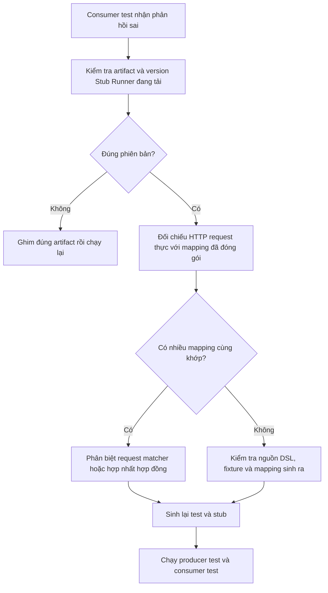

# Tránh trùng tên kiểm thử, nhãn và đường dẫn stub

Một dự án Spring Cloud Contract ban đầu có thể chỉ có vài hợp đồng Groovy hoặc YAML. Khi nhiều nhóm consumer cùng đóng góp, số hợp đồng tăng lên, các tình huống `200`, `400`, `404`, message event và các phiên bản API bắt đầu chồng chéo. Nếu đặt tên thiếu quy tắc, một thay đổi tưởng như nhỏ có thể dẫn tới **kiểm thử sinh ra bị trùng tên**, **nhãn message không xác định được hợp đồng cần kích hoạt**, hoặc **hai stub cùng nhận một HTTP request nhưng trả phản hồi khác nhau**.

Bài học này thuộc phần **Tổ chức hợp đồng** của **SPRING_CLOUD_CONTRACT**. Mục tiêu là thiết kế cách đặt tên, chia thư mục và kiểm tra xung đột để nhóm producer có thể sinh test từ Groovy/YAML DSL, phát hành stub và cho consumer dùng Stub Runner một cách dự đoán được. Quy tắc áp dụng cả khi các hợp đồng được quản lý trong repository producer lẫn khi chúng được đóng góp từ nhiều consumer.

## 1. Có những loại trùng lặp nào?

Trong Spring Cloud Contract, một **hợp đồng** có nhiều danh tính khác nhau. Chúng không có cùng vai trò và không thể thay thế lẫn nhau:

| Khái niệm | Ví dụ | Dùng để làm gì? | Rủi ro nếu trùng hoặc mơ hồ |
|---|---|---|---|
| Đường dẫn **file nguồn hợp đồng** | `contracts/checkout/get_order_found.groovy` | Quản lý DSL trong Git và làm đầu vào cho plugin | File ghi đè, khó review, thay đổi nhầm kịch bản |
| `name` trong DSL | `checkout_get_order_found_200` | Đặt tên có nghĩa cho hợp đồng; có thể ảnh hưởng tên test sinh ra tùy plugin/phiên bản | Tên test hoặc ký hiệu được sinh bị xung đột, khó truy vết lỗi |
| `description` trong DSL | `Checkout lấy đơn hàng tồn tại` | Giúp người đọc hiểu tình huống | Mô tả trùng không nhất thiết gây lỗi kỹ thuật nhưng làm báo cáo khó đọc |
| `label` trong hợp đồng message | `checkout_order_created_v1` | Nhận diện kịch bản message để kích hoạt qua cơ chế stub trigger | Kích hoạt nhầm/không rõ kịch bản khi nhiều label trùng trong phạm vi sử dụng |
| **Điều kiện khớp HTTP stub** | `GET /api/orders/42`, header, query, body | Chọn phản hồi stub phù hợp với request từ consumer | Hai mapping đều khớp cùng request nhưng trả kết quả khác nhau |
| **Đường dẫn mapping trong artifact** | `META-INF/.../mappings/...json` | Lưu stub đã được tạo để Stub Runner tải | Ghi đè hoặc khó truy xuất mapping khi các tên/đường dẫn sinh ra xung đột |
| **Tọa độ artifact stub** | `com.example:order-service:1.2.0:stubs` | Xác định gói stub mà consumer cần lấy | Consumer dùng sai bản, nhầm producer, hoặc stub cũ |

Hai file có tên khác nhau **không chứng minh** các stub bên trong khác nhau. Ngược lại, hai hợp đồng cùng nhắc tới endpoint `/api/orders/{id}` chưa chắc mâu thuẫn nếu chúng có điều kiện request phân biệt rõ nhau, chẳng hạn ID tồn tại và ID không tồn tại.

Vì vậy phải kiểm tra đồng thời **tên**, **nhãn** và **phạm vi request thực sự được stub khớp**.

## 2. Quy tắc đặt tên dễ mở rộng cho nhóm

Một quy ước hữu ích nên trả lời được bốn câu hỏi ngay khi nhìn vào tên: **consumer nào cần hành vi này, thao tác gì, kịch bản nào và kết quả dự kiến ra sao**.

Ví dụ với producer `order-service`, có hai consumer `checkout` và `support`:

```text
src/test/resources/contracts/
├── checkout/
│   ├── get_order_found_200.groovy
│   ├── get_order_missing_404.groovy
│   └── create_order_invalid_400.yml
└── support/
    ├── get_order_history_found_200.groovy
    └── get_order_history_missing_404.yml
```

Đây là **cách tổ chức đề xuất**, không phải cấu trúc duy nhất mà Spring Cloud Contract yêu cầu. Thư mục nguồn mặc định và cách plugin suy ra package/class test có thể thay đổi theo phiên bản và cấu hình; hãy xác nhận chúng trong build của dự án.

Có thể dùng dạng tên:

```text
<consumer>_<operation>_<scenario>_<expectedResult>
```

Chẳng hạn:

- `checkout_get_order_found_200`
- `checkout_get_order_missing_404`
- `support_get_order_history_found_200`
- `billing_order_created_event_v1`

Quy tắc thực tế:

1. Dùng **từ ngữ mô tả hành vi** (`found`, `missing`, `invalid`, `unauthorized`) thay cho `test1`, `test_new` hoặc `final2`.
2. Chọn cách viết ổn định, chẳng hạn chữ thường và dấu gạch dưới cho file/định danh; không để khác nhau chỉ ở chữ hoa, dấu cách hoặc dấu nối.
3. Đặt tên có tính **duy nhất trong phạm vi producer build**. Khi `name` có khả năng được dùng để tạo tên phương thức/lớp kiểm thử, không phụ thuộc vào việc hai file đang nằm ở hai thư mục khác nhau.
4. Không thêm phiên bản bừa bãi vào mọi tên. Chỉ ghi `_v1`, `_v2` khi nhiều hành vi/phiên bản thực sự cùng tồn tại; quản lý bản phát hành còn phải qua version artifact.
5. Tên là định danh kỹ thuật; `description` mô tả nghiệp vụ cho người đọc. Đừng sử dụng `description` làm cơ chế bảo đảm duy nhất.

### 2.1. Phân biệt `name` với tên file và `description`

Ví dụ hợp đồng Groovy cho consumer Checkout:

```groovy
import org.springframework.cloud.contract.spec.Contract

Contract.make {
    name 'checkout_get_order_found_200'
    description 'Checkout lấy đơn hàng đã tồn tại để hiển thị trạng thái'

    request {
        method GET()
        url '/api/orders/42'
        headers {
            header 'Accept', 'application/json'
        }
    }

    response {
        status OK()
        headers {
            contentType(applicationJson())
        }
        body(
            id: 42,
            status: 'CREATED'
        )
    }
}
```

File có thể được đặt là `checkout/get_order_found_200.groovy`. Trong bài này, `name` chủ động mang định danh riêng, còn `description` giải thích mục đích. Plugin Spring Cloud Contract dùng thông tin hợp đồng để sinh kiểm thử và mapping; **cách chính xác chuyển tên file, `name` và thư mục thành tên class/method/file phụ thuộc bản plugin**, nên phải xem output thực tế thay vì suy đoán quy tắc chuyển đổi.

Hợp đồng YAML cho tình huống khác có thể dùng cùng chính sách tên:

```yaml
name: checkout_get_order_missing_404
description: Checkout nhận lỗi khi mã đơn hàng không tồn tại
request:
  method: GET
  url: /api/orders/999
  headers:
    Accept: application/json
response:
  status: 404
  headers:
    Content-Type: application/json
  body:
    code: ORDER_NOT_FOUND
```

Hai hợp đồng minh họa dùng ID `42` và `999` có chủ đích để **không cùng khớp một request**. Giá trị thật trong dự án phải đi cùng dữ liệu kiểm thử producer ổn định; `999` chỉ được chọn làm ID không tồn tại nếu môi trường test bảo đảm điều đó.

### 2.2. Tránh tên khác chữ nhưng trùng sau khi chuẩn hóa

Một số pipeline biến dấu gạch nối, dấu cách hoặc ký tự không hợp lệ thành dấu gạch dưới khi sinh tên Java. Vì vậy nhóm nên tránh các cặp như:

```text
checkout-get-order-found
checkout_get_order_found

GetOrderFound
getorderfound
```

Không thể khẳng định mọi bản generator sẽ xử lý hai tên giống nhau. Nhưng chúng **quá dễ gây nhầm lẫn hoặc xung đột** khi qua các bước chuẩn hóa và khi làm việc giữa Windows, macOS và Linux. Quy ước một kiểu chữ duy nhất giúp tránh phụ thuộc vào chi tiết của plugin và hệ thống file.

## 3. Tránh trùng tên kiểm thử được sinh từ hợp đồng

Trong mô hình producer verification, Spring Cloud Contract lấy DSL, sinh mã kiểm thử Java và chạy những bài test ấy với implementation. Khi tăng số lượng hợp đồng, các tên không rõ ràng làm khó cả **giai đoạn sinh mã** lẫn **phân tích báo cáo CI**.

Ví dụ hai file:

```text
checkout/get_order_found.groovy
support/get_order_found.groovy
```

Nếu cả hai đều gán `name 'shouldReturnOrder'`, nhóm có thể không phân biệt được chúng trên báo cáo và có nguy cơ xung đột tên sau khi sinh mã, tùy cách plugin tạo test class và method. Đừng dựa vào việc folder khác nhau để coi tên là duy nhất; hãy đặt:

```text
checkout_get_order_found_200
support_get_order_found_200
```

Các bước kiểm tra đúng ở cấp producer:

1. Kiểm tra tên file và `name` trước khi merge hợp đồng.
2. Chạy tác vụ sinh contract test của build hiện tại để xác định class/method thực tế.
3. Xem các test đã sinh có **đủ số lượng, không bị ghi đè và dễ gắn với file DSL nguồn** hay không.
4. Chạy các producer contract tests; việc generate thành công chưa chứng minh các endpoint đáp ứng hợp đồng.
5. Khi CI báo lỗi, lần ngược từ class/method hoặc tên contract tới **đúng consumer, kịch bản và file nguồn**.

Ví dụ lệnh cho **dự án đã cấu hình plugin đúng**, thực hiện trong repository producer:

```bash
# Maven Wrapper
./mvnw clean test

# Hoặc Gradle Wrapper
./gradlew clean test
```

Không chạy hai công cụ nếu dự án chỉ dùng một loại build. Việc generated tests được đưa vào pha `test` phụ thuộc cách plugin được cấu hình. Cần kiểm tra thư mục output của plugin và báo cáo test theo đúng phiên bản đang sử dụng.

**Dấu hiệu cần điều tra:** số test sinh ra nhỏ hơn số kịch bản mong đợi, hai contract xuất hiện cùng tên trên báo cáo, trình biên dịch báo trùng class/method, hoặc một file mapping/test đã sinh biến mất sau khi thêm hợp đồng mới.

## 4. Nhãn `label`: chỉ dùng khi thật sự cần kích hoạt message

Trong Spring Cloud Contract, `label` thường được dùng ở **hợp đồng trao đổi thông điệp** để Stub Runner có thể **kích hoạt** một sự kiện/thông điệp được định nghĩa trong contract. Nó khác với `description` và không nên được dùng như nhãn trang trí cho mọi HTTP contract.

Ví dụ producer phát sự kiện đơn hàng được tạo:

```groovy
import org.springframework.cloud.contract.spec.Contract

Contract.make {
    name 'billing_order_created_event_v1'
    label 'billing_order_created_v1'
    description 'Billing nhận thông điệp khi đơn hàng mới được tạo'

    input {
        triggeredBy('publishOrderCreated()')
    }

    outputMessage {
        sentTo('orders.events')
        body(
            orderId: 'ORDER-42',
            type: 'ORDER_CREATED'
        )
    }
}
```

Trong producer verification, phương thức `publishOrderCreated()` là **hook thử nghiệm do dự án cung cấp**, chẳng hạn trong base test class; nó không phải API mặc định của Spring Cloud Contract. Ở phía consumer, Stub Runner hoặc cơ chế stub triggering có thể dùng **label** để yêu cầu phát thông điệp stub tương ứng, tùy cấu hình binder/message verifier và phiên bản thư viện.

Ví dụ hai label sau là lựa chọn **không tốt** khi cùng nhóm stub có thể được nạp chung:

```text
billing/order_created.groovy       -> label: order_created
analytics/order_created.groovy     -> label: order_created
```

Trong khi đó:

```text
billing/order_created.groovy       -> label: billing_order_created_v1
analytics/order_created.groovy     -> label: analytics_order_created_v1
```

giúp phân biệt mục đích khi kích hoạt. Độ duy nhất bắt buộc về kỹ thuật có thể phụ thuộc **phạm vi artifact, Stub Runner và cách gọi trigger**; chính sách nhóm nên bảo đảm nhãn không trùng **trong các stub có thể được tải và kích hoạt cùng lúc**, đồng thời đặt rõ prefix theo consumer hoặc loại sự kiện.

Đừng nhầm `label` với **tên topic/queue**: hai hợp đồng có thể cùng gửi tới topic `orders.events` nhưng mang hai kiểu sự kiện khác nhau. Topic/queue là **đích truyền thông điệp**, còn `label` là **định danh tình huống cần kích hoạt**. Nếu hai hợp đồng cùng `label` mà output khác nhau, consumer test có thể không kiểm soát được chính xác thông điệp mình mong đợi.

### 4.1. Quy tắc đặt label

- Chỉ khai báo khi kịch bản message cần label để được kích hoạt hoặc tham chiếu.
- Dùng tên ổn định, có ngữ nghĩa như `<consumer>_<event>_<version>` thay cho `event1` hoặc `trigger`.
- Xem mọi consumer và artifact có thể được Stub Runner tải trong **một phiên kiểm thử**, không chỉ nhìn một thư mục.
- Khi đổi label, cập nhật đồng bộ các consumer test gọi label cũ; đây có thể là thay đổi làm hỏng kiểm thử dù cấu trúc message không đổi.
- Không dùng label để phân biệt hai message có cùng nội dung nhưng hệ thống chưa định nghĩa rõ điều kiện hoặc loại sự kiện; cần làm rõ contract trước.

## 5. Trùng URL và điều kiện khớp HTTP: lỗi nguy hiểm hơn trùng tên

Trong HTTP stub, điều quyết định Stub Runner trả gì không phải tên file, mà là **mapping request** được sinh từ contract: method, URL/path, header, query parameter, body và các matcher liên quan.

Giả sử có hai hợp đồng:

| Contract | Request mà stub khớp | Response |
|---|---|---|
| `checkout_get_order_found_200` | `GET /api/orders/42` | `200`, `status=CREATED` |
| `support_get_order_cancelled_200` | `GET /api/orders/42` | `200`, `status=CANCELLED` |

Nếu cả hai dùng cùng điều kiện request nhưng trả hai phản hồi không tương thích, một HTTP request không cho stub đủ thông tin để biết producer đang ở tình huống nào. Đổi tên file thành thật dài **không giải quyết** xung đột này.

WireMock và các stub server có quy tắc chọn mapping/độ ưu tiên riêng. Thứ tự chọn có thể bị ảnh hưởng bởi độ ưu tiên, thứ tự nạp hoặc cấu hình phiên bản; không nên dựa vào các hành vi ngầm này để che việc hai contract mô tả phản hồi khác nhau cho cùng một điều kiện.

Có ba hướng xử lý rõ ràng:

1. **Dùng request khác nhau** nếu nghiệp vụ cho phép, chẳng hạn `GET /api/orders/42` và `GET /api/orders/999` cho trường hợp tìm thấy/không tìm thấy.
2. **Bổ sung điều kiện request có ý nghĩa** khi API thực sự phân biệt theo query, header hoặc body. Ví dụ `GET /api/orders/42?view=summary` và `GET /api/orders/42?view=history` nếu producer **thực sự có** quy tắc đó.
3. **Hợp nhất hoặc viết lại contract** nếu hai file đang kiểm tra chính xác cùng một hành vi. Không tạo thêm biến thể response ngẫu nhiên chỉ để làm stub chọn được mapping.

Đừng thêm header giả như `X-Test-Scenario: cancelled` chỉ để phân biệt stub nếu producer thật không có hoặc không cam kết header này. Contract test sẽ kiểm tra một giao tiếp giả khác với API mà consumer chạy trong sản xuất.

### 5.1. Phân biệt đường dẫn URL và điều kiện khớp

Một số request nhìn khác chữ nhưng có thể cùng được mapping chung chấp nhận:

```text
GET /api/orders/42
GET /api/orders/999
GET /api/orders/{id}       (mô tả route)
GET /api/orders/.*         (nếu DSL sử dụng regex phù hợp)
```

Dòng `{id}` là **cách ký hiệu route trong tài liệu**, chưa chắc là cú pháp matcher hợp lệ khi đặt trực tiếp vào DSL. Với contract DSL, phải khai báo URL chính xác hoặc matcher/regex theo API của phiên bản Spring Cloud Contract đang dùng. Một matcher bao quát mọi ID có thể vô tình nhận request `999` trước mapping `404` dự kiến.

Ví dụ rủi ro:

```text
Mapping A: GET /api/orders/[0-9]+ -> 200
Mapping B: GET /api/orders/999    -> 404
```

Vì `999` cũng thuộc tập `[0-9]+`, hai mapping **chồng lấn**. Khi thiết kế stub, tốt nhất tạo các matcher **loại trừ nhau** hoặc thay đổi bộ dữ liệu test cho rõ ràng. Chỉ cân nhắc độ ưu tiên mapping khi thật sự cần một fallback có chủ đích và công cụ hỗ trợ cấu hình ưu tiên rõ ràng; vẫn phải chạy test chứng minh quy tắc đó.

### 5.2. Header, query và body cũng tạo ra xung đột

Không phải chỉ hai URL giống nhau mới có nguy cơ trùng. Ví dụ hai POST contract có cùng endpoint nhưng mỗi contract kỳ vọng body khác:

```json
{"operation":"CONFIRM","orderId":"42"}
```

và:

```json
{"operation":"CANCEL","orderId":"42"}
```

Nếu cả hai chỉ kiểm tra `POST /api/orders/actions` mà không ràng buộc trường `operation`, stub có thể khớp nhầm. Hãy dùng **body matcher** cho thuộc tính quyết định hành vi. Tương tự, nếu endpoint thật phân biệt qua `Accept`, `Content-Type`, `If-Match` hay query parameter, khai báo điều kiện đó theo cam kết API.

Với dữ liệu động như ID được sinh tự động hoặc timestamp, dùng matcher phù hợp để tránh test quá chặt. Tuy nhiên, matcher phải đủ **hẹp** để giữ ý nghĩa nghiệp vụ; dùng regex `.*` cho mọi trường dễ khiến các kịch bản khác nhau trở nên không thể phân biệt.

## 6. Đường dẫn file stub và tọa độ artifact: tránh đụng nhau khi đóng gói

Trong Spring Cloud Contract, file `.groovy`/`.yml` là **nguồn**. Plugin build sử dụng chúng để tạo **generated tests** và **stub mappings**; sau đó dự án có thể đóng gói mappings thành artifact dùng cho Stub Runner. Đây là ba lớp đường dẫn khác nhau:

```text
Nguồn hợp đồng trong repository
  src/test/resources/contracts/checkout/get_order_found_200.groovy
                  |
                  v
Generated tests và WireMock mappings (thư mục build do plugin quyết định)
                  |
                  v
Artifact được đóng gói và publish
  com.example:order-service:1.2.0:stubs
                  |
                  v
Stub Runner tải artifact, nạp mappings, mở HTTP stub server
                  |
                  v
Consumer gọi GET /api/orders/42
```

Với mô hình artifact Maven thông dụng, stub JAR có thể chứa cấu trúc tương tự:

```text
META-INF/
└── com.example/
    └── order-service/
        └── 1.2.0/
            ├── contracts/
            │   └── ...
            └── mappings/
                └── ...json
```

Đường dẫn cụ thể, cách đặt tên file mapping và việc đóng gói thêm nguồn contract **phụ thuộc plugin và cấu hình thực tế**. Điều cần kiểm tra là artifact cuối cùng chứa **đủ mappings cần dùng**, không bị ghi đè, và Stub Runner nạp đúng bản dành cho producer tương ứng.

### 6.1. Trùng basename hoặc tên được sinh

Hai file nguồn nằm ở hai folder khác nhau có thể có cùng basename, ví dụ `checkout/get_success.groovy` và `support/get_success.groovy`. Tùy quy tắc sinh file, hai mapping có thể được đặt trong hai nhánh thư mục khác nhau hoặc được đổi tên để tránh ghi đè. **Không tự giả định cả hai trường hợp**. Hãy xem nội dung artifact đã đóng gói và đối chiếu với danh sách contract được mong đợi.

Nếu muốn bảo vệ tính rõ ràng xuyên suốt các giai đoạn, nên dùng basename đủ ngữ nghĩa ngay từ nguồn:

```text
checkout_get_order_found_200.groovy
support_get_order_history_found_200.groovy
```

Khi chuyển tên file hoặc di chuyển folder, phải xem tác động tới đường dẫn generated test, cấu hình mapping của base class và quy tắc load contract của build. Không xóa file cũ một cách tùy tiện nếu pipeline hoặc consumer vẫn dùng stub artifact thuộc phiên bản trước.

### 6.2. Trùng tọa độ artifact và nhầm phiên bản stub

Maven coordinates của stub artifact thường được nhận diện bằng **group ID, artifact ID, version và classifier `stubs`**. Ví dụ:

```text
com.example:order-service:1.2.0:stubs
com.example:payment-service:1.2.0:stubs
```

Hai producer khác nhau không nên publish artifact với cùng tọa độ mà lại chứa dữ liệu khác nhau. Ngoài ra, tránh publish nhiều nội dung không tương ứng lên **cùng một phiên bản đã phát hành**. Khi consumer dùng Stub Runner, cần cố định bản stub có thể truy vết tới commit/phiên bản producer mà nhóm đã kiểm chứng.

Ví dụ consumer dùng nhầm `order-service:1.1.0:stubs` trong khi producer kiểm thử hợp đồng và phát hành ở bản `1.2.0` có thể khiến consumer vẫn thấy hành vi cũ. Tên file của hợp đồng không giúp khắc phục việc chọn sai artifact version.

**Phân biệt:** URL `GET /api/orders/42` là **đường dẫn API mà stub phục vụ**, còn `META-INF/.../mappings/...json` là **đường dẫn tài nguyên mapping trong gói stub**. Trùng URL gây rủi ro chọn response; trùng tên/đường dẫn mapping có nguy cơ ghi đè tài nguyên; sai coordinates làm Stub Runner nạp nhầm bộ stub.

## 7. Khi nào hai hợp đồng được phép dùng cùng endpoint?

Không cần ép mỗi contract một endpoint khác nhau. Một API có thể có nhiều kịch bản hợp lệ cho cùng method và path nếu điều kiện đầu vào khác nhau.

| Kịch bản | Cùng method/path? | Có thể cùng tồn tại? | Điều kiện |
|---|---|---|---|
| `GET /api/orders/42` trả `200` và `GET /api/orders/999` trả `404` | Khác URL cụ thể | Có | Dữ liệu fixture của producer bảo đảm ID tồn tại/không tồn tại |
| `POST /api/orders/actions` với `operation=CONFIRM` hoặc `CANCEL` | Có | Có | Matcher body phân biệt được hai operation |
| `GET /api/orders/42` trả `200 CREATED` hoặc `200 CANCELLED` cho request giống hệt | Có | **Không rõ ràng** | Cần bổ sung trạng thái/điều kiện thực sự hoặc tách test setup phía producer; stub không tự biết trạng thái hệ thống |
| `GET /api/orders/42` từ hai consumer có cùng response | Có | Có thể, nhưng nên cân nhắc hợp nhất | Nếu cùng là một cam kết, tránh nhân đôi và duy trì hai bản lệch nhau |
| Matcher `GET /api/orders/.*` và matcher `GET /api/orders/999` | Chồng lấn | Có nguy cơ xung đột | Sửa phạm vi matcher, hoặc đặt fallback/ưu tiên được kiểm thử rõ ràng |

Với producer contract tests, hai kịch bản cùng request có thể được chạy trong các trạng thái fixture riêng nếu base test class chuẩn bị dữ liệu khác nhau. Nhưng **stub HTTP thường không duy trì cùng trạng thái producer**, trừ khi bạn cấu hình hành vi mô phỏng trạng thái thích hợp. Vì thế các kịch bản giống request nhưng khác response cần được thiết kế cẩn thận trước khi phát hành.

## 8. Thiết lập kiểm tra xung đột trong review và CI

Kiểm tra thủ công hữu ích ở dự án nhỏ; khi có nhiều consumer, nên đưa một số quy tắc vào pipeline trước khi producer phát hành stub.

### 8.1. Lớp kiểm tra tĩnh

Khi nhận pull request chứa contract mới:

1. Quét các file `.groovy`, `.yml`, `.yaml` được plugin dùng làm hợp đồng.
2. Kiểm tra đường dẫn file và tên sau khi chuẩn hóa theo quy ước của nhóm (bao gồm cả kiểm tra không phân biệt hoa/thường nếu repository có developer Windows/macOS).
3. Trích xuất `name` và, với message contract, `label`; cảnh báo nếu lặp trong phạm vi dự kiến cùng build hoặc cùng Stub Runner session.
4. Kiểm tra mỗi hợp đồng có `description`, request/matcher đủ rõ và response có ý nghĩa.
5. Đánh dấu các cặp HTTP contract có **cùng method và tập request có thể giao nhau**, rồi yêu cầu review. Đừng chỉ so sánh chuỗi URL; cần xét regex, query, header và body.

Ví dụ tìm nhanh các chỗ khai báo trong thư mục contract khi có `ripgrep`:

```bash
rg -n --glob '*.groovy' --glob '*.yaml' --glob '*.yml' \
  'name|label|method|url|urlPath|bodyMatchers' \
  src/test/resources/contracts
```

Kết quả của lệnh này chỉ hỗ trợ **review thủ công**. Nó không phải công cụ parser đầy đủ: từ `name` có thể xuất hiện trong mô tả/body; Groovy DSL còn có thể dùng biểu thức; YAML có cấu trúc lồng nhau. Một kiểm tra tự động nghiêm túc nên dùng parser/AST hoặc kết quả chuẩn hóa từ công cụ build, rồi xây khóa kiểm tra phù hợp.

Ví dụ mô hình khóa dành cho bước rà soát, **không phải cú pháp DSL**:

```text
File identity:       normalized relative path
Generated test key:  generated class + method (sau khi plugin sinh)
Message trigger key: loaded stub artifact + label
HTTP matcher key:    method + path matcher + query/header/body constraints
Stub artifact key:   groupId + artifactId + version + classifier
```

Các khóa có phạm vi khác nhau. Ví dụ `method + path` chỉ là **bước lọc cặp có nguy cơ**, không đủ để kết luận chắc chắn hai matcher xung đột. Cũng không nên coi mọi hợp đồng có `GET /api/orders` là bản sao nếu chúng khớp những query hợp lệ khác nhau.

### 8.2. Lớp kiểm tra build và thử thực tế

Sau khi kiểm tra tĩnh:

1. Chạy plugin sinh producer contract tests và mapping bằng Wrapper của repository.
2. Xem generated tests, số lượng contract được xử lý, cảnh báo trùng tên và lỗi biên dịch.
3. Chạy producer contract tests với dữ liệu được kiểm soát.
4. Đóng gói stub artifact và kiểm tra mappings trong gói có đủ kịch bản mong đợi.
5. Cho Stub Runner tải **đúng artifact/version**; gọi từng request điển hình của consumer để xác minh mapping được chọn và response tương ứng.
6. Với message contract, kích hoạt từng label trong phạm vi dự kiến và kiểm tra topic/queue, header, body nhận được.

Với các request có nguy cơ chồng lấn, hãy viết **consumer integration test** cho cả kịch bản cụ thể và kịch bản bao quát, tránh kiểm tra chỉ một case rồi cho rằng tất cả đều ổn. Không chỉ dựa vào việc build sinh thành công vì xung đột matcher có thể chỉ lộ ra lúc stub server xử lý HTTP request.

### 8.3. Tiêu chí chặn merge hoặc release

| Kết quả kiểm tra | Hướng xử lý |
|---|---|
| Hai contract tạo trùng tên generated method/class | Chặn merge; sửa `name`/đường dẫn hợp đồng, kiểm tra lại output |
| Hai label trùng trong phạm vi consumer test cần kích hoạt | Chặn hoặc yêu cầu làm rõ phạm vi; đặt label tường minh, cập nhật consumer |
| Hai HTTP mappings cùng khớp request và trả response mâu thuẫn | Chặn release stub; thay đổi matcher/hợp đồng để không mơ hồ |
| Nhiều contract giống nhau cả request lẫn response | Review để hợp nhất hoặc giải thích lý do lưu riêng; giảm rủi ro drift |
| Stub artifact sai phiên bản hoặc thiếu mapping | Chặn phát hành; sửa quá trình đóng gói/publish và kiểm thử lại |
| Producer tests chưa đạt | Không công bố stub là đã được producer xác minh; sửa implementation hoặc fixture |

**Một pipeline tốt không chỉ kiểm tra tính hợp lệ cú pháp** mà còn kiểm tra khả năng truy vết từ file DSL đến generated test, mapping và artifact stub mà consumer sử dụng.

## 9. Quy trình xử lý khi đã xảy ra xung đột

Giả sử consumer test bắt đầu nhận `200` thay vì `404` sau khi nhóm thêm hợp đồng mới. Có thể điều tra theo thứ tự:



Các bước thao tác nên ghi rõ bằng chứng:

1. **Ghi request thực tế** từ consumer: method, path, query, các header và body liên quan. Tránh lộ token/cookie nhạy cảm trong log.
2. **Ghi coordinates stub** mà Stub Runner thực sự tải, bao gồm version và classifier.
3. **Mở mapping đã đóng gói** và tìm tất cả mapping có thể nhận request đó; không chỉ tìm theo tên file DSL.
4. **Lần ngược về contract nguồn** qua tên/đường dẫn/description. Nếu tên mơ hồ, bổ sung một quy ước rõ hơn sau khi sửa nguyên nhân.
5. **Sửa matcher hoặc hợp đồng** cùng nhóm liên quan; không chữa lỗi bằng cách đổi tùy tiện thứ tự file hoặc dựa vào thứ tự nạp mapping.
6. **Sinh lại và kiểm thử cả hai phía**. Với thay đổi ảnh hưởng API thật, producer cần vượt qua contract tests trước khi publish bản stub đã xác minh.

Nếu lỗi là **trùng label message**, thay vì phân tích HTTP request, hãy xác định label consumer gọi, các artifact được tải và thông điệp thực tế được phát ra. Đổi một label có thể khiến test ở consumer khác cần cập nhật, vì vậy cần xem tất cả chỗ sử dụng trước khi đổi tên.

## 10. Bài thực hành: dọn bộ hợp đồng của Order Service

Cho một producer `order-service` và ba file hợp đồng được ghi nhận như sau:

```text
src/test/resources/contracts/
├── checkout/
│   ├── success.groovy        # name: shouldReturnOrder
│   └── missing.yml          # name: shouldReturnMissingOrder
└── support/
    └── success.groovy        # name: shouldReturnOrder
```

Cả `checkout/success.groovy` và `support/success.groovy` hiện khớp `GET /api/orders/42`, nhưng một file trả `status=CREATED`, file còn lại trả `status=CANCELLED`. Thêm vào đó, hai message contract dùng chung `label: order_created`, dù một kịch bản phục vụ Billing và một kịch bản phục vụ Analytics.

Hãy thực hiện:

1. **Liệt kê xung đột**: tên `shouldReturnOrder` trùng, hai HTTP matcher có thể cùng khớp và hai label message dễ mơ hồ khi nạp chung.
2. **Đặt tên lại** theo quy ước của nhóm, chẳng hạn `checkout_get_order_found_200` và `support_get_order_cancelled_200`; đặt tên file tương ứng để dễ truy vết.
3. **Xử lý bản chất HTTP conflict**: xác định API thật có điều kiện nào phân biệt đơn hàng `CREATED` và `CANCELLED`. Nếu không có, không giữ hai stub có request giống hệt nhưng response trái nhau. Thiết kế fixture/matcher rõ hoặc thương lượng lại hợp đồng.
4. **Đổi label** thành `billing_order_created_v1` và `analytics_order_created_v1` nếu chúng thực sự là hai tình huống cần kích hoạt độc lập; cập nhật test của consumer.
5. **Sinh producer tests và stub mappings** bằng plugin, kiểm tra tên generated test, các mapping và nội dung artifact.
6. **Chạy Stub Runner** với phiên bản artifact rõ ràng; kiểm thử các HTTP request và trigger label đại diện cho từng kịch bản.
7. **Viết một quy tắc review/CI** để phát hiện trước cả ba loại xung đột ở lần đóng góp hợp đồng tiếp theo.

Kết quả đạt yêu cầu khi mỗi kịch bản có danh tính dễ truy vết, cùng một HTTP request không nhận các response trái ngược ngoài ý muốn, label message phân biệt được và các kiểm thử producer/consumer dùng đúng bộ stub đã đóng gói.

## 11. Câu hỏi tự kiểm tra

1. **Hai file contract khác tên có bảo đảm không đụng nhau khi Stub Runner chạy không?** Không. Nếu HTTP matcher trùng hoặc chồng lấn, chúng vẫn có thể nhận cùng một request.
2. **`name` và `description` khác nhau thế nào?** `name` là định danh kỹ thuật của kịch bản, có thể ảnh hưởng tên sinh; `description` là lời giải thích nghiệp vụ giúp con người hiểu hợp đồng.
3. **Vì sao nên dùng label riêng cho từng message contract cần kích hoạt?** Để consumer test yêu cầu đúng kịch bản khi nhiều stub được nạp và tránh nhầm thông điệp.
4. **Hai mapping `GET /api/orders/[0-9]+` và `GET /api/orders/999` có độc lập không?** Không; ID `999` thỏa cả hai điều kiện. Cần làm rõ matcher hoặc quy tắc fallback.
5. **Đổi tên file `success.groovy` thành `checkout_success.groovy` có tự sửa lỗi hai response khác nhau cho cùng request không?** Không; phải xử lý điều kiện khớp và quy tắc nghiệp vụ.
6. **Stub Runner lấy đúng tên file nhưng sai version artifact thì có an toàn không?** Không; bản stub có thể biểu diễn hợp đồng cũ. Phải chọn coordinates/version phù hợp với build đã kiểm chứng.
7. **Vì sao kiểm tra tĩnh chưa đủ?** Vì DSL và matcher có thể tạo xung đột chỉ xuất hiện sau khi sinh mapping hoặc chạy stub thực tế; cần thêm generated-test checks và consumer test với Stub Runner.

## Kết luận

Trong Spring Cloud Contract, **trùng tên kiểm thử, trùng nhãn message và trùng điều kiện khớp stub** là ba rủi ro khác nhau. Quy ước đặt tên giúp tìm đúng hợp đồng; label duy nhất trong phạm vi sử dụng giúp kích hoạt đúng thông điệp; matcher HTTP rõ ràng bảo đảm stub trả kết quả phù hợp với request. Khi thêm bước kiểm tra generated tests, artifact mappings, phiên bản stub và kiểm thử thực tế qua Stub Runner vào CI, nhóm producer và consumer có thể phát hiện sớm xung đột trước khi một thay đổi API làm hỏng quá trình tích hợp.
