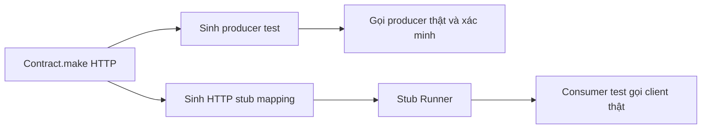

# Cấu trúc Contract.make và các khối cơ bản

## 1. Groovy DSL dùng để mô tả điều gì?

Trong **Spring Cloud Contract** (module `SPRING_CLOUD_CONTRACT`), **Groovy DSL** là một cách định nghĩa hợp đồng tương tác giữa **producer** (dịch vụ cung cấp hành vi) và **consumer** (ứng dụng phụ thuộc vào hành vi đó). Hợp đồng có thể mô tả:

- **HTTP**: consumer gửi method, URL, header, body; producer trả HTTP status, header và body.
- **Thông điệp**: producer phát message khi được kích hoạt hoặc sau khi nhận message đầu vào; hợp đồng xác định destination, header và payload cần quan sát.

Từ hợp đồng Groovy, Spring Cloud Contract có thể **sinh kiểm thử cho producer** và **sinh stub** để consumer thử tích hợp độc lập. Stub HTTP thường được chạy qua **Stub Runner**; hợp đồng thông điệp cần thêm cơ chế kích hoạt/quan sát message phù hợp. Quy trình CI có thể dùng các kiểm thử này để phát hiện thay đổi API hoặc event không tương thích.

Mục tiêu bài này là **đọc và tự viết được một file Groovy DSL sử dụng `Contract.make`**, hiểu vai trò của những khối cơ bản và biết phần nào được kiểm tra phía producer, phần nào được mô phỏng cho consumer. Đây là cú pháp của *hợp đồng*, không phải mã Controller hay service xử lý nghiệp vụ.

## 2. Bộ khung của một hợp đồng

Thông thường, một hợp đồng Groovy được đặt trong file `.groovy` dưới thư mục contracts do plugin Spring Cloud Contract quét (ví dụ `src/test/resources/contracts/` trong dự án Maven, trừ khi có cấu hình khác).

```groovy
import org.springframework.cloud.contract.spec.Contract

Contract.make {
    name 'get_order_success'
    description 'Lấy thông tin đơn hàng đã tồn tại'

    request {
        method GET()
        url '/api/orders/ord-1001'
    }

    response {
        status 200
        headers {
            contentType(applicationJson())
        }
        body([
            id    : 'ord-1001',
            status: 'CREATED'
        ])
    }
}
```

**Đọc từ ngoài vào trong:**

1. `import org.springframework.cloud.contract.spec.Contract`: đưa lớp hỗ trợ khai báo hợp đồng vào phạm vi sử dụng.
2. `Contract.make { ... }`: khối gốc tạo một mô tả hợp đồng. Dấu ngoặc nhọn truyền **Groovy closure** chứa các câu lệnh DSL.
3. `name`, `description`: thông tin giúp đặt tên và giải thích trường hợp kiểm thử.
4. `request { ... }`: phần đầu vào HTTP mà consumer gửi.
5. `response { ... }`: phần đầu ra HTTP mà producer cam kết trả.

Trong ví dụ này, hợp đồng phát biểu: *“Khi gọi `GET /api/orders/ord-1001`, dịch vụ trả `200` với JSON có `id = ord-1001` và `status = CREATED`.”*

### 2.1. Sơ đồ khối

```text
Contract.make {
    name / description          <- metadata của hợp đồng
    request {                   <- yêu cầu HTTP
        method / url
        headers / body / ...
    }
    response {                  <- phản hồi HTTP
        status
        headers / body / ...
    }
}
```

Khối gốc cho một hợp đồng **messaging** vẫn là `Contract.make`, nhưng phần trong có thể thay bằng `input` và `outputMessage`. Vì vậy, trước khi viết code hãy xác định giao thức và kết quả nào mà consumer thực sự quan sát được.

## 3. Ý nghĩa của `Contract.make`, closure và metadata

### 3.1. `Contract.make` là DSL, không phải lời gọi API lúc runtime

Khi build, plugin Spring Cloud Contract **đọc** file Groovy để xây dựng mô hình hợp đồng. Nó không có nghĩa là mỗi request HTTP của hệ thống thật sẽ gọi lại closure `Contract.make`. DSL chỉ mô tả hành vi mong đợi để công cụ sinh test và stub.

Ví dụ, đoạn `status 200` trong DSL không tự sửa Controller để trả `200`. Nếu Controller thực tế trả `404` cho fixture tương ứng, **producer test** sinh ra sẽ phát hiện sự khác biệt.

Groovy cho phép cú pháp gọn:

```groovy
name 'get_order_success'
method GET()
status 200
```

Những dòng này tương tự việc truyền đối số cho phương thức trong ngữ cảnh DSL. Chúng **không phải khai báo biến** và cũng không phải JSON/YAML.

### 3.2. Đặt tên và mô tả

`name` giúp nhận diện hành vi trong mã sinh và log; `description` cho người đọc biết **điều kiện** và **kết quả** được bảo vệ. Nên chọn tên mô tả rõ một nhánh:

| Tên đề xuất | Ý nghĩa |
| --- | --- |
| `get_order_success` | Đọc đơn hàng tồn tại |
| `get_order_not_found` | Đọc đơn hàng không tồn tại |
| `create_order_invalid_quantity` | Tạo đơn có số lượng không hợp lệ |
| `order_created_event` | Producer phát sự kiện tạo đơn |

Tránh tên mơ hồ như `test1` hoặc `contract_new`. Việc đặt tên dễ đọc giúp truy vết khi generated test thất bại, nhất là khi có nhiều nhánh và nhiều consumer.

Metadata không thay cho các điều kiện thực trong `request` hoặc `input`. Đặt tên `not_found` nhưng để `response.status 200` vẫn là một hợp đồng mô tả `200`.

## 4. Khối `request`: mô tả đầu vào HTTP

Một `request` có thể chứa nhiều thành phần; chỉ khai báo những phần thuộc giao diện cần kiểm chứng.

| Thành phần | Ví dụ | Mục đích |
| --- | --- | --- |
| `method` | `method POST()` | Phương thức HTTP |
| `url` | `url '/api/orders'` | URL/path cần gọi |
| `urlPath` | `urlPath('/api/orders') { ... }` | Tách path và query parameters để mô tả rõ hơn |
| `headers` | `contentType(applicationJson())` | Header của request |
| `body` | `body([productId: 'SKU-001', quantity: 2])` | Payload gửi tới producer |
| `cookies` | Khối `cookies { ... }` khi cần | Cookie thuộc hợp đồng tích hợp |

### 4.1. Ví dụ POST với JSON

```groovy
request {
    method POST()
    url '/api/orders'
    headers {
        contentType(applicationJson())
        header 'X-Request-Source': 'web'
    }
    body([
        productId: 'SKU-001',
        quantity : 2
    ])
}
```

Trong ví dụ:

- `method POST()` kiểm tra phương thức gọi.
- `url '/api/orders'` chỉ ra endpoint.
- `Content-Type: application/json` cho biết dữ liệu gửi là JSON.
- `X-Request-Source` chỉ mang ý nghĩa hợp đồng nếu producer/consumer đã thống nhất sử dụng nó.
- `body([ ... ])` tạo một cấu trúc dạng map của Groovy; Spring Cloud Contract có thể chuyển nó thành JSON dựa trên content type và ngữ cảnh.

Đừng cố định header như `Authorization` chứa token thật vào hợp đồng. Nếu có nhánh kiểm tra quyền, hãy dùng fixture và cấu hình kiểm thử an toàn; đảm bảo matcher không chấp nhận một cách quá rộng mọi giá trị token.

### 4.2. Query parameters và đường dẫn

Với HTTP GET có bộ lọc, có thể diễn tả path và query riêng:

```groovy
request {
    method GET()
    urlPath('/api/orders') {
        queryParameters {
            parameter 'status': 'CREATED'
            parameter 'page': 0
        }
    }
}
```

Hợp đồng này quan tâm `GET /api/orders` với `status=CREATED` và `page=0`. Nếu API còn chấp nhận nhiều cách mã hóa query, thứ tự tham số khác nhau hoặc các tham số tùy chọn, hãy xác định điều gì là cam kết thực tế trước khi làm matcher quá chặt.

**Quy tắc:** phần `request` phải đủ cụ thể để **Stub Runner chọn đúng stub**, đặc biệt khi có nhiều hợp đồng dùng cùng method và path nhưng khác body/query/header.

## 5. Khối `response`: mô tả đầu ra HTTP

`response` cho biết consumer mong đợi nhận gì khi request khớp:

```groovy
response {
    status 201
    headers {
        contentType(applicationJson())
        header 'Location': '/api/orders/ord-1001'
    }
    body([
        id    : 'ord-1001',
        status: 'CREATED'
    ])
}
```

| Thành phần | Ý nghĩa |
| --- | --- |
| `status 201` | HTTP status của response; có thể dùng hằng/helper phù hợp DSL |
| `headers { ... }` | Những response headers producer cần trả |
| `body([ ... ])` | Cấu trúc hoặc giá trị body cần kiểm tra |
| `bodyMatchers { ... }` | Điều kiện so khớp thuộc tính body khi giá trị động hoặc cần quy tắc linh hoạt |

Ví dụ, response `201` thường có ý nghĩa tài nguyên đã được tạo; header `Location` giúp consumer biết nơi truy cập tài nguyên mới. Nếu client thật không dùng `Location`, nhóm vẫn nên xác định xem đó có phải một cam kết API cần giữ hay không.

### 5.1. Phân biệt HTTP status và trạng thái nghiệp vụ

Hai giá trị dưới đây có vai trò khác nhau:

```groovy
response {
    status 200
    headers {
        contentType(applicationJson())
    }
    body([
        id    : 'ord-1001',
        status: 'CANCELLED'
    ])
}
```

`response.status 200` là mã HTTP. `body.status = CANCELLED` là thuộc tính trạng thái của **đơn hàng**, không phải HTTP status. Consumer có thể cần xử lý cả hai nhưng không được trộn chúng.

### 5.2. Viết hợp đồng cho nhánh lỗi

Một API thường có nhiều nhánh. Trường hợp không tìm thấy đơn hàng có thể là **hợp đồng độc lập**:

```groovy
import org.springframework.cloud.contract.spec.Contract

Contract.make {
    name 'get_order_not_found'

    request {
        method GET()
        url '/api/orders/ord-missing'
    }

    response {
        status 404
        headers {
            contentType(applicationJson())
        }
        body([code: 'ORDER_NOT_FOUND'])
    }
}
```

Hợp đồng này khác nhánh `200` vì consumer cần xử lý kết quả không tìm thấy. Một tên file/hợp đồng tương ứng với một nhánh rõ ràng giúp nhóm quản lý và chạy lại những tình huống quan trọng trong CI.

## 6. Ví dụ HTTP hoàn chỉnh: tạo đơn thành công

Đây là một hợp đồng đầu-cuối kết hợp các khối cơ bản trong **cùng một file**:

```groovy
import org.springframework.cloud.contract.spec.Contract

Contract.make {
    name 'create_order_success'
    description 'Tạo đơn khi SKU-001 còn đủ hàng'

    request {
        method POST()
        url '/api/orders'
        headers {
            contentType(applicationJson())
        }
        body([
            productId: 'SKU-001',
            quantity : 2
        ])
    }

    response {
        status 201
        headers {
            contentType(applicationJson())
            header 'Location': '/api/orders/ord-1001'
        }
        body([
            id    : 'ord-1001',
            status: 'CREATED'
        ])
    }
}
```

### 6.1. Trước khi chạy, chuẩn bị gì?

Giá trị `SKU-001`, `quantity = 2`, `ord-1001` là **fixture giả định** của bài học. Producer test phải có cơ chế thiết lập sản phẩm, tồn kho, quy tắc tạo ID và trạng thái đơn sao cho response được tái lập. Nếu ID thực tế sinh ngẫu nhiên, không nên dùng kiểm tra một giá trị cố định mà không kiểm soát nguồn sinh.

Các điều kiện kiểm chứng tương ứng:

1. Consumer gửi đúng `POST /api/orders` và body quy định.
2. Producer trả `201`; nếu trả `200`, hợp đồng không đạt.
3. Producer trả JSON chứa `id` và `status` đúng cam kết.
4. Header `Location` (nếu đã công bố) phù hợp tài nguyên tạo ra.
5. Stub được tạo từ cùng hợp đồng để consumer tập xử lý response thành công.

### 6.2. Từ DSL đến test và stub



Hợp đồng chỉ có giá trị bảo vệ tương thích khi **producer verification** được chạy. Một stub trả `201` không tự chứng minh ứng dụng thật đang trả `201`, bởi stub chỉ thực hiện nội dung đã được mô tả.

## 7. Dữ liệu động và matcher cơ bản

Không phải giá trị nào trong response cũng nên cố định. Ví dụ `id` có thể được tạo sau khi lưu đơn. Spring Cloud Contract cung cấp cách chỉ ra **giá trị được stub trả cho consumer** và **quy tắc producer test dùng để kiểm tra response thật**.

Một ví dụ minh họa trong `response.body`:

```groovy
response {
    status 201
    headers {
        contentType(applicationJson())
    }
    body([
        id    : $(consumer('ord-1001'), producer(regex('ord-[0-9]+'))),
        status: 'CREATED'
    ])
}
```

Trong một hợp đồng **HTTP response**:

- `consumer('ord-1001')`: stub dành cho consumer nhận một giá trị mẫu xác định.
- `producer(regex('ord-[0-9]+'))`: producer test chấp nhận các ID có định dạng phù hợp thay vì đòi ID bằng đúng `ord-1001`.
- `status: 'CREATED'`: tiếp tục kiểm tra chính xác vì đây là giá trị nghiệp vụ cố định trong nhánh này.

Trong **request**, nhu cầu thường đảo chiều: stub cần **matcher** để nhận nhiều đầu vào hợp lệ từ consumer, còn producer test dùng một đầu vào cụ thể có thể tái lập:

```groovy
request {
    method GET()
    urlPath($(consumer(regex('/api/orders/ord-[0-9]+')),
               producer('/api/orders/ord-1001')))
}
```

**Cẩn trọng:** matcher request rộng sẽ khiến nhiều URL cùng khớp một stub. Không nên dùng biểu thức `.*` tràn lan, đặc biệt khi các nhánh `200` và `404` có chung method/path pattern. Chỉ dùng regex khi mọi giá trị nó chấp nhận thực sự thuộc cùng một lớp hành vi đã được thỏa thuận.

### 7.1. Khi nào dùng `bodyMatchers`?

Ngoài cú pháp `$(...)`, DSL còn có `bodyMatchers` để mô tả điều kiện so khớp thuộc tính JSON. Chẳng hạn:

```groovy
response {
    status 200
    headers {
        contentType(applicationJson())
    }
    body([
        id    : 'ord-1001',
        status: 'CREATED'
    ])
    bodyMatchers {
        jsonPath('$.id', byRegex('ord-[0-9]+'))
    }
}
```

Mục đích của ví dụ là cho phép producer trả ID có dạng `ord-<số>` trong khi stub vẫn có body mẫu `ord-1001`. Khi phối hợp matcher với dữ liệu mẫu, nên chạy generated test để chắc rằng kiểm tra đúng trường và kiểu dữ liệu mong muốn; tránh matcher quá rộng khiến hợp đồng không phát hiện sai khác thực sự.

## 8. Contract.make trong hợp đồng thông điệp

Hợp đồng messaging cũng dùng `Contract.make` nhưng có các khối tương ứng với luồng message:

| Khối/thuộc tính | Vai trò |
| --- | --- |
| `label` | Đặt nhãn để nhận diện/kích hoạt kịch bản message stub khi công cụ hỗ trợ |
| `input { triggeredBy(...) }` | Xác định phương thức trong môi trường producer test để kích hoạt việc phát message |
| `input { messageFrom(...); messageBody(...) }` | Mô tả message đầu vào sẽ kích hoạt hành vi |
| `outputMessage { sentTo(...); body(...) }` | Mô tả destination và payload message được phát |
| `outputMessage { headers { ... } }` | Khai báo header message nếu chúng là phần cam kết |

### 8.1. Producer phát một sự kiện khi được kích hoạt

```groovy
import org.springframework.cloud.contract.spec.Contract

Contract.make {
    name 'order_created_event'
    label 'order_created'
    description 'Khi đơn được tạo, phát sự kiện cho dịch vụ kho'

    input {
        triggeredBy('publishOrderCreated()')
    }

    outputMessage {
        sentTo('orders.events')
        body([
            eventType: 'ORDER_CREATED',
            orderId  : 'ord-1001',
            quantity : 2
        ])
    }
}
```

Giải thích:

- `triggeredBy('publishOrderCreated()')` gọi một phương thức **do nhóm hiện thực** trong test base/configuration để gây ra hành vi; Spring Cloud Contract không tự cung cấp sẵn phương thức `publishOrderCreated()`.
- `sentTo('orders.events')` là destination đầu ra mà hợp đồng yêu cầu kiểm tra.
- `body(...)` kiểm tra payload sự kiện mà consumer sẽ đọc.
- `label 'order_created'` hữu ích khi consumer test cần kích hoạt mẫu message tương ứng qua khả năng của Stub Runner.

Để generated test chạy được, dự án phải có cơ chế gửi và quan sát message tương thích với hạ tầng (Spring Cloud Stream, Kafka, RabbitMQ, v.v.) và cấu hình kiểm thử tương ứng. Việc chỉ viết DSL không tự khởi động broker.

### 8.2. Khi producer xử lý một message đầu vào

Giả sử inventory service nhận yêu cầu giữ hàng rồi trả kết quả bằng message khác:

```groovy
import org.springframework.cloud.contract.spec.Contract

Contract.make {
    name 'inventory_reserved'

    input {
        messageFrom('orders.created')
        messageBody([
            orderId  : 'ord-1001',
            productId: 'SKU-001',
            quantity : 2
        ])
    }

    outputMessage {
        sentTo('inventory.reservations')
        body([
            orderId: 'ord-1001',
            result : 'RESERVED'
        ])
    }
}
```

Đây là mô hình **message-in → message-out**. Không nên thêm `request.url` hoặc `response.status` chỉ để biểu diễn kết quả nghiệp vụ của message. Nếu payload cần trường `result = REJECTED` cho nhánh hết hàng, đó là **hợp đồng message khác** khi consumer cần xử lý riêng.

> Hợp đồng message giúp kiểm tra thông điệp phát ra đúng mẫu đã thỏa thuận; nó không tự chứng minh cam kết về thứ tự sự kiện, delivery đúng một lần, retry hay idempotency. Những bảo đảm này cần kiểm thử tích hợp và kiến trúc broker/consumer phù hợp.

## 9. Các khối nào thuộc loại hợp đồng nào?

| Bạn muốn bảo vệ | Khối DSL nên bắt đầu | Ví dụ |
| --- | --- | --- |
| Consumer gọi REST API | `request` + `response` | `GET /api/orders/ord-1001` trả `200` |
| API trả lỗi có cấu trúc | `request` + `response` | `POST /api/orders` trả `400 INVALID_QUANTITY` |
| Producer chủ động phát event | `input.triggeredBy` + `outputMessage` | Phát `ORDER_CREATED` |
| Producer nhận một event rồi phát event khác | `input.messageFrom` + `outputMessage` | Nhận `orders.created`, phát `RESERVED` |
| Giá trị URL/JSON biến đổi | Matcher trong request/response | `ord-1001`, `ord-1002` |
| Chỉ kiểm tra thuật toán nội bộ | Unit test / integration test phù hợp | Logic tính tổng tiền không làm thay đổi hợp đồng ngoài |

Sự khác nhau giữa HTTP và messaging nằm ở **ranh giới giao tiếp**, không phải ở tên miền nghiệp vụ. Một dịch vụ có thể vừa nhận HTTP request vừa phát event, và cả hai ranh giới đều có thể được bảo vệ bằng các hợp đồng riêng.

## 10. Cách tổ chức file và kiểm tra với CI

Một cấu trúc thư mục minh họa cho producer Maven:

```text
orders-producer/
  src/test/resources/contracts/
    http/
      get_order_success.groovy
      get_order_not_found.groovy
      create_order_success.groovy
    messaging/
      order_created_event.groovy
```

Đường dẫn và quy tắc khám phá hợp đồng phụ thuộc cấu hình plugin. Nếu thay đổi thư mục nguồn mặc định, phải cập nhật cấu hình build cho phù hợp và xác nhận generated tests/stubs thực sự được tạo.

Trình tự triển khai thường là:

1. **Viết hợp đồng** theo nhánh hành vi mà consumer đã thống nhất, bắt đầu từ `Contract.make`.
2. **Chuẩn bị test base** để khởi tạo producer, dữ liệu fixture và kênh message nếu cần.
3. **Sinh và chạy producer tests** theo cấu hình Maven/Gradle của dự án; thất bại nếu producer trả khác hợp đồng.
4. **Đóng gói, phát hành stub** cùng phiên bản producer; với HTTP, mapping được Stub Runner dùng để trả response mô phỏng.
5. **Consumer kiểm thử** thông qua stub đã chọn, kiểm tra chính logic xử lý của consumer.
6. **CI kiểm tra tương thích** trên các lần thay đổi code/hợp đồng và dừng quy trình khi có sai khác đáng kể.

Một artifact stub thường có classifier `stubs`, ví dụ `com.example:orders-producer:1.4.2:stubs`. Consumer dùng Stub Runner để chọn đúng phiên bản. Với messaging, consumer test còn cần cấu hình transport/adapter và cách kích hoạt message stub; không nên cho rằng chỉ mở một HTTP stub server là đủ để gửi event qua broker thực.

## 11. Những lỗi thường gặp khi mới viết Groovy DSL

| Sai sót | Hệ quả | Cách tránh |
| --- | --- | --- |
| Viết `Contract.make` nhưng không khai báo `request`/`response` hoặc `input`/`outputMessage` phù hợp | Không mô tả được luồng tương tác mong muốn | Xác định giao thức và các ranh giới quan sát trước |
| Nhầm `status` của JSON với HTTP status | Consumer hiểu sai ý nghĩa trường | Phân biệt `response.status` với `body.status` |
| Cố định ID/thời gian ngẫu nhiên | Producer test hỏng dù API còn tương thích | Kiểm soát fixture hoặc dùng matcher hợp lý |
| Dùng regex `.*` cho mọi body/URL | Stub khớp nhầm; kiểm thử bỏ lọt lỗi | Giới hạn matcher theo định dạng và nhánh thực tế |
| Chỉ mô tả nhánh thành công | Consumer không kiểm thử cách xử lý lỗi | Thêm hợp đồng cho các nhánh `400`, `404`, `409` khi đã cam kết |
| Tin rằng `triggeredBy` tự tạo phương thức | Generated test không chạy | Cung cấp phương thức trigger trong test base |
| Viết event contract với HTTP status | Sai ngữ nghĩa giao thức | Dùng `input`/`outputMessage`, mô tả status nghiệp vụ trong payload nếu cần |
| Đặt đồng thời hợp đồng Groovy và YAML trùng nhau | Sinh kiểm thử/stub lặp hoặc xung đột | Chọn một biểu diễn DSL cho mỗi tình huống |
| Chỉ chạy stub test, bỏ producer test | Stub đúng nhưng producer thật có thể khác | Chạy producer verification trước khi publish stub |

## 12. Bài tập thực hành

Một dịch vụ có endpoint:

```text
GET /api/products/SKU-001
200 OK
Content-Type: application/json

{"id":"SKU-001","name":"USB-C Cable","available":true}
```

Và với mã không tồn tại:

```text
GET /api/products/SKU-MISSING
404 Not Found
Content-Type: application/json

{"code":"PRODUCT_NOT_FOUND"}
```

**Yêu cầu:**

1. Viết hai file Groovy sử dụng `Contract.make` với tên `get_product_success` và `get_product_not_found`.
2. Mỗi file khai báo `request.method`, `request.url`, `response.status`, `response.headers`, `response.body`.
3. Giải thích vì sao phải tách hai nhánh `200` và `404` dù cùng phương thức GET.
4. Giả định producer tạo ID động ở endpoint POST. Hãy đề xuất matcher để kiểm tra ID có cấu trúc hợp lệ mà không cố định một chuỗi ngẫu nhiên.
5. Bổ sung một sự kiện `PRODUCT_STOCK_CHANGED` vào `inventory.events` dưới dạng hợp đồng message. Chỉ rõ phương thức kích hoạt và payload mà consumer cần.

### Lời giải tham khảo cho nhánh không tìm thấy

```groovy
import org.springframework.cloud.contract.spec.Contract

Contract.make {
    name 'get_product_not_found'

    request {
        method GET()
        url '/api/products/SKU-MISSING'
    }

    response {
        status 404
        headers {
            contentType(applicationJson())
        }
        body([code: 'PRODUCT_NOT_FOUND'])
    }
}
```

Điểm cần tự kiểm tra: nếu producer trả `200` cho mã `SKU-MISSING`, generated test phải thất bại. Nếu consumer test nhận `404` từ stub nhưng không hiển thị trạng thái không tìm thấy, đó là lỗi xử lý **consumer**, không nhất thiết là lỗi hợp đồng producer.

### Checklist trước khi hoàn thành một file Groovy DSL

- File có `import` và khối `Contract.make` hợp lệ.
- Tên hợp đồng mô tả nhánh thực sự kiểm tra.
- Đúng khối cho giao thức: HTTP dùng `request/response`; message dùng `input/outputMessage`.
- Method, URL, status, headers, body hoặc destination/payload mô tả đúng hành vi đã thống nhất.
- Dữ liệu fixture có thể tái lập; không đưa bí mật vào hợp đồng.
- Matcher chỉ chấp nhận các biến thể tương thích và không làm stub bắt nhầm nhánh.
- Producer test được sinh và chạy; consumer test sử dụng stub phù hợp với cùng hợp đồng.

**Kết luận:** `Contract.make { ... }` là điểm bắt đầu của hợp đồng Groovy DSL. Khi nắm vững metadata, `request`, `response`, `input`, `outputMessage` và matcher, bạn có thể diễn đạt hành vi của producer một cách kiểm chứng được, tạo stub cho consumer và đưa kiểm thử tương thích vào CI của hệ thống.
