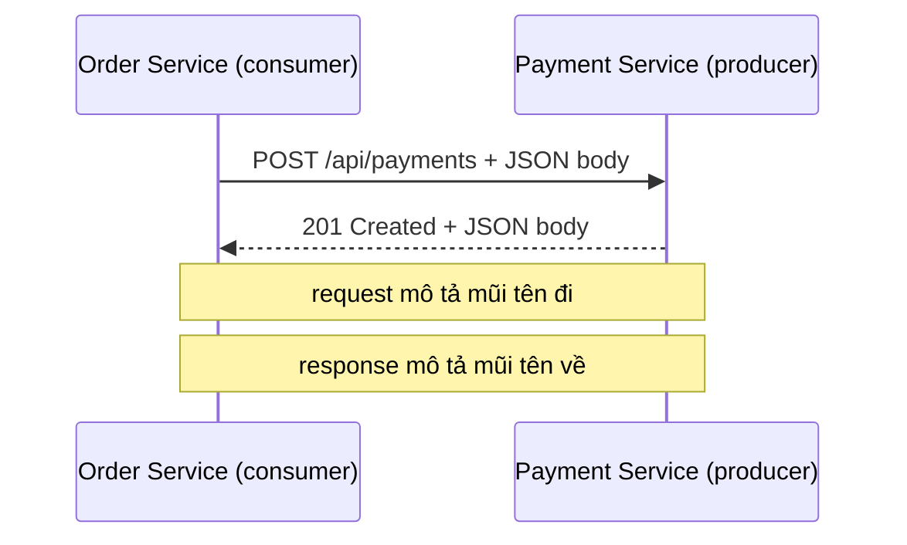
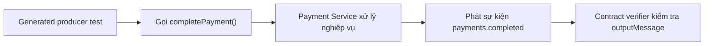
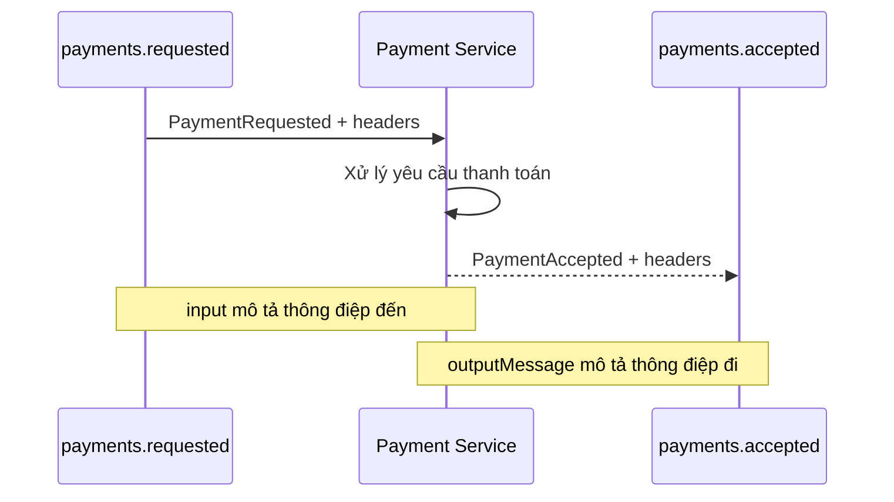

# Khối `request`, `response`, `input` và `outputMessage` trong Groovy DSL

## 1. Mục tiêu và bối cảnh

Trong hệ thống nhiều dịch vụ, **producer** công bố API hoặc sự kiện, còn **consumer** gửi yêu cầu hoặc nhận dữ liệu. Hai bên có thể phát triển và triển khai độc lập, nên một thay đổi nhỏ như đổi HTTP status, xóa trường JSON hay gửi thông điệp sai đích cũng có thể làm hỏng tích hợp.

**Spring Cloud Contract** cho phép mô tả những tương tác cần cam kết bằng **Groovy DSL** hoặc YAML DSL. Từ hợp đồng, công cụ có thể sinh kiểm thử ở phía producer, tạo stub để consumer chạy bằng **Stub Runner**, rồi đưa những kiểm thử đó vào CI nhằm phát hiện thay đổi không tương thích.

Trong Groovy DSL, bốn khối quan trọng là:

| Khối | Dùng cho | Ý nghĩa |
| --- | --- | --- |
| `request` | HTTP | Yêu cầu mà consumer gửi tới producer: phương thức, URL, header, tham số và body |
| `response` | HTTP | Phản hồi mà producer phải trả: status, header và body |
| `input` | Thông điệp | Điều kiện hoặc tác nhân kích hoạt hành vi producer: một phương thức được gọi hoặc một thông điệp đến |
| `outputMessage` | Thông điệp | Thông điệp mà producer phải phát: đích gửi, body và header |

Hai cặp khối diễn đạt hai kiểu giao tiếp khác nhau. Với HTTP, producer nhận một request và trả về response trong cùng tương tác. Với messaging, producer có thể được kích hoạt bằng một lời gọi hoặc thông điệp đầu vào rồi **phát** một thông điệp đến một destination; hai hành động không nhất thiết thuộc cùng một kết nối HTTP.

Mục tiêu của bài học:

1. Đọc và viết được cấu trúc `Contract.make { ... }` sử dụng từng khối.
2. Hiểu nội dung nào được kiểm chứng ở producer và nội dung nào trở thành stub cho consumer.
3. Phân biệt `input.triggeredBy` với `input.messageFrom`.
4. Thiết kế hợp đồng có ý nghĩa với hệ thống nhiều dịch vụ, tránh mô tả dư hoặc bỏ sót kỳ vọng quan trọng.

## 2. Cấu trúc chung của một hợp đồng Groovy

Một tệp Groovy thường trả về đối tượng hợp đồng được tạo bằng `Contract.make`:

```groovy
import org.springframework.cloud.contract.spec.Contract

Contract.make {
    description 'Hành vi mà producer cam kết'

    // Với HTTP: request { ... } và response { ... }
    // Với messaging: input { ... } và outputMessage { ... }
}
```

`description` giải thích ý nghĩa nghiệp vụ để người đọc và người review hiểu hợp đồng đang bảo vệ điều gì. Trong những ví dụ dưới đây, mỗi hợp đồng mô tả **một tương tác cụ thể**; các tình huống thành công, lỗi và dữ liệu khác nhau có thể được tách thành nhiều hợp đồng.

Trong dự án Maven/Gradle có cấu hình Spring Cloud Contract, thư mục hợp đồng mặc định thường là `src/test/resources/contracts` ở phía producer. Cách xác định tên class kiểm thử sinh ra, test framework, test base class và vị trí hợp đồng có thể được cấu hình trong plugin tương ứng.

**Lưu ý phạm vi:** Những đoạn Groovy sau tập trung vào cú pháp hợp đồng. Muốn chạy được trong dự án thật, phải cấu hình đúng phiên bản Spring Cloud Contract, plugin, test base class và hạ tầng HTTP/messaging cần thiết. Tên destination và dữ liệu ví dụ là giả định trong một hệ thống thanh toán mẫu.

## 3. Cặp HTTP: `request` và `response`

Giả sử `Order Service` là consumer và `Payment Service` là producer. Khi tạo thanh toán, Order Service gửi:

```http
POST /api/payments HTTP/1.1
Content-Type: application/json

{"orderId":301,"amount":125000}
```

Payment Service cam kết phản hồi:

```http
HTTP/1.1 201 Created
Content-Type: application/json

{"paymentId":42,"status":"PENDING"}
```

Hợp đồng Groovy DSL có thể viết:

```groovy
import org.springframework.cloud.contract.spec.Contract

Contract.make {
    description 'Tạo thanh toán cho một đơn hàng hợp lệ'

    request {
        method POST()
        url '/api/payments'
        headers {
            contentType(applicationJson())
        }
        body(
            orderId: 301,
            amount: 125000
        )
    }

    response {
        status CREATED()
        headers {
            contentType(applicationJson())
        }
        body(
            paymentId: 42,
            status: 'PENDING'
        )
    }
}
```

Đọc hợp đồng theo hướng dữ liệu:



### 3.1. Khối `request`: producer phải chấp nhận yêu cầu nào?

`request` mô tả phần **consumer gửi**. Các thành phần hay dùng:

| Thành phần DSL | Ý nghĩa | Ví dụ |
| --- | --- | --- |
| `method` | HTTP method | `method GET()`, `method POST()` |
| `url` | URL mà request hướng đến | `url '/api/payments/42'` |
| `urlPath` | Đường dẫn URL, hữu ích khi cần mô tả điều kiện trên path/query | `urlPath '/api/payments/42'` |
| `headers` | Header mà consumer cần gửi | `contentType(applicationJson())` |
| `body` | Request payload | `body(orderId: 301, amount: 125000)` |
| `bodyMatchers` | Điều kiện khớp trên request body khi cần linh hoạt | JSONPath kết hợp matcher |

Ví dụ một hợp đồng chỉ tra cứu, không có request body:

```groovy
import org.springframework.cloud.contract.spec.Contract

Contract.make {
    description 'Tra cứu trạng thái thanh toán đã tồn tại'
    request {
        method GET()
        url '/api/payments/42'
    }
    response {
        status OK()
        headers {
            contentType(applicationJson())
        }
        body(
            paymentId: 42,
            status: 'PAID'
        )
    }
}
```

Với một endpoint có path variable hoặc query parameter, hợp đồng cần thể hiện đúng ranh giới giao tiếp: consumer dùng phương thức nào, URL nào, tham số nào và header nào là điều kiện bắt buộc. Nếu yêu cầu có `Authorization` hoặc header tương quan, chỉ ghi vào hợp đồng những ràng buộc liên quan đến hành vi cần bảo vệ; tránh nhúng credential thật vào tệp DSL.

**Không nên cố định dữ liệu không quan trọng** như timestamp ngẫu nhiên hoặc ID được sinh mỗi lần gọi. Nếu một giá trị phải linh hoạt, Spring Cloud Contract có các matcher và cú pháp định nghĩa giá trị phía consumer/producer; cần chọn matcher đúng với vị trí `request` và phiên bản DSL đang sử dụng.

### 3.2. Khối `response`: producer phải trả điều gì?

`response` mô tả phần **producer trả về** khi nhận request phù hợp. Các thành phần chính:

| Thành phần DSL | Ý nghĩa | Ví dụ |
| --- | --- | --- |
| `status` | HTTP status code | `status OK()`, `status CREATED()`, `status NOT_FOUND()` |
| `headers` | Header trong response | `contentType(applicationJson())` |
| `body` | Cấu trúc và dữ liệu response | `body(status: 'PAID')` |
| `bodyMatchers` | Kiểm tra kiểu, regex hoặc JSONPath thay cho giá trị cố định | `jsonPath('$.paymentId', byType())` |

Ví dụ minh họa một trường sinh động có thể thay đổi:

```groovy
response {
    status OK()
    headers {
        contentType(applicationJson())
    }
    body(
        paymentId: 42,
        status: 'PAID'
    )
    bodyMatchers {
        jsonPath('$.paymentId', byType())
        jsonPath('$.status', byRegex('PAID|PENDING|FAILED'))
    }
}
```

Đoạn này minh họa cách dùng matcher trong `response` để kiểm tra kiểu dữ liệu và tập giá trị. **Matcher không tự cho phép trường vắng mặt**: nếu `paymentId` là bắt buộc, producer vẫn phải trả trường đó. Khi muốn một trường tùy chọn, cần mô tả chính sách có/không có trường bằng các trường hợp kiểm thử phù hợp.

Trong consumer test, stub được tạo từ hợp đồng sẽ cung cấp response mẫu. Trong producer test, mã ứng dụng thật được kiểm tra theo các ràng buộc tương ứng. Hai bước này cần chạy đúng với cùng tập hợp hợp đồng đã thống nhất.

### 3.3. Không quên hợp đồng cho lỗi HTTP

Consumer cũng cần biết producer phản hồi thế nào khi không tìm thấy thanh toán:

```groovy
import org.springframework.cloud.contract.spec.Contract

Contract.make {
    description 'Không tìm thấy thanh toán'
    request {
        method GET()
        url '/api/payments/999'
    }
    response {
        status NOT_FOUND()
        headers {
            contentType(applicationJson())
        }
        body(errorCode: 'PAYMENT_NOT_FOUND')
    }
}
```

Nếu Payment Service bất ngờ đổi `404` thành `200` với body rỗng, consumer có thể xử lý sai. Viết riêng hợp đồng lỗi giúp phát hiện những thay đổi đó. Các trường hợp `400`, `401`, `403`, `409` hoặc `5xx` nên được bổ sung theo đúng hành vi mà consumer thực sự phụ thuộc.

## 4. Cặp messaging: `input` và `outputMessage`

Trong kiến trúc sự kiện, producer có thể phát thông điệp sau khi xử lý thanh toán, hoặc sau khi nhận một thông điệp khác. Khác với HTTP, không có cặp request/response trên một kết nối đồng bộ: hệ thống quan tâm **tác nhân kích hoạt** và **thông điệp được phát ra**.

`input` diễn đạt *điều gì khiến producer thực hiện hành vi*; `outputMessage` diễn đạt *producer phải phát thông điệp gì và đến đâu*. Spring Cloud Contract cung cấp hai dạng `input` thường gặp:

1. **`triggeredBy(...)`:** một phương thức do test base class cung cấp được gọi để kích hoạt logic phát thông điệp.
2. **`messageFrom(...)`:** một thông điệp đến từ destination cụ thể; contract còn có thể mô tả `messageBody` và `messageHeaders`.

Trong cả hai trường hợp, `outputMessage` mô tả kết quả cần quan sát sau khi kích hoạt.

### 4.1. Dạng A: phát thông điệp sau khi gọi một phương thức

Giả sử Payment Service có nghiệp vụ hoàn tất giao dịch. Ta muốn xác minh sau khi kích hoạt thao tác đó, producer phát sự kiện `PaymentCompleted`.

```groovy
import org.springframework.cloud.contract.spec.Contract

Contract.make {
    description 'Phát sự kiện khi thanh toán hoàn tất'
    label 'payment_completed'

    input {
        triggeredBy('completePayment()')
    }

    outputMessage {
        sentTo('payments.completed')
        body(
            eventType: 'PaymentCompleted',
            paymentId: 42,
            orderId: 301
        )
        headers {
            header('eventType', 'PaymentCompleted')
        }
    }
}
```

Ý nghĩa từng dòng quan trọng:

- `label 'payment_completed'` đặt nhãn nhận diện tương tác, hữu ích khi consumer kích hoạt hoặc tham chiếu stub thông điệp theo nhãn trong những cấu hình có hỗ trợ.
- `input.triggeredBy('completePayment()')` yêu cầu mã test do producer cung cấp có phương thức `completePayment()` để kích hoạt hành vi nghiệp vụ. Chuỗi này **không tự gọi API HTTP** và **không tự tạo phương thức**.
- `outputMessage.sentTo('payments.completed')` chỉ destination dự kiến nhận thông điệp.
- `outputMessage.body` mô tả payload mà producer phát.
- `outputMessage.headers` mô tả header của thông điệp đi ra; ở đây là header `eventType`.

Điểm dễ sai: `triggeredBy` chỉ cho biết **cách thực thi hành vi trong kiểm thử producer**. Nếu test base class không khai báo đúng phương thức hoặc phương thức không kích hoạt luồng nghiệp vụ thật, kiểm thử sinh ra sẽ không thực hiện đúng mục tiêu.

Một base class minh họa:

```java
public abstract class BaseContractTest {
    protected void completePayment() {
        // Gọi service thực tế để hoàn tất payment 42.
        // Cấu hình test phải quan sát được thông điệp phát ra.
    }
}
```

Đoạn Java chỉ minh họa **nơi triển khai trigger**; dự án thật cần dependency injection, test context và cấu hình message verifier/binder phù hợp. Phương thức để trống như ví dụ sẽ không tạo ra thông điệp và không thể làm một producer test thực tế vượt qua được.

Luồng tương tác:



### 4.2. Dạng B: xử lý thông điệp nhận được và phát thông điệp mới

Ví dụ một Payment Service nhận yêu cầu `PaymentRequested` từ destination `payments.requested`, xử lý rồi phát `PaymentAccepted` tới `payments.accepted`.

```groovy
import org.springframework.cloud.contract.spec.Contract

Contract.make {
    description 'Nhận yêu cầu thanh toán và phát kết quả chấp nhận'
    label 'payment_requested'

    input {
        messageFrom('payments.requested')
        messageBody(
            eventType: 'PaymentRequested',
            paymentId: 42,
            amount: 125000
        )
        messageHeaders {
            header('eventType', 'PaymentRequested')
        }
    }

    outputMessage {
        sentTo('payments.accepted')
        body(
            eventType: 'PaymentAccepted',
            paymentId: 42,
            accepted: true
        )
        headers {
            header('eventType', 'PaymentAccepted')
        }
    }
}
```

Trong hợp đồng này:

| Lệnh | Kiểm thử mô tả điều gì? |
| --- | --- |
| `input.messageFrom(...)` | Destination nơi producer nhận thông điệp đầu vào |
| `input.messageBody(...)` | Payload được gửi vào hệ thống để kích hoạt xử lý |
| `input.messageHeaders { ... }` | Header của thông điệp đầu vào |
| `outputMessage.sentTo(...)` | Destination mà producer cần phát ra |
| `outputMessage.body(...)` | Payload của thông điệp đầu ra |
| `outputMessage.headers { ... }` | Header được mong đợi trong thông điệp đầu ra |



Để kiểm thử này hoạt động, producer phải cấu hình cách test đưa message vào listener và cách theo dõi message được phát ra. Tên `payments.requested` và `payments.accepted` là destination logic trong ví dụ; cách ánh xạ sang topic, queue hoặc binding thực phụ thuộc framework messaging và cấu hình ứng dụng.

**Không ghép `triggeredBy` và `messageFrom` một cách tùy tiện.** Chúng đại diện hai cơ chế kích hoạt khác nhau. Chọn dạng phù hợp với cách hệ thống hoạt động, và đối chiếu khả năng của phiên bản Spring Cloud Contract đang dùng nếu có tình huống phức tạp.

## 5. Sự khác nhau giữa `headers` và `messageHeaders`

Tên khối dễ gây nhầm vì cùng mô tả metadata, nhưng chúng nằm tại các vị trí khác nhau:

| Ngữ cảnh | Khai báo | Nhiệm vụ |
| --- | --- | --- |
| HTTP `request` | `headers { ... }` | Header request mà consumer gửi |
| HTTP `response` | `headers { ... }` | Header response mà producer trả |
| Messaging `input` dạng `messageFrom` | `messageHeaders { ... }` | Header của message nhận vào |
| Messaging `outputMessage` | `headers { ... }` | Header của message được phát ra |

Đặt nhầm `headers` vào `input` hoặc `messageHeaders` vào `outputMessage` có thể làm hợp đồng không hợp lệ hoặc không kiểm tra được điều mong muốn. Khi chuyển đổi từ một hợp đồng HTTP sang messaging, cần kiểm tra lại cấu trúc DSL thay vì chỉ đổi tên endpoint thành destination.

Tương tự, `request.body` và `outputMessage.body` có thể đều mang nội dung JSON, nhưng `input.messageBody` được dùng cho **payload của thông điệp đầu vào**. Ngữ nghĩa của chúng được xác định bởi khối cha.

## 6. Hợp đồng trở thành test producer và stub consumer như thế nào?

Với hợp đồng HTTP:

1. Producer lưu `Contract.make { request { ... } response { ... } }`.
2. Spring Cloud Contract Verifier sinh kiểm thử, dùng HTTP request đã mô tả để gọi môi trường test của producer.
3. Test kiểm tra status, header và body trả về theo hợp đồng.
4. Khi producer verification thành công, build có thể đóng gói stub cho consumer.
5. Consumer dùng Stub Runner chạy stub, gửi request bằng HTTP client thật của mình và kiểm tra kết quả xử lý.

Với hợp đồng messaging:

1. Producer lưu `Contract.make { input { ... } outputMessage { ... } }`.
2. Test sinh ra kích hoạt hành vi bằng phương thức `triggeredBy` hoặc gửi message theo `messageFrom`.
3. Hệ thống test quan sát thông điệp producer phát, kiểm tra destination, body và headers trong `outputMessage`.
4. Consumer có thể kiểm thử với stub messaging bằng cơ chế tích hợp thích hợp, gồm định danh/nhãn sự kiện và các binding mà Stub Runner hỗ trợ trong cấu hình đã chọn.

Một stub mô phỏng phản hồi hay thông điệp được mô tả **không tự chứng minh producer thật đang phát đúng**. Muốn tin cậy, stub phải xuất phát từ hợp đồng đã được producer kiểm chứng; consumer test phải lấy đúng phiên bản stub đang nhắm tới.

## 7. Phân biệt DSL mô tả dữ liệu và môi trường chạy kiểm thử

Hợp đồng nêu **hành vi quan sát được**, không tự triển khai controller, service, queue, test runner hoặc kết nối mạng. Ví dụ:

- `request.method POST()` không tạo `@PostMapping` trong ứng dụng.
- `response.status CREATED()` không buộc controller trả `201` khi chưa có test chạy; nó cung cấp điều kiện để producer test xác minh.
- `input.triggeredBy('completePayment()')` không có khả năng thực hiện nghiệp vụ nếu base class không triển khai trigger.
- `input.messageFrom('payments.requested')` không tự thiết lập một Kafka topic hay RabbitMQ queue.
- `outputMessage.sentTo('payments.completed')` không thay thế cấu hình binding; chỉ mô tả điểm đích được kỳ vọng.

Vì thế, ngoài tệp Groovy cần có cấu hình plugin Maven/Gradle, test base class và một bộ kiểm thử/hạ tầng thích hợp (ví dụ MockMvc cho HTTP hoặc cấu hình message verifier/binder cho messaging). Chi tiết tích hợp khác nhau theo phiên bản thư viện và hệ thống Spring Messaging, Spring Cloud Stream hay broker đang sử dụng.

## 8. Matcher và dữ liệu biến động trong bốn khối

Trong hệ thống thực, `paymentId`, timestamp hoặc correlation ID có thể thay đổi theo mỗi lần chạy. Nếu hợp đồng gắn tất cả vào giá trị cố định, test dễ thất bại do khác biệt hợp lệ. Tuy nhiên, nếu dùng regex quá rộng, test lại không phát hiện thay đổi sai.

Ví dụ với response HTTP:

```groovy
response {
    status OK()
    body(
        paymentId: 42,
        status: 'PAID'
    )
    bodyMatchers {
        jsonPath('$.paymentId', byType())
        jsonPath('$.status', byRegex('PAID|PENDING|FAILED'))
    }
}
```

Đây là một đoạn `response` nằm trong `Contract.make`, không phải hợp đồng đầy đủ độc lập. Các matcher `byType`, `byRegex` minh họa khả năng kiểm tra kiểu dữ liệu hoặc tập giá trị mà không khóa toàn bộ phản hồi vào một dữ liệu mẫu.

Đối với request HTTP, tương tác thường cần cho phép consumer gửi nhiều ID hợp lệ, còn producer test cần một giá trị cụ thể để gọi được ứng dụng. Với message body cũng có nhu cầu tương tự. Spring Cloud Contract hỗ trợ phân biệt giá trị/matcher cho phía consumer và producer; cách viết chính xác phụ thuộc loại trường, hướng kiểm thử và phiên bản DSL. Nên bắt đầu bằng hợp đồng giá trị cố định như các ví dụ trên, sau đó thêm matcher khi đã xác định rõ biến thể hợp lệ.

Hãy phân loại dữ liệu trước khi chọn matcher:

| Loại dữ liệu | Chiến lược kiểm tra |
| --- | --- |
| Trường bắt buộc với tập giá trị giới hạn | Kiểm tra có mặt, kiểu và miền giá trị |
| ID/timestamp được sinh động | Dùng matcher theo kiểu, định dạng hoặc ràng buộc cụ thể |
| Trường tùy chọn | Kiểm tra trường hợp vắng mặt và hiện diện nếu consumer phụ thuộc cả hai |
| Trường không thuộc nhu cầu consumer | Không ràng buộc giá trị; bảo đảm consumer chịu được dữ liệu thừa |
| Header định tuyến hoặc loại sự kiện | Kiểm tra chính xác nếu thay đổi sẽ khiến consumer không nhận/không xử lý được |

Không cần mô tả mọi chi tiết triển khai nội bộ trong hợp đồng. Hợp đồng nên tập trung vào những điều consumer cần để tương tác an toàn với producer.

## 9. Những lỗi thường gặp và cách nhận biết

| Triệu chứng | Nguyên nhân có thể | Hướng xử lý |
| --- | --- | --- |
| Kiểm thử HTTP sinh ra thất bại với `404` | `request.url` không khớp route/controller | Đối chiếu method, path, mapping và test base class |
| Test HTTP thất bại vì `200` thay `201` | `response.status` mô tả cam kết khác mã producer trả | Kiểm tra yêu cầu API, sửa implementation hoặc thống nhất lại hợp đồng |
| Matcher JSONPath không tìm thấy trường | Producer đổi tên hoặc xóa field | Xác định tính tương thích với consumer, không bỏ matcher chỉ để test xanh |
| Contract messaging không sinh/test được trigger | `triggeredBy` gọi phương thức không tồn tại hoặc test context chưa có logic | Triển khai đúng phương thức và kết nối nó với nghiệp vụ phát message |
| Test không thấy output message | Sai destination, listener chưa chạy, sai binding hoặc producer không phát | Kiểm tra routing, message verifier/binder, headers và nghiệp vụ |
| Stub Runner không trả dữ liệu mong đợi | Consumer chọn nhầm version stub hoặc hợp đồng không có tương tác đó | Kiểm tra artifact version, classifier và các hợp đồng đã được publish |
| Producer test pass nhưng consumer vẫn hỏng | Hợp đồng chưa mô tả trường hợp consumer dùng hoặc consumer xử lý sai response | Bổ sung tương tác liên quan và test consumer bằng client thực |

Một thay đổi hợp đồng muốn có tác dụng trong CI phải đi qua cả chuỗi: hợp đồng được đọc, test được sinh và chạy, producer verification đạt, stub được phát hành, consumer dùng đúng stub trong các bài kiểm thử của mình.

## 10. Bài thực hành: chọn đúng khối DSL

Xét ba yêu cầu:

**Tình huống A.** Order Service gọi `GET /api/payments/42`, Payment Service trả `200` và `{"status":"PAID"}`.

**Tình huống B.** Một phương thức `confirmPayment()` được gọi; Payment Service phát message `PaymentConfirmed` tới destination `payments.confirmed`.

**Tình huống C.** Payment Service nhận `PaymentRequested` ở `payments.requested`, sau khi xử lý phát `PaymentAccepted` tới `payments.accepted`.

Hãy xác định cặp khối và các thành phần bắt buộc để mô tả mỗi tình huống.

| Tình huống | Cấu trúc cần chọn | Phần tối thiểu cần mô tả |
| --- | --- | --- |
| A | `request` + `response` | HTTP method, URL, response status và body |
| B | `input` + `outputMessage` | `triggeredBy('confirmPayment()')`, `sentTo`, `body` |
| C | `input` + `outputMessage` | `messageFrom`, `messageBody`, `sentTo`, `body` |

Thử mở rộng ba tình huống:

1. Ở A, thêm hợp đồng riêng cho `404 PAYMENT_NOT_FOUND`. Nếu producer đổi mã lỗi thành `200`, producer test có còn được phép pass không?
2. Ở B, bổ sung `paymentId` và `orderId` vào body; trường nào bắt buộc đối với consumer nhận sự kiện?
3. Ở C, thêm header `eventType` ở input và output; cần dùng `messageHeaders` hay `headers` trong từng khối?
4. Trong một pipeline CI, vì sao không nên phát hành stub trước khi producer test đạt?

**Gợi ý tự kiểm tra:** (1) Không, nếu hợp đồng yêu cầu `404`; (2) phụ thuộc vào nhu cầu consumer, thường cả hai để liên kết giao dịch và đơn hàng; (3) input dùng `messageHeaders`, outputMessage dùng `headers`; (4) stub chưa được xác minh có thể mô phỏng hành vi mà producer thực không đáp ứng.

## 11. Checklist khi viết hợp đồng Groovy DSL

- Đã xác định rõ **HTTP** hay **messaging** trước khi chọn cặp khối?
- Với HTTP, `request` mô tả đúng phương thức/URL/header/body mà consumer sẽ gửi và `response` mô tả đúng status/header/body producer cam kết?
- Với messaging, `input` thể hiện đúng cách kích hoạt: `triggeredBy` hoặc `messageFrom`?
- `outputMessage` có `sentTo`, body và những header ảnh hưởng đến consumer không?
- Các trường bắt buộc, giá trị động, trường tùy chọn và trường thừa có được xử lý có chủ đích?
- Test base class, controller/listener, message binding và plugin đã được cấu hình để kiểm thử thực sự chạy?
- CI có chạy producer verification và chỉ phát hành stub đã kiểm chứng cho consumer dùng qua Stub Runner?

**Ghi nhớ:** `request` và `response` xác định hợp đồng cho **HTTP**; `input` và `outputMessage` xác định hợp đồng cho **thông điệp**. `input` có thể được kích hoạt bằng phương thức (`triggeredBy`) hoặc bằng thông điệp nhận vào (`messageFrom`). Nắm đúng hướng dữ liệu của từng khối là nền tảng để Groovy DSL tạo ra producer test và stub có ích, giúp phát hiện thay đổi API hoặc thông điệp không tương thích trước khi triển khai.
