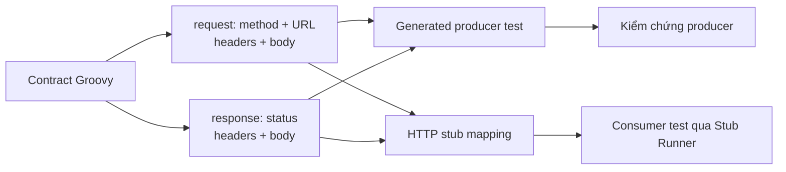
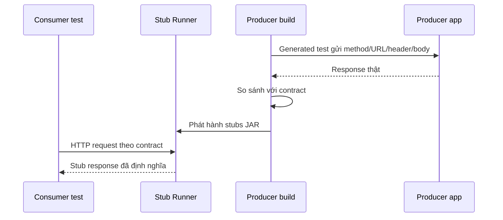

# Khai báo method, URL, header và body bằng Groovy DSL trong Spring Cloud Contract

Một hợp đồng HTTP trong **Spring Cloud Contract (SCC)** trả lời hai câu hỏi: **consumer phải gửi yêu cầu nào?** và **producer cam kết phản hồi thế nào?**. Với **Groovy DSL**, ta mô tả request và response bằng các khối lệnh có cấu trúc. SCC dựa trên hợp đồng này để **sinh test phía producer** và **sinh stub phía consumer**; nhờ đó một thay đổi API không tương thích có thể bị phát hiện khi build hoặc chạy kiểm thử qua **Stub Runner**, trước khi hai dịch vụ thực sự triển khai cùng nhau.

Trong chương **Groovy DSL**, bài học này đi sâu vào bốn thành phần quan trọng của hợp đồng HTTP: **method, URL, header và body**. Ví dụ sử dụng `order-producer` (dịch vụ cung cấp API đơn hàng) và `order-consumer` (dịch vụ gọi API đơn hàng), sau đó kết nối ngắn gọn với quy trình xác minh producer, phát hành stub và CI.

## 1. Cấu trúc cơ bản của HTTP contract

Ví dụ một hợp đồng tĩnh cho API lấy đơn hàng:

```groovy
import org.springframework.cloud.contract.spec.Contract

Contract.make {
    description 'Lấy đơn hàng 1001 và trả trạng thái CREATED'

    request {
        method GET()
        url '/api/orders/1001'
        headers {
            header('Accept', 'application/json')
        }
    }

    response {
        status OK()
        headers {
            contentType(applicationJson())
        }
        body(
            id: 1001,
            status: 'CREATED'
        )
    }
}
```

Đặt hợp đồng tại vị trí thường dùng trong dự án producer:

```text
order-producer/
└── src/
    └── test/
        └── resources/
            └── contracts/
                └── http/
                    └── get-order-by-id-ok.groovy
```

Thư mục mặc định và cách gom nhóm hợp đồng có thể được thay đổi qua cấu hình build. `description` dành cho người đọc và review; điều kiện kiểm chứng thực tế nằm trong `request` và `response`.

| Vị trí DSL | Thành phần | Ý nghĩa |
| --- | --- | --- |
| `request.method` | `GET()` | Loại HTTP request consumer phải gửi |
| `request.url` | `/api/orders/1001` | URL mà producer cần nhận |
| `request.headers` | `Accept: application/json` | Header cần có trong request |
| `response.status` | `OK()` | Producer phải phản hồi HTTP 200 |
| `response.headers` | `Content-Type: application/json` | Loại dữ liệu mà producer trả về |
| `response.body` | `id`, `status` | Các giá trị JSON được cam kết |

Sơ đồ:



**Đừng nhầm body của request và response.** `request.body` là dữ liệu **consumer gửi**; `response.body` là dữ liệu **producer trả**. Tương tự, header trong `request` và header trong `response` là hai tập thuộc tính riêng.

## 2. Khai báo HTTP method

Method mô tả thao tác mà consumer thực hiện với tài nguyên. Trong Groovy DSL, có thể sử dụng helper dễ đọc:

```groovy
request {
    method GET()
    url '/api/orders/1001'
}
```

Hoặc dạng chuỗi:

```groovy
request {
    method 'GET'
    url '/api/orders/1001'
}
```

Các method thường gặp:

| Method | Kịch bản phổ biến | Điểm cần xác minh |
| --- | --- | --- |
| `GET` | Đọc đơn hàng | Đúng URL, status và dữ liệu đọc |
| `POST` | Tạo đơn hàng | Body đầu vào, status tạo mới, response |
| `PUT` | Thay thế biểu diễn tài nguyên | Đúng body cập nhật và status |
| `PATCH` | Cập nhật một phần | Các trường thay đổi, phương thức xử lý patch |
| `DELETE` | Xóa hoặc hủy tài nguyên | URL, status và semantics đã cam kết |

Một hợp đồng `GET /api/orders/1001` **không** bảo vệ một endpoint chỉ phục vụ `POST /api/orders/1001`. Đổi HTTP method của API đang được consumer dùng có thể làm phá vỡ tương thích dù URL giữ nguyên.

### 2.1. Chọn method theo hành vi, không theo tên lớp

Hãy đặt tên hợp đồng `get-order-by-id-ok.groovy` thay vì `order-controller-find.groovy`; contract mô tả giao diện công khai, không mô tả tên hàm Java. Nếu producer chuyển từ MVC controller sang kiến trúc khác nhưng vẫn phục vụ cùng method, URL và response, hợp đồng có thể giữ nguyên.

### 2.2. Phân biệt method với status

`POST` là **method đầu vào**; `201 Created` là **status đầu ra**. Một contract tạo đơn hàng có thể dùng:

```groovy
request {
    method POST()
    url '/api/orders'
}
response {
    status CREATED()
}
```

Hai giá trị này nằm ở hai phía khác nhau và phải đúng với API đã thống nhất. Không tự mặc định mọi POST đều phải trả 201: một số API hợp lệ trả 200 hoặc 202 tùy ngữ nghĩa của chính API đó.

## 3. Khai báo URL: `url`, `urlPath` và query parameters

### 3.1. URL cố định

Với endpoint đơn giản, dùng `url`:

```groovy
request {
    method GET()
    url '/api/orders/1001'
}
```

Trong contract, URL thường là đường dẫn phía server, **không cần** hardcode hostname của môi trường như `https://staging.example.com`. Stub Runner sẽ cung cấp HTTP stub server riêng, còn provider verification test gửi request đến producer trong môi trường test.

Đường dẫn có ký tự đặc biệt, dấu gạch chéo cuối hoặc prefix version phải được viết theo giao diện thực sự mà consumer dùng. Ví dụ `/api/v1/orders/1001` và `/api/orders/1001` là hai đường dẫn khác nhau khi producer/gateway không có quy tắc chuyển tiếp.

### 3.2. Kết hợp URL path và query parameters

Khi yêu cầu cần query string, khai báo rõ từng tham số bằng `urlPath` và `queryParameters`:

```groovy
import org.springframework.cloud.contract.spec.Contract

Contract.make {
    description 'Lọc đơn hàng theo trạng thái CREATED và giới hạn kết quả'

    request {
        method GET()
        urlPath('/api/orders') {
            queryParameters {
                parameter 'status': 'CREATED'
                parameter 'limit': '10'
            }
        }
    }

    response {
        status OK()
        headers {
            contentType(applicationJson())
        }
        body([
            [id: 1001, status: 'CREATED'],
            [id: 1002, status: 'CREATED']
        ])
    }
}
```

Yêu cầu HTTP tương ứng về mặt ý nghĩa:

```http
GET /api/orders?status=CREATED&limit=10 HTTP/1.1
```

Một vài điểm quan trọng:

- `urlPath('/api/orders')` chỉ rõ phần path của request; `queryParameters` mô tả các tham số cần kiểm tra.
- Tên tham số như `status`, `limit` là một phần contract khi consumer phụ thuộc vào chúng.
- Giá trị query được truyền qua HTTP dưới dạng chuỗi. Việc dùng `'10'` trong ví dụ tránh nhầm với số nguyên trong JSON body.
- Chỉ khai báo các query parameter có ý nghĩa trong kịch bản; với tham số tùy chọn, nên có contract riêng khi sự có mặt/vắng mặt của chúng làm thay đổi phản hồi.

Đừng vừa dùng `url` chứa query string vừa khai báo query parameters mâu thuẫn cho cùng request. Nếu URL động hoặc có quy tắc match phức tạp, có thể dùng matcher của SCC; bắt đầu bằng ví dụ cố định giúp nhìn rõ hợp đồng trước.

### 3.3. Path variable là một phần của URL, không phải query

Với controller:

```java
@GetMapping("/api/orders/{id}")
public OrderDto getOrder(@PathVariable long id) {
    return orderService.findById(id);
}
```

Một request thực tế sẽ là `GET /api/orders/1001`. Trong contract cố định, viết:

```groovy
url '/api/orders/1001'
```

Chuỗi `{id}` dùng trong khai báo route của Spring MVC **không phải tự động là placeholder được SCC diễn giải** nếu bạn đưa nguyên văn vào URL contract. Muốn chấp nhận nhiều ID, định nghĩa matcher/regex phù hợp; muốn mô tả một trường hợp cụ thể, cung cấp một ID mẫu như `1001`.

## 4. Khai báo header của request và response

Header cung cấp metadata cho quá trình giao tiếp: định dạng dữ liệu, định danh phiên bản, tenant, correlation ID hoặc các điều kiện khác.

### 4.1. Header trong request

Ví dụ consumer gửi dữ liệu JSON và định danh tenant:

```groovy
request {
    method POST()
    url '/api/orders'
    headers {
        contentType(applicationJson())
        header('X-Tenant-Id', 'shop-01')
        header('Accept', 'application/json')
    }
    body(
        customerId: 'CUS-42',
        sku: 'BOOK-01',
        quantity: 2
    )
}
```

Trong đó:

- `contentType(applicationJson())` thể hiện `Content-Type: application/json` cho body request.
- `header('Accept', 'application/json')` thể hiện consumer chấp nhận JSON phản hồi; **Accept khác Content-Type**.
- `header('X-Tenant-Id', 'shop-01')` là một header ứng dụng riêng; nếu producer bắt buộc yêu cầu header này, cần mô tả nó trong contract.

Header HTTP về nguyên tắc **không phân biệt chữ hoa/chữ thường ở tên**. Tuy vậy, nên thống nhất cách viết trong tệp để tránh nhầm khi review. Giá trị header có thể có quy tắc kiểm tra riêng tùy nghiệp vụ.

### 4.2. Header trong response

Producer có thể cam kết trả JSON và một correlation ID:

```groovy
response {
    status OK()
    headers {
        contentType(applicationJson())
        header('X-Correlation-Id', 'req-1001')
    }
    body(
        id: 1001,
        status: 'CREATED'
    )
}
```

Request headers và response headers không tự động sao chép cho nhau. Nếu client gửi `X-Correlation-Id` và yêu cầu server trả lại cùng giá trị, cần diễn đạt quan hệ đó bằng cơ chế giá trị động/matcher được SCC hỗ trợ, thay vì viết hai giá trị độc lập rồi giả định chúng luôn bằng nhau.

### 4.3. Không đưa token thật vào hợp đồng

Tránh nhúng API key, bearer token production hoặc thông tin nhạy cảm trực tiếp vào Groovy contract. Để test xác thực, dùng token giả, thiết lập security test phù hợp hoặc matcher khi cần mô tả định dạng. Việc có `Authorization` trong contract **không thay thế** kiểm thử phân quyền thực tế.

### 4.4. Khi nào cần kiểm tra header?

| Header | Phía | Vì sao quan trọng? |
| --- | --- | --- |
| `Content-Type: application/json` | Request | Producer biết cách diễn giải JSON body |
| `Accept: application/json` | Request | Thể hiện định dạng phản hồi mà consumer mong đợi |
| `X-Tenant-Id` | Request | Consumer chỉ định ngữ cảnh tenant nếu giao diện yêu cầu |
| `Content-Type: application/json` | Response | Consumer nhận biết và parse phản hồi JSON |
| `Location: /api/orders/1001` | Response | Consumer biết URI tài nguyên vừa tạo trong response 201 |
| `X-Correlation-Id` | Response | Phục vụ truy vết nếu có trong cam kết giao tiếp |

Chỉ ràng buộc những header thật sự thuộc giao diện mà consumer phụ thuộc vào. Header mang timestamp hoặc ID tự sinh thường cần matcher; khóa cứng giá trị có thể khiến generated producer test fail dù hành vi vẫn hợp lệ.

## 5. Khai báo JSON body bằng Groovy Map và List

### 5.1. Body là đối tượng JSON

Ví dụ body dạng object:

```groovy
body(
    orderId: 1001,
    customerId: 'CUS-42',
    status: 'CREATED'
)
```

Tương đương JSON:

```json
{
  "orderId": 1001,
  "customerId": "CUS-42",
  "status": "CREATED"
}
```

Lưu ý **kiểu dữ liệu**: `1001` là số, còn `'1001'` là chuỗi. Một consumer deserialize `orderId` sang number có thể bị ảnh hưởng nếu producer chuyển sang string. Hãy giữ kiểu dữ liệu trong contract tương ứng với API thật.

### 5.2. Body lồng nhau và mảng

Trong Groovy, Map có thể viết `[key: value]`, List dùng `[item1, item2]`. Ví dụ body tạo đơn hàng:

```groovy
body([
    customerId: 'CUS-42',
    shippingAddress: [
        city: 'Ha Noi',
        country: 'VN'
    ],
    items: [
        [sku: 'BOOK-01', quantity: 2, unitPrice: 50000],
        [sku: 'PEN-02', quantity: 1, unitPrice: 10000]
    ],
    gift: false
])
```

JSON tương ứng:

```json
{
  "customerId": "CUS-42",
  "shippingAddress": {
    "city": "Ha Noi",
    "country": "VN"
  },
  "items": [
    {"sku": "BOOK-01", "quantity": 2, "unitPrice": 50000},
    {"sku": "PEN-02", "quantity": 1, "unitPrice": 10000}
  ],
  "gift": false
}
```

`body(...)` của hợp đồng chứa **dữ liệu mẫu và ràng buộc kiểm chứng**, không định nghĩa một class Java `OrderDto` trên producer. Producer có thể dùng record, DTO hoặc Map, miễn là dữ liệu HTTP xuất ra thỏa thuận.

### 5.3. Body có thể là mảng ở cấp gốc

Với API liệt kê đơn hàng:

```groovy
response {
    status OK()
    headers {
        contentType(applicationJson())
    }
    body([
        [id: 1001, status: 'CREATED'],
        [id: 1002, status: 'PAID']
    ])
}
```

Phản hồi ở đây là **JSON array**, không phải object có thuộc tính `orders`. Hai hình dạng đó khác nhau và có thể dẫn đến lỗi parser ở consumer. Nếu API thật trả `{"orders": [...]}`, hãy biểu diễn Map chứa key `orders`, không dùng List cấp gốc.

### 5.4. Phân biệt body rỗng, vắng body và `null`

Trong một HTTP contract:

- Không khai báo `body` nghĩa là không đặt kỳ vọng cụ thể về nội dung qua trường này.
- `body([])` biểu diễn một cấu trúc rỗng theo cách DSL/Groovy xử lý đối tượng (List rỗng), khác với object JSON rỗng `{}`.
- JSON `null` và thuộc tính không xuất hiện là hai tình huống khác nhau mà consumer có thể xử lý khác nhau.
- Response `204 No Content` thông thường không có response body; không ghép nó với một object JSON không rỗng.

Khi đặc tả yêu cầu body phải vắng mặt hoặc có quy tắc null rõ ràng, cần thêm tình huống/matcher/assertion phù hợp. Đừng chỉ suy từ `status: 204` rằng tất cả test đã kiểm tra chính xác mọi khía cạnh của body.

## 6. Ví dụ hoàn chỉnh: POST tạo đơn hàng

Đặt tên tệp `src/test/resources/contracts/http/post-order-created.groovy`:

```groovy
import org.springframework.cloud.contract.spec.Contract

Contract.make {
    description 'Khi consumer gửi đơn hàng hợp lệ, producer tạo đơn và trả HTTP 201'

    request {
        method POST()
        url '/api/orders'
        headers {
            contentType(applicationJson())
            header('Accept', 'application/json')
            header('X-Tenant-Id', 'shop-01')
        }
        body([
            customerId: 'CUS-42',
            items: [
                [sku: 'BOOK-01', quantity: 2]
            ]
        ])
    }

    response {
        status CREATED()
        headers {
            contentType(applicationJson())
            header('Location', '/api/orders/1001')
        }
        body(
            id: 1001,
            status: 'CREATED'
        )
    }
}
```

Một cặp HTTP request/response minh họa đúng hợp đồng:

```http
POST /api/orders HTTP/1.1
Content-Type: application/json
Accept: application/json
X-Tenant-Id: shop-01

{"customerId":"CUS-42","items":[{"sku":"BOOK-01","quantity":2}]}
```

```http
HTTP/1.1 201 Created
Content-Type: application/json
Location: /api/orders/1001

{"id":1001,"status":"CREATED"}
```

Đây là ví dụ **cố định** để làm quen với DSL. Trong hệ thống thực, `id` và `Location` có thể do server sinh ngẫu nhiên; khi ấy phải chọn matcher/generator phù hợp để không yêu cầu producer luôn trả ID `1001`. Nếu `Location` được sinh từ ID, kiểm tra mối quan hệ giữa hai giá trị cũng có thể quan trọng với consumer.

### Phân tích kỹ từng dòng

| Phần | Giá trị ví dụ | Nếu producer thay đổi |
| --- | --- | --- |
| Method | `POST` | Client POST có thể không được chấp nhận |
| URL | `/api/orders` | Client gửi đến endpoint cũ có thể nhận 404 |
| Request `Content-Type` | JSON | Server có thể parse sai nếu định dạng đổi |
| Request `X-Tenant-Id` | `shop-01` | Logic gắn tenant có thể chạy sai hoặc từ chối request |
| Request body `items` | Mảng chứa item | Thay đổi tên trường hay kiểu dữ liệu có thể phá input |
| Response status | 201 | Client đang xử lý luồng “created” có thể bị ảnh hưởng |
| Response `Location` | URI đơn hàng mới | Client dùng URI điều hướng có thể hỏng |
| Response body | `id`, `status` | Client parse DTO cũ có thể hỏng |

**Bài tập nhỏ:** sửa riêng `response.status` thành `OK()` nhưng giữ mô tả “trả 201”, rồi nhận diện mâu thuẫn. Chỉnh lại contract để mô tả và hành vi khớp nhau trước khi chạy build.

## 7. Ví dụ kiểm tra trường hợp lỗi

Một endpoint có thể có nhiều hành vi hợp lệ. `POST /api/orders` thành công không bao quát được dữ liệu đầu vào sai.

Tạo contract riêng `post-order-invalid-body.groovy`:

```groovy
import org.springframework.cloud.contract.spec.Contract

Contract.make {
    description 'Khi số lượng đặt hàng không hợp lệ, producer trả HTTP 400'

    request {
        method POST()
        url '/api/orders'
        headers {
            contentType(applicationJson())
        }
        body(
            customerId: 'CUS-42',
            items: [
                [sku: 'BOOK-01', quantity: 0]
            ]
        )
    }

    response {
        status BAD_REQUEST()
        headers {
            contentType(applicationJson())
        }
        body(
            code: 'INVALID_QUANTITY',
            message: 'Quantity must be greater than zero'
        )
    }
}
```

Nếu producer đổi logic validation khiến yêu cầu số lượng `0` được chấp nhận, test sinh từ contract này có thể phát hiện sai khác. Quan trọng hơn, consumer có thể dùng stub `400` để kiểm tra luồng hiển thị lỗi.

**Một contract không chứng minh toàn bộ quy tắc validation.** Nếu còn điều kiện `customerId` trống, giá âm, sản phẩm không tồn tại hoặc tenant không được phép, hãy xác định những tình huống consumer thực sự cần rồi viết contract hoặc test khác.

## 8. Dữ liệu tĩnh và dữ liệu động: dùng matcher đúng chỗ

Giá trị tĩnh làm contract dễ hiểu nhưng có thể quá cứng. Ví dụ producer tạo ID tự tăng, UUID hoặc timestamp tùy thời điểm:

```json
{"id":934821,"status":"CREATED"}
```

Nếu hợp đồng luôn kỳ vọng `id: 1001`, provider test có thể đỏ chỉ vì giá trị do server sinh khác ví dụ; trong khi consumer có thể chỉ quan tâm `id` là một số hợp lệ.

Spring Cloud Contract hỗ trợ **matchers** để mô tả một nhóm giá trị được chấp nhận. Ví dụ một response có body mẫu và quy tắc kiểm tra kiểu/giá trị:

```groovy
response {
    status OK()
    headers {
        contentType(applicationJson())
    }
    body(
        id: 1001,
        status: 'CREATED'
    )
    bodyMatchers {
        jsonPath('$.id', byType())
        jsonPath('$.status', byRegex('CREATED|PAID|CANCELLED'))
    }
}
```

Trong ví dụ:

- `body` cung cấp mẫu rõ ràng để sinh stub và mô tả hình dạng JSON.
- `jsonPath('$.id', byType())` kiểm tra kiểu dữ liệu ở đường dẫn `$.id` thay vì khóa cứng một ID cụ thể.
- `jsonPath('$.status', byRegex(...))` cho phép những trạng thái thuộc tập đã thỏa thuận.
- Phạm vi và cách áp dụng matcher ở request/response phụ thuộc vào vị trí khai báo, định hướng consumer/producer và cấu hình sinh test/stub. Khi thay matcher, phải xem generated provider tests và stub mappings thực tế để bảo đảm đúng mục đích.

Nguyên tắc: **không viết matcher quá rộng**. Nếu consumer chỉ xử lý `CREATED`, `PAID`, `CANCELLED`, để mọi chuỗi ký tự đều hợp lệ có thể che giấu breaking change. Nếu contract mô tả giá tiền không âm, cần thêm quy tắc phù hợp cho tiền thay vì chỉ kiểm tra `number`.

### 8.1. Phía consumer và producer có thể dùng giá trị khác nhau

Một nhu cầu thường gặp: stub cần trả dữ liệu mẫu cố định cho consumer test, còn provider verification phải chấp nhận một giá trị do server sinh. SCC hỗ trợ cách khai báo giá trị theo **phía consumer** và **phía producer** để tách dữ liệu mẫu khỏi điều kiện kiểm chứng.

Khái niệm cần nhớ:

| Hướng kiểm tra | Cần gì? |
| --- | --- |
| Producer test | Tạo request đầu vào có ý nghĩa; so sánh response thực tế với hợp đồng |
| HTTP stub consumer | Match request của consumer và trả response mẫu theo hợp đồng |
| Dữ liệu động | Quy định giá trị nào dùng làm mẫu và giá trị nào phải được match/validate |

Với field động như `id`, hãy thiết kế matcher để generated test vẫn kiểm tra đúng kiểu/định dạng, trong khi stub trả một mẫu ổn định. Đọc kết quả sinh test/stub sẽ giúp phát hiện vô tình đảo hướng giá trị consumer/producer.

## 9. Từ Groovy contract đến producer test và HTTP stub

Cần biết Groovy DSL được dùng ở đâu trong vòng đời Spring Cloud Contract:

1. Producer đặt `*.groovy` trong thư mục contracts được build quét.
2. Contract Verifier sinh test kiểm tra producer thực đáp ứng method, URL, headers, body và response đã cam kết.
3. Build đóng gói stubs JAR (thường classifier `stubs`) chứa các mapping phục vụ consumer.
4. Consumer test chạy Stub Runner để gọi HTTP stub mà không cần producer thật.
5. CI chạy cả producer verification và consumer verification với **candidate stubs đúng phiên bản** khi có thay đổi API.



Ví dụ khi producer có cấu hình Maven cho `spring-cloud-contract-maven-plugin` và test dependencies tương ứng:

```bash
mvn clean verify
```

Không chỉ xem build màu xanh: kiểm tra generated tests thực sự được sinh và chạy. Nếu controller không được đưa vào context test đúng cách, bạn có thể gặp lỗi setup thay vì lỗi contract; nếu quá trình sinh test không chạy, build xanh cũng chưa chứng minh provider đáp ứng hợp đồng.

### 9.1. Stub HTTP có kiểm tra gì?

Khi consumer test gọi stub:

```http
POST /api/orders HTTP/1.1
Content-Type: application/json
X-Tenant-Id: shop-01

{"customerId":"CUS-42","items":[{"sku":"BOOK-01","quantity":2}]}
```

Stub server so khớp request với mapping đã sinh từ contract (theo method, URL, headers, body và matcher liên quan). Khi request khớp, stub trả phản hồi đã định nghĩa, chẳng hạn `201` và JSON có `id`, `status`.

Nếu request không khớp mapping, Stub Runner/WireMock có thể trả phản hồi “không khớp” như HTTP 404 tùy cấu hình. Điều đó không tự chứng minh producer thật bị lỗi; cần kiểm tra request thực tế và mapping đã sinh.

### 9.2. Các điều contract không tự bảo đảm

- Test HTTP contract không thay thế kiểm thử phân quyền và bảo mật đầy đủ.
- Stub không chứng minh database, message broker hoặc hạ tầng production đang hoạt động.
- Hợp đồng với một ID mẫu chưa bảo vệ mọi ID và mọi lỗi API.
- Việc thêm trường JSON đôi khi không làm consumer hỏng; đổi tên/xóa trường hoặc đổi kiểu mà consumer dựa vào thường nguy hiểm hơn. Tính tương thích phụ thuộc vào hành vi đã cam kết và cách consumer parse dữ liệu.

## 10. Các lỗi thường gặp khi khai báo method, URL, header và body

| Triệu chứng | Nguyên nhân thường gặp | Cách kiểm tra/sửa |
| --- | --- | --- |
| Provider test nhận HTTP 404 | Method hoặc URL trong contract khác controller | Kiểm tra method, prefix version, `@RequestMapping`, path variable |
| Provider test nhận HTTP 415 | Thiếu hoặc sai request `Content-Type` khi gửi JSON | Thêm `contentType(applicationJson())` trong request |
| Provider test nhận HTTP 406 | `Accept` không tương thích định dạng producer hỗ trợ | Xem content negotiation và header `Accept` |
| Stub không match query | Khai báo thiếu hoặc sai `queryParameters` | So sánh tên, giá trị query và request stub thực tế |
| JSON body fail do khác kiểu | `1001` thành `'1001'` hoặc List thành object | Xem JSON schema thực và body DSL |
| Producer trả 200 nhưng contract yêu cầu 201 | Status response chưa khớp hợp đồng | Thống nhất semantics API rồi sửa producer/contract |
| Response body có ID biến động | Dùng giá trị mẫu cố định cho trường động | Chọn matcher đúng loại và xem generated test |
| Consumer test gọi stub cũ | Stub Runner vẫn dùng artifact version cũ | Pin version candidate và xác nhận artifact đã tải |
| Nhiều contract trùng request nhưng trả kết quả khác | Kịch bản không phân biệt điều kiện match | Tách request/headers/body để nhận diện tình huống, hoặc kiểm soát trạng thái mock phù hợp |

**Lỗi tinh vi:** viết `headers { contentType(applicationJson()) }` ở **response** trong khi producer đang nhận request POST JSON. Hai header khác nhau. Nếu body đầu vào là JSON, hãy khai báo request Content-Type tại đúng khối request.

**Lỗi khác:** mô tả `GET /api/orders/{id}` nhưng viết `url '/api/orders/{id}'` rồi tưởng SCC sẽ tự thay thế `{id}` bằng ID. Contract phải nêu URL ví dụ có thể gửi hoặc matcher cho phần đường dẫn.

## 11. Thực hành tự đánh giá

Bắt đầu từ `order-producer` có endpoint `GET /api/orders/{id}` và `POST /api/orders`. Hãy tạo các contract Groovy riêng:

1. **GET thành công:** method `GET`, URL `/api/orders/1001`, request `Accept: application/json`; response `200`, `Content-Type: application/json`, JSON `id: 1001`, `status: CREATED`.
2. **GET không tìm thấy:** method `GET`, URL `/api/orders/9999`, response `404`; quyết định rõ API có body lỗi hay không và thể hiện đúng contract.
3. **POST thành công:** method `POST`, URL `/api/orders`, request JSON có `customerId` và `items`; response `201`, header `Location` và JSON định danh đơn hàng mới.
4. **POST không hợp lệ:** cùng method và URL nhưng body có `quantity: 0`; response `400`, body có `code: INVALID_QUANTITY`.
5. **GET có query:** tạo contract `GET /api/orders?status=CREATED&limit=10`, dùng `urlPath` và `queryParameters` rồi kiểm tra response dạng mảng.
6. **Giá trị động:** với trường ID producer sinh ra, thử matcher cho body và so sánh generated test trước/sau khi thay vì khóa cứng ID mẫu.
7. **Kiểm tra tương thích:** cố ý đổi `status` thành `state` trong producer hoặc đổi `201` thành `200`, quan sát provider verification fail. Khôi phục code để test pass.
8. **Consumer stub:** đóng gói stubs JAR, dùng Stub Runner ở consumer để test `200`, `201` và `400`, rồi pin artifact trong CI.

Tiêu chí hoàn thành:

| Nội dung | Minh chứng |
| --- | --- |
| Method và URL đúng | Generated request đi đến đúng route với method mong đợi |
| Query parameter đúng | Request thiếu/sai query không match kịch bản đã định nghĩa |
| Request header đúng | Contract phản ánh đúng content negotiation và metadata bắt buộc |
| JSON body đúng kiểu | Map, List, string, number và boolean được biểu diễn đúng |
| Response đúng cam kết | Status, header và body kiểm tra được bằng provider test |
| Matcher hợp lý | Dữ liệu động có quy tắc kiểm chứng, không làm test quá cứng |
| Stub hỗ trợ consumer | Stub Runner trả kịch bản từ đúng stubs JAR |
| CI phát hiện thay đổi phá vỡ | Thay method/URL/field quan trọng làm bước kiểm chứng phù hợp fail |

Nắm vững `method`, `url`/`urlPath`, `headers` và `body` là nền tảng để viết HTTP contract bằng Groovy DSL. Khi mô tả đúng **đầu vào consumer gửi** và **đầu ra producer cam kết**, bạn có thể dùng Spring Cloud Contract để sinh test phía cung cấp, phát hành stub, chạy Stub Runner ở consumer và đặt những thay đổi API quan trọng dưới sự kiểm soát của CI.
