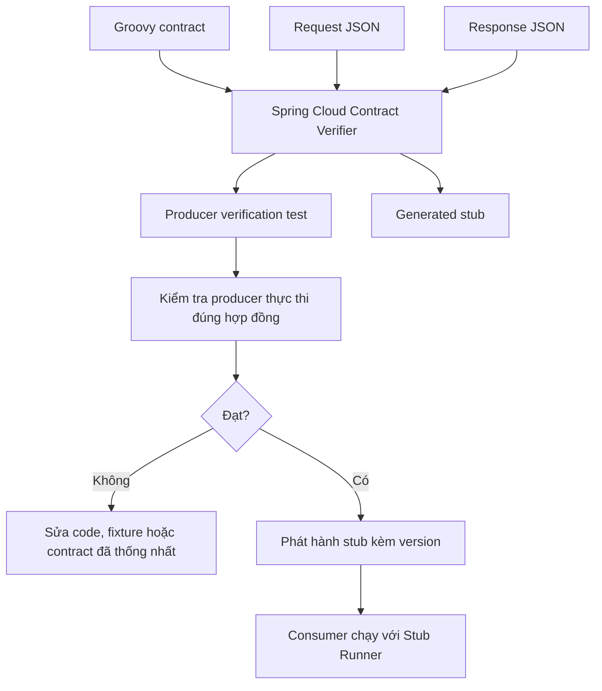

# Tham chiếu tệp body từ hợp đồng

## 1. Vì sao cần tách body ra khỏi Groovy DSL?

Trong một hệ thống microservices, `checkout-service` (consumer) gửi yêu cầu tạo thanh toán đến `payment-service` (producer). Hai bên phải thống nhất cả cấu trúc request và response. Khi payload gồm nhiều trường, danh sách lồng nhau hoặc nội dung nhị phân, việc đặt toàn bộ body trực tiếp trong file Groovy contract làm hợp đồng khó đọc, khó review và khó tái sử dụng dữ liệu mẫu.

**Spring Cloud Contract** cho phép giữ phần mô tả hành vi HTTP hoặc messaging trong Groovy DSL, đồng thời **tham chiếu nội dung body từ một tệp riêng**. Từ các contract này, Spring Cloud Contract Verifier có thể sinh test xác minh producer; các stub được phát hành có thể được consumer sử dụng với Stub Runner và kiểm thử trong CI để phát hiện thay đổi API không tương thích.

Ví dụ, thay vì viết:

```groovy
response {
    status 201
    headers {
        contentType(applicationJson())
    }
    body('''{
      "paymentId": "PAY-1001",
      "orderId": "ORD-2001",
      "status": "CREATED",
      "amount": 250000,
      "currency": "VND"
    }''')
}
```

ta có thể đặt JSON trong file `create-payment-response.json` và thay phần body bằng:

```groovy
response {
    status 201
    headers {
        contentType(applicationJson())
    }
    body(file("create-payment-response.json"))
}
```

**`file("...")` là hàm của DSL**, giúp Spring Cloud Contract lấy nội dung tệp để làm body khi sinh test và stub. Nó không phải một endpoint trả file; cũng không phải Java/Groovy `new File(...)` tùy ý mở đường dẫn tuyệt đối.

Sau bài này, bạn có thể: viết contract HTTP dùng `file(...)` cho request và response; bố trí tệp tương đối đúng vị trí; phân biệt nội dung văn bản với dữ liệu nhị phân bằng `fileAsBytes(...)`; hiểu tác động lên producer verification, stub và CI; đồng thời xử lý các lỗi phổ biến.

## 2. Cú pháp cốt lõi và quy tắc về đường dẫn

Với **Groovy DSL**:

| Mục đích | Cú pháp | Ý nghĩa |
| --- | --- | --- |
| Đọc request body dạng văn bản | `request { body(file("request.json")) }` | Dùng nội dung tệp làm body request trong contract. |
| Đọc response body dạng văn bản | `response { body(file("response.json")) }` | Dùng nội dung tệp làm body response trong contract. |
| Đọc request body dạng byte | `request { body(fileAsBytes("input.pdf")) }` | Dùng nội dung nhị phân của file; tránh coi byte là văn bản. |
| Đọc response body dạng byte | `response { body(fileAsBytes("output.pdf")) }` | Xác minh/phát hành phản hồi nhị phân theo contract. |

Các đường dẫn truyền vào `file(...)` và `fileAsBytes(...)` được **giải quyết tương đối với thư mục chứa tệp contract**. Không tính từ thư mục chạy Maven/Gradle, thư mục gốc của mã nguồn hay thư mục `__files` của WireMock.

Ví dụ cấu trúc thư mục **minh họa** (đây là tên và vị trí trong một dự án producer giả định, không phải các file được tạo bởi bài học):

```text
payment-service/
└── src/
    └── test/
        └── resources/
            └── contracts/
                └── payments/
                    ├── create-payment.groovy
                    ├── create-payment-request.json
                    ├── create-payment-response.json
                    └── payloads/
                        └── payment-error.json
```

Trong `create-payment.groovy`, đường dẫn `"create-payment-request.json"` trỏ đến file ngay bên cạnh; `"payloads/payment-error.json"` trỏ đến file trong thư mục con của `payments`. Nếu chuyển contract sang thư mục khác, cần cập nhật đường dẫn hoặc chuyển các payload đi cùng.

Đường dẫn trên sử dụng bố cục thường gặp của Maven và một số cấu hình Spring Cloud Contract. Với Gradle hoặc khi plugin được cấu hình `contractsDslDir` khác, thư mục nguồn contract có thể thay đổi; **nguyên tắc đường dẫn tương đối từ vị trí contract vẫn là điểm cần kiểm tra**.

### Phân biệt tên tương tự

- `body(file("..."))` **Groovy DSL**: một lời gọi hàm DSL.
- `bodyFromFile: ...` **YAML DSL**: một thuộc tính cấu hình.
- `body(fileAsBytes("..."))` **Groovy DSL**: lấy byte nhị phân.
- `bodyFromFileAsBytes: ...` **YAML DSL**: thuộc tính tương đương cho nhị phân.
- `bodyFileName` trong cấu hình WireMock thuần là cơ chế khác, có quy tắc đường dẫn và file root riêng; **không dùng thay thế trực tiếp** cú pháp của Spring Cloud Contract Groovy DSL.

## 3. Ví dụ hoàn chỉnh: HTTP request và response từ JSON

### 3.1. Nghiệp vụ cần kiểm thử

Checkout gửi yêu cầu tạo thanh toán:

```http
POST /api/payments HTTP/1.1
Content-Type: application/json
Accept: application/json

{
  "orderId": "ORD-2001",
  "amount": 250000,
  "currency": "VND",
  "paymentMethod": "BANK_TRANSFER"
}
```

Payment xác nhận đã tạo bản ghi thanh toán và trả HTTP `201` với `paymentId` mới, trạng thái `CREATED` và thông tin tương ứng đơn hàng. Ở ví dụ học tập, mã `PAY-1001` là giá trị fixture **cố định** để giúp kiểm tra quan hệ giữa request và response. Nếu production luôn phát sinh mã động, cần điều chỉnh contract/matcher và cách dựng fixture như trình bày ở phần sau.

### 3.2. Tệp `create-payment-request.json`

Nội dung:

```json
{
  "orderId": "ORD-2001",
  "amount": 250000,
  "currency": "VND",
  "paymentMethod": "BANK_TRANSFER"
}
```

Các giá trị này không được chọn tùy tiện: `orderId` cho biết giao dịch gắn với đơn nào, `amount` cùng `currency` thể hiện chính xác số tiền, còn `paymentMethod` chỉ ra cách thanh toán. Việc dùng dữ liệu tổng hợp, ổn định giúp test có thể lặp lại mà không phụ thuộc thông tin khách hàng thật.

### 3.3. Tệp `create-payment-response.json`

Nội dung:

```json
{
  "paymentId": "PAY-1001",
  "orderId": "ORD-2001",
  "status": "CREATED",
  "amount": 250000,
  "currency": "VND"
}
```

Response tiếp tục phản ánh đúng `orderId`, `amount` và `currency` của request. Consumer dùng `status` để quyết định bước tiếp theo. Một API thực tế có thể thêm thuộc tính khác, nhưng chỉ nên ghi vào contract những hành vi hai bên thực sự cam kết và cần xác minh.

### 3.4. Tệp `create-payment.groovy`

```groovy
import org.springframework.cloud.contract.spec.Contract

Contract.make {
    name("create_payment_success")
    description("Tạo yêu cầu thanh toán hợp lệ")

    request {
        method "POST"
        url "/api/payments"
        headers {
            contentType(applicationJson())
            header("Accept", "application/json")
        }
        body(file("create-payment-request.json"))
    }

    response {
        status 201
        headers {
            contentType(applicationJson())
        }
        body(file("create-payment-response.json"))
    }
}
```

Phân tích từng thành phần:

1. `method "POST"` và `url "/api/payments"` mô tả HTTP request producer phải xử lý.
2. `contentType(applicationJson())` khai báo định dạng payload là JSON. Nếu client yêu cầu một loại nội dung cụ thể, `Accept` được khai báo cùng phía request.
3. `body(file("create-payment-request.json"))` lấy payload từ tệp JSON để gửi trong bài test producer và dùng làm thông tin khớp request ở stub.
4. `status 201` và `body(file("create-payment-response.json"))` xác định phản hồi được kỳ vọng từ producer và phản hồi mô phỏng bởi stub.
5. `name` và `description` giúp bài test/contract dễ nhận diện khi CI báo lỗi.

Đây là **một contract độc lập với hai file JSON cùng cấp**. Cần cung cấp cả ba file khi chạy bước sinh test/stub; các đoạn JSON trên chỉ mô tả nội dung mẫu, không phải các tệp đã được tạo thật trong bài học này.

## 4. Spring Cloud Contract xử lý tệp ở bước nào?

Về mặt ý tưởng:



Khi generator đọc hợp đồng, nó lấy **nội dung** tệp được tham chiếu để đưa vào việc tạo test hoặc stub tương ứng. Hợp đồng vẫn được xét theo các phần request, response, headers và status; tách JSON ra file không làm mất trách nhiệm mô tả những điều ấy.

| Bên sử dụng | Body request từ file | Body response từ file |
| --- | --- | --- |
| **Producer verification** | Tạo/gửi request phù hợp đến producer đang được test. | Xác minh phản hồi thật của producer phù hợp với contract. |
| **Generated stub** | Xác định request mà stub có thể nhận diện theo quy tắc khớp. | Cung cấp phản hồi mô phỏng cho consumer test. |
| **CI** | Cần tệp nguồn để generator đọc được trong bước build. | Cần tệp nguồn khi sinh test/stub; producer verification phải chạy đạt trước khi phát hành phiên bản ổn định. |

Một lỗi thường gặp là nghĩ rằng Stub Runner sẽ mở lại `create-payment-response.json` từ repository của producer khi consumer gửi HTTP request. Trong luồng phát hành thông thường, consumer dùng **artifact stub đã được sinh và đóng gói**, không cần truy cập trực tiếp vào workspace nguồn của producer. Vì vậy, việc thay JSON trong repository mà **không sinh và phát hành lại stub** sẽ không làm đổi hành vi artifact stub đã phát hành.

**Điểm giới hạn:** phần “đọc file” diễn ra trong quá trình xử lý/generate contract, không có nghĩa Spring Cloud Contract tạo cơ sở dữ liệu, nạp fixture hay quyết định nghiệp vụ thay ứng dụng. Nếu producer phải tìm `ORD-2001` trong database để trả `PAY-1001`, base test hoặc test setup của producer phải chuẩn bị trạng thái đó một cách rõ ràng.

## 5. Đường dẫn tương đối: ba tình huống và cách tránh lỗi

### 5.1. File nằm cùng thư mục với contract

Với:

```text
contracts/payments/
├── create-payment.groovy
└── create-payment-response.json
```

tham chiếu:

```groovy
body(file("create-payment-response.json"))
```

Đây là cách đơn giản nhất để giữ contract và payload đi cùng nhau, giảm rủi ro khi di chuyển thư mục.

### 5.2. File nằm trong thư mục con

Với:

```text
contracts/payments/
├── payment-not-found.groovy
└── payloads/
    └── payment-error.json
```

tham chiếu:

```groovy
body(file("payloads/payment-error.json"))
```

Không viết `"contracts/payments/payloads/payment-error.json"` nếu chuỗi ấy được hiểu lại từ thư mục `payments`, vì dễ tạo thành đường dẫn lặp. Tên file phải đúng từng ký tự; hệ thống CI dùng Linux có thể phân biệt `Payment-Error.json` và `payment-error.json`.

### 5.3. File được chuyển chỗ

Nếu `create-payment.groovy` chuyển từ `contracts/payments/` sang `contracts/payments/create/` còn JSON vẫn ở vị trí cũ, đường dẫn `"create-payment-response.json"` **không còn trỏ đúng**. Cần sắp xếp lại file cạnh contract hoặc cập nhật đường dẫn tương đối một cách chủ đích.

Đối với thư viện contract dùng chung, nên tránh đường dẫn tuyệt đối (ví dụ ổ đĩa cá nhân, thư mục temporary hoặc URL mạng) vì chúng không bảo đảm khả chuyển giữa máy phát triển, agent CI và môi trường build. Cần commit hoặc cung cấp các payload nguồn cho quá trình sinh contract cùng với tệp Groovy.

## 6. Trường hợp body là nhị phân: `fileAsBytes(...)`

Không phải API nào cũng trao đổi JSON. Ví dụ một dịch vụ lưu chứng từ tiếp nhận PDF, hình ảnh hoặc dữ liệu `application/octet-stream`. Những byte này có thể không đại diện cho chuỗi UTF-8 hợp lệ; dùng `file("...")` để đọc như text có thể làm thay đổi nội dung.

Tình huống: producer nhận một PDF mẫu và trả một PDF đã đóng dấu. Ví dụ cấu trúc:

```text
contracts/documents/
├── stamp-document.groovy
├── request.pdf
└── response.pdf
```

Groovy contract:

```groovy
import org.springframework.cloud.contract.spec.Contract

Contract.make {
    name("stamp_document")

    request {
        method "POST"
        url "/api/documents/stamp"
        headers {
            contentType(applicationOctetStream())
        }
        body(fileAsBytes("request.pdf"))
    }

    response {
        status 200
        headers {
            contentType(applicationOctetStream())
        }
        body(fileAsBytes("response.pdf"))
    }
}
```

Đây là ví dụ API **truyền nguyên byte PDF** trong body, với Content-Type `application/octet-stream`. Nếu API công bố `application/pdf`, hãy khai báo header đúng loại đó; nếu là `multipart/form-data`, cần dùng các thành phần multipart và quy tắc ranh giới phù hợp, không coi toàn bộ multipart request là một file PDF đơn.

Đặc điểm quan trọng:

- `fileAsBytes("request.pdf")` và `fileAsBytes("response.pdf")` lấy byte của file, không yêu cầu tự viết chuỗi Base64 trong DSL.
- Nội dung mẫu cần **ổn định** và được quản lý phiên bản trong nguồn kiểm thử; đừng trỏ đến file được hệ thống khác thay đổi mỗi ngày.
- Producer verification cho dữ liệu nhị phân có thể trở nên rất chặt: nếu PDF chứa timestamp, ID ngẫu nhiên hoặc metadata thay đổi giữa các lần sinh, so sánh byte có thể thất bại dù tài liệu hiển thị giống nhau. Khi đó hãy xác định mức cam kết cần có và bổ sung kiểm thử chuyên biệt nếu cần.
- Không dùng dữ liệu nhạy cảm hoặc chứng từ thật trong payload mẫu; dùng file tổng hợp hoặc file đã ẩn danh hợp lệ.

Đừng nhầm `fileAsBytes(...)` với việc tạo một tệp trên đĩa của consumer. Đây là cách mô tả **body của request/response**. Khi chạy qua HTTP, ứng dụng consumer tự quyết định lưu nội dung nhận được vào file hay xử lý trong bộ nhớ.

## 7. So sánh nhanh với YAML DSL

Nếu cùng hành vi được mô tả bằng YAML thay cho Groovy, thuộc tính tương đương là `bodyFromFile`:

```yaml
description: Tạo yêu cầu thanh toán hợp lệ
name: create_payment_success
request:
  method: POST
  url: /api/payments
  headers:
    Content-Type: application/json
    Accept: application/json
  bodyFromFile: create-payment-request.json
response:
  status: 201
  headers:
    Content-Type: application/json
  bodyFromFile: create-payment-response.json
```

Với dữ liệu nhị phân:

```yaml
request:
  method: POST
  url: /api/documents/stamp
  headers:
    Content-Type: application/octet-stream
  bodyFromFileAsBytes: request.pdf
response:
  status: 200
  headers:
    Content-Type: application/octet-stream
  bodyFromFileAsBytes: response.pdf
```

Các ví dụ trên minh họa **cùng ý tưởng với hai cách viết**. Trong một dự án, chọn Groovy hoặc YAML làm nguồn hợp đồng chính cho một tình huống, tránh vô tình đăng ký hai contract trùng nhau. Sự khác biệt là cú pháp tham chiếu file, không phải việc chỉ Groovy mới sinh được producer test và stub.

## 8. Kết hợp body ngoài file với matcher và dữ liệu động

Một file JSON mẫu thường chứa **giá trị cụ thể**. Điều này rất hữu ích với các trường nghiệp vụ cần giữ ổn định, nhưng không phải mọi giá trị trong response của production đều cố định.

Ví dụ:

```json
{
  "paymentId": "PAY-1001",
  "orderId": "ORD-2001",
  "status": "CREATED",
  "amount": 250000,
  "currency": "VND",
  "createdAt": "2026-01-15T09:00:00Z"
}
```

Nếu producer thật luôn tạo `paymentId` và `createdAt` mới, việc kiểm tra giá trị cố định ở hai trường này có thể làm test thất bại không cần thiết. Tuy nhiên, thay tất cả bằng regex quá rộng lại có thể che lỗi thay đổi API.

Hãy phân loại:

| Thuộc tính | Cách xác minh phù hợp | Lý do |
| --- | --- | --- |
| `orderId` | Đối chiếu mã đơn hàng đã gửi. | Consumer cần liên hệ đúng đơn. |
| `status` | Đối chiếu giá trị được cam kết như `CREATED`. | Quyết định nhánh xử lý. |
| `amount`, `currency` | Giữ đúng dữ liệu kịch bản. | Sai đơn vị/số tiền là lỗi nghiệp vụ. |
| `paymentId` do server sinh | Kiểm tra định dạng và điều kiện khác nếu thực sự động. | Tránh ràng buộc ID cụ thể ngoài hợp đồng. |
| `createdAt` | Dùng đồng hồ cố định hoặc matcher thời gian có ràng buộc. | Không phụ thuộc thời điểm chạy test. |

Spring Cloud Contract hỗ trợ **body matchers** và giá trị động trong DSL. Tùy dạng contract và phiên bản, bạn có thể định nghĩa matcher bên cạnh body tham chiếu từ file; phải đọc tài liệu đúng phiên bản và **xem generated test/stub** để xác minh matcher thực sự áp dụng. Không nên giả định một chuỗi như `"PAY-.*"` bên trong JSON sẽ tự được xem là regex: một file JSON bình thường chỉ chứa chuỗi dữ liệu.

Nếu cần biểu thức producer/consumer phức tạp ngay trong từng thuộc tính, có thể cân nhắc dùng `body([...])` của Groovy DSL cho phần đó hoặc kết hợp matcher theo API của phiên bản được chọn. Quyết định tách body ra file phải phục vụ khả năng đọc và bảo trì, không được làm mất các kiểm tra bất biến nghiệp vụ.

**Một nguyên tắc thực hành:** stub cần trả dữ liệu đại diện, ổn định để consumer kiểm thử được logic thật; producer verification cần xác minh đủ những ràng buộc mà consumer phụ thuộc. Tách file không khiến dữ liệu tự trở nên có ý nghĩa hay test tự động bao phủ các trường hợp thiếu.

## 9. Một file lớn hay nhiều file nhỏ?

Tách body khỏi Groovy contract đặc biệt hữu ích khi payload dài. Nhưng không nên biến mọi phản hồi ngắn thành hàng chục tệp khó lần theo.

| Tình huống | Cách tổ chức gợi ý |
| --- | --- |
| JSON chỉ 2–3 trường, đơn giản | Có thể giữ `body([...])` ngay trong contract. |
| JSON lồng nhau, vài chục trường | Dùng file JSON cạnh contract; đặt tên gắn với hành vi. |
| Nhiều trường hợp `CREATED`, `REJECTED`, `NOT_FOUND` | Dùng contract riêng cho từng hành vi với tệp body riêng hoặc dữ liệu dùng chung khi hợp lý. |
| Nhiều contract dùng một cấu trúc chung | Chỉ chia sẻ một file nếu các tình huống có **cùng cam kết**; tránh sửa một file làm nhiều contract thay đổi ngoài dự kiến. |
| PDF, ảnh, nội dung nhị phân | Dùng `fileAsBytes(...)` và file mẫu ổn định, kích thước vừa đủ. |
| Dữ liệu có secret, token thật, PII | Tạo dữ liệu tổng hợp an toàn; không commit dữ liệu nhạy cảm. |

Ví dụ API tra cứu thanh toán có thể có:

```text
contracts/payments/
├── payment-paid.groovy
├── payment-paid-response.json
├── payment-pending.groovy
├── payment-pending-response.json
├── payment-not-found.groovy
└── payment-not-found-response.json
```

Khi đó test consumer có thể phân biệt đã thanh toán với chờ xử lý và không tìm thấy. Nếu dùng cùng JSON `status: "PAID"` cho mọi contract, test có thể xanh nhưng không chứng minh consumer xử lý nhánh `PENDING` đúng.

Tệp dùng chung có lợi cho bảo trì nhưng tạo **coupling ngầm**: thay `common-response.json` có thể làm hàng loạt hợp đồng thay đổi. Hãy ưu tiên tính rõ ràng nghiệp vụ và phạm vi tác động khi review.

## 10. Các lỗi thường gặp

| Triệu chứng | Nguyên nhân thường gặp | Cách kiểm tra và khắc phục |
| --- | --- | --- |
| Generator báo không tìm thấy file | Đường dẫn tính nhầm từ root project hoặc hợp đồng đã được chuyển thư mục. | Kiểm tra vị trí file `.groovy` và đường dẫn tương đối chính xác. |
| Chỉ lỗi trong Linux CI | Khác chữ hoa/thường trong tên file, file chưa được commit. | So sánh chính xác đường dẫn và bảo đảm payload có trong checkout CI. |
| Nội dung gửi đi khác mong muốn | JSON sai cú pháp, mã hóa hoặc header Content-Type không khớp. | Kiểm tra JSON UTF-8, MIME và request do generated test gửi. |
| Producer test xanh nhưng consumer xử lý sai | Stub trả một trường hợp quá chung hoặc test consumer không đi qua client thật. | Tạo kịch bản nghiệp vụ đủ khác nhau và xác minh luồng xử lý consumer. |
| Cập nhật JSON nhưng consumer vẫn thấy body cũ | Stub artifact đang dùng vẫn là phiên bản trước. | Sinh/phát hành lại stub và chọn đúng version bằng Stub Runner. |
| File PDF bị sai byte | Dùng `file(...)` kiểu text cho dữ liệu nhị phân. | Dùng `fileAsBytes(...)` và đúng Content-Type. |
| Test fail không ổn định vì timestamp hoặc ID | So sánh giá trị tuyệt đối với dữ liệu động. | Kiểm soát fixture/Clock hoặc dùng matcher phù hợp. |
| Test báo đúng response nhưng sai quan hệ nghiệp vụ | File request và response dùng ID, số tiền hoặc đơn vị không nhất quán. | Đối chiếu các invariant giữa payload và thêm test nghiệp vụ nếu cần. |
| Mã Groovy có chuỗi `file(...)` nhưng không sinh body đúng | Đặt lời gọi sai vị trí hoặc dùng cơ chế file của công cụ khác. | Dùng `body(file("..."))` trong khối `request`/`response` và xem output generator. |

### Checklist trước khi mở pull request

1. Tệp Groovy contract và mọi tệp được tham chiếu đều có trong repository nguồn đúng vị trí.
2. `file(...)` dùng cho nội dung văn bản; `fileAsBytes(...)` dùng cho nội dung nhị phân.
3. Header như `Content-Type` phù hợp với dữ liệu thực tế.
4. JSON hợp lệ, mã hóa nhất quán, dữ liệu test an toàn và có ý nghĩa nghiệp vụ.
5. Đường dẫn tương đối vẫn đúng sau khi đổi cấu trúc thư mục.
6. Producer verification thực sự được **sinh, biên dịch và chạy**; không chỉ kiểm tra pipeline trả exit code 0.
7. Stub sinh ra chứa hành vi mong đợi, được phát hành và dùng theo phiên bản xác định trong consumer CI.

## 11. Bài thực hành: mở rộng contract thanh toán

Giả sử nhóm Checkout và Payment muốn thêm trường `expiresAt` cho yêu cầu thanh toán chưa hoàn tất. Bạn được giao ba tệp giả định: `create-payment.groovy`, `create-payment-request.json` và `create-payment-response.json`.

**Nhiệm vụ:**

1. Đặt hai file JSON cạnh `create-payment.groovy` rồi dùng `file(...)` cho cả request và response.
2. Giữ `orderId = ORD-2001`, `amount = 250000` và `currency = VND` nhất quán giữa hai tệp. Giải thích vì sao cần đối chiếu những trường đó.
3. Thêm `expiresAt` vào response. Chọn cách kiểm thử khi thời gian hết hạn được producer tính động: dùng `Clock` cố định hoặc matcher có điều kiện hợp lý, và giải thích ưu/nhược điểm.
4. Chuyển hai file JSON vào `payloads/`. Cập nhật hai đường dẫn trong contract theo vị trí mới; không dùng đường dẫn tuyệt đối.
5. Viết thêm contract cho trường hợp phương thức thanh toán không được hỗ trợ, có body lỗi từ file riêng và status đã thống nhất (ví dụ `422` nếu API thực sự cam kết).
6. Mô tả bước sinh producer verification, kiểm tra test thất bại khi producer bỏ trường `currency`, rồi đóng gói stub để Checkout chạy với Stub Runner trong CI.
7. Giải thích vì sao một tệp `receipt.pdf` phải được tham chiếu bằng `fileAsBytes(...)` nếu contract mô tả HTTP body nhị phân.

**Tự đánh giá:** Bài làm đúng khi đường dẫn được tính từ thư mục của contract, payload hợp lệ, request/response nhất quán về nghiệp vụ và producer test kiểm tra những cam kết quan trọng. Khi đổi file JSON, cần tạo lại test/stub trước khi coi đó là phiên bản hợp đồng mới.

## 12. Ghi nhớ

- Trong **Groovy DSL của Spring Cloud Contract**, dùng `body(file("ten-file.json"))` để đưa nội dung file văn bản vào request hoặc response body.
- Đường dẫn file **tương đối với thư mục chứa contract**, không phải đường dẫn của CI workspace hay mặc định của WireMock `__files`.
- Với dữ liệu nhị phân (PDF, ảnh...), dùng `body(fileAsBytes("ten-file.pdf"))`; YAML DSL có các thuộc tính `bodyFromFile` và `bodyFromFileAsBytes`.
- Payload tách riêng vẫn cần có **giá trị nghiệp vụ đúng**, matcher hợp lý, dữ liệu fixture được kiểm soát và versioning rõ ràng.
- Spring Cloud Contract dùng nội dung các tệp khi **sinh producer test và stub**. Consumer dùng Stub Runner với artifact stub phù hợp; chỉnh file nguồn không tự đổi artifact đã phát hành.
- Trong CI, kiểm tra tệp được tìm thấy, generated tests thực sự chạy đạt, stub được đóng gói và consumer xác minh hành vi qua client thật.

### Tài liệu tham khảo

- [Spring Cloud Contract — How Can I Reference Text from File?](https://docs.spring.io/spring-cloud-contract/reference/howto/how-to-reference-text-from-file.html): giới thiệu `file(...)` và đường dẫn tương đối.
- [Spring Cloud Contract — Common Top-Level Elements, Passing Values from Files](https://docs.spring.io/spring-cloud-contract/reference/project-features-contract/common-top-elements.html): ví dụ Groovy, YAML, `file(...)` và `fileAsBytes(...)`.
- [Spring Cloud Contract — HTTP Contracts](https://docs.spring.io/spring-cloud-contract/reference/project-features-contract/http.html): request/response, body, header, status và các quy tắc HTTP.
- [Spring Cloud Contract — Developing Your First Application](https://docs.spring.io/spring-cloud-contract/reference/getting-started/first-application.html): thiết lập contract, sinh test và stub.
