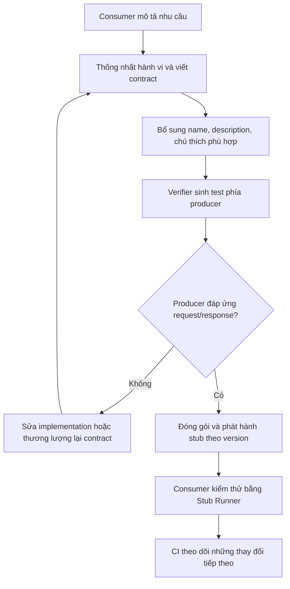

# Metadata và mô tả phục vụ người đọc

Một hợp đồng **Spring Cloud Contract** có thể hợp lệ về mặt cú pháp và sinh được test nhưng vẫn khó hiểu đối với người bảo trì: tên file chỉ là `test1.groovy`, phần mô tả để trống, không biết consumer nào sử dụng hay vì sao phải trả mã lỗi `409`. Vài tháng sau, khi producer muốn đổi API, nhóm phát triển dễ vô tình bỏ một cam kết quan trọng chỉ vì không thấy bối cảnh nghiệp vụ của nó.

Trong chương **Groovy DSL**, bài này tập trung vào **metadata và mô tả phục vụ người đọc**: cách dùng tên hợp đồng, mô tả, chú thích và quy ước truy vết để các nhóm producer–consumer hiểu đúng mục đích của từng kịch bản. Đây là một phần của việc học **Spring Cloud Contract** để mô tả hành vi HTTP hoặc thông điệp bằng Groovy/YAML DSL, sinh kiểm thử phía producer, xuất bản stub, dùng Stub Runner và tích hợp CI nhằm phát hiện thay đổi không tương thích.

Sau bài học, bạn có thể:

- Giải thích sự khác biệt giữa **hành vi được kiểm chứng** và **thông tin giúp con người hiểu hợp đồng**.
- Viết `name` và `description` rõ ràng trong Groovy DSL, phù hợp với nhu cầu consumer.
- Phân biệt chú thích và metadata mô tả với những thuộc tính ảnh hưởng đến test hoặc stub, nhất là `label` trong hợp đồng message.
- Gắn bối cảnh consumer, năng lực nghiệp vụ, giả định và quy tắc thay đổi vào đúng vị trí.
- Dùng thông tin mô tả để review contract, phân tích ảnh hưởng và xử lý lỗi CI mà không hiểu nhầm chúng là assertion tự động.

## 1. Contract cần người đọc hiểu điều gì?

Xét luồng tích hợp của hệ thống đặt hàng:

- **Consumer:** `OrderService` gọi API giữ hàng trước khi nhận thanh toán.
- **Producer:** `InventoryService` xử lý việc giữ hàng.
- **Hành vi HTTP:** `POST /api/v1/reservations` trả `201` khi giữ hàng thành công.
- **Hành vi lỗi:** cùng API trả một phản hồi lỗi nghiệp vụ khi số lượng trong kho không đủ.

Nếu chỉ nhìn thấy request và response của một contract, người đọc có thể biết *API phải trả gì* nhưng chưa chắc biết *vì sao điều này quan trọng*, *ai đang cần kết quả ấy* hay *nhánh xử lý nào sẽ hỏng khi đổi phản hồi*.

Ví dụ, hai phản hồi cùng thuộc nhóm HTTP 2xx có thể khác ý nghĩa đối với consumer: `201 Created` thông báo có một lượt giữ hàng mới, còn `202 Accepted` có thể báo yêu cầu đang chờ xử lý. Nếu `OrderService` dùng `201` để bắt đầu bước thanh toán ngay, đổi thành `202` là thay đổi cần thảo luận, dù API vẫn trả mã thành công.

Metadata và mô tả giúp nhóm đọc lại cam kết đó. Phần **request/response**, matcher và điều kiện message mới là nơi công cụ sinh test lấy các quy tắc có thể kiểm chứng.

| Câu hỏi khi đọc contract | Thông tin nên tìm | Phần nào bảo vệ hành vi? |
| --- | --- | --- |
| Đây là kịch bản gì? | Tên ngắn, ổn định trong `name` và tên file | `name` hỗ trợ định danh; request/response quyết định điều kiện test |
| Ai phụ thuộc vào kịch bản? | `description`, đường dẫn theo consumer hoặc hồ sơ quản lý | Contract phải thực sự mô tả đúng nhu cầu; ghi tên consumer không tạo assertion |
| Vì sao cần mã `201`? | Giải thích ngữ nghĩa trong `description` | `response { status 201 }` |
| Điều kiện nào dẫn đến lỗi hết hàng? | Bối cảnh nghiệp vụ và fixture test | `request`, `response` và việc chuẩn bị trạng thái producer |
| Thay đổi API có ảnh hưởng đến ai? | Chủ sở hữu, người duyệt, danh sách consumer | Kết quả kiểm thử hợp đồng kết hợp đánh giá tương thích thực tế |
| Khi nào consumer được xử lý tiếp? | Mô tả luồng sau khi nhận kết quả | Test cho các field/trạng thái mà consumer thực sự đọc |

**Nguyên tắc:** hãy viết metadata để giải thích *ý nghĩa của một cam kết*; hãy viết phần hành vi của DSL để *kiểm chứng cam kết ấy*. Không nên đặt kỳ vọng quan trọng chỉ trong câu mô tả.

## 2. Những thành phần dễ được gọi chung là “metadata”

Trong quá trình review, nhóm thường gọi tên hợp đồng, mô tả, nhãn và chú thích là metadata. Tuy nhiên, **không phải tất cả đều có cùng vai trò trong Spring Cloud Contract Groovy DSL**.

| Thành phần | Ví dụ | Vai trò chính | Lưu ý |
| --- | --- | --- | --- |
| `name` | `reserve_stock_success` | Định danh hợp đồng, giúp mã test sinh ra và người đọc truy vết kịch bản | Chọn tên ổn định và tránh trùng trong phạm vi build |
| `description` | `OrderService giữ hàng trước thanh toán` | Giải thích bối cảnh, mục tiêu và ý nghĩa hành vi | Văn bản mô tả không tự biến thành điều kiện xác minh |
| Chú thích Groovy | `// SKU này phải hết hàng trong fixture` | Giải thích quyết định thiết kế và dữ liệu kiểm thử | Chỉ có ích khi đọc nguồn; không phải một phần của HTTP payload |
| Đường dẫn và tên file | `reservations/order-service/create-success.groovy` | Tìm contract theo năng lực và consumer | Là quy ước repository; không tự giới hạn stub theo consumer |
| `label` của message contract | `payment_completed` | Định danh có thể dùng khi kích hoạt message trên stub | Có ý nghĩa **vận hành**, không chỉ là nhãn trang trí |
| `priority` và matcher | Độ ưu tiên mapping, quy tắc so khớp | Ảnh hưởng đến cách stub hoặc test hoạt động tùy ngữ cảnh | Không dùng để thay cho mô tả dành cho người đọc |

**Lưu ý về phiên bản:** DSL và các tùy chọn mở rộng có thể thay đổi giữa những phiên bản Spring Cloud Contract. Bài này dùng các thành phần quen thuộc như `name`, `description` và `label`. Không tự đưa các thuộc tính tùy ý như `owner`, `team`, `tags` hoặc `ticket` vào trực tiếp `Contract.make { ... }` khi chưa xác nhận DSL của phiên bản dự án hỗ trợ chúng; điều đó có thể làm contract không biên dịch được.

### `name`: định danh ngắn, dễ tìm kiếm

Tên tốt cho biết *hành động* và *kết quả quan trọng*:

```groovy
Contract.make {
    name 'order_create_reservation_success'
    // ...
}
```

Một số quy tắc hữu ích:

1. Dùng cùng một cách đặt tên cho toàn bộ nguồn contract, chẳng hạn `<consumer>_<action>_<outcome>`.
2. Diễn đạt kết quả quan sát được: `success`, `insufficient_stock`, `invalid_quantity` hoặc `not_found`.
3. Hạn chế dùng ký tự dễ gây khó khăn cho tên test được sinh; dạng chữ, số và dấu gạch dưới thường thuận tiện.
4. Tránh tên trùng có thể dẫn đến nhầm lẫn hoặc xung đột khi sinh test, đặc biệt nếu công cụ cấu hình gom contract từ nhiều thư mục.
5. Không đổi `name` chỉ để làm đẹp trong cùng một PR đang thay đổi hành vi lớn; các tên test, báo cáo hoặc quy tắc theo dõi có thể phụ thuộc vào nó.

Tên hợp đồng có thể được Spring Cloud Contract dùng khi tạo tên lớp/phương thức kiểm thử, nhưng cách chuyển đổi cụ thể phụ thuộc phiên bản plugin và cấu hình. Không nên dựa vào một tên lớp được sinh cụ thể như một API ổn định.

### `description`: giải thích cho người đọc, không thay assertion

`description` nên trả lời được:

- Consumer hoặc luồng nghiệp vụ nào cần hành vi?
- Điều kiện nghiệp vụ nào đang xét?
- Kết quả nào cho phép consumer tiếp tục hoặc dừng xử lý?
- Vì sao một trường hoặc mã lỗi được xem là cam kết quan trọng?

Mô tả tốt có thể gồm một câu ngắn hoặc vài dòng khi cần bối cảnh:

```groovy
Contract.make {
    name 'order_create_reservation_insufficient_stock'
    description '''
        Consumer: OrderService.
        Khi tồn kho không đủ cho số lượng được yêu cầu,
        producer trả lỗi INSUFFICIENT_STOCK để consumer
        dừng bước thanh toán và hiển thị thông báo.
    '''
    // ...
}
```

Ví dụ trên cho thấy có thể dùng chuỗi nhiều dòng Groovy để giải thích ngữ nghĩa. Với các kịch bản đơn giản, mô tả một dòng cũng đủ; điều quan trọng là dễ đọc và thống nhất với những điều kiện test thực sự kiểm tra.

Mô tả không nên là bản sao nguyên văn của JSON. Chẳng hạn, “Trả `201` và trường `reservationId`” hữu ích nhưng chưa đủ để giải thích *vì sao* consumer cần `reservationId`. Tốt hơn là “`OrderService` dùng `reservationId` để xác nhận hoặc hủy lượt giữ trước khi đơn hoàn tất”.

### Chú thích Groovy: giải thích quyết định kỹ thuật cục bộ

Chú thích phù hợp khi một chi tiết trong contract dễ bị hiểu nhầm:

```groovy
request {
    method 'POST'
    url '/api/v1/reservations'
    // Fixture phía producer bảo đảm SKU-EMPTY không còn hàng.
    body([
        sku     : 'SKU-EMPTY',
        quantity: 2
    ])
}
```

Chú thích giúp người sửa file hiểu vì sao chọn dữ liệu mẫu nhưng **không tạo dữ liệu trong database**. Nếu fixture không được chuẩn bị đúng, test vẫn có thể thất bại hoặc kiểm thử sai tình huống. Khi có một yêu cầu cần xác minh, hãy dùng DSL và kiểm thử thực thi tương ứng; đừng chỉ viết comment.

## 3. Ví dụ HTTP: mô tả một kịch bản thành công đầy đủ

Giả sử consumer `OrderService` cần giữ hai đơn vị `SKU-100` để chuyển sang thanh toán. Sau khi hai nhóm thống nhất contract, ta có thể ghi tại:

```text
src/test/resources/contracts/reservations/order-service/create-reservation-success.groovy
```

Nội dung:

```groovy
import org.springframework.cloud.contract.spec.Contract

Contract.make {
    name 'order_create_reservation_success'
    description '''
        Consumer: OrderService.
        Sau khi người dùng xác nhận đơn hàng, OrderService tạo lượt giữ
        để tránh bán vượt số lượng sẵn có. Nếu thành công, consumer cần
        reservationId để tham chiếu lượt giữ và trạng thái HELD để tiếp
        tục luồng thanh toán.
    '''

    request {
        method 'POST'
        url '/api/v1/reservations'
        headers {
            contentType(applicationJson())
        }
        body([
            sku     : 'SKU-100',
            quantity: 2
        ])
    }

    response {
        status 201
        headers {
            contentType(applicationJson())
        }
        body([
            reservationId: 'RES-100',
            status       : 'HELD'
        ])
    }
}
```

Trong ví dụ này:

- `name` giúp nhận ra kịch bản trong nguồn và báo cáo test.
- `description` nói rõ **consumer, thời điểm gọi và lý do cần hai trường phản hồi**.
- `request` và `response` mới xác định yêu cầu kiểm chứng cụ thể. Producer sẽ bị kiểm tra theo các giá trị/matcher trong chúng.
- `RES-100` chỉ là dữ liệu mẫu. Với ID sinh ngẫu nhiên, có thể dùng matcher hoặc fixture thử nghiệm ổn định; không nên vô tình cam kết rằng production luôn trả một ID cố định.

Đường dẫn và API chỉ là ví dụ để học, không phải quy ước do Spring Cloud Contract áp đặt. Khi hệ thống thật sử dụng một định dạng hoặc status khác, mô tả và điều kiện phải phản ánh **thỏa thuận của hai nhóm**.

### Cùng một hợp đồng nhưng mô tả kém

```groovy
Contract.make {
    name 'test_post'
    description 'POST works'

    // Giả sử request/response giống ví dụ ở trên.
}
```

Đây là đoạn minh họa *cách đặt tên và mô tả thiếu thông tin*, không phải một contract đầy đủ có thể sinh test. Sau một thời gian, `test_post` không giúp người đọc biết API nào, kết quả nào và consumer nào sẽ bị ảnh hưởng. Ngược lại, mô tả một trang dài liệt kê toàn bộ quá trình triển khai cũng không có ích; hãy tập trung vào **lý do cam kết tồn tại**.

## 4. Mô tả từng nhánh nghiệp vụ bằng contract riêng

Một API có thể có nhiều kết quả, và mỗi kết quả ảnh hưởng đến quyết định của consumer. Chẳng hạn, giữ hàng thành công cho phép tiếp tục thanh toán; hết hàng thì phải dừng luồng. Không nên gộp hai ý nghĩa thành một mô tả chung chung “API xử lý đặt giữ hàng”.

Ví dụ contract cho trường hợp không đủ hàng:

```groovy
import org.springframework.cloud.contract.spec.Contract

Contract.make {
    name 'order_create_reservation_insufficient_stock'
    description '''
        Consumer: OrderService.
        Nếu không đủ hàng, producer từ chối tạo lượt giữ.
        Consumer dựa vào mã lỗi INSUFFICIENT_STOCK để dừng bước
        thanh toán thay vì giả định hàng đã được giữ.
    '''

    request {
        method 'POST'
        url '/api/v1/reservations'
        headers {
            contentType(applicationJson())
        }
        body([
            sku     : 'SKU-EMPTY',
            quantity: 2
        ])
    }

    response {
        status 409
        headers {
            contentType(applicationJson())
        }
        body([
            code: 'INSUFFICIENT_STOCK'
        ])
    }
}
```

Người đọc thấy ngay sự khác biệt:

| Kịch bản | Tên hợp đồng | Ý nghĩa với consumer | Điều kiện kiểm được |
| --- | --- | --- | --- |
| Giữ hàng thành công | `order_create_reservation_success` | Tiếp tục thanh toán với mã lượt giữ | `201`, `reservationId`, `status=HELD` |
| Không đủ hàng | `order_create_reservation_insufficient_stock` | Dừng thanh toán và thông báo hết hàng | `409`, `code=INSUFFICIENT_STOCK` |

Giá trị `409` và mã `INSUFFICIENT_STOCK` là lựa chọn API của ví dụ. Spring Cloud Contract không bắt mọi nghiệp vụ hết hàng phải sử dụng đúng những giá trị ấy.

Với dữ liệu kiểm thử, producer cần chuẩn bị `SKU-100` có đủ hàng và `SKU-EMPTY` không đủ hàng. Chỉ viết “không đủ hàng” trong `description` mà không kiểm soát điều kiện đầu vào thì test có thể không thực sự bao phủ nhánh nghiệp vụ dự kiến.

## 5. Khi nào nên viết mô tả nhiều dòng?

Không có một độ dài bắt buộc. Mô tả nên dài hơn khi contract có giả định hoặc ngữ nghĩa dễ nhầm lẫn. Có thể dùng quy tắc:

| Mức phức tạp | Cách mô tả |
| --- | --- |
| Một endpoint đọc dữ liệu đơn giản | Một câu: ai gọi, cần kết quả gì |
| Một nhánh lỗi nghiệp vụ | Nêu điều kiện lỗi và hành vi consumer cần thực hiện |
| Một kết quả có trạng thái/timestamp | Làm rõ ý nghĩa trạng thái và đơn vị/thời điểm nếu không hiển nhiên |
| Một message bất đồng bộ | Nêu sự kiện gây phát, consumer sử dụng và ý nghĩa payload |
| Một contract đã có thay đổi tương thích phức tạp | Tóm tắt cam kết còn hiệu lực; dẫn chiếu tài liệu thiết kế được quản lý tại nơi phù hợp |

Viết rõ **Given – When – Then** ở mức nghiệp vụ là một cách tốt:

> **Given:** mặt hàng có thể giữ đủ hai đơn vị. **When:** `OrderService` yêu cầu tạo lượt giữ. **Then:** `InventoryService` trả mã lượt giữ và xác nhận trạng thái `HELD` để consumer tiếp tục thanh toán.

Không cần nhồi toàn bộ kịch bản này vào `name`. Tên ngắn cho phép tìm kiếm; mô tả cho phép hiểu ngữ nghĩa; nội dung DSL cho phép kiểm chứng.

### Những thông tin không nên đưa vào mô tả

- Thông tin nhạy cảm như token thật, mật khẩu, khóa API, dữ liệu cá nhân hoặc ID sản xuất.
- Chi tiết triển khai nội bộ không phải cam kết với consumer, như tên private method hoặc cấu trúc bảng có thể thay đổi.
- Lời bảo đảm mà test không thể xác minh và nhóm producer chưa thống nhất, chẳng hạn “không bao giờ xảy ra lỗi” hoặc “đảm bảo xử lý đúng 100% mọi trường hợp”.
- Mã ticket tạm thời là thông tin duy nhất giải thích contract; nếu ticket bị xóa, người đọc sẽ không còn biết mục đích kịch bản.
- Các mệnh đề mâu thuẫn với request/response, ví dụ nói “trả `201`” trong mô tả nhưng DSL lại ghi `200`.

## 6. Phân biệt `label` trong message contract với mô tả cho người đọc

Với giao tiếp bằng thông điệp, Spring Cloud Contract có khái niệm **`label`**. Đây không đơn thuần là từ khóa để tìm kiếm; trong các kịch bản tương ứng, nhãn có thể được dùng để **kích hoạt message của stub**, chẳng hạn qua cơ chế Stub Runner.

Ví dụ producer `PaymentService` phát sự kiện thanh toán thành công để consumer `OrderService` cập nhật trạng thái đơn:

```groovy
import org.springframework.cloud.contract.spec.Contract

Contract.make {
    name 'order_payment_completed_event'
    description '''
        Consumer: OrderService.
        Khi thanh toán thành công, PaymentService phát sự kiện
        có orderId và paymentId để consumer hoàn tất đơn hàng.
    '''
    label 'payment_completed'

    input {
        triggeredBy('publishPaymentCompleted()')
    }

    outputMessage {
        sentTo('payments.completed')
        headers {
            header('contentType', 'application/json')
        }
        body([
            orderId  : 'ORD-100',
            paymentId: 'PAY-100',
            status   : 'COMPLETED'
        ])
    }
}
```

Ở đây:

1. `name` định danh kịch bản kiểm thử.
2. `description` giải thích **ai cần message và để làm gì**.
3. `label 'payment_completed'` là nhãn có thể được consumer dùng khi kích hoạt message từ stub theo cơ chế hỗ trợ; đổi label tùy tiện có thể ảnh hưởng test của consumer.
4. `input { triggeredBy(...) }` mô tả cách test producer kích hoạt việc phát message.
5. `outputMessage` mô tả đích, header và body cần kiểm chứng.

Đoạn ví dụ cần môi trường message verification phù hợp với công nghệ tích hợp đã chọn và một phương thức kiểm thử `publishPaymentCompleted()` được cấu hình ở phía producer. Chỉ có DSL là chưa đủ để bảo đảm mọi broker hoặc binder tự chạy được.

**Phân biệt quan trọng:** nếu muốn giải thích “người đọc cần biết message này phục vụ mục đích gì”, hãy dùng `description`. Nếu consumer test cần một **nhãn để gọi cơ chế kích hoạt stub message**, `label` là một phần của hợp đồng thực thi, cần được quản lý như một phụ thuộc tích hợp.

## 7. Đừng biến “metadata” thành field tùy ý không được hỗ trợ

Một nhóm có thể muốn lưu thêm các thuộc tính như:

- `consumer = OrderService`;
- `businessCapability = Reservation`;
- `ownerTeam = Checkout`;
- `ticket = ORDER-123`;
- `sinceVersion = 1.3`.

Các thông tin này có giá trị quản lý, nhưng không thể mặc định thêm mọi tên thuộc tính vào DSL Groovy:

```groovy
// Ví dụ KHÔNG nên sao chép khi chưa xác nhận DSL hỗ trợ:
Contract.make {
    ownerTeam 'Checkout' // Không phải thuộc tính phổ quát của Contract DSL.
    ticket 'ORDER-123'   // Có thể gây lỗi hoặc không có tác dụng như mong đợi.
}
```

Muốn gắn thêm thông tin, hãy chọn cách có thể kiểm chứng trong dự án:

| Nhu cầu | Nơi lưu khuyến nghị | Lý do |
| --- | --- | --- |
| Ý nghĩa kịch bản | `description` | Được đọc cùng file contract |
| Ghi chú về fixture hoặc matcher | Chú thích cạnh đoạn DSL liên quan | Giữ ngữ cảnh kỹ thuật tại chỗ |
| Consumer và năng lực nghiệp vụ | Tên file/thư mục, mô tả, quy tắc repository | Dễ tìm kiếm và duyệt tác động |
| Người review hoặc chủ sở hữu code | Quy tắc CODEOWNERS/review của repository nếu dự án có dùng | Có thể gắn với quy trình duyệt |
| Thảo luận, quyết định kiến trúc | Pull request, ADR hoặc tài liệu thiết kế có đường dẫn ổn định | Lưu được lý do và lịch sử thay đổi |
| Metadata tùy biến cho tooling | Cơ chế mở rộng **được phiên bản cụ thể hỗ trợ**, có test cho công cụ đọc nó | Tránh bịa thuộc tính DSL chỉ để chứa nhãn |

Spring Cloud Contract có các khả năng mở rộng, song cú pháp và cách xử lý phụ thuộc phiên bản cùng cấu hình. Chỉ dùng API metadata mở rộng sau khi kiểm tra tài liệu và khả năng chạy thật của phiên bản dự án; trong bài này, ta chỉ dựa trên các thành phần Groovy DSL minh họa ở trên.

### Mô tả có cần lặp thông tin từ đường dẫn?

Không cần lặp mọi từ. Nếu file nằm tại `contracts/reservations/order-service/...` thì `description` không phải viết lại toàn bộ cấu trúc thư mục. Tuy nhiên, nêu rõ `Consumer: OrderService` thường hữu ích khi người đọc xem một file riêng lẻ trong pull request hoặc báo cáo, không có toàn bộ ngữ cảnh đường dẫn.

Giá trị chính của `description` là câu trả lời cho **vì sao consumer cần hành vi đó**, chứ không phải sao chép thông tin đã rõ trong tên file.

## 8. Metadata không thay thế điều kiện kiểm thử

Giả sử một contract có mô tả:

> “Trả `reservationId` là một chuỗi không rỗng và `status` bằng `HELD`.”

Nếu phần `response` chỉ kiểm tra `status`, test có thể vẫn pass khi producer không trả `reservationId`. Muốn bảo vệ cam kết, phải đưa điều kiện vào DSL, ví dụ bằng giá trị cụ thể hoặc matcher phù hợp với kiểu dữ liệu động.

Một ví dụ kiểm tra dạng dữ liệu động bằng Groovy DSL:

```groovy
import org.springframework.cloud.contract.spec.Contract

Contract.make {
    name 'order_create_reservation_dynamic_id'
    description 'OrderService cần reservationId có định dạng xác định.'

    request {
        method 'POST'
        url '/api/v1/reservations'
        headers {
            contentType(applicationJson())
        }
        body([
            sku     : 'SKU-100',
            quantity: 2
        ])
    }

    response {
        status 201
        headers {
            contentType(applicationJson())
        }
        body([
            reservationId: $(consumer('RES-100'),
                             producer(regex('RES-[0-9]+'))),
            status       : 'HELD'
        ])
    }
}
```

Ý tưởng ở ví dụ là: consumer khi dùng stub sẽ thấy giá trị mẫu `RES-100`; test producer đối chiếu ID thực tế với biểu thức chính quy `RES-[0-9]+`. Cú pháp consumer/producer và matcher cần phù hợp với phiên bản Spring Cloud Contract được dự án sử dụng. Trong thực tế, mẫu regex phải phản ánh **định dạng được cam kết**, không dựa vào giả định tình cờ của ID.

Lưu ý: trường hợp có dữ liệu producer sinh động có thể kiểm tra bằng matcher nhưng **không chứng minh** tính duy nhất của ID trong mọi điều kiện hay tính đúng của việc giữ hàng đồng thời. Những yêu cầu ấy cần kiểm thử trạng thái/tích hợp riêng.

## 9. Dùng metadata để review thay đổi API

Giả sử một pull request thay `reservationId` bằng `holdId` trong response. Thử tưởng tượng hai tình huống:

**Trường hợp A — mô tả sơ sài:** tên `test_reservation`, description “success”. Reviewer có thể chỉ thấy khác biệt tên trường và nghĩ đây là việc đổi tên DTO nội bộ.

**Trường hợp B — mô tả rõ ràng:** `order_create_reservation_success` ghi rằng `OrderService` dùng `reservationId` để hủy hoặc xác nhận lượt giữ. Reviewer lập tức hiểu rằng đổi trường có thể làm consumer phiên bản đang chạy bị lỗi.

Quy trình review hữu ích:

1. Đọc `name` và `description` để xác định luồng consumer bị ảnh hưởng.
2. So sánh request/response cũ và mới, phân biệt đổi kỹ thuật với đổi hành vi đã cam kết.
3. Kiểm tra producer có thể đáp ứng cả hai dạng trong giai đoạn chuyển đổi hay không.
4. Làm việc với consumer về chiến lược nâng cấp hoặc versioning nếu thay đổi phá vỡ tương thích.
5. Chạy generated tests phía producer và consumer tests dùng stub version phù hợp.
6. Cập nhật mô tả để phản ánh **cam kết hiện tại**, không để lại câu chữ đã lỗi thời.

Metadata là công cụ giúp reviewer nhìn thấy **lý do** tồn tại của một assertion. Quyết định tương thích vẫn phải dựa trên thực tế consumer sử dụng những trường, mã và trạng thái nào.

### Khi thay đổi tên hoặc mô tả, có cần chạy test?

Có thể không có thay đổi nào trong response của stub khi chỉ sửa `description`; tuy nhiên, cần kiểm tra build nếu generator phụ thuộc vào `name` hoặc những trường khác. Đổi `name` có thể làm tên test được sinh thay đổi, gây ảnh hưởng cách CI nhận diện test, báo cáo hoặc quy tắc lọc.

Không nên mặc định rằng “chỉ sửa metadata thì hoàn toàn không ảnh hưởng”. Đặc biệt với **`label` của message**, việc đổi tên có thể trực tiếp phá vỡ câu lệnh kích hoạt message trong consumer tests.

## 10. Metadata trong quy trình sinh test, stub và CI

Luồng vòng đời điển hình:



Khi Spring Cloud Contract Verifier sinh test, công cụ dựa chủ yếu vào **điều kiện thực thi đã định nghĩa** trong request/response hoặc thông điệp. `name` có thể ảnh hưởng đến định danh test được sinh. `description` giúp con người hiểu mục tiêu nhưng **không tự động tạo thêm assertion nghiệp vụ**.

Tương tự, stub mà consumer sử dụng chủ yếu mô phỏng các request/response hoặc message đã được định nghĩa. Đừng giả định consumer có thể đọc đầy đủ `description` từ API của stub hay rằng Stub Runner tự xác nhận tính đúng về nghiệp vụ của đoạn mô tả.

Đối với producer dùng Maven và đã cấu hình plugin Verifier, một bước CI thường chạy:

```bash
mvn -B -ntp clean verify
```

Sau đó:

- Kiểm tra có test thực sự được sinh và thực thi; một build xanh với **0 contract test** không đủ bảo vệ API.
- Khi test fail, dùng tên kịch bản và mô tả để lần ngược về nhu cầu consumer.
- Không sửa mô tả hoặc xóa assertion chỉ để cho CI xanh; sửa producer nếu producer không đáp ứng cam kết.
- Chỉ phát hành stub từ bản build đạt các cổng kiểm tra bắt buộc và được gắn phiên bản rõ ràng.
- Consumer dùng đúng stub version bằng Stub Runner; kết quả kiểm thử bổ sung giúp kiểm tra mã consumer xử lý kịch bản đã được cam kết.

Thông tin mô tả có thể hỗ trợ quy trình review tự động hoặc tài liệu nội bộ do nhóm tự xây dựng, nhưng **không thay thế** người chịu trách nhiệm xác nhận ý nghĩa nghiệp vụ.

## 11. Những lỗi thường gặp khi viết metadata

| Sai lầm | Hệ quả | Cách khắc phục |
| --- | --- | --- |
| `name 'test1'`, `description 'OK'` | Không biết ai dùng, không biết nhánh nghiệp vụ nào | Đặt tên theo hành động/kết quả, mô tả consumer và lý do |
| Chỉ ghi “trả `201`” trong `description` | Generated test có thể không kiểm tra status | Đặt `status 201` trong `response` |
| Đưa yêu cầu tương thích chỉ vào comment | Không được bảo vệ bằng assertion | Viết điều kiện phù hợp bằng DSL hoặc bổ sung test khác |
| Sao chép mô tả của nhánh thành công cho nhánh lỗi | Reviewer hiểu sai tác động nghiệp vụ | Mỗi nhánh có mô tả riêng về quyết định của consumer |
| Đổi `label` như một nhãn trang trí | Consumer có thể không kích hoạt được stub message | Quản lý `label` như một phần giao diện message |
| Thêm `ownerTeam`/`ticket` tùy ý vào Groovy DSL | Có thể gây lỗi sinh test hoặc không có ý nghĩa | Dùng nơi lưu metadata được hỗ trợ hoặc quy ước repo |
| Ghi dữ liệu khách hàng thật trong mô tả hoặc request mẫu | Lộ thông tin và làm test kém tái lập | Dùng dữ liệu giả ổn định, không chứa bí mật |
| Mô tả không còn khớp request/response | Tạo cảm giác sai về hành vi hệ thống | Cập nhật mô tả khi sửa contract, review song song |
| Mô tả chứa mọi chi tiết triển khai nội bộ | Nhiễu khi review, dễ lỗi thời | Giữ phần nghĩa vụ producer/consumer; dẫn tới tài liệu thiết kế khi cần |

## 12. Checklist cho một contract dễ đọc

Trước khi gửi pull request, hãy tự hỏi:

- [ ] `name` diễn đạt được hành động và kết quả quan trọng mà không cần mở implementation.
- [ ] `name` không trùng với hợp đồng khác trong phạm vi generator.
- [ ] `description` nêu consumer hoặc luồng nghiệp vụ liên quan.
- [ ] Mô tả giải thích **vì sao consumer cần hành vi**, không chỉ lặp status code.
- [ ] Các điều kiện bắt buộc xuất hiện trong request/response, matcher hoặc phần message của DSL.
- [ ] Dữ liệu mẫu và fixture đủ rõ để người khác tái hiện kịch bản.
- [ ] Comment chỉ giải thích quyết định khó hiểu; không chứa bí mật hay thông tin nhạy cảm.
- [ ] Nếu dùng `label` cho message, đã xem xét consumer test có phụ thuộc vào tên label hay không.
- [ ] Không có field metadata tùy ý mà phiên bản DSL của dự án chưa hỗ trợ.
- [ ] Mô tả, tên file và hành vi thực tế thống nhất với nhau.
- [ ] Đã chạy generated tests và biết stub phát hành đại diện cho phiên bản producer nào.

### Bài tập áp dụng

Bạn nhận được contract sau từ một nhóm khác:

```groovy
import org.springframework.cloud.contract.spec.Contract

Contract.make {
    name 'test1'
    description 'reserve'

    request {
        method 'POST'
        url '/api/v1/reservations'
        headers { contentType(applicationJson()) }
        body([sku: 'SKU-EMPTY', quantity: 2])
    }

    response {
        status 409
        headers { contentType(applicationJson()) }
        body([code: 'INSUFFICIENT_STOCK'])
    }
}
```

Hãy thực hiện các yêu cầu:

1. Đổi `name` thành tên thể hiện đúng consumer, hành động và kết quả lỗi.
2. Viết `description` giải thích điều kiện “không đủ hàng”, consumer phải dừng thao tác nào và vì sao cần mã `INSUFFICIENT_STOCK`.
3. Thêm một chú thích ngắn về fixture cần chuẩn bị cho `SKU-EMPTY`, nhưng không chuyển điều kiện HTTP ra khỏi phần DSL.
4. Giải thích tại sao đổi `description` mà không đổi `response` không thể biến mã status `409` thành `400`.
5. Giả sử producer muốn thay `INSUFFICIENT_STOCK` bằng `OUT_OF_STOCK`: xác định consumer nào cần được hỏi, test nào phải chạy và điều gì cần cập nhật trong hợp đồng.
6. Với một message contract khác dùng `label 'payment_completed'`, giải thích vì sao thay label có thể ảnh hưởng test dùng Stub Runner dù payload message giữ nguyên.

**Kết quả mong đợi:** khi một reviewer chưa biết mã nguồn producer mở contract, họ vẫn có thể trả lời **ai phụ thuộc vào hành vi, hành vi được cam kết là gì, tại sao nó quan trọng và phần nào của DSL thực sự kiểm chứng cam kết đó**. Metadata có chất lượng làm hợp đồng dễ hiểu và dễ duy trì; test cùng stub giúp đưa cam kết đã mô tả vào quy trình xác minh và phát hiện thay đổi không tương thích.
