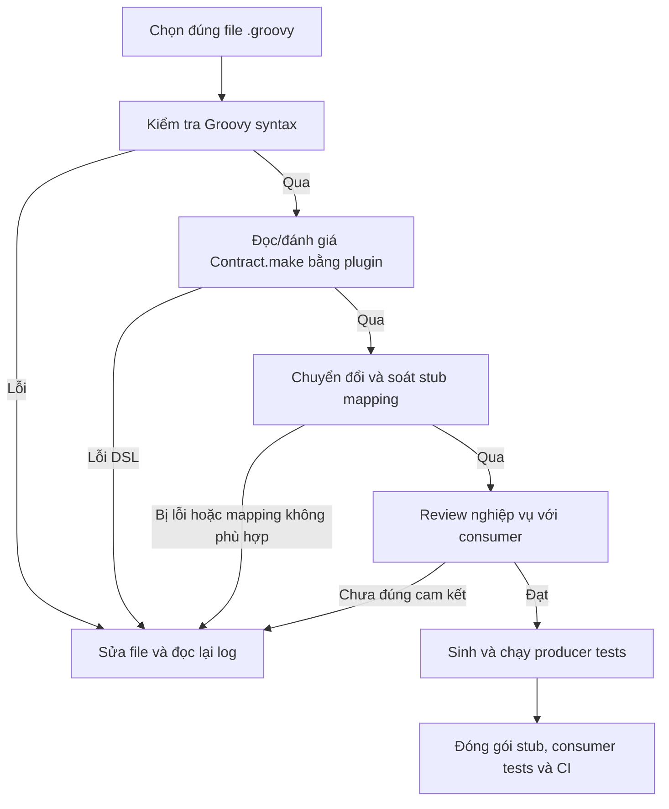

# Đọc lỗi cú pháp và kiểm chứng hợp đồng trước khi sinh test

## 1. Vì sao cần kiểm tra Groovy DSL trước bước sinh test?

Trong **Spring Cloud Contract** (module `SPRING_CLOUD_CONTRACT`), hợp đồng là mô tả hành vi mà **producer** cam kết cung cấp cho **consumer**. Hợp đồng có thể viết bằng Groovy hoặc YAML DSL để mô tả HTTP request/response hay sự kiện thông điệp. Từ các hợp đồng này, công cụ sinh **producer tests** và **stub**; Stub Runner cho phép consumer kiểm thử với stub đã phát hành. CI có thể dùng các bước đó để phát hiện thay đổi API không tương thích.

Với **Groovy DSL**, một lỗi dấu ngoặc, tên phương thức DSL, điều kiện request hoặc matcher có thể khiến quá trình sinh test thất bại, hoặc tệ hơn: sinh được test nhưng **đang kiểm chứng một hành vi sai**. Vì vậy, trước khi yêu cầu công cụ sinh producer tests, chúng ta cần kiểm tra file hợp đồng theo nhiều lớp.

Sau bài này, bạn có thể:

- Phân biệt **lỗi cú pháp Groovy**, **lỗi gọi DSL** và **lỗi ngữ nghĩa hợp đồng**.
- Đọc thông báo lỗi theo tên file, dòng, cột và nguyên nhân gốc; tránh sửa theo dòng cuối của stack trace.
- Soát các khối `Contract.make`, `request`, `response`, `input`, `outputMessage` và matcher.
- Sử dụng bước **chuyển đổi/kiểm tra hợp đồng** trước khi chạy bước sinh và thực thi producer tests, nếu build có hỗ trợ.
- Đưa một quy trình kiểm chứng có thể lặp lại vào pull request và CI.

> **Phạm vi:** bài học tập trung vào **đọc lỗi và kiểm chứng đầu vào hợp đồng trước khi sinh test**. Đây là bước kiểm tra sớm; nó không thay thế việc chạy producer tests, consumer tests hoặc kiểm thử tích hợp sau đó.

## 2. Bốn lớp vấn đề thường bị gọi chung là “lỗi hợp đồng”

| Lớp vấn đề | Ví dụ | Phát hiện bằng cách nào? | Có thể lọt qua kiểm tra cú pháp? |
| --- | --- | --- | --- |
| **1. Cú pháp Groovy** | Thiếu `}`, thiếu dấu nháy, ngoặc `[`/`]` không khớp | Parser/compiler Groovy trong IDE hoặc lúc plugin tải file | Không |
| **2. Cấu trúc/DSL** | Gọi `statuses 200` thay vì `status 200`; dùng khối không được DSL hỗ trợ | Khi thực thi/đánh giá `Contract.make` trong quá trình plugin đọc và chuyển đổi | Có |
| **3. Tính hợp lệ của biểu diễn** | Matcher không hợp lệ, body không chuyển đổi được, dữ liệu không tương thích với định dạng mapping | Bước chuyển đổi hợp đồng sang test/stub, nếu công cụ phát hiện | Có |
| **4. Ngữ nghĩa tích hợp** | Hợp đồng nói `200` nhưng API đã thống nhất `404`; thiếu trường `code` mà consumer phụ thuộc | Review với đặc tả API/consumer và kiểm thử producer/consumer | Có |

Một file **Groovy hợp lệ** chưa chắc là **hợp đồng Spring Cloud Contract hợp lệ**. Một hợp đồng chuyển đổi thành công cũng chưa chắc **đúng yêu cầu nghiệp vụ**. Do đó không thể dùng duy nhất kết quả “không lỗi cú pháp” làm căn cứ phát hành stub.

## 3. Bắt đầu từ một hợp đồng HTTP đúng cấu trúc

Giả sử producer `orders-producer` có endpoint `GET /api/orders/ord-1001`. Với fixture `ord-1001` tồn tại, API đã thống nhất trả `200 OK` và JSON có `id`, `status`.

File minh họa `get_order_success.groovy`:

```groovy
import org.springframework.cloud.contract.spec.Contract

Contract.make {
    name 'get_order_success'
    description 'Trả thông tin một đơn hàng đã tồn tại'

    request {
        method GET()
        url '/api/orders/ord-1001'
    }

    response {
        status 200
        headers {
            contentType(applicationJson())
        }
        body([
            id    : 'ord-1001',
            status: 'CREATED'
        ])
    }
}
```

Khi đọc hoặc review file này, hãy đi theo trật tự:

1. **Khối gốc** `Contract.make { ... }` có mở và đóng đủ không?
2. **Metadata** `name` và `description` có mô tả đúng nhánh hành vi không?
3. **Request** có đúng method, URL/path, query, headers và body đã thỏa thuận không?
4. **Response** có đúng mã HTTP, headers và body mà consumer sẽ sử dụng không?
5. **Fixture** có thể tạo ra dữ liệu `ord-1001` trong môi trường producer test không?

Giá trị `ord-1001` là dữ liệu minh họa được kiểm soát, không phải giá trị Spring Cloud Contract tự cung cấp. Nếu producer tạo ID ngẫu nhiên, hợp đồng nên dùng dữ liệu kiểm thử cố định hoặc matcher phù hợp.

## 4. Đọc lỗi cú pháp Groovy: bắt đầu từ dấu ngoặc và chuỗi

### 4.1. Thiếu dấu ngoặc đóng

Ví dụ lỗi:

```groovy
import org.springframework.cloud.contract.spec.Contract

Contract.make {
    name 'get_order_success'

    request {
        method GET()
        url '/api/orders/ord-1001'
    // thiếu } đóng request

    response {
        status 200
    }
}
```

Parser Groovy có thể báo một thông điệp kiểu `Unexpected input`, `expecting '}'` hoặc `Unexpected end of file`, tùy vị trí lỗi và phiên bản Groovy. Thông báo đôi khi trỏ đến cuối file thay vì dòng làm thiếu dấu ngoặc: parser chỉ phát hiện khi không thể ghép cấu trúc tiếp nữa.

**Cách xử lý:**

1. Đi từ dòng parser chỉ ra ngược lên tới khối gần nhất chưa đóng.
2. Kiểm tra đủ cặp `{ }` cho `Contract.make`, `request`, `response`, `headers`, `bodyMatchers`.
3. Kiểm tra thêm `( )` và `[ ]` trong body dạng map/list.
4. Sửa một nguyên nhân gần nhất rồi chạy lại bước kiểm tra; không sửa hàng loạt từ các dòng stack trace.

Phiên bản sửa đúng của phần request:

```groovy
request {
    method GET()
    url '/api/orders/ord-1001'
}

response {
    status 200
}
```

Đây là hai khối nằm **bên trong** `Contract.make`; đoạn sửa trên không phải file hợp đồng độc lập.

### 4.2. Thiếu dấu nháy hoặc dấu phẩy

Ví dụ lỗi:

```groovy
body([
    id    : 'ord-1001,
    status: 'CREATED'
])
```

Dấu nháy đơn mở tại `'ord-1001` không được đóng, khiến Groovy không phân tích đúng chuỗi. Nếu thông báo lỗi xuất hiện ở dòng `status`, hãy kiểm tra **dòng trước đó** trước khi cho rằng `status` sai.

Một lỗi khác thường gặp là viết map với dấu ngăn cách không hợp lệ:

```groovy
body([
    id: 'ord-1001'
    status: 'CREATED'
])
```

Trong ví dụ map nhiều mục, nên phân tách rõ bằng dấu phẩy:

```groovy
body([
    id    : 'ord-1001',
    status: 'CREATED'
])
```

**Mẹo đọc lỗi:** xác định ký tự cuối của biểu thức đang xây dựng; rất nhiều lỗi “sai dòng tiếp theo” thực ra do dấu nháy, phẩy hoặc ngoặc ở dòng phía trên.

### 4.3. Ví dụ log cú pháp

Các dòng sau là **log giả lập để luyện đọc**, không phải thông báo nguyên văn cố định ở mọi phiên bản:

```text
ERROR .../contracts/get_order_success.groovy: 14:
unexpected token: response @ line 14, column 5
    response {
    ^
```

Từ log này nên rút ra:

- File nào lỗi: `get_order_success.groovy`.
- Vị trí parser dừng: dòng 14, cột 5.
- Token gây vướng: `response`.
- Giả thuyết kiểm tra đầu tiên: khối `request` ngay trước đó chưa đóng.

Không nên bắt đầu bằng cách đổi `response` thành tên khác. `response` có thể hoàn toàn đúng; lỗi là parser vẫn tưởng nó thuộc khối `request` trước đó.

## 5. Groovy đúng cú pháp nhưng gọi sai DSL

### 5.1. Gõ nhầm tên phương thức DSL

Ví dụ:

```groovy
Contract.make {
    request {
        method GET()
        url '/api/orders/ord-1001'
    }
    response {
        statuses 200
    }
}
```

`statuses 200` là cú pháp lời gọi phương thức hợp lệ trong Groovy, nhưng **không phải** thuộc tính `response` được dùng để đặt HTTP status trong DSL. Khi Spring Cloud Contract đánh giá closure, lỗi có thể biểu hiện như `MissingMethodException` hoặc một ngoại lệ DSL tương ứng.

Sửa thành:

```groovy
response {
    status 200
}
```

**Dấu hiệu nhận biết:** nếu stack trace có tên `MissingMethodException`, `MissingPropertyException` hoặc báo không tìm thấy thuộc tính/phương thức trong đối tượng DSL, hãy kiểm tra **đúng tên khối và vị trí lồng nhau** trước khi sửa logic nghiệp vụ.

### 5.2. Đặt thuộc tính ở sai khối

Ví dụ viết như sau dù cú pháp Groovy không sai:

```groovy
request {
    method POST()
    url '/api/orders'
    status 201
}
```

Ở đây `status 201` nằm trong `request` thay vì `response`. Tùy cách DSL thực thi, công cụ có thể báo lỗi do không hỗ trợ lời gọi này, nhưng ngay cả trước khi chạy, review cũng phải phát hiện: **HTTP status là phản hồi của producer**.

Sửa bằng cách tách ranh giới:

```groovy
request {
    method POST()
    url '/api/orders'
}
response {
    status 201
}
```

Tương tự, message contract không dùng `response.status` để mô tả mã nghiệp vụ trong event. Payload message có thể chứa `result: 'REJECTED'`, nhưng đó không phải HTTP status.

### 5.3. Nhầm Groovy DSL với YAML DSL

Ví dụ dưới đây là cú pháp YAML, không phải nội dung hợp lệ để dán trực tiếp vào file Groovy:

```yaml
request:
  method: GET
  url: /api/orders/ord-1001
response:
  status: 200
```

Trong Groovy DSL phải sử dụng `Contract.make`, closure, lời gọi `method GET()`, `url '/...'`, `status 200` và các khối tương ứng. Nếu nhóm đã chọn YAML DSL, hãy lưu theo quy ước file YAML và cho công cụ nhận diện YAML thay vì cố biến đoạn YAML thành Groovy bằng cách đổi phần mở rộng.

## 6. Lỗi matcher: hợp lệ cú pháp nhưng sinh ra hành vi không mong muốn

Spring Cloud Contract có hai góc nhìn khi tạo hợp đồng HTTP:

- **Producer test** dùng dữ liệu đầu vào xác định để gọi producer và kiểm tra dữ liệu đầu ra.
- **Consumer stub** cần khớp request consumer gửi và trả response được mô tả.

Vì thế, khi dùng matcher, chiều `consumer(...)` và `producer(...)` có ý nghĩa khác nhau tùy matcher nằm ở **request** hay **response**.

### 6.1. Matcher trong HTTP response

Giả sử producer tự sinh ID đơn ở dạng `ord-<số>`, còn consumer stub cần một ID cụ thể, ổn định:

```groovy
import org.springframework.cloud.contract.spec.Contract

Contract.make {
    name 'create_order_success'

    request {
        method POST()
        url '/api/orders'
        headers {
            contentType(applicationJson())
        }
        body([productId: 'SKU-001', quantity: 2])
    }

    response {
        status 201
        headers {
            contentType(applicationJson())
        }
        body([
            id    : $(consumer('ord-1001'),
                      producer(regex('ord-[0-9]+'))),
            status: 'CREATED'
        ])
    }
}
```

Ở **response**:

| Góc nhìn | Giá trị | Tác dụng |
| --- | --- | --- |
| Consumer stub | `ord-1001` | Stub trả một ID mẫu ổn định |
| Producer verification | Regex `ord-[0-9]+` | Producer test chấp nhận ID thực tế khớp định dạng |

Nếu đảo nhầm hai phía hoặc dùng một regex chấp nhận mọi chuỗi, kết quả kiểm chứng có thể không phản ánh yêu cầu. Chẳng hạn `.*` cho trường ID sẽ chấp nhận chuỗi rỗng, định dạng sai hoặc nhiều loại dữ liệu ngoài mong đợi tùy cách matcher áp dụng.

### 6.2. Matcher trong HTTP request

Giả sử stub cần nhận mọi ID hợp lệ trong nhánh tìm thấy đơn, nhưng producer test chỉ cần gửi một URL cụ thể:

```groovy
request {
    method GET()
    urlPath($(consumer(regex('/api/orders/ord-[0-9]+')),
               producer('/api/orders/ord-1001')))
}
```

Ở **request**, phía consumer cung cấp điều kiện **khớp stub**; phía producer cung cấp **giá trị request test thực tế**. Một regex trùm lên cả nhánh “đơn tồn tại” và “đơn không tồn tại” khiến HTTP stub dễ trả nhầm `200` thay vì `404`. Nếu không bảo đảm mọi ID trong regex thuộc cùng một nhánh, hãy dùng URL cụ thể hoặc các điều kiện không chồng lấp.

### 6.3. `bodyMatchers` và tính cụ thể

Một cách khác để kiểm tra response JSON động là khai báo `bodyMatchers`:

```groovy
response {
    status 200
    headers {
        contentType(applicationJson())
    }
    body([
        id    : 'ord-1001',
        status: 'CREATED'
    ])
    bodyMatchers {
        jsonPath('$.id', byRegex('ord-[0-9]+'))
    }
}
```

Chỉ dùng cách kiểm tra matcher phù hợp với kiểu dữ liệu và phiên bản DSL của dự án. Không cần chồng nhiều matcher lên cùng một thuộc tính nếu không có mục đích rõ ràng. Khi kiểm tra trước bước sinh test, cần trả lời: *“Matcher nào tác động đến request stub? Matcher nào tác động đến response producer test? Nó có đủ chặt để bắt lỗi không?”*

## 7. Kiểm chứng ngữ nghĩa: công cụ không biết thỏa thuận giữa hai nhóm

Ví dụ sau **có thể hợp lệ về cú pháp và DSL**:

```groovy
Contract.make {
    name 'get_order_not_found'
    request {
        method GET()
        url '/api/orders/ord-missing'
    }
    response {
        status 200
        headers {
            contentType(applicationJson())
        }
        body([id: 'ord-missing'])
    }
}
```

Nhưng nếu API đã thống nhất rằng một đơn không tồn tại phải trả `404` với `code = ORDER_NOT_FOUND`, file trên **sai hợp đồng nghiệp vụ**. Tên `get_order_not_found` không khiến framework tự đổi `status 200` thành `404`.

Hợp đồng phản ánh thỏa thuận có thể là:

```groovy
Contract.make {
    name 'get_order_not_found'
    request {
        method GET()
        url '/api/orders/ord-missing'
    }
    response {
        status 404
        headers {
            contentType(applicationJson())
        }
        body([code: 'ORDER_NOT_FOUND'])
    }
}
```

**Review ngữ nghĩa** cần dựa vào đặc tả API, consumer expectations và quyết định nghiệp vụ đã thống nhất. Plugin không thể tự biết rằng `ord-missing` phải trả `404`.

### 7.1. Checklist ngữ nghĩa HTTP

| Câu hỏi | Điều cần quan sát |
| --- | --- |
| Method và URL/path có đúng? | `GET` khác `POST`; path, query và encoding đúng theo API |
| Header nào thuộc cam kết? | `Content-Type`, `Location`, header định tuyến hoặc auth khi có ý nghĩa |
| Body có đúng schema và kiểu dữ liệu? | Trường bắt buộc, giá trị enum, số so với chuỗi, nested object/list |
| Lỗi có các nhánh riêng? | `400`, `404`, `409` khi consumer xử lý khác nhau |
| Dữ liệu nào là động? | ID, timestamp, correlation ID cần matcher hoặc fixture ổn định |
| Các request mapping có phân biệt được? | Tránh hai stub cùng khớp một request nhưng trả response khác nhau |
| Producer test có tái lập được? | Fixture độc lập, không phụ thuộc thứ tự chạy hoặc dữ liệu môi trường cũ |

### 7.2. Checklist ngữ nghĩa messaging

Một hợp đồng thông điệp có thể bắt đầu từ `input` và mô tả `outputMessage`:

```groovy
import org.springframework.cloud.contract.spec.Contract

Contract.make {
    name 'order_created_event'
    label 'order_created'

    input {
        triggeredBy('publishOrderCreated()')
    }

    outputMessage {
        sentTo('orders.events')
        body([
            eventType: 'ORDER_CREATED',
            orderId  : 'ord-1001'
        ])
    }
}
```

Trước khi sinh test, cần xác minh:

1. `publishOrderCreated()` **sẽ được hiện thực trong lớp nền producer test** hoặc cơ chế kích hoạt tương ứng. Đây là tên phương thức minh họa, không phải API có sẵn.
2. `orders.events` đúng destination mà consumer đăng ký; tránh nhầm tên logical binding với tên physical topic nếu dự án có ánh xạ.
3. `eventType` và `orderId` phản ánh schema thực sự mà consumer dùng.
4. `label` được đặt rõ nếu bài kiểm thử consumer cần kích hoạt message stub qua nhãn.
5. Môi trường kiểm thử có cách **quan sát message được phát**; một hợp đồng không tự cài đặt hoặc khởi động broker.

Với luồng nhận message rồi phát message khác, `input` có thể dùng `messageFrom(...)` và `messageBody(...)` thay vì `triggeredBy(...)`. Lỗi DSL và lỗi mapping của loại này cần được kiểm tra bằng plugin/bộ kiểm thử có cấu hình messaging phù hợp. Không dùng HTTP `response.status` để mô tả kết quả event.

## 8. Quy trình kiểm tra trước khi sinh producer tests

Không có một câu lệnh chung cho mọi dự án bảo đảm cả **cú pháp, DSL, ngữ nghĩa** mà không dùng môi trường build. Hãy phân tách các bước và ghi lại kết quả từng bước.



### Bước 1 — Xác định file và phạm vi đang kiểm tra

Xác nhận:

- File nằm ở contracts directory mà plugin thực sự quét và có phần mở rộng phù hợp.
- Có `Contract.make` và khối HTTP hoặc messaging đúng với giao thức.
- Không tồn tại hai file Groovy/YAML trùng nội dung khiến build đăng ký cùng một tình huống hai lần.
- Mỗi hợp đồng có dữ liệu và tên dễ truy vết; không chứa credential hoặc dữ liệu người dùng thật.

Không nên kết luận “đã kiểm tra toàn bộ hợp đồng” khi build chỉ quét một thư mục con hoặc một bản copy cũ của file.

### Bước 2 — Kiểm tra cú pháp Groovy

IDE có Groovy support có thể báo sớm lỗi dấu ngoặc, chuỗi và cấu trúc closure. Trong môi trường CI, bước plugin **đọc và đánh giá DSL** thường cũng sẽ báo lỗi parser khi gặp file hỏng. Kiểm tra cú pháp thuần chỉ nói rằng file là Groovy hợp lệ; nó chưa xác minh phương thức DSL, cấu trúc HTTP hay quy tắc nghiệp vụ.

Nếu một trình kiểm tra cú pháp độc lập cần tải lớp `Contract` để phân tích import, phải bảo đảm classpath dùng đúng thư viện Spring Cloud Contract của dự án. Không nên lấy một thông báo “không resolve được import” làm bằng chứng hợp đồng sai nếu môi trường parser chưa có dependency.

### Bước 3 — Chạy bước chuyển đổi hợp đồng trước khi sinh test

Với **Maven** và `spring-cloud-contract-maven-plugin` đã cấu hình, có thể sử dụng goal chuyển đổi hợp đồng sang stub mapping để phát hiện sớm một số lỗi DSL/chuyển đổi:

```bash
./mvnw -B spring-cloud-contract:convert
```

**Điều kiện:** goal/prefix trên cần plugin và phiên bản tương thích được cấu hình/resolve trong dự án. Nếu Maven báo không tìm được prefix hoặc goal, trước hết kiểm tra plugin configuration và tài liệu của phiên bản dự án; đó không nhất thiết là lỗi trong file Groovy. Nếu plugin đã được gắn vào lifecycle, hành vi thực tế phụ thuộc cấu hình build.

`convert` nhằm **chuyển đổi hợp đồng sang biểu diễn stub/mapping**; đây không phải bài kiểm thử producer thật và **không tự chứng minh** endpoint của ứng dụng tuân thủ hợp đồng. Nó cũng không phải một bộ kiểm chứng ngữ nghĩa nghiệp vụ hoàn chỉnh. Có thể xảy ra trường hợp chuyển đổi thành công dù HTTP status hoặc event schema trong DSL đã sai so với thỏa thuận.

Ở dự án Gradle, dùng task chuyển đổi/sinh stub được plugin phiên bản đang dùng cung cấp theo cấu hình hiện tại. Tên task có thể khác nhau giữa các phiên bản; cần kiểm tra đúng project thay vì đoán một tên task rồi coi lỗi “task not found” là hợp đồng sai.

### Bước 4 — Đọc lại mapping hoặc artifact chuyển đổi

Khi conversion thành công, hãy xác nhận kết quả có phản ánh đúng DSL:

- HTTP mapping có method, URL/path, query/body/header matcher và response như mong đợi.
- Các nhánh `200`, `400`, `404`... không dùng điều kiện request chồng lấp ngoài ý muốn.
- Dữ liệu động được chuyển thành matcher đúng chiều, không thay bằng giá trị quá rộng.
- Với messaging, kiểm tra biểu diễn/kịch bản message được hỗ trợ trong build và cách kích hoạt; không mặc định có một mapping WireMock cho mọi message.

Nếu plugin không sinh output cho một file, kiểm tra đường dẫn contracts directory, bộ lọc quét, cấu hình chuyển đổi và log. **Không nên đánh dấu PASS chỉ vì lệnh trả mã thoát 0 khi hợp đồng mong đợi không được nạp.**

### Bước 5 — Review hành vi trước khi chạy generator

Đặt song song ba thứ: **hợp đồng**, **đặc tả nghiệp vụ** và **hành vi consumer cần xử lý**. Ví dụ consumer phụ thuộc `404 ORDER_NOT_FOUND` thì nhất định phải thấy cả `404` và `code` trong hợp đồng. Với message `ORDER_CREATED`, phải có đúng destination và các trường bắt buộc.

Đây là bước có thể phát hiện những sai lệch mà parser và converter không biết. Nếu chưa đạt, chỉnh DSL và kiểm tra lại; sau đó mới để bước sinh test tạo mã kiểm thử tương ứng.

### Bước 6 — Sinh và thực thi producer tests

Sau khi kiểm tra sơ bộ đạt, tiếp tục với bước **sinh producer tests** theo build của dự án, rồi **chạy** các test đã sinh. Dù đây là bước tiếp theo ngoài phạm vi tiền kiểm, nó bắt buộc trong quy trình bảo vệ hợp đồng:

```text
Groovy syntax
    -> DSL evaluation / conversion
    -> review contract semantics
    -> generated producer tests
    -> execute producer tests
    -> package/publish verified stubs
    -> consumer tests
```

**Lưu ý:** Một test được sinh thành công chỉ chứng minh công cụ đã tạo mã test; chưa chứng minh producer thực tế đáp ứng test đó. Cần chạy test và xem assertion.

## 9. Đọc log hiệu quả theo tầng nguyên nhân

Khi build báo lỗi, đừng vội đọc toàn bộ stack trace từ trên xuống. Xem thông tin theo thứ tự:

1. **Bước nào lỗi?** Parser, converter, generator hay producer test runtime?
2. **Tên file nào?** File hợp đồng hay lớp test được sinh?
3. **Dòng/cột nào?** Vị trí parser phát hiện có thể nằm sau nguồn lỗi.
4. **Ngoại lệ gốc là gì?** `MultipleCompilationErrorsException`, `MissingMethodException`, sai matcher hoặc assertion failure mang ý nghĩa khác nhau.
5. **Có liên quan đến hạ tầng?** Lỗi plugin resolution, classpath, repository hoặc fixture không đồng nghĩa lỗi cú pháp.

| Thông điệp/triệu chứng | Khả năng cao | Hướng kiểm tra đầu tiên |
| --- | --- | --- |
| `MultipleCompilationErrorsException`, `Unexpected input` | Sai dấu ngoặc, dấu nháy hoặc cú pháp Groovy | Xem dòng trước vị trí báo lỗi và các cặp dấu |
| `MissingMethodException: ... statuses(...)` | Gọi tên DSL sai | Xác nhận `status` trong `response` |
| `MissingPropertyException` trong closure DSL | Tham chiếu property sai hoặc nằm sai ngữ cảnh | Xem tên property, khối cha, API DSL đúng phiên bản |
| JSON/mapping conversion failure | Body, matcher hoặc biểu diễn không chuyển đổi được | Kiểm tra type, JSONPath, regex và cấu trúc body |
| Không tìm thấy Maven plugin prefix/goal | Cấu hình build/plugin chưa đúng | Kiểm tra plugin version, repositories và goal |
| Không có generated mapping/test | File không được quét, contract bị loại hoặc build không chạy bước tương ứng | Xác minh contracts directory, plugin lifecycle và output |
| Producer test assertion failed | Producer lệch hợp đồng hoặc test fixture sai | So sánh request/response thật với DSL; kiểm tra fixture |
| Stub trả nhánh khác mong đợi | Mapping chồng lấp hoặc request không khớp | So khớp method, URL, headers, body và thứ tự/ưu tiên mapping |

### 9.1. Mẫu ghi nhận lỗi để người khác tái hiện

Một báo cáo lỗi hữu ích có thể viết:

```text
Contract: src/test/resources/contracts/http/get_order_success.groovy
Phase: contract conversion
Error: MissingMethodException on statuses(200)
Location: response block, line 13
Expected: response status 200
Root cause: typo in Groovy DSL
Fix: change statuses 200 to status 200
Validation: conversion succeeds; mapping contains HTTP 200
```

Thông tin trên chỉ minh họa định dạng. Trong báo cáo thực tế, lấy đúng tên file, phase, thông báo, dòng và kết quả từ lần chạy tương ứng. Không đưa đường dẫn chứa bí mật, URL repository có credentials hoặc payload dữ liệu thật vào log công khai.

## 10. Quy trình kiểm chứng trong pull request và CI

Một pipeline nhiều bước có thể đặt **tiền kiểm** trước **producer verification**:

| Giai đoạn | Kiểm tra | Kết quả mong đợi |
| --- | --- | --- |
| Review file | Đúng cấu trúc Groovy DSL, đúng nhánh và fixture | Không có lỗi hiển nhiên hoặc metadata gây hiểu nhầm |
| Conversion | Plugin đọc được contract, chuyển đổi đúng | Không lỗi parse/DSL, có mapping/scenario mong đợi |
| Review ngữ nghĩa | Method/status/schema/destination khớp thỏa thuận | Có ít nhất một ví dụ cho mỗi hành vi consumer cần |
| Generate tests | Công cụ tạo producer tests | Test tương ứng với các hợp đồng được thay đổi |
| Execute producer tests | Ứng dụng producer đáp ứng hợp đồng | Assertions đạt với dữ liệu kiểm thử ổn định |
| Package stub | Tạo artifact phiên bản rõ ràng | Stub thực sự chứa mapping/message scenario |
| Consumer integration | Stub Runner và consumer tests | Consumer xử lý đúng các nhánh tương tác quan trọng |

Không nên đưa bước publish lên trước khi producer verification đạt. Nếu CI chạy nhiều job song song, cần bảo đảm **artifact được công bố là chính artifact vừa được xác minh**, đồng thời tránh publish bản release với cùng version nhưng nội dung bị ghi đè.

Một lỗi thường gặp là để pipeline chạy thành công vì **không tìm thấy hợp đồng nào**. Cần kiểm tra số lượng và danh sách contract đã đọc/sinh output, đặc biệt khi thay đổi thư mục, phần mở rộng hoặc cấu hình filter.

## 11. Bài thực hành: tìm lỗi từ ba hợp đồng

### Tình huống A — Lỗi cú pháp

```groovy
import org.springframework.cloud.contract.spec.Contract

Contract.make {
    request {
        method GET()
        url '/api/products/SKU-001'
    }
    response {
        status 200
        body([id: 'SKU-001', available: true]
    }
}
```

**Câu hỏi:** Lỗi xuất hiện ở tầng nào? Nên kiểm tra ký tự nào trước?

**Gợi ý:** `body([ ... ])` phải đóng đủ dấu `]` và `)`. Đoạn trên thiếu `)` của lời gọi `body(...)`. Đây là lỗi cú pháp Groovy; chưa cần suy luận về HTTP status hoặc producer.

### Tình huống B — Lỗi DSL

```groovy
import org.springframework.cloud.contract.spec.Contract

Contract.make {
    request {
        method GET()
        url '/api/products/SKU-001'
    }
    response {
        statuses 200
        body([id: 'SKU-001'])
    }
}
```

**Câu hỏi:** Vì sao editor có thể không báo lỗi cú pháp, nhưng plugin lại báo lỗi khi đánh giá DSL?

**Gợi ý:** `statuses` được Groovy phân tích như tên một phương thức, nhưng không đúng API DSL của khối `response`. Sửa thành `status 200`, sau đó chạy lại bước conversion.

### Tình huống C — Cú pháp đúng, hành vi sai

Đặc tả đã thống nhất: `GET /api/products/SKU-MISSING` trả `404` với `code = PRODUCT_NOT_FOUND`.

```groovy
import org.springframework.cloud.contract.spec.Contract

Contract.make {
    name 'get_product_not_found'
    request {
        method GET()
        url '/api/products/SKU-MISSING'
    }
    response {
        status 200
        headers {
            contentType(applicationJson())
        }
        body([id: 'SKU-MISSING'])
    }
}
```

**Câu hỏi:** Tại sao conversion có thể thành công mà hợp đồng vẫn cần sửa?

**Đáp án:** Plugin không biết quy tắc trả `404` của sản phẩm thiếu. Cần sửa thành `status 404` và body `[code: 'PRODUCT_NOT_FOUND']`. Nếu bỏ qua review, plugin có thể sinh test và stub bảo vệ nhầm hành vi `200`.

### Bài tập mở rộng

Từ hợp đồng C sau khi sửa, hãy bổ sung hợp đồng `GET /api/products/SKU-001` trả `200`. Sau đó kiểm tra hai mapping không bị chồng lấp. Giả sử ID sản phẩm là chuỗi động, hãy đề xuất matcher đủ hẹp để chỉ chấp nhận lớp ID hợp lệ, đồng thời giải thích vì sao matcher chung `.*` có thể khiến stub trả sai nhánh.

## 12. Checklist tiền kiểm trước khi sinh test

- [ ] File đúng thư mục được plugin quét; phần mở rộng `.groovy` và import `Contract` đúng.
- [ ] `Contract.make` và các closure có đủ dấu `{ }`; map/list và chuỗi đóng đủ dấu.
- [ ] Không có lời gọi DSL sai tên hoặc nằm sai khối.
- [ ] HTTP dùng `request`/`response`, khai báo method, URL, status, headers và body cần thiết.
- [ ] Messaging dùng `input`/`outputMessage` với trigger/message, destination và payload đã thống nhất.
- [ ] `name`, `description` và nhánh request/response phản ánh cùng một tình huống.
- [ ] Dữ liệu động có matcher phù hợp; producer/consumer side đúng chiều.
- [ ] Những stub cùng method/path có điều kiện request đủ phân biệt.
- [ ] Fixture kiểm thử có thể chuẩn bị và không phụ thuộc dữ liệu ngẫu nhiên chưa kiểm soát.
- [ ] Conversion/tiền kiểm plugin chạy thành công **và** đọc ra đúng hợp đồng mong đợi.
- [ ] Đã review ngữ nghĩa với yêu cầu API/event và các consumer liên quan.
- [ ] Bước sinh **và chạy** producer tests được giữ trong CI trước khi publish stub.

**Kết luận:** Đọc lỗi hiệu quả bắt đầu bằng việc xác định **lỗi parser, lỗi DSL, lỗi chuyển đổi hay lỗi hành vi**. Hãy kiểm chứng `Contract.make` qua các lớp đó trước khi sinh producer tests, rồi tiếp tục chạy test và phân phối stub theo phiên bản. Nhờ vậy, pipeline Spring Cloud Contract kiểm tra đúng lời hứa tích hợp, thay vì chỉ tạo thành công những bài test cho một hợp đồng viết sai.
