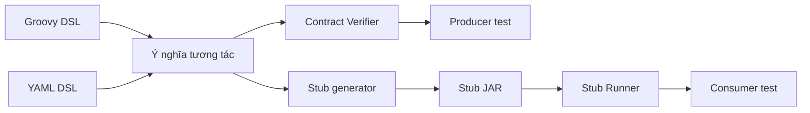
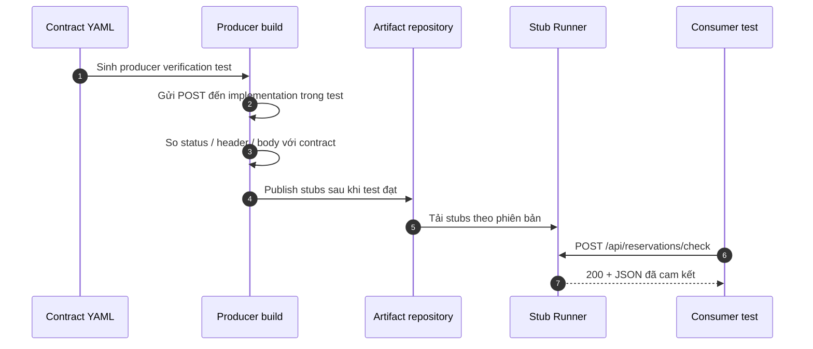
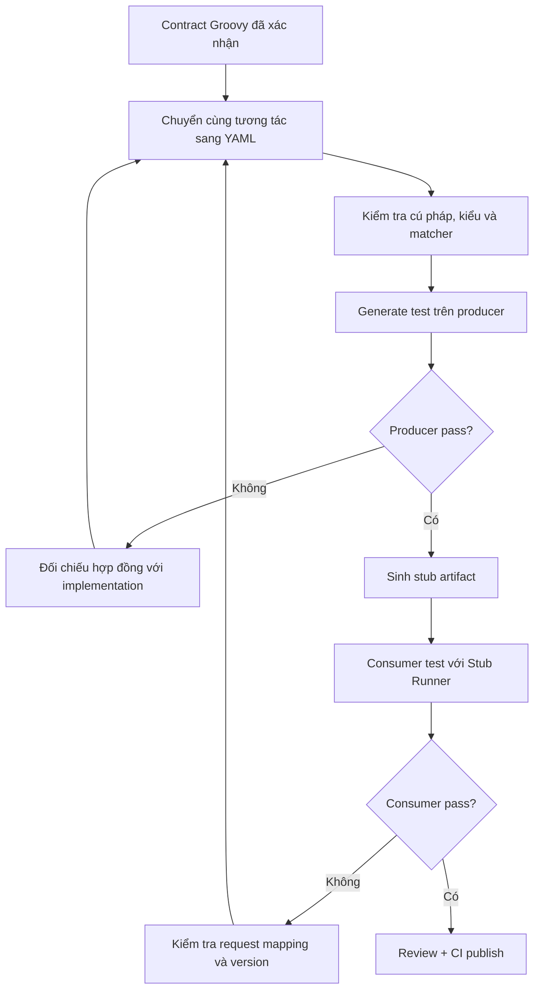

# Biểu diễn cùng tương tác bằng YAML

> **Chương:** YAML và DSL khác  
> **Phạm vi:** `SPRING_CLOUD_CONTRACT` — Spring Cloud Contract cho kiểm thử hợp đồng giữa **producer** và **consumer**.

## Mục tiêu học tập

Sau bài học, bạn có thể:

1. Chuyển **một tương tác HTTP** từ Groovy DSL sang **YAML DSL** mà vẫn giữ đúng ý nghĩa hợp đồng.
2. Giải thích các trường `request`, `response`, `headers`, `body`, `matchers`, và mối liên hệ giữa chúng với test producer và stub consumer.
3. Dùng đúng kiểu dữ liệu, cú pháp YAML, JSONPath và matcher để tránh những khác biệt ngoài ý muốn khi chuyển đổi DSL.
4. Biểu diễn một **tương tác thông điệp** bằng YAML và so sánh với Groovy DSL.
5. Tích hợp hợp đồng YAML vào luồng **sinh test producer → kiểm chứng → tạo và phát hành stub → Stub Runner ở consumer → CI**.

## 1. Vì sao cùng một tương tác có thể viết bằng YAML?

Spring Cloud Contract cho phép định nghĩa **hành vi giao tiếp đã cam kết** giữa hai hệ thống bằng Groovy DSL hoặc YAML DSL. Đối với HTTP, hợp đồng mô tả producer phải nhận kiểu request nào và trả response nào. Đối với messaging, hợp đồng có thể mô tả sự kiện đầu vào, trigger, nơi phát thông điệp, headers và payload.

Hai DSL là **hai hình thức diễn đạt** của hợp đồng; người viết cần giữ cùng ý nghĩa:

- **Producer:** khi nhận request phù hợp, triển khai thật có thực hiện hành vi đã cam kết không? Spring Cloud Contract Verifier dùng contract để sinh test producer.
- **Consumer:** ứng dụng gửi request và xử lý response ra sao? Spring Cloud Contract sinh stub từ contract; Stub Runner cho consumer gọi stub trong test.
- **CI:** test producer phải đạt trước khi publish một stub đã được xác minh; consumer cần dùng đúng phiên bản stub mà mình muốn hỗ trợ.

YAML hữu ích khi nhóm muốn một bản khai báo ngắn gọn, dễ review trên pull request, thuận tiện cho người không quen Groovy. Groovy DSL thuận lợi khi cần dùng các helper, biểu thức hoặc cấu trúc chương trình phức tạp. Chọn DSL theo mức độ dễ đọc và nhu cầu biểu diễn, vì **mức độ an toàn tương thích phụ thuộc vào nội dung contract và việc thực sự chạy kiểm chứng**, chứ không do phần mở rộng file.



Sơ đồ minh họa hai **cách chọn đầu vào**. Trong một bài thực hành, thường chỉ lưu **một** phiên bản của hợp đồng để tránh test và stub bị trùng.

## 2. Tương tác HTTP cần biểu diễn

Giả sử dịch vụ `checkout-service` (consumer) muốn biết có thể giữ trước hai sản phẩm `SKU-001` không. Dịch vụ `inventory-service` (producer) cung cấp endpoint:

```http
POST /api/reservations/check HTTP/1.1
Content-Type: application/json
Accept: application/json

{
  "sku": "SKU-001",
  "quantity": 2,
  "channel": "WEB"
}
```

Producer cam kết trả:

```http
HTTP/1.1 200 OK
Content-Type: application/json

{
  "sku": "SKU-001",
  "approved": true,
  "available": 5,
  "requestId": "CHK-0042"
}
```

Ý nghĩa nghiệp vụ: hàng hiện có đủ để chấp nhận yêu cầu giữ trước, với mã theo dõi `requestId`. Để bài học có một trường hợp kiểm tra rõ ràng, ban đầu ta giữ **mọi giá trị cố định**; phần matcher sẽ mở rộng khi `requestId` có thể thay đổi.

Hãy xác định giao diện trước khi viết DSL:

| Yếu tố | Giá trị/hành vi cam kết |
| --- | --- |
| HTTP method | `POST` |
| Path | `/api/reservations/check` |
| Request header | `Content-Type: application/json`, `Accept: application/json` |
| Request body | `sku` là chuỗi, `quantity` là số, `channel` là chuỗi |
| Response status | `200` |
| Response header | `Content-Type: application/json` |
| Response body | `sku` là chuỗi, `approved` là boolean, `available` là số, `requestId` là chuỗi |

Việc liệt kê như vậy ngăn tình trạng chỉ chuyển đổi cú pháp nhưng vô tình đổi đường dẫn, kiểu trường hoặc trạng thái HTTP.

## 3. Viết tương tác bằng Groovy DSL

Đây là một contract kiểu Groovy, chẳng hạn tại `src/test/resources/contracts/reservation_check_approved.groovy` của dự án producer:

```groovy
org.springframework.cloud.contract.spec.Contract.make {
    name 'reservation_check_approved'

    request {
        method 'POST'
        url '/api/reservations/check'
        headers {
            contentType('application/json')
            header 'Accept': 'application/json'
        }
        body(
            sku: 'SKU-001',
            quantity: 2,
            channel: 'WEB'
        )
    }

    response {
        status 200
        headers {
            contentType('application/json')
        }
        body(
            sku: 'SKU-001',
            approved: true,
            available: 5,
            requestId: 'CHK-0042'
        )
    }
}
```

Ở đây `Contract.make` mô tả **một lần giao tiếp**. Khối `request` là điều kiện để gọi API; khối `response` là kỳ vọng. Các giá trị `true` và `2`/`5` không đặt trong dấu nháy nên giữ đúng kiểu boolean/số.

Cần lưu ý: đoạn Groovy không phải mã controller của producer. Nó là **đặc tả có thể sinh test và stub**, hoạt động khi dự án đã cấu hình plugin Spring Cloud Contract và test base class.

## 4. Chuyển nguyên tương tác sang YAML DSL

Đặt phiên bản YAML tại:

```text
src/test/resources/contracts/reservation_check_approved.yml
```

Nội dung:

```yaml
name: reservation_check_approved
description: "Kiem tra yeu cau giu hang du so luong"

request:
  method: POST
  url: /api/reservations/check
  headers:
    Content-Type: application/json
    Accept: application/json
  body:
    sku: SKU-001
    quantity: 2
    channel: WEB

response:
  status: 200
  headers:
    Content-Type: application/json
  body:
    sku: SKU-001
    approved: true
    available: 5
    requestId: CHK-0042
```

Đây là **cùng giao tiếp HTTP** như bản Groovy ở mục 3. `description` là mô tả giúp người bảo trì, không thay đổi request/response. Thứ tự các trường trong YAML có thể khác khi đọc bằng parser, nhưng **vị trí thụt lề** và trường cha của chúng phải đúng.

### 4.1. Bản đồ tương ứng giữa Groovy và YAML

| Groovy DSL | YAML DSL | Ý nghĩa |
| --- | --- | --- |
| `Contract.make { ... }` | Cấu trúc YAML gốc | Một hợp đồng |
| `name 'reservation_check_approved'` | `name: reservation_check_approved` | Tên hợp đồng |
| `request { ... }` | `request:` | Điều kiện đầu vào |
| `method 'POST'` | `method: POST` | HTTP method |
| `url '/api/reservations/check'` | `url: /api/reservations/check` | HTTP path |
| `headers { contentType('application/json') }` | `headers: Content-Type: application/json` | HTTP header (trong YAML là map lồng nhau) |
| `body(sku: 'SKU-001', quantity: 2)` | `body: sku: SKU-001; quantity: 2` | JSON object với kiểu dữ liệu |
| `response { status 200 }` | `response: status: 200` | Trạng thái response |
| `body(approved: true, available: 5)` | `body: approved: true; available: 5` | Boolean và số |

Trong bảng, ký hiệu dấu chấm phẩy chỉ là cách **viết gọn trên một ô**. Khi nhập file YAML thật, hãy dùng nhiều dòng và thụt lề như ví dụ đầy đủ.

### 4.2. Đọc YAML từ ngoài vào trong

Một cách đọc nhanh:

1. `name` định danh tình huống, ví dụ *giữ hàng được chấp nhận*.
2. `request.method` và `request.url` xác định lời gọi.
3. `request.headers` và `request.body` chỉ ra dữ liệu consumer phải gửi.
4. `response.status` xác định HTTP status producer phải trả.
5. `response.headers` và `response.body` mô tả nội dung response đã cam kết.

Nhờ cấu trúc này, reviewer không cần đọc code controller vẫn thấy API hứa gì. Hợp đồng không chỉ là mô tả tài liệu: plugin còn dùng nó như **đầu vào sinh kiểm thử**.

## 5. Từ YAML đến producer test và consumer stub

Giả sử producer đã cấu hình `spring-cloud-contract-maven-plugin`, phụ thuộc `spring-cloud-starter-contract-verifier` và lớp cơ sở thiết lập MockMvc hoặc WebTestClient.



Chạy trong producer:

```bash
mvn clean verify
```

Khi test đạt, chạy lifecycle phù hợp để cài artifact stub vào Maven local:

```bash
mvn clean install
```

Kết quả thường có JAR dạng `inventory-service-1.0.0-stubs.jar`. Stub được tạo từ hợp đồng, còn test được sinh xác minh triển khai producer; **chỉ publish artifact sau khi phần xác minh thật sự vượt qua**.

Ở consumer, Stub Runner có thể dùng tọa độ minh họa:

```java
@AutoConfigureStubRunner(
    ids = "com.example:inventory-service:1.0.0:stubs:8090",
    stubsMode = StubRunnerProperties.StubsMode.LOCAL
)
```

Consumer cấu hình HTTP client gọi `http://localhost:8090` trong test; stub phản hồi theo YAML. Giá trị tọa độ/cổng chỉ minh họa và phải khớp artifact thực tế. Trong CI với các job chạy ở máy khác nhau, stub cần được chuyển giữa job hoặc publish lên Maven-compatible artifact repository và dùng chế độ phù hợp.

**Không xóa bản Groovy rồi mặc nhiên xem YAML đúng:** sau khi chuyển đổi, chạy producer verification và test consumer với stub được sinh lại để kiểm tra hai biểu diễn giữ nguyên hành vi.

## 6. Từ giá trị cố định sang matcher trong YAML

Trong hệ thống thật, `requestId` thường thay đổi theo mỗi request. Nếu contract yêu cầu duy nhất `CHK-0042`, producer test có thể thất bại dù API vẫn đúng định dạng và consumer không cần đúng giá trị đó.

Trong Groovy DSL, ta có thể khai báo điều kiện response với `bodyMatchers`. Với YAML DSL, cơ chế tương ứng đặt tại **`response.matchers`**.

Giữ `body.requestId: CHK-0042` như ví dụ mẫu, rồi **bổ sung**:

```yaml
response:
  status: 200
  headers:
    Content-Type: application/json
  body:
    sku: SKU-001
    approved: true
    available: 5
    requestId: CHK-0042
  matchers:
    body:
      - path: $.requestId
        type: by_regex
        value: 'CHK-[0-9]{4}'
```

Đây là đoạn **thay thế riêng khối `response`** của contract ban đầu, không phải một YAML document thứ hai đặt dưới cùng file.

Ý nghĩa khác nhau của hai trường:

- `body.requestId` cung cấp **giá trị ví dụ** để stub trả về; giá trị `CHK-0042` phù hợp regex.
- `response.matchers.body` bảo producer verification kiểm tra field ở JSONPath `$.requestId` theo **regex**, thay cho việc bắt buộc đúng nguyên chuỗi ví dụ.
- Giá trị khớp `CHK-1234` hay `CHK-9999` được chấp nhận bởi matcher; giá trị sai định dạng như `ABC` hoặc vắng trường có thể khiến test thất bại.

Cần giữ đúng chỗ của matcher: trong YAML là `response.matchers.body`, **không** phải khóa `bodyMatchers` ở cấp gốc. Spring Cloud Contract chỉ chấp nhận các kiểu matcher mà YAML schema hỗ trợ. Matcher phải trỏ tới trường có tồn tại trong body ví dụ.

### 6.1. Các matcher hay dùng

| YAML matcher | Dùng cho | Lưu ý |
| --- | --- | --- |
| `by_equality` | Giá trị phải bằng mẫu | Hợp khi đây là cam kết quan trọng |
| `by_regex` | Chuỗi hoặc mẫu giá trị động | Cần cung cấp `value` hoặc `predefined` phù hợp |
| `by_type` | Kiểu giá trị theo body mẫu | Phù hợp khi không cần so giá trị tuyệt đối |
| `by_date` | Giá trị ngày | Chọn khi producer trả date theo định dạng hỗ trợ |
| `by_time` | Giá trị thời gian | Tránh khóa vào một giờ cố định |
| `by_timestamp` | Timestamp | Phù hợp dữ liệu thời điểm phát sinh |
| `by_null` | Giá trị phải null | Chủ yếu ở phía response/test |
| `by_command` | Điều kiện xác minh tùy biến | Dùng khi đã chuẩn bị helper và base test phù hợp |

Ví dụ thay response matcher để kiểm tra **kiểu số** cho `available` thay vì ép đúng số 5:

```yaml
response:
  status: 200
  headers:
    Content-Type: application/json
  body:
    sku: SKU-001
    approved: true
    available: 5
    requestId: CHK-0042
  matchers:
    body:
      - path: $.available
        type: by_type
      - path: $.requestId
        type: by_regex
        value: 'CHK-[0-9]{4}'
```

Matcher `by_type` dựa trên kiểu của body mẫu. Nếu consumer cần đúng hành vi `approved: true`, hãy **giữ kiểm tra giá trị này**, đừng tự ý làm matcher quá lỏng khiến producer thay đổi nghiệp vụ mà test vẫn xanh.

### 6.2. Matcher phía request

Nếu yêu cầu là "chấp nhận các SKU theo dạng `SKU-` cộng ba chữ số", có thể giữ body ví dụ cụ thể nhưng thêm matcher:

```yaml
request:
  method: POST
  url: /api/reservations/check
  headers:
    Content-Type: application/json
    Accept: application/json
  body:
    sku: SKU-001
    quantity: 2
    channel: WEB
  matchers:
    body:
      - path: $.sku
        type: by_regex
        value: 'SKU-[0-9]{3}'
```

Trong trường hợp này:

- **Producer test:** vẫn có dữ liệu request mẫu dùng để gọi implementation.
- **Consumer stub:** có thể khớp các giá trị `sku` đáp ứng pattern thay vì chỉ chấp nhận đúng `SKU-001`.
- **Hệ quả:** nếu stub trả mã `SKU-001` cố định dù request dùng `SKU-777`, đây là hành vi của ví dụ stub; **không** suy ra producer có thể trả chính xác SKU được hỏi. Muốn cam kết phản hồi phụ thuộc vào request, cần định nghĩa và kiểm chứng quy tắc đó (chẳng hạn cơ chế tham chiếu request) thay vì tự nới lỏng matcher.

Các matcher request và response có **vai trò khác nhau**: request matcher xác định những request stub chấp nhận, response matcher xác định producer cần thỏa những điều kiện nào khi test.

### 6.3. So sánh bản Groovy matcher

Ví dụ cách diễn tả *response requestId phù hợp regex* trong Groovy:

```groovy
response {
    status 200
    headers {
        contentType('application/json')
    }
    body(
        sku: 'SKU-001',
        approved: true,
        available: 5,
        requestId: 'CHK-0042'
    )
    bodyMatchers {
        jsonPath('$.requestId', byRegex('CHK-[0-9]{4}'))
    }
}
```

Đây là **khối `response` thay thế** trong contract Groovy, không phải một contract mới. So với YAML, sự khác biệt chính là `bodyMatchers { jsonPath(..., byRegex(...)) }` được tách thành danh sách:

```yaml
matchers:
  body:
    - path: $.requestId
      type: by_regex
      value: 'CHK-[0-9]{4}'
```

Khi chuyển đổi, kiểm tra matcher nằm đúng **phía request hay response**. Đặt matcher sai phía có thể làm stub quá rộng hoặc làm producer test kiểm tra sai điều cần bảo vệ.

## 7. Thay đổi cách mô tả URL, query và dữ liệu

### 7.1. Request GET với query parameters

Với tương tác khác, chẳng hạn tìm số tồn kho qua query, YAML có thể dùng `urlPath` và `queryParameters`:

```yaml
name: stock_query
request:
  method: GET
  urlPath: /api/stock
  queryParameters:
    sku: SKU-001
response:
  status: 200
  headers:
    Content-Type: application/json
  body:
    sku: SKU-001
    quantity: 5
```

Request tương ứng là `GET /api/stock?sku=SKU-001`. `urlPath` tập trung vào phần path, trong khi `queryParameters` giữ các tham số truy vấn ở cấu trúc riêng. Hãy chọn hình thức URL theo cách client thực sự gọi, nhất quán giữa Groovy và YAML; việc đổi `url` thành `urlPath` trong lúc chuyển đổi có thể thay đổi điều kiện khớp.

### 7.2. Kiểu dữ liệu YAML trở thành kiểu dữ liệu JSON

YAML khác JSON về cú pháp nhưng có thể mô tả cùng cấu trúc dữ liệu. So sánh:

```yaml
quantity: 2        # number
approved: true     # boolean
requestId: CHK-0042  # string
cancelled: false   # boolean
```

Nếu đặt dấu nháy sai, bạn thay đổi loại giá trị:

```yaml
quantity: "2"       # string, không phải number
approved: "true"    # string, không phải boolean
```

Kiểu chuỗi/số/boolean rất quan trọng với JSON binding, validation và cách consumer giải mã response. Khi không chắc về cách parser diễn giải các chuỗi đặc biệt (như giá trị giống ngày tháng, `null`, `yes/no`, `on/off`), hãy đặt dấu nháy cho **chuỗi** để tránh khác biệt giữa công cụ đọc YAML.

### 7.3. Trường JSON chứa dấu chấm và ký tự đặc biệt

Trong JSON, tên field có thể chứa dấu chấm:

```json
{
  "client.id": "CUS-001",
  "loanAmount": 1000
}
```

Biểu diễn YAML:

```yaml
body:
  "client.id": CUS-001
  loanAmount: 1000
```

Nếu cần matcher cho `client.id`, đường dẫn JSONPath phải mô tả **một khóa có dấu chấm**, không phải đối tượng lồng hai cấp:

```yaml
matchers:
  body:
    - path: "$.['client.id']"
      type: by_regex
      value: 'CUS-[0-9]{3}'
```

Còn `$.client.id` có thể bị hiểu là trường `id` nằm trong đối tượng `client`. Phải kiểm tra cấu trúc JSON thực trước khi viết JSONPath.

## 8. Biểu diễn cùng ý tưởng dưới messaging contract bằng YAML

Spring Cloud Contract còn hỗ trợ mô tả tương tác **thông điệp**. Đây là một ví dụ **riêng**, không phải bản chuyển đổi trực tiếp từ HTTP `POST` sang message: sau khi xác nhận tồn kho, producer có thể phát sự kiện `StockReserved`.

Giả sử gọi phương thức `reservationTriggered()` trong producer làm hệ thống gửi thông điệp đến kênh `inventory.events`, với payload:

```json
{
  "eventType": "StockReserved",
  "sku": "SKU-001",
  "quantity": 2
}
```

### 8.1. Groovy DSL cho sự kiện

```groovy
org.springframework.cloud.contract.spec.Contract.make {
    name 'stock_reserved_event'
    label 'stock_reserved'

    input {
        triggeredBy('reservationTriggered()')
    }

    outputMessage {
        sentTo('inventory.events')
        body(
            eventType: 'StockReserved',
            sku: 'SKU-001',
            quantity: 2
        )
        headers {
            messagingContentType(applicationJson())
        }
    }
}
```

### 8.2. YAML DSL tương ứng

```yaml
name: stock_reserved_event
label: stock_reserved

input:
  triggeredBy: reservationTriggered

outputMessage:
  sentTo: inventory.events
  body:
    eventType: StockReserved
    sku: SKU-001
    quantity: 2
  headers:
    contentType: application/json
```

So sánh:

| HTTP contract | Messaging contract |
| --- | --- |
| `request.method`, `request.url` | `input.triggeredBy` hoặc thông điệp đầu vào |
| `request.headers`, `request.body` | Headers/payload của input message nếu có |
| `response.status` | Không có HTTP status cho event thuần |
| `response.body` | `outputMessage.body` |
| `response.headers` | `outputMessage.headers` |
| Endpoint và request matching | Kênh/đích gửi, trigger, payload và header |

**Để thực thi messaging contract**, dự án phải cấu hình phần hỗ trợ message tương ứng, producer test base, trigger `reservationTriggered()` và adapter/binder (tùy Kafka, RabbitMQ, Spring Integration hoặc cơ chế truyền thông điệp). YAML tự nó không tạo topic hay broker. Đích `inventory.events` chỉ là tên minh họa, cần ánh xạ vào hạ tầng và cơ chế messaging thực tế.

Tương tự HTTP, producer phải kiểm chứng thông điệp được phát đúng nội dung và consumer phải kiểm tra cách xử lý sự kiện. Những yếu tố như broker sẵn sàng, retry, ordering hoặc kết nối mạng vẫn cần integration/E2E test phù hợp.

## 9. Quy trình chuyển đổi Groovy → YAML có kiểm chứng

Khi chuyển một contract đang dùng Groovy sang YAML:

1. **Đọc contract gốc**, ghi lại điều kiện request, kết quả response, kiểu dữ liệu, matcher, mẫu động, tên contract và nhánh lỗi.
2. **Tạo YAML tương ứng**, giữ cùng method/path/query/header/body, status và điều kiện khớp.
3. **Chọn một bản làm nguồn chính**: tránh để cả hai cùng được plugin thu nạp trong một lượt build. Nếu cần so sánh, dùng branch riêng hoặc chuyển đổi rồi kiểm tra từng phiên bản.
4. **Chạy producer verification** và so sánh test được sinh với hành vi producer thật; không chỉ xem YAML có parse được không.
5. **Sinh stub**, kiểm tra HTTP method, URL, header/body matcher và response mapping; chạy consumer test bằng Stub Runner với artifact mới.
6. **Kiểm tra CI**, bảo đảm producer test phải pass trước khi publish stub cho consumer; giữ một lịch sử versioning tương thích khi API thay đổi.



Đây là quy trình **chuyển đổi có kiểm chứng hành vi**; một YAML file giống về câu chữ nhưng khác về kiểu dữ liệu, JSONPath hoặc matcher vẫn có thể tạo stub/test khác so với Groovy.

### 9.1. Ma trận kiểm tra tương đương

| Điều cần đối chiếu | Câu hỏi kiểm tra |
| --- | --- |
| Method/path | Có đúng `POST /api/reservations/check` không? |
| Headers | `Content-Type` và `Accept` có được giữ không? |
| Request body | `quantity` là số hay chuỗi? Các trường có đúng tên không? |
| Response | `200`, `approved` boolean, `available` số và `requestId` chuỗi có đúng không? |
| Matcher | Regex được đặt ở request hay response? Có khớp mẫu đã cung cấp không? |
| Stub behavior | Consumer gửi cùng request có nhận đúng JSON không? |
| Producer verification | API đổi sai kiểu/trường có khiến test đỏ không? |

## 10. Những lỗi thường gặp khi viết YAML contract

| Vấn đề | Ví dụ hoặc triệu chứng | Cách xử lý |
| --- | --- | --- |
| Sai thụt lề | `body` nằm ngoài `response` | Dùng khoảng trắng nhất quán; kiểm tra cấu trúc phân cấp |
| Đặt sai kiểu | `quantity: "2"` thay vì `quantity: 2` | Quyết định kiểu JSON theo contract |
| Sai kiểu boolean | `approved: "true"` | Dùng `approved: true` nếu consumer cần boolean |
| Nhầm matcher | Dùng `bodyMatchers` của Groovy trong YAML | Dùng `request.matchers` / `response.matchers` |
| JSONPath không đúng | `$.client.id` cho khóa `"client.id"` | Dùng JSONPath bracket notation |
| Regex không khớp mẫu | Body `requestId: CHK-0042` nhưng regex yêu cầu định dạng khác | Giá trị ví dụ phải hợp lệ theo matcher |
| Duplicated contract | Cả `.groovy` và `.yml` mô tả cùng scenario | Chỉ để một bản được plugin xử lý |
| Producer test không được sinh | Lưu sai thư mục hoặc chưa cấu hình plugin | Kiểm tra `src/test/resources/contracts` và cấu hình Maven/Gradle |
| Stub không khớp request | Header/path/query khác với consumer thật | Xem request log và mapping WireMock |
| Stub xanh nhưng API thật lỗi | Producer chưa verify contract hoặc consumer dùng stub cũ | Chặn publish khi verifier fail; quản lý version |
| YAML parse được nhưng sai nghĩa | Tên field có dấu chấm hoặc dữ liệu ngày tháng bị parser hiểu nhầm | Kiểm tra JSON thực sinh ra và trích dẫn chuỗi cần thiết |

Một sai lầm đặc biệt nguy hiểm là **nới matcher quá rộng** để CI xanh. Ví dụ nếu `approved: true` là hành vi nghiệp vụ consumer cần, đổi nó thành một kiểm tra boolean bất kỳ sẽ bỏ lọt trường hợp producer trả `false` ngoài mong đợi.

## 11. Bài tập thực hành

**Bài 1 — Chuyển đổi tương đương.** Từ Groovy DSL ở mục 3, tự viết file YAML mà không nhìn mục 4. Đối chiếu từng trường theo ma trận kiểm tra. Nêu 3 lỗi cú pháp/kiểu dữ liệu có thể xảy ra.

**Bài 2 — Matcher động.** Cho phép `requestId` có dạng `CHK-` theo sau là bốn chữ số. Viết `response.matchers.body` theo kiểu `by_regex`; giải thích tại sao `requestId` trong `body` vẫn cần có giá trị mẫu hợp lệ.

**Bài 3 — Biến thể request.** Viết thêm contract cho `quantity: 99` và response `approved: false`. Xác định phải chỉnh producer ở đâu để test mới đạt. Không dùng cùng một matcher request rộng đến mức hai stub không phân biệt được tình huống.

**Bài 4 — Tìm lỗi trong YAML.** Vì sao đoạn sau có thể phá giao tiếp khi consumer dùng Java record với `boolean approved` và `int available`?

```yaml
response:
  status: 200
  body:
    approved: "true"
    available: "5"
```

*Gợi ý:* Cả hai giá trị đang là string. Hãy sửa kiểu và thêm header `Content-Type` phù hợp nếu API trả JSON.

**Bài 5 — Messaging.** Chuyển event `StockReserved` sang YAML với field mới `reservationId`. Giải thích cần bổ sung matcher và producer test gì nếu ID được sinh động.

**Bài 6 — CI.** Lập hai pipeline cho producer và consumer: producer phải chạy verifier trước khi publish artifact; consumer chạy Stub Runner với một phiên bản stub cụ thể. Viết cách xử lý trường hợp producer đổi `available` thành `stockCount` mà consumer chưa cập nhật.

## 12. Tổng kết

**Cùng một tương tác** có thể được khai báo bằng Groovy DSL hoặc YAML DSL mà giữ nguyên ý nghĩa hợp đồng. Bản YAML sử dụng `request`/`response` cho HTTP, `input`/`outputMessage` cho thông điệp và `matchers` khi phải kiểm chứng mẫu động. Chuyển đổi đúng yêu cầu giữ nguyên **method, path, headers, body, kiểu dữ liệu, status và điều kiện khớp**.

Sức mạnh của Spring Cloud Contract đến từ quy trình sử dụng hợp đồng: **sinh test phía producer, xác nhận implementation, phát hành stub đã kiểm chứng, dùng Stub Runner trong consumer test và đưa các cổng kiểm tra này vào CI** để phát hiện thay đổi API không tương thích trước khi triển khai.

## Tài liệu tham khảo

- [Spring Cloud Contract — Developing Your First Application](https://docs.spring.io/spring-cloud-contract/reference/getting-started/first-application.html) — ví dụ cùng tương tác bằng Groovy và YAML, producer và consumer.
- [Spring Cloud Contract — Contract DSL](https://docs.spring.io/spring-cloud-contract/reference/project-features-contract.html) — cơ chế hợp đồng và các DSL.
- [Spring Cloud Contract — Dynamic Properties](https://docs.spring.io/spring-cloud-contract/reference/project-features-contract/dsl-dynamic-properties.html) — cú pháp YAML `matchers` và các loại điều kiện.
- [Spring Cloud Contract — YML Schema](https://docs.spring.io/spring-cloud-contract/reference/yml-schema.html) — thuộc tính hợp lệ của hợp đồng YAML.
- [Spring Cloud Contract — Stub Runner Core](https://docs.spring.io/spring-cloud-contract/reference/project-features-stubrunner/stub-runner-core.html) — sử dụng stub với consumer.
