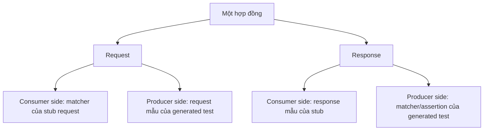
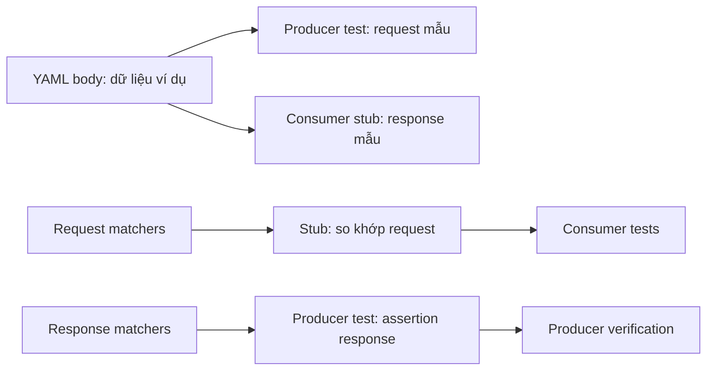
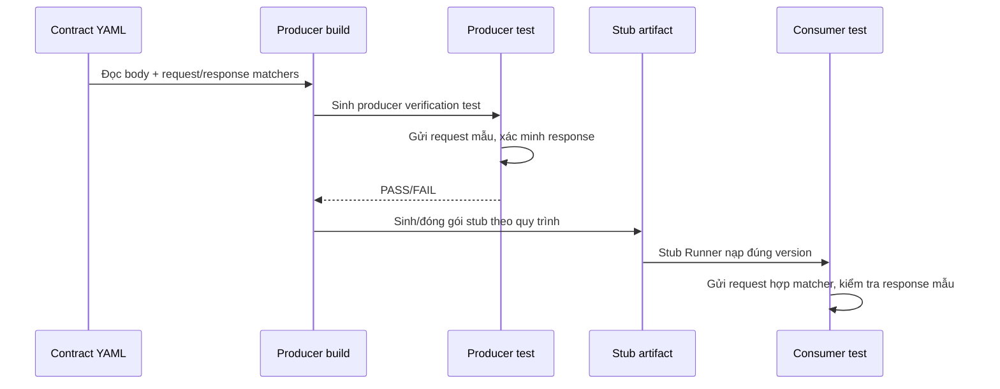

# Giá trị hai phía trong định dạng khai báo

## 1. Vì sao một hợp đồng cần hai góc nhìn về dữ liệu?

Trong **Spring Cloud Contract**, cùng một định nghĩa hợp đồng phục vụ hai việc khác nhau: **producer verification** kiểm tra bên cung cấp API hoặc thông điệp có đáp ứng cam kết hay không; **consumer testing** sử dụng **stub** được tạo từ hợp đồng để kiểm tra cách bên tiêu thụ tương tác với giao diện ấy. Hai phía này thường cần *cách diễn đạt giá trị khác nhau*.

Ví dụ, một ứng dụng gọi `POST /api/payments` với mã đơn hàng. Consumer có thể gửi nhiều mã hợp lệ như `ORD-42`, `ORD-83`; nhưng test được sinh ở producer cần **một request cụ thể, tái lập được** để thực thi. Ngược lại, producer có thể tạo ID thanh toán khác nhau mỗi lần, trong khi stub cho consumer cần **một response ví dụ ổn định**.

Nếu contract chỉ dùng các giá trị cố định, bài test có thể quá cứng nhắc; nếu dùng một biểu thức chính quy quá rộng ở mọi vị trí, contract có thể bỏ lọt thay đổi không tương thích. **Giá trị hai phía** giúp kết hợp dữ liệu cụ thể với quy tắc so khớp linh hoạt.

Bài thuộc chương **YAML và DSL khác** của mô-đun **SPRING_CLOUD_CONTRACT**. Các ví dụ đặt trong ngữ cảnh kiểm thử hợp đồng HTTP bằng **Groovy/YAML DSL**, sinh test phía producer, tạo và phát hành stub, dùng **Stub Runner** ở consumer và tích hợp vào CI. Nguyên tắc hai phía cũng quan trọng khi kiểm tra payload thông điệp.

Sau bài này, bạn sẽ phân biệt được hai phía `consumer` và `producer` trong DSL, đọc đúng hướng áp dụng giá trị ở request/response, biểu diễn cách ứng xử tương ứng bằng YAML `body` + `matchers`, và xác minh rằng test/stub được sinh thể hiện đúng ý định.

## 2. Hai phía không đồng nghĩa với hai khối request và response

Với **coded DSL** như Groovy, Spring Cloud Contract có thể mô tả một giá trị theo dạng:

```groovy
value(consumer(...), producer(...))
```

Có thể gặp các cách viết tương đương: `$(consumer(...), producer(...))` hoặc alias `client` / `server`, `stub` / `test`. Tên gọi `consumer` và `producer` xác định **góc nhìn mà một giá trị sẽ được dùng**, chứ không phải một cặp key JSON tên `consumer` và `producer`.

Điều cốt lõi là hiểu **góc nhìn nào được dùng vào việc gì**:

| Vị trí trong hợp đồng | Phía consumer (stub/client) | Phía producer (test/server) |
|---|---|---|
| **Request** | Quy tắc nhận diện request gửi tới stub, ví dụ mã `orderId` khớp regex | Giá trị request cụ thể mà generated producer test gửi cho ứng dụng |
| **Response** | Giá trị cụ thể mà stub trả cho consumer | Điều kiện/matcher mà generated producer test dùng để kiểm tra response thật |
| **Thông điệp đầu ra** | Payload/header ví dụ dùng cho stub phía consumer | Ràng buộc xác minh thông điệp producer thực sự phát |

Có thể ghi nhớ bằng sơ đồ:



**Chú ý chiều dữ liệu:** Ở request, consumer chủ động **gửi** yêu cầu. Ở response, producer chủ động **trả** dữ liệu. Vì thế, cùng một từ `consumer` không có nghĩa lúc nào nó cũng là “dữ liệu được gửi đi”; và `producer` không có nghĩa lúc nào cũng là “dữ liệu được trả về”. Vai trò của mỗi phía thay đổi theo hướng của tương tác.

Một giá trị có thể giống hệt nhau ở cả hai phía, nhưng việc tách hai phía hữu ích khi cần cho phép nhiều request hợp lệ hoặc nhiều response hợp lệ mà vẫn tạo ra stub và test có dữ liệu mẫu rõ ràng.

## 3. Ví dụ gốc với Groovy DSL: cú pháp giá trị hai phía

Trước khi sang YAML, hãy xem cách coded DSL diễn đạt hai phía một cách tường minh. Giả sử dịch vụ `payment-service` nhận yêu cầu tạo thanh toán:

```groovy
import org.springframework.cloud.contract.spec.Contract

Contract.make {
    name 'create_payment_with_dynamic_ids'

    request {
        method POST()
        url '/api/payments'
        headers {
            contentType(applicationJson())
        }
        body(
            orderId: value(
                consumer(regex('ORD-[0-9]+')),
                producer('ORD-42')
            ),
            amount: 150000
        )
    }

    response {
        status CREATED()
        headers {
            contentType(applicationJson())
        }
        body(
            paymentId: value(
                consumer('PAY-1001'),
                producer(regex('PAY-[0-9]+'))
            ),
            state: 'ACCEPTED'
        )
    }
}
```

Hãy đọc **request** trước:

- Consumer side quy định stub chấp nhận giá trị `orderId` phù hợp với `ORD-[0-9]+`, ví dụ `ORD-42` hoặc `ORD-83`.
- Producer side dùng `ORD-42` làm dữ liệu cụ thể cho generated test gửi tới producer.
- `amount: 150000` không được tách hai phía nên vẫn là giá trị cố định được biểu diễn trong hợp đồng.

Đọc **response** theo chiều ngược lại:

- Consumer side định nghĩa giá trị mẫu `PAY-1001` mà stub có thể trả cho consumer.
- Producer side kiểm tra ID thanh toán thực tế khớp `PAY-[0-9]+`; producer có thể trả `PAY-783` và vẫn đáp ứng ràng buộc này.
- `state: 'ACCEPTED'` vẫn là kỳ vọng cố định. Nếu consumer chỉ xử lý `ACCEPTED`, không nên biến nó thành regex quá rộng.

Các chuỗi được chọn chỉ là **ví dụ hợp đồng**, không phải API chuẩn có sẵn của Spring Cloud Contract. Khi dùng trong dự án thật, cần thống nhất ý nghĩa `amount`, trạng thái và quy tắc định dạng mã với các consumer.

### Một chiều thì dùng regex, chiều còn lại cần gì?

Nếu một phía là **matcher**, phía kia thường cần **giá trị cụ thể phù hợp matcher**. Điều này giúp build sinh request xác định ở producer hoặc stub response xác định cho consumer.

| Biểu thức | Có phù hợp? | Vì sao |
|---|---|---|
| Request: consumer regex `ORD-[0-9]+`; producer mẫu `ORD-42` | Có | Producer test gửi một mã mà stub cũng sẽ chấp nhận |
| Response: consumer mẫu `PAY-1001`; producer regex `PAY-[0-9]+` | Có | Stub trả ví dụ hợp lệ, producer có thể trả ID khác |
| Response: consumer mẫu `INVALID`; producer regex `PAY-[0-9]+` | Không hợp lý | Giá trị stub không đáp ứng chính quy tắc kỳ vọng của contract |
| Response: consumer `PAID`; producer regex `.*` | Quá lỏng | Test có thể bỏ qua thay đổi về enum mà client thực sự phụ thuộc |

Các helper sinh chuỗi hợp lệ từ regex có tồn tại trong một số coded DSL, nhưng **không nên dựa vào việc tự sinh ngẫu nhiên** khi một mẫu cố định giúp test dễ kiểm tra và tái lập hơn.

## 4. Biểu diễn cùng ý nghĩa trong YAML: `body` và `matchers`

**Điểm khác biệt lớn:** YAML là DSL **khai báo**. Theo tài liệu Spring Cloud Contract hiện hành, giá trị động của YAML được cấu hình trong phần **`matchers`**, không đặt trực tiếp biểu thức Groovy `value(consumer(...), producer(...))` bên trong `body`.

Thay vì viết một field có hai nhánh lồng nhau, YAML dùng:

1. **`body`** chứa những giá trị ví dụ cụ thể, ví dụ `orderId: ORD-42` và `paymentId: PAY-1001`.
2. **`request.matchers`** mô tả cách **stub so khớp request** do consumer gửi.
3. **`response.matchers`** mô tả cách **generated test kiểm tra response thật** do producer trả.

File `create-payment.yml` có thể viết như sau:

```yaml
name: create_payment_with_dynamic_ids
description: "Tạo thanh toán với ID được ràng buộc theo định dạng"
request:
  method: POST
  url: /api/payments
  headers:
    Content-Type: application/json
  body:
    orderId: "ORD-42"
    amount: 150000
  matchers:
    body:
      - path: $.orderId
        type: by_regex
        value: "ORD-[0-9]+"
response:
  status: 201
  headers:
    Content-Type: application/json
  body:
    paymentId: "PAY-1001"
    state: "ACCEPTED"
  matchers:
    body:
      - path: $.paymentId
        type: by_regex
        value: "PAY-[0-9]+"
```

Đây là một **tài liệu YAML duy nhất** cho một tình huống HTTP, không phải hai hợp đồng tách biệt. Hai mục `matchers` nằm dưới **hai khối khác nhau**, nên ý nghĩa của chúng khác nhau:

| Thành phần YAML | Cách sử dụng trong luồng Spring Cloud Contract |
|---|---|
| `request.body.orderId: "ORD-42"` | Giá trị request mẫu cho producer test |
| `request.matchers.body[path=$.orderId]` | Stub yêu cầu `orderId` do consumer gửi khớp `ORD-[0-9]+` |
| `request.body.amount: 150000` | Giá trị mẫu đồng thời là ràng buộc cố định nếu không có matcher thay thế |
| `response.body.paymentId: "PAY-1001"` | Giá trị mẫu mà stub có thể trả cho consumer |
| `response.matchers.body[path=$.paymentId]` | Generated producer test xác minh response có `paymentId` phù hợp `PAY-[0-9]+` |
| `response.body.state: "ACCEPTED"` | Trạng thái được ràng buộc cố định trong tình huống này |
| `response.status: 201` | Mã HTTP cụ thể mà producer phải trả trong tình huống đã định nghĩa |

Để tránh hiểu nhầm, đừng viết như sau rồi mong Spring Cloud Contract coi đó là cú pháp hai phía:

```yaml
# VÍ DỤ SAI: không phải định dạng diễn đạt
# hai phía chuẩn trong YAML DSL của SCC.
response:
  body:
    paymentId:
      consumer: "PAY-1001"
      producer: "PAY-[0-9]+"
```

Với một bộ giải mã YAML thông thường, đoạn trên là **một object JSON lồng nhau** có hai key `consumer`, `producer`. Nó không tự trở thành cặp giá trị động mà SCC hiểu như `value(consumer(...), producer(...))` của Groovy.

## 5. Đọc từng bước một bộ test và stub sinh từ YAML

Từ contract `create-payment.yml`, có thể dự kiến hành vi về mặt ý nghĩa như sau. Mã cụ thể được sinh ra còn phụ thuộc **phiên bản Spring Cloud Contract, plugin, test mode và cấu hình base class**.

### 5.1. Phía producer: gửi dữ liệu cố định, kiểm tra đầu ra linh hoạt

Generated producer verification test cần dựng request đại diện:

```http
POST /api/payments HTTP/1.1
Content-Type: application/json

{"orderId":"ORD-42","amount":150000}
```

Sau đó nó kiểm tra các cam kết được khai báo. Một response ví dụ có thể vượt qua:

```http
HTTP/1.1 201 Created
Content-Type: application/json

{"paymentId":"PAY-7821","state":"ACCEPTED"}
```

Tại sao `PAY-7821` hợp lệ dù `response.body.paymentId` viết là `PAY-1001`? Vì **response matcher** yêu cầu dạng `PAY-[0-9]+`, cho phép ID biến đổi theo lần chạy. Các điều kiện khác, chẳng hạn HTTP `201` và `state: ACCEPTED`, vẫn cần đáp ứng.

Nếu producer trả `paymentId: "abc"`, matcher cần báo sai. Nếu trả `state: "REJECTED"`, phần trạng thái cố định cần báo sai. Tất nhiên, mức độ kiểm tra cuối cùng phụ thuộc generated assertion có được sinh và chạy đúng cách; cần kiểm tra test report thực tế.

### 5.2. Phía consumer: gửi request linh hoạt, nhận dữ liệu mô phỏng cố định

Khi consumer dùng Stub Runner, stub được sinh từ cùng contract có thể chấp nhận:

```http
POST /api/payments HTTP/1.1
Content-Type: application/json

{"orderId":"ORD-83","amount":150000}
```

Vì `ORD-83` khớp `ORD-[0-9]+`, mapping request được thiết kế để phù hợp. Stub trả response được mô tả bằng giá trị mẫu, ví dụ:

```json
{
  "paymentId": "PAY-1001",
  "state": "ACCEPTED"
}
```

Consumer test có thể khẳng định mã thanh toán được đọc vào DTO hoặc nghiệp vụ của mình, trạng thái `ACCEPTED` được xử lý đúng và mã HTTP `201` được nhận diện.

Nhưng việc **consumer test chạy xanh với stub** chưa chứng minh producer thật đang trả cùng định dạng. Kiểm thử producer và consumer phải được dùng **cùng bộ hợp đồng, artifact và phiên bản tương thích**, rồi nối với nhau trong CI.

### 5.3. Nhìn theo bốn nguồn thông tin



**Không diễn giải sơ đồ như một phép sao chép máy móc mọi thuộc tính của `body` vào hai hướng.** Trường nào không có matcher phù hợp vẫn chịu các quy tắc mặc định của contract engine. Với header, query parameter, URL hay thông điệp, cần đọc cấu trúc và quy tắc tương ứng thay vì chỉ xét JSON body.

## 6. Matchers khai báo: chọn đúng độ chặt

YAML DSL hỗ trợ nhiều kiểu matcher. Những kiểu thường dùng cho bài toán hai phía gồm:

| Kiểu matcher | Ý nghĩa | Tình huống nên dùng |
|---|---|---|
| `by_equality` | So sánh bằng với mẫu trong hợp đồng | Giá trị ổn định như trạng thái hoặc loại sự kiện |
| `by_regex` | Kiểm tra một định dạng hoặc tập giá trị | ID, mã giao dịch, enum có tập giá trị cụ thể |
| `by_type` | Kiểm tra kiểu dữ liệu | Trường số/chuỗi được phép thay đổi; dùng khi kiểu là ràng buộc đủ mạnh |
| `by_date`, `by_time`, `by_timestamp` | Kiểm tra định dạng thời gian tương ứng | Dữ liệu ngày/giờ thay đổi theo lần chạy |
| `by_null` | Kiểm tra null khi được hỗ trợ ở vị trí tương ứng | Hợp đồng quy định trường có giá trị null |
| `by_command` | Gọi phương thức kiểm tra tùy chỉnh ở phía test | Quy tắc đặc biệt cần mã assertion trong test base |

**Không phải kiểu nào cũng có cùng hiệu lực ở mọi hướng.** Ví dụ `by_type` và `by_command` thường phục vụ **verification phía producer** với response, trong khi matcher của request dùng để tạo quy tắc stub nhận request. Hãy xem schema và tài liệu của bản SCC đang dùng trước khi áp dụng một loại matcher cho bất kỳ vị trí nào.

### 6.1. Dùng matcher có sẵn để kiểm tra UUID

Nếu producer sinh một UUID khi trả về, bạn có thể diễn đạt trong YAML:

```yaml
response:
  status: 200
  body:
    requestId: "550e8400-e29b-41d4-a716-446655440000"
  matchers:
    body:
      - path: $.requestId
        type: by_regex
        predefined: uuid
```

Giá trị mẫu phải hợp lệ theo loại matcher tương ứng. Stub cần một `requestId` cụ thể để consumer có thể parse; generated producer test cần kiểm tra response chứa UUID hợp lệ. Các kiểu `predefined` được hỗ trợ phụ thuộc phiên bản; những giá trị được tài liệu hóa gồm `uuid`, `number`, `iso_date`, `iso_date_time` và một số loại khác.

### 6.2. Giữ ràng buộc enum thay vì mở quá rộng

Giả sử consumer chỉ hiểu hai trạng thái `PENDING` và `PAID`. Không nên viết:

```yaml
response:
  body:
    status: "PAID"
  matchers:
    body:
      - path: $.status
        type: by_regex
        value: ".*"
```

Matcher này chấp nhận cả trạng thái sai về ngữ nghĩa. Nếu hai trạng thái thật sự đều được hỗ trợ, có thể dùng một tập cụ thể:

```yaml
response:
  body:
    status: "PAID"
  matchers:
    body:
      - path: $.status
        type: by_regex
        value: "PENDING|PAID"
```

Tuy nhiên, nếu tình huống test mô tả **đơn đã thanh toán**, hợp đồng có thể cần giữ `status: PAID` chính xác; việc nới lỏng matcher phải phản ánh quy tắc nghiệp vụ được thống nhất, không chỉ để test dễ qua.

### 6.3. Matcher của header không nằm trong matcher của body

Với các header biến động, YAML có cấu trúc `headers` riêng, chẳng hạn:

```yaml
name: lookup_order_with_correlation_id
request:
  method: GET
  url: /api/orders/42
  headers:
    X-Correlation-Id: "trace-42"
  matchers:
    headers:
      - key: X-Correlation-Id
        regex: "trace-[0-9]+"
response:
  status: 200
```

Trong trường hợp này, stub có thể chấp nhận các request có header phù hợp pattern, còn generated producer test có một header mẫu `trace-42` để gửi. Chú ý cấu trúc `matchers.headers` dùng `key` và `regex` theo schema này; không dùng `path: $.X-Correlation-Id` vì đó không phải JSON body.

### 6.4. Khi muốn phản hồi phản ánh chính request

Đôi khi consumer muốn trường `correlationId` trong response **bằng đúng** giá trị đã gửi trong request, chứ không phải một ví dụ cố định. Regex riêng ở hai phía chỉ chứng minh **mỗi trường có định dạng đúng**; nó không tự chứng minh **hai giá trị bằng nhau**.

Spring Cloud Contract có cơ chế tham chiếu request từ response: Groovy DSL có `fromRequest()`; YAML có cách diễn đạt tham chiếu bằng Handlebars và các helper phù hợp. Đó là cơ chế khác với `matchers` thông thường. Cần kiểm tra cú pháp theo phiên bản SCC và viết thêm assertion khi muốn bảo vệ quan hệ giữa hai giá trị, tránh suy ra quan hệ đó chỉ vì cả hai cùng khớp regex.

## 7. Cách chọn dữ liệu ví dụ và matcher khi thiết kế contract

Một số nguyên tắc giúp các giá trị hai phía có ý nghĩa:

1. **Bắt đầu từ nhu cầu consumer.** Consumer đọc trường nào, cần định dạng nào, phụ thuộc những giá trị enum nào? Chỉ ràng buộc điều quan trọng cho ca sử dụng.
2. **Chọn ví dụ cụ thể hợp lệ.** Nếu regex là `ORD-[0-9]+`, hãy dùng `ORD-42` chứ không dùng `42` cho phía cần mẫu.
3. **Chỉ nới lỏng phần thực sự biến động.** ID, timestamp, mã giao dịch thường là ứng viên; tên field, mã lỗi hoặc trạng thái nghiệp vụ thường cần chặt chẽ hơn.
4. **Giữ ý nghĩa dữ liệu.** `amount: 150000` cần quy ước đơn vị, tiền tệ và cách làm tròn. Matcher kiểu số không chứng minh cùng ngữ nghĩa.
5. **Gắn matcher đúng đường dẫn.** `$.paymentId` phải tham chiếu field có thật trong `body`; path sai có thể khiến việc sinh hoặc xác minh test không như mong đợi.
6. **Xác minh cả hai đầu ra.** Kiểm tra generated producer test thực sự gửi dữ liệu mẫu và assert response; kiểm tra stub mapping thực sự nhận request động và trả response mẫu.
7. **Dùng cùng nguồn contract trong CI.** Liên kết contract, producer build, stub artifact và consumer tests bằng phiên bản rõ ràng.

Đừng nhầm giá trị hai phía với việc producer bắt buộc dùng một ID giả trong production. Giá trị producer side ở request là **đầu vào của test được sinh**, còn giá trị producer side ở response có thể là **matcher áp lên dữ liệu thật từ test**. Ứng dụng production vẫn xử lý dữ liệu thật theo quy tắc của nó.

## 8. So sánh YAML với Groovy, Java và Kotlin DSL

| Tiêu chí | YAML DSL | Groovy DSL | Java/Kotlin DSL |
|---|---|---|---|
| Cách thể hiện contract | Cấu trúc `request`/`response` dưới dạng YAML | Các khối cấu hình bằng mã Groovy | API DSL trong mã Java/Kotlin |
| Giá trị động trong JSON body | Giá trị mẫu ở `body`, quy tắc ở `matchers` | Có thể dùng `value(consumer(...), producer(...))`/`$()` trực tiếp, hoặc `bodyMatchers` | Dùng phương thức DSL tương ứng và matchers |
| Khả năng review | Dễ quan sát dữ liệu khai báo, ít cú pháp lập trình | Biểu đạt động linh hoạt | Có kiểu và cú pháp của ngôn ngữ lập trình |
| Điểm dễ sai | Coi key YAML tùy ý là lệnh SCC; đặt matcher sai cấp | Trộn `consumer`/`producer`; nhúng giá trị động trong chuỗi khó parse | Khác cú pháp API, kiểu dữ liệu và escaping giữa Java/Kotlin |
| Khi thích hợp | Nhóm ưu tiên hợp đồng khai báo và dữ liệu JSON rõ ràng | Cần biểu thức giá trị động phong phú | Team muốn DSL đồng bộ với Java/Kotlin |

Ví dụ, **không thể chép** nguyên biểu thức dưới đây vào một field YAML:

```groovy
paymentId: value(consumer('PAY-1001'), producer(regex('PAY-[0-9]+')))
```

Với YAML, cách diễn đạt tương ứng nằm ở **hai vị trí**: `response.body.paymentId` chứa `PAY-1001` và `response.matchers.body` chứa `by_regex` cho `$.paymentId`. Việc chuyển đổi giữa DSL vì thế cần kiểm tra **ý nghĩa**, không chỉ đổi đuôi file `.groovy` thành `.yml`.

## 9. Với thông điệp bất đồng bộ, tư duy hai phía vẫn giữ nguyên

Ngoài HTTP, Spring Cloud Contract có thể mô tả **message contract**. Producer có thể phát sự kiện với một ID thay đổi, nhưng consumer cần payload mẫu để chạy kiểm thử. Trong YAML, `outputMessage` có cấu trúc `body` và `matchers` tương tự mục response HTTP.

Ví dụ khái niệm cho tình huống producer phát sự kiện sau khi xử lý thanh toán:

```yaml
description: "Phát sự kiện thanh toán được chấp nhận"
label: payment_accepted_event
input:
  triggeredBy: emitPaymentAccepted
outputMessage:
  sentTo: payments
  headers:
    contentType: application/json
  body:
    paymentId: "PAY-1001"
    state: "ACCEPTED"
  matchers:
    body:
      - path: $.paymentId
        type: by_regex
        value: "PAY-[0-9]+"
```

Đây là **ví dụ DSL để học cách áp dụng matcher**; muốn chạy được cần cấu hình messaging test, điểm đến và phương thức `emitPaymentAccepted` tương ứng ở producer test base. Tên destination `payments` là tên minh họa, không phải một broker/topic có sẵn.

Tại consumer side, stub có thể cung cấp payload ví dụ để kiểm tra việc nhận, giải mã và xử lý sự kiện. Tại producer side, generated test có thể xác minh thông điệp phát đi chứa `paymentId` phù hợp pattern. Tuy nhiên, một contract như vậy **không tự bảo đảm** broker hoạt động, thứ tự giao hàng, retry, xử lý trùng lặp, hay quyền truy cập trong production.

## 10. Lỗi thường gặp khi mô tả hai phía bằng YAML

| Sai lầm | Điều có thể xảy ra | Cách khắc phục |
|---|---|---|
| Dùng `value(consumer(...), producer(...))` trực tiếp trong YAML body | YAML không diễn giải như coded DSL; payload có thể sai hoặc contract không hợp lệ | Dùng `body` chứa giá trị mẫu và `matchers` đúng cấp |
| Đặt matcher của response dưới `request` | Matcher áp vào phía sai, không kiểm tra response producer như mong muốn | Đặt dưới `response.matchers` |
| Đặt matcher request ở `response` | Stub có thể chỉ chấp nhận giá trị cố định | Đặt dưới `request.matchers` |
| Regex và giá trị ví dụ mâu thuẫn | Stub hoặc generated test mô tả hai hành vi lệch nhau | Chọn ví dụ thỏa regex, kiểm tra bằng một ca thực |
| Dùng `by_type` cho enum có ý nghĩa nghiệp vụ | Thay đổi `PAID` thành `FAILED` vẫn cùng kiểu string | Dùng giá trị cố định hoặc regex enum đủ hẹp |
| Tham chiếu `path` không tồn tại trong body | Matcher không gắn đúng dữ liệu; có thể gây lỗi chuyển đổi/test | Đối chiếu JSONPath và schema payload |
| Tin rằng stub response động vì response matcher dùng regex | Stub vẫn thường trả mẫu trong `response.body` | Nếu cần trả dữ liệu phụ thuộc request, dùng cơ chế tham chiếu phù hợp |
| Chỉ chạy consumer test với stub | Không biết producer thật có tuân thủ contract | Chạy producer verification trên đúng build trước khi phát hành |
| Dùng stub mới nhất không cố định version | CI hôm nay và ngày mai có thể thử giao diện khác nhau | Quản lý version contract và stub có thể tái lập |
| Mở rộng regex vì generated test bị đỏ | Che giấu thay đổi API không tương thích | Xác định mismatch và sửa code hoặc thỏa thuận contract mới |

**Lưu ý về regex:** matcher thường kiểm tra chuỗi theo quy tắc tương ứng của engine; đừng mặc định một biểu thức viết cho ngôn ngữ khác sẽ có cùng cách escape. Trong YAML, **chuỗi trong dấu nháy đơn** có thể giúp giữ nguyên ký tự `\` của regex mà không gặp quy tắc escape của YAML double quote. Ví dụ `'ORD-\d+'` cho ký tự số cần được kiểm tra trên đúng engine và kiểu dữ liệu. Với ví dụ đầu tiên, dạng `[0-9]+` giúp tránh nhầm lẫn về escape.

## 11. Tích hợp vòng kiểm thử producer và consumer vào CI

Một contract YAML có matcher chỉ là **đầu vào**. Để phát hiện thay đổi không tương thích, cần kiểm chứng cả hai luồng:



Một pipeline đáng tin cậy cần:

- **Producer build:** sinh test từ Groovy/YAML DSL và chạy generated tests với test base/fixture ổn định; nếu producer trả sai, CI phải thất bại.
- **Stub publication:** phát hành artifact stub có dấu vết phiên bản chỉ theo chính sách nhóm; không coi việc *sinh stub* là bằng chứng producer đã qua test.
- **Consumer build:** dùng **Stub Runner** tải đúng artifact, trỏ HTTP/messaging client vào stub và có assertion cho những trường mà consumer thật sự phụ thuộc.
- **Release control:** ràng buộc contract, test report, artifact producer, artifact stubs và các consumer được hỗ trợ vào phiên bản cụ thể.

Với ví dụ thanh toán, một thay đổi producer trả `paymentId: "123"` sẽ bị producer verification phát hiện **nếu** contract `PAY-[0-9]+` và assertion đã được sinh, chạy trên mã mới. Consumer test chạy với stub cũ chứa `PAY-1001` vẫn có thể xanh; đây là lý do cần cả hai nhánh.

## 12. Thực hành: chuyển một kỳ vọng hai phía thành YAML

**User story:** Consumer `shipping-ui` cần hiển thị chi tiết vận đơn. Consumer gửi nhiều `trackingCode` hợp lệ như `TRK-100` hoặc `TRK-999`. Producer kiểm thử với mã `TRK-100` đã được chuẩn bị dữ liệu. Producer có thể sinh `eventId` mới mỗi lần; stub phải trả một ID mẫu. Consumer chỉ hỗ trợ các trạng thái `CREATED` hoặc `IN_TRANSIT`.

Yêu cầu:

1. Viết hợp đồng YAML với `POST /api/tracking/lookup`; request body có `trackingCode: "TRK-100"` và matcher chấp nhận mã `TRK-[0-9]+`.
2. Response phải có HTTP `200`, `eventId` dạng `EVT-[0-9]+` với mẫu `EVT-51` và `status: CREATED`.
3. Giải thích request matcher kiểm tra phía nào, response matcher kiểm tra phía nào.
4. Chỉ ra điều gì vẫn chưa được bảo đảm nếu consumer chạy xanh với Stub Runner nhưng producer chưa chạy verification.

### Lời giải tham khảo

```yaml
name: tracking_lookup
description: "Tra cứu vận đơn và trả mã sự kiện theo định dạng"
request:
  method: POST
  url: /api/tracking/lookup
  headers:
    Content-Type: application/json
  body:
    trackingCode: "TRK-100"
  matchers:
    body:
      - path: $.trackingCode
        type: by_regex
        value: "TRK-[0-9]+"
response:
  status: 200
  headers:
    Content-Type: application/json
  body:
    eventId: "EVT-51"
    status: "CREATED"
  matchers:
    body:
      - path: $.eventId
        type: by_regex
        value: "EVT-[0-9]+"
```

**Giải thích:** `TRK-100` là request cố định dùng trong test producer; matcher trên `trackingCode` giúp stub chấp nhận nhiều mã vận đơn hợp lệ. `EVT-51` là mẫu response của stub; producer test chấp nhận `eventId` đúng định dạng mà không yêu cầu bằng đúng `EVT-51`.

Với `status`, bài toán đang nói tình huống `CREATED` nên hợp đồng giữ giá trị cố định; nếu muốn cho phép `IN_TRANSIT` trong **chính cùng tình huống**, phải xác nhận ý nghĩa nghiệp vụ và điều chỉnh matcher có chủ đích. Consumer test xanh với stub chỉ xác nhận consumer tương tác đúng với **dữ liệu mô phỏng**; nó không chứng minh producer triển khai endpoint hay phát response thật hợp lệ.

## 13. Checklist trước khi hoàn tất một hợp đồng YAML có giá trị hai phía

- [ ] Phân biệt đúng góc nhìn `consumer/stub` và `producer/test` cho cả request lẫn response.
- [ ] Trong YAML, giá trị ví dụ ở `body`; các quy tắc linh hoạt ở `request.matchers` hoặc `response.matchers` thích hợp.
- [ ] Matcher dùng `path` trỏ tới field thật trong body, hoặc `key` trỏ tới header đúng khi dùng matcher header.
- [ ] Mỗi ví dụ cố định phù hợp với regex/kiểu dữ liệu được khai báo.
- [ ] Matcher đủ chặt để bảo vệ tên trường, enum, đơn vị và định dạng mà consumer phụ thuộc.
- [ ] Đã kiểm tra generated producer tests có đúng request mẫu và assertion response.
- [ ] Đã kiểm tra stub mapping phản hồi với request động và trả response mẫu như dự kiến.
- [ ] Test producer và consumer thực sự chạy trong CI, có fail gate và dùng stub có version.
- [ ] Các yêu cầu ngoài phạm vi contract như nghiệp vụ, bảo mật, transaction, broker và hiệu năng được kiểm thử bằng lớp test phù hợp.

## 14. Ghi nhớ và tài liệu tham khảo

Trong **Spring Cloud Contract**, hai phía không đơn thuần là hai giá trị khác nhau của cùng một field. Chúng là **hai góc nhìn thực thi**: stub/consumer và generated test/producer. Đối với **request**, phía consumer mô tả cách stub nhận yêu cầu và phía producer cung cấp request mẫu; đối với **response**, phía consumer cung cấp dữ liệu stub trả và phía producer định nghĩa điều kiện xác minh phản hồi thật.

**Groovy/Java/Kotlin DSL** có thể diễn đạt điều này bằng `value(consumer(...), producer(...))`. **YAML DSL** thể hiện cùng ý định qua `body` + `matchers`, tách matcher của `request` và `response`. Dùng đúng hai phía giúp test ít phụ thuộc vào ID/timestamp ngẫu nhiên nhưng vẫn đủ chặt để phát hiện thay đổi giao diện quan trọng. Giá trị của hợp đồng chỉ được phát huy khi producer verification, stub publication, Stub Runner và CI cùng được cấu hình và chạy đúng.

Nguồn chính thức nên đối chiếu theo phiên bản Spring Cloud Contract được sử dụng:

- [Spring Cloud Contract — Dynamic properties và YAML matchers](https://docs.spring.io/spring-cloud-contract/reference/project-features-contract/dsl-dynamic-properties.html).
- [Spring Cloud Contract — Contract DSL: YAML và coded DSL](https://docs.spring.io/spring-cloud-contract/reference/project-features-contract.html).
- [Spring Cloud Contract — YML Schema](https://docs.spring.io/spring-cloud-contract/reference/yml-schema.html).
- [Spring Cloud Contract — HTTP contracts](https://docs.spring.io/spring-cloud-contract/reference/project-features-contract/http.html).
- [Spring Cloud Contract — First application (HTTP và messaging contracts)](https://docs.spring.io/spring-cloud-contract/reference/getting-started/first-application.html).
