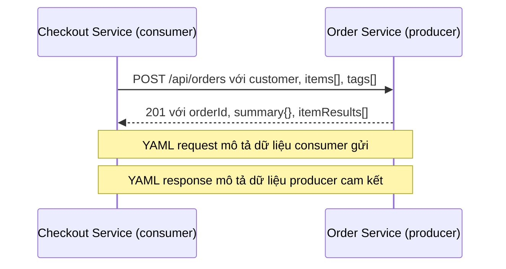

# Body lồng nhau, mảng và dữ liệu lấy từ tệp trong Spring Cloud Contract

## 1. Tại sao cấu trúc body quan trọng khi kiểm thử hợp đồng?

Trong kiến trúc nhiều dịch vụ, consumer thường nhận một JSON có nhiều cấp: thông tin khách hàng, địa chỉ, danh sách sản phẩm, thuộc tính của từng sản phẩm và dữ liệu tổng hợp. Khi producer thay đổi cấu trúc, ví dụ đổi `items` từ mảng sang object hoặc chuyển `customer.address.city` thành `customer.city`, consumer có thể lỗi dù HTTP status vẫn là `200` hoặc `201`.

**Spring Cloud Contract** giúp hai phía thống nhất hành vi HTTP hoặc thông điệp bằng Groovy/YAML DSL. Từ hợp đồng, nhóm producer sinh và chạy kiểm thử xác minh ứng dụng, đóng gói stub; nhóm consumer dùng Stub Runner để kiểm thử mà không cần khởi động producer thật. Trong CI, các kiểm thử này giúp phát hiện thay đổi API không tương thích sớm.

Bài này tập trung vào ba kỹ năng thiết kế hợp đồng:

1. Viết **body lồng nhau** (object trong object) bằng YAML.
2. Mô tả **mảng** gồm giá trị đơn, object hoặc mảng con; lựa chọn điều kiện kiểm tra cho từng phần tử.
3. Chuyển những payload dài sang **tệp ngoài** bằng `bodyFromFile` hoặc `bodyFromFileAsBytes` và hiểu tương đương trong Groovy DSL.

Các ví dụ sử dụng API đơn hàng của `Order Service`. Đây là tình huống minh họa; tên endpoint, package và giá trị dữ liệu cần được điều chỉnh theo hệ thống thực tế.

## 2. Cách YAML biểu diễn JSON lồng nhau

YAML có hai cấu trúc nền tảng cần nắm:

- **Mapping:** cặp `key: value`, tương ứng object JSON trong các ví dụ ở bài này.
- **Sequence:** các phần tử mở đầu bằng `-`, tương ứng array JSON.

Các cấp lồng nhau được thể hiện bằng **thụt lề bằng dấu cách**, không dùng tab. Xét dữ liệu YAML:

```yaml
customer:
  id: "C-101"
  profile:
    fullName: "Nguyen An"
    address:
      city: "Ha Noi"
      countryCode: "VN"
  contactChannels:
    - "email"
    - "sms"
```

Dữ liệu JSON tương ứng là:

```json
{
  "customer": {
    "id": "C-101",
    "profile": {
      "fullName": "Nguyen An",
      "address": {
        "city": "Ha Noi",
        "countryCode": "VN"
      }
    },
    "contactChannels": ["email", "sms"]
  }
}
```

Trong hợp đồng HTTP, các trường nằm dưới `request.body` hoặc `response.body` sẽ tạo thành nội dung payload. Cấp thụt lề quyết định phần tử nào là con của phần tử nào. Chẳng hạn `city` thuộc `customer.profile.address`, còn `contactChannels` là mảng trực tiếp của `customer`.

**Đừng nhầm key có dấu chấm với object lồng nhau.** Khai báo `"customer.id": "C-101"` tạo một key có tên `customer.id`; còn `customer: { id: "C-101" }` tạo object `customer` chứa key `id`. JSONPath của hai cấu trúc khác nhau: `$['customer.id']` so với `$.customer.id`.

## 3. Hợp đồng YAML hoàn chỉnh: object và mảng trong HTTP request/response

Giả sử consumer gửi đơn hàng với thông tin khách hàng và hai mặt hàng:

```yaml
description: Tao don hang voi hai mat hang
request:
  method: POST
  url: /api/orders
  headers:
    Content-Type: application/json
  body:
    customer:
      id: "C-101"
      address:
        city: "Ha Noi"
        countryCode: "VN"
    items:
      - sku: "BOOK-01"
        quantity: 2
        options:
          giftWrap: false
          color: "blue"
      - sku: "PEN-02"
        quantity: 1
        options:
          giftWrap: true
          color: "black"
    tags:
      - "mobile"
      - "promotion"
response:
  status: 201
  headers:
    Content-Type: application/json
  body:
    orderId: "O-202"
    summary:
      totalQuantity: 3
      amount:
        currency: "VND"
        value: 260000
    itemResults:
      - sku: "BOOK-01"
        accepted: true
      - sku: "PEN-02"
        accepted: true
```

Điểm cần quan sát:

| Cấu trúc | Đường dẫn trong JSON | Loại dữ liệu | Vai trò |
| --- | --- | --- | --- |
| `customer` | `$.customer` | Object | Gom dữ liệu khách hàng |
| `address` | `$.customer.address` | Object lồng nhau | Thông tin giao hàng |
| `items` | `$.items` | Array | Danh sách các mặt hàng |
| Mặt hàng đầu | `$.items[0]` | Object | Gồm SKU, số lượng và tùy chọn |
| `giftWrap` | `$.items[0].options.giftWrap` | Boolean | Thuộc tính lồng trong phần tử mảng |
| `tags` | `$.tags` | Array chuỗi | Các nhãn nguồn/chiến dịch |
| `summary.amount.value` | `$.summary.amount.value` | Number | Giá trị tổng hợp ở response |
| `itemResults[1].accepted` | `$.itemResults[1].accepted` | Boolean | Kết quả cho mặt hàng thứ hai |

Hợp đồng này mô tả một **tình huống cụ thể**: request có hai sản phẩm và response có hai kết quả. Nếu nghiệp vụ chấp nhận nhiều số lượng sản phẩm khác nhau, không nên suy từ hợp đồng mẫu rằng mọi số lượng đã được kiểm thử. Cần thêm các tình huống hoặc matcher phù hợp.

### 3.1. Diễn giải chiều producer–consumer



Producer verification cần kiểm tra endpoint thật trả cấu trúc đã thỏa thuận. Stub được sinh từ hợp đồng cung cấp phản hồi mẫu để consumer kiểm tra logic xử lý `itemResults`, kể cả khi producer không chạy.

## 4. Biểu diễn các kiểu mảng thường gặp

YAML sequence có thể chứa phần tử đơn giản, object lồng nhau hoặc một sequence khác.

### 4.1. Mảng giá trị đơn

```yaml
response:
  status: 200
  body:
    supportedCurrencies:
      - "VND"
      - "USD"
      - "EUR"
```

JSON tương ứng: `{"supportedCurrencies":["VND","USD","EUR"]}`.

### 4.2. Mảng object

```yaml
response:
  status: 200
  body:
    payments:
      - id: 42
        status: "PAID"
        details:
          method: "CARD"
      - id: 43
        status: "PENDING"
        details:
          method: "TRANSFER"
```

Mỗi dấu `-` mở một phần tử mới. Các trường `id`, `status`, `details` cùng mức thụt lề bên trong một phần tử thuộc cùng một object. Nếu đặt `details` ngang hàng với `payments`, cấu trúc sinh ra sẽ thay đổi hoàn toàn.

### 4.3. Mảng chứa mảng

```yaml
response:
  status: 200
  body:
    groupedIds:
      - [42, 43]
      - [50, 51, 52]
```

JSON tương ứng: `{"groupedIds":[[42,43],[50,51,52]]}`. Cũng có thể viết các mảng con theo dạng nhiều dòng nếu dễ đọc hơn.

### 4.4. Mảng rỗng, trường vắng mặt và `null`

Các payload sau có ý nghĩa khác nhau:

```json
{"items": []}
```

```json
{"items": null}
```

```json
{}
```

- `[]` là **mảng tồn tại và có 0 phần tử**.
- `null` là **trường tồn tại nhưng không có giá trị mảng**.
- Không có `items` là **trường vắng mặt**.

Nếu consumer yêu cầu `items` phải là mảng, hai trường hợp cuối có thể phá vỡ hợp đồng. Nếu consumer chỉ chấp nhận ít nhất một phần tử, ngay cả `[]` cũng không hợp lệ. Các quy tắc này cần được ghi rõ theo nghiệp vụ và được kiểm thử riêng; một body mẫu có hai phần tử không chứng minh được mọi quy tắc về kích thước.

## 5. Matcher JSONPath cho trường lồng nhau và phần tử mảng

Một body mẫu chỉ đưa ra ví dụ dữ liệu. Trong thực tế, một số giá trị như `orderId`, số tiền hoặc SKU có thể thay đổi nhưng **kiểu và định dạng** phải được giữ. Spring Cloud Contract YAML sử dụng `matchers` để mô tả những ràng buộc như vậy.

Ví dụ đoạn `response` sau có thể đặt trong một hợp đồng YAML:

```yaml
response:
  status: 201
  headers:
    Content-Type: application/json
  body:
    orderId: "O-202"
    summary:
      totalQuantity: 3
      amount:
        value: 260000
    itemResults:
      - sku: "BOOK-01"
        accepted: true
      - sku: "PEN-02"
        accepted: true
  matchers:
    body:
      - path: '$.orderId'
        type: by_regex
        value: 'O-[0-9]+'
      - path: '$.summary.totalQuantity'
        type: by_type
      - path: '$.summary.amount.value'
        type: by_type
      - path: '$.itemResults[0].sku'
        type: by_regex
        value: '[A-Z]+-[0-9]+'
      - path: '$.itemResults[0].accepted'
        type: by_type
      - path: '$.itemResults[1].sku'
        type: by_regex
        value: '[A-Z]+-[0-9]+'
      - path: '$.itemResults[1].accepted'
        type: by_type
```

Với `response.matchers.body`, những quy tắc này được dùng khi xác minh phản hồi producer:

- `$.orderId` phải có dạng phù hợp `O-[0-9]+`.
- `$.summary.totalQuantity` và `$.summary.amount.value` phải có kiểu tương ứng với dữ liệu mẫu.
- Hai phần tử `itemResults[0]` và `itemResults[1]` được kiểm tra riêng về định dạng SKU và kiểu boolean.

**Matcher phải tham chiếu tới trường có trong body mẫu.** Một đường dẫn như `$.summary.currency` sẽ không đúng với đoạn body ở trên vì không có trường đó. Trong YAML DSL, matcher nằm dưới `request.matchers` hoặc `response.matchers` tùy chiều cần kiểm tra; không sử dụng cú pháp `bodyMatchers { ... }` của Groovy trực tiếp trong YAML.

### 5.1. JSONPath nào tương ứng với dữ liệu nào?

| JSONPath | Mục tiêu |
| --- | --- |
| `$.customer.address.city` | Trường `city` của object `address` |
| `$.items[0].sku` | SKU ở phần tử đầu tiên của mảng `items` |
| `$.items[1].quantity` | Số lượng ở phần tử thứ hai |
| `$.items[0].options.giftWrap` | Boolean nằm trong object lồng của phần tử đầu |
| `$.tags[0]` | Chuỗi đầu tiên trong mảng `tags` |
| `$.itemResults[*].accepted` | Các giá trị `accepted` trong mảng; là biểu thức chọn nhiều phần tử |

JSONPath đánh chỉ số phần tử từ **0**. Đường dẫn `$.items[2]` sẽ không khớp phần tử nào nếu mảng chỉ có hai phần tử. Biểu thức `[*]` lấy nhiều phần tử, nên cần hiểu matcher áp dụng tới **cả tập** hay tới từng giá trị tùy cơ chế cụ thể; đừng giả định một matcher trên phần tử đầu là đủ bảo vệ mọi phần tử.

### 5.2. Những giới hạn khi xác minh mảng

Việc ràng buộc **độ dài mảng**, **mọi phần tử** và **thứ tự phần tử** cần được cân nhắc riêng:

1. Nếu consumer thật sự yêu cầu hai phần tử và đúng thứ tự, hãy định nghĩa/test điều kiện tương ứng.
2. Nếu thứ tự không có ý nghĩa nghiệp vụ, không nên khóa hợp đồng vào phần tử cố định `[0]` hoặc `[1]` rồi coi đó là hợp đồng tổng quát.
3. Nếu cần tất cả phần tử thỏa một schema, cân nhắc matcher/kiểm thử bổ sung ở mức collection hoặc kiểm thử schema riêng.
4. Tài liệu Spring Cloud Contract có lưu ý cơ chế **xác minh kích thước mảng** phụ thuộc cấu hình/phiên bản; ví dụ một số bản có `spring.cloud.contract.verifier.assert.size` hoặc cấu hình plugin `assertJsonSize`. Không được giả định kích thước mảng luôn được kiểm tra theo mặc định.

Nếu một phần tử có matcher riêng, cần đảm bảo các phần tử còn lại được kiểm tra theo mức chặt chẽ mong muốn. Nên kiểm tra test code thực tế được sinh ra để biết chính xác điều kiện nào đang được xác minh.

## 6. Lấy JSON body từ tệp ngoài với `bodyFromFile`

Khi payload có nhiều cấp, nhiều phần tử hoặc được chia sẻ giữa tài liệu và kiểm thử, việc nhúng hàng trăm dòng JSON trong YAML khiến hợp đồng khó đọc. **`bodyFromFile`** cho phép chuyển body sang tệp nội dung độc lập.

Ví dụ cấu trúc tệp của **một dự án minh họa**:

```text
src/test/resources/contracts/orders/
├── create-order.yml
├── request.json
└── response.json
```

Nội dung của `create-order.yml`:

```yaml
description: Tao don hang tu du lieu JSON trong tep
request:
  method: POST
  url: /api/orders
  headers:
    Content-Type: application/json
  bodyFromFile: request.json
response:
  status: 201
  headers:
    Content-Type: application/json
  bodyFromFile: response.json
```

Nội dung `request.json`:

```json
{
  "customer": {
    "id": "C-101",
    "address": {
      "city": "Ha Noi",
      "countryCode": "VN"
    }
  },
  "items": [
    {"sku": "BOOK-01", "quantity": 2},
    {"sku": "PEN-02", "quantity": 1}
  ]
}
```

Nội dung `response.json`:

```json
{
  "orderId": "O-202",
  "summary": {
    "totalQuantity": 3,
    "amount": {"currency": "VND", "value": 260000}
  },
  "itemResults": [
    {"sku": "BOOK-01", "accepted": true},
    {"sku": "PEN-02", "accepted": true}
  ]
}
```

Khi sinh kiểm thử và stub, Spring Cloud Contract đọc dữ liệu của tệp được tham chiếu và sử dụng làm body của request/response. **Đường dẫn tệp được tính tương đối với thư mục chứa hợp đồng**, vì vậy `request.json` và `response.json` trong ví dụ nằm cùng thư mục với `create-order.yml`.

**Những điểm cần nhớ:**

- `bodyFromFile: request.json` có nghĩa **nạp nội dung** tệp, không phải truyền chuỗi tên tệp `"request.json"` làm body.
- Đối với một chiều request/response, hãy chọn **một nguồn body** là `body` hoặc `bodyFromFile` để hợp đồng dễ đọc và không gây mâu thuẫn.
- Tệp JSON ngoài cần **JSON hợp lệ**, không có comment hoặc dấu phẩy thừa. Không nên giả định bộ phân tích tự chuyển một tệp YAML bên ngoài thành JSON nếu đang dùng `bodyFromFile`.
- Payload ở tệp ngoài **vẫn là nội dung hợp đồng**. Thay đổi `request.json` hoặc `response.json` có thể thay đổi test/stub được sinh, nên phải đưa cả tệp liên quan vào version control và code review.
- Tên tệp ví dụ chỉ minh họa: khi thực hành dự án thật cần tạo đầy đủ các tệp này; một hợp đồng tham chiếu đến tệp không tồn tại sẽ không hoạt động.

### 6.1. Có thể dùng matcher với `bodyFromFile` không?

Với payload JSON đã được lấy từ tệp, vẫn có thể mô tả matcher cho các đường dẫn JSON cần linh hoạt. Ví dụ chỉ thay phần `response`:

```yaml
response:
  status: 201
  headers:
    Content-Type: application/json
  bodyFromFile: response.json
  matchers:
    body:
      - path: '$.orderId'
        type: by_regex
        value: 'O-[0-9]+'
      - path: '$.summary.amount.value'
        type: by_type
```

Ở đây `response.json` phải có `orderId` và `summary.amount.value` tương ứng. Matcher không tự thêm trường bị thiếu và không thay thế việc chuẩn bị JSON mẫu hợp lệ.

### 6.2. Khi nào nên tách tệp?

| Cách viết | Phù hợp khi | Đánh đổi |
| --- | --- | --- |
| `body:` inline | JSON nhỏ, người review cần thấy toàn bộ tương tác tại một chỗ | YAML dài và lặp dữ liệu nếu body phức tạp |
| `bodyFromFile:` | JSON lớn, nhiều object/mảng lồng, có fixture được dùng nhất quán | Phải quản lý thêm tệp và đường dẫn; review cần mở cả contract và fixture |
| `bodyFromFileAsBytes:` | Dữ liệu nhị phân như PDF, ảnh, tệp tải xuống | Không dùng matcher JSONPath như với JSON thông thường |

Không có một lựa chọn tối ưu cho mọi API. Mục tiêu là giữ hợp đồng đủ rõ để review và đủ chặt để phát hiện thay đổi không tương thích.

## 7. Đọc dữ liệu nhị phân với `bodyFromFileAsBytes`

Giả sử producer nhận PDF và trả lại nội dung PDF đã xử lý. Payload ở đây là **byte**, không phải JSON hay văn bản. Hợp đồng YAML:

```yaml
description: Xu ly tai lieu PDF
request:
  method: PUT
  url: /api/documents/42
  headers:
    Content-Type: application/octet-stream
  bodyFromFileAsBytes: upload.pdf
response:
  status: 200
  headers:
    Content-Type: application/octet-stream
  bodyFromFileAsBytes: processed.pdf
```

Giả sử `upload.pdf` và `processed.pdf` nằm cạnh tệp hợp đồng YAML. `bodyFromFileAsBytes` nạp **dữ liệu nhị phân**, phù hợp với trường hợp upload/download tệp. Không dùng `bodyFromFile` để thay thế một cách tùy tiện cho dữ liệu nhị phân.

**Phân biệt ba dạng body:**

| Cú pháp YAML | Dữ liệu được lấy từ đâu? | Kiểu sử dụng |
| --- | --- | --- |
| `body: { ... }` hoặc mapping nhiều dòng | Giá trị viết trực tiếp trong YAML | JSON/text biểu diễn inline |
| `bodyFromFile: response.json` | Nội dung tệp văn bản | JSON, XML hoặc nội dung văn bản thích hợp |
| `bodyFromFileAsBytes: processed.pdf` | Byte của tệp | PDF, ảnh và những payload nhị phân khác |

Hãy đặt `Content-Type` phù hợp với giao diện API thực tế. `application/octet-stream` là kiểu nhị phân tổng quát; endpoint trả PDF có thể công bố `application/pdf` nếu đó là hợp đồng thật.

## 8. Tương đương trong Groovy DSL và các DSL khác

YAML là một cách diễn đạt hợp đồng. Trong **Groovy DSL**, dùng `file(...)` để nạp nội dung văn bản và `fileAsBytes(...)` để nạp dữ liệu nhị phân:

```groovy
import org.springframework.cloud.contract.spec.Contract

Contract.make {
    description 'Tao don hang tu JSON fixture'
    request {
        method POST()
        url '/api/orders'
        headers {
            contentType(applicationJson())
        }
        body(file('request.json'))
    }
    response {
        status CREATED()
        headers {
            contentType(applicationJson())
        }
        body(file('response.json'))
    }
}
```

Ví dụ nhị phân:

```groovy
import org.springframework.cloud.contract.spec.Contract

Contract.make {
    request {
        method PUT()
        url '/api/documents/42'
        headers {
            contentType(applicationOctetStream())
        }
        body(fileAsBytes('upload.pdf'))
    }
    response {
        status OK()
        headers {
            contentType(applicationOctetStream())
        }
        body(fileAsBytes('processed.pdf'))
    }
}
```

Các thư viện DSL dựa trên Java/Kotlin cũng có cách khai báo nội dung lấy từ tệp, nhưng cú pháp chính xác phụ thuộc DSL và phiên bản. Dù viết bằng Groovy hay YAML, cần giữ thống nhất **cùng cấu trúc payload, header, status và đường dẫn fixture**; việc chuyển đổi cú pháp không được vô tình thay đổi cam kết với consumer.

## 9. Các lỗi thực tế khi dùng body nhiều cấp

### Lỗi 1 — Sai thụt lề làm thay đổi cấu trúc

Ví dụ mong muốn `address` là object con của `customer`, nhưng viết:

```yaml
body:
  customer:
    id: "C-101"
  address:
    city: "Ha Noi"
```

Kết quả là hai trường **ngang hàng** `customer` và `address`, trong khi consumer mong đợi `customer.address.city`. Hãy so sánh JSON thực tế sau khi chuyển đổi, không chỉ nhìn bằng mắt vào YAML.

### Lỗi 2 — Không đặt dấu `-` hoặc đặt sai mức

```yaml
body:
  items:
    sku: "BOOK-01"
    quantity: 2
```

`items` ở đây là **object**, không phải mảng. Nếu API hứa trả `items: [ ... ]`, producer/consumer có thể lỗi khi giải mã kiểu dữ liệu.

### Lỗi 3 — YAML tự nhận diện kiểu giá trị

YAML có thể phân tích `true` thành boolean, `42` thành number, `null` thành giá trị null. Các chuỗi có số 0 đầu, giống ngày tháng, hoặc từ khóa có thể bị hiểu khác với ý định tùy phiên bản bộ phân tích YAML. Nếu một giá trị là **mã định danh** hay **chuỗi nghiệp vụ**, nên viết:

```yaml
body:
  customerCode: "00123"
  createdDate: "2026-11-24"
  enabled: true
  quantity: 2
```

`customerCode` vẫn là string `"00123"`, còn `enabled` và `quantity` được chủ đích sử dụng kiểu boolean và number.

### Lỗi 4 — Matcher trỏ sai JSONPath

Nếu body là `customer.address.city`, matcher `$.customer.city` không tìm được trường mong muốn. Với mảng, `$.items[1].sku` là phần tử **thứ hai** chứ không phải phần tử đầu. Tên key có dấu chấm cần dùng cú pháp truy cập key phù hợp thay vì coi dấu chấm là một cấp object.

### Lỗi 5 — Khóa thứ tự hoặc giá trị không được consumer sử dụng

Nếu API không cam kết thứ tự `items` nhưng hợp đồng bắt `items[0].sku` luôn bằng `BOOK-01`, những phản hồi hợp lệ có thể làm test thất bại. Ngược lại, nếu consumer cần thứ tự ưu tiên, việc kiểm tra thứ tự là cần thiết. Hãy xác định nhu cầu nghiệp vụ trước khi lựa chọn matcher.

### Lỗi 6 — Đường dẫn fixture sai hoặc fixture không được commit

`bodyFromFile: request.json` tìm dữ liệu tương đối với thư mục của contract. Nếu chuyển `create-order.yml` sang thư mục khác nhưng không chuyển/cập nhật fixture, việc sinh test và stub có thể thất bại. Nếu chỉ commit YAML mà bỏ quên JSON/PDF đi kèm, CI sẽ không có đủ dữ liệu để chạy.

### Lỗi 7 — Trộn JSON matcher vào dữ liệu binary

PDF hoặc ảnh không phải JSON nên JSONPath như `$.items[0]` không phù hợp. Với dữ liệu binary, cần xác minh các yếu tố phù hợp hơn như mã HTTP, header, loại nội dung và byte payload được mong đợi.

### Lỗi 8 — Consumer test xanh nhưng producer không khớp

Stub Runner sử dụng dữ liệu của hợp đồng để mô phỏng hành vi. Nếu nhóm chỉ chạy consumer test với stub mà **không chạy producer verification**, stub có thể trả đúng JSON mẫu trong khi API thật đã đổi cấu trúc. Pipeline cần kiểm tra producer trước khi phát hành stub đã xác minh.

## 10. Quy trình thực hành và tích hợp CI

Để áp dụng bài học cho một API có body phức tạp:

1. **Liệt kê dữ liệu consumer thật sự cần.** Xác định field bắt buộc, field tùy chọn, object/mảng và ý nghĩa thứ tự phần tử.
2. **Chọn inline hoặc fixture ngoài.** Body nhỏ có thể đặt thẳng trong YAML; body dài nên tách JSON để dễ review.
3. **Viết hợp đồng request/response đúng cấu trúc.** Kiểm tra thụt lề, kiểu scalar, cấp object, mảng và đường dẫn fixture.
4. **Bổ sung matcher có mục đích.** Những trường động dùng `by_regex`, `by_type` hoặc matcher tương ứng; những đường dẫn JSONPath phải tồn tại trong payload mẫu.
5. **Chạy producer verification.** Kiểm tra test sinh ra có thật sự xác minh cấu trúc nhiều cấp, phần tử mảng và điều kiện nghiệp vụ mà consumer cần.
6. **Sinh và phát hành stub sau khi kiểm thử đạt.** Commit và version toàn bộ YAML cùng JSON/PDF fixture; gắn stub với phiên bản producer.
7. **Chạy consumer test với Stub Runner.** Thử trường hợp một phần tử, nhiều phần tử, mảng rỗng và thay đổi giá trị động nếu chúng có ý nghĩa với consumer.
8. **Đưa vào CI và review thay đổi tương thích.** Khi producer thay đổi schema, hợp đồng và test cần giúp phân biệt thay đổi an toàn với thay đổi phá vỡ client.

Ví dụ lỗi không tương thích:

| Producer thay đổi | Rủi ro đối với consumer | Hợp đồng/test cần bảo vệ |
| --- | --- | --- |
| `customer.address.city` chuyển thành `customer.city` | Không đọc được địa chỉ | Đường dẫn trường lồng nhau |
| `items` từ array thành object | Lỗi ánh xạ hoặc duyệt danh sách | Kiểu collection |
| `items[0].quantity` từ number thành string | Sai tính toán | Kiểu trường con của phần tử |
| Xóa phần tử/đổi thứ tự | Sai mapping nếu consumer phụ thuộc vị trí | Quy tắc số lượng hoặc thứ tự khi có cam kết |
| Thêm một trường `metadata` | Thường không gây lỗi nếu client bỏ qua field thừa | Chính sách tương thích của consumer |
| Thay JSON bằng PDF | Thay đổi hoàn toàn định dạng payload | Content-Type và loại body/fixture |

## 11. Bài tập tự kiểm tra

Một producer trả về:

```json
{
  "shipmentId": "S-900",
  "recipient": {
    "name": "Mai",
    "address": {"city": "Da Nang", "postalCode": "550000"}
  },
  "packages": [
    {"weightGrams": 500, "labels": ["fragile", "priority"]},
    {"weightGrams": 1200, "labels": []}
  ]
}
```

Hãy thử làm các yêu cầu sau:

1. Viết `response.body` bằng YAML, giữ `recipient.address` lồng nhau và `packages` là mảng hai object.
2. Viết JSONPath cho `recipient.address.postalCode`, `packages[0].weightGrams` và mảng `packages[1].labels`.
3. Chọn trường nào nên kiểm tra kiểu và trường nào nên kiểm tra định dạng bằng regex nếu `shipmentId` thay đổi mỗi lần.
4. Chuyển body đó sang một tệp `shipment-response.json`, rồi viết `response.bodyFromFile` để sử dụng.
5. Giải thích vì sao `labels: []` khác với `labels: null` và không có trường `labels`.

Gợi ý YAML cho phần body:

```yaml
response:
  status: 200
  headers:
    Content-Type: application/json
  body:
    shipmentId: "S-900"
    recipient:
      name: "Mai"
      address:
        city: "Da Nang"
        postalCode: "550000"
    packages:
      - weightGrams: 500
        labels:
          - "fragile"
          - "priority"
      - weightGrams: 1200
        labels: []
```

JSONPath đúng lần lượt là `$.recipient.address.postalCode`, `$.packages[0].weightGrams` và `$.packages[1].labels`. Nếu dùng fixture ngoài, thay mục `body:` bằng `bodyFromFile: shipment-response.json` và lưu JSON cạnh hợp đồng. `labels: []` nghĩa là có mảng rỗng; `null` và trường vắng mặt có ý nghĩa khác và phải có quy tắc hợp đồng rõ ràng.

## 12. Checklist trước khi gửi pull request

- Cấu trúc YAML biểu diễn đúng object, array và cấp lồng nhau mà API đã thỏa thuận?
- Các giá trị dạng mã, ngày tháng hay chuỗi giống số có được đặt dấu nháy khi cần giữ kiểu string?
- Đã phân biệt trường thiếu, `null`, object/mảng rỗng và danh sách có phần tử?
- Matcher JSONPath tham chiếu đúng trường có trong body mẫu, gồm đúng chỉ số mảng?
- Có cần kiểm tra kích thước/thứ tự mảng không, và test sinh ra có thực sự làm việc đó?
- Đường dẫn `bodyFromFile`/`bodyFromFileAsBytes` là tương đối với thư mục contract, tệp có tồn tại và đã được commit?
- Đã dùng cách nạp **text** hoặc **bytes** phù hợp với Content-Type, tránh áp matcher JSON cho binary?
- Producer verification và consumer test bằng Stub Runner có dùng cùng hợp đồng/stub version đã kiểm chứng?

**Tài liệu chính thức để tra cứu cú pháp theo phiên bản:**

- [Spring Cloud Contract — Contract DSL](https://docs.spring.io/spring-cloud-contract/reference/project-features-contract.html)
- [Spring Cloud Contract — Dynamic properties và matchers](https://docs.spring.io/spring-cloud-contract/reference/project-features-contract/dsl-dynamic-properties.html)
- [Spring Cloud Contract — Reference text from file](https://docs.spring.io/spring-cloud-contract/reference/howto/how-to-reference-text-from-file.html)

**Ghi nhớ:** Object lồng nhau trong YAML được biểu diễn bằng mapping và thụt lề, mảng bằng sequence `-`. `bodyFromFile` lấy payload văn bản từ tệp cạnh hợp đồng; `bodyFromFileAsBytes` phục vụ payload nhị phân. Chọn matcher và các trường hợp kiểm thử theo nhu cầu thực của consumer để Spring Cloud Contract phát hiện thay đổi không tương thích mà vẫn cho phép producer mở rộng API an toàn.
