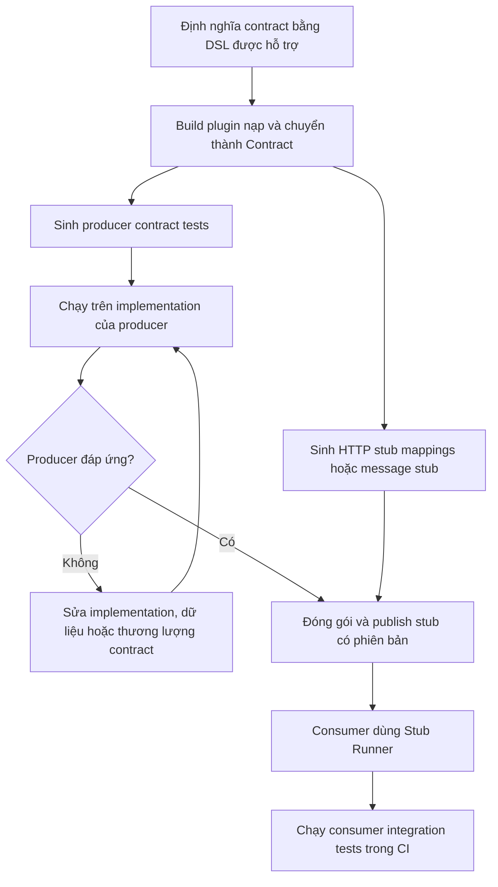

# Java DSL và Kotlin DSL theo khả năng hỗ trợ của phiên bản

Trong **Spring Cloud Contract**, mục tiêu của một hợp đồng là mô tả **đầu vào và hành vi mà producer cam kết với consumer**, để công cụ có thể sinh kiểm thử phía producer và tạo stub cho consumer dùng qua Stub Runner. Groovy DSL và YAML DSL thường được dùng trong ví dụ nhập môn, nhưng nhiều phiên bản Spring Cloud Contract còn cung cấp cách khai báo hợp đồng bằng **Java DSL** và **Kotlin DSL**.

Hai cách viết này hữu ích khi nhóm muốn tận dụng cú pháp quen thuộc, IDE và khả năng tổ chức mã của Java/Kotlin. Tuy nhiên, việc một dự án dùng Java hoặc Kotlin để phát triển dịch vụ **không tự động bảo đảm** build đã hỗ trợ các file hợp đồng Java/Kotlin. Phải đối chiếu đúng **phiên bản Spring Cloud Contract**, thiết lập plugin, đường dẫn nguồn và dependency của từng DSL.

Bài học thuộc chương **YAML và DSL khác** trong lộ trình **SPRING_CLOUD_CONTRACT**. Nội dung trình bày cách kiểm tra hỗ trợ theo phiên bản, ví dụ tương đương giữa các ngôn ngữ, cấu hình Maven/Gradle, và quy trình bảo đảm producer test, stub artifact và consumer test hoạt động thống nhất.

## 1. Phân biệt ngôn ngữ hợp đồng và ngôn ngữ ứng dụng

Một dịch vụ Pricing có thể viết bằng Java nhưng lưu hợp đồng ở YAML. Một consumer viết bằng Kotlin vẫn có thể chạy Stub Runner với các stub sinh từ hợp đồng Groovy. **Ngôn ngữ của hợp đồng không quyết định ngôn ngữ của mã dịch vụ hoặc mã test được sinh.**

| Cách định nghĩa | Dạng nguồn thường gặp | Kiểu biểu đạt | Điều kiện cần lưu ý |
|---|---|---|---|
| Groovy DSL | `*.groovy` | `Contract.make { ... }` với closure | Phải có plugin Spring Cloud Contract nhận diện nguồn |
| YAML DSL | `*.yml`, `*.yaml` | Cấu trúc `request`, `response` bằng khóa/giá trị | Cần tuân thủ schema của phiên bản |
| Java DSL | `*.java` | Lớp cung cấp `Contract` thông qua `Supplier` | Cần classpath, biên dịch/nhận diện Java contract và đúng thư mục |
| Kotlin DSL | `*.kts` | Kotlin Script gọi `contract { ... }` | Cần hỗ trợ script và dependency `spring-cloud-contract-spec-kotlin` phù hợp |

**Ý nghĩa của bảng:** Java/Kotlin không phải công cụ thay thế cho producer verification hoặc Stub Runner. Chúng là những **cú pháp khai báo cùng loại cam kết** mà build chuyển thành kiểm thử và stub.

Các tài liệu Spring Cloud Contract **4.3** và **5.0** có mục riêng cho Groovy, YAML, Java và Kotlin DSL. Điều đó không có nghĩa mọi ví dụ trên mạng áp dụng nguyên xi cho tất cả bản 2.x, 3.x, 4.x hoặc 5.x: đường dẫn mặc định, thư viện Kotlin scripting, API builder và tương thích với Spring Boot/Gradle có thể khác nhau.

## 2. Kiểm tra hỗ trợ trước khi chọn Java DSL hoặc Kotlin DSL

Không nên quyết định từ một câu “Spring Cloud Contract hỗ trợ Java/Kotlin” mà thiếu phiên bản cụ thể. Hãy xác nhận theo thứ tự:

1. **Phiên bản Spring Boot** của producer và consumer.
2. **Spring Cloud release train** tương thích với dòng Spring Boot đó.
3. **Phiên bản Spring Cloud Contract** thực sự được giải quyết trong build; kiểm tra cả plugin sinh test và thư viện spec/verifier/stub runner.
4. **JDK, Maven hoặc Gradle Wrapper** mà build dùng; với Kotlin, kiểm tra cả plugin/compiler và Kotlin scripting runtime.
5. **Tài liệu Contract DSL cho đúng phiên bản đã ghim**: có mục Java DSL/Kotlin DSL không, ví dụ dùng package/method nào, cần dependency gì?
6. **Bằng chứng thực thi**: ít nhất một file Java hoặc Kotlin được nhận diện, sinh ra producer test, chạy được và tạo mapping stub.

Nguồn tra cứu chính thức:

- [Spring Cloud Contract 4.3 — Contract DSL](https://docs.spring.io/spring-cloud-contract/reference/4.3/project-features-contract.html)
- [Spring Cloud Contract — tài liệu bản hiện hành](https://docs.spring.io/spring-cloud-contract/reference/project-features-contract.html)
- [Spring Cloud — các release train](https://spring.io/projects/spring-cloud)
- [Spring Boot — yêu cầu hệ thống](https://docs.spring.io/spring-boot/system-requirements.html)

Khi đọc ví dụ, hãy nhìn **phiên bản trong đầu trang tài liệu**. Nếu dự án đang ghim một phiên bản cụ thể, dùng chính tài liệu của phiên bản ấy. Không lấy một đoạn dành cho bản mới và giả định API builder tương thích ngược hoàn toàn.

### 2.1. Ba lớp “hỗ trợ” khác nhau

| Lớp kiểm tra | Câu hỏi | Dấu hiệu đạt |
|---|---|---|
| **DSL/API** | Bản đang dùng có `Contract.make` với Java builder hoặc `ContractDsl.contract` cho Kotlin không? | Ví dụ của đúng phiên bản biên dịch/được đọc thành `Contract` |
| **Build integration** | Maven/Gradle plugin có nhìn thấy và xử lý file nguồn không? | Có generated tests và stub mappings từ đúng file |
| **Runtime verification** | Producer có đáp ứng hợp đồng và consumer có gọi được stub không? | Producer contract tests đạt, Stub Runner cung cấp đúng phản hồi |

Kết quả “Java class biên dịch thành công” mới chứng minh lớp thứ nhất một phần. Nếu plugin không quét đường dẫn đó, không có hợp đồng nào được kiểm thử. Tương tự, việc Stub Runner phát ra dữ liệu theo mapping chưa tự chứng minh implementation của producer đang chạy đúng.

## 3. Một hành vi HTTP dùng xuyên suốt các ví dụ

Giả sử **Checkout** cần gọi **Pricing** để lấy giá một sản phẩm:

```http
GET /api/prices/SKU-42
Accept: application/json

HTTP/1.1 200 OK
Content-Type: application/json

{"sku":"SKU-42","currency":"VND","amount":120000}
```

Bên gọi phụ thuộc vào ba trường:

- `sku` là mã sản phẩm.
- `currency` là mã tiền tệ.
- `amount` là số nguyên, đơn vị tiền quy ước cho ví dụ.

Producer phải tạo ra đúng cấu trúc khi nhận request trong hợp đồng. Consumer phải đọc và xử lý được response. Giá trị `120000` là dữ liệu kiểm thử cố định; dự án thực tế có thể dùng matcher cho dữ liệu động nhưng vẫn phải bảo vệ các trường và kiểu dữ liệu mà consumer cần.

Các đoạn Java, Kotlin và YAML dưới đây **biểu đạt cùng một kịch bản để so sánh**. Khi thử trong một repository, chỉ bật **một nguồn hợp đồng** cho kịch bản này; nạp cả ba cùng lúc có thể tạo generated tests/mappings trùng nhau.

## 4. Java DSL: định nghĩa `Contract` qua `Supplier`

Ở các phiên bản có hỗ trợ Java DSL, tài liệu chính thức mô tả cách tạo lớp Java triển khai:

- `Supplier<Contract>`: cung cấp một hợp đồng.
- `Supplier<Collection<Contract>>`: cung cấp một tập hợp hợp đồng.

Ví dụ sau chọn dạng **collection**, ngay cả khi mới có một hợp đồng, để dễ mở rộng.

File minh họa: `src/test/java/contracts/PricingContract.java`.

```java
import java.util.Collection;
import java.util.Collections;
import java.util.function.Supplier;

import org.springframework.cloud.contract.spec.Contract;
import org.springframework.cloud.contract.verifier.util.ContractVerifierUtil;

class PricingContract implements Supplier<Collection<Contract>> {

    @Override
    public Collection<Contract> get() {
        return Collections.singletonList(
            Contract.make(c -> {
                c.name("checkout_get_price_found_200");
                c.description("Checkout lấy giá của SKU đã tồn tại");

                c.request(r -> {
                    r.method(r.GET());
                    r.url("/api/prices/SKU-42");
                    r.headers(h -> {
                        h.header("Accept", "application/json");
                    });
                });

                c.response(r -> {
                    r.status(r.OK());
                    r.headers(h -> {
                        h.header("Content-Type", "application/json");
                    });
                    r.body(ContractVerifierUtil.map()
                        .entry("sku", "SKU-42")
                        .entry("currency", "VND")
                        .entry("amount", 120000));
                });
            })
        );
    }
}
```

Đặc điểm cần hiểu:

1. `Contract.make(c -> { ... })` dùng **Java lambda builder**, khác với cú pháp closure Groovy `Contract.make { ... }`.
2. `r.method(r.GET())` và `r.status(r.OK())` dùng các giá trị của builder, không phải gọi một HTTP client thực sự.
3. `r.body(ContractVerifierUtil.map().entry(...))` diễn tả JSON body theo cấu trúc dữ liệu; không phải tạo entity trong database.
4. `Supplier` giúp công cụ lấy ra một hoặc nhiều đối tượng hợp đồng. Đây **không phải** một `@Test` JUnit viết tay.
5. Phải cấu hình nơi đặt/nhận diện nguồn Java contract. Java compiler biên dịch thành công không bảo đảm plugin đang đọc đúng contract.

### 4.1. Nếu cần nhiều hợp đồng trong một lớp

Dùng `Supplier<Collection<Contract>>` và trả một collection gồm các lệnh `Contract.make`, chẳng hạn:

```java
@Override
public Collection<Contract> get() {
    return java.util.Arrays.asList(
        Contract.make(c -> {
            c.name("checkout_get_price_found_200");
            // request và response của tình huống 200
        }),
        Contract.make(c -> {
            c.name("checkout_get_price_missing_404");
            // request và response của tình huống 404
        })
    );
}
```

Đoạn này minh họa **cấu trúc collection**, chưa phải file hợp đồng hoàn chỉnh: mỗi contract cần định nghĩa request và response đầy đủ. Với một tập lớn, nhiều file nhỏ có tên rõ ràng thường dễ review hơn một file chứa quá nhiều tình huống.

## 5. Kotlin DSL: dùng Kotlin Script `.kts`

Spring Cloud Contract Kotlin DSL được tài liệu mô tả dưới dạng **Kotlin Script** `.kts`. Đây là điểm rất dễ nhầm:

- `PricingContract.kts`: file **khai báo hợp đồng**.
- `build.gradle.kts`: file **cấu hình build Gradle bằng Kotlin DSL**.
- `PricingContract.kt`: file mã Kotlin thông thường; không đồng nghĩa plugin sẽ đọc nó như contract script.

Ba loại file đều liên quan Kotlin nhưng có mục đích và cơ chế tải khác nhau.

Ví dụ contract cùng hành vi với Java ở mục 4:

```kotlin
import org.springframework.cloud.contract.spec.ContractDsl.Companion.contract

contract {
    name = "checkout_get_price_found_200"
    description = "Checkout lấy giá của SKU đã tồn tại"

    request {
        method = GET
        url = url("/api/prices/SKU-42")
        headers {
            header("Accept", "application/json")
        }
    }

    response {
        status = OK
        headers {
            header("Content-Type", "application/json")
        }
        body = body(
            mapOf(
                "sku" to "SKU-42",
                "currency" to "VND",
                "amount" to 120000
            )
        )
    }
}
```

Lưu dưới tên như `src/test/resources/contracts/checkout_get_price_found_200.kts` **nếu Maven plugin trong phiên bản dự án đang đọc thư mục đó**; với Gradle plugin từ 3.0.0, tài liệu dùng `src/contractTest/resources/contracts` làm thư mục mặc định và có thể nhận thư mục legacy `src/test/resources/contracts` kèm cảnh báo. Cần kiểm tra tài liệu đúng phiên bản và cấu hình `contractsDslDir` khi cần.

Trong `.kts`, `contract { ... }` đến từ `ContractDsl.Companion.contract` của Spring Cloud Contract, **không phải** Kotlin DSL tích hợp sẵn của ngôn ngữ. Kotlin Script phải truy cập được thư viện `spring-cloud-contract-spec-kotlin` phù hợp và runtime/compiler scripting cần thiết.

### 5.1. Không áp cú pháp Java DSL sang Kotlin một cách cơ học

Java DSL dùng `c.request(r -> ...)`, `r.method(r.GET())` và `r.body(...)`. Kotlin DSL dùng property như `method = GET`, `status = OK`, `body = body(...)` bên trong builder. Groovy DSL thường dùng `request { method GET() }` hoặc cú pháp tương tự. Cả ba mô tả request/response nhưng **không thể sao chép từng dòng giữa các file** mà mong parser tự dịch.

Nếu code Kotlin báo `Unresolved reference: contract` hoặc `Unresolved reference: GET`, kiểm tra import, vị trí DSL receiver và classpath Kotlin Script trước khi thay đổi nghiệp vụ hợp đồng.

## 6. Đối chiếu YAML DSL với Java và Kotlin

Một file YAML thể hiện cùng request/response theo cấu trúc:

```yaml
name: checkout_get_price_found_200
description: Checkout lấy giá của SKU đã tồn tại
request:
  method: GET
  url: /api/prices/SKU-42
  headers:
    Accept: application/json
response:
  status: 200
  headers:
    Content-Type: application/json
  body:
    sku: SKU-42
    currency: VND
    amount: 120000
```

Bảng ánh xạ các thành phần tương đương:

| Ý nghĩa | Java DSL | Kotlin DSL | YAML DSL |
|---|---|---|---|
| Tên kịch bản | `c.name("...")` | `name = "..."` | `name: ...` |
| Phương thức | `r.method(r.GET())` | `method = GET` | `method: GET` |
| Đường dẫn | `r.url("/...")` | `url = url("/...")` | `url: /...` |
| Mã phản hồi | `r.status(r.OK())` | `status = OK` | `status: 200` |
| JSON body | `ContractVerifierUtil.map().entry(...)` | `body(mapOf(...))` | `body:` và các khóa con |
| Phụ thuộc | API Java builder | Kotlin Script/spec library | YAML schema và parser |

Điều quan trọng là **tính tương đương về hành vi**, không phải số dòng. Nếu Java nhận `GET /api/prices/SKU-42` nhưng YAML nhận `GET /api/prices/{sku}` với matcher rộng hơn, chúng **không còn là cùng một hợp đồng** dù tên giống nhau.

### 6.1. Khi nào chọn loại nào?

| Bối cảnh | Ưu tiên cân nhắc | Lý do |
|---|---|---|
| Nhóm gồm nhiều ngôn ngữ, ít logic trong DSL | YAML | Dễ review và trao đổi, không cần viết builder Java/Kotlin |
| Kho hợp đồng đã dùng Groovy ổn định | Groovy | Tận dụng quy trình/plugin sẵn có; không phải đổi chỉ vì backend dùng Kotlin |
| Nhóm hiểu rõ Java, cần quản lý contract thành lớp | Java DSL | Lambda/type và IDE giúp tổ chức hợp đồng, đổi lại phải cấu hình build/classpath |
| Nhóm dùng Kotlin và muốn dùng script idiomatic | Kotlin DSL | Cú pháp ngắn gọn, nhưng cần quản lý Kotlin scripting/spec dependency |
| Các bản plugin trong hệ thống không đồng nhất | DSL đang được mọi pipeline hỗ trợ | Khả năng đọc/generate của producer và CI quan trọng hơn sở thích cú pháp |

Không có quy tắc “service viết bằng Kotlin thì phải khai báo contract bằng Kotlin”. Nhiều nhóm giữ YAML hoặc Groovy vì chúng ít phụ thuộc vào công cụ biên dịch ngôn ngữ của dịch vụ.

## 7. Cấu hình Maven: đường dẫn contract và Kotlin dependency

Phần này mô tả **mẫu cấu hình theo tài liệu Spring Cloud Contract 4.3**, không phải một file `pom.xml` hoàn chỉnh cho mọi phiên bản.

### 7.1. Java DSL trong thư mục nguồn kiểm thử

Nếu đặt Java contract tại `src/test/java/contracts`, hướng dẫn chính thức dùng `contractsDirectory` để chỉ cho Maven plugin nơi tìm:

```xml
<!-- Bên trong <build><plugins> của pom.xml -->
<plugin>
    <groupId>org.springframework.cloud</groupId>
    <artifactId>spring-cloud-contract-maven-plugin</artifactId>
    <version>VERSION_PHU_HOP</version>
    <extensions>true</extensions>
    <configuration>
        <contractsDirectory>src/test/java/contracts</contractsDirectory>
    </configuration>
</plugin>
```

`VERSION_PHU_HOP` là placeholder: thay bằng phiên bản Contract đã được đối chiếu với Spring Boot/Spring Cloud. Dự án có thể cấu hình version qua Maven property hoặc plugin management; cần kiểm tra **effective POM** để chắc rằng plugin được nạp.

Không nhất thiết mọi Java contract đều phải đặt ở `src/test/java`; tài liệu cho phép đặt thư mục khác nhưng phải bảo đảm classpath và đường dẫn plugin nhận diện. Nếu di chuyển contract mà không đổi cấu hình, build có thể chạy xanh vì **không tìm thấy hợp đồng để sinh test**.

### 7.2. Kotlin DSL: bổ sung spec library vào Maven plugin

Với Kotlin DSL, bản 4.3 yêu cầu rõ dependency `spring-cloud-contract-spec-kotlin` trong **plugin dependencies**. Ví dụ cấu trúc tối thiểu:

```xml
<!-- Bên trong <build><plugins> của pom.xml -->
<plugin>
    <groupId>org.springframework.cloud</groupId>
    <artifactId>spring-cloud-contract-maven-plugin</artifactId>
    <version>VERSION_PHU_HOP</version>
    <extensions>true</extensions>
    <dependencies>
        <dependency>
            <groupId>org.springframework.cloud</groupId>
            <artifactId>spring-cloud-contract-spec-kotlin</artifactId>
            <version>VERSION_PHU_HOP</version>
        </dependency>
    </dependencies>
</plugin>
```

Nếu muốn IDE/test scope nhận diện DSL, tài liệu còn hướng dẫn khai báo dependency tương ứng trong `<dependencies>` của dự án, ví dụ:

```xml
<!-- Bên trong <dependencies> của project -->
<dependency>
    <groupId>org.springframework.cloud</groupId>
    <artifactId>spring-cloud-contract-spec-kotlin</artifactId>
    <scope>test</scope>
</dependency>
```

Khi dùng BOM quản lý phiên bản dependency, có thể không cần ghi version cho **dependency dự án**, nhưng **version của plugin và plugin dependency vẫn phải được giải quyết đúng**. Không cho rằng BOM dependency tự chọn mọi version của build plugin.

Nếu chuyển thư mục `.kts`, khai báo `contractsDirectory` tương ứng theo khả năng hỗ trợ của phiên bản và kiểm tra bằng generated tests.

## 8. Cấu hình Gradle: đường dẫn và Kotlin scripting

Theo tài liệu 4.3, Gradle plugin mặc định tìm nguồn hợp đồng tại `src/contractTest/resources/contracts`; từ 3.0.0, đường dẫn cũ `src/test/resources/contracts` còn được xét để hỗ trợ di chuyển và có thể sinh cảnh báo. **Đừng suy ra đường dẫn Maven và Gradle luôn giống nhau.**

Ví dụ cấu hình tùy chọn trong `build.gradle` dùng Groovy DSL:

```groovy
contracts {
    contractsDslDir = new File(project.rootDir, "src/test/java/contracts")
}
```

Đoạn này dành cho ví dụ Java contract nằm ở `src/test/java/contracts`, **giả định plugin Spring Cloud Contract đã được áp dụng**. Nó chỉ thay đổi nơi plugin tìm nguồn, chưa bao gồm khai báo plugin/dependency đầy đủ.

Khi dùng Kotlin contract `.kts`, ngoài plugin Contract phù hợp, tài liệu Gradle 4.3 đưa ra các dependency phía test/scripting như:

```groovy
dependencies {
    testImplementation "org.springframework.cloud:spring-cloud-contract-spec-kotlin"
    testImplementation "org.jetbrains.kotlin:kotlin-scripting-compiler-embeddable:KOTLIN_VERSION"
}
```

Ở đây `KOTLIN_VERSION` là placeholder. Dùng đúng phiên bản Kotlin compiler phù hợp với Kotlin trong project và tài liệu Contract/Gradle đang áp dụng. Tài liệu cũng thể hiện cách đưa `spring-cloud-contract-gradle-plugin` vào buildscript classpath; với cấu hình Gradle mới, cách đăng ký plugin có thể khác. Phải kiểm tra nguồn plugin **và** nguồn dependency chứ không chỉ copy mỗi khối `dependencies`.

**Lưu ý:** ví dụ phía trên là **Gradle Groovy build script**, còn file contract Kotlin là **`.kts`**. Dùng `build.gradle.kts` sẽ thay đổi cú pháp cấu hình Gradle, nhưng không làm contract `.kts` tự động có thư viện spec.

## 9. Sau khi đọc DSL, Spring Cloud Contract làm gì?

Dù hợp đồng viết bằng Groovy, YAML, Java hay Kotlin, luồng kiểm chứng chủ yếu giống nhau:



Cần kiểm tra từng tầng:

- **Source recognition**: plugin có thực sự tìm và đọc file `.java`/`.kts` không?
- **Generated tests**: có test đúng kịch bản `checkout_get_price_found_200` không?
- **Producer verification**: endpoint triển khai trả đúng status, header, body và matcher không?
- **Stub output**: mapping được tạo có chứa đúng request/response không?
- **Consumer test**: Stub Runner tải đúng artifact và client Checkout thực sự xử lý được phản hồi không?

Với message contracts, thay phần HTTP request/response bằng cơ chế trigger và output message phù hợp. Chọn Java/Kotlin DSL **không tự bổ sung** message binder, broker hoặc message verifier cần thiết.

### 9.1. Đừng nhầm hai loại kiểm thử

Producer test sinh từ contract kiểm tra **mã producer** có đáp ứng cam kết không. Consumer test với Stub Runner kiểm tra **mã consumer** có tương tác được với stub dựa trên hợp đồng không. Nếu người học chỉ chạy Stub Runner và không bao giờ chạy producer verification, stub có thể mô phỏng một hành vi mà producer chưa triển khai.

## 10. Thay đổi giữa Java, Kotlin, Groovy và YAML có gây tương thích API không?

**Đổi ngôn ngữ khai báo** không nhất thiết làm thay đổi API. Nếu hai biểu diễn tạo **cùng request matcher, cùng response và cùng điều kiện nghiệp vụ**, producer và consumer vẫn có thể quan sát cùng hành vi.

Ngược lại, thay đổi cú pháp rất dễ vô tình làm biến đổi ý nghĩa:

| Sai khác khi chuyển DSL | Hậu quả |
|---|---|
| Mất header `Accept` hoặc `Content-Type` | Stub có thể khớp request không đúng hoặc consumer parse sai response |
| Đổi `amount` từ số nguyên thành chuỗi | Consumer mong số có thể lỗi |
| Regex quá rộng ở request matcher | Stub của kịch bản 200 nhận cả request đáng lẽ trả 404 |
| Mất matcher cho dữ liệu động | Producer test trở nên quá chặt hoặc quá lỏng |
| Thay đổi `name`/`label` không kiểm soát | Generated test hoặc message trigger khó truy vết |
| Giữ cả hợp đồng cũ và mới trong thư mục được quét | Sinh test trùng hoặc HTTP stub mappings chồng lấn |
| Đổi source directory nhưng không cấu hình plugin | Không sinh test/stub mà build vẫn có thể chạy những test khác |

Vì vậy một migration an toàn nên **so sánh output**, không chỉ so sánh hai văn bản nguồn. Hãy giữ tên kịch bản, chạy generate, kiểm tra số lượng test, nội dung mapping và chạy producer/consumer tests.

### 10.1. Quy trình chuyển một hợp đồng YAML sang Kotlin

1. Ghi lại hành vi của YAML gốc: method, URL, header, body, matcher và mã phản hồi.
2. Chốt version Contract plugin cùng Kotlin spec/scripting dependency.
3. Viết file `.kts` thể hiện cùng hành vi; kiểm tra IDE nhận diện import và DSL receiver.
4. Tạm chỉ cho build đọc một trong hai biểu diễn; không để YAML và Kotlin cùng sinh mapping cho một request.
5. Sinh producer tests/stubs, so sánh các điều kiện request và response với nguồn gốc.
6. Chạy producer test, rồi consumer integration test qua Stub Runner.
7. Chỉ khi đạt mới đưa thay đổi vào CI và loại bỏ nguồn cũ đã được thay thế.

Cách làm tương tự áp dụng khi chuyển Groovy sang Java. Nếu đội không có nhu cầu thực tế, có thể giữ YAML/Groovy đang ổn định để giảm công việc bảo trì.

## 11. Chẩn đoán lỗi phổ biến của Java/Kotlin DSL

| Triệu chứng | Nguyên nhân nên kiểm tra trước | Cách xử lý |
|---|---|---|
| Java contract báo `cannot find symbol: Contract` | Thiếu dependency spec/API ở classpath biên dịch | Xem dependency của đúng bản, test source set và cấu hình plugin |
| Java class chạy được nhưng không có generated test | Plugin chưa quét `contractsDirectory` hoặc chưa nhận dạng kiểu `Supplier` | Kiểm tra đường dẫn và output generate |
| Kotlin `Unresolved reference: contract` | Thiếu import `ContractDsl.Companion.contract` hoặc spec-kotlin | Kiểm tra Kotlin script classpath/dependency |
| `.kts` báo lỗi parser/compilation | Kotlin version, scripting compiler hoặc API DSL không tương thích | Đối chiếu bản Kotlin/Contract, dùng ví dụ từ tài liệu đúng phiên bản |
| Gradle không thấy file contract | Dùng sai `contractsDslDir` hay nhầm đường dẫn Maven | Kiểm tra default/path theo Gradle plugin đang dùng |
| Maven/Gradle tải dependency thất bại | Repository/plugin repository, version không tồn tại hoặc proxy | Kiểm tra resolution trước khi sửa DSL |
| Sinh test được nhưng compile generated sources lỗi | JDK, test dependencies hoặc base class chưa đúng | Xem lỗi compiler và cấu hình producer test |
| Producer contract test trả `404` thay vì `200` | Endpoint/fixture chưa đáp ứng contract | Kiểm tra implementation và trạng thái dữ liệu |
| Consumer Stub Runner trả phản hồi khác mong đợi | Artifact/version/mapping sai hoặc mappings chồng lấn | Ghim artifact, kiểm tra request thực và mapping đã đóng gói |

Trước khi kết luận “Kotlin DSL không được hỗ trợ”, hãy xem tài liệu đúng phiên bản và phân biệt **không có hỗ trợ**, **thiếu dependency**, **sai thư mục**, **sai cú pháp** và **vi phạm hợp đồng thật**.

## 12. Thực hành: kiểm tra Java DSL và Kotlin DSL trong một producer

Giả định nhóm có ứng dụng `pricing-service` và consumer `checkout-service`. Hãy thực hiện trên nhánh bài tập của producer có Spring Cloud Contract plugin và các dependency tương thích.

### Phần A — kiểm tra phiên bản và build

1. Xác nhận version Spring Boot, Spring Cloud release train, Spring Cloud Contract plugin, JDK và Maven/Gradle Wrapper.
2. Mở tài liệu Contract DSL đúng phiên bản; tìm yêu cầu đối với `Supplier<Contract>`, `Supplier<Collection<Contract>>` và Kotlin Script `.kts`.
3. Chạy lệnh kiểm tra công cụ tương ứng, ví dụ `./mvnw -version` hoặc `./gradlew --version`. Không giả định Java của IDE trùng JVM chạy build.

### Phần B — Java DSL

1. Lưu Java contract ở mục 4 vào thư mục mà plugin đang sử dụng.
2. Nếu cần, cấu hình `contractsDirectory`/`contractsDslDir` theo tài liệu.
3. Sinh và chạy producer contract test. Nếu controller chưa trả giá cho `SKU-42`, ghi nhận đây là test đỏ có chủ đích.
4. Bổ sung implementation và fixture để test đạt. Kiểm tra mapping stub được sinh.

### Phần C — Kotlin DSL

1. Chọn một nguồn hợp đồng khác để tránh nạp trùng Java và Kotlin cho cùng request.
2. Bổ sung `spring-cloud-contract-spec-kotlin` và phần Kotlin scripting được yêu cầu bởi bản plugin đang dùng.
3. Lưu `.kts` ở thư mục plugin nhận diện; chạy sinh test và kiểm tra output.
4. Đối chiếu request/response của Kotlin với Java; bảo đảm status, header và body tương đương.

### Phần D — consumer và CI

1. Đóng gói bản stub đã vượt producer verification.
2. Cho Stub Runner tải đúng artifact và ghim version.
3. Dùng HTTP client thực của Checkout gọi `GET /api/prices/SKU-42` và xác minh `amount = 120000`, `currency = "VND"`.
4. Thay một trường trong producer response (ví dụ `amount` thành `price`), quan sát producer contract test thất bại, rồi khôi phục implementation.
5. Đưa generate/test/package và consumer test vào CI, tránh bỏ qua test để làm xanh pipeline.

**Tiêu chí hoàn thành:** có bằng chứng build đọc được Java hoặc Kotlin contract đúng phiên bản, sinh kiểm thử producer, xác minh implementation, tạo stub và chạy được consumer test. Kết quả “file Java/Kotlin không báo lỗi cú pháp” chưa đủ.

## 13. Câu hỏi tự kiểm tra

1. **Dịch vụ viết bằng Kotlin có bắt buộc dùng Kotlin contract DSL không?** Không. Ngôn ngữ khai báo hợp đồng độc lập với ngôn ngữ của dịch vụ; có thể dùng Groovy hoặc YAML.
2. **Java DSL thường trả hợp đồng cho plugin bằng cách nào?** Lớp triển khai `Supplier<Contract>` hoặc `Supplier<Collection<Contract>>`, tùy cần một hay nhiều hợp đồng và theo hỗ trợ của phiên bản.
3. **`build.gradle.kts` có phải file hợp đồng Kotlin DSL không?** Không. Nó là file build. File hợp đồng trong tài liệu thường là Kotlin Script `.kts` được plugin đọc từ thư mục contracts.
4. **Vì sao Kotlin `.kts` có thể không chạy dù project đã dùng Kotlin?** Có thể thiếu `spring-cloud-contract-spec-kotlin`, Kotlin scripting compiler, đường dẫn nguồn hoặc có chênh lệch phiên bản.
5. **BOM Spring Cloud có tự động bảo đảm đúng mọi version Maven plugin không?** Không nên giả định. Phải kiểm tra cả version của plugin và dependency/plugin classpath.
6. **Nếu cùng một HTTP request có cả file YAML và Java contract tạo response khác nhau, đổi tên file là đủ chưa?** Chưa. Cần loại bỏ nguồn trùng hoặc làm rõ điều kiện request/matcher.
7. **Vì sao phải chạy producer contract test trước khi phát hành stub?** Để chứng minh implementation thực đáp ứng hợp đồng; stub chạy đúng tự nó chỉ chứng minh mapping đang phục vụ kỳ vọng đã viết.
8. **Làm sao biết phiên bản dự án hỗ trợ Java/Kotlin DSL?** Đối chiếu tài liệu của bản Spring Cloud Contract đã ghim và chạy một kiểm tra generate/test/stub thực tế với cấu hình build tương ứng.

## Kết luận

**Java DSL và Kotlin DSL là hai cách biểu diễn hợp đồng trong những phiên bản Spring Cloud Contract có hỗ trợ chúng**, bên cạnh Groovy và YAML. Java thường tổ chức hợp đồng qua `Supplier` và builder API; Kotlin dùng `.kts` và `ContractDsl.contract` cùng dependency scripting/spec phù hợp. Để khai thác chúng an toàn, nhóm phải kiểm tra ma trận phiên bản Spring Boot–Spring Cloud–Contract, đường dẫn DSL, classpath của plugin và kết quả sinh test/stub. Khi producer verification và consumer integration tests đều chạy trên artifact có thể truy vết, việc chọn ngôn ngữ DSL sẽ phục vụ tính dễ đọc và bảo trì mà không làm suy yếu mục tiêu phát hiện thay đổi API không tương thích.
