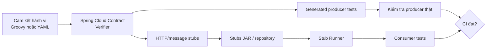
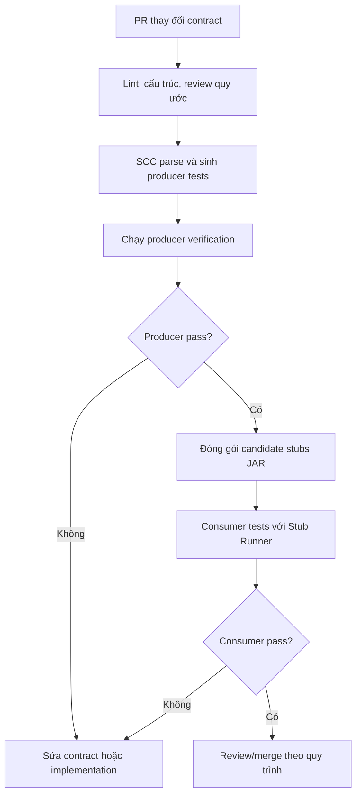

# So sánh tính dễ đọc, khả năng mở rộng và yêu cầu công cụ của YAML và các DSL khác

Trong **Spring Cloud Contract (SCC)**, một hợp đồng mô tả những gì producer phải đáp ứng để consumer có thể giao tiếp an toàn: phương thức, đường dẫn, header, body, status của HTTP hoặc điểm phát nhận và payload của thông điệp. Hợp đồng được dùng để **sinh bài kiểm thử phía producer** và **tạo stub** cho consumer chạy bằng **Stub Runner**. Nhờ đó, CI có cơ sở phát hiện nhiều thay đổi API không tương thích trước khi phát hành.

Có nhiều cách biểu diễn cùng một cam kết. **Groovy DSL** dùng mã khai báo có các khối `request`, `response`, `input`, `outputMessage`. **YAML DSL** trình bày dữ liệu theo cấu trúc thụt lề. Ngoài hai cách này, nhóm phát triển có thể gặp mô tả API dạng OpenAPI/AsyncAPI, contract của Pact hoặc DSL viết theo ngôn ngữ lập trình. Chọn định dạng không chỉ dựa trên sở thích: cần xét **người đọc, độ phức tạp của hành vi, khả năng bảo trì và chuỗi công cụ thực sự có thể kiểm chứng hợp đồng**.

Bài thuộc chương **YAML và DSL khác** này so sánh các lựa chọn theo ba trục chính: **tính dễ đọc**, **khả năng mở rộng** và **yêu cầu công cụ**. Các ví dụ dùng `order-producer`, dịch vụ cung cấp API và phát sự kiện đơn hàng cho `order-consumer`.

## 1. Phân biệt định dạng hợp đồng với quy trình kiểm thử

Một tệp Groovy hoặc YAML hợp lệ về cú pháp chưa đủ chứng minh dịch vụ thực hiện đúng hợp đồng. Vòng đời kiểm thử có các bước riêng:



Định dạng contract ảnh hưởng đến cách tác giả viết, reviewer đọc và công cụ phân tích tệp. Nó **không tự thay đổi** nguyên tắc phân chia trách nhiệm:

- **Producer verification** chạy generated tests với hành vi producer thật.
- **Consumer verification** chạy logic consumer với stub được sinh từ contract.
- **CI** cần kiểm tra producer và consumer bằng artifact đúng phiên bản.
- **Test tích hợp và vận hành** vẫn cần cho mạng, bảo mật, database, broker, retry hoặc thời gian phản hồi.

Một contract YAML mô tả sai response vẫn sinh ra stub mô phỏng response sai. Một contract Groovy rất linh hoạt nhưng không được chạy trong build cũng không bảo vệ API. Vì vậy nên so sánh **độ chính xác của kết quả sinh test/stub** cùng với cú pháp.

## 2. Ma trận so sánh nhanh

| Tiêu chí | Groovy DSL trong SCC | YAML DSL trong SCC | Định dạng/công cụ liên quan khác |
| --- | --- | --- | --- |
| Hình thức | Khối DSL có cú pháp Groovy | Các key/value, map và list thụt lề | Phụ thuộc lựa chọn: Java/Kotlin, JSON, OpenAPI, AsyncAPI, Pact… |
| Dễ đọc với reviewer không chuyên lập trình | Cần biết dấu ngoặc, closure và helper | Thường dễ rà soát các trường dữ liệu tĩnh | OpenAPI dễ hiểu cấu trúc API nhưng thường dài; DSL dạng code đòi hỏi biết ngôn ngữ |
| Diễn đạt HTTP cơ bản | Tốt | Tốt | Cần adapter/công cụ tương ứng |
| Diễn đạt điều kiện và matcher | Có helper, biểu thức và cơ chế matcher phong phú | Có cấu trúc matcher được SCC hỗ trợ; phải đúng schema | Khác nhau đáng kể theo hệ sinh thái và phiên bản |
| Tái sử dụng, mở rộng bằng mã | Thuận tiện hơn nếu dự án cho phép áp dụng Groovy | Bản thân YAML chủ yếu là dữ liệu, nên tái sử dụng thường qua generator/template ngoài | DSL theo ngôn ngữ có thể tiện abstraction; đặc tả API có cơ chế riêng |
| Rủi ro review | Logic phụ, helper khó thấy hoặc quá nhiều điều kiện | Thụt lề, kiểu scalar, escape và bản sao contract trùng | Chênh lệch schema, plugin và bước chuyển đổi |
| Công cụ SCC sinh provider test/stub | Được SCC hỗ trợ trực tiếp | Được SCC hỗ trợ trực tiếp | Phải **xác minh khả năng tích hợp cụ thể**; không mặc định dùng trực tiếp |
| IDE | Groovy syntax/IDE hỗ trợ tùy môi trường | YAML syntax, lint và schema validation nếu cấu hình | Theo định dạng và extension |
| Tình huống phù hợp | Contract phức tạp, nhóm quen Groovy DSL | Contract chủ yếu tĩnh, nhiều người review | Khi tổ chức đã dùng chuẩn/contract framework đó và có pipeline chuyển đổi rõ ràng |

Bảng này mô tả **xu hướng**, không phải quy tắc tuyệt đối. Một contract YAML có matcher vẫn có thể xử lý tình huống động; một contract Groovy vẫn có thể được viết rất ngắn, dễ đọc. Khả năng cụ thể phải được kiểm tra với **phiên bản Spring Cloud Contract đang dùng**, vì schema, matcher và plugin có thể khác theo phiên bản.

## 3. Cùng một HTTP contract viết bằng Groovy và YAML

Giả sử consumer gọi:

```http
GET /api/orders/1001 HTTP/1.1
Accept: application/json
```

Producer phải trả:

```http
HTTP/1.1 200 OK
Content-Type: application/json

{"id":1001,"status":"CREATED"}
```

### 3.1. Groovy DSL

Tệp ví dụ `src/test/resources/contracts/http/get-order-by-id-ok.groovy`:

```groovy
import org.springframework.cloud.contract.spec.Contract

Contract.make {
    description 'Khi đơn hàng tồn tại, GET theo ID trả 200 và trạng thái CREATED'

    request {
        method GET()
        url '/api/orders/1001'
        headers {
            header('Accept', 'application/json')
        }
    }

    response {
        status OK()
        headers {
            contentType(applicationJson())
        }
        body(
            id: 1001,
            status: 'CREATED'
        )
    }
}
```

**Ưu điểm khi đọc:** các khối `request` và `response` phân biệt rõ hai phía; helper `GET()`, `OK()`, `applicationJson()` thể hiện ý nghĩa. **Chi phí:** reviewer cần hiểu closure Groovy và biết rằng `body(id: 1001, status: 'CREATED')` là dữ liệu JSON được mô tả bằng cú pháp map.

### 3.2. YAML DSL

Tệp tương đương `src/test/resources/contracts/http/get-order-by-id-ok.yml`:

```yaml
description: "Khi đơn hàng tồn tại, GET theo ID trả 200 và trạng thái CREATED"
request:
  method: GET
  url: /api/orders/1001
  headers:
    Accept: application/json
response:
  status: 200
  headers:
    Content-Type: application/json
  body:
    id: 1001
    status: CREATED
```

**Ưu điểm khi đọc:** người chưa quen Groovy có thể nhận ra ngay `request.method`, `response.status` và dữ liệu JSON. **Chi phí:** ngữ nghĩa phụ thuộc chính xác vào mức thụt lề, kiểu dữ liệu YAML và schema SCC nhận diện. Một trường đặt sai cấp có thể làm parser báo lỗi hoặc khiến contract không mang ý nghĩa tác giả dự kiến.

### 3.3. Chọn một bản cho cùng kịch bản

Hai tệp ở trên là **hai cách biểu diễn để so sánh**. Trong bài thực hành, chỉ nên đưa **một bản** vào thư mục contract được build quét tại cùng thời điểm. Đặt cả hai bản đồng thời có thể sinh hai test/stub trùng hành vi; khi chỉ sửa một trong hai, nhóm sẽ không còn biết bản nào là nguồn cam kết chính thức.

| Hành vi | Groovy | YAML |
| --- | --- | --- |
| HTTP method | `method GET()` | `method: GET` |
| URL | `url '/api/orders/1001'` | `url: /api/orders/1001` |
| Request header | `header('Accept', 'application/json')` | `headers: {Accept: application/json}` |
| Response status | `status OK()` | `status: 200` |
| Response Content-Type | `contentType(applicationJson())` | `Content-Type: application/json` trong response headers |
| Response JSON body | `body(id: 1001, status: 'CREATED')` | `body:` chứa map `id`, `status` |

Mặc dù hai contract thể hiện cùng ví dụ, không nên mặc định chúng sinh **tệp test giống hệt từng byte**. Điều cần kiểm chứng là cả hai sinh ra cùng **hành vi test và stub** đối với request/response đã thỏa thuận.

## 4. Tính dễ đọc: nhìn cú pháp và nhìn được hành vi

### 4.1. YAML dễ quét bằng mắt trong những contract tĩnh

Khi contract chủ yếu là method, URL, header, status và body, YAML cho phép đọc từ trên xuống như một tài liệu có cấu trúc. Các thay đổi trong pull request cũng dễ tập trung:

```diff
 response:
-  status: 200
+  status: 404
```

Reviewer không cần hiểu cú pháp closure. Tuy vậy, **YAML dễ đọc không đồng nghĩa ít lỗi**. Dữ liệu nằm sai cấp thụt lề làm mất cấu trúc, còn chuỗi “giống số/boolean” có thể được parser xử lý khác mong đợi.

### 4.2. Groovy rõ nghĩa khi biểu diễn điều kiện phức tạp

Groovy DSL dùng các helper và khối khai báo gần với khái niệm kiểm thử. Ví dụ một response có trường `id` cần đúng kiểu nhưng không cố định giá trị:

```groovy
response {
    status OK()
    headers {
        contentType(applicationJson())
    }
    body(
        id: 1001,
        status: 'CREATED'
    )
    bodyMatchers {
        jsonPath('$.id', byType())
    }
}
```

Ở đây `body` chứa một giá trị mẫu, còn matcher kiểm tra kiểu dữ liệu của trường trên response thật. Điều này hữu ích khi producer sinh ID động. YAML DSL cũng có cơ chế mô tả matcher, nhưng cấu trúc khai báo khác và cần đối chiếu schema được hỗ trợ bởi phiên bản SCC của dự án.

**Giới hạn dễ đọc của Groovy:** nếu đưa nhiều nhánh điều kiện, biến toàn cục hoặc helper khó truy vết vào file contract, reviewer có thể khó biết chính xác hành vi nào sẽ được kiểm chứng. Một tệp Groovy đọc như chương trình xử lý nghiệp vụ thường là tín hiệu cần làm đơn giản hóa hợp đồng.

### 4.3. Mô tả quyết định khả năng đọc không kém định dạng

So sánh hai phần mô tả:

```text
"Test GET"
"Khi đơn hàng 1001 tồn tại, GET theo ID trả 200 và trạng thái CREATED"
```

Câu thứ hai rõ hơn ở cả Groovy lẫn YAML. Hãy thống nhất:

- Tên tệp thể hiện kịch bản: `get-order-by-id-ok`, `get-order-by-id-not-found`.
- `description` nêu điều kiện và kết quả quan sát được.
- Request/response hoặc input/outputMessage ràng buộc hành vi thật.
- Các trường có ý nghĩa với consumer được kiểm tra; không giấu thông tin cần thiết trong comment.

Một quy ước đặt tên và mô tả tốt đem lại lợi ích dài hạn lớn hơn việc đổi DSL chỉ để file trông ngắn hơn.

## 5. Những chi tiết YAML dễ gây lỗi khi mở rộng

YAML là định dạng dữ liệu, vì vậy cần chú ý cấu trúc và kiểu dữ liệu.

### 5.1. Thụt lề xác định cây dữ liệu

Đúng:

```yaml
response:
  status: 200
  headers:
    Content-Type: application/json
  body:
    id: 1001
    status: CREATED
```

Dễ sai nếu `body` được đặt ở cấp không đúng hoặc `status` bị thụt lề xuống thành một phần của `headers`. Không nên căn lề bằng tab; dùng số khoảng trắng nhất quán và bật YAML lint trong IDE/CI.

### 5.2. Phân biệt số, chuỗi, boolean và null

```yaml
body:
  orderId: 1001
  externalOrderId: "001001"
  confirmed: true
  optionalNote: null
```

Ý nghĩa mong muốn: `orderId` là số; `externalOrderId` là chuỗi giữ số 0 ở đầu; `confirmed` là boolean; `optionalNote` là null. Nếu consumer cần chuỗi `"001001"` nhưng contract dùng `001001` không có dấu nháy, parser có thể diễn giải thành dạng số và làm mất định dạng.

Các scalar như `yes`, `no`, `on`, `off`, chuỗi ngày tháng hoặc số có số 0 ở đầu cũng có thể được các YAML parser/phiên bản schema xử lý khác nhau. Với dữ liệu cần **chính xác kiểu string**, cách an toàn là đặt dấu nháy và kiểm tra kết quả parse/sinh stub.

### 5.3. Ký tự đặc biệt trong chuỗi

Dấu `:` kết hợp khoảng trắng, `#`, backslash hoặc dấu nháy có thể đổi nghĩa khi biểu diễn bằng YAML. Ví dụ khi viết pattern, URL chứa ký tự đặc biệt hoặc message text dài:

```yaml
description: "Khi id không tồn tại: producer trả 404"
request:
  method: GET
  url: "/api/orders/9999"
```

Một chuỗi regex trong YAML đôi khi dễ bảo trì hơn nếu dùng **single quote**, vì backslash không được xử lý như escape của double-quoted YAML theo cùng cách. Tuy nhiên cần đồng thời xét escaping ở lớp regex; hãy kiểm tra matcher thực tế được SCC parse.

### 5.4. Không dùng template như thể YAML tự thực thi mã

YAML không có vòng lặp, hàm hoặc biến runtime tích hợp như một ngôn ngữ lập trình. Nếu nhóm sinh hàng chục contract từ template, phải quản lý **generator riêng** và xác nhận đầu ra cuối cùng là các contract được SCC hỗ trợ.

Ví dụ pseudo-template dưới đây **không phải cú pháp SCC**:

```text
for each orderStatus in [CREATED, PAID, CANCELLED]:
    emit contract with request status=orderStatus
```

Nếu áp dụng generator ngoài, giữ một bước validate output, kiểm tra Git diff và chạy generated provider tests/stubs. Không để sự phức tạp của template che khuất những hành vi được cam kết.

## 6. Khả năng mở rộng: thêm hành vi, không chỉ thêm số lượng tệp

Khi nói DSL “mở rộng tốt”, cần phân biệt ba nhu cầu:

1. **Mở rộng tình huống:** thêm response 404, 400, 401, version hoặc trường hợp message mới.
2. **Mở rộng quy tắc dữ liệu:** match UUID, timestamp, enum, header động, phần tử mảng, trường tùy chọn.
3. **Mở rộng tổ chức:** nhiều producer, nhiều consumer, nhiều phiên bản stub và nhiều nhóm cùng review.

Một DSL chỉ giúp làm một tình huống ngắn gọn không nhất thiết làm hàng trăm tình huống dễ quản lý. Cần thiết kế cấu trúc thư mục, nguyên tắc tránh trùng và kiểm tra CI phù hợp.

### 6.1. Thêm kịch bản mới theo cách tường minh

Giả sử API GET có tình huống không tìm thấy. YAML có thể dùng tệp riêng `get-order-by-id-not-found.yml`:

```yaml
description: "Khi đơn hàng 9999 không tồn tại, GET theo ID trả 404"
request:
  method: GET
  url: /api/orders/9999
response:
  status: 404
```

Groovy cũng mô tả được cùng trường hợp:

```groovy
import org.springframework.cloud.contract.spec.Contract

Contract.make {
    description 'Khi đơn hàng 9999 không tồn tại, GET theo ID trả 404'
    request {
        method GET()
        url '/api/orders/9999'
    }
    response {
        status NOT_FOUND()
    }
}
```

Những tình huống khác nhau nên có request/matcher đủ phân biệt. Hai contract cùng match một request nhưng mô tả phản hồi trái ngược có thể khiến stub hoạt động không như dự kiến. Đây là vấn đề **thiết kế bộ hợp đồng**, không phải YAML hay Groovy “tốt hơn” về cú pháp.

### 6.2. Matcher và dữ liệu động

Khi producer trả giá trị do server sinh, khóa cứng `id: 1001` có thể khiến test không ổn định. SCC có cơ chế matcher/generator để dùng ví dụ cố định cho consumer và điều kiện linh hoạt hơn cho producer.

Chẳng hạn với response:

```json
{"id": 82731, "status": "CREATED"}
```

Một hợp đồng tốt có thể yêu cầu:

| Field | Yêu cầu nên kiểm tra | Rủi ro nếu quá lỏng |
| --- | --- | --- |
| `id` | Kiểu số hoặc định dạng ID đã thống nhất | Consumer không parse được ID mới |
| `status` | Thuộc tập giá trị hợp lệ | Producer thêm trạng thái consumer chưa xử lý |
| `createdAt` | Timestamp theo định dạng cam kết | Consumer giải mã thời gian sai |
| `currency` | Mã tiền tệ hợp lệ nếu nghiệp vụ phụ thuộc | Consumer tính toán/hiển thị sai |

Groovy DSL thể hiện matcher bằng helper như `byType()`, `byRegex()`, `jsonPath()`; YAML DSL khai báo matcher thành dữ liệu có cấu trúc. Khi so sánh, cần kiểm tra **cùng một quy tắc** được sinh vào provider test và stub, vì diễn đạt một matcher không đồng nghĩa tác dụng giống nhau nếu chọn sai phía request/response.

Không dùng regex `.*` để che mọi khác biệt. Matcher chỉ nên nới các giá trị **được phép thay đổi**; kiểu dữ liệu và ý nghĩa consumer phụ thuộc vào vẫn cần ràng buộc.

### 6.3. Trừu tượng hóa và tái sử dụng

Groovy là một ngôn ngữ lập trình có DSL; nếu tổ chức cho phép, tác giả có thể tận dụng các cơ chế của Groovy để hỗ trợ khai báo. Việc này có lợi khi nhiều contract cùng một quy tắc, nhưng cũng tạo rủi ro:

- Logic dùng chung thay đổi có thể ảnh hưởng nhiều contract ngoài ý muốn.
- Review cần đọc cả helper để biết contract thực tế làm gì.
- Tính dễ tái lập phụ thuộc vào nguồn mã và dependency bổ sung.

YAML thường buộc mỗi kịch bản thể hiện nhiều dữ liệu trực tiếp hơn. Để giảm lặp, có thể dùng công cụ sinh tệp, nhưng lúc đó generator trở thành một phần của hệ thống build và phải được version/review. **Không tự mặc định YAML anchor, alias hoặc custom tag sẽ được mọi bước của pipeline SCC xử lý đúng**; xác minh với parser và plugin cụ thể.

### 6.4. Mở rộng theo consumer và phiên bản

Khi có nhiều consumer, câu hỏi cần giải quyết là **ai còn cần hành vi nào**. Có thể tổ chức theo domain hoặc consumer đã được thống nhất, gắn contract với version của artifact stubs và chạy kiểm thử cho những consumer liên quan.

Ví dụ:

```text
contracts/
  http/
    get-order-by-id-ok.yml
    get-order-by-id-not-found.yml
    post-order-created.groovy
  messaging/
    order-created-v1.groovy
    order-created-v2.groovy
```

Cấu trúc trên chỉ là **quy ước nhóm**, không phải tên thư mục bắt buộc của Spring Cloud Contract. Trong dự án thật có thể chọn thống nhất YAML hoặc Groovy, hoặc dùng kết hợp khi mỗi loại giải quyết một nhu cầu rõ ràng. Khi kết hợp, phải có rule về review và tránh hai contract đồng nghĩa khác ngôn ngữ.

## 7. Message contract: so sánh thêm một ví dụ ngoài HTTP

Để kiểm thử sự kiện, producer phát thông điệp sau khi tạo đơn hàng. Ví dụ Groovy:

```groovy
import org.springframework.cloud.contract.spec.Contract

Contract.make {
    description 'Khi tạo đơn hàng thành công, phát OrderCreated v1'
    label 'order_created_v1'

    input {
        triggeredBy('publishOrderCreated()')
    }

    outputMessage {
        sentTo('orders.created')
        body(
            orderId: 1001,
            status: 'CREATED'
        )
    }
}
```

Cùng ý định khai báo ở dạng YAML:

```yaml
description: "Khi tạo đơn hàng thành công, phát OrderCreated v1"
label: order_created_v1
input:
  triggeredBy: publishOrderCreated()
outputMessage:
  sentTo: orders.created
  body:
    orderId: 1001
    status: CREATED
```

Các trường này có vai trò khác nhau:

- `input.triggeredBy` chỉ hook mà producer verification test gọi để kích hoạt việc phát thông điệp.
- `outputMessage.sentTo` là destination logic mà message phải được gửi đến.
- `outputMessage.body` là payload mà producer cam kết.
- `label` là tên dùng để consumer test kích hoạt message stub, ví dụ `StubTrigger.trigger("order_created_v1")`.

**Không nhầm label với destination.** Đổi label có thể làm consumer test không tìm thấy kịch bản; đổi destination có thể khiến consumer đang subscribe topic cũ không nhận được sự kiện. Groovy hay YAML không làm mất đi khác biệt này.

Provider test thông điệp còn cần **message verifier/test binder hoặc adapter** phù hợp với ứng dụng; Stub Runner phía consumer cần transport và cách quan sát listener xử lý message. Viết contract đúng cú pháp không tự động tạo broker hoặc bảo đảm message được phát trên môi trường thực.

Đối với messaging, lựa chọn Groovy hay YAML còn phụ thuộc việc nhóm có thường viết matcher payload phức tạp, khai báo nhiều header, hoặc tái sử dụng quy tắc cho event version khác nhau hay không. Hãy thử một contract đại diện của hệ thống trước khi chọn định dạng cho toàn bộ message catalog.

## 8. Yêu cầu công cụ: cần những gì để hai DSL hoạt động?

### 8.1. Các thành phần Spring Cloud Contract chính

Với dự án Maven hoặc Gradle, cần một tập phiên bản tương thích của Spring Boot/Spring Cloud Contract và cấu hình build sinh test, đóng gói stubs. Quy trình điển hình:

| Nhiệm vụ | Thành phần/công cụ |
| --- | --- |
| Phân tích hợp đồng Groovy/YAML | Bộ xử lý DSL do Spring Cloud Contract cung cấp trong cấu hình build |
| Sinh provider verification test | Spring Cloud Contract Verifier cùng plugin build |
| Chạy test với ứng dụng thực | JUnit/Test framework và cơ chế kiểm thử HTTP/message phù hợp |
| Đóng gói stub HTTP | Plugin SCC và WireMock mappings sinh từ contract |
| Phát hành stub | Maven/Gradle publish artifacts với classifier `stubs` theo cấu hình |
| Khởi động stub cho consumer | Spring Cloud Contract Stub Runner |
| Kiểm chứng thay đổi trước release | CI chạy producer verification và consumer tests với candidate stubs |

Một điều dễ nhầm: **chọn YAML không có nghĩa bỏ được Contract Verifier hoặc Stub Runner**. YAML chỉ thay đổi định dạng đầu vào; việc sinh test/stub vẫn cần đúng plugin và dependency. Tương tự, với Groovy DSL, dự án sử dụng plugin SCC thường không cần cài một chương trình `groovy` toàn hệ thống chỉ để chạy build, miễn plugin và dependency đã được khai báo chính xác.

### 8.2. Ví dụ cấu hình Maven mang tính định hướng

Đoạn dưới là phần **cấu hình plugin minh họa**, giả sử phiên bản plugin đã được quản lý đúng trong build:

```xml
<plugin>
    <groupId>org.springframework.cloud</groupId>
    <artifactId>spring-cloud-contract-maven-plugin</artifactId>
    <extensions>true</extensions>
    <configuration>
        <baseClassForTests>com.example.order.ContractVerifierBase</baseClassForTests>
    </configuration>
</plugin>
```

Dự án producer cũng cần dependency test phù hợp như `spring-cloud-starter-contract-verifier`, cùng lớp base chuẩn bị ứng dụng/test mode. Với HTTP, lớp base có thể dùng MockMvc hoặc một phương thức gọi HTTP khác tùy cấu hình; với message cần adapter/binder. Không coi đoạn plugin rời này là `pom.xml` hoàn chỉnh.

Sau khi đã cấu hình đúng:

```bash
mvn clean verify
```

Kết quả cần quan sát là **generated tests thực sự chạy**, không chỉ là build xanh. Khi đóng gói và phát hành stubs JAR, consumer dùng Stub Runner trỏ đến artifact đúng tọa độ (groupId, artifactId, version, classifier `stubs`). Dù dùng Groovy hay YAML, cần kiểm tra cả hai mặt:

1. Test phía producer đối chiếu hành vi thật theo contract.
2. Stub phía consumer thể hiện cùng cam kết và đúng phiên bản producer dự kiến phát hành.

### 8.3. Công cụ kiểm tra chất lượng định dạng

| Nhóm công cụ | Giá trị | Giới hạn |
| --- | --- | --- |
| YAML syntax highlighting/linter | Phát hiện tab, thụt lề, một số lỗi cấu trúc | Một tệp YAML đúng cú pháp có thể không đúng schema SCC |
| YAML schema-aware validation | Phát hiện field sai nếu có schema phù hợp phiên bản | Cần schema đúng và cơ chế tích hợp vào IDE/CI |
| Groovy IDE support | Highlight, điều hướng, hỗ trợ chỉnh sửa DSL | Không thay thế chạy Contract Verifier |
| Formatter/code review | Đồng bộ phong cách tên, mô tả và nội dung | Không chứng minh producer đáp ứng hành vi |
| Generated test/stub inspection | Cho biết tool đã diễn giải contract ra sao | Cần xác minh cả logic ứng dụng và môi trường chạy |
| Artifact/version check trong CI | Hạn chế việc consumer test nhầm bản stub cũ | Vẫn cần chạy consumer tests và kiểm tra runtime khi cần |

Lint là lớp đầu; **build SCC mới xác minh đầu vào được SCC chấp nhận và sinh ra test/stub theo mong đợi**.

## 9. “DSL khác” là lựa chọn gì, và có dùng trực tiếp với SCC không?

Trong thực tế, nhóm phát triển thường đã có nguồn mô tả API khác. Những lựa chọn này không phải tất cả đều là **DSL trực tiếp thay thế Groovy/YAML trong SCC**.

| Lựa chọn | Mạnh về điều gì? | Cần làm rõ trước khi kết hợp với SCC |
| --- | --- | --- |
| DSL theo Java/Kotlin hoặc ngôn ngữ lập trình | Tích hợp với hệ sinh thái mã nguồn và IDE khi công cụ/phiên bản hỗ trợ | Phiên bản SCC hiện dùng có nhận trực tiếp cú pháp đó không? Cần dependency/plugin nào? |
| **OpenAPI** | Tài liệu hóa và mô tả REST API, schema, parameter, response | Có bộ chuyển đổi/generator hay tích hợp nào được nhóm vận hành không? Mô tả OpenAPI không mặc nhiên sinh SCC provider tests giống contract Groovy/YAML |
| **AsyncAPI** | Mô tả kênh, message, schema và sự kiện bất đồng bộ | Cần công cụ chuyển đổi hoặc quy trình đồng bộ với contract message SCC nếu muốn dùng chung |
| **Pact** | Hệ sinh thái kiểm thử contract, thường nhấn mạnh nhu cầu consumer | Là quy trình/framework riêng; cần thiết kế tích hợp rõ ràng, không coi tệp Pact là `*.yml` SCC |
| **JSON Schema/Protocol Buffers** | Ràng buộc hình dạng dữ liệu hoặc schema message | Kiểm tra schema không tự bao quát HTTP status, header, routing, nghiệp vụ hay khả năng tương thích runtime |

Lựa chọn “tốt nhất” phụ thuộc mục đích. Nếu cần **phát hành API documentation** cho đối tác, OpenAPI có thể là nguồn tài liệu thích hợp. Nếu cần **provider verification và Stub Runner trong hệ thống đã dùng SCC**, Groovy/YAML thường là cách đi trực tiếp và dễ kiểm soát. Nếu tổ chức muốn dùng một mô tả duy nhất cho tài liệu API và kiểm thử contract, phải chứng minh bộ chuyển đổi giữ được những matcher và kịch bản quan trọng.

Không nên chỉ đổi đuôi `contract.json` thành `contract.yml` rồi mong SCC tự hiểu. **Định dạng và schema phải được công cụ đang dùng hỗ trợ rõ ràng.**

## 10. Chọn DSL theo nhóm và nhu cầu

Một bảng quyết định thực tế:

| Bối cảnh | Phương án cân nhắc trước | Lý do |
| --- | --- | --- |
| API HTTP chủ yếu có request/response cố định | YAML | Dễ đọc với cả người không viết Groovy |
| Contract có nhiều matcher và quy tắc động | Groovy, hoặc YAML nếu matcher được hỗ trợ đầy đủ | Chọn cách diễn đạt rõ và ít workaround nhất |
| Chủ yếu review qua pull request, nhiều nhóm tham gia | YAML với quy ước schema, lint và mô tả | Diff trực quan, dễ kiểm tra cấu trúc |
| Nhóm thành thạo Groovy, contract có logic hỗ trợ chung | Groovy nhưng giới hạn mức trừu tượng hóa | Tận dụng helper, tránh duplicate khi kiểm soát tốt |
| Đã có tài liệu OpenAPI/AsyncAPI | Thiết kế pipeline liên kết nguồn tài liệu và contract thực thi | Tránh hai nguồn cam kết mâu thuẫn nhau |
| Đang dùng Pact ở các consumer | Đánh giá việc duy trì Pact hoặc tích hợp rõ ràng | Tránh duplicate test và kết luận sai về phạm vi kiểm chứng |
| Nhiều message event với các schema version | Thử nghiệm một sự kiện đại diện bằng Groovy và YAML | Kiểm tra khả năng matcher, label, binder và Stub Runner |

Một cách đánh giá có thể lặp lại:

1. Chọn **một contract HTTP** có request body và response status, một **contract có matcher** và một **contract message**.
2. Viết cả Groovy và YAML ở **hai nhánh hoặc hai bộ test tách biệt**, không để cả hai bản cùng hoạt động trong bộ contract chính.
3. Nhờ developer producer, developer consumer và reviewer khác nhóm đọc thử; ghi nhận chỗ nào dễ hiểu sai.
4. Chạy build sinh test và stubs, xem generated output có ràng buộc đúng giá trị/kiểu không.
5. Chạy consumer với Stub Runner và kiểm tra đúng artifact version, đúng label message khi cần.
6. Ước lượng chi phí bảo trì khi thêm 404, event v2, matcher động, hoặc khi phải đổi schema.
7. Ghi lại quy ước đã chọn; chỉ dùng nhiều DSL trong cùng dự án nếu có lý do rõ ràng và quy tắc kiểm soát trùng lặp.

Tính “dễ đọc” nên được đo bằng **người thật review đúng hành vi**; tính “mở rộng” nên được đo bằng **thêm kịch bản mà không làm contract khó bảo trì**; yêu cầu công cụ nên được đo bằng **CI có sinh và chạy đúng test/stub**.

## 11. Chiến lược chuyển đổi từ Groovy sang YAML hoặc ngược lại

Khi dự án đã có hàng trăm hợp đồng, đổi toàn bộ định dạng trong một lần thường gây diff lớn và dễ che thay đổi hành vi. Hãy xem chuyển đổi DSL như một lần **refactor contract** cần bằng chứng.

### 11.1. Chuyển từng contract đại diện

Quy trình đề xuất:

```text
Chọn một contract hiện có
  -> ghi lại HTTP request/response hoặc message behavior hiện hành
  -> chuyển sang DSL đích ở nhánh riêng
  -> sinh lại provider tests và stubs
  -> so sánh hành vi được kiểm chứng (matcher, status, body, header)
  -> chạy producer verification
  -> chạy consumer tests với candidate stubs
  -> thay tệp cũ bằng tệp mới khi kết quả tương đương
```

Không chỉ so sánh văn bản: một matcher `byType()` có thể bị chuyển nhầm thành một giá trị mẫu cố định trong YAML, khiến test mới **quá cứng**. Ngược lại, chuyển `status: CREATED` thành regex chấp nhận mọi chuỗi làm test **quá lỏng**. So sánh kết quả sinh test và stub là bước quan trọng.

### 11.2. Tránh bộ stub trùng và thay đổi không chủ đích

Nếu giữ đồng thời `get-order-by-id-ok.groovy` và `get-order-by-id-ok.yml` trong thư mục được build quét, cả hai có thể tham gia sinh test/stub. Trong quá trình chuyển đổi:

- Dùng nhánh riêng hoặc tạm đặt bản so sánh ngoài đường dẫn discovery.
- Chỉ đưa một bản vào đường dẫn chính sau khi kiểm tra.
- Giữ ổn định đường dẫn HTTP, status, headers, body và matcher mà consumer phụ thuộc.
- Xác nhận version stubs JAR và consumer test dùng đúng bản mới.
- Với message, giữ `label` và `sentTo` nếu chưa có quyết định thay đổi hành vi.

Đổi DSL **không nên âm thầm thay đổi API**. Nếu mục tiêu thực sự là đổi hành vi, hãy tách thành thay đổi riêng với quy trình review, migration và kiểm tra tương thích.

## 12. CI nên xác minh điều gì bất kể chọn DSL nào?

Các bước cơ bản:



Checklist CI tối thiểu:

- Contract được đặt ở **đúng thư mục** và plugin thực sự phát hiện; số lượng generated tests không giảm ngoài dự kiến.
- Parse/validate thành công, bao gồm matcher, YAML scalar và data type.
- Producer verification chạy với ứng dụng và test mode đúng.
- Bộ stub sinh ra có kịch bản cần thiết, không có contract trùng gây mơ hồ.
- Consumer verification dùng **candidate stubs của phiên bản chuẩn bị phát hành**, tránh test nhầm stub cũ.
- Message test có binder/adapter và assertion thật, không chỉ gọi trigger.
- Lỗi do đổi method, URL, status, JSON field hoặc destination quan trọng làm bước kiểm tra phù hợp thất bại.

Một lệnh Maven điển hình sau khi đã cấu hình plugin và dependency:

```bash
mvn clean verify
```

Đây không phải phép kiểm chứng hoàn chỉnh nếu plugin chưa được tích hợp hoặc generated tests không chạy. Trong CI nhiều repository, cần liên kết kết quả provider build với consumer tests và artifact mới đúng phiên bản. **Chọn YAML hay Groovy không thay thế thiết kế pipeline này.**

## 13. Lỗi thường gặp khi đánh giá và sử dụng nhiều DSL

**“YAML dễ đọc nên chắc chắn dễ mở rộng hơn.”** Khi có hàng trăm matcher và kịch bản, YAML có thể lặp nhiều dữ liệu và khó đồng bộ. Đo bằng chi phí thay đổi thật, không chỉ độ ngắn một tệp.

**“Groovy là code nên cứ tạo helper và vòng lặp tùy ý.”** Trừu tượng hóa quá mức khiến người review không biết test nào đang được sinh; có thể tạo lỗi khó tái lập. Giữ hợp đồng tập trung vào hành vi giao tiếp.

**“Đổi DSL là đổi mỗi cú pháp.”** Nếu mất matcher, đổi kiểu số/chuỗi, đổi header hoặc label, contract sau chuyển đổi đã có ngữ nghĩa khác. Cần so sánh provider tests và stub mappings.

**“YAML parse thành công nghĩa là SCC hiểu đúng.”** YAML hợp lệ vẫn có thể sai schema hoặc đặt field sai cấp. Lint và SCC build giải quyết các lớp lỗi khác nhau.

**“Có OpenAPI là không cần contract test.”** OpenAPI hữu ích cho mô tả và sinh tài liệu; việc xác minh producer thực và consumer stub cần công cụ hoặc pipeline đã tích hợp. Không tự suy ra hành vi kiểm thử từ việc có tài liệu.

**“Pact và SCC chỉ khác định dạng tệp.”** Đây là các hệ sinh thái và quy trình có trọng tâm, công cụ, artifact khác nhau. So sánh cả việc ai sở hữu contract, test chạy ở đâu và kết quả được chia sẻ thế nào.

**“Stub Runner chạy được nghĩa là producer đúng.”** Stub có thể hoạt động đúng theo contract ngay cả khi producer thật đã sai. Vẫn phải chạy generated provider tests với implementation.

**“Message label chính là topic.”** `label` phục vụ nhận diện/kích hoạt stub; `sentTo` mô tả destination. Nhầm lẫn này có thể khiến consumer test xanh nhưng listener không đọc đúng channel.

## 14. Bài thực hành so sánh có tiêu chí rõ ràng

Tạo ứng dụng `order-producer` và `order-consumer` với Spring Cloud Contract được cấu hình đúng phiên bản. Thực hiện trong nhánh thử nghiệm để tránh sinh hai contract trùng lặp trong cùng build.

1. **HTTP tĩnh:** viết `GET /api/orders/1001` trả `200`, `id`, `status` bằng Groovy và YAML. So sánh tên trường, kiểu dữ liệu và mức độ dễ đọc khi review diff.
2. **HTTP lỗi:** viết `GET /api/orders/9999` trả `404`. Quan sát việc thêm kịch bản trong hai cách tổ chức tệp.
3. **HTTP động:** mở rộng response có ID sinh động. Dùng matcher tương ứng ở từng DSL và kiểm tra generated producer test có khóa cứng ID hay kiểm tra đúng kiểu.
4. **Messaging:** viết event `orders.created` với `label` và `triggeredBy`. Xác minh message verifier, rồi dùng `StubTrigger` trong consumer để kiểm tra listener.
5. **YAML edge cases:** thử `externalId: "001001"`, một scalar boolean và chuỗi chứa dấu hai chấm. Quan sát parser và stub trả đúng kiểu không.
6. **Đánh giá công cụ:** ghi nhận cấu hình build, IDE/linter, plugin, thời gian review, số lỗi khi chuyển đổi và khả năng debug.
7. **Tạo thay đổi phá vỡ:** đổi `status` thành `state` hoặc đổi HTTP method; xác định bước provider/consumer CI báo lỗi.
8. **Quyết định:** lập bảng lựa chọn DSL cho nhóm và viết một đoạn lý do dựa trên bằng chứng thực hành.

Bảng tự đánh giá:

| Tiêu chí | Minh chứng cần có |
| --- | --- |
| Hai định dạng thể hiện cùng hành vi | HTTP request/response và message behavior được so sánh rõ |
| Dễ đọc | Người review xác định được kịch bản và kết quả khi chỉ đọc tệp |
| Matcher đúng | ID/field động được kiểm tra theo quy tắc, không quá cứng hoặc quá lỏng |
| Khả năng mở rộng | Thêm được kịch bản lỗi, message version và header mà bộ contract vẫn rõ |
| Công cụ đáp ứng | SCC parse, sinh test, chạy provider verification thành công |
| Stub đúng | Consumer chạy Stub Runner với candidate stubs và assertion thật |
| Kiểm soát tương thích | CI phát hiện được thay đổi API có ý nghĩa với consumer |
| Quyết định có cơ sở | Lý do chọn YAML, Groovy hoặc phương án tích hợp khác dựa trên điều kiện nhóm |

Khi lựa chọn định dạng contract, **YAML** thường thuận lợi cho khai báo dữ liệu tĩnh, dễ đọc và review; **Groovy DSL** thuận lợi khi nhóm cần helper và biểu đạt matcher phong phú trong hệ sinh thái Spring Cloud Contract. Các đặc tả và DSL khác có thể phù hợp với mục tiêu riêng, nhưng cần xác minh đường tích hợp với SCC. Dù chọn cách nào, giá trị quyết định vẫn là **hành vi producer được kiểm chứng, stub consumer phản ánh đúng cam kết và CI phát hiện sớm thay đổi không tương thích**.
