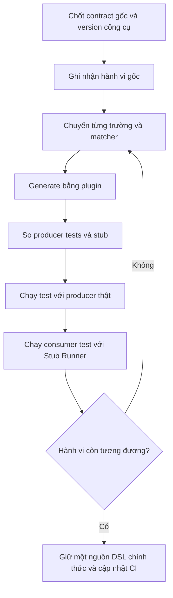

# Chuyển định dạng mà vẫn giữ nguyên ý nghĩa kiểm thử

## 1. Đổi cú pháp không đồng nghĩa với giữ nguyên hợp đồng

Trong **Spring Cloud Contract**, một hợp đồng (*contract*) thể hiện cam kết giữa **producer** và **consumer**. Với HTTP, cam kết thường gồm phương thức, URL, header, query/body của request và status, header, body, matcher của response. Với thông điệp, hợp đồng có thể mô tả dữ liệu đầu vào hoặc thông điệp đầu ra. Spring Cloud Contract hỗ trợ mô tả các hành vi đó bằng **Groovy DSL** và **YAML DSL**.

Một nhóm có thể muốn chuyển hợp đồng từ Groovy sang YAML vì hệ thống lưu trữ ưu tiên cấu hình dạng dữ liệu, hoặc chuyển ngược lại để dùng những tiện ích DSL Groovy. Việc chuyển chỉ thành công khi **cùng request quan trọng vẫn được chấp nhận, request sai vẫn bị từ chối theo cùng nguyên tắc, producer test vẫn kiểm chứng cùng điều kiện và consumer nhận stub tương đương**.

Ví dụ, thay `orderId` kiểu số nguyên thành chuỗi `"42"` có thể khiến client phân tích JSON sai. Chuyển matcher `status` từ giá trị chính xác `"CONFIRMED"` thành “bất kỳ chuỗi nào” khiến hợp đồng bỏ sót thay đổi API. Cả hai định dạng có thể hợp lệ về cú pháp nhưng **không còn tương đương về kiểm thử**.

Mục tiêu của bài: chuyển đổi có kiểm soát giữa Groovy/YAML DSL, tránh lỗi về kiểu dữ liệu, matcher và dữ liệu động, rồi xác minh đầu ra bằng producer tests, stub và CI.

## 2. “Tương đương” cần được kiểm tra ở hai phía

Một contract phục vụ ít nhất **hai mục đích**:

| Phía | Spring Cloud Contract tạo ra gì? | Điều phải giữ sau khi đổi định dạng |
| --- | --- | --- |
| **Producer** | Generated tests xác minh API triển khai | Request, response, giá trị bắt buộc và matcher không bị nới lỏng hoặc siết quá mức |
| **Consumer** | Stub, thường là WireMock mapping với HTTP, phục vụ qua Stub Runner | Request được stub nhận và status/header/body trả cho consumer có ý nghĩa tương đương |
| **CI** | Kết quả kiểm thử, stubs JAR và artifact version | Không bỏ sót kịch bản hoặc công bố stub chưa được producer xác minh |

**Tương đương về hành vi** không yêu cầu hai tệp giống số dòng, thứ tự khóa hoặc tên class test sinh ra. Điều cần so:

1. Request hợp lệ và không hợp lệ có được match theo cùng điều kiện không?
2. Status, header và body cam kết cho mỗi tình huống có giữ nguyên không?
3. Thay đổi nào của producer phải khiến test thất bại, thay đổi nào được phép?
4. Consumer có nhận dữ liệu mẫu với cùng ý nghĩa khi gọi stub không?

Chỉ parse DSL thành công chưa trả lời được bốn câu hỏi này.

## 3. Ví dụ cơ sở: cùng một hợp đồng HTTP ở hai DSL

Giả sử `order-service` có endpoint `GET /api/orders/42`; consumer `checkout-service` cần mã đơn và trạng thái.

### 3.1. Groovy DSL

Tệp `src/test/resources/contracts/orders/get-confirmed-order.groovy`:

```groovy
import org.springframework.cloud.contract.spec.Contract

Contract.make {
    description 'Truy vấn đơn hàng 42 đã xác nhận'

    request {
        method GET()
        url '/api/orders/42'
        headers {
            accept(applicationJson())
        }
    }

    response {
        status OK()
        headers {
            contentType(applicationJson())
        }
        body([
            orderId: 42,
            status : 'CONFIRMED'
        ])
    }
}
```

### 3.2. YAML DSL tương ứng

Tệp `src/test/resources/contracts/orders/get-confirmed-order.yml`:

```yaml
description: Truy vấn đơn hàng 42 đã xác nhận
request:
  method: GET
  url: /api/orders/42
  headers:
    Accept: application/json
response:
  status: 200
  headers:
    Content-Type: application/json
  body:
    orderId: 42
    status: "CONFIRMED"
```

Hai tệp mô tả **một kịch bản duy nhất**. Khi chuyển định dạng trong dự án thật, cần chỉ giữ **một nguồn hợp đồng** ở nơi plugin quét. Giữ cả hai bản có thể sinh hai bộ test/stub cho cùng request, gây trùng lặp hoặc xung đột.

### 3.3. Bảng ánh xạ từng điều kiện

| Ý nghĩa | Groovy DSL | YAML DSL | Điều cần giữ |
| --- | --- | --- | --- |
| Mô tả | `description '...'` | `description: ...` | Cùng tình huống |
| HTTP method | `method GET()` | `method: GET` | GET |
| URL | `url '/api/orders/42'` | `url: /api/orders/42` | Cùng đường dẫn và ý định match |
| Request header | `accept(applicationJson())` | `Accept: application/json` | Media type được chấp nhận |
| Response status | `status OK()` | `status: 200` | HTTP 200 |
| Response header | `contentType(applicationJson())` | `Content-Type: application/json` | JSON response |
| ID dạng số | `orderId: 42` | `orderId: 42` | Số, không phải chuỗi |
| Trạng thái | `status: 'CONFIRMED'` | `status: "CONFIRMED"` | Chuỗi chính xác |

YAML không dùng các lời gọi helper `OK()` hoặc `applicationJson()` như Groovy. Ta cần chuyển **hành vi mà chúng biểu diễn**, không chép nguyên tên helper thành chuỗi YAML.

## 4. Giữ kiểu dữ liệu khi chuyển đổi

YAML suy luận kiểu của scalar, trong khi Groovy có literal của ngôn ngữ lập trình. JSON trả ra có các kiểu riêng: string, number, boolean, null, array và object.

| Kiểu JSON mong muốn | Groovy Map | YAML | Lỗi thường gặp |
| --- | --- | --- | --- |
| Số `42` | `id: 42` | `id: 42` | `id: "42"` đổi thành chuỗi |
| Chuỗi `"0042"` | `id: '0042'` | `id: "0042"` | Bỏ nháy có thể khiến parser coi là số |
| Boolean | `active: true` | `active: true` | `active: "true"` là chuỗi |
| Null | `note: null` | `note: null` | `note: "null"` là chuỗi |
| Chuỗi ngày giờ | `at: '2026-11-24T09:00:00Z'` | `at: "2026-11-24T09:00:00Z"` | YAML loader có thể suy luận timestamp |
| Chuỗi `on`, `yes` | `value: 'on'` | `value: "on"` | Một số parser YAML 1.1 hiểu thành boolean |
| Danh sách | `items: ['A', 'B']` | `items: ["A", "B"]` | Đổi list thành map sẽ đổi cấu trúc |

YAML 1.1/1.2 và các parser có thể suy luận kiểu khác nhau. **Khi phải là string, hãy dùng dấu nháy**, nhất là với mã định danh có số 0 ở đầu, timestamp và các từ giống boolean.

### Vắng trường khác với có trường null

Hai response sau có thể khác ý nghĩa nếu consumer kiểm tra sự hiện diện của khóa:

```json
{ "orderId": 42 }
```

```json
{ "orderId": 42, "note": null }
```

Trong YAML, `note: null` biểu diễn một khóa có giá trị null; **không khai báo khóa `note`** mới biểu diễn trường vắng mặt. Trong Groovy Map cũng vậy. Cần giữ sự phân biệt này nếu consumer dựa vào nó.

### Object khác với chuỗi chứa JSON

Không nên mặc định hai cách khai báo sau là tương đương:

```yaml
body:
  orderId: 42
  status: "CONFIRMED"
```

```yaml
body: '{"orderId":42,"status":"CONFIRMED"}'
```

Ở ví dụ thứ hai, `body` là **scalar string trong YAML**. Cách plugin xử lý body, content type và serialization quyết định kết quả; có nguy cơ nhận chuỗi JSON đã được escape thay vì object JSON. Phải xem response thật do stub phục vụ và generated assertions.

## 5. Matcher: phần khó nhất khi chuyển đổi

Phần `body` cung cấp dữ liệu mẫu nhưng chưa biểu diễn hết các quy tắc động. Một hợp đồng có thể yêu cầu:

- `status` phải **bằng** `CONFIRMED`.
- `orderId` phải là số hợp lệ theo quy tắc, thay vì nhất thiết bằng số mẫu.
- `requestId` có dạng UUID nhưng thay đổi giữa các request.
- Header có thể **khớp regex** thay vì bằng một chuỗi cố định.

Khi chuyển sang DSL khác, phải giữ **loại matcher, đường dẫn, phía áp dụng và giá trị ví dụ**. Bỏ matcher có thể khiến test quá chặt; nới matcher quá rộng có thể khiến test bỏ qua thay đổi phá vỡ consumer.

### 5.1. Response matcher với giá trị động

Giả sử stub cần trả một `orderId` cụ thể là `42`, trong khi producer test được phép chấp nhận các ID chỉ chứa chữ số. Trong Groovy DSL có thể diễn đạt:

```groovy
response {
    status OK()
    headers {
        contentType(applicationJson())
    }
    body([
        orderId: $(consumer(42), producer(regex('[0-9]+'))),
        status : 'CONFIRMED'
    ])
}
```

Ở **response**, giá trị phía `consumer` là dữ liệu mẫu để stub trả cho consumer test; matcher phía `producer` giúp generated producer test kiểm chứng response thật mà không khóa nó vào đúng một giá trị bất biến. Những ràng buộc nghiệp vụ khác (ví dụ ID phải khớp ID trong request) vẫn cần bổ sung nếu consumer dựa vào chúng.

Một cách thể hiện ý định tương ứng trong YAML DSL là dùng body mẫu và một matcher tại JSONPath:

```yaml
response:
  status: 200
  headers:
    Content-Type: application/json
  body:
    orderId: 42
    status: "CONFIRMED"
  matchers:
    body:
      - path: $.orderId
        type: by_regex
        value: '[0-9]+'
```

Đây là ví dụ về nguyên tắc ánh xạ matcher. **Kiểm tra schema và các loại matcher được hỗ trợ bởi phiên bản Spring Cloud Contract thực tế**; cách biểu diễn và generated test có thể khác giữa các phiên bản. Regex `[0-9]+` chỉ cho phép chữ số; nó chưa diễn đạt những điều kiện như cấm số 0 ở đầu hay giới hạn giá trị số, và bản thân matcher regex có thể kiểm tra cách biểu diễn khác với matcher kiểu số.

### 5.2. Request và response có hướng khác nhau

Khi gặp các giá trị hai phía như `consumer(...)` và `producer(...)` trong Groovy, cần hiểu chúng được dùng ở đâu:

| Dữ liệu | Matcher được dùng để làm gì? | Ví dụ cụ thể phục vụ gì? |
| --- | --- | --- |
| **Request** | Stub phải nhận những request từ consumer phù hợp matcher | Generated producer test cần request mẫu để gửi |
| **Response** | Generated producer test phải kiểm chứng response thật của producer | Stub cần response mẫu ổn định cho consumer test |

Vì vậy, khi chuyển một **request matcher** sang YAML, hãy đặt nó trong phần request tương ứng; khi chuyển **response matcher**, hãy đặt trong phần response. Sao chép cùng regex vào body mà không giữ đúng phía kiểm tra có thể khiến producer test và stub đổi hành vi.

### 5.3. Bảng rủi ro đối với matcher

| Ý định ban đầu | Lỗi khi chuyển | Hệ quả |
| --- | --- | --- |
| `status = CONFIRMED` | Dùng regex `.*` | Producer trả trạng thái bất kỳ vẫn có thể qua |
| ID thuộc miền số hợp lệ | Khóa đúng ID mẫu `42` | Producer thay ID hợp lệ có thể bị báo lỗi |
| Path có thể khớp pattern | Chép pattern như URL literal | Stub chỉ nhận một path |
| Regex chứa dấu `.` hoặc `\d` | Escape sai qua Groovy/YAML | Matcher đổi nghĩa hoặc parse lỗi |
| Chỉ kiểm tra vài trường JSON | Đổi thành so sánh strict toàn bộ body | Thêm metadata không liên quan gây lỗi giả |
| Phân biệt null và vắng trường | Bỏ kiểm tra sự hiện diện | Có thể bỏ sót thay đổi không tương thích |

**Không mặc định** việc khai báo hai trường JSON trong cả hai DSL sẽ luôn sinh ra phép so khớp cho phép mọi trường bổ sung. Xem generated assertions, kiểm tra response có thêm một trường và response thiếu một trường để xác nhận độ chặt đúng với nhu cầu consumer.

## 6. Giữ nguyên điều kiện HTTP ngoài body

Nhiều lỗi chuyển định dạng nằm ở những thành phần dễ bỏ sót:

| Thành phần | Câu hỏi cần trả lời |
| --- | --- |
| Method | Vẫn là `GET`, `POST`, `PUT` đúng kịch bản không? |
| URL | Path và query nào được yêu cầu? Matcher chính xác hay regex? |
| Request headers | `Accept`, `Content-Type`, token hoặc header nghiệp vụ có được giữ đúng không? |
| Request body | Field bắt buộc, giá trị, null và matcher có giữ đúng nghĩa không? |
| Response status | `200`, `201`, `400`, `404` có bị thay đổi không? |
| Response headers | Media type và header có ý nghĩa với consumer có còn không? |
| Response body | Type, matcher và quy ước danh sách có bị đổi không? |

### Query parameters và URL

Hai request sau khác nhau về điều kiện nghiệp vụ:

```http
GET /api/orders?state=CONFIRMED
GET /api/orders?state=PENDING
```

Nếu hợp đồng gốc khẳng định query `state = CONFIRMED`, bản chuyển phải giữ điều kiện đó. Không tự biến một `urlPath` kèm matcher query thành `url` cố định nếu consumer được phép đổi thứ tự query parameters; cũng không bỏ matcher query chỉ vì muốn mã YAML ngắn hơn. Hãy kiểm tra WireMock mapping được sinh có khớp đúng request và từ chối đúng request ngoài phạm vi không.

### Header

Tên header HTTP về mặt giao thức không phân biệt hoa/thường; giá trị và ý nghĩa của header thì vẫn quan trọng. Chuyển `accept(applicationJson())` sang `Accept: application/json` trong ví dụ là tương đương về ý định. Tuy nhiên, nếu contract gốc cho phép nhiều media type hoặc yêu cầu matcher riêng, một giá trị cố định có thể đổi tập request được nhận.

### Mảng và thứ tự

JSON array có thứ tự; JSON object không mang ý nghĩa thứ tự khóa. Nếu consumer dựa vào thứ tự phần tử, hợp đồng phải giữ quy tắc đó. Nếu chỉ cần một vài phần tử đáp ứng điều kiện, việc đổi thành so sánh cứng toàn mảng có thể tạo ràng buộc dữ liệu không cần thiết.

## 7. Hợp đồng messaging: giữ metadata và hướng sự kiện

Spring Cloud Contract còn hỗ trợ **hợp đồng thông điệp**. Khi chuyển từ Groovy sang YAML hoặc ngược lại, không được chỉ sao chép JSON payload mà bỏ mất cơ chế nhận/phát message.

Những điều cần rà soát:

- **Input:** điều kiện producer nhận message hoặc được kích hoạt bằng cách khác.
- **Output message:** destination, topic, routing key hoặc channel nào nhận sự kiện.
- **Headers:** event type, content type, correlation ID và metadata consumer thật sự sử dụng.
- **Body:** cấu trúc payload, nullability, giá trị mẫu và matcher.
- **Trigger:** cách kích hoạt hành vi để generated producer test xác minh được message.

Ví dụ, contract `OrderConfirmed` gửi tới destination `orders.confirmed` khác với một đoạn JSON chứa `orderId` và `status` nhưng không chỉ rõ nơi phát. Consumer có thể đăng ký đúng topic hoặc dùng header để phân nhánh. WireMock mapping dành cho HTTP không thay thế cho việc kiểm chứng broker, destination hay trigger của messaging.

Tính năng và cú pháp messaging thay đổi tùy hệ thống truyền tin, cấu hình và phiên bản Spring Cloud Contract. Hãy đối chiếu generated test/stub/message thực tế, thay vì coi hai payload giống nhau là đủ.

## 8. Quy trình chuyển định dạng an toàn



### Bước 1. Chốt mốc đối chiếu

Ghim commit, JDK, phiên bản Spring Cloud Contract và build plugin. Ghi nhận source contract, generated producer tests, stub mapping và stubs JAR của bản gốc. Không chuyển DSL và nâng cấp plugin trong cùng một thử nghiệm nếu cần phân biệt nguyên nhân thay đổi.

### Bước 2. Ghi các cam kết thành bảng

Với mỗi điều kiện của request/response, xác định: đây là **giá trị ví dụ** hay **giá trị bắt buộc**; matcher thuộc phía nào; có ý nghĩa kiểu dữ liệu, nullability và đường dẫn JSONPath gì; consumer thực sự phụ thuộc phần nào.

### Bước 3. Chuyển một kịch bản mỗi lần

Viết Groovy/YAML mới từ bảng cam kết. Bắt đầu với method/URL/status và body cố định; sau đó đến matcher, query/header, giá trị động, lỗi HTTP và messaging. Khi thử, để bản mới ở vị trí xử lý riêng để tránh plugin sinh hai bộ test/stub trùng nhau.

### Bước 4. Sinh test và stub cùng phiên bản plugin

Với Maven đã cấu hình Contract Verifier:

```bash
./mvnw clean verify
```

Với Gradle, xem task thực tế và chạy luồng verify phù hợp:

```bash
./gradlew tasks --all
./gradlew clean check
```

Không giả định mọi cấu hình Gradle sẽ tự gắn generated contract tests vào `check`; xác minh log, số test sinh ra và số test **thực sự chạy**. Kiểm tra artifact stub theo cơ chế đóng gói/publishing của dự án.

### Bước 5. Đối chiếu hai đầu ra

1. Generated producer tests có cùng request và assertion quan trọng?
2. Stub có nhận cùng tập request hợp lệ và từ chối request không hợp lệ?
3. Response stub có cùng status, header, body và kiểu dữ liệu?
4. Matcher có cùng hướng áp dụng và mức độ chặt?
5. Các kịch bản `404`, `400`, unauthorized và message cần thiết có còn tồn tại?

So tên class, tên mapping hoặc diff byte chỉ là hỗ trợ: thứ tự khóa JSON có thể thay đổi mà không đổi nghĩa, trong khi sửa một ký tự regex có thể làm thay đổi hành vi.

### Bước 6. Chạy kiểm thử đối chứng

| Tình huống | Kỳ vọng khi hai bản tương đương |
| --- | --- |
| Producer trả đúng `orderId = 42` và `status = CONFIRMED` | Generated producer test pass |
| Producer đổi `status` từ string sang object | Test phải phát hiện nếu hợp đồng cam kết string |
| Producer bỏ `orderId` bắt buộc | Test phải phát hiện |
| Producer trả HTTP `204` thay `200` | Test phải phát hiện |
| Consumer gọi sai method hoặc path | Stub không được coi là match request |
| Consumer gọi đúng request | Stub trả dữ liệu đúng kịch bản |
| Producer thêm metadata không liên quan | Nên được phép nếu contract thiết kế mở rộng như vậy |
| Producer đổi giá trị động nhưng vẫn thỏa matcher | Nên được phép theo matcher đã thống nhất |

### Bước 7. Chọn một định dạng nguồn và cập nhật CI

Khi các điều kiện đã đạt, chỉ giữ một nguồn contract ở nơi build plugin quét. Pipeline producer phải sinh/chạy tests từ nguồn mới; stubs JAR phải được phát hành **sau khi producer tests pass**. Pipeline consumer dùng đúng version artifact để chạy Stub Runner và kiểm tra nhánh nghiệp vụ.

## 9. Những lỗi chuyển đổi thường gặp

| Triệu chứng | Nguyên nhân có thể | Cách xác minh |
| --- | --- | --- |
| YAML không parse được | Sai thụt lề, dấu hai chấm, escape hoặc biểu thức regex | Dùng plugin cùng phiên bản dự án, xem vị trí lỗi |
| Producer test bỏ lọt sai kiểu | Đổi số thành string hoặc bỏ matcher | Xem generated assertions và thử response sai kiểu |
| Stub không match request đúng | Đổi exact URL thành matcher khác, mất query/header | Đối chiếu request client gửi và WireMock mapping |
| Consumer nhận JSON dạng chuỗi | Biến object body thành YAML scalar | Gọi stub và kiểm tra body/Content-Type thực tế |
| Date/boolean đổi kiểu | YAML loader suy luận scalar | Quote các scalar phải là string |
| Regex không còn khớp | Escape dấu `\`, dấu `.` hoặc ký tự đặc biệt sai | So matcher được sinh trong producer test/stub |
| Stub trả mẫu đúng nhưng test quá chặt | Matcher động phía producer bị mất | Kiểm tra phía consumer/producer của giá trị động |
| Test tăng gấp đôi | Giữ cả bản Groovy và YAML trong nguồn quét | So danh sách contract được phát hiện và generated tests |
| Một kịch bản biến mất | Đổi phần mở rộng/path nên plugin không quét | Xem plugin log, generated output và số test chạy |
| Local pass nhưng CI fail | Khác JDK, plugin version, parser hoặc dữ liệu test | Ghim version, dùng wrapper, ghi tọa độ stubs JAR |

### Sai lầm: chỉ nhìn mã test mới có màu xanh

Giả sử hợp đồng Groovy gốc chứa matcher regex cho `requestId` nhưng bản YAML mới bỏ matcher và giữ giá trị ví dụ. Với dữ liệu test hiện tại, cả hai có thể pass. Tuy nhiên khi producer sinh một ID khác hợp lệ, bản YAML có thể fail sai. Do đó phải thử **thay đổi hợp lệ** ngoài dữ liệu mẫu, chứ không chỉ chạy happy path.

### Sai lầm: bỏ một hợp đồng vì không biết chuyển matcher

Khi contract gốc có matcher mà phiên bản YAML DSL đang dùng chưa hỗ trợ hoặc không dễ diễn đạt, không được tự bỏ ràng buộc rồi coi là chuyển xong. Có thể giữ Groovy DSL cho tình huống đó, tìm tính năng tương ứng ở phiên bản plugin hoặc ghi nhận hạn chế để có quyết định kỹ thuật rõ ràng. Một repository có thể chứa nhiều định dạng DSL nếu từng hợp đồng đại diện kịch bản khác nhau và plugin hỗ trợ, nhưng không nên duy trì **hai bản độc lập của cùng một lời hứa**.

## 10. Bài thực hành: chuyển hợp đồng lỗi HTTP 404

Producer cung cấp `GET /api/orders/999` và trả lỗi JSON khi đơn hàng không tồn tại. Hợp đồng Groovy gốc:

```groovy
import org.springframework.cloud.contract.spec.Contract

Contract.make {
    description 'Không tìm thấy đơn hàng'
    request {
        method GET()
        url '/api/orders/999'
        headers {
            accept(applicationJson())
        }
    }
    response {
        status NOT_FOUND()
        headers {
            contentType(applicationJson())
        }
        body([
            code   : 'ORDER_NOT_FOUND',
            message: 'Order 999 does not exist'
        ])
    }
}
```

**Yêu cầu:**

1. Chuyển sang YAML DSL và giữ nguyên HTTP method, URL, headers, status và body.
2. Giải thích vì sao đổi `status: 404` thành `status: 200` làm thay đổi hợp đồng, dù body vẫn chứa `ORDER_NOT_FOUND`.
3. Xác nhận `code` và `message` là chuỗi, đồng thời kiểm tra chúng xuất hiện đúng trong stub.
4. Sinh và chạy producer test, sau đó dùng stub mới để consumer kiểm tra nhánh “không tìm thấy”.
5. Đổi mã lỗi trong producer thật thành `INTERNAL_ERROR` nhưng không đổi contract; kiểm tra generated producer test có phát hiện không.

### Đáp án tham khảo bằng YAML

```yaml
description: Không tìm thấy đơn hàng
request:
  method: GET
  url: /api/orders/999
  headers:
    Accept: application/json
response:
  status: 404
  headers:
    Content-Type: application/json
  body:
    code: "ORDER_NOT_FOUND"
    message: "Order 999 does not exist"
```

HTTP `404` là điều kiện quan trọng: consumer có thể xử lý khác giữa phản hồi `200` và `404` dù body giống nhau. Khi chuyển sang YAML, giữ đúng mã HTTP để generated producer test và stub kiểm tra cùng nhánh lỗi.

**Bài tập mở rộng:** Trong thực tế, `message` có thể được quốc tế hóa và không cần cố định từng ký tự, nhưng `code` phải giữ nguyên để consumer xử lý. Nếu consumer không phụ thuộc vào câu thông báo cụ thể, hãy thiết kế matcher/phạm vi hợp đồng phù hợp ngay từ bản gốc, rồi chuyển sang DSL còn lại với cùng quyết định. Đừng tự nới lỏng ràng buộc trong lúc đổi định dạng mà chưa có sự thống nhất.

## 11. Checklist kiểm tra tính tương đương

- [ ] Mỗi tình huống chỉ có một tệp contract chính thức sau chuyển đổi.
- [ ] Request method, URL, query, headers và body có cùng điều kiện match.
- [ ] Response status, headers, body, kiểu dữ liệu và nullability không đổi.
- [ ] Giá trị mẫu, matcher và phía consumer/producer được ánh xạ đúng.
- [ ] YAML scalar đặc biệt được quote; regex và escape hoạt động đúng.
- [ ] Những trường hợp lỗi HTTP hoặc hợp đồng thông điệp trong phạm vi vẫn đầy đủ.
- [ ] Generated producer tests có assertion tương đương, **được chạy** và pass.
- [ ] Stub được thử với request hợp lệ và sai; consumer tests chạy với Stub Runner.
- [ ] JDK, build plugin version và stubs JAR version được ghi rõ để CI tái lập.
- [ ] Đã kiểm tra một thay đổi phá vỡ và một thay đổi hợp lệ ngoài dữ liệu mẫu.

**Ghi nhớ:** Chuyển Groovy DSL sang YAML DSL hoặc ngược lại là công việc **bảo toàn hành vi kiểm thử**. Nguồn hợp đồng mới chỉ đáng tin khi request, response và matcher vẫn có ý nghĩa tương đương đối với producer, stub và consumer; khả năng phát hiện thay đổi API không tương thích phải được chứng minh bằng kiểm thử sinh tự động và thực thi thực tế.
