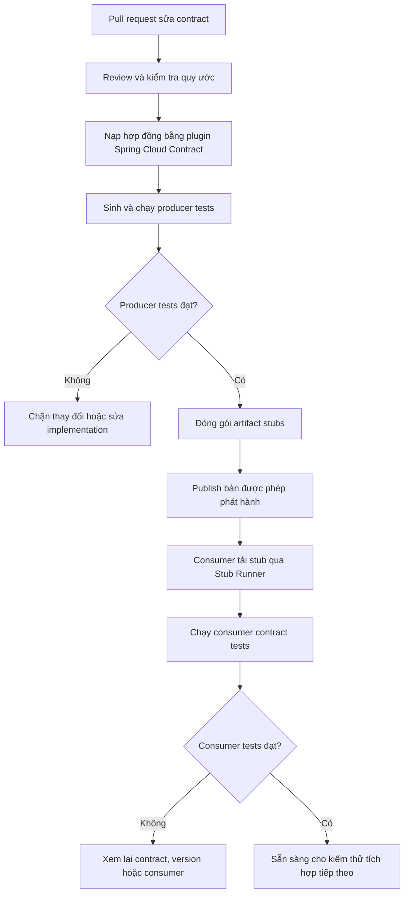

# Chọn một quy ước thống nhất trong nhóm phát triển

**Spring Cloud Contract** giúp producer và consumer cùng kiểm chứng những tương tác đã thống nhất: một hợp đồng mô tả hành vi HTTP hoặc thông điệp; phía producer dùng hợp đồng để sinh và chạy kiểm thử; phía consumer dùng stub được phát hành và **Stub Runner** để kiểm tra mã tích hợp. Spring Cloud Contract hỗ trợ **Groovy DSL** và **YAML DSL**, với cách diễn đạt và khả năng mở rộng khác nhau. Khi nhiều lập trình viên cùng viết hợp đồng, lựa chọn định dạng chỉ là bước đầu: nhóm còn cần quy ước về vị trí tệp, cách đặt tên, dữ liệu ví dụ, quy tắc matcher, phiên bản và quy trình review.

Bài thuộc chương **YAML và DSL khác**, tập trung vào câu hỏi: **nhóm phát triển nên chọn và duy trì một quy ước chung thế nào để hợp đồng dễ đọc, kiểm thử được, ít trùng lặp và bảo vệ được các consumer khi API thay đổi?** Các ví dụ xoay quanh `Order Service` (producer) và `Billing Service` (consumer), nhưng nguyên tắc có thể dùng cho HTTP cũng như hợp đồng thông điệp.

Sau bài học, bạn có thể xây dựng một quyết định kỹ thuật về DSL, đề xuất bộ quy tắc có thể áp dụng ngay trong repository, nhận biết những bất nhất gây lỗi test/stub và tổ chức quy trình CI để quy ước thực sự được thực thi.

## 1. Tại sao cần thống nhất quy ước?

Giả sử cùng một nhóm đang phát triển API đọc đơn hàng. Một thành viên viết hợp đồng Groovy có đường dẫn `/orders/42`, người khác viết YAML dùng `/api/orders/42`; tệp thứ nhất kiểm tra `status`, tệp thứ hai kiểm tra `state`; một người dùng phản hồi lỗi có `code`, người khác chỉ ghi status `404`. Cả hai đều có thể hợp lệ về **cú pháp**, nhưng người đọc không biết tình huống nào được nhóm cam kết hỗ trợ.

Hệ quả không chỉ là khó bảo trì:

1. **Producer tests** có thể kiểm những hành vi không nhất quán hoặc bỏ sót trường quan trọng với consumer.
2. **Stub mappings** được sinh có thể chồng lấn hoặc phản ánh kỳ vọng khác nhau, khiến consumer test nhận kết quả khó đoán.
3. **Code review** mất thời gian tranh luận về định dạng, tên và vị trí tệp thay vì tính tương thích API.
4. **CI** có thể chạy xanh với hợp đồng mới nhưng không còn kiểm hợp đồng mà consumer cũ vẫn phụ thuộc.
5. **Truy nguyên thay đổi** khó: không rõ hợp đồng nào tương ứng phiên bản stub nào hoặc consumer nào cần được thông báo.

Quy ước tốt phải trả lời được ba câu hỏi thực tế: **viết như thế nào**, **kiểm chứng bằng gì** và **đổi hợp đồng theo quy trình nào**. Nó là thỏa thuận kỹ thuật được review và kiểm tra tự động, không chỉ là một tài liệu nêu sở thích viết mã.

## 2. Chọn DSL dựa trên nhu cầu của nhóm

Các dự án dùng Spring Cloud Contract thường gặp Groovy DSL và YAML DSL. Bản chất của cả hai là **đầu vào cho cùng quy trình xác minh producer và tạo stub consumer**; nhưng chúng khác nhau về cách biểu diễn matcher, dữ liệu động và khả năng tái sử dụng logic.

| Tiêu chí | YAML DSL | Groovy DSL | Câu hỏi cần thống nhất |
| --- | --- | --- | --- |
| Dễ đọc khi review | Cấu trúc dữ liệu rõ, quen thuộc với người làm cấu hình, ít mã thực thi. | DSL gần Java/Groovy, thuận tiện diễn đạt logic đặc tả phức tạp hơn. | Reviewer có thành thạo định dạng này không? |
| Biểu diễn tình huống cơ bản | Phù hợp với request/response tĩnh, dễ so diff. | Cũng phù hợp với tình huống tĩnh và cú pháp ngắn gọn. | Bài toán chủ yếu là mẫu HTTP đơn giản hay có điều kiện phức tạp? |
| Matcher và giá trị động | Có các cấu trúc matcher được công cụ hỗ trợ; cú pháp và phạm vi hỗ trợ cần kiểm theo phiên bản. | Có cú pháp matcher/consumer-producer values trong DSL; thuận lợi khi đặc tả phức tạp. | Những tính năng matcher nào thật sự cần và có hoạt động trong toolchain đang dùng không? |
| Tái sử dụng | Thường ưu tiên file nhỏ và dữ liệu minh bạch; tái sử dụng qua công cụ/khâu sinh hợp đồng riêng cần quy trình rõ. | Có thể tận dụng khả năng của Groovy để tổ chức định nghĩa; dùng quá nhiều code động dễ khó đọc. | Nhóm cần tái sử dụng đến mức nào, có ảnh hưởng tính minh bạch không? |
| Review an toàn | Dễ áp dụng kiểm tra định dạng và cấu trúc dữ liệu. | Hợp đồng là Groovy script; quy trình review cần chú ý hành vi code và phụ thuộc. | Ai chịu trách nhiệm kiểm thay đổi logic trong DSL? |
| Tính tương thích công cụ | Cần xác nhận parser, tính năng matcher, plugin và IDE tương ứng. | Cần xác nhận phiên bản plugin và các API DSL sử dụng. | CI hiện dùng release train nào, có ví dụ chạy được cho các tính năng bắt buộc không? |

**Gợi ý quy tắc lựa chọn:** nếu nhóm chủ yếu mô tả những tình huống HTTP rõ ràng, dễ tách thành các trường hợp độc lập, có reviewer không chuyên Groovy, có thể chọn **YAML làm định dạng mặc định**. Nếu nhóm cần nhiều matcher/phép biến đổi phức tạp và đã có kinh nghiệm Groovy, có thể chọn **Groovy làm định dạng mặc định**. Không nên ép chuyển đổi chỉ vì một định dạng được cho là “đẹp hơn”; tiêu chí quyết định là **độ rõ của hợp đồng, khả năng kiểm thử và chi phí bảo trì**.

Trong một repository vẫn có thể tồn tại hợp đồng viết bằng nhiều DSL nếu toolchain hỗ trợ. Tuy nhiên, cho phép mọi người tùy ý chọn cho từng tệp khiến quy trình review khó đồng đều. Một quy ước hữu ích là: **một DSL mặc định cho hợp đồng mới; ngoại lệ phải có lý do kỹ thuật, người review và kiểm thử xác nhận**. Nếu đã chọn Groovy mặc định, quy tắc này cũng áp dụng theo chiều ngược lại.

### 2.1. Ma trận quyết định nhanh

Chấm từng tiêu chí từ 1 đến 5 theo mức quan trọng của dự án, rồi đánh giá **YAML và Groovy bằng một proof of concept thực tế**. Không nên kết luận từ cảm giác cá nhân về cú pháp.

| Tiêu chí nên thử | Bằng chứng cần có từ bản thử nghiệm |
| --- | --- |
| Người mới đọc được hợp đồng | Một người ngoài nhóm tác giả giải thích đúng request, response và các điều kiện. |
| Biểu đạt được tình huống khó nhất | Cả request matcher, giá trị động, trường hợp lỗi và messaging cần thiết đều được mô tả đúng. |
| Sinh đúng producer test | Plugin sinh bài test và test thất bại khi cố tình làm sai triển khai. |
| Sinh đúng stub | Artifact có mapping mong đợi, Stub Runner chạy được và consumer test kiểm được hành vi. |
| Review thuận lợi | Thay một trường JSON hoặc status tạo diff nhỏ, dễ thấy thay đổi tương thích. |
| Đưa vào CI đơn giản | CI nạp hợp đồng, chạy test, tạo artifact và chặn publish khi test fail. |

Nếu hai DSL đều đáp ứng đầy đủ yêu cầu, hãy ưu tiên **định dạng nhóm đã có khả năng duy trì tốt nhất**, và ghi lại quyết định trong một tài liệu kiến trúc ngắn.

## 3. Một hành vi HTTP, hai cách mô tả để so sánh

Giả sử Billing cần lấy đơn hàng đã thanh toán bằng HTTP:

```http
GET /api/orders/42
Accept: application/json
```

```http
HTTP/1.1 200 OK
Content-Type: application/json

{"id":42,"status":"PAID"}
```

### 3.1. Với YAML DSL

Một file tại `src/test/resources/contracts/orders/get_paid_order.yml` có thể viết:

```yaml
description: Trả về đơn hàng đã thanh toán
request:
  method: GET
  url: /api/orders/42
response:
  status: 200
  headers:
    Content-Type: application/json
  body:
    id: 42
    status: PAID
```

Tệp này mô tả **một** tương tác. Các khóa `request`, `method`, `url`, `response`, `status`, `headers`, `body` giúp người đọc lần theo điều kiện đầu vào và kỳ vọng đầu ra. Việc viết `Content-Type` và giá trị `application/json` nhất quán giúp client parser nhận đúng kiểu dữ liệu.

### 3.2. Với Groovy DSL

Một định nghĩa tương đương trong file `get_paid_order.groovy`:

```groovy
import org.springframework.cloud.contract.spec.Contract

Contract.make {
    description 'Trả về đơn hàng đã thanh toán'
    request {
        method 'GET'
        url '/api/orders/42'
    }
    response {
        status 200
        headers {
            contentType(applicationJson())
        }
        body(
            id: 42,
            status: 'PAID'
        )
    }
}
```

Cả hai định nghĩa cùng nói rằng producer phải trả `200` cùng một đối tượng JSON khi nhận đúng request. Trong dự án thực tế, cần **chọn một trong hai tệp làm hợp đồng có hiệu lực** cho tình huống đó. Nếu đưa cả hai vào thư mục được plugin quét, bạn có thể tạo **hai producer tests và hai stub mappings trùng hành vi**; khi một bản được cập nhật và bản kia bị quên, tập hợp hợp đồng sẽ mâu thuẫn.

Ví dụ này cố tình dùng **dữ liệu tĩnh** để tập trung vào quy ước. Với dữ liệu động, matcher theo loại hoặc biểu thức chính quy, hãy xác nhận cấu trúc được Spring Cloud Contract ở **phiên bản dự án đang dùng** hỗ trợ; các cú pháp YAML và Groovy không nhất thiết tương đương từng chữ.

## 4. Quy ước về vị trí, phạm vi và cách đặt tên tệp

Nhóm nên thống nhất **một nguồn chân lý** cho mỗi tập hợp hợp đồng. Một lựa chọn phổ biến là đặt hợp đồng cùng producer trong `src/test/resources/contracts` để pipeline build trực tiếp nạp và tạo test/stub:

```text
order-service/
└── src/
    └── test/
        └── resources/
            └── contracts/
                ├── orders/
                │   ├── get_paid_order.yml
                │   ├── get_missing_order.yml
                │   └── create_order.yml
                └── payments/
                    └── get_payment.yml
```

Đây là **ví dụ tổ chức nội bộ**, không phải cấu trúc bắt buộc cho mọi bản Spring Cloud Contract. Khi dùng kho hợp đồng riêng, nhóm phải thiết lập quy tắc nguồn hợp đồng, cách producer tải chúng vào build và cách version tương ứng với artifact stub.

Một bộ quy tắc tối thiểu có thể là:

1. **Tên thư mục theo nhóm API hoặc chủ đề nghiệp vụ**, ví dụ `orders/`, `payments/`, không theo tên lập trình viên.
2. **Tên file mô tả hành vi quan sát được**: `get_paid_order.yml`, `get_missing_order.yml`; tránh `test1.yml`, `new_contract.yml`.
3. **Một tình huống rõ ràng mỗi file YAML** theo quy ước của nhóm; với Groovy, chỉ gom nhiều `Contract.make` vào một file khi chúng có liên hệ rõ và script trả về danh sách hợp đồng hợp lệ.
4. **Không tạo hai hợp đồng có request matcher trùng nhau nhưng response mâu thuẫn** trừ khi có cơ chế phân biệt hoặc ưu tiên được thiết kế và kiểm thử tường minh.
5. **Không đổi tên, di chuyển hay xóa hợp đồng tùy tiện** mà thiếu kiểm tra số tình huống được plugin nạp và các consumer còn phụ thuộc.

Nếu một tương tác được nhiều consumer dùng chung, không cần sao chép thành nhiều file chỉ vì số consumer tăng. Cần làm rõ **những consumer nào được bảo vệ** và phiên bản nào còn hiệu lực, đồng thời tránh khiến hai bản mô tả cùng một yêu cầu bị lệch theo thời gian.

## 5. Quy ước viết một hợp đồng dễ review

Hãy chuẩn hóa cách diễn đạt để reviewer nhìn vào file có thể trả lời: **khi nào producer nhận yêu cầu gì, phải phản hồi gì và consumer đang dựa vào yếu tố nào**.

### 5.1. Quy tắc cho request HTTP

Thống nhất các điểm sau:

| Thành phần | Quy ước ví dụ | Lý do |
| --- | --- | --- |
| HTTP method | Viết `GET`, `POST`, `PUT`, `PATCH`, `DELETE` in hoa. | Dễ quét mắt, phù hợp cách mô tả API phổ biến. |
| Đường dẫn | Chứa prefix/version nếu API thực dùng, ví dụ `/api/orders/42`. | Tránh hợp đồng bỏ quên route prefix, đặc biệt khi qua gateway. |
| Query parameters | Mô tả những tham số quyết định hành vi, không giả định chúng luôn tùy chọn. | Tránh stub match quá rộng. |
| Headers | Chỉ rõ header ảnh hưởng contract, như `Content-Type` hoặc `Accept`, khi cần. | Ngăn mismatch do media type hoặc định dạng. |
| Request body | Nêu kiểu dữ liệu, trường bắt buộc và ý nghĩa các trường quan trọng. | Phát hiện request mà consumer gửi sai schema. |
| Dữ liệu ví dụ | Dùng ID/timestamp ổn định, có ý nghĩa và không chứa dữ liệu cá nhân thật. | Giúp test tái lập trên máy dev và CI. |

Ví dụ với request có body, nhóm nên thống nhất liệu các trường `idempotencyKey`, `currency`, `amount` hoặc `tenantId` là một phần của hợp đồng bắt buộc không. Nếu consumer thực sự phụ thuộc vào chúng, bỏ qua trong hợp đồng làm giảm giá trị bảo vệ của producer test và stub.

### 5.2. Quy tắc cho response HTTP

Một response contract nên làm rõ:

- **Mã trạng thái** đúng theo trường hợp, ví dụ `200`, `201`, `400`, `404`, `409`; không chỉ mô tả happy path.
- **Content-Type** nhất quán, đặc biệt khi response là JSON hoặc có kiểu media khác.
- **Tên, kiểu và tính bắt buộc của trường** mà consumer đọc, ví dụ `status` kiểu string và `id` kiểu number.
- **Định dạng thời gian**, timezone, đơn vị tiền tệ hoặc giá trị enum nếu là thành phần giao tiếp mà consumer dựa vào.
- **Payload lỗi** có cấu trúc, chẳng hạn `code` và `message`, để consumer phân biệt lỗi nghiệp vụ và lỗi kết nối/stub.

Ví dụ hợp đồng YAML cho một **404 nghiệp vụ**:

```yaml
description: Đơn hàng không tồn tại trả mã lỗi xác định
request:
  method: GET
  url: /api/orders/404
response:
  status: 404
  headers:
    Content-Type: application/json
  body:
    code: ORDER_NOT_FOUND
    message: Order does not exist
```

Lưu file này là `get_missing_order.yml`, bên cạnh `get_paid_order.yml`. **Không được chỉ assert HTTP 404 ở consumer test**: WireMock cũng có thể trả 404 nếu request **không khớp mapping**. Nên kiểm thêm `code=ORDER_NOT_FOUND` theo hợp đồng, hoặc dùng cơ chế xác minh request đã khớp mapping dự kiến.

### 5.3. Quy tắc cho matcher và dữ liệu biến đổi

Một số dữ liệu không nên cố định, như request ID, timestamp hoặc token. Nhóm nên có nguyên tắc:

1. Dùng **giá trị ví dụ cụ thể** khi tình huống yêu cầu giá trị cụ thể; giá trị càng rõ, lỗi càng dễ chẩn đoán.
2. Chỉ dùng **matcher** cho trường thật sự biến động, ví dụ `orderId` là số hoặc timestamp theo dạng chuẩn.
3. Matcher cần **đủ chặt** để phát hiện thay đổi không tương thích. Một regex quá rộng, chẳng hạn chấp nhận mọi chuỗi cho một trường enum, khiến producer test không còn bảo vệ consumer.
4. Xem xét **khác biệt kỳ vọng phía producer và phía consumer** khi DSL hỗ trợ biểu diễn giá trị kiểm thử và giá trị stub riêng; không cho phép hai phía mang ý nghĩa nghiệp vụ khác nhau.
5. Với các matcher phức tạp, đưa **một hợp đồng nhỏ có producer test và consumer stub test chạy được** vào review trước khi nhân rộng.

Đừng viết một helper Groovy tự sinh toàn bộ danh sách request từ nguồn dữ liệu bên ngoài mà reviewer không nhìn thấy; đừng thay matcher YAML bằng một cơ chế mở rộng ngoài mà CI không kiểm tra. Tái sử dụng giúp giảm trùng lặp chỉ có ích khi **định nghĩa cuối cùng vẫn có thể kiểm chứng và truy nguyên**.

## 6. Quy ước riêng cho hợp đồng thông điệp

Spring Cloud Contract còn hỗ trợ **hợp đồng thông điệp** bên cạnh HTTP. Khi quy định YAML/Groovy cho messaging, nhóm cần chốt thêm:

| Khía cạnh | Câu hỏi cần trả lời |
| --- | --- |
| Tên sự kiện và đích gửi/nhận | Dùng quy tắc nào cho `OrderCreated`, topic, queue hoặc routing key? |
| Payload | Những trường nào bắt buộc, kiểu dữ liệu và version/schema được thể hiện ra sao? |
| Headers | `eventType`, correlation ID, content type, tracing hay version được sử dụng thế nào? |
| Trigger | Hành vi nào khiến producer phát thông điệp, và test sẽ kích hoạt nó bằng cách gì? |
| Không tương thích | Xóa/đổi tên trường, đổi routing key hoặc đổi kiểu dữ liệu sẽ ảnh hưởng consumer nào? |

Ví dụ một sự kiện `OrderCreated` có payload `orderId` và `eventType`. Quy ước phải chỉ rõ tên và kiểu của từng trường, cách test producer quan sát thông điệp đã phát, và cách consumer test nhận/giải mã stub messaging bằng tích hợp hỗ trợ. **Không áp dụng máy móc HTTP WireMock stub cho messaging**: kiểm thử broker/adapter, transaction và ngữ nghĩa phát nhiều lần vẫn cần những lớp kiểm thử thích hợp.

Nếu nhóm dùng cả HTTP và messaging, có thể thống nhất **cùng một DSL mặc định** hoặc cho phép ngoại lệ theo loại tương tác nếu phiên bản công cụ yêu cầu. Điều quan trọng là quy tắc về tên, chất lượng hợp đồng, ownership, review và CI **nhất quán** giữa hai loại.

## 7. Thống nhất quy trình review thay đổi hợp đồng

Quy ước chỉ có hiệu lực khi mọi pull request sửa hợp đồng đều được kiểm theo cùng tiêu chuẩn.

### 7.1. Checklist review gợi ý

Một review hợp đồng nên xác nhận:

1. **Vì sao cần thay đổi:** tình huống mới, sửa hợp đồng sai hay chuẩn bị version API mới?
2. **Ai chịu tác động:** consumer nào gọi request hoặc đọc response này; phiên bản cũ còn đang chạy không?
3. **Tính rõ ràng:** tên tệp, description, request matcher, response, kiểu dữ liệu và nhánh lỗi có đầy đủ?
4. **Tính thực thi:** plugin nạp được hợp đồng; generated producer test thực sự chạy với mã producer?
5. **Tính tái sử dụng:** artifact stub được sinh theo đúng version; Stub Runner có thể cung cấp hành vi cho consumer test?
6. **Tính tương thích:** có xóa/đổi tên trường, đổi kiểu, HTTP status, path, header hay schema thông điệp mà consumer cũ phụ thuộc không?
7. **Khả năng quan sát:** khi test fail, có thể nhận ra contract nào và sự khác biệt nào gây lỗi?

Với thay đổi không tương thích, cần thống nhất phương án với đội consumer: giữ đường dẫn/trường cũ trong thời gian chuyển đổi, ra phiên bản mới hoặc nâng cấp consumer theo thứ tự. **Không đổi hợp đồng cho khớp mã producer mới rồi kết luận an toàn** khi chưa biết những consumer cũ còn sử dụng điều gì.

### 7.2. Quyền sở hữu và cách quyết định

Nhóm nên phân vai rõ:

- **Consumer** mô tả nhu cầu thực tế: trường cần đọc, lỗi phải xử lý, các phiên bản đang dùng.
- **Producer** xác nhận khả năng thực thi và bảo đảm generated producer tests đạt.
- **Reviewer hoặc người phụ trách tích hợp** kiểm xem thay đổi có đúng DSL/định dạng chung, không chồng lấn matcher và không bỏ hợp đồng còn hiệu lực.
- **CI** thực thi các kiểm tra có thể tự động hóa; kết quả phải có liên kết đến commit và version artifact.

Có thể dùng một bảng nhỏ trong tài liệu kỹ thuật để truy nguyên phụ thuộc, ví dụ:

| Hợp đồng | Producer | Consumer quan trọng | Trạng thái hỗ trợ |
| --- | --- | --- | --- |
| `orders/get_paid_order.yml` | Order Service | Billing Service | Đang dùng |
| `orders/get_missing_order.yml` | Order Service | Billing Service, Portal | Đang dùng |
| `orders/get_order_v2.yml` | Order Service | Billing Service phiên bản mới | Đang chuyển đổi |

Bảng chỉ minh họa quy tắc quản trị; nhóm phải cập nhật bằng thông tin thực khi áp dụng. Một hợp đồng có tên `v2` **không tự giải quyết tương thích** nếu request/response thực và các consumer cũ chưa được kiểm.

## 8. Đưa quy ước vào công cụ và CI

Mục tiêu CI là kiểm **tính hợp lệ lẫn tính đúng của hành vi**, không chỉ kiểm YAML parse thành công. Một pipeline phù hợp có thể gồm:



Trong CI có thể thực thi theo các lớp:

| Lớp kiểm tra | Có thể tự động hóa điều gì? | Rủi ro nếu bỏ qua |
| --- | --- | --- |
| Định dạng | YAML parse được, tên/path theo quy ước, không có tệp trùng tên hoặc trường metadata ngoài chính sách. | Hợp đồng khó đọc, không tải được hoặc không thể truy nguyên. |
| Spring Cloud Contract compile/generate | Plugin đọc được DSL và tạo producer tests/stub mappings đúng số tình huống. | File chỉ hợp lệ về cú pháp YAML nhưng không được công cụ hiểu đúng. |
| Producer verification | Chạy test sinh ra với implementation, xác nhận đúng status/body/header. | Stub phản ánh lời hứa nhưng producer thực đã sai. |
| Stub artifact | Kiểm classifier `stubs`, version và sự hiện diện của mapping cần thiết. | Consumer không tải được hoặc chạy nhầm phiên bản. |
| Consumer verification | Stub Runner khởi động stub; mã client thật chạy các assertion nghiệp vụ. | Consumer lệch request/response dù producer test xanh. |
| Kiểm tra tương thích | Review hoặc chạy bộ test với những hợp đồng/consumer còn hỗ trợ. | Xóa hợp đồng cũ làm tất cả test hiện tại xanh nhưng vẫn phá consumer cũ. |

Đối với Maven, nhóm có thể dùng `mvn verify` ở producer nếu plugin đã được cấu hình đúng lifecycle; chạy `mvn test` ở consumer sau khi artifact stub có sẵn. Các lệnh không thay thế việc **đọc report và xác nhận generated tests thật sự chạy**. Với Gradle hoặc cách quản lý hợp đồng khác, nhóm chọn task tương ứng từ cấu hình thực tế.

Một quy tắc quan trọng khi phát hành: **chỉ publish stub được tin cậy sau khi producer verification đạt**. Công cụ có thể sinh file stub trong quá trình build trước khi toàn bộ test hoàn thành; việc chặn publish thuộc cấu hình pipeline. Khi consumer test trong CI, nên chọn **version stub cụ thể** thay vì luôn lấy bản mới nhất, để build có tính tái lập.

## 9. Mẫu quy ước nhóm có thể áp dụng ngay

Dưới đây là **ví dụ một quyết định kỹ thuật** cho nhóm chủ yếu viết hợp đồng HTTP đơn giản. Đây không phải quy định bắt buộc của Spring Cloud Contract; mỗi nhóm cần điều chỉnh theo khả năng parser/DSL và nhu cầu của mình.

> **Quy ước hợp đồng v1 — Order Platform**
>
> - DSL mặc định: **YAML** cho hợp đồng HTTP; dùng Groovy khi YAML trong release train hiện tại không biểu diễn được nhu cầu matcher/phần tử động và có reviewer phê duyệt.
> - Nguồn hợp đồng: `producer/src/test/resources/contracts/<domain>/`; tên file theo hành vi `<action>_<scenario>.yml`.
> - Phạm vi: một tình huống rõ ràng trong mỗi file YAML; yêu cầu các trường quan trọng của consumer, phản hồi thành công và ít nhất các lỗi nghiệp vụ consumer phải xử lý.
> - Đặc tả: method in hoa; path đầy đủ; status, Content-Type, tên trường, kiểu dữ liệu và payload lỗi nhất quán với API; dữ liệu ví dụ cố định, không dùng dữ liệu bí mật.
> - Matcher: chỉ dùng khi cần dữ liệu động, diễn đạt đủ chặt; ví dụ matcher phức tạp phải có test producer và test consumer minh chứng.
> - Review: thay đổi hợp đồng cần reviewer từ phía producer và xác nhận nhu cầu của consumer liên quan; breaking change phải có kế hoạch tương thích.
> - CI: nạp/generate tất cả hợp đồng, chạy generated producer tests trước publish, phát hành `stubs` theo version, rồi chạy consumer tests qua Stub Runner.
> - Phiên bản: consumer test ghim version; không âm thầm ghi đè artifact release; hợp đồng cũ chỉ xóa sau khi xác nhận không còn consumer cần hỗ trợ.

Nếu nhóm chọn **Groovy mặc định**, chỉ cần thay chính sách DSL và phần mở rộng tệp, còn các quy tắc về tính rõ ràng, phiên bản, review, tương thích và CI vẫn giữ nguyên.

### 9.1. Ghi quyết định để nhóm mới hiểu được

Một **Architecture Decision Record (ADR)** ngắn có thể gồm:

```text
Tiêu đề: Quy ước viết Spring Cloud Contract trong Order Platform
Trạng thái: Accepted
Bối cảnh: Nhiều consumer dùng API, cần review thay đổi rõ ràng.
Quyết định: YAML mặc định; Groovy khi có lý do kỹ thuật.
Phạm vi: HTTP contracts của Order Service.
Yêu cầu: Naming, matcher, error schema, CI và version stubs.
Hệ quả: Dễ review và onboarding; ngoại lệ phải ghi lý do.
Kiểm chứng: Producer generated tests + consumer tests qua Stub Runner.
```

ADR cần được cập nhật khi đổi release train, plugin, DSL được hỗ trợ hoặc nhu cầu sản phẩm thay đổi. Quy ước có giá trị khi người mới đọc là **hiểu cách tạo hợp đồng hợp lệ và biết build/test nào phải chạy**.

## 10. Quy trình chuyển một repository đang dùng lẫn YAML/Groovy

Nếu dự án có sẵn nhiều phong cách khác nhau, không nên đổi hàng loạt mà thiếu kiểm tra tác động. Một kế hoạch chuyển đổi an toàn:

1. **Kiểm kê hợp đồng hiện hữu:** ghi lại số tình huống thực tế, nơi lưu, format, consumer và version stub đang được sử dụng.
2. **Chọn định dạng mặc định cùng quy tắc** dựa trên các tiêu chí ở mục 2; phân loại những hợp đồng cần giữ Groovy vì tính năng riêng.
3. **Chọn một API nhỏ làm mẫu:** thống nhất tên tệp, response lỗi, matcher; viết contract mới hoặc chuyển đổi một tình huống.
4. **Đối chiếu hành vi trước/sau:** cùng request phải sinh cùng kỳ vọng producer và stub; kiểm cả 200 lẫn các tình huống lỗi quan trọng.
5. **Chạy generated producer tests và consumer tests** trước khi xóa nguồn cũ; xác nhận không còn hai tệp sinh mapping trùng cho cùng một hành vi.
6. **Chuyển dần từng nhóm API**, có review, thống kê số hợp đồng và bảo vệ các phiên bản đang hỗ trợ.
7. **Cập nhật tài liệu và CI**, thêm mẫu contract, checklist review và bước kiểm format/lifecycle tương ứng.

Không cần chuyển tất cả file chỉ để đạt hình thức đồng nhất nếu rủi ro phá tương thích lớn hơn lợi ích. Nhóm có thể quyết định **quy ước cho hợp đồng mới** và xử lý hợp đồng cũ khi chúng được sửa, miễn quy trình test/stub vẫn đáng tin cậy.

## 11. Bài thực hành: xây dựng quy ước cho một nhóm ba người

Tình huống: nhóm có một producer `order-service` và hai consumer `billing-service`, `portal-service`. Một developer quen Groovy, một developer quen YAML, người còn lại phụ trách CI. API `GET /api/orders/{id}` có hai hành vi:

- ID `42`: HTTP `200`, `{"id":42,"status":"PAID"}`.
- ID `404`: HTTP `404`, `{"code":"ORDER_NOT_FOUND","message":"Order does not exist"}`.

Thực hiện các bước:

1. **So sánh hai DSL:** dùng hai bản mẫu ở mục 3 cho response `200`. Người không viết mẫu đọc và nêu chính xác request/response; thử cách biểu đạt một matcher cần cho dự án.
2. **Ra quyết định nhóm:** chọn YAML hoặc Groovy làm mặc định, ghi ba lý do dựa trên bằng chứng chứ không dựa vào sở thích cá nhân.
3. **Viết hai hợp đồng có hiệu lực** với tên tệp theo quy ước. Chỉ giữ một bản cho mỗi tình huống; nếu thử định dạng còn lại để so sánh, đặt ngoài đường dẫn plugin quét hoặc xóa bản thử trước khi build.
4. **Chạy producer verification:** cố tình đổi `status` thành `state` trong implementation nhưng giữ hợp đồng, kiểm xem generated test tương ứng có fail hay không.
5. **Sinh và dùng stub:** build và cài/phát hành artifact `stubs`; cho Billing dùng Stub Runner và assert trạng thái `PAID`; cho Portal kiểm lỗi `ORDER_NOT_FOUND`.
6. **Review một breaking change:** đề xuất đổi `status` sang `state`; xác định consumer nào chịu tác động, cơ chế giữ tương thích và thời điểm được phép bỏ hợp đồng cũ.
7. **Hoàn thiện checklist:** một người khác áp dụng checklist để review PR và nêu ít nhất một điều bản checklist ban đầu còn thiếu.

**Tiêu chí hoàn thành:** nhóm có một quyết định DSL được ghi rõ; mỗi tình huống có duy nhất một nguồn đặc tả có hiệu lực; plugin sinh và chạy đúng producer tests; artifact stub được consumer dùng qua Stub Runner; CI có thể chỉ ra thay đổi nào làm test thất bại và vì sao.

## 12. Sai lầm thường gặp khi áp dụng quy ước

| Sai lầm | Vì sao có hại | Cách khắc phục |
| --- | --- | --- |
| “Nhóm chọn YAML nên mọi trường hợp đều phải viết YAML bằng mọi giá.” | Có thể thiếu khả năng diễn đạt matcher hoặc messaging đang cần trong phiên bản hiện tại. | Xác nhận bằng proof of concept; cho phép ngoại lệ có kiểm soát. |
| Giữ cả YAML và Groovy mô tả cùng request như hai hợp đồng chính thức. | Sinh trùng test/mapping; khi sửa một bản sẽ có kỳ vọng mâu thuẫn. | Xác định một nguồn chân lý cho tình huống, loại bản thử khỏi đường dẫn nạp hợp đồng. |
| Chỉ đặt tên file đẹp và yêu cầu YAML parse được. | Một hợp đồng đúng cú pháp vẫn có thể thiếu phản hồi lỗi, matcher quá rộng hoặc không được plugin nạp. | Chạy Contract Verifier, kiểm số test và consumer stub test. |
| Chỉ viết hợp đồng cho HTTP 200. | Consumer có thể phụ thuộc vào 400/404/409, header hoặc body lỗi mà chưa được bảo vệ. | Ưu tiên tình huống có ảnh hưởng nghiệp vụ và rủi ro tương thích cao. |
| Thấy consumer test xanh là tin producer thực đúng. | Stub phản ánh hợp đồng; producer có thể đã lệch nếu không chạy generated test. | Producer CI phải chạy test và chỉ publish stub sau khi đạt. |
| Đổi hợp đồng theo mã mới để giải quyết build đỏ. | Có thể xóa kỳ vọng của consumer cũ, khiến breaking change không còn bị phát hiện. | Review tác động consumer, giữ hợp đồng/phiên bản còn hỗ trợ và có kế hoạch chuyển đổi. |
| CI luôn tải stub mới nhất không ghim version. | Test khó tái lập, cùng commit consumer có thể cho kết quả khác. | Ghim version hoặc chọn phiên bản có chủ đích trong ma trận CI. |
| Viết matcher quá rộng. | Bỏ qua lỗi đổi kiểu, định dạng hoặc giá trị mà consumer cần. | Chỉ chấp nhận những biến thiên hợp lệ, kiểm bằng ví dụ sai có chủ đích. |

## 13. Câu hỏi tự kiểm tra

1. Nếu YAML và Groovy cùng mô tả được API, tiêu chí nào ngoài sở thích cá nhân quyết định lựa chọn cho nhóm?
2. Vì sao một file YAML parse thành công chưa đủ để khẳng định đây là hợp đồng Spring Cloud Contract có thể sử dụng?
3. Nên làm gì khi hai hợp đồng có cùng matcher request nhưng response khác nhau?
4. Điều gì có thể xảy ra nếu nhóm tự động thay tất cả file Groovy bằng YAML mà không đối chiếu generated producer tests và stub mappings?
5. Tại sao consumer cần kiểm payload lỗi `ORDER_NOT_FOUND` thay vì chỉ kiểm status `404`?
6. Vì sao không được xem producer test và consumer test với stub là hai bản sao của cùng một phép kiểm?
7. Một nhóm đang có consumer cũ vẫn dùng `status`; cần làm gì trước khi đổi API sang `state` và cập nhật hợp đồng?

**Ghi nhớ:** quy ước thống nhất cho Spring Cloud Contract không dừng ở việc chọn **YAML** hay **Groovy**. Nhóm cần một nguồn hợp đồng rõ ràng, tên và cấu trúc nhất quán, matcher và dữ liệu ví dụ đủ chặt, quy tắc review thay đổi, generated producer tests chạy thật và artifact stub theo version để consumer kiểm thử bằng Stub Runner. **Quy ước chỉ đáng tin khi được kiểm chứng bằng build và bảo vệ những consumer còn được hỗ trợ.**
