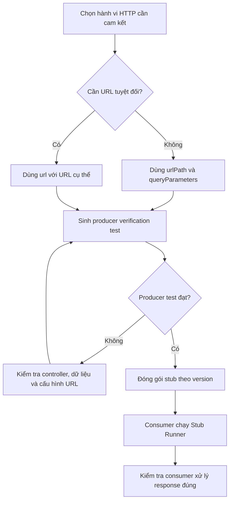

# Phân biệt URL đầy đủ với urlPath

## 1. Vấn đề khi thiết kế request HTTP trong hợp đồng

Giả sử `checkout-service` (consumer) cần gọi `payment-service` (producer) để tra cứu một giao dịch:

```http
GET /api/payments/PAY-1001?includeHistory=false HTTP/1.1
Host: payment-service:8080
Accept: application/json
```

Hai nhóm thỏa thuận rằng producer phải trả thông tin giao dịch `PAY-1001` ở trạng thái `PAID`. Với **Spring Cloud Contract**, nhóm có thể mô tả tương tác bằng **Groovy DSL** hoặc **YAML DSL**, sinh kiểm thử xác minh producer, đóng gói stub để consumer chạy với **Stub Runner** và đưa các bước vào CI nhằm phát hiện thay đổi API không tương thích.

Khi viết phần `request` của contract HTTP, bạn sẽ gặp hai lựa chọn:

- `url(...)`: khai báo **URL** của request; có thể là giá trị tương đối (ví dụ `/api/payments/PAY-1001`) hoặc tuyệt đối (ví dụ `http://localhost:8080/api/payments/PAY-1001`).
- `urlPath(...)`: khai báo **phần đường dẫn** (*path*) của request; nếu cần ràng buộc query string, đặt các tham số trong `queryParameters { ... }`.

Hai lựa chọn có thể mô tả những request tương tự, nhưng chúng mang ý nghĩa cấu hình khác nhau. Đặc biệt, viết cứng host, port hoặc chuỗi query có thể khiến contract khó chuyển giữa máy phát triển và CI, hoặc khiến stub nhận diện request theo cách ngoài ý muốn.

**Mục tiêu bài học:** hiểu thành phần của URL, chọn đúng `url` hoặc `urlPath`, khai báo query parameters có chủ đích, đọc được ví dụ Groovy/YAML, và biết producer verification cùng stub phản ứng thế nào khi request thay đổi.

## 2. Tách các thành phần của một HTTP URL

Xét địa chỉ:

```text
https://payments.example.test:8443/api/v1/payments/PAY-1001?includeHistory=false&locale=vi
|---|  |------------------------| |--------------------------| |---------------------------|
scheme           authority                path                      query
```

| Thành phần | Ví dụ | Dùng để làm gì? |
| --- | --- | --- |
| **Scheme** | `https` | Giao thức dùng khi kết nối. |
| **Host** | `payments.example.test` | Máy chủ hoặc tên dịch vụ nhận yêu cầu. |
| **Port** | `8443` | Cổng kết nối khi được chỉ định. |
| **Path** | `/api/v1/payments/PAY-1001` | Tài nguyên/đường dẫn mà API xử lý. |
| **Query string** | `includeHistory=false&locale=vi` | Các tham số lọc, tùy chọn hoặc phân trang. |
| **Fragment** | `#section` (nếu có trong URL ở trình duyệt) | Không được gửi trong request-target HTTP đến server; không dùng để định nghĩa hợp đồng endpoint. |

Lưu ý: trong dòng đầu tiên của một request HTTP/1.1 thông thường, client thường gửi path và query, còn host ở header `Host`. Trên lớp cấu hình client, *base URL* có thể do môi trường quyết định. Vì vậy trong contract giữa hai dịch vụ, ta thường cần cam kết **method + path + query/header/body phù hợp**, chứ không cần khóa ứng dụng vào một hostname cụ thể.

Một phân biệt rất quan trọng:

```text
/api/v1/payments/PAY-1001
    = path

?includeHistory=false&locale=vi
    = query string

/api/v1/payments/PAY-1001?includeHistory=false&locale=vi
    = path + query (request target dạng origin-form)

https://payments.example.test:8443/api/v1/payments/PAY-1001?includeHistory=false&locale=vi
    = URL tuyệt đối với scheme, authority, path và query
```

Trong ngữ cảnh bài học, cụm **“URL đầy đủ”** chỉ một URL tuyệt đối có scheme/host (và có thể thêm query). Tuy nhiên, phương thức `url(...)` của Spring Cloud Contract **không bắt buộc** phải nhận URL tuyệt đối: nó cũng chấp nhận đường dẫn tương đối.

## 3. So sánh `url(...)` và `urlPath(...)`

| Tiêu chí | `url(...)` | `urlPath(...)` |
| --- | --- | --- |
| Phần biểu diễn chính | Một URL được chỉ định trong contract. | Riêng thành phần path của request. |
| Có thể dùng giá trị tương đối? | **Có**, ví dụ `url('/api/payments')`. | **Có**, và đây là cách dùng điển hình. |
| Có thể khai báo URL tuyệt đối? | **Có**, ví dụ `url('http://localhost:8080/api/payments')`. | Không dùng để khai báo scheme/host/port; chỉ khai báo path. |
| Khi có query parameters | Có thể khai báo trong DSL; nếu ghi trực tiếp vào chuỗi URL thì query gắn với chuỗi đó. | Khuyến nghị ghép `urlPath('/api/payments')` với `queryParameters { ... }`. |
| Tính độc lập với host | URL tương đối không khóa host; URL tuyệt đối có host/port được ghi rõ. | Là lựa chọn Spring Cloud Contract khuyến nghị để test độc lập với host. |
| Tình huống phù hợp | Khi cần mô tả URL cụ thể, kể cả URL tuyệt đối theo thiết kế. | Phần lớn hợp đồng HTTP giữa các dịch vụ, đặc biệt khi môi trường có host/port khác nhau. |

**Không được đặt `url(...)` và `urlPath(...)` trong cùng một khối `request`.** Tài liệu Spring Cloud Contract nêu rõ đây là cấu hình không hợp lệ; hãy chọn đúng một trong hai.

Ví dụ **không hợp lệ**:

```groovy
request {
    method 'GET'
    url('/api/payments/PAY-1001')
    urlPath('/api/payments/PAY-1001') // Sai: hai cách khai báo URL cùng lúc
}
```

Với cả hai cách, `method` vẫn là phần bắt buộc của request trong HTTP contract. Việc dùng `urlPath` không thay thế khai báo `method 'GET'` hoặc `method 'POST'`.

## 4. Dùng `url(...)` trong Groovy DSL

### 4.1. URL tương đối

Contract tra cứu một giao dịch:

```groovy
import org.springframework.cloud.contract.spec.Contract

Contract.make {
    name 'get_paid_payment_by_url'

    request {
        method 'GET'
        url('/api/payments/PAY-1001')
        headers {
            header 'Accept': 'application/json'
        }
    }

    response {
        status 200
        headers {
            contentType(applicationJson())
        }
        body([
            paymentId: 'PAY-1001',
            orderId: 'ORD-2001',
            status: 'PAID'
        ])
    }
}
```

Giá trị `'/api/payments/PAY-1001'` là URL tương đối. Nó không chứa scheme, host hoặc port, nên **không phải** URL tuyệt đối. Khi sinh test, framework vẫn phải dùng cấu hình test thích hợp để gửi request đến producer được kiểm thử.

Ví dụ có chủ đích nghiệp vụ: consumer cần kiểm tra ID `PAY-1001` trong request được producer ánh xạ về đúng `ORD-2001` với trạng thái `PAID`. Dữ liệu mẫu ở đây được chọn cố định để test dễ lặp lại.

### 4.2. URL tuyệt đối

Spring Cloud Contract cũng cho phép:

```groovy
request {
    method 'GET'
    url('http://localhost:8888/api/payments/PAY-1001')
}
```

Ở đây, URL chứa `http://`, host `localhost`, port `8888` và path. Đây chính là trường hợp **URL đầy đủ/tuyệt đối**.

Giá trị tuyệt đối hợp lệ về mặt DSL, nhưng hãy cân nhắc trước khi viết cứng nó trong contract dùng chung:

- Khi chạy trên CI, producer có thể được khởi tạo bằng port ngẫu nhiên hoặc cách gọi qua MockMvc/WebTestClient; địa chỉ `localhost:8888` có thể không phù hợp.
- Khi chạy stub qua Stub Runner, host và port của stub thường được cấp theo cấu hình bài test consumer, không phải cố định giống URL production.
- Nếu API được đặt sau gateway, reverse proxy hoặc service discovery, host của môi trường chạy khác với host mô tả trong một tệp contract.

Tài liệu Spring Cloud Contract **khuyến nghị `urlPath` để test độc lập với host**. Điều này không có nghĩa mọi contract dùng `url(...)` đều sai; `url('/api/payments')` tương đối vẫn có thể dùng, nhưng `urlPath(...)` diễn đạt rõ hơn ý định chỉ cam kết đường dẫn.

## 5. Dùng `urlPath(...)` để mô tả path rõ ràng

Hãy viết lại contract tra cứu thanh toán chỉ bằng path:

```groovy
import org.springframework.cloud.contract.spec.Contract

Contract.make {
    name 'get_paid_payment_by_path'

    request {
        method 'GET'
        urlPath('/api/payments/PAY-1001')
        headers {
            header 'Accept': 'application/json'
        }
    }

    response {
        status 200
        headers {
            contentType(applicationJson())
        }
        body([
            paymentId: 'PAY-1001',
            orderId: 'ORD-2001',
            status: 'PAID'
        ])
    }
}
```

Ý định giờ rất rõ: kiểm thử đường dẫn `/api/payments/PAY-1001` và phản hồi tương ứng; hợp đồng không cần biết producer chạy ở `localhost:8080`, `payment-service:8080` hay phía sau gateway.

Ví dụ trên chỉ gồm path, chưa có ràng buộc query. Nếu consumer yêu cầu thêm `includeHistory=false` và hệ thống cần xác minh tham số này, đừng lén nối `?includeHistory=false` vào chuỗi của `urlPath`. Hãy khai báo `queryParameters` rõ ràng như phần tiếp theo.

## 6. Path và query parameters: thiết kế hợp đồng thực tế

### 6.1. Viết query bên cạnh `urlPath`

Giả sử Checkout cần danh sách giao dịch đã thanh toán, giới hạn 20 bản ghi:

```http
GET /api/payments?status=PAID&limit=20 HTTP/1.1
Accept: application/json
```

Hợp đồng Groovy:

```groovy
import org.springframework.cloud.contract.spec.Contract

Contract.make {
    name 'list_paid_payments'
    description 'Lọc các giao dịch đã thanh toán, giới hạn số bản ghi'

    request {
        method 'GET'
        urlPath('/api/payments') {
            queryParameters {
                parameter 'status': equalTo('PAID')
                parameter 'limit': 20
            }
        }
        headers {
            header 'Accept': 'application/json'
        }
    }

    response {
        status 200
        headers {
            contentType(applicationJson())
        }
        body([
            payments: [[
                paymentId: 'PAY-1001',
                orderId: 'ORD-2001',
                status: 'PAID'
            ]],
            total: 1
        ])
    }
}
```

Điểm đáng chú ý:

1. `urlPath('/api/payments')` chỉ chứa **đường dẫn**; không có ký tự `?`.
2. `queryParameters { ... }` khai báo **những query mà hợp đồng thực sự quan tâm**.
3. `parameter 'status': equalTo('PAID')` ràng buộc giá trị `status` là `PAID`.
4. `parameter 'limit': 20` là cách viết giá trị literal; DSL sử dụng phép so khớp tương đương `equalTo` cho trường hợp literal.
5. Response minh họa rõ rằng consumer lấy danh sách giao dịch đã thanh toán; `total` và từng `status` có ý nghĩa nghiệp vụ trong kịch bản.

Cách viết này tách **ý nghĩa của URL path** khỏi **điều kiện truy vấn**. Điều đó đặc biệt hữu ích khi cùng endpoint hỗ trợ `status`, `limit`, `page` hoặc `sort`.

### 6.2. Trường hợp viết toàn bộ query vào `url(...)`

Bạn cũng có thể gặp một contract mô tả request bằng chuỗi:

```groovy
request {
    method 'GET'
    url('/api/payments?status=PAID&limit=20')
}
```

Cú pháp này thể hiện path **và query** trong một giá trị URL. Tuy nhiên nó khiến việc review từng điều kiện query hoặc thay giá trị bằng matcher khó rõ ràng bằng khai báo `queryParameters`. Tùy cách converter/generator ánh xạ chuỗi URL sang test và stub, những chi tiết như thứ tự query, encode ký tự và giá trị literal có thể ảnh hưởng cách so khớp; cần kiểm tra generated test/stub của phiên bản Spring Cloud Contract đang dùng.

Đối với một API mà **thứ tự tham số query không mang ý nghĩa nghiệp vụ**, nên khai báo thành các tham số riêng để tập trung vào tên và giá trị cần bảo vệ. Không suy ra rằng hai chuỗi URL có thứ tự query khác nhau luôn phải được coi là hai hành vi API khác nhau.

### 6.3. Điều gì xảy ra khi có thêm hoặc thiếu query?

Với `urlPath('/api/payments')` cùng `status=PAID` và `limit=20` đã khai báo:

| Request | Ý nghĩa đối với hợp đồng |
| --- | --- |
| `GET /api/payments?status=PAID&limit=20` | Phù hợp các điều kiện query đã mô tả. |
| `GET /api/payments?limit=20&status=PAID` | Cùng tên/giá trị query; thiết kế tách query giúp không phải coi thứ tự trong chuỗi là quy tắc nghiệp vụ. |
| `GET /api/payments?status=PENDING&limit=20` | Khác điều kiện `status=PAID`; cần một contract riêng nếu producer hỗ trợ tình huống này. |
| `GET /api/payments?status=PAID` | Thiếu `limit` đã được hợp đồng yêu cầu; không được mặc nhiên coi như request mẫu. |
| `GET /api/payments?status=PAID&limit=20&trace=true` | Có tham số bổ sung chưa được contract nhắc đến; muốn cấm, phải có quy tắc/test rõ ràng, không được suy ra từ sự im lặng của contract. |

**Nguyên tắc quan trọng:** theo tài liệu Spring Cloud Contract, một query parameter **không được khai báo** trong contract có nghĩa nó **không phải điều kiện bắt buộc để request khớp**. Việc không viết một tham số không tự động tạo quy tắc “tham số đó phải vắng mặt”. Nếu yêu cầu bảo mật/nghiệp vụ buộc API từ chối query không hợp lệ, cần mô tả rõ và bổ sung kiểm thử phù hợp.

### 6.4. Query parameter có matcher

Ví dụ hệ thống cho phép `offset` là số nguyên không âm trong quá trình phân trang. Để minh họa phần **DSL matcher**, có thể viết:

```groovy
request {
    method 'GET'
    urlPath('/api/payments') {
        queryParameters {
            parameter 'status': equalTo('PAID')
            parameter 'offset': value(
                consumer(matching('[0-9]+')),
                producer(0)
            )
        }
    }
}
```

Đây là ví dụ rút gọn của **khối request**, cần đặt trong `Contract.make { ... }` với khối `response` phù hợp để thành hợp đồng hoàn chỉnh. Ở vị trí request, giá trị phía **consumer** dùng cho ràng buộc request mà stub nhận, còn giá trị phía **producer** là ví dụ cụ thể generator dùng khi tạo request cho producer verification.

Matcher `[0-9]+` chỉ xác minh định dạng số, **không** bảo đảm offset nằm trong mọi giới hạn mà nghiệp vụ yêu cầu. Nếu consumer phụ thuộc `limit <= 100`, chính sách phân trang cần được kiểm thử bằng các ca có chủ đích thay vì một regex quá rộng.

## 7. Ví dụ YAML DSL tương đương

Không bắt buộc viết Groovy DSL mới khai báo được `urlPath`. Tình huống liệt kê giao dịch đã thanh toán có thể viết bằng **YAML DSL**:

```yaml
description: Lọc các giao dịch đã thanh toán, giới hạn số bản ghi
name: list_paid_payments
request:
  method: GET
  urlPath: /api/payments
  queryParameters:
    status: PAID
    limit: 20
  headers:
    Accept: application/json
response:
  status: 200
  headers:
    Content-Type: application/json
  body:
    payments:
      - paymentId: PAY-1001
        orderId: ORD-2001
        status: PAID
    total: 1
```

Nếu muốn dùng `url` trong YAML, đổi **trường URL** tương ứng, chẳng hạn:

```yaml
request:
  method: GET
  url: /api/payments/PAY-1001
```

Hoặc URL tuyệt đối:

```yaml
request:
  method: GET
  url: http://localhost:8888/api/payments/PAY-1001
```

Các đoạn YAML nhỏ chỉ minh họa thuộc tính `request.url`, cần có `response` để tạo contract HTTP hoàn chỉnh. **Không khai báo đồng thời `url` và `urlPath`** trong cùng một request YAML, tương tự Groovy DSL.

Vì đều hỗ trợ cùng ý tưởng, nên chọn **một bản Groovy hoặc YAML** làm nguồn contract chính cho từng kịch bản; không cần khai báo trùng một kịch bản trong hai file khác nhau chỉ để thể hiện hai cú pháp.

## 8. Mối liên hệ với producer verification và Stub Runner

Chọn `url` hay `urlPath` không chỉ thay đổi chữ trong file Groovy. Nó ảnh hưởng cách generator tạo request và cách stub nhận diện request.



### 8.1. Phía producer

Với contract `GET /api/payments?status=PAID&limit=20`, test sinh ra cần gửi request tương ứng đến producer (qua MockMvc, WebTestClient hoặc chế độ HTTP phù hợp) rồi xác minh status, header và body của phản hồi.

Nếu producer đổi endpoint từ `/api/payments` sang `/api/payment-records` mà không giữ đường dẫn cũ, contract đang yêu cầu `/api/payments` phải giúp phát hiện thay đổi không tương thích. Tương tự, nếu `status=PAID` không còn lọc đúng, producer verification phải có dữ liệu fixture và assertion response đủ ý nghĩa để phát hiện khác biệt.

**Lưu ý:** contract chỉ mô tả tương tác; nó không tự tạo các bản ghi thanh toán trong database. Base test/fixture của producer phải tạo hoặc giả lập dữ liệu cần thiết để kết quả test được xác định.

### 8.2. Phía consumer

Sau khi producer verification đạt, producer có thể phát hành artifact `stubs` kèm phiên bản. Consumer dùng **Spring Cloud Contract Stub Runner** để chạy stub, cấu hình client trỏ đến host/port của stub và kiểm tra luồng nghiệp vụ.

Ví dụ Checkout muốn xác minh khi gọi:

```http
GET /api/payments?status=PAID&limit=20 HTTP/1.1
Host: localhost:6565
```

stub trả danh sách thanh toán đã thỏa thuận. Nếu contract dùng `urlPath('/api/payments')` và query parameters riêng, phần cam kết request hướng vào path/query, phù hợp khi stub chạy ở cổng khác producer thật. Không cần viết `localhost:6565` vào hợp đồng nguồn.

Một bài test chỉ xác minh “stub trả 200” chưa đủ để chứng minh consumer đúng. Hãy chạy qua mã HTTP client của Checkout và kiểm tra quyết định nghiệp vụ, ví dụ Checkout có thực sự phân loại `PAID` khác `PENDING` hay không.

### 8.3. Trong CI

Một pipeline có thể triển khai:

1. Review contract khi producer hoặc consumer đề xuất thay đổi HTTP endpoint.
2. Sinh producer verification tests từ Groovy/YAML DSL.
3. Kiểm tra số test được sinh, biên dịch và chạy; nếu producer phá vỡ cam kết thì pipeline thất bại.
4. Phát hành stub theo phiên bản producer sau khi test đạt.
5. Consumer lấy **đúng phiên bản stub** bằng Stub Runner và chạy kiểm thử client/nghiệp vụ.
6. Khi đổi path hoặc query, chạy lại các contract liên quan trước khi công bố API mới.

Nếu test chỉ chạy với URL tuyệt đối `http://localhost:8888`, CI có thể gặp lỗi do port đó không có dịch vụ; việc dùng `urlPath` trong các hợp đồng chỉ cần path giúp giảm ràng buộc môi trường. Vẫn phải cấu hình base test, mock server và địa chỉ client đúng cách; `urlPath` tự nó không khởi động producer hoặc stub.

## 9. Các lỗi phổ biến khi phân biệt URL và path

| Hiện tượng | Nguyên nhân hay gặp | Cách sửa |
| --- | --- | --- |
| Contract không hợp lệ vì vừa có `url` vừa có `urlPath` | Khai báo hai lựa chọn loại trừ nhau trong một request. | Giữ một trong hai; ưu tiên `urlPath` nếu chỉ cần path. |
| CI thất bại vì không kết nối được `localhost:8888` | URL tuyệt đối khóa host/port ở môi trường khác. | Xem xét `urlPath` và cấu hình base URL theo môi trường/test mode. |
| Stub không nhận request có query | Đưa query vào phần path, hoặc dùng tên/giá trị sai trong `queryParameters`. | Dùng `urlPath('/api/payments') { queryParameters { ... } }`. |
| Stub phản hồi với request không mong muốn | Contract không ràng buộc query hoặc matcher quá rộng. | Liệt kê đúng những query quan trọng; thêm contract/test cho hành vi bị từ chối. |
| Đường dẫn mới làm consumer hỏng nhưng test vẫn xanh | Chỉ có contract mới, không còn contract/kiểm thử cho client đang dùng path cũ. | Duy trì contract tương thích và chạy cả test consumer còn được hỗ trợ. |
| Test pass local, fail khi chạy sau gateway | Context path/prefix URL của môi trường khác. | Thống nhất path mà producer thực sự công bố; cấu hình gateway/client phù hợp, không đoán bằng cách nối thêm prefix tùy ý. |
| `/api/payments` và `/api/payments/` được đối xử khác nhau | Dấu gạch chéo cuối có thể ảnh hưởng route và matching. | Thống nhất đường dẫn chính xác; test chuyển hướng/compatibility nếu API cam kết. |
| Query có khoảng trắng, dấu `+`, `%` hoặc Unicode gặp lỗi | URL encoding/decoding không thống nhất. | Dùng URI builder ở client, kiểm tra tên/giá trị tham số sau giải mã, có test với dữ liệu đặc biệt. |
| Phụ thuộc host để phân tenant nhưng dùng chỉ path | Contract thiếu ràng buộc mà nghiệp vụ thật sự cần. | Mô tả header/host và các quy tắc liên quan nếu là cam kết, kèm integration/security test phù hợp. |

### Dấu hỏi, dấu thăng và tham số đường dẫn

- `?` bắt đầu phần **query** trong URL; đừng đặt query string như thể đó là một phần của `urlPath`.
- `#fragment` được xử lý phía client/browser, không gửi đến HTTP server như một phần request path để contract xác minh.
- `/api/payments/PAY-1001` chứa mã `PAY-1001` trong **path segment**, khác với `/api/payments?paymentId=PAY-1001` chứa mã trong **query parameter**.
- Nếu ID thực tế biến động, có thể dùng matcher của DSL cho thành phần path theo khả năng phiên bản đang dùng; phải bảo đảm stub dùng ví dụ cụ thể và producer test kiểm tra đúng pattern/quan hệ nghiệp vụ. Không đổi thành regex chấp nhận mọi path chỉ để hết lỗi.

## 10. Chọn cách viết trong dự án thực tế

Hãy tự hỏi ba câu:

**1. Hợp đồng đang cam kết phần nào của request?** Nếu consumer chỉ cần `GET /api/payments/{id}` và không quan tâm server chạy ở đâu, dùng `urlPath` diễn đạt đúng mục tiêu.

**2. Query parameter có ảnh hưởng đến kết quả không?** Nếu `status=PAID`, `currency=VND` hoặc `limit=20` ảnh hưởng tới quyết định của consumer, hãy khai báo `queryParameters` rõ ràng và dùng matcher/literal phù hợp. Nếu query không phải cam kết, không thêm chỉ để mô phỏng một URL production ngẫu nhiên.

**3. Có thật sự cần ràng buộc host hoặc port không?** Trường hợp này hiếm khi là cam kết lõi giữa các microservices; nó thường thuộc cấu hình triển khai hoặc routing. Nếu host-based routing là một phần hợp đồng, cần mô tả và kiểm thử riêng các ràng buộc cần thiết, thay vì mặc định host tuyệt đối trong `url` luôn chứng minh toàn bộ chính sách routing.

Từ đó, lựa chọn thường gặp là:

```groovy
request {
    method 'GET'
    urlPath('/api/payments') {
        queryParameters {
            parameter 'status': 'PAID'
        }
    }
}
```

Khối trên minh họa phần request; phải có `response { ... }` để tạo một HTTP contract hoàn chỉnh.

## 11. Bài tập thực hành

Một producer `inventory-service` cung cấp API tìm tồn kho. Consumer `checkout-service` dùng:

```http
GET /api/v1/inventory?sku=SKU-001&warehouse=HN01 HTTP/1.1
Host: inventory-service:8080
Accept: application/json
```

Phản hồi đã thống nhất:

```json
{
  "sku": "SKU-001",
  "warehouse": "HN01",
  "available": true,
  "quantity": 12
}
```

**Nhiệm vụ:**

1. Viết một Groovy contract dùng `urlPath('/api/v1/inventory')` và `queryParameters` cho `sku=SKU-001`, `warehouse=HN01`; trả `200` cùng JSON trên.
2. Viết phiên bản tương đương bằng YAML DSL dùng `request.urlPath` và `request.queryParameters`. Giữ nguyên ý nghĩa request/response.
3. Viết một ví dụ `url('http://localhost:8080/api/v1/inventory?sku=SKU-001&warehouse=HN01')` và giải thích nguy cơ khi chạy trong CI có host/port khác.
4. Xác định các trường cần so khớp chính xác để consumer không đặt hàng nhầm kho. Nếu `quantity` thay đổi trong production, giải thích cách dùng fixture xác định hoặc matcher có giới hạn phù hợp.
5. Xử lý tình huống `warehouse=SG01`: cùng path nhưng khác query; theo nghiệp vụ phải trả dữ liệu kho SG01 hay lỗi? Viết contract riêng cho quyết định đã thống nhất.
6. Giả sử consumer đổi thứ tự query thành `?warehouse=HN01&sku=SKU-001`. Vì sao nên tập trung vào tên và giá trị query thay vì thứ tự chuỗi URL? Hãy kiểm tra generated stub/test để xác minh hành vi của phiên bản plugin đang dùng.
7. Mô tả các bước sinh producer verification, chạy stub qua Stub Runner và kiểm tra consumer xử lý `available=false` đúng cách trong CI.

**Gợi ý tự kiểm:** Lời giải đúng phân biệt được path và query, chỉ dùng một trong `url`/`urlPath` cho một request, không khóa host vào contract khi không cần và có fixture/stub phản ánh đúng nghiệp vụ tồn kho.

## 12. Ghi nhớ

- **`url(...)`** chấp nhận cả URL tương đối và URL tuyệt đối; vì vậy “`url` luôn là URL đầy đủ có host” là một kết luận sai.
- **`urlPath(...)`** tập trung vào phần **path**; tài liệu Spring Cloud Contract khuyến nghị cách này để producer verification không phụ thuộc vào hostname.
- Không dùng `url(...)` và `urlPath(...)` cùng lúc trong một contract request.
- Với query ảnh hưởng nghiệp vụ, dùng `queryParameters { ... }` trong Groovy hoặc `queryParameters:` trong YAML để ràng buộc rõ các tham số; không giả định query không khai báo bắt buộc phải vắng mặt.
- Cách mô tả URL tác động đến generated producer test và stub. Luôn xác minh hành vi thực tế, phát hành stub có phiên bản và cho consumer chạy qua Stub Runner trong CI.

### Tài liệu tham khảo

- [Spring Cloud Contract — HTTP Contracts](https://docs.spring.io/spring-cloud-contract/reference/project-features-contract/http.html): phần HTTP request, `url`, `urlPath`, URL tuyệt đối, query parameters và matcher.
- [Spring Cloud Contract — Contract DSL](https://docs.spring.io/spring-cloud-contract/reference/project-features-contract.html): cách viết hợp đồng Groovy/YAML và sinh producer verification/stub.
- [Spring Cloud Contract — Dynamic Properties](https://docs.spring.io/spring-cloud-contract/reference/project-features-contract/dsl-dynamic-properties.html): các giá trị động và cách tham chiếu path/query trong hợp đồng.
- [Spring Cloud Contract — Stub Runner](https://docs.spring.io/spring-cloud-contract/reference/project-features-stubrunner.html): cách consumer tải và chạy các stub đã phát hành.
