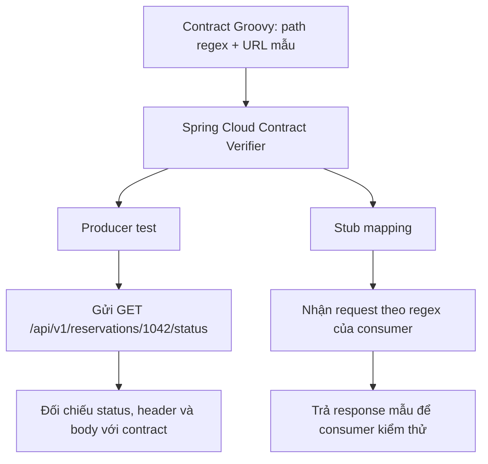

# Path parameter và biểu thức khớp đường dẫn

Trong ứng dụng HTTP, hai request như `GET /api/v1/orders/1042` và `GET /api/v1/orders/2055` thường gọi cùng một chức năng: xem thông tin đơn hàng theo mã. Phần `1042` hoặc `2055` là **path parameter** (tham số nằm trong đường dẫn). Khi định nghĩa contract, ta cần quyết định producer cam kết chỉ xử lý **một URL cụ thể** hay **một lớp URL thỏa quy tắc định dạng**.

Trong chương **Request HTTP** của **Spring Cloud Contract**, bài này hướng dẫn cách mô tả URL, path parameter và biểu thức chính quy (regular expression, viết tắt **regex**) trong Groovy DSL; đồng thời giới thiệu biểu diễn đường dẫn tĩnh bằng YAML DSL. Mục tiêu là sinh test phía producer đủ rõ, tạo stub cho consumer chạy với **Stub Runner**, và phát hiện các thay đổi HTTP API không tương thích trong CI mà không làm stub khớp nhầm endpoint khác.

Sau bài học, bạn có thể:

- Phân biệt path parameter, query parameter, URL cố định và mẫu đường dẫn.
- Dùng `urlPath`, `url` và cặp `consumer(...)` / `producer(...)` đúng vai trò trong request contract.
- Thiết kế regex theo **toàn bộ đường dẫn**, với ranh giới rõ cho từng tham số.
- Kết hợp path parameter với query parameter, mã lỗi và các trường phản hồi liên quan.
- Nhận biết ảnh hưởng của matcher đến generated tests, stub và khả năng phát hiện thay đổi API trong CI.
- Phát hiện các lỗi phổ biến: matcher quá rộng, dữ liệu mẫu không khớp regex, trùng mapping, nhầm cú pháp Spring MVC với DSL.

## 1. Path parameter là gì và khác query parameter như thế nào?

Một URL HTTP điển hình:

```text
GET /api/v1/shops/hn-01/orders/1042?includeItems=true
                  └──┘        └──┘ └───────────────┘
                shopId      orderId   query parameter
```

Ở API này:

- `hn-01` là **path parameter** `shopId`, giúp chọn cửa hàng.
- `1042` là **path parameter** `orderId`, giúp chọn đơn hàng.
- `includeItems=true` là **query parameter**, yêu cầu bổ sung chi tiết mặt hàng.

Trong controller Spring MVC, lập trình viên có thể viết:

```java
@GetMapping("/api/v1/shops/{shopId}/orders/{orderId}")
public OrderView getOrder(
        @PathVariable String shopId,
        @PathVariable Long orderId,
        @RequestParam(defaultValue = "false") boolean includeItems) {
    return orderService.getOrder(shopId, orderId, includeItems);
}
```

Đây là cách Spring MVC ánh xạ biến đường dẫn tại runtime. **Spring Cloud Contract không tự lấy thông tin `@PathVariable` từ controller để tạo contract.** Trong DSL, nhóm producer và consumer phải định nghĩa request phù hợp, bằng đường dẫn cố định hoặc matcher.

| Thành phần | Ví dụ | Ý nghĩa | Cách diễn tả trong contract |
| --- | --- | --- | --- |
| Path cố định | `/api/v1/orders` | Xác định tài nguyên hoặc tập tài nguyên | `urlPath('/api/v1/orders')` |
| Path parameter số | `/api/v1/orders/1042` | Chọn một đơn hàng | Một URL mẫu cụ thể hoặc regex cho phần ID |
| Nhiều path parameter | `/shops/hn-01/orders/1042` | Xác định tài nguyên trong phạm vi cửa hàng | Regex có ràng buộc cho từng đoạn đường dẫn |
| Query parameter | `?includeItems=true` | Điều chỉnh cách truy vấn | `queryParameters` bên trong `urlPath` |
| Header | `Accept: application/json` | Thương lượng định dạng hoặc truyền metadata request | `headers` của `request` |

Path parameter và query parameter cùng là dữ liệu của request nhưng nằm ở những thành phần khác nhau. Trong contract, không nên gộp mọi thứ thành một chuỗi URL rồi dùng regex tổng quát nếu DSL có chỗ chuyên biệt để mô tả chúng.

## 2. Bắt đầu bằng URL cố định để hiểu hành vi

Trước khi viết regex, hãy mô tả một kịch bản cụ thể và có dữ liệu thử nghiệm xác định. Giả sử `OrderService` (consumer) gọi `InventoryService` (producer) để xem trạng thái giữ hàng.

```groovy
import org.springframework.cloud.contract.spec.Contract

Contract.make {
    name 'get_reservation_status_fixed'
    description 'OrderService tra cứu trạng thái lượt giữ hàng 1042'

    request {
        method 'GET'
        urlPath('/api/v1/reservations/1042/status')
    }

    response {
        status 200
        headers {
            contentType(applicationJson())
        }
        body([
            status: 'HELD'
        ])
    }
}
```

Contract trên có một yêu cầu rất cụ thể: request `GET /api/v1/reservations/1042/status` phải trả mã `200` và JSON chứa `status = HELD` theo fixture đã chuẩn bị. Đây là **ví dụ API giả định**, không phải endpoint do Spring Cloud Contract mặc định cung cấp.

Một URL cố định hữu ích khi:

1. Chỉ có một đường dẫn quan trọng cần bảo vệ.
2. Kịch bản cần đối chiếu đúng một bộ dữ liệu fixture.
3. Đầu vào có mã đặc biệt hoặc hành vi không thể khái quát thành cùng một phản hồi.

Tuy nhiên, nếu consumer cần gọi nhiều reservation ID, stub chỉ khớp `1042` sẽ không mô phỏng được lời gọi với `2055`. Khi đó, cân nhắc **matcher cho đường dẫn động**.

## 3. `urlPath` và `url` trong request của Groovy DSL

Spring Cloud Contract cho phép định nghĩa phần URL HTTP bằng `urlPath(...)` hoặc `url(...)`. Trong ví dụ request dùng đường dẫn tương đối, `urlPath` thường phù hợp vì tập trung vào thành phần path và thuận tiện khi mô tả query parameter. Nó cũng giúp tránh buộc contract vào hostname/port của môi trường thử nghiệm.

```groovy
request {
    method 'GET'
    urlPath('/api/v1/reservations/1042/status')
}
```

Một cách hợp lệ khác:

```groovy
request {
    method 'GET'
    url('/api/v1/reservations/1042/status')
}
```

**Chỉ chọn một cách khai báo URL cho mỗi request:** không viết cả `url(...)` và `urlPath(...)` trong cùng một contract. Với host và port thay đổi theo môi trường, nên ưu tiên đường dẫn tương đối thay vì đưa `http://localhost:8080` vào cam kết.

Trong DSL, đoạn path `/api/v1/reservations/1042/status` chỉ là một **giá trị cụ thể**. Việc controller Spring MVC dùng `/{reservationId}/` không mặc nhiên khiến chuỗi `'{reservationId}'` trong contract trở thành một biến có thể khớp mọi ID. Để mô tả một họ URL, hãy định nghĩa matcher tường minh.

## 4. Regex cho đường dẫn động với `consumer` và `producer`

Trong request contract, `consumer(...)` mô tả điều kiện mà **stub phía consumer** cần chấp nhận; `producer(...)` cung cấp **giá trị cụ thể cho generated test phía producer** gửi vào ứng dụng thật.

Đây là điểm dễ nhầm vì cùng một biểu thức `$(...)` có vai trò khác nhau trên hai phía. Với path chứa ID số, hãy mô tả:

```groovy
import org.springframework.cloud.contract.spec.Contract

Contract.make {
    name 'get_reservation_status_numeric_id'
    description '''
        OrderService cần tra cứu trạng thái lượt giữ hàng theo ID số.
        Producer phải xử lý URL đúng định dạng; stub phục vụ các ID hợp lệ.
    '''

    request {
        method 'GET'
        urlPath($(consumer(regex('/api/v1/reservations/[0-9]+/status')),
                  producer('/api/v1/reservations/1042/status')))
    }

    response {
        status 200
        headers {
            contentType(applicationJson())
        }
        body([
            status: 'HELD'
        ])
    }
}
```

Đọc biểu thức theo hai hướng:

| Thành phần | Giá trị | Công dụng |
| --- | --- | --- |
| `consumer(regex(...))` | `/api/v1/reservations/[0-9]+/status` | Stub có thể khớp path với một hoặc nhiều chữ số |
| `producer(...)` | `/api/v1/reservations/1042/status` | Test sinh tự động gửi request cụ thể này tới producer |
| `response` | `200`, JSON có `status: HELD` | Điều kiện phản hồi được kiểm chứng và mô phỏng |

Như vậy một **contract** có thể tạo một **producer test với một ví dụ cụ thể** trong khi stub nhận một nhóm URL. Đây không phải bằng chứng rằng producer xử lý đúng **mọi** giá trị ID: để chứng minh ranh giới và hành vi lỗi, cần thêm kịch bản phù hợp.

### Đọc regex của ví dụ

```text
/api/v1/reservations/[0-9]+/status
                     └────┘
                 một hay nhiều chữ số
```

- `[0-9]`: một chữ số trong khoảng 0–9.
- `+`: lặp lại phần ngay trước **ít nhất một lần**.
- `/status`: đoạn path cố định sau ID, giúp phân biệt với endpoint khác.

Regex của Spring Cloud Contract được dùng để so khớp cả vùng ký tự; về mặt thiết kế, hãy coi regex là **mẫu của toàn bộ path**, không phải đoạn ký tự tình cờ xuất hiện trong path. Ví dụ `/reservations/[0-9]+` không phải mẫu đúng cho `/api/v1/reservations/1042/status`. Khi framework phải sinh chuỗi từ regex, các ký hiệu neo `^` và `$` cũng có những hạn chế tùy phiên bản/công cụ; thay vì dựa vào chúng, hãy dùng mẫu đầy đủ có ranh giới và cung cấp giá trị `producer(...)` cụ thể.

### Vì sao phải có một ID thực tế phía producer?

Generated test cần request có thể chạy được. Giá trị `1042` nên tương ứng với dữ liệu kiểm thử đã chuẩn bị (ví dụ reservation tồn tại và có trạng thái `HELD`). Nếu test chọn ID không tồn tại, implementation có thể trả `404` một cách hoàn toàn đúng nghiệp vụ, nhưng contract thành công lại mong `200`.

Một quy tắc kiểm tra đơn giản: **giá trị `producer` phải thỏa regex `consumer` và trạng thái fixture phải phù hợp với kỳ vọng response**.

## 5. Chọn regex theo kiểu dữ liệu nghiệp vụ

Mẫu đường dẫn càng rộng, khả năng stub trả response cho request không thuộc kịch bản càng lớn. Chỉ nới matcher đến đúng phạm vi consumer cần.

| Loại định danh | Mẫu đường dẫn ví dụ | Khớp | Không khớp |
| --- | --- | --- | --- |
| ID số nguyên dương dưới dạng chữ số | `/orders/[0-9]+` | `/orders/1042` | `/orders/abc` |
| Mã gồm chữ, số và dấu gạch ngang | `/products/[A-Za-z0-9-]+` | `/products/SKU-001` | `/products/SKU_001` |
| Một đoạn path không có dấu gạch chéo | `/orders/[^/]+` | `/orders/A_42` | `/orders/A/42` |
| ID chữ số có đúng sáu ký tự | `/orders/[0-9]{6}` | `/orders/001042` | `/orders/42` |
| Tenant và order ID | `/tenants/[a-z0-9-]+/orders/[0-9]+` | `/tenants/hn-01/orders/1042` | `/tenants/hn-01/orders/x` |

`[^/]+` có nghĩa “một hoặc nhiều ký tự khác dấu `/`” và hữu ích để giữ một tham số trong **một đoạn đường dẫn**. Tuy vậy, nó rộng hơn `[0-9]+` hoặc mẫu SKU cố định: nếu nghiệp vụ chỉ chấp nhận số, nên chọn mẫu số.

Một số ví dụ cần thận trọng:

| Regex | Rủi ro |
| --- | --- |
| `/orders/.*` | Chấp nhận cả phần ID rỗng và có thể nuốt nhiều đoạn path |
| `.*/orders/.*` | Có thể khớp đường dẫn không thuộc API cần bảo vệ |
| `/orders/[0-9]*` | `*` cho phép **không có chữ số nào** |
| `/orders/[0-9]+.*` | Có thể khớp cả phần hậu tố bất ngờ |
| `/orders/[0-9]+` | Hợp lý cho ID số, nhưng **không** chứng minh ID có tồn tại trong hệ thống |

Regex là công cụ so khớp **cú pháp**. Các quy tắc như “đơn hàng thuộc đúng người dùng”, “ID đã tồn tại”, “reservation chưa hết hạn” hoặc “tenant có quyền truy cập” phải được triển khai trong producer và kiểm thử bằng những tình huống nghiệp vụ, bảo mật phù hợp.

## 6. Nhiều path parameter trong cùng URL

Giả sử API tra cứu đơn hàng thuộc một cửa hàng:

```text
GET /api/v1/shops/hn-01/orders/1042
                 ^^^^^        ^^^^
                 shopId       orderId
```

Một contract Groovy cho request này:

```groovy
import org.springframework.cloud.contract.spec.Contract

Contract.make {
    name 'shop_get_order_by_id'
    description 'OrderService tra cứu đơn hàng theo shopId và orderId'

    request {
        method 'GET'
        urlPath($(consumer(regex('/api/v1/shops/[a-z0-9-]+/orders/[0-9]+')),
                  producer('/api/v1/shops/hn-01/orders/1042')))
    }

    response {
        status 200
        headers {
            contentType(applicationJson())
        }
        body([
            status: 'CONFIRMED'
        ])
    }
}
```

Định dạng `shopId` và `orderId` được quy định **ngay tại vị trí của chúng trong path**. Matcher không cần biết tên biến Java `shopId` hay `orderId`; điều quan trọng là URL của HTTP request phù hợp với contract.

Nên làm rõ các quy tắc nghiệp vụ liên quan:

- Shop ID có cho phép chữ hoa không? Nếu có, thêm tập ký tự phù hợp hoặc chuẩn hóa theo thỏa thuận.
- Order ID có được phép bắt đầu bằng số 0? `[0-9]+` vẫn chấp nhận, vì vậy nếu phải cấm thì cần matcher hoặc validation khác.
- Tìm đơn hàng thuộc shop khác có trả `403` hay `404`? Đây là một kịch bản riêng và có thể cần kiểm tra quyền truy cập bổ sung.
- Thứ tự các đoạn trong path có ổn định không? Thay `/shops/{shopId}/orders/{orderId}` thành `/orders/{orderId}/shops/{shopId}` thường là thay đổi breaking đối với consumer chưa nâng cấp.

## 7. Kết hợp path parameter và query parameter

Query parameter không phải một phần của **path**. Spring Cloud Contract hỗ trợ khối `queryParameters` khi khai báo `urlPath`.

Ví dụ consumer muốn tra trạng thái giữ hàng và yêu cầu bổ sung chi tiết:

```groovy
import org.springframework.cloud.contract.spec.Contract

Contract.make {
    name 'get_reservation_status_with_details'

    request {
        method 'GET'
        urlPath($(consumer(regex('/api/v1/reservations/[0-9]+/status')),
                  producer('/api/v1/reservations/1042/status'))) {
            queryParameters {
                parameter 'includeHistory': 'true'
            }
        }
    }

    response {
        status 200
        headers {
            contentType(applicationJson())
        }
        body([
            status: 'HELD',
            historyIncluded: true
        ])
    }
}
```

Ở đây request tương ứng với:

```http
GET /api/v1/reservations/1042/status?includeHistory=true
```

Sự phân tách này giúp người đọc thấy rõ:

- **Path regex** quy định dạng ID ở giữa URL.
- **`queryParameters`** quy định tham số `includeHistory` và giá trị mà consumer cần.
- Producer test chạy với ID mẫu `1042` và query parameter đã khai báo.

Với query parameter động, DSL còn có những matcher như `matching(...)`, `equalTo(...)` và giá trị `consumer/producer` theo ngữ cảnh. Hãy chọn matcher đáp ứng đúng nhu cầu consumer, thay vì đưa dấu `?` và biểu thức query vào regex path.

## 8. YAML DSL: mô tả đường dẫn tĩnh và sự khác biệt về matcher

Spring Cloud Contract cũng hỗ trợ YAML DSL. Với URL tĩnh, một file tương đương có thể là:

```yaml
name: get_reservation_status_fixed
description: OrderService tra cứu lượt giữ hàng theo ID mẫu
request:
  method: GET
  urlPath: /api/v1/reservations/1042/status
response:
  status: 200
  headers:
    Content-Type: application/json
  body:
    status: HELD
```

YAML contract tĩnh phù hợp khi chỉ cần cố định request của một tình huống. Khi cần biểu thức động ở request URL, **không sao chép cú pháp `$(consumer(...), producer(...))` của Groovy trực tiếp vào YAML**: YAML dùng cấu trúc matcher của chính nó, tùy phiên bản Spring Cloud Contract.

Nếu dự án dùng YAML DSL cho path động, hãy đối chiếu **cú pháp URL matcher trong tài liệu của phiên bản đang dùng** và kiểm tra generated tests cùng các stub mapping được tạo. Các mẫu Groovy ở bài này minh họa trực tiếp cặp consumer/producer vì đó là hình thức dễ thấy sự khác biệt giữa **stub matching** và **giá trị producer test**.

Một biểu hiện dễ nhận ra khi cấu hình sai là producer test vẫn dùng đường dẫn cố định trong khi stub mapping bị biến thành chuỗi có dấu ngoặc hay regex không được diễn giải. Do đó, sau khi sinh artifact, cần xem request matcher thật sự chứ không chỉ nhìn file nguồn.

## 9. Contract cho trường hợp tài nguyên không tồn tại

Một contract với regex cho đường dẫn động và status `200` không chứng minh rằng mọi ID đều tồn tại. Nếu consumer cần phân biệt đơn hàng không có trong hệ thống, hãy thêm **contract lỗi**.

```groovy
import org.springframework.cloud.contract.spec.Contract

Contract.make {
    name 'get_reservation_not_found'
    description 'OrderService nhận 404 khi tra cứu reservation không tồn tại'

    request {
        method 'GET'
        urlPath('/api/v1/reservations/999999/status')
    }

    response {
        status 404
        headers {
            contentType(applicationJson())
        }
        body([
            code: 'RESERVATION_NOT_FOUND'
        ])
    }
}
```

**Lưu ý xung đột stub:** ví dụ thành công tại mục 4 dùng regex nhận **mọi ID số**, nên nó cũng có thể khớp `999999`. Nếu đóng gói cả contract thành công và lỗi vào cùng một stub mà không thêm điều kiện phân biệt, hai mapping có thể cùng nhận request và Stub Runner/WireMock có thể chọn kết quả không đúng mong muốn.

Để thiết kế thực tế, có thể:

1. Thu hẹp mẫu thành công về miền dữ liệu thích hợp trong môi trường stub, sao cho không trùng với URL của trường hợp không tồn tại.
2. Phân biệt các kịch bản bằng điều kiện request có thể quan sát được và được consumer thật sự sử dụng, hoặc cơ chế trạng thái của stub nếu phù hợp với luồng.
3. Cấu hình ưu tiên mapping khi thật sự cần, nhưng phải hiểu quy tắc và kiểm tra behavior sau khi đóng gói; **priority không thay thế thiết kế matcher đúng**.
4. Tạo các hợp đồng/môi trường stub riêng có phạm vi rõ ràng nếu các kịch bản thực sự không thể cùng tồn tại dưới một mapping tổng quát.

Ví dụ minh họa để tránh xung đột trong một bộ stub:

| Kịch bản | Path cụ thể trong stub | Phản hồi |
| --- | --- | --- |
| Tồn tại | `/api/v1/reservations/1042/status` | `200`, `HELD` |
| Không tồn tại | `/api/v1/reservations/999999/status` | `404`, `RESERVATION_NOT_FOUND` |

Ở cách trên, cả hai contract có thể dùng path **cố định**, vì mỗi path tương ứng một fixture. Nếu muốn stub xử lý một dải ID thực tế, hãy thiết kế và thử các matcher không chồng chéo trước khi phát hành. Không nên giả định rằng một stub HTTP biết dữ liệu thực trong database của producer.

## 10. Một pattern không thay thế nhiều kịch bản nghiệp vụ

Ví dụ request `GET /api/v1/reservations/1042/status` có thể có những kết quả khác nhau tùy ngữ cảnh:

| Điều kiện | Phản hồi ví dụ | Consumer quyết định gì? | Cách kiểm chứng |
| --- | --- | --- | --- |
| ID hợp lệ, reservation tồn tại | `200`, `HELD` | Có thể tiếp tục luồng | Contract thành công và fixture có reservation |
| ID đúng định dạng nhưng không tồn tại | `404`, `RESERVATION_NOT_FOUND` | Không thể tra cứu lượt giữ | Contract lỗi, fixture không có ID |
| ID có ký tự không phù hợp, chẳng hạn `abc` | `400` hoặc `404` tùy quy ước API | Không retry vô ích | Contract riêng nếu consumer cần bảo đảm; validation/controller test |
| Thiếu quyền truy cập reservation | `403` hoặc `404` theo chính sách bảo mật | Từ chối truy cập | Security/integration test và contract nếu phản hồi là cam kết |

Regex chỉ xác định một request thuộc **dạng đường dẫn nào**. Regex không xác minh ứng dụng trả đúng kết quả cho mọi bản ghi, mọi trạng thái hay mọi quyền truy cập. Producer test sinh từ một contract thường sử dụng request mẫu phía `producer`; cần những test khác cho các nhánh quan trọng.

## 11. Các trường hợp biên cần thống nhất với consumer

### Dấu gạch chéo kết thúc

`/api/v1/orders/1042` và `/api/v1/orders/1042/` không phải lúc nào cũng được framework hoặc reverse proxy xử lý giống nhau. Nếu consumer phụ thuộc vào việc chấp nhận dấu `/` cuối, hãy nêu rõ trong contract; đừng tự thêm `/?` vào regex chỉ vì muốn stub “dễ tính hơn”.

### Chữ hoa, chữ thường và Unicode

Mẫu `[a-z0-9-]+` không chấp nhận `SKU-001`, còn `[A-Za-z0-9-]+` thì có. Nếu ID cho phép ký tự Unicode hoặc có quy tắc chuẩn hóa chữ hoa, cần thống nhất cách mã hóa và dùng matcher đủ rõ. Một regex rộng như `.+` không giải quyết được sự khác biệt giữa giá trị hợp lệ và đầu vào sai.

### Ký tự đặc biệt và URL encoding

Giá trị chứa dấu cách, `?`, `#`, `%`, `/` hoặc ký tự Unicode có thể được mã hóa trong URL. Chẳng hạn dấu gạch chéo nằm trong dữ liệu ID có thể xuất hiện dưới dạng `%2F`, nhưng cách server, proxy và framework giải mã hay chặn nó tùy cấu hình. Không nên suy rằng regex `[^/]+` tự bảo đảm xử lý đúng **encoded slash**. Nếu ID có thể chứa ký tự đó, cần thiết kế API/encoding và kiểm thử end-to-end tương ứng.

### Path variable dạng UUID

Nếu ID có định dạng UUID chuẩn, có thể dùng pattern đầy đủ của các nhóm hex thay vì chỉ `[a-f0-9-]+`. Tuy nhiên, một regex kiểm tra hình thức chưa chứng minh UUID tồn tại hoặc hợp lệ theo mọi quy tắc version/variant. Đừng nhầm kiểm tra dạng ký tự với kiểm tra định danh nghiệp vụ.

### Tham số trống và ID số không hợp lệ

Regex `[0-9]+` loại bỏ phần ID rỗng nhưng vẫn khớp `0000`. Nếu nghiệp vụ chỉ chấp nhận số dương khác 0, điều kiện đó cần được thể hiện bằng rule validation phù hợp và kiểm thử riêng. Cách thiết kế contract phải phản ánh điều consumer cần, không suy từ regex đơn giản rằng mọi điều kiện số học đã được bảo vệ.

## 12. Producer test và stub hiểu path matcher ra sao?

Với hợp đồng có:

```groovy
urlPath($(consumer(regex('/api/v1/reservations/[0-9]+/status')),
          producer('/api/v1/reservations/1042/status')))
```

Hãy tách rõ hai kết quả:



**Producer test** kiểm tra hệ thống thực với giá trị mẫu. **Stub mapping** mô phỏng phản hồi khi request của consumer thỏa điều kiện đã định nghĩa. Điều này có hai hệ quả:

1. Không dùng một regex quá rộng chỉ vì muốn một stub xử lý được “mọi trường hợp”: stub có thể trả `200` cả khi ứng dụng thực sẽ trả `404`.
2. Nếu response chứa dữ liệu phản ánh path parameter (ví dụ `orderId`), stub có thể cần một **response transformer/dynamic response** hoặc cấu hình tham chiếu request được Spring Cloud Contract hỗ trợ, thay vì trả cố định `orderId = 1042` cho mọi request có ID khác.

Trong Groovy DSL, Spring Cloud Contract có những helper như `fromRequest()` để tham chiếu dữ liệu request từ response. Khi áp dụng, hãy chọn đúng thành phần path, kiểm tra cách tính chỉ số trong phiên bản dự án và xác nhận output của producer test **lẫn** stub. Bài này dùng response `status` chung để tập trung vào path matching, tránh mô phỏng sai việc echo ID.

## 13. Kiểm chứng kịch bản đường dẫn trước khi phát hành stub

Với regex `/api/v1/reservations/[0-9]+/status`, hãy lập một bảng request cần kiểm tra trực tiếp trên stub:

| Request path | Có nên khớp contract thành công? | Vì sao |
| --- | --- | --- |
| `/api/v1/reservations/1042/status` | Có | ID là chữ số |
| `/api/v1/reservations/2055/status` | Có, nếu cùng kịch bản nghiệp vụ | Cùng mẫu path; response mẫu phải phù hợp |
| `/api/v1/reservations/abc/status` | Không | ID không phải số |
| `/api/v1/reservations//status` | Không | ID trống |
| `/api/v1/reservations/1042` | Không | Thiếu hậu tố `/status` |
| `/api/v1/reservations/1042/status/extra` | Không | Thừa đoạn path |
| `/api/v2/reservations/1042/status` | Không | Khác phiên bản API |

Bảng trên kiểm tra **phạm vi matcher**. Nó không tự khẳng định producer thật sẽ trả thành công cho `2055`; điều đó tùy trạng thái dữ liệu và các quy tắc nghiệp vụ.

Trong dự án producer đã cấu hình Maven plugin của Spring Cloud Contract, có thể chạy:

```bash
mvn -B -ntp clean verify
```

Hãy kiểm tra:

1. Hợp đồng đã được đọc và generated test có được **chạy thật** hay không.
2. Producer test dùng đúng path mẫu `/api/v1/reservations/1042/status`.
3. Test fail khi thay đổi route hoặc mã phản hồi so với contract.
4. Stub được đóng gói có matcher đúng; có vô tình khớp nhánh lỗi hoặc route khác không.
5. Consumer dùng Stub Runner với đúng version stub và có test cho ít nhất một path hợp lệ cùng một path phải bị từ chối mapping.

Nếu build xanh nhưng không có contract test nào được sinh hoặc chạy, không được kết luận API tương thích. Tương tự, nếu Stub Runner trả đúng body cho ID mẫu nhưng không có test về các ID khác, giới hạn chứng minh của bộ kiểm thử vẫn hẹp.

## 14. Những lỗi thường gặp

| Lỗi | Biểu hiện | Cách xử lý |
| --- | --- | --- |
| Viết literal `'{id}'` trong URL rồi mong framework tự thay biến | Stub không khớp path thật hoặc generated test dùng path sai | Dùng literal mẫu hoặc matcher consumer/producer tường minh |
| Đưa cả `url` và `urlPath` vào một contract | Contract không hợp lệ | Chỉ dùng một kiểu khai báo URL |
| Dùng `.*` cho toàn bộ path | Stub có thể khớp nhầm endpoint hoặc đường dẫn thừa | Ràng buộc prefix, suffix và từng đoạn ID |
| Dùng `[0-9]*` cho ID bắt buộc | Matcher vẫn cho phép ID rỗng | Dùng `[0-9]+` và thêm validation khác khi cần |
| Giá trị `producer` không nằm trong miền regex `consumer` | Test và stub đại diện hai tình huống không đồng nhất | Chọn giá trị test thuộc miền được cam kết |
| Fixture `1042` không tồn tại nhưng contract đòi `200` | Producer test fail vì dữ liệu | Chuẩn bị fixture có trạng thái phù hợp |
| Response stub echo ID cố định cho mọi request regex | Consumer nhận ID khác request | Dùng dynamic response phù hợp hoặc thu hẹp matcher |
| Có contract `200` regex rộng và `404` cho một ID thuộc regex | Stub mapping mâu thuẫn, khó dự đoán response | Thiết kế matcher/điều kiện không trùng, kiểm thử artifact |
| Gộp query vào regex path | Matcher sai ngữ nghĩa URL, khó đọc | Dùng `urlPath` với `queryParameters` |
| Cho rằng regex kiểm tra quyền truy cập và dữ liệu tồn tại | Đánh giá quá mức contract test | Viết test nghiệp vụ/bảo mật riêng |
| Không kiểm tra dấu `/`, case, encoding | Khác biệt giữa local, proxy, production | Thống nhất URL semantics và kiểm thử các trường hợp biên |

## 15. Checklist trước khi đưa contract vào CI

- [ ] Biết consumer nào đang gọi endpoint và vì sao cần path parameter.
- [ ] Phân biệt các đoạn path cố định, các ID biến thiên và query parameter.
- [ ] Quy định định dạng ID (số, SKU, UUID, ký tự cho phép) theo API thực tế.
- [ ] Chọn đúng `urlPath` hoặc `url`, không khai báo trùng.
- [ ] Khi dùng regex, có ranh giới prefix/suffix và không nhận path ngoài kịch bản.
- [ ] Cặp `consumer/producer` thể hiện đúng mục đích stub và producer test.
- [ ] Giá trị phía producer khớp regex và có fixture nhất quán với response.
- [ ] Các nhánh `200`, `404`, `400`, `403` quan trọng được tách thành contract/test phù hợp.
- [ ] Các mapping stub không chồng chéo một cách mâu thuẫn.
- [ ] Những field phụ thuộc ID trong response được xử lý đúng khi stub nhận nhiều path khác nhau.
- [ ] Đã kiểm tra generated tests và nội dung stub thực tế trước khi phát hành.
- [ ] Consumer dùng Stub Runner để xác minh path hợp lệ, path không hợp lệ và luồng nghiệp vụ tương ứng.

### Bài tập thực hành

Bạn triển khai `OrderService` gọi `InventoryService` qua API sau:

```text
GET /api/v1/warehouses/wh-hcm-01/items/SKU-100/availability?quantity=2
```

Producer trả:

```json
{
  "sku": "SKU-100",
  "canReserve": true
}
```

Hãy thực hiện:

1. Xác định hai path parameter và một query parameter của request.
2. Viết contract Groovy dùng `urlPath` và giá trị cố định cho một kịch bản thành công.
3. Thay URL cố định bằng regex để `warehouseId` chấp nhận chữ thường, số, dấu gạch ngang; `sku` chấp nhận chữ hoa, số, dấu gạch ngang. Giữ query `quantity=2` trong `queryParameters`.
4. Dùng `consumer(regex(...))` và `producer(...)` với path mẫu hợp lệ; giải thích hai phía phục vụ bước nào trong Spring Cloud Contract.
5. Liệt kê ít nhất năm path cần khớp và không được khớp; chú ý slash cuối, thiếu ID, ký tự không hợp lệ và URL version khác.
6. Tạo một contract khi sản phẩm không tồn tại hoặc quantity sai theo quy ước API đã thống nhất; bảo đảm stub không có hai mapping mâu thuẫn.
7. Sinh và chạy producer tests trong dự án đã cấu hình Spring Cloud Contract; sau đó đóng gói stub, chạy test consumer với Stub Runner và thử những request trong bảng của mình.

**Kết quả mong đợi:** bạn biết biến một URL với path parameter thành **hợp đồng có thể kiểm chứng**, hiểu rõ chỗ nào cần literal, chỗ nào cần regex và có thể giải thích vì sao một thay đổi đường dẫn hoặc điều kiện matcher sẽ ảnh hưởng đến producer test, stub và consumer trong CI.

## Tài liệu tham khảo

- [Spring Cloud Contract — HTTP Contracts](https://docs.spring.io/spring-cloud-contract/reference/project-features-contract/http.html): cú pháp `url`, `urlPath`, query parameters và đặc tả HTTP.
- [Spring Cloud Contract — Dynamic Properties](https://docs.spring.io/spring-cloud-contract/reference/project-features-contract/dsl-dynamic-properties.html): cú pháp `consumer`, `producer`, regex và những giới hạn cần lưu ý. Khi triển khai, đối chiếu đúng phiên bản Spring Cloud Contract mà dự án sử dụng.
