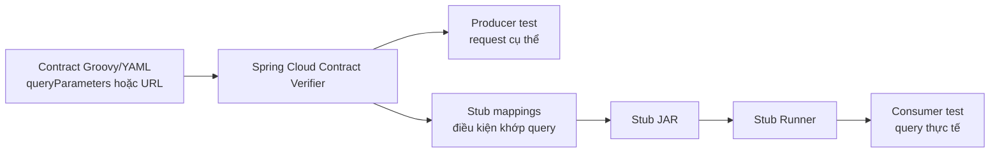

# Query parameter bắt buộc, tùy chọn và nhiều giá trị

## 1. Vì sao query parameter là một phần của hợp đồng HTTP?

Trong **Spring Cloud Contract**, một hợp đồng mô tả hành vi mà **producer** cam kết với **consumer**. Ngoài phương thức HTTP, đường dẫn, header, body và response, **query parameter** quyết định một request có được chấp nhận hay không và kết quả nào sẽ được trả về.

Ví dụ, ba request sau có thể mang ý nghĩa rất khác nhau:

```http
GET /api/orders?state=PAID
GET /api/orders?state=PAID&limit=20
GET /api/products?tag=java&tag=spring
```

- `state=PAID` có thể là điều kiện lọc **bắt buộc**.
- `limit=20` có thể là tham số **tùy chọn**, có giá trị mặc định khi không gửi.
- Hai lần xuất hiện của `tag` cho thấy một tham số **có nhiều giá trị**, thường dùng trong lọc theo danh sách.

Nếu hợp đồng chỉ kiểm tra `GET /api/orders` và mã `200`, một thay đổi khiến producer bỏ qua `state` có thể không bị phát hiện. Nếu hợp đồng khóa chặt mọi query bằng một chuỗi URL duy nhất, stub lại có thể từ chối những request hợp lệ chỉ vì các tham số xuất hiện theo thứ tự khác.

Bài này thuộc chương **Request HTTP** của Spring Cloud Contract, tập trung vào cách dùng **Groovy DSL/YAML DSL**, sinh kiểm thử producer, tạo stub, chạy **Stub Runner** phía consumer và kiểm tra thay đổi API qua CI.

## 2. Những khái niệm cần phân biệt

### 2.1. Query string, query parameter và giá trị

Trong URI:

```text
/api/products?tag=java&tag=spring&sort=price
             └─────────────────────────────┘
                      query string
```

Các cặp `name=value` trong query string là query parameter. **Một tên có thể xuất hiện nhiều lần**; vì thế query không luôn biểu diễn chính xác bằng `Map<String, String>`. Với request trên, có thể hiểu dữ liệu theo mô hình:

```text
tag  -> ["java", "spring"]
sort -> ["price"]
```

| Tình huống | URL minh họa | Ý nghĩa cần thống nhất |
|---|---|---|
| Có một giá trị | `?state=PAID` | `state` mang giá trị `PAID` |
| Thiếu tham số | `/api/orders` | Không gửi `state` |
| Có nhưng rỗng | `?state=` | Có key `state` với chuỗi rỗng |
| Chỉ có key | `?state` | Cách diễn giải phụ thuộc HTTP stack; cần kiểm thử nếu API phân biệt |
| Lặp nhiều lần | `?tag=java&tag=spring` | `tag` có hai giá trị |
| Một giá trị chứa dấu phẩy | `?tag=java,spring` | Một chuỗi có dấu phẩy; không mặc nhiên tương đương hai giá trị |
| Giá trị cần mã hóa | `?q=C%2B%2B` | Giá trị sau giải mã là `C++` |

**Bắt buộc/tùy chọn** là quy tắc của **API**; HTTP tự nó không quy định `state` phải có. **Có một hay nhiều giá trị** cũng là lựa chọn thiết kế của API. Contract test cần thể hiện đúng các quy tắc mà consumer đang phụ thuộc.

### 2.2. Hai khía cạnh của việc kiểm thử

Spring Cloud Contract từ một đặc tả có thể:

1. Sinh **producer test** gửi một HTTP request cụ thể vào ứng dụng thật, rồi xác minh response.
2. Sinh **stub** để consumer test có thể gửi request tới Stub Runner/WireMock và nhận phản hồi mẫu.

Một query matcher có thể giúp stub chấp nhận *nhiều* giá trị hợp lệ, nhưng generated producer test thường dùng *một* giá trị mẫu. Vì vậy, **test producer chạy xanh với một giá trị không có nghĩa tất cả giá trị đầu vào đều được kiểm thử**.

## 3. Cú pháp khai báo query bằng Groovy DSL

Trong Groovy DSL, thường nên khai báo query tách biệt với đường dẫn bằng `urlPath(...)` và `queryParameters`:

```groovy
import org.springframework.cloud.contract.spec.Contract

Contract.make {
    description 'Lấy danh sách đơn hàng đã thanh toán'

    request {
        method GET()
        urlPath('/api/orders') {
            queryParameters {
                parameter 'state': 'PAID'
                parameter 'limit': '20'
            }
        }
    }

    response {
        status OK()
        headers {
            contentType(applicationJson())
        }
        body(
            orders: [
                [id: 42, state: 'PAID']
            ]
        )
    }
}
```

Đây là một hợp đồng có hai query parameter được đưa vào request kiểm thử. `parameter 'state': 'PAID'` mô tả kỳ vọng về tham số `state`, trong khi `parameter 'limit': '20'` mô tả giá trị `limit` cho kịch bản cụ thể.

Các helper liên quan:

| Cú pháp | Vai trò |
|---|---|
| `url('/api/orders?state=PAID')` | Chỉ định toàn bộ URL bằng chuỗi, gồm query nếu có |
| `urlPath('/api/orders') { ... }` | Mô tả path và phần cấu hình query theo cấu trúc |
| `queryParameters { ... }` | Khối khai báo các tham số query |
| `parameter 'state': 'PAID'` | Tham số với giá trị mong đợi |
| `$(consumer(...), producer(...))` | Giá trị khác nhau cho phía stub/consumer và phía producer test |
| `regex('...')` | Matcher theo định dạng khi không muốn khóa một giá trị duy nhất |
| `optional(...)` | Biểu diễn matcher cho giá trị tùy chọn ở vị trí DSL hỗ trợ |

**Chọn `urlPath` khi cần khớp từng query parameter** hoặc cần regex. URL nguyên chuỗi thuận tiện cho tình huống rất cụ thể, nhưng với nhiều tham số dễ vô tình phụ thuộc thứ tự, encoding và cách xây dựng URL.

## 4. Query parameter bắt buộc

### 4.1. Yêu cầu nghiệp vụ

Giả sử `GET /api/orders` chỉ hợp lệ khi có `state` thuộc tập `PAID`, `PENDING`, `CANCELLED`. Nếu thiếu `state`, producer trả `400 Bad Request` với mã lỗi `MISSING_STATE`.

Hợp đồng cho kịch bản thành công:

```groovy
import org.springframework.cloud.contract.spec.Contract

Contract.make {
    description 'Lọc đơn hàng theo trạng thái bắt buộc'

    request {
        method GET()
        urlPath('/api/orders') {
            queryParameters {
                parameter 'state': $(
                    consumer(regex('PAID|PENDING|CANCELLED')),
                    producer('PAID')
                )
            }
        }
    }

    response {
        status OK()
        headers {
            contentType(applicationJson())
        }
        body(orders: [[id: 42, state: 'PAID']])
    }
}
```

Trong **request**, cách hiểu hai phía là:

- **`consumer(regex(...))`**: điều kiện matcher dùng khi consumer gọi **stub**. Stub cho phép những giá trị `state` khớp mẫu.
- **`producer('PAID')`**: giá trị request mà **generated producer test** gửi thật vào ứng dụng.

Giá trị mẫu `PAID` phải phù hợp với dữ liệu và phản hồi được chuẩn bị trong test. Nếu API trả kết quả khác nhau cho `PENDING`, đừng mặc nhiên để stub trả cùng `orders` trạng thái `PAID` cho mọi request chỉ vì matcher chấp nhận cả ba trạng thái. Thay vào đó, dùng matcher chặt theo kịch bản, nhiều hợp đồng riêng, hoặc phản hồi có quan hệ với input khi phù hợp.

### 4.2. “Bắt buộc” phải có kiểm thử khi *thiếu* tham số

Việc khai báo `parameter 'state': 'PAID'` **không tự chứng minh** producer từ chối request thiếu `state`. Nó chỉ xác minh hành vi của một request có `state`. Muốn bảo vệ quy tắc “bắt buộc”, cần thêm hợp đồng âm:

```groovy
import org.springframework.cloud.contract.spec.Contract

Contract.make {
    description 'Thiếu state phải nhận lỗi'

    request {
        method GET()
        url '/api/orders'
    }

    response {
        status BAD_REQUEST()
        headers {
            contentType(applicationJson())
        }
        body(
            code: 'MISSING_STATE',
            message: 'state is required'
        )
    }
}
```

Trong generated producer test, request `GET /api/orders` được gửi **không có `state`** để kiểm tra `400`. Với stub, hãy bảo đảm mapping cho trường hợp lỗi và mapping thành công không xung đột: một stub khớp path quá rộng có thể trả `200` cho request thiếu tham số nếu DSL không ràng buộc đúng query.

Nếu API còn quy định `state=` là không hợp lệ, hãy kiểm thử riêng trường hợp **giá trị rỗng**. Thiếu tham số, chuỗi rỗng và giá trị ngoài enum có thể có ba mã lỗi hoặc thông báo khác nhau tùy thiết kế.

### 4.3. Không tùy tiện nới lỏng giá trị nghiệp vụ

Ví dụ `regex('.*')` cho `state` sẽ chấp nhận cả `PAID`, `MISSING` và chuỗi rỗng; đó không phải phép kiểm tra tập giá trị hợp lệ. Nếu tập enum được mở rộng, cần xem consumer cũ có xử lý được giá trị mới hay không. **Thêm giá trị enum có thể là thay đổi không tương thích**, dù schema vẫn ghi kiểu chuỗi.

## 5. Query parameter tùy chọn

### 5.1. Ý nghĩa của tùy chọn

Giả sử `limit` có thể được bỏ qua và server mặc định `20`, nhưng nếu có thì giá trị hợp lệ là số nguyên dương trong khoảng `1..99`.

Ba trường hợp nên phân biệt:

1. **Không gửi** `limit`: producer dùng giá trị mặc định được cam kết.
2. **Gửi** `limit=10`: producer giới hạn kết quả theo 10.
3. **Gửi** `limit=abc` hoặc `limit=0`: producer trả lỗi nếu API không cho phép.

Hàm `optional(...)` trong Groovy DSL có thể dùng ở phía **consumer của request** để mô tả matcher cho tham số được phép không xuất hiện:

```groovy
import org.springframework.cloud.contract.spec.Contract

Contract.make {
    description 'limit có thể được bỏ qua'

    request {
        method GET()
        urlPath('/api/orders') {
            queryParameters {
                parameter 'state': 'PAID'
                parameter 'limit': $(
                    consumer(optional(regex('[1-9][0-9]?'))),
                    producer('20')
                )
            }
        }
    }

    response {
        status OK()
        headers {
            contentType(applicationJson())
        }
        body(orders: [[id: 42, state: 'PAID']])
    }
}
```

**Điểm rất quan trọng:** `optional` giúp diễn đạt khả năng tùy chọn cho **stub matching** ở nơi DSL hỗ trợ; **generated producer test vẫn gửi `limit=20`** vì phía producer đã chọn giá trị đó. Contract này **chưa kiểm tra** ứng dụng thật khi `limit` vắng mặt.

### 5.2. Bảo vệ hành vi mặc định bằng hợp đồng riêng

Nếu consumer dựa vào giá trị mặc định `20`, cần hợp đồng thứ hai gửi request không có `limit`:

```groovy
import org.springframework.cloud.contract.spec.Contract

Contract.make {
    description 'Không truyền limit thì dùng giới hạn mặc định'

    request {
        method GET()
        url '/api/orders?state=PAID'
    }

    response {
        status OK()
        headers {
            contentType(applicationJson())
        }
        body(
            effectiveLimit: 20,
            orders: [[id: 42, state: 'PAID']]
        )
    }
}
```

`effectiveLimit` là trường **giả định của API minh họa**, nhằm làm rõ giá trị mặc định. Nếu API thật không trả lại trường đó, có thể dùng response phù hợp với fixture và kiểm tra gián tiếp số lượng phần tử, hoặc viết producer test bổ sung. Không nên thêm một trường chỉ để thuận tiện cho contract test nếu trường đó không thuộc hợp đồng công khai.

Với stub, việc khai báo không có `limit` trong một mapping không nhất thiết đồng nghĩa “mọi request có `limit` đều bị từ chối”; nhiều cơ chế khớp chỉ kiểm tra tham số đã khai báo và bỏ qua tham số lạ. Khi sự **vắng mặt** là điều kiện phân nhánh, cần kiểm tra mapping sinh ra hoặc dùng cơ chế matcher có thể xác nhận sự vắng mặt của key trong phiên bản WireMock/Spring Cloud Contract đang dùng.

### 5.3. Khi nào nên tách nhiều hợp đồng?

| Quy tắc | Hợp đồng nên có |
|---|---|
| Gửi `limit=10` cho tối đa 10 kết quả | Kịch bản query có `limit` và fixture tương ứng |
| Bỏ `limit` cho mặc định 20 | Kịch bản **không gửi** `limit` |
| `limit=0` hoặc `limit=abc` bị từ chối | Kịch bản `400` cho giá trị không hợp lệ |
| `limit` được chấp nhận từ 1 đến 99 | Matcher chặt và/hoặc test biên cho 1, 99 |
| `limit=100` không hợp lệ | Kịch bản kiểm chứng phía producer cho giá trị vượt giới hạn |

Không cần nhân số lượng contract theo mọi con số có thể có; hãy bảo vệ những **ranh giới** và hành vi consumer thực sự phụ thuộc.

## 6. Query parameter có nhiều giá trị

### 6.1. Phân biệt lặp key và danh sách chứa dấu phẩy

Hai URL sau **không đương nhiên tương đương**:

```http
GET /api/products?tag=java&tag=spring
GET /api/products?tag=java,spring
```

Ở URL đầu tiên, key `tag` xuất hiện **hai lần**; ở URL thứ hai, `tag` xuất hiện **một lần** với nội dung `java,spring`. Một số framework hỗ trợ bind cả hai dạng vào danh sách, nhưng consumer khác, gateway, cache hoặc bộ xác thực chữ ký request có thể xử lý khác nhau. Hợp đồng cần quy định cụ thể định dạng được hỗ trợ.

Một API lọc sản phẩm có thể cam kết:

- `tag` là tham số có thể lặp để tìm sản phẩm mang **bất kỳ** tag nào;
- tối đa năm giá trị tag;
- mỗi tag không được rỗng;
- thứ tự tag **không** ảnh hưởng kết quả.

Các quy tắc này phải được thể hiện bằng một tập hợp contract và kiểm thử nghiệp vụ phù hợp; chỉ có một ví dụ với hai tag không đủ để chứng minh giới hạn năm giá trị hay bất biến theo thứ tự.

### 6.2. Ví dụ hợp đồng với hai giá trị lặp rõ ràng

Một cách ghi **kịch bản cụ thể, dễ hiểu** bằng Groovy DSL là đặt nguyên URL gồm hai giá trị:

```groovy
import org.springframework.cloud.contract.spec.Contract

Contract.make {
    description 'Lọc sản phẩm theo hai giá trị tag trong query'

    request {
        method GET()
        url '/api/products?tag=java&tag=spring'
    }

    response {
        status OK()
        headers {
            contentType(applicationJson())
        }
        body(
            appliedTags: ['java', 'spring'],
            products: [
                [id: 'P-42', name: 'Spring Handbook']
            ]
        )
    }
}
```

URL trong ví dụ **thực sự chứa hai lần `tag`**. Generated producer test cần gửi request tương ứng; stub nhận kịch bản HTTP được mô tả. Cách này phù hợp khi muốn kiểm chứng đúng một biến thể của query, nhưng có thể **nhạy với thứ tự** và biểu diễn ký tự mã hóa của URL. Vì vậy, không nên suy luận rằng hợp đồng đã bảo vệ tất cả hoán vị của danh sách tag.

**Đặc biệt tránh** viết hai lần một khóa vào cấu trúc giống `Map<String, String>` rồi mặc định rằng cả hai giá trị sẽ được giữ nguyên. Nếu chọn cấu hình `queryParameters` nâng cao cho các key lặp, phải xác minh cú pháp và WireMock mapping được sinh trong **phiên bản Spring Cloud Contract của dự án**, bởi cách biểu diễn tham số nhiều giá trị có thể khác với một giá trị đơn.

### 6.3. Request thực tế từ consumer

Ví dụ gọi API bằng `curl` với hai giá trị:

```bash
curl -G 'http://localhost:8080/api/products' \
  --data-urlencode 'tag=java' \
  --data-urlencode 'tag=spring'
```

Cách biểu diễn sau khi mã hóa tương ứng với `?tag=java&tag=spring`. Khi consumer là một ứng dụng Spring, client phải xây dựng URI **giữ hai giá trị** thay vì ghi đè giá trị đầu. Ví dụ với `UriComponentsBuilder`:

```java
URI uri = UriComponentsBuilder
        .fromPath("/api/products")
        .queryParam("tag", "java", "spring")
        .build()
        .encode()
        .toUri();

// Path + query: /api/products?tag=java&tag=spring
```

Phía producer Spring MVC có thể nhận nhiều giá trị:

```java
@GetMapping("/api/products")
public List<ProductDto> findProducts(
        @RequestParam(name = "tag") List<String> tags) {
    return productService.findByTags(tags);
}
```

**Lưu ý:** ví dụ controller chỉ cho thấy cách nhận danh sách. Việc tag **bắt buộc**, có được để rỗng, có chấp nhận duplicate, giới hạn năm phần tử hoặc kết quả có phụ thuộc thứ tự hay không là những quy tắc nghiệp vụ cần triển khai và kiểm thử riêng.

### 6.4. Nếu thứ tự không phải một phần của cam kết

Khi consumer có thể gửi `tag=spring&tag=java`, bạn có hai hướng:

1. **Viết thêm kịch bản** với thứ tự đảo để xác minh producer xử lý đúng; cách này trực quan và phù hợp với số trường hợp ít.
2. **Thiết kế matcher query theo giá trị/cấu trúc** và kiểm tra mapping stub được sinh ra để bảo đảm không ràng buộc thứ tự ngoài ý muốn. Với bộ lọc phức tạp, có thể bổ sung integration test của producer kiểm tra cả hai request và khẳng định chúng mang ý nghĩa tương đương.

Không nên khẳng định một matcher cho key `tag` đã tự kiểm tra **độ dài danh sách, tập giá trị, thứ tự và số lần lặp** nếu chưa quan sát kết quả thực tế. Một stub khớp quá rộng có thể trả `200` ngay cả khi producer thật chỉ hiểu giá trị đầu tiên.

## 7. Tương đương bằng YAML DSL: bắt buộc và tùy chọn

Spring Cloud Contract hỗ trợ định nghĩa hợp đồng HTTP bằng **YAML DSL**. Đối với query giá trị đơn, có thể dùng `urlPath` và `queryParameters`:

```yaml
description: Lọc đơn hàng theo trạng thái
request:
  method: GET
  urlPath: /api/orders
  queryParameters:
    state: PAID
    limit: "20"
response:
  status: 200
  headers:
    Content-Type: application/json
  body:
    orders:
      - id: 42
        state: PAID
```

YAML trên mô tả một request có `state=PAID` và `limit=20`. Dấu nháy quanh `"20"` nhấn mạnh rằng query parameter trên HTTP là dữ liệu dạng văn bản; JSON number `20` trong response body là chuyện khác.

Khi viết matcher với YAML DSL, Spring Cloud Contract còn hỗ trợ biểu diễn giá trị phía test/stub và các matcher tùy phiên bản/cấu hình; cú pháp YAML **không phải phép chuyển từng chữ một** từ cú pháp closure Groovy. Với **nhiều giá trị trùng key**, không nên làm:

```yaml
# Sai ý tưởng: YAML map có key trùng, dễ mất một giá trị.
queryParameters:
  tag: java
  tag: spring
```

Hai key `tag` lặp trong một YAML mapping không biểu diễn an toàn một multi-value query. Để minh họa chính xác hai giá trị mà không phụ thuộc cú pháp matcher đặc biệt, có thể dùng URL đầy đủ:

```yaml
description: Lọc sản phẩm bằng hai query value
request:
  method: GET
  url: /api/products?tag=java&tag=spring
response:
  status: 200
  headers:
    Content-Type: application/json
  body:
    appliedTags:
      - java
      - spring
```

Hãy chọn một biểu diễn phù hợp với **phiên bản plugin đang dùng**, kiểm tra test sinh ra và stub mapping trước khi kết luận rằng trường tùy chọn hoặc multi-value được hỗ trợ đúng như ý.

## 8. Kiểm tra phạm vi, encoding và giá trị bất thường

### 8.1. Thiếu key, chuỗi rỗng và null không giống nhau

Ví dụ `GET /api/orders?state=` là request **có** `state` nhưng giá trị rỗng. `GET /api/orders` là request **không có** key này. Đừng gộp cả hai vào cùng một kịch bản nếu producer phải trả lỗi khác nhau hoặc dùng fallback khác nhau.

Trong Java:

```java
@GetMapping("/api/orders")
public List<OrderDto> findOrders(
        @RequestParam(name = "state", required = true) String state,
        @RequestParam(name = "limit", required = false) Integer limit) {
    int effectiveLimit = (limit == null) ? 20 : limit;
    return orderService.find(state, effectiveLimit);
}
```

`required = true` thể hiện ràng buộc ở Spring MVC; contract vẫn cần kiểm tra hành vi công khai, ví dụ trả `400` khi thiếu `state`. Với dữ liệu rỗng, cách bind/validate còn phụ thuộc converter, annotation và code nghiệp vụ; đừng chỉ nhìn vào `required = true` rồi suy ra mọi giá trị rỗng đều bị từ chối.

### 8.2. Encoding và normalization

- Giá trị có dấu cách, dấu `&`, dấu `+`, dấu `?` hoặc ký tự Unicode cần được mã hóa URI đúng cách.
- Trong cách mã hóa query theo quy ước form, ký tự `+` có thể được diễn giải là dấu cách; dùng `%2B` nếu cần dấu cộng thật.
- `q=C%2B%2B` biểu diễn tìm kiếm `C++`; `q=C++` có thể không mang cùng ý nghĩa trên mọi thành phần của hệ thống.
- Một proxy/gateway có thể chuẩn hóa URL hoặc thay đổi thứ tự query khi chuyển tiếp, đặc biệt với request được ký chữ ký hoặc được cache.
- Contract nên mô tả **giá trị mà API cam kết** và bổ sung test cho encoding ở những luồng có tác động đến consumer.

### 8.3. Trùng lặp ngoài ý muốn và HTTP parameter pollution

Nếu API chỉ cho phép một `state`, request `?state=PAID&state=CANCELLED` cần có hành vi rõ ràng: từ chối với `400`, nhận giá trị đầu tiên, nhận giá trị cuối, hay xử lý như danh sách? Việc framework tự chọn một giá trị mà không có chính sách có thể gây lỗi nhất quán giữa gateway, ứng dụng và hệ thống cache.

Khi key chỉ cho phép **một giá trị**, hãy kiểm thử trường hợp trùng key có chủ đích. Khi key cho phép **nhiều giá trị**, hãy xác định cách xử lý giá trị lặp giống nhau, ví dụ `?tag=java&tag=java`.

## 9. Kiểm chứng bằng producer test, stub và Stub Runner



**Ở producer**, verifier sinh test từ hợp đồng, gọi đường dẫn có query theo phía producer và so sánh response thực tế. Fixture của test phải nhất quán: nếu `state=PAID` thì dữ liệu trả về cần phù hợp `PAID`.

**Ở consumer**, Stub Runner khởi chạy stub từ artifact được phát hành. Consumer test phải gọi client HTTP thật của ứng dụng và kiểm tra ứng dụng xử lý response đúng. Việc stub trả `200` chỉ chứng minh request đã được stub xử lý; nó chưa chứng minh consumer có gửi đủ query hoặc hiển thị đúng dữ liệu.

Ví dụ các tình huống kiểm tra:

| Tình huống | Test producer cần chứng minh | Consumer test với stub cần chứng minh |
|---|---|---|
| `state=PAID` | Producer thực thi đúng bộ lọc | Consumer gửi đúng `state` và đọc dữ liệu đúng |
| Thiếu `state` | Producer trả lỗi đã cam kết | Consumer xử lý response lỗi đúng |
| Không gửi `limit` | Producer áp dụng default đã cam kết | Consumer không cần tự chèn tham số khi không cần |
| `limit` ngoài khoảng | Producer từ chối theo chính sách | Consumer hiện thông báo hoặc sửa request hợp lệ |
| `tag=java&tag=spring` | Producer nhận hai giá trị và lọc đúng | Client không đánh rơi giá trị nào |
| `tag` lặp với thứ tự đảo | Kết quả đúng nếu API hứa thứ tự không ảnh hưởng | Client không dựa vào thứ tự nếu không được cam kết |

CI nên chạy **generated producer tests** trước khi tạo/phát hành stub; sau đó chạy **consumer tests** với Stub Runner dùng phiên bản stub mục tiêu. Khi thêm tham số bắt buộc, đổi giá trị mặc định, thay đổi chính sách multi-value hoặc bỏ hỗ trợ một tham số, cần đánh giá liệu consumer đã triển khai có còn tương thích hay không. Nếu cần thay đổi không tương thích, hãy lên kế hoạch chuyển đổi hoặc versioning rõ ràng.

## 10. Những lỗi thiết kế contract thường gặp

| Lỗi | Hệ quả | Cách sửa |
|---|---|---|
| Viết `url '/api/orders?state=PAID&limit=20'` cho mọi kịch bản lọc | Stub có thể ràng buộc thứ tự/biểu diễn URL quá mức | Dùng `urlPath` và `queryParameters` cho các giá trị đơn cần khớp riêng |
| Chỉ kiểm tra request **có** tham số bắt buộc | Producer vẫn có thể cho qua request thiếu tham số | Thêm hợp đồng âm với request thiếu key |
| Dùng `optional(...)` rồi nghĩ test đã chạy trường hợp *vắng* tham số | Default của producer chưa được xác minh | Viết kịch bản producer test bỏ tham số |
| Dùng `regex('.*')` cho enum | Stub nhận cả trạng thái không hợp lệ | Dùng tập giá trị cụ thể và test theo từng hành vi |
| Lặp key trong YAML map | Một giá trị có thể ghi đè giá trị kia | Dùng URL mẫu chứa hai key hoặc biểu diễn multi-value được phiên bản DSL hỗ trợ |
| Coi `tag=a,b` bằng `tag=a&tag=b` | Consumer/gateway xử lý khác nhau | Chọn và công bố đúng một hay cả hai định dạng |
| Tuyên bố thứ tự tag không quan trọng nhưng chỉ test một thứ tự | Không phát hiện bug xử lý thứ tự | Thêm kịch bản đảo thứ tự hoặc test tập hợp |
| So sánh tham số số với JSON number | Nhầm dữ liệu query (chuỗi) và kiểu response body | Xác định ranh giới ép kiểu và validate |
| Chỉ kiểm tra Stub Runner có khởi động | Không chứng minh client gửi đủ query | Gọi client thật và assert hành vi consumer |
| Không lưu phiên bản stub | Test CI có thể dùng stub cũ | Pin artifact version hoặc đặt chiến lược cập nhật có truy vết |

## 11. Bài thực hành: bộ lọc đơn hàng và tag

**Bối cảnh:** một trang quản trị gọi API:

```http
GET /api/orders?state=PAID&limit=10
GET /api/orders?state=PAID
GET /api/products?tag=java&tag=spring
```

Các cam kết:

1. `state` bắt buộc, nhận `PAID` hoặc `PENDING`; thiếu `state` trả `400`.
2. `limit` tùy chọn, mặc định 20, giới hạn từ 1 đến 99.
3. `tag` cho phép nhiều giá trị được gửi qua các key lặp.
4. Producer công bố stub để consumer chạy kiểm thử độc lập.

**Các bước thực hiện:**

1. Viết một hợp đồng Groovy có `urlPath('/api/orders')`, `parameter 'state': 'PAID'`, `parameter 'limit': '10'` và phản hồi mẫu.
2. Viết hợp đồng cho request `/api/orders` thiếu `state`; kỳ vọng `400` và mã lỗi đã công bố.
3. Viết hợp đồng cho `/api/orders?state=PAID` không có `limit`; fixture phải thể hiện hoặc kiểm chứng hành vi mặc định.
4. Viết hợp đồng cho `/api/orders?state=PAID&limit=0`; kỳ vọng mã lỗi theo quy tắc của API.
5. Viết hợp đồng `/api/products?tag=java&tag=spring`, chuẩn bị fixture cho hai tag. Thêm một kịch bản đảo thứ tự nếu API cam kết không phụ thuộc thứ tự.
6. Chạy producer tests được sinh, tạo stub artifact và kiểm thử client phía consumer với Stub Runner.

**Câu hỏi tự kiểm tra:**

- Vì sao `state=PAID` trong contract chưa đủ chứng minh `state` bắt buộc? — Vì chưa gửi request thiếu `state` đến producer để quan sát lỗi.
- Vì sao `optional(regex(...))` không tự kiểm tra giá trị mặc định của producer? — Vì generated producer test vẫn dùng giá trị mẫu ở phía `producer(...)`.
- Vì sao không viết hai key `tag` trùng nhau trong YAML mapping? — Vì YAML mapping không phải cấu trúc multi-map đáng tin cậy; có thể mất một giá trị.
- Nếu producer chuyển `limit` mặc định từ 20 sang 50, có thể phá vỡ tương thích không? — Có, nếu consumer dựa vào số lượng hoặc phân trang mặc định và contract trước đó bảo vệ quy tắc này.
- Nếu `tag=spring&tag=java` trả khác `tag=java&tag=spring`, có luôn là bug không? — Chỉ là bug khi API đã cam kết thứ tự không ảnh hưởng kết quả.

## 12. Checklist review trước khi chấp nhận hợp đồng

- [ ] Có phân biệt **tham số bắt buộc**, **tham số tùy chọn** và **tham số nhiều giá trị** theo ngữ nghĩa API.
- [ ] Dùng `urlPath`/`queryParameters` hoặc URL mẫu có chủ đích, không vô tình khóa thứ tự query.
- [ ] Với tham số bắt buộc, có ít nhất một kiểm thử khi **thiếu key**.
- [ ] Với tham số tùy chọn, có kiểm thử khi **có giá trị** và khi **không gửi** nếu default có ý nghĩa với consumer.
- [ ] Với dữ liệu có miền giá trị rõ ràng, matcher không rộng hơn quy tắc nghiệp vụ.
- [ ] Với multi-value, xác nhận key lặp giữ đủ các giá trị; xác định duplicate và thứ tự.
- [ ] Có kiểm thử cho giá trị rỗng, giá trị sai kiểu, ngoài khoảng hoặc encoding khi chúng ảnh hưởng hành vi.
- [ ] Generated producer tests chạy với fixture tái lập được; stub mappings khớp những request dự kiến.
- [ ] Consumer test dùng client thật với Stub Runner, assert hành vi sau khi nhận response.
- [ ] CI kiểm tra producer, phát hành stub có phiên bản và phát hiện thay đổi API không tương thích.

Khi thiết kế query parameter trong Spring Cloud Contract, câu hỏi quan trọng nhất là: **“Request nào producer phải chấp nhận, request nào phải từ chối, và consumer có đang dựa vào sự khác biệt đó không?”** Viết các kịch bản rõ ràng cho **bắt buộc, tùy chọn và nhiều giá trị** sẽ giúp contract vừa đáng tin cậy trong CI, vừa đủ linh hoạt khi ứng dụng phát triển.
