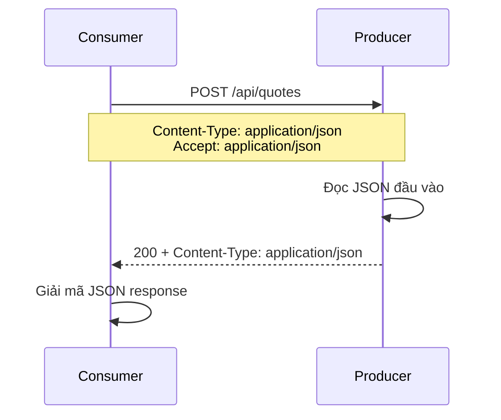
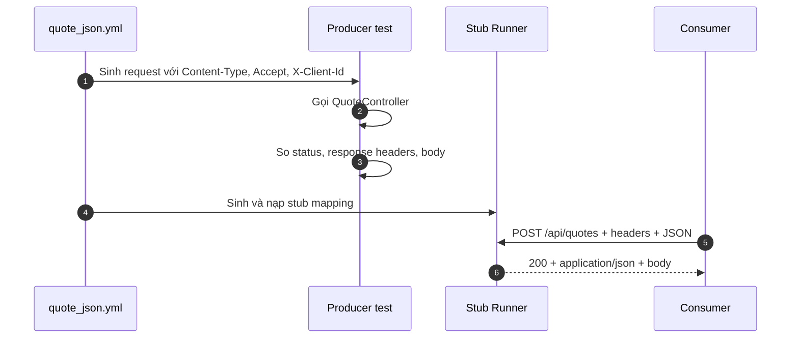
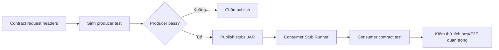

# Request header và content negotiation

> **Chương:** Request HTTP  
> **Module:** `SPRING_CLOUD_CONTRACT` — học kiểm thử hợp đồng giữa producer và consumer bằng Spring Cloud Contract, sử dụng Groovy/YAML DSL, producer verification, stub, Stub Runner và CI.

## Mục tiêu học tập

Sau bài này, bạn có thể:

1. Phân biệt **request header** với **response header**, đặc biệt là vai trò của `Accept` và `Content-Type`.
2. Giải thích **content negotiation**: client thông báo những biểu diễn có thể nhận, server chọn một biểu diễn hỗ trợ hoặc từ chối yêu cầu.
3. Định nghĩa request header trong **Groovy DSL** và **YAML DSL** của Spring Cloud Contract.
4. Viết contract để kiểm chứng header bắt buộc, header có mẫu động, các biến thể `application/json` và `text/plain`, cũng như trường hợp `406`/`415`.
5. Hiểu header tham gia thế nào vào producer test và vào request matching của stub chạy bằng Stub Runner.
6. Tổ chức các contract trong CI để phát hiện thay đổi API không tương thích mà không làm test giòn do những header không liên quan.

## 1. Header nằm ở đâu trong giao tiếp HTTP?

Một HTTP request thường gồm **method**, **target URI**, **header fields** và một **body tùy chọn**.

Ví dụ consumer `checkout-service` yêu cầu producer `pricing-service` báo giá:

```http
POST /api/quotes HTTP/1.1
Host: pricing-service
Content-Type: application/json
Accept: application/json
X-Client-Id: checkout

{
  "sku": "SKU-001",
  "units": 2
}
```

Producer trả:

```http
HTTP/1.1 200 OK
Content-Type: application/json

{
  "sku": "SKU-001",
  "units": 2,
  "amount": 250000
}
```

Trong request này:

- `Content-Type: application/json` mô tả **kiểu dữ liệu của body consumer đang gửi**.
- `Accept: application/json` diễn tả **kiểu biểu diễn response consumer muốn/cho phép nhận**.
- `X-Client-Id: checkout` là header ứng dụng tự quy ước để định danh hệ thống gọi.
- `Host` phục vụ định tuyến HTTP; nó **không đồng nghĩa** với danh tính caller và không nên dùng như cơ chế xác thực.

Header có thể chi phối route, validation, serialization, auth, cache hoặc observability. Vì thế một thay đổi header có thể phá vỡ tích hợp API ngay cả khi JSON body không đổi.

**Contract test** quan tâm tới các header nằm trong lời hứa giao tiếp. Spring Cloud Contract có thể sinh **producer-side tests** từ hợp đồng và sinh **HTTP stubs** để consumer gọi qua Stub Runner. Cả hai phải thống nhất những header quan trọng như media type hoặc một header ứng dụng bắt buộc.

## 2. Phân biệt Accept và Content-Type

Đây là hai header thường bị nhầm:

| Header | Xuất hiện ở | Câu hỏi được trả lời | Ví dụ |
| --- | --- | --- | --- |
| `Content-Type` | Request có body | *Dữ liệu tôi gửi có định dạng nào?* | `Content-Type: application/json` |
| `Accept` | Request | *Tôi có thể nhận response định dạng nào?* | `Accept: application/json` |
| `Content-Type` | Response có body | *Dữ liệu server thực sự trả có định dạng nào?* | `Content-Type: text/plain` |
| `Content-Language` | Response | *Nội dung trả về sử dụng ngôn ngữ nào?* | `Content-Language: vi` |
| `Accept-Language` | Request | *Tôi ưu tiên ngôn ngữ nào?* | `Accept-Language: vi, en;q=0.8` |
| `Accept-Encoding` | Request | *Tôi chấp nhận cách mã hóa/nén nội dung nào?* | `Accept-Encoding: gzip, br` |

**Hai ví dụ cần nhớ:**

- Một request `GET /api/products/SKU-001` không có body **không cần** gửi `Content-Type` chỉ để thông báo muốn nhận JSON; hãy gửi `Accept: application/json`.
- Một request `POST` gửi JSON **vẫn có thể muốn nhận text**. Khi đó `Content-Type: application/json` và `Accept: text/plain` hoàn toàn hợp lệ, **nếu** endpoint hỗ trợ response `text/plain`.



Trong ví dụ sơ đồ, mỗi header chỉ có một nhiệm vụ. `Accept` không mô tả body request; `Content-Type` của request không tự quyết định response sẽ là JSON.

### 2.1. Content negotiation là gì?

**Content negotiation** là cơ chế chọn một **representation** phù hợp cho cùng một tài nguyên hoặc kết quả nghiệp vụ: JSON, XML, văn bản, ngôn ngữ hoặc dạng nén, tùy khả năng server và yêu cầu của client.

Với media type, consumer có thể gửi:

```http
Accept: application/json
```

Hoặc chấp nhận nhiều loại với độ ưu tiên khác nhau:

```http
Accept: application/json;q=0.9, text/plain;q=0.5
```

Giá trị `q` nằm trong khoảng `0` đến `1`. Khi không khai báo `q`, mặc định là `1`; `q=0` có nghĩa là loại đó không được chấp nhận. Server xét các biểu diễn nó hỗ trợ cùng mức ưu tiên, mức cụ thể và chính sách chọn representation; không nhất thiết trả đúng mục xuất hiện đầu tiên trong chuỗi.

```http
Accept: */*
```

nghĩa là consumer chấp nhận mọi media type. Tuy nhiên, test đang muốn kiểm chứng **đúng biến thể JSON** nên khai báo `Accept: application/json` sẽ làm kỳ vọng rõ ràng hơn.

Tên header HTTP **không phân biệt chữ hoa/chữ thường** (`Accept` và `accept` là cùng một field); nhưng khi viết stub matcher, không nên suy ra rằng mọi cách định dạng **giá trị header** đều mặc nhiên được so khớp như nhau. `application/json; charset=UTF-8`, `application/json`, dấu cách và chuỗi nhiều media type có thể yêu cầu quy tắc matcher phù hợp.

### 2.2. Hai mã lỗi thường liên quan

| Mã | Tình huống điển hình | Header cần xem |
| --- | --- | --- |
| **406 Not Acceptable** | Client chỉ chấp nhận loại response mà endpoint không thể cung cấp | `Accept` |
| **415 Unsupported Media Type** | Server không hỗ trợ media type của request body | `Content-Type` |
| **400 Bad Request** | Dữ liệu có cấu trúc không hợp lệ hoặc thiếu header đầu vào được khai báo bắt buộc | Cần xem validation và chính sách ứng dụng |
| **401/403** | Thiếu hoặc không đủ quyền truy cập | `Authorization` và cấu hình bảo mật |

Chẳng hạn với Spring MVC:

```java
@PostMapping(
    path = "/api/quotes",
    consumes = MediaType.APPLICATION_JSON_VALUE,
    produces = MediaType.APPLICATION_JSON_VALUE
)
```

- Gửi body `text/plain` với `Content-Type: text/plain` có thể bị từ chối `415` do không thỏa `consumes`.
- Gửi `Accept: application/pdf` trong khi endpoint chỉ sản sinh JSON có thể dẫn đến `406` do không thỏa `produces`.
- Nếu `@RequestBody` kỳ vọng JSON hợp lệ nhưng body bị lỗi cú pháp, thông thường server trả `400`, **không phải `415`**, vì media type vẫn là JSON.

Đây là hành vi minh họa của Spring MVC với cấu hình thông thường; custom exception handler, content negotiation strategy hoặc gateway có thể làm response thực tế khác. **Contract phải phản ánh API thực sự cam kết**.

## 3. Chọn những request header nào để đưa vào contract

Không phải header nào xuất hiện trong packet capture cũng cần được ràng buộc.

| Nhóm header | Ví dụ | Có nên đưa vào contract? |
| --- | --- | --- |
| Media type | `Content-Type`, `Accept` | Có, nếu cách xử lý request/response phụ thuộc vào media type |
| Header nghiệp vụ bắt buộc | `X-Client-Id`, `X-Tenant-Id` | Có, khi producer sử dụng chúng làm điều kiện hành vi |
| Truy vết | `X-Request-Id`, `traceparent` | Nếu consumer/producer cam kết định dạng hoặc phản hồi cụ thể; nên dùng matcher cho giá trị động |
| Xác thực | `Authorization` | Chỉ mô tả hành vi kiểm tra liên quan, dùng token giả trong test; không đặt secret thật vào contract |
| Header do môi trường tự thêm | `User-Agent`, `Via`, `X-Forwarded-For` | Chỉ khi chúng là một phần hợp đồng; nếu không, tránh khóa cứng |
| Độ dài/connection | `Content-Length`, `Connection` | Thường không nên ép cố định trong contract ứng dụng vì HTTP stack tự quản lý |

Nguyên tắc: **ràng buộc đúng thông tin consumer thực sự dựa vào**. Một contract chỉ mô tả trạng thái thành công có header `X-Client-Id` chưa đủ để chứng minh producer **từ chối** lời gọi thiếu header đó; nếu từ chối là một yêu cầu, hãy thêm contract tình huống âm tính hoặc integration/security test thích hợp.

## 4. Ví dụ producer tối thiểu để kiểm thử

Tạo một controller minh họa. Các import tiêu chuẩn của Spring MVC được lược bỏ cho gọn:

```java
@RestController
public class QuoteController {

    @PostMapping(
        path = "/api/quotes",
        consumes = MediaType.APPLICATION_JSON_VALUE,
        produces = MediaType.APPLICATION_JSON_VALUE
    )
    public QuoteResponse quote(
        @RequestHeader("X-Client-Id") String clientId,
        @RequestBody QuoteRequest request
    ) {
        return new QuoteResponse(
            request.sku(),
            request.units(),
            250000
        );
    }

    public record QuoteRequest(String sku, int units) {}

    public record QuoteResponse(
        String sku,
        int units,
        long amount
    ) {}
}
```

Kết quả mong đợi khi gửi request ở mục 1:

```json
{
  "sku": "SKU-001",
  "units": 2,
  "amount": 250000
}
```

Một số điều cần hiểu trước khi viết contract:

- `@PostMapping(consumes = ...)` quyết định media type request được mapping hỗ trợ.
- `@PostMapping(produces = ...)` quyết định media type response endpoint có thể cung cấp.
- `@RequestHeader("X-Client-Id")` mặc định yêu cầu có header đó khi Spring MVC bind tham số; thiếu header thường dẫn tới `400`.
- Response JSON được Spring chuyển đổi từ record Java khi có message converter hỗ trợ.
- Ví dụ chưa kiểm tra **giá trị** `clientId` là `checkout`: controller chỉ đòi header có mặt. Nếu nghiệp vụ cần chặn giá trị khác, phải bổ sung logic và test tương ứng.

Một bài contract test phía producer có thể dùng lớp cơ sở thiết lập MockMvc/RestAssuredMockMvc với controller này. Ví dụ:

```java
public abstract class ContractTestBase {

    @BeforeEach
    void setup() {
        RestAssuredMockMvc.standaloneSetup(new QuoteController());
    }
}
```

Đoạn này chỉ minh họa phần setup; để thực thi cần các dependency Contract Verifier, JUnit 5, Rest Assured MockMvc và cấu hình Maven/Gradle trỏ đến lớp base tương ứng.

## 5. Định nghĩa request headers trong Groovy DSL

File ví dụ `src/test/resources/contracts/quote_json.groovy` trong producer:

```groovy
org.springframework.cloud.contract.spec.Contract.make {
    name 'quote_json'

    request {
        method 'POST'
        url '/api/quotes'

        headers {
            contentType(applicationJson())
            header 'Accept': 'application/json'
            header 'X-Client-Id': 'checkout'
        }

        body(
            sku: 'SKU-001',
            units: 2
        )
    }

    response {
        status 200
        headers {
            contentType(applicationJson())
        }
        body(
            sku: 'SKU-001',
            units: 2,
            amount: 250000
        )
    }
}
```

**Giải thích theo hướng request:**

- `headers { ... }` **bên trong `request`** khai báo request headers mà contract cần.
- `contentType(applicationJson())` là helper Groovy cho `Content-Type: application/json`.
- `header 'Accept': 'application/json'` thêm header media type mong nhận.
- `header 'X-Client-Id': 'checkout'` ràng buộc header ứng dụng.
- `body(...)` khai báo JSON request. `units: 2` là số, không phải chuỗi `"2"`.

**Giải thích theo hướng response:**

- `response.headers { contentType(applicationJson()) }` quy định media type của response.
- `status 200` và `response.body` là kỳ vọng producer cần đáp ứng.
- Cùng contract đó cung cấp dữ liệu để sinh stub cho consumer.

Viết `contentType(applicationJson())` trong `request` **không thay thế** cho header `Accept`. Ngược lại, chỉ có `Accept` cũng **không khai báo** định dạng body gửi đi.

## 6. Biểu diễn cùng contract bằng YAML DSL

Nếu nhóm dùng YAML, file tương đương là `src/test/resources/contracts/quote_json.yml`:

```yaml
name: quote_json
description: "Consumer yeu cau bao gia bang JSON"

request:
  method: POST
  url: /api/quotes
  headers:
    Content-Type: application/json
    Accept: application/json
    X-Client-Id: checkout
  body:
    sku: SKU-001
    units: 2

response:
  status: 200
  headers:
    Content-Type: application/json
  body:
    sku: SKU-001
    units: 2
    amount: 250000
```

YAML thể hiện các header như một **map** dưới `request.headers` hoặc `response.headers`. Đọc cấu trúc theo đường dẫn:

| Vị trí trong YAML | Ý nghĩa |
| --- | --- |
| `request.headers.Content-Type` | Body consumer gửi là JSON |
| `request.headers.Accept` | Consumer yêu cầu response JSON |
| `request.headers.X-Client-Id` | Request mang giá trị định danh caller đã thống nhất |
| `response.headers.Content-Type` | Producer trả response dưới dạng JSON |
| `request.body.units` | Kiểu số của trường đầu vào |
| `response.body.amount` | Giá trị số của trường đầu ra |

**Quan trọng:** Groovy `quote_json.groovy` và YAML `quote_json.yml` ở hai mục trên **diễn đạt cùng một contract**. Khi triển khai thật, chỉ chọn **một** file để tránh sinh trùng test và stub mapping.

Khi dùng YAML:

- Thụt lề chính xác; `headers` phải nằm trong khối `request` hoặc `response` phù hợp.
- Các giá trị nhìn giống số/boolean trong YAML có thể bị parser đổi kiểu. Với token, mã hoặc media type có ký tự đặc biệt, đặt dấu nháy khi cần để giữ ý nghĩa **chuỗi**.
- Header name có dấu gạch nối (như `X-Client-Id`) là khóa YAML hợp lệ.
- Dùng giá trị header thực tế mà producer chấp nhận; đừng vô tình mã hóa bí mật vào repository.

## 7. Request header được kiểm chứng như thế nào?

Với contract `quote_json.yml`, Spring Cloud Contract có thể sinh:

1. **Producer verification test:** gửi `POST /api/quotes` với các header và body ví dụ, rồi kiểm tra response (status, header, body) từ implementation.
2. **Stub mapping:** chấp nhận request khớp method, URL, các request header/body đã mô tả; trả response đã cam kết.
3. **Consumer test:** HTTP client thực sự gửi header tới Stub Runner; request không khớp mapping có thể nhận phản hồi `404` hoặc lỗi mapping thay vì response đã định.



Lưu ý giới hạn quan trọng: nếu test producer **luôn gửi** `X-Client-Id: checkout`, producer test thành công **không chứng minh** API từ chối request khi thiếu hoặc sai header. Muốn cam kết điều đó, cần thêm contract lỗi hoặc bài test validation riêng.

Một request đi vào stub có thể không khớp nếu thiếu header `Accept` mà hợp đồng đòi hỏi, ngay cả khi producer thật vẫn cho phép request với `Accept: */*`. Điều này cho thấy stub được tạo từ **phạm vi và quy tắc khớp** bạn mô tả; viết header quá chặt sẽ làm consumer test thất bại giả.

## 8. Dùng request header matcher cho giá trị động

Một số header thay đổi theo từng request như `X-Request-Id` hoặc `Authorization` chứa token thử nghiệm. Cố định mọi giá trị có thể khiến stub chỉ chấp nhận duy nhất một request.

Ví dụ consumer phải gửi `X-Request-Id` theo mẫu `req-` + bốn chữ số. Từ contract YAML ở mục 6, bổ sung trong `request`:

```yaml
request:
  method: POST
  url: /api/quotes
  headers:
    Content-Type: application/json
    Accept: application/json
    X-Client-Id: checkout
    X-Request-Id: req-0042
  body:
    sku: SKU-001
    units: 2
  matchers:
    headers:
      - key: X-Request-Id
        regex: 'req-[0-9]{4}'
```

Đây là **khối `request` thay thế** để minh họa, không đặt thêm một `request` thứ hai trong cùng contract.

- `request.headers.X-Request-Id` cung cấp giá trị **ví dụ** cho test producer.
- `request.matchers.headers` giúp stub có thể so khớp giá trị header theo **regex**; không buộc mỗi consumer request có đúng chuỗi `req-0042`.
- `req-0777` sẽ khớp mẫu, còn `request77` thì không.
- Regex ví dụ ràng buộc **toàn bộ** định dạng. Khi muốn khớp thêm prefix/suffix, phải diễn đạt rõ trong pattern.

Cấu trúc YAML chính xác cho matcher header là danh sách gồm `key` và `regex` (hoặc `command` khi cần logic tùy biến). Nó khác body matcher, vốn đặt dưới `matchers.body` với `path` và `type`.

### 8.1. Header response động

Giả sử producer thực sự **trả thêm** `X-Correlation-Id` có dạng `corr-1234`, consumer cần trường đó nhưng không quan tâm giá trị cụ thể. Khi đó có thể thay khối `response` của contract bằng:

```yaml
response:
  status: 200
  headers:
    Content-Type: application/json
    X-Correlation-Id: corr-0042
  body:
    sku: SKU-001
    units: 2
    amount: 250000
  matchers:
    headers:
      - key: X-Correlation-Id
        regex: 'corr-[0-9]{4}'
```

Ý nghĩa:

- Producer verification kiểm tra header trả về theo regex, trong trường hợp generator/plugin hỗ trợ matcher này.
- Stub có thể dùng giá trị response mẫu `corr-0042` để consumer đọc.
- **Ứng dụng producer phải thực sự trả `X-Correlation-Id`** thì test này mới hợp lệ; controller tối thiểu ở mục 4 chưa phát hành header đó. Đây là phần mở rộng để tự thực hành, không nên ghép vào contract ban đầu nếu chưa sửa implementation.

Nếu API cam kết **trả lại chính request ID**, regex kiểm tra định dạng là chưa đủ; cần ràng buộc quan hệ giữa request và response (tham chiếu request trong DSL hoặc test bổ sung). Không đánh đồng "đúng định dạng" với "đúng giá trị tương ứng".

### 8.2. Đừng làm lỏng header quan trọng quá mức

| Cách khai báo | Tác động | Khi nào phù hợp |
| --- | --- | --- |
| `X-Client-Id: checkout` cố định | Stub chỉ chấp nhận giá trị đã quy định | Consumer này phải luôn dùng định danh `checkout` |
| Regex `checkout-[a-z]+` | Chấp nhận một họ định danh | Hợp đồng cho phép nhiều caller theo mẫu |
| Bỏ `X-Client-Id` khỏi contract | Stub không ràng buộc header đó | Giá trị không nằm trong giao kèo của tương tác đang mô tả |

Không dùng regex `.*` hoặc bỏ một header chỉ để "cho test xanh" khi chính header đó là điều kiện xác thực, phân quyền hoặc chọn tenant. Nếu cần kiểm tra chính sách bảo mật thực tế, hãy bổ sung integration/security test; stub không thay thế security middleware.

## 9. Content negotiation: hai representation cho cùng URL

Xem endpoint đọc tồn kho:

```http
GET /api/stock/SKU-001 HTTP/1.1
Accept: application/json
```

Producer có thể trả JSON:

```http
HTTP/1.1 200 OK
Content-Type: application/json

{"sku":"SKU-001","quantity":4}
```

Nếu consumer thay `Accept: text/plain`, cùng URL có thể trả văn bản:

```http
HTTP/1.1 200 OK
Content-Type: text/plain

SKU-001:4
```

**Điều kiện:** producer phải **thực sự hỗ trợ cả hai representation**. Content negotiation không tự tạo bản text nếu controller chỉ có converter/handler cho JSON.

### 9.1. Hai contract YAML

Contract cho JSON, file `stock_json.yml`:

```yaml
name: stock_json
request:
  method: GET
  url: /api/stock/SKU-001
  headers:
    Accept: application/json
response:
  status: 200
  headers:
    Content-Type: application/json
  body:
    sku: SKU-001
    quantity: 4
```

Contract cho text, file `stock_text.yml`:

```yaml
name: stock_text
request:
  method: GET
  url: /api/stock/SKU-001
  headers:
    Accept: text/plain
response:
  status: 200
  headers:
    Content-Type: text/plain
  body: "SKU-001:4"
```

Hai contract có **cùng method và path**, nhưng khác `request.headers.Accept`. Nhờ vậy stub có cơ sở để chọn response tương ứng. Nếu bỏ `Accept` khỏi cả hai, hai stub có thể chồng lấn điều kiện và kết quả phụ thuộc mức ưu tiên/matching, khiến test khó đoán.

Một triển khai Spring MVC minh họa:

```java
@RestController
@RequestMapping("/api/stock")
public class StockController {

    @GetMapping(
        path = "/{sku}",
        produces = MediaType.APPLICATION_JSON_VALUE
    )
    public StockResponse asJson(@PathVariable String sku) {
        return new StockResponse(sku, 4);
    }

    @GetMapping(
        path = "/{sku}",
        produces = MediaType.TEXT_PLAIN_VALUE
    )
    public String asText(@PathVariable String sku) {
        return sku + ":4";
    }

    public record StockResponse(String sku, int quantity) {}
}
```

Spring MVC dùng `produces` cùng `Accept` để chọn handler phù hợp. Dữ liệu đang được làm cứng cho `SKU-001` để minh họa; ứng dụng thật cần tìm tồn kho theo SKU và xử lý SKU không tồn tại.

**Chi tiết cần kiểm tra:** Spring có thể thêm tham số như `charset` vào `Content-Type` của một số representation tùy converter/cấu hình. Đừng tự kết luận `text/plain` luôn có chuỗi header **giống hệt** mọi môi trường; chạy producer test và điều chỉnh matcher theo ý nghĩa hợp đồng. Trong ví dụ cơ bản, contract giả định đúng media type đã nêu.

### 9.2. Trường hợp không chấp nhận được: 406

Giả sử producer chỉ hỗ trợ JSON và text như trên, consumer gửi:

```http
GET /api/stock/SKU-001 HTTP/1.1
Accept: application/pdf
```

Không có representation PDF phù hợp. Với cấu hình Spring MVC minh họa, một contract âm tính có thể là:

```yaml
name: stock_not_acceptable
request:
  method: GET
  url: /api/stock/SKU-001
  headers:
    Accept: application/pdf
response:
  status: 406
```

Không thêm body/header lỗi khi chưa thống nhất: error response có thể được framework hoặc exception handler tạo dưới định dạng khác. Nếu consumer cần định dạng lỗi ổn định, hãy đưa chính sách lỗi đó vào contract và producer implementation tương ứng.

### 9.3. Trường hợp request body không hỗ trợ: 415

Quay lại `POST /api/quotes` với controller chỉ nhận JSON:

```http
POST /api/quotes HTTP/1.1
Content-Type: text/plain
Accept: application/json

sku=SKU-001&units=2
```

Đây là request gửi **text**, không phải JSON. Contract kiểm tra nhánh lỗi:

```yaml
name: quotes_unsupported_content_type
request:
  method: POST
  url: /api/quotes
  headers:
    Content-Type: text/plain
    Accept: application/json
  body: "sku=SKU-001&units=2"
response:
  status: 415
```

Tình huống này khác với `406`:

- `415` hỏi "server có **đọc được định dạng request này** không?".
- `406` hỏi "server có **trả được định dạng response client chấp nhận** không?".

Nếu cả `consumes` và `produces` đều không khớp, chi tiết chọn mã lỗi có thể phụ thuộc router và implementation; hãy viết từng contract âm tính cho một nguyên nhân rõ ràng để tránh nhầm lẫn.

## 10. Kiểm tra bằng curl trước khi viết contract

Khi producer chạy local ở cổng `8081`:

### Request thành công

```bash
curl -i -X POST "http://localhost:8081/api/quotes" \
  -H "Content-Type: application/json" \
  -H "Accept: application/json" \
  -H "X-Client-Id: checkout" \
  --data '{"sku":"SKU-001","units":2}'
```

Kỳ vọng: `200`, `Content-Type: application/json` và JSON response phù hợp contract.

### Thiếu header bắt buộc

```bash
curl -i -X POST "http://localhost:8081/api/quotes" \
  -H "Content-Type: application/json" \
  -H "Accept: application/json" \
  --data '{"sku":"SKU-001","units":2}'
```

Vì controller dùng `@RequestHeader("X-Client-Id")` mặc định bắt buộc, thông thường server trả `400`. Nếu việc thiếu header là một **hành vi cam kết**, hãy định nghĩa thêm contract cho lỗi này.

### Content-Type không được hỗ trợ

```bash
curl -i -X POST "http://localhost:8081/api/quotes" \
  -H "Content-Type: text/plain" \
  -H "Accept: application/json" \
  -H "X-Client-Id: checkout" \
  --data 'sku=SKU-001&units=2'
```

Kỳ vọng trong ví dụ: `415`.

### Accept không được hỗ trợ

```bash
curl -i "http://localhost:8081/api/stock/SKU-001" \
  -H "Accept: application/pdf"
```

Kỳ vọng với `StockController` chỉ hỗ trợ JSON/text: `406`.

Các lệnh trên minh họa cú pháp `curl` trên shell hỗ trợ dấu `\` xuống dòng (Bash, zsh). Với PowerShell có thể nhập thành một dòng hoặc dùng dấu nối dòng phù hợp; đừng giả định `curl` luôn trỏ đến cùng chương trình trên mọi hệ điều hành.

## 11. Spring Cloud Contract phát hiện thay đổi header như thế nào?

Giả sử consumer phụ thuộc vào:

```http
Accept: application/json
```

nhưng producer mới chỉ hỗ trợ `text/plain`. Khi producer chạy contract test từ `stock_json.yml`:

1. Test được sinh gửi request có `Accept: application/json` tới producer.
2. Producer không có representation phù hợp nên có thể trả `406`.
3. Contract mong `200` và JSON, khiến **producer verification FAIL**.
4. CI nên chặn việc publish artifact/stub mới khi test này thất bại.

Tương tự, nếu producer đổi response `Content-Type` từ JSON thành text, contract test có thể phát hiện sai khác header dù body vẫn nhìn giống JSON.

**Giới hạn cần phân biệt:**

- Consumer test dùng stub phiên bản cũ vẫn có thể xanh vì stub vẫn trả JSON theo contract cũ.
- Stub Runner chỉ bảo đảm client giao tiếp được với **stub đã chọn**, không tự kiểm tra producer mới.
- Việc đổi tên header `X-Client-Id` thành `X-Caller-Id` chỉ bị bắt nếu contract hoặc test thực sự ràng buộc tên header/hành vi tương ứng.
- Header ghi trong request contract dùng làm **đầu vào** của producer test. Nếu muốn khẳng định producer từ chối các biến thể không hợp lệ, phải có thêm **negative contract** hoặc test độc lập.
- Nếu response `Content-Type` đổi thêm một tham số hợp lệ mà consumer vẫn hiểu được, một assertion exact string quá chặt có thể gây báo động giả. Cần chọn matcher phù hợp với giao kèo thực.

## 12. Vary, Accept-Language, Authorization và các header khác

### 12.1. Vary hỗ trợ cache đúng representation

Khi cùng URL có thể trả nhiều representation dựa vào `Accept`, response đôi khi cần:

```http
Vary: Accept
```

Header `Vary` cho cache biết response phụ thuộc vào request header nào khi quyết định khả năng tái sử dụng. Nếu trả bản dịch theo `Accept-Language`, có thể dùng `Vary: Accept-Language` hoặc danh sách gồm cả hai. Không cần thêm `Vary` vào contract nếu ứng dụng không dùng cache/hành vi này chưa được cam kết, nhưng khi proxy/cache là một phần thiết kế, đây là yếu tố cần kiểm thử.

### 12.2. Accept-Language không phải Content-Type

Ví dụ:

```http
GET /api/messages/HELLO HTTP/1.1
Accept: application/json
Accept-Language: vi-VN, en;q=0.8
```

`Accept: application/json` chọn **định dạng**, còn `Accept-Language` thể hiện **ngôn ngữ ưu tiên** của nội dung. Producer có thể trả JSON với `Content-Language: vi` nếu hỗ trợ. Test nội dung tiếng Việt chỉ nên kỳ vọng khi producer thực sự có locale resolution và dữ liệu đa ngôn ngữ.

### 12.3. Authorization và thông tin nhạy cảm

Có thể khai báo header `Authorization` trong contract để kiểm tra request shape, nhưng **không đưa access token thật** vào repository, bản ghi CI hay stub công khai. Dùng giá trị giả được test environment chấp nhận và kiểm tra auth riêng qua security integration test.

Lưu ý: đặt `Authorization: Bearer test-token` trong request contract chỉ bảo đảm test gửi header đó; producer verification thành công **không chứng minh** token sai chắc chắn bị từ chối. Cần có tình huống `401 Unauthorized` hoặc `403 Forbidden` khi đó là hành vi API được cam kết.

### 12.4. Header nhiều giá trị và chuẩn hóa

Header HTTP có thể có nhiều giá trị, hoặc một trường chứa danh sách như `Accept`. Các client/HTTP stack có thể gộp hoặc chuẩn hóa header. Với các trường này, nên tránh matcher phụ thuộc vào **thứ tự văn bản thuần** nếu thứ tự đó không có ý nghĩa nghiệp vụ. Hãy diễn đạt mức ưu tiên thực sự cần, hoặc kiểm chứng content negotiation bằng nhiều contract tương ứng với response chờ đợi.

## 13. Tích hợp producer verification và Stub Runner vào CI

Một vòng kiểm thử tiêu biểu:



Ví dụ các bước có thể tự động hóa:

1. Producer lưu contract Groovy/YAML trong `src/test/resources/contracts`.
2. Maven/Gradle Contract Verifier sinh test, chạy implementation và kiểm tra status, response header, body.
3. Chỉ sau khi verification đạt mới publish `*-stubs.jar` có phiên bản rõ ràng.
4. Consumer test dùng Stub Runner tải stub thích hợp, gửi request qua client thật và xác minh cách xử lý.
5. CI kiểm tra thêm các trường hợp 406/415/400 đã được cam kết và một số integration/E2E cần thiết.

Với request header, nên ưu tiên bảo vệ những giao kèo quan trọng: media type được hỗ trợ, header nghiệp vụ cần có, định dạng header động và nhánh lỗi mà consumer có thể gặp. Không tăng số contract chỉ vì mọi request HTTP đều có rất nhiều header phụ trợ.

### Kiểm tra chéo khi một test thất bại

| Triệu chứng | Khả năng cần xem | Cách xác minh |
| --- | --- | --- |
| Producer test nhận `406` thay `200` | `Accept` không phù hợp `produces` | Xem request test sinh và danh sách media type controller hỗ trợ |
| Producer test nhận `415` | `Content-Type` không phù hợp `consumes` | Kiểm tra request header, converter và annotation |
| Producer test nhận `400` | Thiếu header bắt buộc hoặc JSON lỗi | Đọc log Spring MVC, body và `@RequestHeader`/`@RequestBody` |
| Stub trả `404` dù producer thật trả `200` | Header request không khớp stub mapping | Xem WireMock request log, so `Accept`/`X-Client-Id` |
| Test đỏ vì charset | Contract ép so khớp media type quá chặt | Xác định tham số charset có quan trọng với consumer không, rồi điều chỉnh matcher |
| Producer test xanh nhưng thiếu header vẫn được xử lý | Chỉ có test tình huống thành công | Viết contract/test âm tính cho header bắt buộc |
| Consumer test xanh nhưng production hỏng | Stub artifact cũ hoặc producer chưa verifier | So phiên bản stub và trạng thái producer contract verification |

## 14. Bài tập thực hành

**Bài 1 — Nhận diện header.** Cho request:

```http
POST /api/quotes HTTP/1.1
Content-Type: application/json
Accept: text/plain
X-Client-Id: checkout

{"sku":"SKU-001","units":2}
```

Hãy giải thích định dạng của **request body** và **response mong muốn**. Vì sao hai media type có thể khác nhau? Dự đoán kết quả nếu controller chỉ khai báo `produces = application/json`.

**Bài 2 — Viết YAML.** Từ Groovy `quote_json.groovy`, chuyển sang YAML, bảo đảm có `Content-Type`, `Accept`, `X-Client-Id`, đúng kiểu số `units` và response `amount`. So sánh với `quote_json.yml` ở mục 6.

**Bài 3 — Header động.** Thêm `X-Request-Id: req-0042` và matcher regex `req-[0-9]{4}`. Giải thích vì sao stub nên chấp nhận `req-0731` nhưng không chấp nhận `abc`. Xác định một bài test riêng nếu server buộc phải từ chối request không có header.

**Bài 4 — Đổi representation.** Viết hai contract `GET /api/stock/SKU-001` cho `application/json` và `text/plain`. Khi kiểm tra stub, đảm bảo hai contract có request matcher khác nhau ở `Accept`. Lý giải điều gì xảy ra khi bỏ header `Accept` khỏi cả hai contract.

**Bài 5 — Phân biệt 406 và 415.** Thiết kế hai request lỗi tới `POST /api/quotes`: một request gửi `Content-Type: text/plain`, request còn lại gửi JSON hợp lệ nhưng `Accept: application/pdf`. Chọn mã lỗi tương ứng và nêu điều kiện triển khai để có thể kết luận.

**Bài 6 — Rà soát CI.** Producer đổi `Content-Type` response từ JSON thành text, còn consumer vẫn parse JSON. Mô tả bước producer verification cần chặn phát hành và vì sao test consumer dùng stub cũ vẫn có thể xanh.

## 15. Tóm tắt

**Request header** là một phần quan trọng của giao kèo HTTP. `Content-Type` mô tả kiểu dữ liệu body **đang gửi**, còn `Accept` cho biết representation **muốn nhận**. Spring Cloud Contract cho phép mô tả các header này trong **Groovy/YAML DSL**, sinh test phía producer, sinh stub rồi dùng **Stub Runner** cho consumer test.

Khi API hỗ trợ nhiều representation, cần mô tả rõ `Accept` cho từng tình huống, kiểm tra `Content-Type` phản hồi và có thêm contract âm tính cho `406` hoặc `415` khi đó là hành vi mong đợi. Header động nên dùng matcher có ý nghĩa, còn header không thuộc giao kèo không cần khóa cứng. CI hiệu quả đòi hỏi **producer test đạt trước khi phát hành stub** và consumer kiểm thử với đúng phiên bản artifact.

## Tài liệu tham khảo

- [Spring Cloud Contract — HTTP Contracts](https://docs.spring.io/spring-cloud-contract/reference/project-features-contract/http.html): cú pháp request/response và `headers` của Groovy/YAML.
- [Spring Cloud Contract — Dynamic Properties](https://docs.spring.io/spring-cloud-contract/reference/project-features-contract/dsl-dynamic-properties.html): matcher header và giá trị động.
- [Spring Cloud Contract — Contract DSL](https://docs.spring.io/spring-cloud-contract/reference/project-features-contract.html): các DSL được hỗ trợ.
- [Spring Cloud Contract — Stub Runner Core](https://docs.spring.io/spring-cloud-contract/reference/project-features-stubrunner/stub-runner-core.html): thực thi stub trong consumer test.
- [RFC 9110 — HTTP Semantics](https://www.rfc-editor.org/rfc/rfc9110): ý nghĩa `Accept`, `Content-Type`, `406`, `415` và negotiation.
