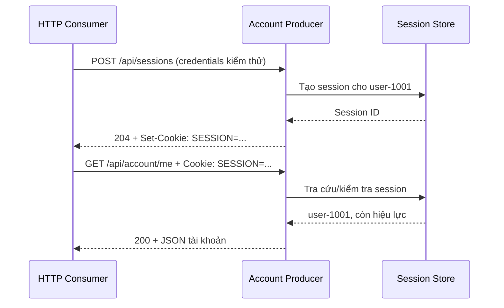
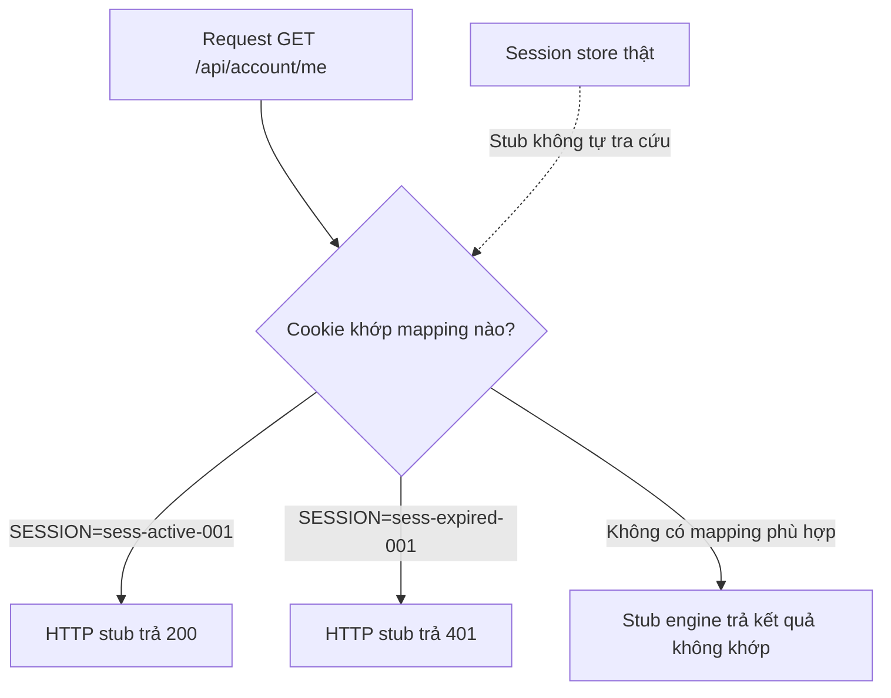

# Cookie và thông tin phiên trong hợp đồng

## 1. Cookie nằm ở đâu trong kiểm thử hợp đồng HTTP?

Trong **Spring Cloud Contract** (module `SPRING_CLOUD_CONTRACT`), producer công bố hành vi mà consumer có thể dựa vào thông qua hợp đồng viết bằng **Groovy DSL** hoặc **YAML DSL**. Với HTTP, hợp đồng mô tả request, response, các header và body cần thiết. Công cụ có thể sinh kiểm thử phía producer, tạo stub cho consumer dùng với **Stub Runner** và đưa cả hai bước vào CI để phát hiện thay đổi API không tương thích.

**Cookie** là một phần của tương tác HTTP: server có thể gửi `Set-Cookie` trong response, còn client gửi lại tên và giá trị cookie qua `Cookie` trong những request tiếp theo. Cookie có thể mang định danh phiên đăng nhập, tùy chọn giao diện, mã tương quan hoặc dữ liệu khác. Khi consumer phụ thuộc vào cookie để gọi một API, hợp đồng cần diễn đạt rõ **điều kiện request** và **kết quả quan sát được**.

Bài học này tập trung vào:

- Phân biệt **`Cookie` của request** với **`Set-Cookie` của response**.
- Dùng `cookies { cookie(...) }` trong **Groovy DSL** và trường `cookies` trong **YAML DSL** để mô tả cookie gửi lên.
- Viết hợp đồng cho phiên hợp lệ, phiên hết hiệu lực và response thiết lập phiên.
- Chuẩn bị fixture phía producer và kiểm thử phía consumer với Stub Runner.
- Nhận diện những hành vi bảo mật, vòng đời phiên và quy tắc trình duyệt **không được stub tự bảo đảm**.

Ví dụ xuyên suốt sử dụng một API tài khoản có cơ chế xác thực qua session cookie; các endpoint, tên cookie và dữ liệu người dùng trong bài **đều là giả định minh họa**.

## 2. Ba khái niệm cần phân biệt

### 2.1. Cookie, session ID và phiên phía server

Một cookie là cặp tên/giá trị mà client có thể lưu và gửi lại trong HTTP request. **Session ID** là một giá trị định danh phiên; nếu hệ thống dùng session phía server, ID thường ánh xạ đến dữ liệu phiên được lưu trong bộ nhớ, database hoặc session store.

Ví dụ: client giữ cookie `SESSION=sess-active-001`, còn server lưu phiên tương ứng với user `user-1001`. Khi client gọi `GET /api/account/me`, server xác minh cookie, tìm phiên và quyết định trả thông tin tài khoản hay lỗi xác thực.

Tên `SESSION` được dùng để minh họa. Các hệ thống Servlet truyền thống có thể dùng `JSESSIONID`; khi dùng Spring Session hoặc cấu hình tùy biến, tên cookie có thể khác. **Phải sử dụng tên thực tế đã thống nhất giữa producer và consumer**, không mặc định mọi ứng dụng Spring đều có cùng tên cookie.

### 2.2. Request `Cookie` khác response `Set-Cookie`

```http
GET /api/account/me HTTP/1.1
Host: api.example.test
Cookie: SESSION=sess-active-001; locale=vi
```

Đây là **request**: client chỉ gửi tên/giá trị cookie, không gửi lại các thuộc tính như `HttpOnly` hoặc `SameSite`.

```http
HTTP/1.1 204 No Content
Set-Cookie: SESSION=sess-active-001; Path=/; HttpOnly; Secure; SameSite=Lax
```

Đây là **response**: server yêu cầu client lưu hoặc cập nhật cookie, kèm các thuộc tính kiểm soát phạm vi và cách gửi cookie. Nếu response đặt nhiều cookie, thông thường sử dụng **nhiều header `Set-Cookie` riêng**, không gộp chúng thành một chuỗi phân tách bằng dấu phẩy.

| Phần HTTP | Bên gửi | Nội dung | Ví dụ |
| --- | --- | --- | --- |
| Request `Cookie` | Client → server | Tên và giá trị của một hoặc nhiều cookie | `SESSION=sess-active-001` |
| Response `Set-Cookie` | Server → client | Tên, giá trị và thuộc tính lưu/gửi | `SESSION=...; Path=/; HttpOnly; Secure` |
| Response status | Server → client | Kết quả request hiện tại | `200`, `204`, `401` |
| Session store | Server | Phiên còn hiệu lực, thuộc user nào, hết hạn khi nào | Không nằm trong header Cookie |

HTTP tự thân không lưu trạng thái giữa các request. Cơ chế cookie cộng với session store **tạo ra ngữ cảnh phiên ở tầng ứng dụng**, nhưng một giá trị cookie xuất hiện trong request không chứng minh phiên đó còn hợp lệ.

### 2.3. Sơ đồ luồng đăng nhập và sử dụng phiên



Sơ đồ thể hiện **luồng nghiệp vụ giả định**. Một hợp đồng Spring Cloud Contract đơn lẻ thông thường kiểm tra một ranh giới request/response; nó không tự kiểm chứng toàn bộ trình tự tạo phiên → lưu cookie → tra cứu phiên → hủy phiên.

## 3. Dùng `cookies` trong request Groovy DSL

Trong Groovy DSL, một hợp đồng HTTP vẫn bắt đầu với `Contract.make { ... }`. Bên trong `request`, dùng khối `cookies` để diễn đạt cookie mà client gửi:

```groovy
import org.springframework.cloud.contract.spec.Contract

Contract.make {
    name 'get_account_with_session'

    request {
        method GET()
        url '/api/account/me'
        cookies {
            cookie('SESSION', 'sess-active-001')
        }
    }

    response {
        status 200
        headers {
            contentType(applicationJson())
        }
        body([
            id   : 'user-1001',
            name : 'Nguyen An'
        ])
    }
}
```

Ở ví dụ này, `cookies { cookie('SESSION', 'sess-active-001') }` diễn đạt rằng một request thuộc nhánh thành công phải có cookie `SESSION` với giá trị đại diện `sess-active-001`. Khi tạo stub HTTP, request matcher cần phân biệt cookie đó; khi sinh producer test, yêu cầu tương ứng được gửi đến producer với cookie đã khai báo.

Giá trị `sess-active-001` chỉ là **fixture của bài**, không phải session hợp lệ trong mọi môi trường. Producer test phải tạo hoặc mô phỏng phiên tương ứng để request được xác thực thật sự.

### 3.1. Nhiều cookie trong cùng request

```groovy
request {
    method GET()
    url '/api/account/preferences'
    cookies {
        cookie('SESSION', 'sess-active-001')
        cookie('locale', 'vi')
    }
}
```

Khối `cookies` ở đây yêu cầu các giá trị tương ứng cho hai tên cookie. Những cookie khác không được mô tả **không mặc nhiên bị cấm**; việc có ràng buộc sự vắng mặt của cookie khác hay không phụ thuộc matcher được sinh và công cụ kiểm thử.

Không đặt `HttpOnly`, `Secure` hoặc `SameSite` vào khối request `cookies` như thể chúng là cookie riêng. Đây là **thuộc tính của response `Set-Cookie`**, được trình duyệt áp dụng khi lưu/gửi cookie.

### 3.2. Dùng YAML DSL cho cùng một hành vi

Có thể viết hợp đồng tương đương bằng YAML DSL:

```yaml
name: get_account_with_session
description: Lấy thông tin tài khoản khi có phiên hợp lệ
request:
  method: GET
  url: /api/account/me
  cookies:
    SESSION: sess-active-001
response:
  status: 200
  headers:
    Content-Type: application/json
  body:
    id: user-1001
    name: Nguyen An
```

Khi đưa vào dự án, nên chọn **một** biểu diễn (Groovy hoặc YAML) cho cùng trường hợp kiểm thử. Nếu cả hai được plugin quét, có thể sinh những test/stub trùng nhau.

## 4. Chọn ví dụ cho các trạng thái phiên khác nhau

Giả sử API của bài học công bố quy tắc:

- Phiên còn hiệu lực: `GET /api/account/me` trả `200` với thông tin người dùng.
- Cookie mang ID phiên đã hết hạn: trả `401` và `code = SESSION_EXPIRED`.
- Không có thông tin xác thực: trả `401` và `code = AUTHENTICATION_REQUIRED`.
- Có phiên hợp lệ nhưng user không được phép truy cập tài nguyên quản trị: có thể trả `403` (nếu API đã quy định).

Ma trận hành vi:

| Trường hợp | Input/tiền điều kiện | Response dự kiến | Consumer xử lý |
| --- | --- | --- | --- |
| Phiên hợp lệ | `SESSION=sess-active-001`, session store có user | `200` và tài khoản | Hiển thị dữ liệu |
| Phiên hết hạn | `SESSION=sess-expired-001`, phiên đã hết hiệu lực | `401 SESSION_EXPIRED` | Chuyển sang luồng đăng nhập/làm mới phiên |
| Thiếu cookie xác thực | Không gửi `SESSION` | `401 AUTHENTICATION_REQUIRED` | Yêu cầu đăng nhập |
| Đủ phiên, thiếu quyền | Session hợp lệ nhưng thiếu vai trò | `403 FORBIDDEN` | Báo không đủ quyền |

**Quan trọng:** `401` và `403` là mã HTTP khác nhau; không được suy ra mọi hệ thống sẽ dùng chính xác những mã lỗi JSON trên. Chỉ tạo hợp đồng cho những hành vi mà producer và consumer đã thống nhất.

### 4.1. Hợp đồng cho phiên hết hạn

File `get_account_expired_session.groovy`:

```groovy
import org.springframework.cloud.contract.spec.Contract

Contract.make {
    name 'get_account_expired_session'
    description 'Từ chối cookie phiên đã hết hạn'

    request {
        method GET()
        url '/api/account/me'
        cookies {
            cookie('SESSION', 'sess-expired-001')
        }
    }

    response {
        status 401
        headers {
            contentType(applicationJson())
        }
        body([
            code: 'SESSION_EXPIRED'
        ])
    }
}
```

Hợp đồng phiên hợp lệ và phiên hết hạn **cùng dùng method/URL** nhưng có **giá trị cookie khác nhau** để stub xác định nhánh. Khi producer test chạy, fixture phải bảo đảm `sess-expired-001` thực sự là một ID không còn hiệu lực; chỉ đặt tên chuỗi là “expired” không khiến server tự coi phiên đã hết hạn.

### 4.2. Thiếu cookie không giống cookie sai

Một sai sót dễ gặp là viết:

```groovy
request {
    method GET()
    url '/api/account/me'
    // Không có khai báo cookies
}
```

Sau đó kết luận stub **chỉ** khớp khi request không có cookie. Kết luận này **không an toàn**: nếu hợp đồng không yêu cầu cookie cụ thể, mapping được sinh có thể chấp nhận cả request **có** cookie; do đó có nguy cơ chồng lấp với mapping phiên hợp lệ.

Muốn bảo vệ nhánh **không có cookie**, cần có cách so khớp điều kiện *vắng mặt* rõ ràng và tương thích với phiên bản DSL/stub engine đang dùng, hoặc bổ sung kiểm thử trực tiếp lên producer. Đừng tự giả định rằng **bỏ dòng `cookies`** đồng nghĩa “Cookie header không được phép xuất hiện”.

Ví dụ kiểm thử producer ở mức HTTP phù hợp khi API cam kết trả `401` lúc thiếu cookie:

```java
// Đoạn minh họa trong một bài test MockMvc đã cấu hình Spring Security.
mockMvc.perform(get("/api/account/me"))
       .andExpect(status().isUnauthorized());
```

Muốn chạy đoạn trên cần import `get`, `status`, cấu hình `mockMvc` và security filter chain tương ứng. Một ứng dụng dùng form login có thể trả redirect `302` thay cho `401`; vì vậy phải thống nhất hợp đồng HTTP thực tế trước khi chốt assertion.

## 5. Response thiết lập cookie phiên bằng `Set-Cookie`

Giả sử `POST /api/sessions` với tài khoản kiểm thử hợp lệ trả `204 No Content` và yêu cầu client lưu một cookie phiên. Trong hợp đồng, `Set-Cookie` được mô tả như **header của response**.

### 5.1. Groovy DSL: hợp đồng đăng nhập

File `login_sets_session_cookie.groovy`:

```groovy
import org.springframework.cloud.contract.spec.Contract

Contract.make {
    name 'login_sets_session_cookie'
    description 'Đăng nhập hợp lệ và phát cookie phiên'

    request {
        method POST()
        url '/api/sessions'
        headers {
            contentType(applicationJson())
        }
        body([
            username: 'demo-user',
            password: 'fixture-password'
        ])
    }

    response {
        status 204
        headers {
            header 'Set-Cookie': 'SESSION=sess-active-001; Path=/; HttpOnly; Secure; SameSite=Lax'
        }
    }
}
```

Trong ví dụ:

- `status 204` nghĩa là endpoint này **không trả body**, theo thiết kế minh họa.
- `Set-Cookie` là header server gửi để client tạo/cập nhật cookie.
- `SESSION=sess-active-001` là ID phiên **do fixture kiểm thử kiểm soát**, không được dùng làm session ID cố định trong hệ thống triển khai thật.
- `fixture-password` chỉ là mật khẩu giả phục vụ mô tả. Không ghi mật khẩu hoặc session ID có thật vào contract repository hay stub artifact.

### 5.2. YAML DSL tương đương

```yaml
name: login_sets_session_cookie
request:
  method: POST
  url: /api/sessions
  headers:
    Content-Type: application/json
  body:
    username: demo-user
    password: fixture-password
response:
  status: 204
  headers:
    Set-Cookie: "SESSION=sess-active-001; Path=/; HttpOnly; Secure; SameSite=Lax"
```

Các ví dụ trên mô tả **giá trị chính xác** của header. Nếu producer sinh session ID ngẫu nhiên hoặc đổi thứ tự các thuộc tính `Set-Cookie`, so khớp chuỗi nguyên văn có thể quá cứng. Cần chọn matcher phù hợp với **dạng giá trị động và chính sách cookie thực sự được cam kết**, rồi kiểm tra generated producer test. Không nên dùng regex `.*` cho toàn bộ header: matcher quá rộng có thể bỏ lọt việc thiếu `HttpOnly` hoặc `Secure` mà consumer/bảo mật mong đợi.

### 5.3. Các thuộc tính của `Set-Cookie`

| Thuộc tính | Ý nghĩa cơ bản | Tình huống cần quan tâm |
| --- | --- | --- |
| `Path=/` | Chỉ rõ phạm vi URL path được áp dụng | Client gọi endpoint khác path có gửi cookie không? |
| `Domain` | Xác định phạm vi hostname theo quy tắc cookie | Có dùng giữa các subdomain hợp lệ hay không? |
| `HttpOnly` | Ngăn JavaScript trên trang truy cập cookie qua `document.cookie` | Giảm rủi ro lộ ID phiên qua JavaScript |
| `Secure` | Chỉ gửi cookie qua kết nối an toàn theo quy tắc client | Browser chạy HTTPS trong môi trường thật |
| `SameSite=Lax` | Hạn chế việc gửi cookie trong ngữ cảnh cross-site theo quy tắc trình duyệt | Đăng nhập, điều hướng, CSRF |
| `SameSite=None` | Cho phép ngữ cảnh cross-site rộng hơn khi đáp ứng yêu cầu của trình duyệt | Thường cần `Secure` |
| `Max-Age` | Thời gian sống tính theo giây từ khi nhận cookie | Gia hạn, hủy cookie, timeout |
| `Expires` | Mốc thời gian hết hạn của cookie | Cookie lâu dài, hết hạn theo thời điểm |

Không phải mọi thuộc tính trên đều bắt buộc phải xuất hiện trong tất cả hợp đồng. Chỉ nên khẳng định các thuộc tính **thuộc giao diện/chính sách đã thống nhất**. `SameSite` và `Secure` được thực thi bởi trình duyệt, còn một stub HTTP thông thường chỉ trả chuỗi header, không thể tự chứng minh toàn bộ hành vi trình duyệt.

Ngoài ra, **hết hạn cookie ở phía client** và **hết hạn session trong session store** là hai vấn đề khác nhau. Cookie còn trên trình duyệt nhưng session đã bị server vô hiệu hóa vẫn phải được xử lý theo quy tắc xác thực đã công bố.

## 6. Dữ liệu động và tính ổn định của hợp đồng

ID phiên thật phải khó dự đoán và thường được cấp động. Nếu hợp đồng bắt buộc mọi lần đăng nhập đều trả:

```http
Set-Cookie: SESSION=sess-active-001; Path=/; HttpOnly; Secure; SameSite=Lax
```

thì một producer tạo session ID an toàn và ngẫu nhiên sẽ thất bại dù đang hoạt động đúng. Có ba cách xử lý phù hợp theo mức độ cần kiểm tra:

1. **Fixture có thể kiểm soát:** dùng một lớp test base, session store kiểm thử hoặc cơ chế mô phỏng giúp producer trả giá trị dự kiến. Chỉ dùng ID cố định trong môi trường test.
2. **Matcher có giới hạn:** phía consumer nhận chuỗi ví dụ ổn định; phía producer test kiểm tra tên cookie, định dạng ID và những thuộc tính quan trọng mà API cam kết. Cần đối chiếu cú pháp matcher của phiên bản Spring Cloud Contract đang dùng.
3. **Tách kiểm chứng:** hợp đồng bảo vệ status/cấu trúc header cần thiết; integration/security tests kiểm tra chi tiết cấp phát, luân chuyển, hết hạn và vô hiệu hóa session.

Khi chọn matcher, hãy hỏi:

- Định dạng nào là **cam kết công khai**? Consumer chỉ cần cookie có giá trị không rỗng, hay cần một định dạng cụ thể?
- Cookie ID có thực sự ổn định giữa producer test và consumer stub không?
- Header `Set-Cookie` có thể xuất hiện nhiều lần hoặc có thứ tự thuộc tính khác nhau không?
- Có thuộc tính quan trọng như `HttpOnly` và `Secure` cần được kiểm tra riêng không?
- Mapping stub `200` và `401` có thể cùng khớp một request do điều kiện cookie quá rộng không?

Một matcher quá tổng quát làm mất khả năng phát hiện breaking change; một so khớp quá chính xác với dữ liệu ngẫu nhiên lại gây false failure. Mục tiêu của hợp đồng là **bảo vệ hành vi consumer phụ thuộc**.

## 7. Phiên có trạng thái, nhưng stub HTTP thường không giữ trạng thái nghiệp vụ

Giả sử consumer chạy trình tự:

1. `POST /api/sessions` để đăng nhập và nhận `Set-Cookie`.
2. `GET /api/account/me` gửi `Cookie` để lấy tài khoản.
3. `DELETE /api/sessions/current` để đăng xuất.
4. Gửi lại cookie cũ và mong `401`.

Một bộ mapping stub tạo từ các hợp đồng riêng **không tự tạo session store** và không mặc nhiên thay đổi trạng thái giữa các lời gọi. Stub cho `GET` thường khớp **giá trị cookie hiện tại**, cho dù giá trị đó được lấy từ endpoint đăng nhập hay do bài test tự đặt.



Đây là minh họa về **khớp request của stub**. Kết quả khi không có mapping phụ thuộc Stub Runner/WireMock và cấu hình đang sử dụng; thường là một phản hồi không khớp, không phải bằng chứng của một nhánh xác thực đã kiểm chứng.

Nếu cần bảo đảm luồng đăng nhập → lấy dữ liệu → đăng xuất → từ chối cookie cũ, hãy bổ sung **integration test** với producer/session store thực hoặc một mô hình stateful stub được cấu hình rõ ràng. Không suy luận rằng các contract đơn lẻ đã tự kiểm tra vòng đời session.

## 8. Chuẩn bị producer tests để cookie thật sự có ý nghĩa

### 8.1. Vì sao chỉ đưa cookie vào request chưa đủ?

Khi generated test thực thi:

```text
GET /api/account/me
Cookie: SESSION=sess-active-001
```

producer phải có cách giải quyết ID này thành một phiên hợp lệ. Nếu test base không có session store hoặc security context phù hợp, ứng dụng có thể trả `401`, redirect `302` hoặc sinh một phiên khác, trong khi hợp đồng đang yêu cầu `200`.

**Trách nhiệm của test base/fixture:**

- Khởi tạo user `user-1001` và trạng thái xác thực cần thiết.
- Bảo đảm `sess-active-001` được liên kết với user hoặc mô phỏng được thông tin xác thực tương đương theo thiết kế dự án.
- Tạo một ID hết hạn hoặc vô hiệu hóa tương ứng cho `sess-expired-001`.
- Cô lập dữ liệu giữa các bài test để thứ tự chạy không làm đổi kết quả.
- Cấu hình Spring Security/filter chain và session store đúng với ranh giới muốn kiểm tra.

Trong ứng dụng dùng **Spring Security**, chỉ chèn một header `Cookie` không tự tạo `SecurityContext` có quyền truy cập. Ngược lại, nếu test tắt toàn bộ filter bảo mật, contract `200` có thể đạt mà không kiểm tra đúng yêu cầu có phiên hợp lệ.

### 8.2. Chọn mức kiểm thử phù hợp

| Mức kiểm thử | Kiểm tra được | Giới hạn |
| --- | --- | --- |
| Generated producer test | Producer trả status/body/header theo hợp đồng với fixture phù hợp | Không tự xác minh mọi quy tắc session/security |
| Integration test với auth/session | Cookie ánh xạ đúng phiên, hết hạn, thu hồi, logout | Cần thiết lập môi trường và session store |
| Browser/E2E test | Trình duyệt lưu/gửi cookie theo `Secure`, `SameSite`, `Path` và luồng điều hướng | Tốn tài nguyên hơn, cần HTTPS/origin phù hợp |
| Consumer test với Stub Runner | Consumer gửi cookie và xử lý `200`/`401` theo stub | Stub không tự chứng minh session thật tồn tại |

Vì cookie thường liên quan xác thực, cần phối hợp cả hợp đồng **và** những kiểm thử bảo mật/hành vi phiên thích hợp. Đây là hai lớp kiểm chứng bổ sung cho nhau.

## 9. Consumer dùng Stub Runner để kiểm tra cookie

Sau khi producer verification đạt, nhóm có thể đóng gói stub JAR theo phiên bản, ví dụ `com.example:account-producer:1.4.2:stubs`. Consumer dùng Stub Runner tải đúng phiên bản và khởi tạo HTTP stub.

Giả sử stub lắng nghe cổng `8090` và đã nạp hai hợp đồng ở mục 3, 4. Khi kiểm thử consumer:

```http
GET /api/account/me HTTP/1.1
Host: localhost:8090
Cookie: SESSION=sess-active-001
```

stub trả `200` và JSON cho phiên hợp lệ. Với:

```http
GET /api/account/me HTTP/1.1
Host: localhost:8090
Cookie: SESSION=sess-expired-001
```

stub trả `401` và `SESSION_EXPIRED` khi mapping tương ứng được nạp và khớp.

Điều consumer test thực sự cần khẳng định không chỉ là “stub có trả JSON”, mà còn là:

- Client có gửi đúng cookie đến endpoint hay không?
- Khi nhận `200`, consumer có đọc thông tin tài khoản không?
- Khi nhận `401 SESSION_EXPIRED`, consumer có điều hướng hoặc yêu cầu đăng nhập theo thiết kế không?
- Khi dùng cookie từ response đăng nhập, client có lưu/tiếp tục gửi đúng cookie không, nếu đó là chức năng của client?

### 9.1. Lưu ý về HTTP client và trình duyệt

Một HTTP client Java có thể cần cấu hình **cookie jar/cookie store** để tự lưu `Set-Cookie` và gửi `Cookie` vào request kế tiếp. Việc gọi hai endpoint liên tiếp **không tự bảo đảm** cookie được truyền nếu client không có cơ chế duy trì cookie.

Nếu stub chạy qua `http://localhost:8090` nhưng response khai báo `Secure`, **trình duyệt thật** có thể không gửi cookie theo cùng cách một HTTP client trong test tự đặt header. Hành vi với `localhost` còn phụ thuộc trình duyệt và môi trường. Vì vậy, kiểm thử chính sách cookie của trình duyệt nên chạy với origin và HTTPS phù hợp; khi dùng Stub Runner qua HTTP, test có thể gửi cookie bằng tay để xác minh logic consumer nhưng kết quả đó **không chứng minh** trình duyệt đã lưu/gửi cookie đúng chính sách.

### 9.2. Ví dụ kiểm tra thủ công request đến stub

Có thể mô phỏng hai request bằng `curl`:

```bash
curl -i \
  -H 'Cookie: SESSION=sess-active-001' \
  http://localhost:8090/api/account/me
```

```bash
curl -i \
  -H 'Cookie: SESSION=sess-expired-001' \
  http://localhost:8090/api/account/me
```

Đây là cách **gửi Cookie header tường minh**, hữu ích để quan sát request matcher. Nó không thay thế consumer integration test và không kiểm thử tự động lưu cookie theo quy tắc của trình duyệt.

## 10. Cookie và các lưu ý bảo mật khi viết hợp đồng

Spring Cloud Contract kiểm tra những thuộc tính giao tiếp được khai báo; nó **không phải một bộ kiểm thử bảo mật tổng quát**. Khi hợp đồng liên quan cookie phiên, nên cân nhắc:

1. **Không commit ID phiên thật.** Các giá trị `sess-active-001`, `sess-expired-001` và `fixture-password` phải là dữ liệu giả, không dùng được trên hệ thống thật.
2. **Không tắt kiểm tra xác thực chỉ để generated test đạt.** Nếu hợp đồng bảo vệ hành vi xác thực, test cần đúng filter/session fixture.
3. **Kiểm chứng `HttpOnly`, `Secure`, `SameSite` theo chính sách.** Giá trị và cách tạo header có thể thay đổi theo cấu hình framework; tránh so khớp toàn bộ chuỗi cứng khi không có cam kết về thứ tự thuộc tính.
4. **Phân biệt `401` và `403`.** Không xác thực hoặc phiên không hợp lệ khác với đã xác thực nhưng thiếu quyền.
5. **Chú ý CSRF.** API sử dụng cookie phiên cho các thao tác làm thay đổi dữ liệu có thể cần CSRF token theo cơ chế bảo vệ được cấu hình. Hợp đồng cho `POST`/`PUT`/`DELETE` phải mô tả request thực tế, bao gồm header/token liên quan khi đó là phần giao diện.
6. **Phân biệt session cookie và token trong `Authorization`.** Bearer token ở header `Authorization` là một kiểu truyền thông tin xác thực khác; không cố ép nó thành cookie DSL.
7. **Xử lý logout và thu hồi phiên.** Response hủy cookie có thể dùng `Set-Cookie` với `Max-Age=0`, nhưng server còn phải vô hiệu hóa phiên. Chỉ nhìn thấy header hủy cookie chưa chứng minh session đã bị thu hồi.
8. **Không đưa dữ liệu người dùng nhạy cảm vào stub.** Hợp đồng và artifact có thể được nhiều người hoặc CI tải về; hãy sử dụng fixture vô hại.

### 10.1. Ví dụ response xóa cookie

Giả sử `DELETE /api/sessions/current` là endpoint đăng xuất theo thiết kế API:

```http
HTTP/1.1 204 No Content
Set-Cookie: SESSION=; Path=/; Max-Age=0; HttpOnly; Secure; SameSite=Lax
```

Giá trị `Max-Age=0` yêu cầu client xóa cookie cùng phạm vi thích hợp. Nếu cookie ban đầu có `Path` hoặc `Domain` riêng, lúc xóa phải xét phạm vi tương ứng; đồng thời cần kiểm tra phiên phía server đã bị hủy. Hợp đồng có thể bảo vệ header trả về, còn hành vi hủy phiên cần integration/security test.

## 11. Chẩn đoán lỗi cookie trong producer test và stub

| Hiện tượng | Nguyên nhân có thể | Cách kiểm tra |
| --- | --- | --- |
| Producer test kỳ vọng `200` nhưng nhận `401` | Fixture không tạo session; cookie name sai; filter/security context không đúng | Đọc request thực tế và cấu hình session store/test base |
| Producer test trả `302` thay vì `401` | Security đang redirect tới login page | Thống nhất API JSON hay form login, xác nhận security entry point |
| Stub trả response không như nhánh dự kiến | Mapping thành công/hết hạn chồng lấp hoặc thiếu điều kiện cookie | Kiểm tra mapping, Cookie header và request matcher |
| Consumer không gửi cookie sau đăng nhập | HTTP client không lưu cookie; `Path`, `Domain` hoặc `Secure` không phù hợp | Kiểm tra cookie jar, origin/HTTPS và client settings |
| Test pass với header Cookie thủ công nhưng browser vẫn không đăng nhập | Stub không kiểm chứng hành vi browser; `SameSite`/`Secure`/CORS/credentials có thể khác | Bổ sung browser/E2E test với origin thật |
| Header `Set-Cookie` thay đổi thứ tự thuộc tính làm test fail | Hợp đồng đang so khớp toàn chuỗi quá chặt | Dùng matcher có chủ đích hoặc fixture có header xác định |
| Phiên “hết hạn” vẫn nhận `200` | ID fixture thật ra còn hiệu lực hoặc test tắt security | Kiểm tra dữ liệu phiên và cấu hình xác thực |
| Thiếu cookie nhưng stub trả `200` | Mapping không ràng buộc sự vắng mặt của cookie | Thêm so khớp vắng mặt đúng cách hoặc test trực tiếp producer |
| Đăng xuất rồi cookie cũ vẫn dùng được | Server chưa vô hiệu hóa phiên, chỉ xóa cookie phía client | Integration test trực tiếp với session store |

Khi xử lý lỗi, kiểm tra theo thứ tự:

1. **Request gửi đi:** tên và giá trị `Cookie` thực tế có đúng không?
2. **Mapping/hợp đồng:** có yêu cầu cookie chính xác và phân biệt nhánh không?
3. **Producer state:** ID phiên có tồn tại, còn hiệu lực và thuộc đúng user không?
4. **Response:** status, `Set-Cookie`, JSON error code có đúng cam kết không?
5. **Client policy:** client có lưu/gửi lại cookie theo Path, Domain, Secure, SameSite không?

Không nên sửa `status` trong hợp đồng cho khớp với kết quả sai chỉ để CI xanh. Cần xác định lỗi thuộc dữ liệu kiểm thử, cấu hình xác thực, mã nguồn producer hay thỏa thuận API.

## 12. Tích hợp bài kiểm tra cookie vào CI

Một quy trình phù hợp với Spring Cloud Contract:

```text
Hợp đồng Groovy/YAML
    -> Review các nhánh cookie/phiên và thuộc tính Set-Cookie
    -> Sinh producer test
    -> Thiết lập fixture session hợp lệ/hết hạn
    -> Chạy producer tests
    -> Đóng gói/phát hành stub theo phiên bản
    -> Consumer tests sử dụng Stub Runner
    -> Integration/browser tests cho vòng đời phiên và cookie policy
```

Trong CI producer, cần xác minh rằng thay đổi cấu hình security hoặc tên cookie làm **test liên quan thất bại** thay vì bị bỏ qua. Trong CI consumer, nên chọn phiên bản stub cố định để kết quả có thể tái lập và kiểm thử cả nhánh `200` và `401`.

Hợp đồng có thể phát hiện việc producer đổi `SESSION` thành một tên khác hoặc bỏ `Set-Cookie` khi các thuộc tính đó được mô tả. Nó **không tự phát hiện** lỗi session store, timeout, CSRF, CORS, trình duyệt từ chối cookie hoặc replay attack nếu các hành vi đó không được kiểm tra bằng công cụ và môi trường bổ sung.

## 13. Bài thực hành: xây dựng hợp đồng phiên cho giỏ hàng

Giả sử API `GET /api/cart` của một trang thương mại điện tử có các quy tắc:

- Cookie `SESSION=cart-user-001` liên kết với giỏ của user `user-001`.
- Nếu phiên hợp lệ, response `200` có `ownerId` và `items`.
- Nếu phiên bị thu hồi, response `401` có `code = SESSION_REVOKED`.
- Endpoint `POST /api/sessions` trả `204` và `Set-Cookie` có `HttpOnly; Secure; SameSite=Lax` khi đăng nhập hợp lệ.

**Yêu cầu thực hành:**

1. Viết hợp đồng Groovy `get_cart_authenticated.groovy` dùng `cookies` trong request và `200` trong response.
2. Viết hợp đồng thứ hai `get_cart_revoked.groovy` với cookie `SESSION=cart-revoked-001` và response `401 SESSION_REVOKED`. Đảm bảo hai request matcher khác nhau.
3. Viết hợp đồng đăng nhập có `Set-Cookie` trong **response headers**. Giải thích vì sao không đặt `HttpOnly`/`Secure` vào `request.cookies`.
4. Mô tả fixture producer test cần có để hai cookie được phân loại đúng.
5. Chạy consumer test với Stub Runner, kiểm tra consumer hiển thị giỏ khi `200` và yêu cầu đăng nhập khi `401`.
6. Đề xuất một integration test chứng minh rằng phiên đã thu hồi không được sử dụng lại, ngay cả khi client còn giữ giá trị cookie cũ.

### Lời giải tham khảo cho nhánh bị thu hồi

```groovy
import org.springframework.cloud.contract.spec.Contract

Contract.make {
    name 'get_cart_revoked'

    request {
        method GET()
        url '/api/cart'
        cookies {
            cookie('SESSION', 'cart-revoked-001')
        }
    }

    response {
        status 401
        headers {
            contentType(applicationJson())
        }
        body([code: 'SESSION_REVOKED'])
    }
}
```

Hợp đồng này bảo vệ phản hồi của API đối với một **giá trị cookie đại diện**. Để chứng minh việc thu hồi phiên hoạt động thật, cần thiết lập phiên, thu hồi trong session store rồi gửi request với chính cookie đó trong integration test.

### Checklist trước khi hoàn thành bài

- [ ] Biết request `Cookie` khác response `Set-Cookie` như thế nào.
- [ ] Khai báo cookie request bằng `cookies`/`cookie` đúng tên và giá trị.
- [ ] Đặt `Set-Cookie` trong response header khi API thiết lập hoặc hủy phiên.
- [ ] Các nhánh phiên hợp lệ/hết hạn/thiếu quyền có status và error code đúng hợp đồng.
- [ ] Có fixture producer test cho ID phiên hợp lệ, hết hạn hoặc bị thu hồi.
- [ ] Không nhầm việc bỏ khối `cookies` với kiểm tra cookie **vắng mặt**.
- [ ] Không dùng session ID thật hoặc credential thật trong hợp đồng.
- [ ] Không trông đợi Stub Runner tự duy trì session store hoặc chính sách cookie của trình duyệt.
- [ ] Chạy producer verification, consumer tests và các integration/security tests cần thiết trước khi phát hành.

**Ghi nhớ:** cookie là một phần của giao diện HTTP cần mô tả chính xác khi consumer phụ thuộc vào nó. Spring Cloud Contract giúp kiểm tra **request mang cookie nào** và **response trả status/header/body gì**; tính hợp lệ của session, vòng đời đăng nhập/đăng xuất và chính sách cookie thực tế còn cần fixture cùng những kiểm thử tích hợp phù hợp.
