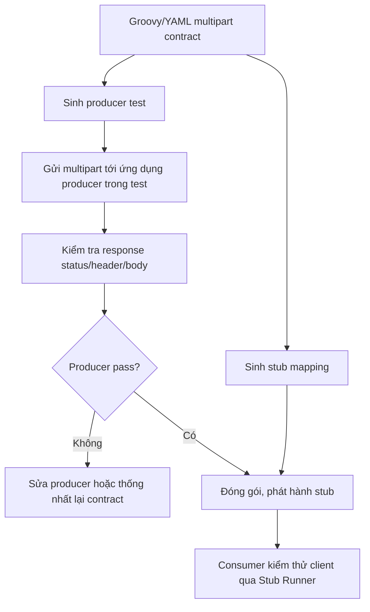

# Multipart, trường biểu mẫu và nội dung tệp trong hợp đồng HTTP

## 1. Bài toán: gửi biểu mẫu cùng tệp qua một HTTP request

Trong hệ thống nhiều dịch vụ, consumer không chỉ gửi JSON. Một dịch vụ quản lý đơn hàng có thể cần gửi **mã đơn**, **loại tài liệu** và **tệp biên lai** tới dịch vụ lưu trữ; một dịch vụ hồ sơ có thể gửi ảnh kèm các thông tin mô tả. Những tương tác này thường dùng `multipart/form-data`.

Nếu producer thay tên trường `orderId` thành `orderCode`, đổi part `document` thành `file` hoặc ngừng chấp nhận tệp có nội dung nhất định, consumer có thể lỗi ngay cả khi endpoint vẫn tồn tại. **Spring Cloud Contract** giúp ghi các kỳ vọng HTTP này bằng **Groovy/YAML DSL**, sinh kiểm thử phía producer, phát hành stub và cho consumer thử lời gọi qua **Stub Runner** trong CI.

Bài học thuộc phần **Request HTTP**, tập trung vào ba thành phần của một yêu cầu multipart:

1. **Form field (trường biểu mẫu):** giá trị đơn như `orderId`, `documentType`, `note`.
2. **File part (phần tệp):** có tên part, thường có tên tệp, kiểu nội dung và nội dung dạng text hoặc byte.
3. **HTTP metadata:** `Content-Type` của toàn request và từng part, cùng `boundary` phân tách các part.

Sau bài này, người học có thể đọc cấu trúc multipart trên đường truyền, viết hợp đồng YAML/Groovy cho trường biểu mẫu và tệp, chọn matcher đúng, kiểm tra dữ liệu nhị phân và xây dựng quy trình xác minh producer–consumer.

## 2. Phân biệt JSON, form URL encoded và multipart

| Loại request | `Content-Type` thường gặp | Cách biểu diễn | Trường hợp sử dụng |
| --- | --- | --- | --- |
| JSON | `application/json` | Một JSON object/array trong body | Tạo tài nguyên, cập nhật dữ liệu có cấu trúc |
| Form URL encoded | `application/x-www-form-urlencoded` | Các cặp `key=value` được mã hóa trong một body | Biểu mẫu chỉ có trường text, không cần part tệp |
| Multipart | `multipart/form-data; boundary=...` | Nhiều part, mỗi part có header và body riêng | Upload tệp cùng text/metadata, nhiều tệp hoặc nhiều part |

**Multipart không phải một JSON object có trường `file`.** Trong multipart, một phần request chứa `orderId`, phần khác chứa nội dung tệp. Mỗi part có thể có `Content-Disposition` và `Content-Type` riêng.

Ví dụ yêu cầu minh họa:

```http
POST /api/attachments HTTP/1.1
Host: documents.example.test
Content-Type: multipart/form-data; boundary=Boundary42

--Boundary42
Content-Disposition: form-data; name="orderId"

O-42
--Boundary42
Content-Disposition: form-data; name="note"

Bien lai thanh toan
--Boundary42
Content-Disposition: form-data; name="document"; filename="receipt.txt"
Content-Type: text/plain

Payment received for order O-42
--Boundary42--
```

Đây là cách trình bày **dễ đọc** của payload; trên đường truyền thật, các dòng phân cách dùng CRLF (`\r\n`) và phần tệp có thể là các byte không biểu diễn được bằng chữ. `Boundary42` chỉ là tên ví dụ, không phải giá trị mà mọi HTTP client phải sử dụng.

### Ba tên dễ nhầm

| Thành phần | Trong ví dụ | Ý nghĩa |
| --- | --- | --- |
| Tên form field | `orderId`, `note` | Key để controller lấy giá trị text |
| Tên **part** của tệp | `document` | Key mà controller dùng để tìm tệp upload |
| Tên **tệp** | `receipt.txt` | Tên do client khai báo trong `filename` |

Một controller tìm `@RequestPart("document")` sẽ không nhận được part chỉ vì tên tệp là `document.pdf` nếu **tên part** lại là `attachment`. Hợp đồng phải mô tả đúng tên part mà API công bố.

## 3. `boundary` và `Content-Type` ảnh hưởng gì tới hợp đồng?

Trong multipart, `boundary` nằm trong header tổng:

```http
Content-Type: multipart/form-data; boundary=Boundary42
```

Mỗi part được phân cách bằng `--Boundary42`; kết thúc toàn bộ body bằng `--Boundary42--`. `boundary` trong header phải khớp chuỗi phân cách ở body, nếu không parser không thể tách các trường và tệp.

**HTTP client thực tế thường tự sinh boundary.** Vì thế, không nên buộc consumer sản xuất dùng cố định `Boundary42`. Tài liệu Spring Cloud Contract có ví dụ hợp đồng đặt `multipart/form-data;boundary=AaB03x` để sinh request kiểm thử minh họa; khi áp dụng cho client thật, hãy xác nhận stub matcher và cấu hình test có chấp nhận boundary do client sinh hay không. Nếu cần, dùng điều kiện header phù hợp thay vì khóa vào một chuỗi thay đổi theo mỗi request.

Từng part có thể có `Content-Type` riêng. Ví dụ part `document` là `text/plain`, trong khi part `metadata` có thể là `application/json`. `Content-Type` của **toàn request** vẫn là `multipart/form-data`.

Không nên tự đặt `Content-Type: multipart/form-data` thủ công trong HTTP client nếu thư viện cần tự thêm `boundary`; hãy để client multipart thiết lập cả header và body một cách nhất quán.

## 4. Hợp đồng multipart bằng YAML DSL

Giả sử dịch vụ `Document Service` cung cấp API:

- `POST /api/attachments`.
- Yêu cầu có trường text `orderId` và `note`.
- Yêu cầu có một file part tên **`document`**, tên tệp `receipt.txt`, nội dung text.
- Trả `201 Created` cùng mã tài liệu `attachmentId` và trạng thái `STORED`.

Một hợp đồng YAML minh họa:

```yaml
description: Luu bien lai dang text cho mot don hang
request:
  method: POST
  url: /api/attachments
  headers:
    Content-Type: multipart/form-data;boundary=AaB03x
  multipart:
    params:
      orderId: "O-42"
      note: "Bien lai thanh toan"
    named:
      - paramName: document
        fileName: receipt.txt
        fileContent: "Payment received for order O-42"
        contentType: text/plain
response:
  status: 201
  headers:
    Content-Type: application/json
  body:
    attachmentId: "A-101"
    status: "STORED"
```

Các tên khóa quan trọng:

| Vị trí YAML | Ý nghĩa |
| --- | --- |
| `request.method`, `request.url` | Phương thức và endpoint mà consumer phải gọi |
| `request.headers.Content-Type` | Media type của toàn request; ở đây kèm boundary minh họa |
| `request.multipart.params` | Mapping **tên form field → giá trị** |
| `request.multipart.named` | Danh sách part có tên và nội dung tệp |
| `paramName` | **Tên part** của tệp: `document` |
| `fileName` | Tên tệp báo cho producer: `receipt.txt` |
| `fileContent` | Nội dung tệp dạng text dùng trong tình huống kiểm thử |
| `contentType` | Kiểu nội dung của part `document`, không phải của toàn request |
| `response` | HTTP status, header và body producer phải trả |

Khác với JSON request thông thường, dữ liệu multipart được đặt trong `request.multipart`. Đừng viết `request.body.document: ...` rồi mong công cụ tự tạo file part. Với YAML DSL, **form fields** thuộc `multipart.params`, còn **file parts** thuộc `multipart.named`.

Giá trị ví dụ dùng số đơn hàng, tệp văn bản và boundary cố định để kiểm thử dễ tái lập. Với các tương tác thật, nhóm cần điều chỉnh dữ liệu và matcher theo yêu cầu API. Trước khi dùng một tính năng ít phổ biến, hãy đối chiếu tài liệu Spring Cloud Contract đúng phiên bản mà dự án đã khai báo.

## 5. Viết hợp đồng tương ứng bằng Groovy DSL

Groovy DSL sử dụng `multipart(...)` ở bên trong `request`. Trường text được khai báo bằng key/value; file part dùng `named(...)`:

```groovy
import org.springframework.cloud.contract.spec.Contract

Contract.make {
    description 'Luu bien lai dang text cho mot don hang'

    request {
        method POST()
        url '/api/attachments'
        headers {
            contentType('multipart/form-data;boundary=AaB03x')
        }
        multipart(
            orderId: $(c(regex('O-[0-9]+')), p('O-42')),
            note: $(c(regex(nonEmpty())), p('Bien lai thanh toan')),
            document: named(
                name: $(c(regex(nonEmpty())), p('receipt.txt')),
                content: $(c(regex(nonEmpty())), p('Payment received for order O-42')),
                contentType: $(c(regex(nonEmpty())), p('text/plain'))
            )
        )
    }

    response {
        status CREATED()
        headers {
            contentType(applicationJson())
        }
        body(
            attachmentId: 'A-101',
            status: 'STORED'
        )
    }
}
```

Trong đoạn trên:

- `orderId` và `note` là form field.
- `document: named(...)` khai báo file part tên `document`. Các trường `name`, `content`, `contentType` lần lượt mô tả tên tệp, nội dung và kiểu của part.
- `$(c(...), p(...))` phân biệt **giá trị chấp nhận ở phía consumer/stub** (`c`) với **giá trị producer test sử dụng** (`p`). Nhờ đó stub có thể chấp nhận các đơn hàng phù hợp regex, trong khi test sinh ra có dữ liệu cụ thể để gọi producer.
- `nonEmpty()` chỉ minh họa điều kiện không rỗng. Nếu ứng dụng yêu cầu tên tệp phải kết thúc bằng `.txt` hoặc nội dung có cấu trúc cụ thể, hãy đưa ràng buộc đó vào matcher thay vì chỉ kiểm tra không rỗng.

Đây là cách dùng `named` trong Groovy DSL đã được mô tả trong tài liệu Spring Cloud Contract. Nó khác với cú pháp YAML `named: - paramName: ...`; không nên trộn hai dạng.

### Vì sao cần hai phía `consumer` và `producer`?

Với `orderId`:

```groovy
orderId: $(c(regex('O-[0-9]+')), p('O-42'))
```

Producer test dùng giá trị `O-42` để kích hoạt endpoint thật. Stub có thể dùng regex `O-[0-9]+` để khớp các giá trị request của consumer như `O-11` hay `O-43`. Nhưng nếu endpoint chỉ hỗ trợ một đơn hàng cố định trong môi trường kiểm thử, vẫn cần bảo đảm producer có dữ liệu tương ứng.

Một stub khớp request theo regex **không có nghĩa** producer đã được kiểm tra với vô hạn giá trị hợp lệ. Các tình huống nghiệp vụ khác nhau vẫn cần hợp đồng/test riêng nếu consumer phụ thuộc vào hành vi khác nhau.

## 6. Matcher multipart trong YAML

YAML DSL có phần `request.matchers.multipart`, tách biệt với `request.multipart`:

```yaml
request:
  method: POST
  url: /api/attachments
  headers:
    Content-Type: multipart/form-data;boundary=AaB03x
  multipart:
    params:
      orderId: "O-42"
      note: "Bien lai thanh toan"
    named:
      - paramName: document
        fileName: receipt.txt
        fileContent: "Payment received for order O-42"
        contentType: text/plain
  matchers:
    multipart:
      params:
        - key: orderId
          regex: 'O-[0-9]+'
        - key: note
          predefined: non_empty
      named:
        - paramName: document
          fileName:
            regex: '[A-Za-z0-9_-]+\.txt'
          fileContent:
            predefined: non_empty
          contentType:
            regex: 'text/plain'
response:
  status: 201
```

**`multipart` mô tả dữ liệu mẫu**, còn **`matchers.multipart` mô tả điều kiện chấp nhận** khi so khớp. Cụ thể:

- `matchers.multipart.params` dùng `key` để chỉ form field, rồi `regex` hoặc `predefined` để ràng buộc giá trị.
- `matchers.multipart.named` dùng `paramName` để chỉ file part; các matcher bên trong kiểm tra tên tệp, nội dung hoặc kiểu nội dung nếu được hỗ trợ bởi phiên bản hiện hành.
- `predefined: non_empty` yêu cầu giá trị không rỗng theo định nghĩa matcher; nó chưa kiểm tra phần mở rộng tệp hay định dạng tài liệu.

Nếu `fileName` cần chính xác `receipt.txt`, có thể dùng điều kiện tương ứng với tên cố định. Nếu chỉ cần định dạng `.txt`, regex thích hợp hơn. Nếu consumer phụ thuộc vào một chuỗi hoặc header cụ thể, không nên dùng một matcher quá rộng chỉ để test dễ pass.

**Lưu ý:** `matchers.multipart` không phải `matchers.body` dành cho JSONPath. Multipart gồm nhiều part, không phải một JSON object duy nhất; vì vậy không thể dùng `$.document` để tự động xác minh byte của file part.

## 7. Nội dung tệp: text, JSON part và dữ liệu nhị phân

### 7.1. Tệp văn bản

Trong ví dụ trước, `fileContent` chứa dữ liệu text trực tiếp:

```yaml
multipart:
  named:
    - paramName: document
      fileName: receipt.txt
      fileContent: "Payment received for order O-42"
      contentType: text/plain
```

Đoạn này là **mảnh nằm dưới `request`**, cần ghép với `method`, `url`, `headers` và `response` để thành hợp đồng đầy đủ. Khi chạy test/stub, nội dung part được dựng từ dữ liệu mô tả, không phải một JSON object với key `document`.

### 7.2. Part chứa JSON

Một API cũng có thể nhận dữ liệu JSON qua một part `metadata`, bên cạnh part tệp:

```http
Content-Disposition: form-data; name="metadata"
Content-Type: application/json

{"orderId":"O-42","documentType":"RECEIPT"}
```

Về mặt HTTP, đây là **một part có nội dung JSON**, không phải form field text đơn thuần. Controller có thể dùng `@RequestPart("metadata")` để deserialize thành DTO. Khi cần kiểm thử một part JSON có media type riêng, nên mô tả nó dưới dạng named part với `contentType: application/json` trong những phiên bản DSL hỗ trợ, hoặc triển khai hợp đồng/kiểm thử bổ sung phù hợp.

Nếu chỉ đặt chuỗi JSON vào `multipart.params.metadata`, không được suy ra rằng part đó tự có `Content-Type: application/json`. Hãy kiểm tra HTTP request thực tế mà client gửi và test sinh ra trước khi quyết định kiểu binding của controller.

### 7.3. Tệp nhị phân

Đối với ảnh, PDF hoặc ZIP, không nên đặt byte giả định vào `fileContent: "..." ` và coi đó là nội dung thật. Lược đồ YAML của Spring Cloud Contract có trường `fileContentFromFileAsBytes` cho named file part:

```yaml
description: Tai anh minh chung cho don hang
request:
  method: POST
  url: /api/attachments
  headers:
    Content-Type: multipart/form-data;boundary=AaB03x
  multipart:
    params:
      orderId: "O-42"
    named:
      - paramName: document
        fileName: proof.png
        fileContentFromFileAsBytes: proof.png
        contentType: image/png
response:
  status: 201
```

Ví dụ **giả định** có tệp `proof.png` nằm trong bộ fixture cùng hợp đồng theo quy ước đường dẫn của phiên bản công cụ. Trường `fileContentFromFileAsBytes` là trường của **một named multipart part**, không giống `request.bodyFromFileAsBytes` dành cho **toàn bộ raw request body**. Nếu dự án sử dụng Spring Cloud Contract khác phiên bản lược đồ được tham khảo, hãy kiểm tra hỗ trợ trường này trước khi chạy build.

Với tệp nhị phân, hợp đồng nên kiểm tra những điều consumer/producer thực sự cam kết: tên part, loại nội dung, định dạng cơ bản, điều kiện rỗng hoặc không rỗng. Một chuỗi regex trên text không phải cách đáng tin cậy để kiểm tra mọi byte PNG/PDF. Các quy tắc như giới hạn dung lượng, loại tệp được chấp nhận, checksum, chống tệp độc hại và lưu trữ thực tế cần kiểm thử ở lớp phù hợp.

### 7.4. Khi nào dùng `bodyFromFileAsBytes`?

So sánh:

| Trường hợp | Cách biểu diễn thường phù hợp |
| --- | --- |
| Upload multipart gồm `orderId` và một tệp | `request.multipart.params` + `request.multipart.named` |
| Named part có nội dung văn bản ngắn | `fileContent` |
| Named part chứa dữ liệu binary lấy từ fixture | `fileContentFromFileAsBytes` nếu phiên bản DSL hỗ trợ |
| Request có **toàn bộ body** là một file binary, không chia part | `request.bodyFromFileAsBytes` |

Không dùng `bodyFromFileAsBytes` ở cấp request để thay cho `multipart.named` nếu API thực tế nhận `multipart/form-data`. Hai cách tạo wire format khác nhau; một server chờ multipart có thể không xử lý được raw bytes.

## 8. Ví dụ Spring MVC producer nhận multipart

Ở producer, Spring MVC có thể nhận trường text bằng `@RequestParam` và file part bằng `@RequestPart` hoặc `@RequestParam` phù hợp:

```java
@RestController
@RequestMapping("/api/attachments")
class AttachmentController {

    @PostMapping(consumes = MediaType.MULTIPART_FORM_DATA_VALUE)
    ResponseEntity<AttachmentResponse> upload(
            @RequestParam("orderId") String orderId,
            @RequestParam("note") String note,
            @RequestPart("document") MultipartFile document) {

        // Ở đây gọi service kiểm tra và lưu tệp;
        // ví dụ trả kết quả cố định để minh họa contract.
        return ResponseEntity.status(HttpStatus.CREATED)
                .body(new AttachmentResponse("A-101", "STORED"));
    }
}

record AttachmentResponse(String attachmentId, String status) {}
```

Mã này là **trích đoạn minh họa**, cần import lớp Spring/JDK, cấu hình Spring Boot và triển khai nghiệp vụ lưu file thật. `orderId`, `note` và `document` phải khớp **tên form field/part**, không khớp tên file trên đĩa.

Nếu controller dùng `@RequestPart("metadata") SomeDto metadata`, client phải gửi part `metadata` với JSON và media type phù hợp. Nếu controller dùng `@RequestParam("note") String note`, đó là một giá trị form đơn giản. Quy tắc binding khác nhau nên phải chọn hợp đồng đúng với chữ ký controller và yêu cầu consumer.

### Gửi thử bằng curl

Với một endpoint thật đang chạy, giả sử có tệp `receipt.txt` trong thư mục hiện tại:

```bash
curl -X POST "http://localhost:8080/api/attachments" \
  --form "orderId=O-42" \
  --form "note=Bien lai thanh toan" \
  --form "document=@receipt.txt;type=text/plain"
```

Lệnh này yêu cầu curl tự dựng multipart, bao gồm boundary. Nó giúp kiểm tra producer thật, nhưng **không phải bảo đảm** sẽ khớp một WireMock stub đang ép chính xác chuỗi boundary cố định trong contract mẫu. Với Stub Runner, cần dùng matcher phù hợp với HTTP client và kiểm tra generated mappings.

## 9. Producer test và stub được sinh như thế nào?

Với hợp đồng HTTP multipart, quy trình có thể hình dung như sau:



Ở phía producer, công cụ sinh request multipart từ dữ liệu hợp đồng rồi kiểm tra response. Các ví dụ trong tài liệu tham khảo minh họa request dạng `.param(...)` cho form field và `.multiPart(...)` cho file part khi sinh test. Việc đó chỉ xảy ra nếu plugin, test mode và test base class được cấu hình đúng.

Ở phía consumer, stub matching cần nhận được request có đúng phương thức, đường dẫn, form field và file part. Nếu producer verification thành công nhưng stub mapping không khớp boundary/kiểu part mà HTTP client thật gửi, consumer test vẫn có thể thất bại; hãy xem request thực tế và mapping được sinh thay vì sửa bừa response.

Một pipeline CI hợp lý:

1. Đọc hợp đồng và các fixture liên quan; sinh source test/stub.
2. Chạy producer contract tests với controller/service thực tế trong môi trường kiểm thử.
3. Chỉ sau khi producer test pass, đóng gói/phát hành stub đúng phiên bản producer.
4. Consumer dùng Stub Runner lấy phiên bản stub cụ thể, gửi multipart bằng client thật và kiểm tra kết quả xử lý.
5. Khi contract hoặc thư viện Spring Cloud Contract thay đổi, kiểm tra cả generated test và stub mapping trước khi phát hành.

Một **stub được sinh ra** chưa đủ chứng minh producer thật đúng; phải xác minh producer với hợp đồng đó. Ngược lại, producer test pass chưa đủ chứng minh mọi kiểu request multipart từ consumer đều khớp stub: consumer vẫn cần test client của chính mình.

## 10. Những thay đổi nào có thể phá vỡ hợp đồng multipart?

| Thay đổi ở producer hoặc client | Tác động | Kiểm thử nên phát hiện |
| --- | --- | --- |
| Đổi `orderId` thành `orderCode` | Controller không nhận form field cũ | Tên trường và dữ liệu bắt buộc |
| Đổi tên part `document` thành `attachment` | Upload bị coi là thiếu tệp | `paramName` của named part |
| Từ chối `text/plain` vốn được hỗ trợ | Consumer có tệp hợp lệ không upload được | `contentType` của part, mã lỗi |
| Tên tệp không còn được chấp nhận | Producer từ chối file theo extension/định dạng | Matcher tên tệp và response lỗi khi cần |
| Trả `200` thay cho `201` | Consumer có thể suy luận sai trạng thái tạo tài nguyên | `response.status` |
| Client đặt header boundary khác body | Server parse request thất bại | Kiểm thử tích hợp HTTP client/parser |
| Producer giới hạn kích thước file | Tệp lớn bị từ chối | Các ngưỡng và status như `413` ở test phù hợp |
| Bổ sung form field tùy chọn | Thường vẫn tương thích nếu client không cần gửi | Chính sách tương thích và xử lý trường vắng mặt |

Một trường hợp thực tế là **file part có cùng `fileName` nhưng nội dung khác**. Nếu consumer cần bảo đảm đúng định dạng hoặc nội dung, matcher chỉ kiểm tra tên tệp là chưa đủ. Ngược lại, nếu producer chấp nhận mọi tệp text khác nhau, không nên cố định toàn bộ `fileContent` làm kỳ vọng chung cho mọi request.

## 11. Lỗi thường gặp và cách xử lý

### 11.1. Trả `415 Unsupported Media Type`

Nguyên nhân có thể là request dùng `application/json` thay vì `multipart/form-data`, hoặc controller yêu cầu part JSON nhưng client gửi text/plain. Kiểm tra `consumes` của endpoint, `Content-Type` tổng, `Content-Type` từng part và payload thực trên đường truyền.

### 11.2. Trả `400 Bad Request` do thiếu part

Tên `paramName` trong hợp đồng hoặc key client gửi không khớp với `@RequestPart("document")`. Cũng có thể parser không tách được multipart do boundary sai. Hãy đối chiếu tên part và boundary thay vì chỉ nhìn vào `filename`.

### 11.3. Stub Runner báo request unmatched

Kiểm tra URL/method, tên form field, file part, matcher nội dung và header multipart. Một boundary thay đổi, một dấu nháy bổ sung trong text form hoặc kiểu file khác có thể khiến mapping không khớp. Nên kiểm tra diagnostic output của WireMock/Stub Runner và request thật được gửi.

### 11.4. Test chỉ chạy với tệp văn bản nhưng thất bại với PNG/PDF

Text `fileContent` không phản ánh đúng byte của file nhị phân. Hãy dùng fixture binary và cơ chế DSL tương ứng, rồi kiểm thử thêm phần xử lý byte/size/hash khi nghiệp vụ yêu cầu.

### 11.5. Test xanh vì chỉ kiểm tra HTTP status

Nếu hợp đồng chỉ khẳng định `201` mà không kiểm tra các trường/phần tệp quan trọng, producer có thể bỏ qua `orderId` hoặc xử lý sai file mà kiểm thử vẫn pass. Cần xác định các hành vi bắt buộc và thiết kế case có dữ liệu cụ thể; contract test không thay thế kiểm thử nghiệp vụ lưu file.

### 11.6. Trùng tên form field hoặc upload nhiều tệp

HTTP multipart có thể chứa nhiều part cùng tên. Đừng suy từ một ví dụ `named` rằng tất cả trường hợp `List<MultipartFile>` hay `MultipartFile[]` đều được kiểm thử. Khi API cho phép nhiều tệp, cần xác minh cú pháp hỗ trợ của phiên bản DSL và viết ca producer/consumer phù hợp cho số lượng, thứ tự và điều kiện từng tệp.

## 12. Bài thực hành: upload hóa đơn

Yêu cầu nghiệp vụ:

- Consumer gọi `POST /api/invoices/upload`.
- Gửi `invoiceId` theo mẫu `INV-[0-9]+`.
- Gửi `source` là `MOBILE` hoặc `WEB`.
- Gửi một file part `invoice` với tên `invoice.pdf`, kiểu `application/pdf`.
- Producer trả `201` với `{"status":"ACCEPTED"}` nếu upload hợp lệ.
- Nếu thiếu `invoice`, producer trả `400` cùng mã lỗi `FILE_REQUIRED`.

**Bài 1:** Viết YAML `request.multipart.params` cho `invoiceId`, `source` và `request.multipart.named` cho `invoice`; thêm `response.status: 201`.

**Bài 2:** Viết `request.matchers.multipart.params` để `invoiceId` khớp regex `INV-[0-9]+`, còn `source` chỉ nhận `MOBILE|WEB`.

**Bài 3:** Trình bày cách mô tả file PDF với byte fixture. Giải thích tại sao `fileContent: "invoice.pdf"` không có nghĩa là upload byte từ tệp `invoice.pdf`.

**Bài 4:** Viết một hợp đồng riêng cho `400 FILE_REQUIRED`. Phân biệt trường hợp **part vắng mặt** với part **có tên nhưng nội dung rỗng**, vì controller có thể xử lý hai trạng thái khác nhau.

Gợi ý cho dữ liệu multipart và matcher của tình huống thành công:

```yaml
request:
  method: POST
  url: /api/invoices/upload
  headers:
    Content-Type: multipart/form-data;boundary=AaB03x
  multipart:
    params:
      invoiceId: "INV-123"
      source: "WEB"
    named:
      - paramName: invoice
        fileName: invoice.pdf
        fileContentFromFileAsBytes: invoice.pdf
        contentType: application/pdf
  matchers:
    multipart:
      params:
        - key: invoiceId
          regex: 'INV-[0-9]+'
        - key: source
          regex: 'MOBILE|WEB'
      named:
        - paramName: invoice
          fileName:
            regex: '[A-Za-z0-9_-]+\.pdf'
response:
  status: 201
  headers:
    Content-Type: application/json
  body:
    status: ACCEPTED
```

Tệp `invoice.pdf` là **fixture cần được cung cấp khi thực hành**, không phải tệp được tạo tự động bởi đoạn YAML này. Trước khi chạy, cần kiểm tra bản Spring Cloud Contract đang dùng hỗ trợ `fileContentFromFileAsBytes` trong named multipart part, và điều chỉnh cách assertion trên byte nếu ứng dụng có quy tắc kiểm tra nội dung PDF riêng.

## 13. Checklist trước khi merge hợp đồng multipart

- `Content-Type` tổng đúng `multipart/form-data`; boundary trong HTTP request thực sự hợp lệ?
- Tên form field trong `multipart.params` và tên file part `paramName` khớp controller?
- Đã phân biệt rõ tên **part**, tên **tệp** và `Content-Type` của từng part?
- Nếu part chứa JSON, client/test có gửi đúng media type thay vì chỉ chuỗi text?
- Với file text, matcher có kiểm tra nội dung cần bảo vệ; với file binary, fixture và cơ chế byte có phù hợp?
- Đã kiểm thử trường bắt buộc, thiếu part, part rỗng và lỗi định dạng/dung lượng khi nghiệp vụ yêu cầu?
- Đã kiểm tra generated producer test và stub mapping, đặc biệt các điều kiện multipart và boundary?
- CI chỉ phát hành stub sau khi producer verification pass; consumer dùng đúng phiên bản stub qua Stub Runner?

**Tài liệu tham khảo chính thức:**

- [Spring Cloud Contract — HTTP Contracts (Multipart)](https://docs.spring.io/spring-cloud-contract/reference/project-features-contract/http.html)
- [Spring Cloud Contract — YAML Schema](https://docs.spring.io/spring-cloud-contract/reference/yml-schema.html)
- [Spring Cloud Contract — Common Top-Level Elements và dữ liệu tệp](https://docs.spring.io/spring-cloud-contract/reference/project-features-contract/common-top-elements.html)

**Ghi nhớ:** Một HTTP multipart request gồm các **form field** và **named file part** được phân tách bằng boundary. Trong Spring Cloud Contract, YAML diễn đạt hai loại đó bằng `multipart.params` và `multipart.named`, Groovy dùng `multipart(...)` với `named(...)`. Chọn matcher đúng cho tên trường, tên tệp, loại nội dung và byte cần kiểm tra để producer contract tests và consumer tests phát hiện được thay đổi API không tương thích.
