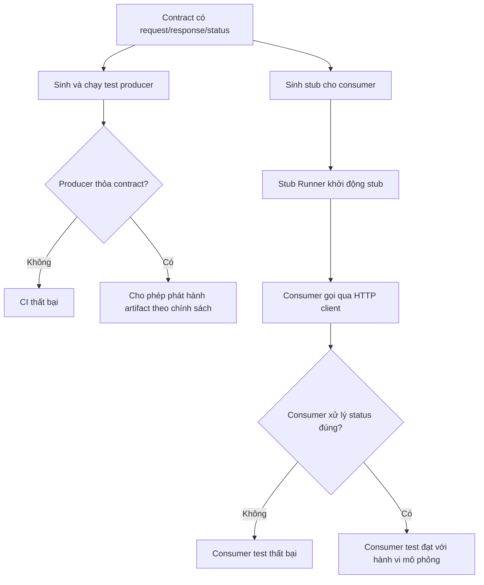

# Mã trạng thái và ý nghĩa hợp đồng đối với consumer

## 1. Mã HTTP là một phần của giao diện mà consumer phụ thuộc

Khi một **consumer** gọi API, thông tin đầu tiên nó có thể dùng để quyết định bước tiếp theo thường là **mã trạng thái HTTP** (HTTP status code). Một response có body JSON đúng cấu trúc nhưng mã HTTP sai vẫn có thể làm consumer thất bại: HTTP client có thể đi vào nhánh xử lý lỗi, thư viện retry có thể kích hoạt lại request hoặc ứng dụng có thể không đọc body như dự kiến.

Trong **Spring Cloud Contract (SCC)**, producer và consumer thỏa thuận hành vi giao tiếp bằng **Groovy/YAML DSL**. Với hợp đồng HTTP, phần `request` mô tả lời gọi và phần `response.status` mô tả **mã mà producer cam kết trả** cho tình huống đó. SCC có thể sinh test xác minh producer và sinh stub mô phỏng hành vi cho consumer. **Stub Runner** giúp consumer dùng stub trong kiểm thử; CI có thể phát hiện sớm việc producer đổi mã HTTP ngoài thỏa thuận.

Ví dụ, consumer gọi:

```http
GET /api/orders/42 HTTP/1.1
Accept: application/json
```

Nếu hợp đồng quy định `200 OK`, thì việc producer chuyển sang `202 Accepted` là một thay đổi hành vi có thể gây lỗi, ngay cả khi response vẫn có trường `id` và `status`. `200` nghĩa là yêu cầu đã được xử lý thành công theo ngữ nghĩa của phương thức; `202` chỉ cho biết yêu cầu đã được chấp nhận để xử lý, việc xử lý có thể chưa hoàn tất.

**Mục tiêu bài học:** hiểu ý nghĩa mã trạng thái từ góc nhìn consumer, viết contract HTTP phản ánh đúng hành vi, thiết kế riêng các tình huống thành công và thất bại, phân biệt kết quả producer test với consumer test trên stub, và đưa các kỳ vọng status vào CI để ngăn thay đổi API không tương thích.

> Một lần contract test xanh chứng minh rằng **tình huống đã khai báo được kiểm tra** đã đáp ứng mã trạng thái và các điều kiện liên quan trong môi trường test. Nó không chứng minh mọi tình huống, mọi phiên bản consumer hoặc mọi trạng thái nghiệp vụ đều đúng.

## 2. Status code biểu diễn điều gì?

Một HTTP response thường có ba nhóm thông tin:

- **Status code:** cho biết kết quả ở cấp giao thức của request, ví dụ `200`, `404`, `503`.
- **Headers:** bổ sung ngữ cảnh như `Content-Type`, `Location`, `Retry-After` hoặc thông tin về cache.
- **Body:** dữ liệu nghiệp vụ hoặc thông tin lỗi mà consumer cần giải mã.

Ví dụ:

```http
HTTP/1.1 404 Not Found
Content-Type: application/json

{
  "code": "ORDER_NOT_FOUND",
  "message": "Order does not exist"
}
```

Trong ví dụ này, `404` cho consumer biết resource được yêu cầu không được tìm thấy trong ngữ cảnh request; `code: ORDER_NOT_FOUND` là **mã lỗi nghiệp vụ do hai nhóm thiết kế**, không phải một mã HTTP chuẩn. Consumer có thể xử lý chung các phản hồi `404`, đồng thời dùng `code` để chọn thông báo phù hợp với chức năng cụ thể.

Không nên tráo vị trí hai thứ: `response.status: 404` trong SCC ràng buộc mã HTTP; `response.body.code: ORDER_NOT_FOUND` ràng buộc giá trị JSON. Một hợp đồng có thể bảo vệ cả hai nếu consumer thực sự phụ thuộc vào cả hai.

### Năm nhóm mã trạng thái

| Dải | Nhóm | Ý nghĩa tổng quát | Điểm cần lưu ý cho consumer |
|---|---|---|---|
| `1xx` | Thông tin | Phản hồi trung gian, yêu cầu còn tiếp diễn | Không thường là kết quả nghiệp vụ cuối cùng của API |
| `2xx` | Thành công | Request được tiếp nhận/xử lý thành công theo mã cụ thể | `200`, `201`, `202`, `204` **không đồng nghĩa** |
| `3xx` | Chuyển hướng | Cần thông tin/điểm đích khác hoặc dùng bản cache | HTTP client có thể tự theo redirect; hành vi phải được kiểm tra |
| `4xx` | Lỗi liên quan request/client | Request hiện tại không thể được xử lý theo yêu cầu | Cần phân biệt xác thực, phân quyền, dữ liệu, không tồn tại, xung đột |
| `5xx` | Lỗi phía server/gateway | Server hoặc thành phần trung gian không đáp ứng được request | Consumer có thể có chính sách retry, thông báo hoặc fallback |

**Không suy ra mọi mã trong cùng một nhóm đều có cách xử lý giống nhau.** Chẳng hạn `401` và `403` thường đòi hỏi hai hành động khác nhau; `409` có thể cần người dùng giải quyết xung đột; `429` có thể cần tôn trọng giới hạn tần suất.

## 3. Những mã thường gặp và quyết định của consumer

| Mã | Ý nghĩa ở cấp HTTP | Ví dụ hành vi consumer có thể cần | Điều nên thể hiện trong contract |
|---|---|---|---|
| `200 OK` | Request thành công | Đọc dữ liệu đơn hàng | Status, Content-Type, các trường được dùng |
| `201 Created` | Tạo resource thành công | Lưu ID mới, điều hướng tới resource | `201`; `Location`/body nếu consumer dựa vào chúng |
| `202 Accepted` | Chấp nhận request, xử lý có thể chưa hoàn tất | Hiển thị “đang xử lý”, theo dõi trạng thái | `202`; tham chiếu job nếu giao diện cam kết |
| `204 No Content` | Thành công nhưng không có body | Hoàn tất thao tác và không parse JSON | `204`, không đặt body JSON mong đợi |
| `301/302/307/308` | Chuyển hướng theo các ngữ nghĩa khác nhau | Xử lý URL mới hoặc theo redirect nếu được phép | Status và `Location` nếu client thực sự phụ thuộc |
| `400 Bad Request` | Request không hợp lệ hoặc không thể xử lý theo cú pháp/định dạng | Thông báo lỗi đầu vào | Status và mã lỗi/field lỗi đã thỏa thuận |
| `401 Unauthorized` | Request thiếu hoặc chưa có thông tin xác thực hợp lệ | Yêu cầu đăng nhập/làm mới xác thực khi phù hợp | Status, cơ chế xác thực và header cần thiết |
| `403 Forbidden` | Server từ chối quyền truy cập | Thông báo không đủ quyền | Status và biểu diễn lỗi nếu có |
| `404 Not Found` | Không tìm thấy resource đích; đôi khi dùng để che resource bị cấm | Hiển thị “không tìm thấy” | Status, error code nếu consumer phân nhánh theo code |
| `409 Conflict` | Request xung đột trạng thái hiện tại | Hiển thị cảnh báo, làm mới dữ liệu, giải quyết xung đột | Status và mã xung đột có ý nghĩa |
| `422 Unprocessable Content` | Nội dung đúng cú pháp nhưng không xử lý được theo ngữ nghĩa | Hiển thị lỗi kiểm tra dữ liệu | Status và cấu trúc lỗi trường nếu có |
| `429 Too Many Requests` | Client gửi quá nhiều request trong thời gian quy định | Giảm tốc độ, tôn trọng retry policy | Status; `Retry-After` nếu API cam kết |
| `500 Internal Server Error` | Lỗi server không xác định cụ thể | Báo lỗi hệ thống, ghi nhận theo dõi | Status và error envelope phù hợp |
| `503 Service Unavailable` | Dịch vụ tạm không sẵn sàng | Hiển thị trạng thái gián đoạn; retry có kiểm soát | Status; `Retry-After` nếu được sử dụng |

Bảng trên là **gợi ý thiết kế consumer**, không phải chỉ thị rằng mọi thư viện HTTP phải tự xử lý như vậy. Consumer có thể dùng exception, response wrapper, callback hoặc mã nhánh riêng. Hợp đồng cần xuất phát từ **cách consumer thật sự sử dụng API**, và nhóm phải xác nhận chính sách giao tiếp giữa hai phía.

### Những phân biệt dễ gây lỗi

**`200` và `202`:** Hai mã cùng thuộc nhóm `2xx` nhưng không cho cùng cam kết hoàn tất công việc. Với `202`, consumer có thể cần dùng `operationId` để kiểm tra sau; không nên tự đánh dấu thanh toán đã hoàn tất.

**`200` và `204`:** `204` không có message body; consumer cố parse JSON có thể nhận EOF hoặc lỗi giải mã. Nếu API trả `204`, contract không nên đòi body `{}` hoặc `null` như một payload.

**`201` và `200`:** Khi tạo resource mới, `201` biểu diễn kết quả tạo; consumer có thể phụ thuộc vào `Location` hoặc ID trả về. Trả `200` thay `201` có thể vẫn chứa dữ liệu hợp lệ nhưng vi phạm thỏa thuận status.

**`400` và `422`:** Hai nhóm có thể phân biệt request sai cấu trúc với dữ liệu hợp lệ về cú pháp nhưng không đáp ứng quy tắc nghiệp vụ. Cách phân loại chính xác phải được hai bên chấp thuận và áp dụng nhất quán.

**`401` và `403`:** `401` liên quan tới xác thực; `403` liên quan tới việc server từ chối truy cập. Không nên viết contract “bất kỳ mã `4xx` nào cũng được” nếu consumer xử lý chúng khác nhau.

**`404` và `500`:** Resource không tồn tại có thể là một kết quả dự kiến để consumer hiển thị trạng thái “không tìm thấy”. Lỗi `500` thường báo rằng server không xử lý được request và có thể cần thông báo hoặc giám sát riêng.

**`429` và `503`:** Cả hai có thể liên quan chiến lược thử lại, nhưng lý do khác nhau: giới hạn tần suất ở client so với dịch vụ tạm không sẵn sàng. Đừng mặc định retry mọi request: với thao tác không idempotent như tạo thanh toán, cần cơ chế idempotency và quy tắc retry được thỏa thuận để tránh tạo giao dịch trùng.

## 4. Viết hợp đồng HTTP status trong YAML DSL

Tài liệu Spring Cloud Contract xác định `request` và `response` là hai phần bắt buộc của hợp đồng HTTP. Trong `response`, **`status` là bắt buộc**; `headers`, `cookies` và `body` có thể bổ sung tùy trường hợp.

Giả sử producer `order-service` phục vụ ứng dụng `order-web`. Consumer muốn lấy thông tin một đơn đã thanh toán. File `order-found.yml`:

```yaml
name: order_found
description: "Consumer lấy đơn hàng đã thanh toán"
request:
  method: GET
  url: /api/orders/42
  headers:
    Accept: application/json
response:
  status: 200
  headers:
    Content-Type: application/json
  body:
    id: 42
    status: PAID
    totalAmount: 125000
    currency: VND
```

Bản hợp đồng này mô tả một **tình huống cụ thể**:

1. Consumer gửi `GET /api/orders/42` và đề nghị nhận JSON.
2. Producer cần trả HTTP `200`.
3. Response cần có kiểu nội dung và các trường JSON đã ràng buộc.
4. Test phía producer được sinh từ contract có thể kiểm tra response thật trong môi trường test.
5. Stub được tạo từ contract cho phép consumer kiểm tra cách giải mã và sử dụng dữ liệu được mô phỏng.

**`response.body.status: PAID` là trạng thái đơn hàng, khác với `response.status: 200` là mã HTTP.** Hai field cùng tên `status` nhưng khác đường dẫn và khác ý nghĩa. Đây là một nguyên nhân nhầm lẫn phổ biến khi đọc YAML.

Cũng cần thỏa thuận `totalAmount` tính theo đơn vị nào, `PAID` đại diện cho giai đoạn nào của thanh toán, và consumer nào thực sự cần các field này. Kiểm thử đúng hình dạng và mã HTTP chưa chắc chứng minh dữ liệu nghiệp vụ phía sau đúng.

### Groovy DSL diễn đạt cùng cam kết

Trong Groovy, có thể viết:

```groovy
import org.springframework.cloud.contract.spec.Contract

Contract.make {
    name('order_found')

    request {
        method GET()
        url '/api/orders/42'
    }

    response {
        status OK()
        headers {
            contentType(applicationJson())
        }
        body(
            id: 42,
            status: 'PAID',
            totalAmount: 125000,
            currency: 'VND'
        )
    }
}
```

Ở đây, `OK()` là helper của Groovy DSL tương ứng mã `200`. Có thể viết `status 200` thay cho helper. Groovy cũng cung cấp các helper khác như `BAD_REQUEST()`; không nên suy đoán helper từ tên mã nếu chưa đối chiếu phiên bản. Trong YAML, dùng **mã số** như `status: 200` để rõ ràng và đúng cú pháp.

Đây là hai cách khai báo **cùng ý nghĩa**, không phải yêu cầu producer cần giữ hai tệp hợp đồng trùng lặp.

## 5. Mỗi nhánh status quan trọng nên có tình huống contract riêng

Hợp đồng `order_found` chỉ mô tả tình huống đơn tồn tại. Nó không tự bảo vệ nhánh đơn không tồn tại, lỗi đầu vào hay xung đột. Với các nhánh consumer cần phân biệt, nên tạo **tình huống riêng có request và response cụ thể**.

### 5.1. Không tìm thấy đơn: `404 Not Found`

File `order-not-found.yml`:

```yaml
name: order_not_found
description: "Đơn hàng không tồn tại"
request:
  method: GET
  url: /api/orders/9999
response:
  status: 404
  headers:
    Content-Type: application/json
  body:
    code: ORDER_NOT_FOUND
    message: Order not found
```

Consumer có thể dựa vào `404` để chọn nhánh “không tìm thấy”, và dựa vào `ORDER_NOT_FOUND` để nhận biết lỗi nghiệp vụ. Nếu `message` chỉ phục vụ hiển thị, có thể thay đổi do dịch thuật hoặc nội dung vận hành; nhóm cần quyết định consumer có **thực sự phụ thuộc vào chuỗi chính xác** không trước khi ràng buộc chặt trong contract.

Để producer verification test chạy được, ứng dụng test phải có điều kiện bảo đảm **đơn `9999` không tồn tại**, hoặc cách mô phỏng nguồn dữ liệu tương đương. Không có fixture, test có thể không ổn định dù YAML đúng.

### 5.2. Tạo đơn mới: `201 Created`

File `order-created.yml`:

```yaml
name: order_created
description: "Tạo đơn hàng mới thành công"
request:
  method: POST
  url: /api/orders
  headers:
    Content-Type: application/json
  body:
    customerId: 7
    sku: BOOK-1
    quantity: 1
response:
  status: 201
  headers:
    Content-Type: application/json
    Location: /api/orders/42
  body:
    id: 42
    status: CREATED
```

Trong thiết kế này, consumer dùng `Location` để điều hướng tới resource mới. Header `Location` là kỳ vọng **do hai phía thỏa thuận** trong contract; nó không tự xuất hiện chỉ vì khai báo `201`. Nếu ID mới biến động theo lần chạy, nên dùng matcher cho những phần động hoặc fixture test ổn định thay vì buộc production luôn tạo ID `42`.

`201` thông báo đã tạo resource. Cách xử lý sau đó của consumer còn tùy quy trình nghiệp vụ; ví dụ `status: CREATED` trong body chỉ biểu diễn trạng thái của đơn, không có nghĩa đơn đã được giao.

### 5.3. Chấp nhận xử lý bất đồng bộ: `202 Accepted`

Giả sử consumer yêu cầu tạo báo cáo, nhưng báo cáo cần thời gian xử lý. File `report-accepted.yml`:

```yaml
name: report_generation_accepted
description: "Yêu cầu tạo báo cáo đã được tiếp nhận"
request:
  method: POST
  url: /api/reports
  headers:
    Content-Type: application/json
  body:
    month: "2026-10"
response:
  status: 202
  headers:
    Content-Type: application/json
  body:
    operationId: job-42
    state: QUEUED
```

`202` có ý nghĩa **đã tiếp nhận, chưa cam kết công việc hoàn tất thành công**. Consumer có thể lưu `operationId`, hiển thị “đang xử lý” và gọi một API trạng thái khác nếu hai bên đã thống nhất. Nó không nên coi sự có mặt của `202` là bằng chứng báo cáo đã sinh xong.

Contract `202` chỉ xác minh phản hồi **tiếp nhận yêu cầu**. Nếu cần bảo vệ cả quá trình hoàn thành, hãy xây dựng những contract/tình huống khác cho endpoint theo dõi hoặc thông điệp hoàn tất; kết hợp với integration test để kiểm tra side effect và job processing thực tế.

### 5.4. Xóa thành công không trả body: `204 No Content`

File `order-delete-no-content.yml`:

```yaml
name: order_delete_no_content
description: "Xóa đơn hàng và không trả nội dung"
request:
  method: DELETE
  url: /api/orders/42
response:
  status: 204
```

Đây là hợp đồng hợp lệ về mặt ý tưởng với **chỉ mã status**, không cần `response.body`. `204` không mang body của response, nên consumer phải xử lý như một kết quả thành công **không có JSON để parse**.

Không nên làm như sau:

```yaml
# Không phù hợp với ngữ nghĩa 204 No Content:
response:
  status: 204
  body:
    deleted: true
```

Nếu consumer cần xác nhận thêm dữ liệu trong response, nhóm nên cân nhắc thiết kế một response khác có body và status phù hợp (ví dụ `200`), hoặc để consumer lấy trạng thái bằng request riêng. `204` chỉ cho biết request thành công nhưng không có body; không tự chứng minh bản ghi đã bị xóa vĩnh viễn trong cơ sở dữ liệu.

### 5.5. Xung đột phiên bản: `409 Conflict`

File `order-version-conflict.yml`:

```yaml
name: order_version_conflict
description: "Consumer cập nhật với phiên bản đơn hàng đã cũ"
request:
  method: PUT
  url: /api/orders/42
  headers:
    Content-Type: application/json
  body:
    version: 3
    note: "Giao buổi chiều"
response:
  status: 409
  headers:
    Content-Type: application/json
  body:
    code: VERSION_CONFLICT
```

Ở đây, nhóm quyết định `409` mang ý nghĩa “đã có phiên bản mới hơn”. Consumer có thể cần tải lại đơn trước khi cho người dùng sửa tiếp. Tuy nhiên, `409` **không tự** có nghĩa “version conflict” cho mọi API; đó là cách sử dụng được ghi rõ bằng `code: VERSION_CONFLICT` trong hợp đồng này.

Những ví dụ trong phần 5 là **các tình huống độc lập**. Để dùng thực tế, producer cần mô hình dữ liệu và trạng thái test phù hợp cho từng request, đặc biệt nếu test chạy song song hoặc dùng chung database.

## 6. Status, header và body phải nhất quán về ngữ nghĩa

Một status code chính xác vẫn chưa đủ nếu consumer cần thêm thông tin để hành động. Hãy xét ba ví dụ:

| Tình huống | Status | Header/body có thể quan trọng | Rủi ro nếu thiếu |
|---|---|---|---|
| Resource vừa được tạo | `201` | `Location` hoặc ID resource | Consumer không biết truy cập resource mới ở đâu |
| Thất bại xác thực | `401` | `WWW-Authenticate` khi cơ chế HTTP authentication yêu cầu | Client không có thông tin challenge phù hợp |
| Bị giới hạn request | `429` | `Retry-After` nếu API cam kết thời điểm thử lại | Consumer retry quá sớm, gây thêm tải |
| Dịch vụ tạm không sẵn sàng | `503` | `Retry-After` khi được cung cấp | Consumer không biết liệu/khi nào nên thử lại |
| Đã xử lý nhưng không có nội dung | `204` | Không có response body | Client cố parse body và báo lỗi |
| Redirect | `3xx` | `Location` theo ngữ nghĩa mã và cấu hình client | Consumer đi sai URL hoặc không theo được redirect |

Vì vậy, hợp đồng cần ràng buộc **status và các trường liên quan mà consumer thực sự dùng**. Không nên khóa cứng mọi header động như `Date`, request ID hoặc trace ID nếu consumer chỉ cần chúng đúng định dạng. Đồng thời, không nên bỏ qua header quan trọng như `Location` nếu client phải điều hướng sau `201`.

**Chú ý với `401`:** Khi dùng HTTP authentication theo chuẩn, các response tương ứng có thể cần header `WWW-Authenticate`. Bài này không áp đặt một kiểu xác thực cụ thể. Contract cần theo cơ chế xác thực thật của hệ thống và thỏa thuận giữa hai phía.

**Chú ý với `429/503`:** Header `Retry-After` có thể chỉ thời lượng hoặc thời điểm. Nếu consumer phải dùng header đó, hãy thể hiện đúng cấu trúc/định dạng được hỗ trợ và kiểm tra hành vi retry riêng. Chỉ có status contract chưa chứng minh client có cơ chế retry an toàn.

### Vì sao “luôn trả HTTP 200 và để lỗi trong JSON” dễ gây rắc rối?

Một API đôi khi thiết kế phản hồi kiểu:

```http
HTTP/1.1 200 OK
Content-Type: application/json

{
  "success": false,
  "errorCode": "ORDER_NOT_FOUND"
}
```

Đây **có thể là giao diện đã thỏa thuận** của một hệ thống, nên không được tự ý sửa contract trái với API thực tế. Tuy nhiên, cách đó làm mất sự phân biệt lỗi ở cấp HTTP: một HTTP client có thể coi request thành công, hệ thống quan sát dựa trên status khó phân nhóm và consumer phải luôn mở body mới biết lỗi.

Nếu nhóm quyết định chuyển sang `404`, cần xem đây là **thay đổi tương thích có thể phá vỡ consumer cũ**. Nên khảo sát client, chuẩn bị phương án chuyển đổi và kiểm thử các phiên bản liên quan trước khi phát hành.

## 7. Generated producer test kiểm tra status thế nào?

Khi cấu hình Spring Cloud Contract plugin và môi trường producer test, hợp đồng YAML/Groovy là đầu vào để sinh kiểm thử. Ví dụ, contract `order_not_found` có thể dẫn đến một bài test về mặt ý nghĩa như:

```java
// Pseudocode minh họa ý tưởng; không phải mã generated test
// có thể sao chép trực tiếp giữa các phiên bản SCC.
Response response = callGet("/api/orders/9999");
assertEquals(404, response.statusCode());
assertEquals("ORDER_NOT_FOUND", response.json("code"));
```

Generated code thực tế phụ thuộc công cụ, test mode, test framework và cấu hình dự án; có thể dùng Rest Assured, MockMvc hay cơ chế khác. Cách triển khai cần bảo đảm test **thật sự gọi producer ở trạng thái dữ liệu đã chuẩn bị**, sau đó so khớp response với contract.

Nếu producer vô tình đổi `404` thành `500`, bài test có assertion status `404` sẽ báo thất bại. Nếu producer trả `404` nhưng body bỏ trường `code` mà consumer yêu cầu, bài test có assertion tương ứng cũng phải phát hiện sai lệch. Điều kiện là những test đó đã được **sinh, biên dịch và chạy** trong CI và lỗi không bị bỏ qua.

**Một contract cho `404` không tự kiểm chứng `200`**, cũng như contract cho `200` không tự kiểm chứng `404`. Các nhánh quan trọng cần được mô tả riêng và chạy trên fixture phù hợp.

## 8. Consumer test dùng Stub Runner hiểu status thế nào?

Producer có thể phát hành stub artifact từ các contract đã được xác nhận. Consumer dùng **Stub Runner** để khởi động một HTTP stub và gọi nó như gọi producer thật.



Ví dụ consumer xử lý kết quả tra cứu:

```java
// Pseudocode minh họa logic của client.
if (status == 200) {
    renderOrder(parseOrder(responseBody));
} else if (status == 404) {
    showOrderNotFound();
} else if (status == 503) {
    showTemporarilyUnavailable();
} else {
    showGenericError();
}
```

Consumer test nên kiểm tra những nhánh **có ý nghĩa nghiệp vụ** thay vì chỉ xác minh Stub Runner khởi động. Chẳng hạn:

- Khi stub trả `200` và JSON hợp lệ, màn hình hiển thị đúng đơn.
- Khi stub trả `404`, màn hình hiển thị “không tìm thấy”, không cố parse body như dữ liệu đơn.
- Khi stub trả `204`, HTTP client không cố giải mã một body JSON rỗng.
- Khi stub trả `202`, luồng thao tác chuyển sang trạng thái chờ, không báo hoàn tất.
- Khi stub trả `503` hoặc `429`, consumer áp dụng chính sách lỗi/retry phù hợp và đã được kiểm thử riêng.

**Giới hạn quan trọng:** Nếu consumer test xanh khi chạy trên stub cũ trả `404`, điều đó **không chứng minh** producer phiên bản mới vẫn trả `404`. Producer có thể đã đổi sang `200` hoặc `500`. Phải chạy producer verification trên đúng commit/artifact chuẩn bị phát hành và quản lý version stub mà consumer đang sử dụng.

## 9. Kiểm thử nhánh lỗi và tránh hợp đồng quá rộng

Hợp đồng có thể trở nên vô nghĩa nếu chỉ ràng buộc “một lỗi bất kỳ” hoặc “một mã thuộc nhóm 2xx”. Ví dụ, consumer cần phân biệt `401` để yêu cầu đăng nhập với `403` để hiển thị “không đủ quyền”. Nếu hai trạng thái bị gộp chung thành `4xx`, test có thể không phát hiện việc producer đổi nhánh và làm hỏng trải nghiệm.

### Ma trận tình huống nên cân nhắc

| Consumer cần làm gì? | Request/điều kiện đại diện | Status đề xuất để thỏa thuận | Assertion tối thiểu |
|---|---|---|---|
| Hiển thị đơn hàng | ID tồn tại | `200` | Status, trường hiển thị, Content-Type |
| Hiển thị “không tìm thấy” | ID không tồn tại | `404` | Status và mã lỗi cần cho client |
| Yêu cầu đăng nhập | Thiếu token trong API cần xác thực | `401` | Status và yêu cầu xác thực liên quan |
| Hiển thị không đủ quyền | Token hợp lệ nhưng thiếu quyền | `403` | Status, không rò rỉ dữ liệu cấm |
| Hiển thị lỗi nhập liệu | Request không đáp ứng điều kiện | `400` hoặc `422` theo API | Status, cấu trúc lỗi phù hợp |
| Xử lý dữ liệu đã thay đổi | Dùng version cũ khi cập nhật | `409` | Status và mã xung đột |
| Chờ xử lý nền | Yêu cầu được nhận để xử lý sau | `202` | Status và tham chiếu công việc nếu dùng |
| Hoàn tất không có body | DELETE thành công, API chọn không trả body | `204` | Status; consumer không parse body |
| Hạn chế lưu lượng | Vượt giới hạn được cấu hình | `429` | Status và thông tin retry nếu có |
| Báo lỗi tạm thời | Producer hoặc gateway không sẵn sàng | `503` | Status; đường xử lý/fallback phù hợp |

Các mã trong bảng là **ứng viên thiết kế cho tình huống minh họa**, không phải hành vi mặc định mà SCC áp đặt. Nhóm phải xác nhận cách producer thực sự xử lý, tiêu chuẩn API hiện có và những consumer/phiên bản cần duy trì.

### Khi nào một contract thất bại là tín hiệu hữu ích?

Giả sử code producer được sửa để “trả `200` cho mọi request để frontend dễ xử lý”. Contract `order_not_found` đang yêu cầu `404`. Generated producer test thất bại: đó là **tín hiệu chính xác** cho thấy producer lệch khỏi giao diện đã thỏa thuận.

Để xử lý, có hai hướng hợp lệ:

1. **Sửa producer** để tiếp tục tuân thủ hợp đồng nếu thay đổi `200` là vô ý hoặc ảnh hưởng consumer hiện tại.
2. **Đề xuất thay đổi hợp đồng** nếu hành vi mới là quyết định thiết kế có chủ ý: review với consumer, nâng phiên bản/chuyển đổi tương thích và cập nhật test/stub theo lịch phát hành.

Đừng đơn thuần sửa YAML thành `200` để CI xanh khi consumer vẫn đang phụ thuộc vào `404`. Contract là công cụ ghi nhận thỏa thuận giao tiếp, không phải mục tiêu cần “làm xanh” bằng mọi giá.

## 10. Những trường hợp cần đặc biệt thận trọng

### 10.1. Status code không kiểm chứng side effect nghiệp vụ

`201` không tự chứng minh resource đã được lưu bền vững trong database. `202` không đảm bảo tác vụ nền cuối cùng sẽ thành công. `204` không chứng minh bản ghi đã bị xóa khỏi mọi bản sao. Để kiểm chứng những điều đó, cần integration test, kiểm thử transaction, outbox/event, hoặc end-to-end test phù hợp.

### 10.2. `HEAD`, `204` và `304` không mang response body như `200`

HTTP `HEAD` yêu cầu server gửi metadata tương ứng nhưng không có message body. `204 No Content` và `304 Not Modified` cũng không mang nội dung response như một `200` thông thường. Nếu client giả định mọi response thành công đều có JSON, nó có thể lỗi khi gặp các trường hợp này. Dùng contract cho tình huống cụ thể và kiểm tra cách client xử lý *body vắng mặt*, không áp dụng một parser chung một cách máy móc.

### 10.3. Redirect không tự chứng minh consumer có thể theo

Với `3xx`, hành vi tự động theo redirect phụ thuộc HTTP client, cấu hình và loại request. Đặc biệt, ý nghĩa giữ hay thay đổi phương thức có thể khác giữa `302` và `307/308`. Khi API có redirect, contract cần bảo vệ mã và header mà consumer cần; test consumer phải cho thấy HTTP client xử lý đúng. Đừng ngầm cho rằng producer trả `302` và consumer luôn nhận payload ở URL đích.

### 10.4. Retry không tự an toàn khi chỉ nhìn thấy `5xx`

`500`, `502`, `503`, `504` báo các tình huống khác nhau. Dù một số lỗi tạm thời có thể phù hợp retry, quyết định phải xét tính idempotent của request, idempotency key, backoff và chính sách chống gây quá tải. Contract status là một lớp thông tin; kiểm thử độ bền và luồng lặp request cần cơ chế bổ sung.

### 10.5. Bảo mật là kiểm thử bổ sung

`401`/`403` giúp biểu đạt kết quả API trên các trường hợp xác thực/phân quyền đã khai báo. Một contract trả đúng mã trong một fixture **không đủ chứng minh** toàn bộ chính sách bảo mật, không rò rỉ thông tin hoặc xử lý token đã hết hạn đúng ở mọi lớp. Cần security/integration tests với nhiều vai trò và tình huống.

## 11. Đưa kỳ vọng status vào CI và phát hành stub

Một pipeline có ích cần kết nối những bước sau:

1. **Consumer và producer thống nhất status cho từng ca sử dụng.** Ghi rõ mã thành công, mã lỗi, headers/body liên quan và thông điệp nghiệp vụ. Với API hiện hữu, không đổi nghĩa mã tùy tiện.
2. **Viết Groovy/YAML DSL theo từng tình huống quan trọng.** Trong YAML, `response.status` dùng số nguyên HTTP tương ứng; đừng nhầm với field trạng thái nghiệp vụ trong JSON.
3. **Sinh và chạy producer verification tests.** Producer test base cần dựng fixture tương ứng: đơn `42` tồn tại, `9999` không tồn tại, version cũ có xung đột, v.v. Generated tests cần được thực thi và fail khi status/body không đúng.
4. **Phát hành stub artifact có phiên bản.** Thực hiện theo chính sách build/release sau khi producer đã được kiểm chứng. Phải truy vết được contract và mã producer đã được test.
5. **Consumer chạy test qua Stub Runner.** Trỏ HTTP client tới stub, xác minh nhánh xử lý `200`, `202`, `204`, `404`... mà consumer thực sự dùng.
6. **Chặn thay đổi không tương thích và kiểm tra phiên bản.** Không suy ra tương thích từ consumer test xanh với stub cũ; cần bảo vệ các phiên bản client còn được hỗ trợ.
7. **Duy trì các lớp test bổ sung.** Contract test không thay thế unit test nghiệp vụ, security test, integration test database/broker hay kiểm thử vận hành.

Ví dụ, một pull request đổi `GET /api/orders/9999` từ `404` sang `200` sẽ bị chặn **nếu** producer test tương ứng thực sự chạy trên mã thay đổi và job CI dùng kết quả thất bại làm cổng kiểm soát. Nếu contract không bao phủ nhánh `404` hoặc CI bỏ qua generated tests thì thay đổi có thể lọt qua.

## 12. Những lỗi thường gặp

| Lỗi | Tác động | Cách sửa |
|---|---|---|
| Chỉ kiểm tra JSON body, bỏ status | Producer đổi `404` thành `200` mà test không phát hiện | Ràng buộc `response.status` cho từng tình huống |
| Đồng nhất mọi `2xx` là “hoàn tất” | Consumer xử lý `202` như `200` | Test rõ nhánh nhận và chờ kết quả |
| Trả `204` kèm body và yêu cầu parse JSON | Vi phạm ý nghĩa No Content; client có thể lỗi | Không khai báo body cho `204`; điều chỉnh thiết kế nếu cần dữ liệu |
| Gộp `401`, `403`, `404` vào một nhánh chung | Consumer hiển thị sai thông báo hoặc luồng đăng nhập | Xác định mã riêng và test xử lý từng nhánh |
| Coi `500` là “không tìm thấy” | Che lỗi hệ thống, gây xử lý sai | Dùng `404` cho trường hợp resource không tồn tại nếu API thỏa thuận như vậy |
| Cho qua `429` mà không kiểm tra xử lý | Client thử lại dồn dập | Contract header cần thiết; test retry/backoff riêng |
| Khóa cứng ID ngẫu nhiên trong `201` | Test producer không ổn định | Dùng fixture hoặc matcher thích hợp cho trường biến động |
| Test `200` xanh rồi tuyên bố mọi lỗi đều đúng | Không có contract cho `400`/`404`/`409` | Chọn các ca âm mà consumer thật sự cần |
| Chỉ chạy consumer test với stub | Stub cũ có thể khác producer hiện tại | Yêu cầu producer verification trên đúng mã/artifact |
| Đổi contract cho xanh test nhưng không cập nhật consumer | Thay đổi API không tương thích bị hợp thức hóa | Review với consumer và kế hoạch version/migration |
| Chỉ sinh test mà không thực thi | Không có bằng chứng producer đáp ứng contract | Chạy generated tests, buộc CI thất bại khi mismatch |

## 13. Thực hành: từ user story tới ma trận status và YAML

**Bối cảnh:** `invoice-service` (consumer) gửi yêu cầu tạo hóa đơn qua `billing-service` (producer). Hai bên đang thỏa thuận các tình huống:

- Dữ liệu hợp lệ: hóa đơn được tạo ngay, trả `201` cùng ID và `Location`.
- Cùng một mã yêu cầu nhưng thông tin mâu thuẫn với trạng thái hiện tại: trả `409` và `code: INVOICE_CONFLICT`.
- Dịch vụ đang bảo trì: trả `503`; consumer hiển thị trạng thái tạm thời không sẵn sàng, không thử lại tạo hóa đơn một cách vô điều kiện.

### Yêu cầu thực hành

1. Viết bảng liệt kê request/fixture, status, body/header mà consumer dùng và nhánh xử lý của client.
2. Viết ít nhất hai YAML contract độc lập cho `201` và `409`. `response.status` phải đúng; với `201`, khai báo `Location`; với `409`, khai báo error code.
3. Nêu lý do tại sao `201` không nên được đổi thành `200` chỉ để “đơn giản hóa” test.
4. Mô tả cách producer verification và consumer test với Stub Runner bảo vệ hai nhánh.
5. Nêu giới hạn của status contract nếu yêu cầu tạo hóa đơn có side effect trong database hoặc bị gửi lại khi network timeout.

### Gợi ý hợp đồng thành công

```yaml
name: invoice_created
description: "Tạo hóa đơn mới"
request:
  method: POST
  url: /api/invoices
  headers:
    Content-Type: application/json
  body:
    orderId: 42
    requestId: "REQ-1001"
response:
  status: 201
  headers:
    Content-Type: application/json
    Location: /api/invoices/501
  body:
    invoiceId: 501
    state: CREATED
```

### Gợi ý hợp đồng xung đột

```yaml
name: invoice_conflict
description: "Yêu cầu tạo hóa đơn xung đột với trạng thái hiện tại"
request:
  method: POST
  url: /api/invoices
  headers:
    Content-Type: application/json
  body:
    orderId: 42
    requestId: "REQ-CONFLICT"
response:
  status: 409
  headers:
    Content-Type: application/json
  body:
    code: INVOICE_CONFLICT
```

Hai request mẫu phải có **fixture độc lập hoặc trạng thái kiểm thử được chuẩn bị rõ ràng** để producer trả `201` và `409` theo đúng bối cảnh. Đừng chỉ tạo mapping stub mà quên kiểm tra producer thực sự có đường xử lý tương ứng.

### Tiêu chí tự kiểm tra

- Mỗi contract mô tả **một tình huống với status có ý nghĩa**, không dùng matcher quá lỏng để chấp nhận mọi mã.
- Consumer biết dựa vào status/header/body nào để chuyển sang nhánh UI hoặc nghiệp vụ.
- Producer có test data cho cả tạo thành công lẫn xung đột.
- Consumer test với Stub Runner xác minh nhánh xử lý, không chỉ xác minh stub chạy được.
- CI gắn kết phiên bản contract/stub với producer build đã xác minh.
- Các side effect, retry an toàn và idempotency được kiểm thử ở tầng phù hợp, ngoài phạm vi status contract thuần túy.

## 14. Checklist khi review một contract HTTP response

- [ ] `response.status` được khai báo bằng đúng mã HTTP của tình huống.
- [ ] Không nhầm `response.status` với trường `body.status` mang ý nghĩa nghiệp vụ.
- [ ] Status phản ánh đúng kết quả: `200`, `201`, `202`, `204` và các nhánh `4xx`/`5xx` được phân biệt khi consumer cần.
- [ ] Header `Content-Type`, `Location`, `Retry-After` hoặc header khác được mô tả khi consumer phụ thuộc.
- [ ] Không yêu cầu response body khi dùng `204`; xử lý các trường hợp không body phù hợp.
- [ ] Error code và schema body lỗi nhất quán với cách consumer thật sự giải mã.
- [ ] Có fixture cụ thể cho cả luồng thành công và những ca lỗi quan trọng.
- [ ] Generated producer tests được sinh, chạy và fail nếu status sai.
- [ ] Consumer tests chạy trên stub đúng version và có assertion về nhánh status.
- [ ] Những phiên bản client còn hỗ trợ được xem xét khi đổi status.
- [ ] Có kiểm thử bổ sung cho side effect, phân quyền, retry và hiệu năng khi cần.

## 15. Ghi nhớ và tài liệu tham khảo

**Mã trạng thái HTTP là một phần của hợp đồng giao tiếp**, không phải con số trang trí trong response. Consumer dùng nó để quyết định đọc dữ liệu, đợi xử lý, điều hướng, thông báo lỗi, yêu cầu xác thực hoặc áp dụng retry có kiểm soát. Vì vậy, đổi `200` thành `202`, `201` thành `200` hoặc `404` thành `500` có thể phá vỡ hành vi consumer dù cấu trúc JSON không đổi.

Spring Cloud Contract diễn đạt cam kết đó bằng **`response.status`** trong YAML hoặc **`status OK()` / `status 200`** trong Groovy. Producer verification xác minh response thật ở những tình huống được khai báo; stub và Stub Runner cho phép consumer kiểm tra logic client với phản hồi mô phỏng. Chỉ khi các kiểm thử được thực thi, kết quả được gắn đúng phiên bản và CI chặn sai lệch, nhóm mới có bằng chứng đáng tin cậy về các nhánh status đã được bảo vệ.

Tài liệu chính thức để đối chiếu khi triển khai:

- [Spring Cloud Contract — HTTP Contracts, HTTP Response](https://docs.spring.io/spring-cloud-contract/reference/project-features-contract/http.html).
- [Spring Cloud Contract — Dynamic Properties và response matchers](https://docs.spring.io/spring-cloud-contract/reference/project-features-contract/dsl-dynamic-properties.html).
- [MDN — HTTP response status codes](https://developer.mozilla.org/en-US/docs/Web/HTTP/Reference/Status).
- [HTTP Semantics — RFC 9110](https://www.rfc-editor.org/rfc/rfc9110.html).
