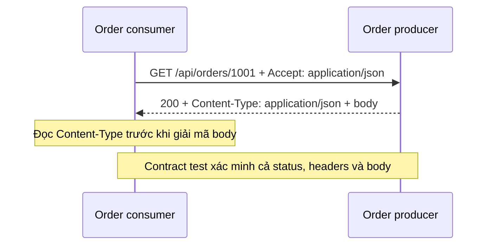

# Response header và content type trong Spring Cloud Contract

Trong giao tiếp HTTP, **status code** cho biết kết quả tổng quát, **response body** chứa dữ liệu, còn **response headers** giải thích cách client phải diễn giải và sử dụng phản hồi đó. Một API trả đúng JSON nhưng thiếu hoặc gửi sai `Content-Type` vẫn có thể làm consumer không giải mã được response. Tương tự, một response `201 Created` có body đúng nhưng thiếu header `Location` có thể phá vỡ client đang dựa vào URI của tài nguyên vừa tạo.

**Spring Cloud Contract (SCC)** cho phép khai báo các cam kết này trong **Groovy DSL hoặc YAML DSL**. Từ hợp đồng, công cụ có thể sinh **provider verification tests** để đối chiếu response thực của producer, đồng thời sinh **HTTP stubs** để consumer kiểm thử bằng **Stub Runner**. Bài thuộc chương **Response HTTP** này tập trung vào cách khai báo, kiểm tra và tiến hóa **response headers và content type**. Ví dụ dùng `order-producer` cung cấp API đơn hàng và `order-consumer` gọi API đó.

## 1. Response header nằm ở đâu trong HTTP?

Một phản hồi HTTP đơn giản:

```http
HTTP/1.1 200 OK
Content-Type: application/json
Cache-Control: no-store
X-Request-Id: req-1001

{"id":1001,"status":"CREATED"}
```

Đọc từng phần:

| Thành phần | Ví dụ | Vai trò |
| --- | --- | --- |
| Status | `200 OK` | Yêu cầu đã được xử lý thành công theo ngữ nghĩa HTTP |
| `Content-Type` | `application/json` | Media type của representation trong response body |
| `Cache-Control` | `no-store` | Chỉ dẫn cách cache được phép lưu trữ response |
| `X-Request-Id` | `req-1001` | Định danh truy vết do ứng dụng quy ước |
| Body | `{"id":1001,"status":"CREATED"}` | Dữ liệu mà consumer giải mã và sử dụng |

Trong contract, header không phải ghi chú cho con người: nếu khai báo ở phần `response.headers`, nó trở thành một phần của **cam kết có thể được kiểm tra**. Đổi một header mà consumer cần có thể là breaking change ngay cả khi response body không thay đổi.

Sơ đồ luồng:



**Phân biệt hai phía:**

- `request.headers` là header **consumer gửi**, ví dụ `Accept`, `Authorization`, request `Content-Type`.
- `response.headers` là header **producer trả**, ví dụ `Content-Type`, `Location`, `ETag`, `Cache-Control`.
- Header trùng tên có thể tồn tại ở cả hai phía, nhưng mang vai trò khác nhau. Đặc biệt, `Content-Type` của request mô tả **request body**, còn `Content-Type` của response mô tả **response body**.

## 2. Khai báo response headers bằng Groovy DSL

Giả sử `GET /api/orders/1001` phải trả JSON và chỉ dẫn không lưu cache. Tệp `src/test/resources/contracts/http/get-order-by-id.groovy`:

```groovy
import org.springframework.cloud.contract.spec.Contract

Contract.make {
    description 'Đơn hàng tồn tại: trả JSON và yêu cầu không lưu cache'

    request {
        method GET()
        url '/api/orders/1001'
        headers {
            header('Accept', 'application/json')
        }
    }

    response {
        status OK()
        headers {
            contentType(applicationJson())
            header('Cache-Control', 'no-store')
        }
        body(
            id: 1001,
            status: 'CREATED'
        )
    }
}
```

Phần trọng tâm:

```groovy
response {
    status OK()
    headers {
        contentType(applicationJson())
        header('Cache-Control', 'no-store')
    }
    body(id: 1001, status: 'CREATED')
}
```

- `status OK()` ràng buộc status `200`.
- `headers { ... }` chứa **response headers**, không phải request headers.
- `contentType(applicationJson())` là helper biểu diễn media type JSON.
- `header('Cache-Control', 'no-store')` thêm một header cụ thể theo quy ước HTTP.
- `body(...)` mô tả nội dung JSON. Việc đặt `Content-Type` và body tương ứng giúp consumer giải mã phản hồi đúng cách.

Có thể biểu diễn content type bằng tên header thay vì helper:

```groovy
response {
    status OK()
    headers {
        header('Content-Type', 'application/json')
    }
    body(id: 1001, status: 'CREATED')
}
```

Hai cách trên nhằm diễn đạt cùng media type trong ví dụ. Khi dự án cần kiểm tra parameter như `charset` hoặc media type đặc biệt, nên khai báo rõ chuỗi kỳ vọng và xem test/stub thực tế được sinh ra.

### 2.1. Khi nào dùng helper, khi nào dùng `header(...)`?

| Cách khai báo | Thích hợp khi | Điều cần chú ý |
| --- | --- | --- |
| `contentType(applicationJson())` | Response JSON thông thường | Dễ đọc, tránh lỗi chính tả tên media type |
| `header('Content-Type', 'application/json')` | Cần biểu diễn trực tiếp header | Dễ đối chiếu HTTP raw response |
| `header('Content-Type', 'application/problem+json')` | API lỗi theo media type JSON chuyên biệt | Consumer có thể cần xử lý media type riêng |
| `header('Location', '/api/orders/1001')` | Response tạo tài nguyên cần URI | Header `Location` là một cam kết độc lập với body |
| `header('ETag', '"order-v3"')` | API áp dụng cache/conditional requests | Dấu nháy là một phần biểu diễn ETag trong ví dụ |

Không cần khai báo mọi header framework tự thêm vào response. **Chỉ cố định các header mà hợp đồng API cam kết và consumer phụ thuộc**. Việc đóng băng header biến động do server/proxy sinh có thể khiến provider tests dễ thất bại vì những thay đổi không liên quan đến tương thích.

## 3. Khai báo tương đương bằng YAML DSL

Nếu chọn YAML, một hợp đồng tương đương có thể đặt ở `src/test/resources/contracts/http/get-order-by-id.yml`:

```yaml
description: "Đơn hàng tồn tại: trả JSON và yêu cầu không lưu cache"
request:
  method: GET
  url: /api/orders/1001
  headers:
    Accept: application/json
response:
  status: 200
  headers:
    Content-Type: application/json
    Cache-Control: no-store
  body:
    id: 1001
    status: CREATED
```

Về ngữ nghĩa, hai tệp Groovy và YAML mô tả **cùng request và response**. Chúng là **hai lựa chọn để học**, không nên cùng tồn tại cho một tình huống trong thư mục contract đang được build quét, vì có thể tạo test và stub trùng lặp.

So sánh nhanh:

| Groovy DSL | YAML DSL | Ý nghĩa |
| --- | --- | --- |
| `response { headers { ... } }` | `response: headers:` | Header producer trả về |
| `contentType(applicationJson())` | `Content-Type: application/json` | Phản hồi là JSON |
| `header('Cache-Control', 'no-store')` | `Cache-Control: no-store` | Không lưu response trong cache |
| `status OK()` | `status: 200` | HTTP 200 |
| `body(id: 1001, status: 'CREATED')` | `body: {id: 1001, status: CREATED}` | JSON object |

Ở YAML, **thụt lề quyết định cấu trúc**. Nếu `Content-Type` bị đặt dưới `request.headers`, hợp đồng đang yêu cầu header phía consumer chứ không kiểm tra header producer. Nếu `Content-Type` bị đặt dưới `body`, nó không còn là response header.

## 4. Hiểu chính xác Content-Type và media type

Theo HTTP, **`Content-Type` mô tả media type của nội dung được gửi**. Giá trị có thể bao gồm media type chính và các tham số:

```http
Content-Type: application/json
Content-Type: application/json; charset=utf-8
Content-Type: text/plain; charset=utf-8
Content-Type: application/problem+json
```

**Media type** và **hình dạng body** phải nhất quán. Ví dụ nếu API trả object JSON `{"id":1001}`, producer nên gửi `application/json`, trừ khi giao diện đã công bố một media type JSON chuyên biệt.

| Media type | Body điển hình | Điều consumer cần biết |
| --- | --- | --- |
| `application/json` | JSON object, array hoặc giá trị JSON | Parse JSON và kiểm tra field/kiểu dữ liệu |
| `application/problem+json` | Problem Details dạng JSON | Xử lý lỗi theo cấu trúc mà API quy định |
| `text/plain; charset=utf-8` | Chuỗi văn bản | Giải mã ký tự đúng charset |
| `text/csv` | Dữ liệu CSV | Phân tích header dòng/cột, escaping CSV |
| `application/octet-stream` | Byte nhị phân | Không giải mã như JSON/text |
| `application/pdf` | Tệp PDF | Xử lý như tài liệu PDF |
| `text/event-stream` | Luồng sự kiện SSE | Cần client hỗ trợ streaming, không xem như JSON response đơn lẻ |

Các media type trên minh họa các loại biểu diễn HTTP; chúng không có nghĩa mọi loại đều được SCC tự kiểm thử đầy đủ về ngữ nghĩa. Với streaming, file nhị phân hoặc nội dung lớn, cần lựa chọn chiến lược contract và integration test phù hợp.

### 4.1. `application/json` và `application/json; charset=utf-8`

Hai header này cùng biểu thị media type JSON, nhưng **không phải hai chuỗi ký tự giống nhau**. Một matcher kiểm tra chính xác giá trị header có thể coi chúng khác nhau, dù consumer hỗ trợ cả hai.

Để quyết định mức ràng buộc:

- Nếu consumer chỉ cần JSON và không phụ thuộc vào tham số `charset`, hãy thiết kế phép kiểm chứng phù hợp với yêu cầu đó; kiểm tra ứng xử generated tests và stub mappings ở phiên bản SCC đang dùng.
- Nếu giao thức hoặc client cũ thực sự đòi chuỗi/parameter cụ thể, contract có thể cần kiểm tra chính xác hơn.
- Với `application/json`, cách giải mã ký tự được ràng buộc bởi quy tắc riêng của định dạng JSON; không nên thêm `charset` tùy tiện chỉ để làm đẹp response.

**Tên field HTTP không phân biệt chữ hoa chữ thường**, nên `content-type` và `Content-Type` là cùng tên header về mặt giao thức. Trái lại, **giá trị** là nội dung cần diễn giải theo quy tắc của từng header; không nên suy ra mọi giá trị header đều được so sánh bằng quy tắc không phân biệt hoa/thường.

### 4.2. JSON hợp lệ nhưng Content-Type sai

Ví dụ producer trả:

```http
HTTP/1.1 200 OK
Content-Type: text/plain

{"id":1001,"status":"CREATED"}
```

Body trông giống JSON, nhưng header đang công bố văn bản thuần. Một HTTP client có thể xử lý khác tùy bộ giải mã được cấu hình. Do đó contract cần kiểm tra **cả Content-Type và body**, không chỉ so sánh chuỗi JSON.

Ngược lại, `Content-Type: application/json` chưa chứng minh body là JSON hợp lệ. Provider verification và test parse JSON phải kiểm tra đúng dữ liệu thực tế.

## 5. Phân biệt Accept và Content-Type trong content negotiation

Dù cả hai đều nhắc đến media type, `Accept` và `Content-Type` trả lời hai câu hỏi khác nhau:

- **Request `Accept`:** Consumer muốn nhận loại representation nào?
- **Response `Content-Type`:** Producer thực sự gửi representation theo loại nào?
- **Request `Content-Type`:** Nếu request có body, body đó thuộc loại nào?

Ví dụ:

```http
GET /api/orders/1001 HTTP/1.1
Accept: application/json
```

```http
HTTP/1.1 200 OK
Content-Type: application/json

{"id":1001,"status":"CREATED"}
```

Không có quy tắc bắt buộc mọi response phải chép nguyên `Accept` sang `Content-Type`. Một client có thể chấp nhận nhiều loại, ví dụ `Accept: application/json, application/xml`, còn producer chọn một biểu diễn mà nó hỗ trợ.

### 5.1. Ví dụ producer hỗ trợ nhiều loại biểu diễn

Nếu producer thật hỗ trợ JSON và XML cho cùng URL, có thể cần hai hợp đồng tách biệt:

```groovy
// Ví dụ contract cho trường hợp client yêu cầu JSON
request {
    method GET()
    url '/api/orders/1001'
    headers {
        header('Accept', 'application/json')
    }
}
response {
    status OK()
    headers {
        contentType(applicationJson())
        header('Vary', 'Accept')
    }
    body(id: 1001, status: 'CREATED')
}
```

Hợp đồng cho XML phải có `Accept: application/xml`, `response.headers.Content-Type` XML và body XML tương ứng. `Vary: Accept` hữu ích cho cache khi representation thay đổi theo `Accept`, nhưng chỉ khai báo nếu producer thật cam kết gửi header này.

**Không viết hai hợp đồng có cùng điều kiện request nhưng phản hồi trái ngược** rồi mong stub tự lựa chọn ngẫu nhiên đúng ý. Stub mapping cần điều kiện đủ phân biệt kịch bản.

### 5.2. HTTP 406 và 415 nằm ở những tình huống nào?

| Status | Khi nào có thể gặp | Mối liên hệ với header |
| --- | --- | --- |
| `406 Not Acceptable` | Producer không thể tạo representation thỏa `Accept` | Liên quan lựa chọn **response media type** |
| `415 Unsupported Media Type` | Producer không hỗ trợ định dạng **request body** được gửi | Liên quan **request Content-Type** |
| `200 OK` | Đọc dữ liệu thành công | Response Content-Type cần phù hợp representation |
| `201 Created` | Tài nguyên được tạo | Thường cần cân nhắc response `Location` |
| `204 No Content` | Thành công nhưng không có body | Không mô tả JSON body không rỗng |

Không phải mọi API đều triển khai `406` hoặc `415` giống nhau. Chỉ viết contract cho hành vi mà API của producer thực sự đã thống nhất; tránh coi các status trên là mặc định của SCC.

## 6. Khai báo nhiều response headers có ý nghĩa nghiệp vụ

Ngoài `Content-Type`, response có thể công bố các header khác:

| Header | Tình huống | Cam kết consumer có thể dựa vào |
| --- | --- | --- |
| `Location` | Tạo tài nguyên (`201`) hoặc redirect | URI tài nguyên mới hoặc đích điều hướng |
| `Cache-Control` | Cache policy | Có được lưu response, lưu trong bao lâu |
| `ETag` | Conditional request và tối ưu cache | Phiên bản representation để kiểm tra thay đổi |
| `Last-Modified` | Conditional request/cache | Thời điểm chỉnh sửa theo ngữ nghĩa HTTP |
| `Retry-After` | `429` hoặc `503` trong API dùng header này | Thời gian nên chờ trước lần thử tiếp |
| `Vary` | Nhiều representation theo header request | Cache hiểu header nào ảnh hưởng lựa chọn representation |
| `Content-Disposition` | Tải tệp | Gợi ý cách hiển thị và tên tệp |
| `X-Request-Id` | Truy vết | Mã request được đội ứng dụng quy định |

Không nên ràng buộc header được sinh động như `Date`, `ETag` hoặc `X-Request-Id` vào một giá trị giả cố định nếu producer thực tế tạo giá trị khác trên mỗi request. Với contract động, hãy chọn cơ chế matcher/generator phù hợp và kiểm tra generated test/stub tương ứng.

### 6.1. Ví dụ POST 201 với Content-Type và Location

Tệp `post-order-created.groovy`:

```groovy
import org.springframework.cloud.contract.spec.Contract

Contract.make {
    description 'Khi tạo đơn thành công, trả 201, JSON và URI đơn mới'

    request {
        method POST()
        url '/api/orders'
        headers {
            contentType(applicationJson())
        }
        body(
            customerId: 'CUS-42',
            sku: 'BOOK-01',
            quantity: 2
        )
    }

    response {
        status CREATED()
        headers {
            contentType(applicationJson())
            header('Location', '/api/orders/1001')
        }
        body(
            id: 1001,
            status: 'CREATED'
        )
    }
}
```

HTTP response tương ứng:

```http
HTTP/1.1 201 Created
Content-Type: application/json
Location: /api/orders/1001

{"id":1001,"status":"CREATED"}
```

`Location` mô tả URI tham chiếu tới tài nguyên vừa tạo; trong ví dụ có thể dùng relative URI. Nếu producer tạo ID ngẫu nhiên, `Location` và `id` sẽ thay đổi; hãy dùng matcher thích hợp và kiểm thử mối quan hệ giữa chúng nếu consumer cần mối quan hệ đó.

### 6.2. Ví dụ YAML tương đương

```yaml
description: "Khi tạo đơn thành công, trả 201, JSON và URI đơn mới"
request:
  method: POST
  url: /api/orders
  headers:
    Content-Type: application/json
  body:
    customerId: CUS-42
    sku: BOOK-01
    quantity: 2
response:
  status: 201
  headers:
    Content-Type: application/json
    Location: /api/orders/1001
  body:
    id: 1001
    status: CREATED
```

Khi review, hãy kiểm tra **request Content-Type** và **response Content-Type** đều nằm đúng cấp, nhưng chúng không phải luôn bắt buộc bằng nhau. Ví dụ một request `application/json` có thể tạo resource và response trả `201` với một representation JSON khác.

## 7. Response lỗi và media type chuyên biệt

Một API hiện đại có thể dùng **Problem Details** ở dạng JSON để mô tả lỗi. Khi đó response `400` có thể dùng `application/problem+json`, thay vì `application/json` thông thường:

```http
HTTP/1.1 400 Bad Request
Content-Type: application/problem+json

{
  "type": "https://example.org/problems/invalid-quantity",
  "title": "Invalid quantity",
  "status": 400,
  "detail": "Quantity must be greater than zero"
}
```

Hợp đồng Groovy có thể thể hiện rõ media type:

```groovy
import org.springframework.cloud.contract.spec.Contract

Contract.make {
    description 'Khi số lượng bằng 0, trả lỗi validation dạng Problem Details'

    request {
        method POST()
        url '/api/orders'
        headers {
            contentType(applicationJson())
        }
        body(
            customerId: 'CUS-42',
            quantity: 0
        )
    }

    response {
        status BAD_REQUEST()
        headers {
            header('Content-Type', 'application/problem+json')
        }
        body(
            type: 'https://example.org/problems/invalid-quantity',
            title: 'Invalid quantity',
            status: 400,
            detail: 'Quantity must be greater than zero'
        )
    }
}
```

Ở đây **status HTTP `400`** và **field JSON `"status":400`** là hai chỗ khác nhau. Nếu API công bố cả hai, nên giữ chúng nhất quán. Không được giả định `application/problem+json` và `application/json` là hai chuỗi header tương đương trong mọi HTTP client; các thư viện có thể xử lý media type có hậu tố `+json` theo khả năng riêng.

**Lưu ý:** `example.org` là domain ví dụ dành cho tài liệu; ở dự án thực tế, giá trị `type` nên theo quy ước của API và có ý nghĩa ổn định với consumer.

## 8. Response không có body: 204, 304 và HEAD

Không phải response nào cũng có payload. Ví dụ xóa đơn thành công:

```http
HTTP/1.1 204 No Content
```

Contract:

```groovy
import org.springframework.cloud.contract.spec.Contract

Contract.make {
    description 'Xóa đơn hàng thành công, trả 204 và không có nội dung'

    request {
        method DELETE()
        url '/api/orders/1001'
    }

    response {
        status NO_CONTENT()
    }
}
```

Ví dụ này **không khai báo response body**. Nếu yêu cầu học thuật hoặc nghiệp vụ cần xác minh nghiêm ngặt không có body, hãy xem generated test thực sự kiểm tra điều đó ra sao và bổ sung kiểm thử phù hợp; việc bỏ trường `body` chỉ có nghĩa contract không mô tả payload cụ thể.

Một số tình huống liên quan:

- **`204 No Content`:** theo ngữ nghĩa HTTP, response không có content; không gửi JSON body `{}` cho 204.
- **`304 Not Modified`:** response của conditional request không mang message body, nhưng có thể mang metadata hỗ trợ cache như `ETag` hoặc `Cache-Control`.
- **`HEAD`:** trả metadata của representation tương ứng nhưng không chuyển response body; `Content-Type` vẫn có thể có ý nghĩa.

Không gán mặc định `Content-Type: application/json` cho mọi status chỉ vì controller trả JSON ở các nhánh khác. Với 204, hãy kiểm tra behavior của framework và hợp đồng HTTP trước khi yêu cầu một response Content-Type không cần thiết.

## 9. Response header có giá trị động: thiết kế matcher

Trong hệ thống thực tế, một số response headers mang dữ liệu động:

```http
X-Request-Id: dfa3dcdc-69dd-4a89-b328-68d1d29661ec
ETag: "order-1001-v7"
Date: Tue, 24 Nov 2026 04:00:00 GMT
```

Nếu hợp đồng khóa cứng `X-Request-Id: req-1001`, test sinh có thể fail khi producer trả UUID khác dù consumer chỉ yêu cầu ID không rỗng và đúng định dạng.

Để xử lý đúng:

1. Quyết định **quy tắc consumer cần**: header phải tồn tại, đúng định dạng UUID, theo pattern ETag hay thuộc một tập giá trị?
2. Dùng **matcher/generator phù hợp** mà phiên bản Spring Cloud Contract của dự án hỗ trợ cho response header. Groovy DSL có cơ chế biểu thức/matcher; YAML DSL có schema tương ứng tùy phiên bản.
3. Kiểm tra **generated provider test** có kiểm tra đúng điều kiện thay vì exact value không.
4. Kiểm tra **HTTP stub** sinh ra response header có giá trị mẫu phù hợp để consumer test được lặp lại.
5. Nếu header có quan hệ với request hoặc body, kiểm chứng quan hệ đó bằng contract/test phù hợp; regex độc lập không tự bảo đảm hai giá trị trùng nhau.

Ví dụ một quy tắc ở mức nghiệp vụ:

```text
X-Request-Id: bắt buộc xuất hiện và là UUID hợp lệ
Cache-Control: chính xác "no-store"
Content-Type: thuộc họ JSON được API cam kết
Location: bắt đầu bằng "/api/orders/" và trỏ đúng tài nguyên vừa tạo
```

Không nên dùng một regex `.*` cho mọi header. Nó có thể khiến producer thay đổi giá trị sai mà provider test vẫn xanh. Ngược lại, test một UUID cố định khi hợp đồng chỉ cần định dạng hợp lệ sẽ làm test dễ gãy vô ích.

Trong bài này, các snippet tĩnh dùng exact value để dễ học. Phần matcher động cần được thiết kế theo **version và test mode thực tế** của dự án, kiểm tra output sinh ra thay vì tự cho rằng mọi cú pháp matcher Groovy/YAML đều tương đương.

## 10. Kiểm chứng response headers ở producer

Với HTTP contract đã lưu trong `src/test/resources/contracts`, SCC Contract Verifier đọc contract và sinh test cho producer. Ở chế độ HTTP test dựa trên MockMvc, bài test kiểm tra status, headers, body của response thật theo kỳ vọng đã khai báo.

Ví dụ một Spring MVC controller đơn giản tạo response phù hợp contract GET:

```java
import java.util.Map;
import org.springframework.http.CacheControl;
import org.springframework.http.MediaType;
import org.springframework.http.ResponseEntity;
import org.springframework.web.bind.annotation.GetMapping;
import org.springframework.web.bind.annotation.PathVariable;
import org.springframework.web.bind.annotation.RequestMapping;
import org.springframework.web.bind.annotation.RestController;

@RestController
@RequestMapping("/api/orders")
class OrderController {

    @GetMapping("/{id}")
    ResponseEntity<Map<String, Object>> find(@PathVariable long id) {
        return ResponseEntity.ok()
            .contentType(MediaType.APPLICATION_JSON)
            .cacheControl(CacheControl.noStore())
            .body(Map.of("id", id, "status", "CREATED"));
    }
}
```

Đây chỉ là controller tối giản để minh họa header JSON và cache policy. Ứng dụng thực cần service, xử lý khi ID không tồn tại, phân quyền và persistence. `CacheControl.noStore()` là một cách để ứng dụng tạo header `Cache-Control: no-store`; kết quả cụ thể nên được kiểm tra ở runtime/test.

Nếu producer đã cấu hình build plugin/dependency Contract Verifier tương thích, chạy:

```bash
mvn clean verify
```

Sau đó kiểm tra:

- Có **generated contract tests** thật sự được sinh và thực thi không?
- Khi controller bỏ `Cache-Control`, test của contract có báo sai header không?
- Khi controller đổi media type thành `text/plain`, test có báo sai `Content-Type` không?
- Khi controller vẫn gửi header đúng nhưng body sai JSON, test body có phát hiện không?
- Có lỗi setup hoặc thiếu context khiến test chưa chạm đến controller không?

Không chỉ nhìn `BUILD SUCCESS`. Nếu plugin không chạy hoặc contract bị đặt sai thư mục, build có thể xanh mà không có phép kiểm tra nào cho response headers.

## 11. Consumer kiểm thử header bằng Stub Runner

Producer build có thể xuất bản **stubs JAR** chứa các HTTP stub mappings. Consumer chạy **Stub Runner** để gọi một HTTP server giả lập đúng theo request/response của hợp đồng. Với ví dụ GET trên, stub có thể trả `Content-Type: application/json`, `Cache-Control: no-store` và JSON body dù producer thật đang tắt.

Ví dụ consumer test bằng Spring Boot/JUnit, giả định đã có dependency `spring-cloud-starter-contract-stub-runner` và artifact `com.example:order-producer:1.0.0:stubs` đã cài vào Maven local repository:

```java
import static org.junit.jupiter.api.Assertions.assertEquals;
import static org.junit.jupiter.api.Assertions.assertNotNull;
import static org.junit.jupiter.api.Assertions.assertTrue;

import java.util.Map;
import org.junit.jupiter.api.Test;
import org.springframework.boot.test.context.SpringBootTest;
import org.springframework.cloud.contract.stubrunner.spring.AutoConfigureStubRunner;
import org.springframework.cloud.contract.stubrunner.spring.StubRunnerProperties;
import org.springframework.http.HttpHeaders;
import org.springframework.http.MediaType;
import org.springframework.http.ResponseEntity;
import org.springframework.web.client.RestTemplate;

@SpringBootTest
@AutoConfigureStubRunner(
    ids = "com.example:order-producer:1.0.0:stubs:8085",
    stubsMode = StubRunnerProperties.StubsMode.LOCAL
)
class OrderConsumerHeaderTest {

    @Test
    void receivesJsonWithExpectedHeaders() {
        RestTemplate rest = new RestTemplate();
        HttpHeaders requestHeaders = new HttpHeaders();
        requestHeaders.setAccept(java.util.List.of(MediaType.APPLICATION_JSON));

        ResponseEntity<Map> response = rest.exchange(
            "http://localhost:8085/api/orders/1001",
            org.springframework.http.HttpMethod.GET,
            new org.springframework.http.HttpEntity<Void>(requestHeaders),
            Map.class
        );

        assertEquals(200, response.getStatusCode().value());

        MediaType contentType = response.getHeaders().getContentType();
        assertNotNull(contentType);
        assertTrue(contentType.isCompatibleWith(MediaType.APPLICATION_JSON));

        assertEquals("no-store",
            response.getHeaders().getFirst(HttpHeaders.CACHE_CONTROL));
        assertEquals("CREATED", response.getBody().get("status"));
    }
}
```

Đoạn test dùng `MediaType.isCompatibleWith` ở **consumer assertion** để kiểm tra sự tương thích media type, thay vì so sánh cứng toàn bộ chuỗi header. Đây là **quyết định ở consumer test**, không tự làm SCC contract có matcher tương ứng. Nếu consumer yêu cầu chính xác giá trị `Content-Type` theo giao thức riêng, cần assertion chặt hơn.

Tọa độ `com.example:order-producer:1.0.0:stubs:8085` là minh họa **groupId : artifactId : version : classifier : port**. Trong CI, dùng artifact candidate đúng version và repository phù hợp; không test với stubs cũ rồi kết luận producer mới tương thích.

### 11.1. Phân biệt hai phép kiểm chứng

| Phép kiểm tra | Chạy với gì? | Phát hiện điều gì? |
| --- | --- | --- |
| Producer verification | Mã producer thật + generated contract tests | Producer bỏ hoặc đổi response header, status, body so với cam kết |
| Consumer test với Stub Runner | Client consumer + stub được sinh từ contract | Consumer không xử lý được response header/body theo cam kết |
| Integration/end-to-end test | Hệ thống thực và hạ tầng liên quan | Sai lệch khi qua gateway, proxy, auth, cache, load balancer, cấu hình triển khai |

**Stub Runner trả đúng header theo mapping không chứng minh producer thật đang trả header ấy.** Cần cả provider tests; và nếu gateway thực có thể viết lại header, phải có kiểm thử tích hợp bổ sung ở ranh giới đó.

## 12. Các thay đổi header có thể phá vỡ tương thích

Một số thay đổi dễ thấy là breaking change, số khác phụ thuộc consumer:

| Thay đổi producer | Rủi ro | Contract/kiểm thử nên làm gì? |
| --- | --- | --- |
| Bỏ `Content-Type: application/json` | Client không chọn đúng decoder | Kiểm tra response Content-Type và consumer parser |
| Đổi `application/json` thành `text/plain` | Client JSON có thể lỗi | Provider test cho header; consumer test dùng decoder thực |
| Thêm `charset=utf-8` vào JSON | Tùy client/matcher, có thể vẫn hoạt động | Kiểm tra mức ràng buộc của contract và client |
| Đổi JSON lỗi sang `application/problem+json` | Consumer xử lý lỗi cần thích ứng | Có contract cho status lỗi và media type |
| Bỏ `Location` ở response `201` | Client không tìm được URI resource mới | Contract 201 cần assert header nếu đã cam kết |
| Bỏ `Cache-Control: no-store` | Dữ liệu có thể bị cache theo chính sách khác | Provider test giữ policy, integration test qua cache nếu cần |
| Đổi định dạng `ETag` | Conditional request có thể không hoạt động | Kiểm tra chuẩn định dạng và luồng `If-None-Match` |
| Bỏ `X-Request-Id` | Mất khả năng correlation ở client dùng header này | Matcher kiểm tra sự hiện diện/định dạng phù hợp |

Ví dụ, đổi tên `Content-Type` thành `content-type` **không phải breaking change về tên HTTP header**. Nhưng đổi `application/json` thành `text/plain` là thay đổi ý nghĩa. Khi review contract, phân biệt **chữ hoa/thường của tên header** với **giá trị và hành vi client thực sự phụ thuộc**.

## 13. Lỗi thường gặp và hướng xử lý

**“Body JSON đúng thì không cần kiểm Content-Type.”** Client thường chọn decoder dựa trên media type. Thêm `response.headers.Content-Type` khi đó là cam kết công khai.

**“Đã có request `Accept: application/json` thì response tự phải là JSON.”** `Accept` là lời đề nghị từ client; producer vẫn cần chọn representation, và contract phải kiểm tra response thực.

**“Thêm Content-Type ở request là đủ.”** Request Content-Type mô tả dữ liệu consumer gửi, còn response Content-Type mô tả dữ liệu producer trả. Hãy kiểm tra đúng khối trong DSL.

**“Tất cả response 2xx đều có JSON body.”** `204` và phản hồi `HEAD` không có body theo ngữ nghĩa HTTP. Không tự bắt buộc JSON payload cho các tình huống đó.

**“Header `Location` chỉ là trang trí.”** Với API tạo tài nguyên mà consumer dựa vào URI, `Location` là một phần contract quan trọng cần bảo vệ.

**“Test fail vì server tạo X-Request-Id khác, vậy sửa producer trả ID cố định.”** Vấn đề có thể nằm ở contract quá cứng; cân nhắc matcher cho định dạng thay vì khóa cứng một giá trị.

**“Header name khác viết hoa nên API hỏng.”** Tên HTTP header không phân biệt chữ hoa/thường; đánh giá test theo ngữ nghĩa header và công cụ đang sử dụng.

**“Stub Runner chạy xanh nên producer đã triển khai đúng.”** Stub phản ánh contract, có thể trả đúng dữ liệu ngay khi producer thật sai. Cần provider verification và kiểm tra gateway khi có tác động.

**“Ghi `Content-Type: application/json` trong YAML thì parser tự hiểu body mọi nơi.”** Khai báo header không thay thế định nghĩa body và matcher. Phải xem output sinh từ SCC, nhất là body có kiểu số, boolean, array hoặc giá trị động.

## 14. Bài thực hành: bảo vệ Content-Type và các response headers

Giả sử `order-producer` có `GET /api/orders/1001`, `POST /api/orders` và `DELETE /api/orders/1001`. Thực hiện lần lượt:

1. **GET JSON:** Viết contract Groovy với response `200`, `Content-Type: application/json`, `Cache-Control: no-store` và body chứa `id`, `status`. Viết bản YAML tương đương ở nhánh hoặc thư mục thử nghiệm tách biệt.
2. **Tạo tài nguyên:** Viết contract POST có request JSON và response `201`, `Location: /api/orders/1001`, `Content-Type: application/json`, cùng JSON body.
3. **Validation error:** Tạo contract cho POST có `quantity: 0`, phản hồi `400` với `Content-Type: application/problem+json` và body theo dạng lỗi mà API chọn.
4. **Không có nội dung:** Tạo contract DELETE trả `204` không có response body; so sánh response thực tế với kỳ vọng.
5. **Media type mismatch:** Cố ý cho producer trả `text/plain` thay cho JSON ở GET. Generated provider test phải cảnh báo nếu contract ràng buộc Content-Type.
6. **Header bị thiếu:** Bỏ `Cache-Control` hoặc `Location` khỏi controller. Xem test nào fail và consumer nào bị ảnh hưởng.
7. **Header động:** Thêm `X-Request-Id` do server tự sinh. Thiết kế matcher để kiểm tra định dạng thay vì bắt buộc giá trị cố định.
8. **Stub Runner và CI:** Đóng gói candidate stubs, chạy consumer test kiểm tra status, media type và header quan trọng; bảo đảm CI sử dụng đúng artifact version.

Tiêu chí hoàn thành:

| Kỹ năng | Bằng chứng cần có |
| --- | --- |
| Phân biệt request/response header | Giải thích đúng `Accept`, request `Content-Type`, response `Content-Type` |
| Khai báo Groovy DSL | Có `response.headers` với content type và header phụ phù hợp |
| Khai báo YAML DSL | Field/header nằm đúng cấp, response body đúng kiểu |
| Chọn media type | JSON, Problem Details và no-body status được thể hiện đúng |
| Kiểm tra producer | Generated tests thực sự chạy và phát hiện header bị bỏ/sai |
| Kiểm tra consumer | Stub Runner trả đúng headers; consumer có assertion có ý nghĩa |
| Xử lý header động | Không khóa cứng ID/timestamp khi không cần thiết |
| Tích hợp CI | Thay đổi Content-Type/Location quan trọng khiến bước kiểm chứng phù hợp fail |

**Ghi nhớ:** **`Content-Type` nói cho consumer biết cách diễn giải response body; các response headers khác có thể mang cam kết quan trọng về cache, URI tài nguyên và truy vết.** Viết rõ các header thực sự cần thiết bằng Groovy/YAML DSL, kiểm chứng producer thật bằng Contract Verifier, cho consumer chạy Stub Runner với stubs đúng phiên bản và dùng CI để phát hiện sớm những thay đổi HTTP gây mất tương thích.
