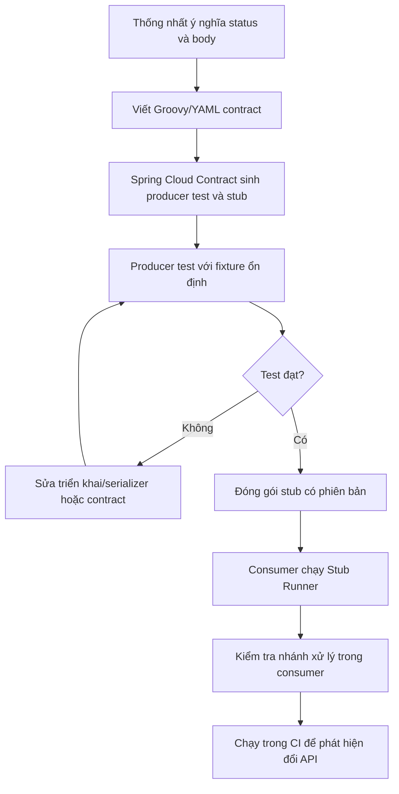

# Phản hồi rỗng, không có body và giá trị null

## 1. Vì sao cần phân biệt ba trường hợp?

Trong kiến trúc microservices, **consumer** nhận HTTP response do **producer** tạo ra. Một response có thể trả mã `204 No Content`, trả `200 OK` nhưng không có dữ liệu, hoặc trả JSON có trường mang giá trị `null`. Nếu consumer nhầm các trường hợp này, ứng dụng có thể báo lỗi giải mã JSON, hiểu nhầm trạng thái giao dịch hoặc làm mất thông tin có ý nghĩa nghiệp vụ.

Khi học **Spring Cloud Contract**, chúng ta dùng **Groovy DSL hoặc YAML DSL** để mô tả hành vi producer đã cam kết. Spring Cloud Contract Verifier sinh kiểm thử trên producer; producer có thể phát hành stub để consumer dùng **Stub Runner**. CI chạy kiểm thử ở cả hai phía để phát hiện thay đổi API không tương thích. Cách mô tả body trong contract vì thế ảnh hưởng trực tiếp đến điều consumer được phép kỳ vọng.

Xét một hệ thống thanh toán:

- `DELETE /api/payments/PAY-1001/reservations`: hủy giữ chỗ thành công, trả `204` và **không có nội dung phản hồi**.
- `GET /api/payments/PAY-1001`: trả JSON giao dịch, trong đó `captureId` bằng `null` vì tiền chưa được thu.
- `GET /api/payments/PAY-1001/events`: trả `200` với danh sách JSON `[]` nếu chưa có sự kiện.
- `GET /api/payments/PAY-1001/notes`: có thể trả `200` với văn bản rỗng nếu API cho phép, nhưng đây là quyết định khác với trả `204`.

Bốn kết quả trên không có cùng ý nghĩa mặc dù đều có thể bị mô tả thiếu chính xác bằng câu “response trống”.

**Mục tiêu bài học:** phân biệt body vắng mặt, body có độ dài bằng 0, cấu trúc JSON rỗng, JSON `null` và thuộc tính JSON `null`; biết viết hợp đồng Groovy/YAML đúng cam kết, kiểm thử cả việc **không có nội dung** khi cần, và kiểm tra producer/stub/consumer trong CI.

## 2. Các trạng thái “rỗng” nhìn trên HTTP

| Dạng phản hồi | Ví dụ phần body trên đường truyền | Ý nghĩa |
| --- | --- | --- |
| **Không có body (no content)** | Không có byte nội dung | Thường đi với `204 No Content`; client không được trông chờ JSON để giải mã. |
| **Body rỗng (zero-length body)** | 0 byte nội dung | Có thể xảy ra với `200`. Về dữ liệu nhận được, không có ký tự nào để parse. |
| **JSON literal `null`** | `null` (4 byte ASCII/UTF-8) | Một tài liệu JSON hợp lệ biểu diễn giá trị null ở cấp gốc; không giống 0 byte. |
| **JSON string rỗng** | `""` (2 byte ASCII/UTF-8) | Một chuỗi JSON hợp lệ có độ dài 0. |
| **JSON object rỗng** | `{}` (2 byte) | Đối tượng JSON hợp lệ, không có thuộc tính. |
| **JSON array rỗng** | `[]` (2 byte) | Danh sách JSON hợp lệ, có 0 phần tử. |
| **Một thuộc tính JSON bằng null** | `{"captureId":null}` | Đối tượng **có khóa** `captureId`, nhưng giá trị của khóa là null. |
| **Không có thuộc tính JSON** | `{}` hoặc đối tượng thiếu `captureId` | Khóa `captureId` **vắng mặt** hoàn toàn. |

Lưu ý: số byte trong bảng chỉ áp dụng cho chuỗi ví dụ không có khoảng trắng và dùng mã hóa ASCII/UTF-8. Một body chỉ chứa dấu cách hoặc xuống dòng **không** có độ dài 0, dù nhìn trên màn hình có vẻ rỗng.

### Body rỗng và không có body có phân biệt được không?

Ở cấp dữ liệu được đọc, hai tình huống “không gửi nội dung” và “gửi nội dung có độ dài 0” đều có thể khiến client thu được mảng byte rỗng. Phân biệt chính xác còn phụ thuộc **status, header và cách đóng khung thông điệp** của HTTP/1.1 hay HTTP/2. Đừng thiết kế logic nghiệp vụ dựa vào việc “có `Content-Length: 0` hay không” nếu API không cam kết điều đó.

Điều consumer thường cần biết là: **API có hứa sẽ có một tài liệu JSON để parse không?** Với `204`, câu trả lời là không. Với `200` cùng `[]` hoặc `{}`, câu trả lời là có và loại JSON của tài liệu khác nhau.

## 3. Chọn status đúng ngữ nghĩa

### 3.1. `204 No Content`: thành công và không có nội dung

`204` thể hiện producer đã xử lý yêu cầu thành công và **không gửi content trong response**. Trường hợp phù hợp gồm hủy một reservation hoặc cập nhật thành công mà client không cần nhận representation mới.

Ví dụ:

```http
DELETE /api/payments/PAY-1001/reservations HTTP/1.1
Host: payment-service

HTTP/1.1 204 No Content
```

Phần minh họa sau dòng trạng thái `204` không có body. Không đính kèm `{}`, `[]` hay `null` vào response `204` chỉ để “cho đủ JSON”; theo ngữ nghĩa HTTP, phản hồi `204` **không có content**. Thông thường cũng không khai báo `Content-Type: application/json` khi thực tế không có representation JSON.

### 3.2. `200 OK` với body rỗng

Một API vẫn có thể trả `200` nhưng phần body có độ dài 0:

```http
HTTP/1.1 200 OK
Content-Length: 0

```

Kết quả này **không tự động đồng nghĩa** với `204`. Cả hai đều có thể khiến consumer đọc được 0 byte, nhưng status mang cam kết khác nhau. Một client đang kỳ vọng JSON theo hợp đồng `200` có thể bị lỗi khi cố parse body rỗng.

Nếu API cần thể hiện “không có dữ liệu để trả”, nhóm producer/consumer nên thống nhất rõ: dùng `204`, hay `200` với cấu trúc JSON có nghĩa, chẳng hạn `[]`. Đừng chuyển qua lại giữa các cách mà không kiểm tra consumer.

### 3.3. Các mã trạng thái khác

- `201 Created` thường được dùng khi tạo tài nguyên mới; response có thể chứa representation, đồng thời header `Location` có thể giúp client truy cập tài nguyên, tùy cam kết API.
- `304 Not Modified` là phản hồi điều kiện và không mang content trong thông điệp.
- Phản hồi của một yêu cầu `HEAD` không mang content, dù `GET` tương ứng có thể trả body.
- `205 Reset Content` cũng không được tạo content theo ngữ nghĩa HTTP.

Việc một response **không có body** không tự động có nghĩa thành công: ý nghĩa phải xét cùng status, phương thức HTTP và điều khoản hợp đồng.

## 4. Groovy DSL: contract `204` không có body

Giả sử Checkout hủy reservation thanh toán. Producer cam kết trả `204` khi thao tác hợp lệ:

```groovy
import org.springframework.cloud.contract.spec.Contract

Contract.make {
    name 'cancel_payment_reservation'
    description 'Hủy giữ chỗ thanh toán thành công, không trả nội dung'

    request {
        method 'DELETE'
        urlPath '/api/payments/PAY-1001/reservations'
    }

    response {
        status 204
        // Không khai báo body.
    }
}
```

Đây là cách thể hiện **ý định response không chứa dữ liệu**: trong khối `response` chỉ có `status`. Một số điểm cần phân biệt:

1. Không khai báo `body` **khác với** `body('null')` và `body([:])`.
2. `204` phải đi cùng triển khai HTTP thực tế không có content.
3. Contract có thể được dùng để sinh producer verification và stub, nhưng việc **bỏ hẳn trường body trong DSL không tự bảo đảm** mã test sinh ra sẽ luôn kiểm tra chính xác độ dài body bằng 0. Cần **xem generated test** và thêm assertion riêng khi “không có byte nội dung” là cam kết quan trọng.
4. Với response `204` không có representation JSON, không cần viết header `Content-Type: application/json` chỉ vì những response khác của dịch vụ dùng JSON.

### Cấu hình tương đương bằng YAML DSL

```yaml
description: Hủy giữ chỗ thanh toán thành công, không trả nội dung
name: cancel_payment_reservation
request:
  method: DELETE
  urlPath: /api/payments/PAY-1001/reservations
response:
  status: 204
```

Trong YAML, **không có khóa `body`**. Viết `body: null` sẽ tạo ra một giá trị null trong **cấu trúc YAML**; điều đó không phải cách đáng tin cậy để yêu cầu “trả đúng bốn byte `null` dưới dạng JSON”. Với hợp đồng 204, hãy **bỏ trường body**.

Chọn một trong hai file Groovy/YAML làm định nghĩa chính cho kịch bản trong một dự án để tránh sinh các contract trùng nhau.

### Kiểm thử bổ sung khi bắt buộc không có byte nội dung

Một bài test HTTP viết tay bằng Spring MockMvc có thể kiểm tra cả status và body:

```java
import static org.springframework.test.web.servlet.request.MockMvcRequestBuilders.delete;
import static org.springframework.test.web.servlet.result.MockMvcResultMatchers.content;
import static org.springframework.test.web.servlet.result.MockMvcResultMatchers.status;

@Test
void cancelReservationReturnsNoContent() throws Exception {
    mockMvc.perform(delete("/api/payments/PAY-1001/reservations"))
        .andExpect(status().isNoContent())
        .andExpect(content().string(""));
}
```

Ví dụ giả định một `MockMvc` đã được inject và fixture có reservation `PAY-1001`; cần bổ sung import và cấu hình JUnit/Spring Test của dự án. Assertion `content().string("")` kiểm tra phần nội dung trả về là chuỗi rỗng tại lớp MockMvc. Nếu hệ thống có yêu cầu bắt buộc về header, thêm kiểm tra header **theo đúng hợp đồng**. Với HTTP client thật, có thể kiểm tra `byte[]` nhận được có độ dài 0.

## 5. Body rỗng `''`: trường hợp cần thận trọng

Groovy DSL có thể biểu diễn chuỗi rỗng như:

```groovy
import org.springframework.cloud.contract.spec.Contract

Contract.make {
    name 'empty_notes_text'

    request {
        method 'GET'
        urlPath '/api/payments/PAY-1001/notes-text'
    }

    response {
        status 200
        body('')
    }
}
```

Ý định ở đây là **body văn bản rỗng** cùng status `200`, khác với đối tượng JSON rỗng. Tuy nhiên:

- Chuỗi rỗng chứa 0 ký tự, nên có thể không tạo ra khác biệt quan sát được ở byte body so với trường hợp không khai báo body.
- Tùy phiên bản và bộ chuyển đổi contract sang test/stub, khai báo `body('')` có thể cần được kiểm tra kỹ trong **generated producer test** để xác nhận test thực sự assert nội dung rỗng.
- Nếu hệ thống muốn cam kết chính xác `200` với 0 byte, nên thêm một kiểm thử HTTP assertion `status = 200` và `content().string("")`, tương tự ví dụ ở phần trước.
- Không dùng `body('')` để thể hiện JSON string rỗng `""`: về byte, đó là **hai dấu ngoặc kép**, không phải chuỗi body có độ dài 0.

Trong YAML, một chuỗi rỗng được biểu diễn dưới dạng `body: ""`, nhưng cần kiểm tra kết quả sinh test và stub của phiên bản được dùng trước khi dựa vào nó để bảo đảm body có độ dài 0. Cũng không nên dùng `body:` không có giá trị như một cách viết tắt tùy tiện: YAML thường hiểu giá trị trống là `null`.

## 6. JSON rỗng: `{}` và `[]` vẫn có dữ liệu

Hai tình huống nghiệp vụ rất phổ biến:

**Danh sách không có phần tử:**

```http
HTTP/1.1 200 OK
Content-Type: application/json

[]
```

**Đối tượng không có thuộc tính:**

```http
HTTP/1.1 200 OK
Content-Type: application/json

{}
```

Chúng **không** phải response không có body. Consumer có thể parse `[]` thành danh sách 0 phần tử và `{}` thành đối tượng không có field.

### Groovy DSL cho danh sách rỗng

```groovy
import org.springframework.cloud.contract.spec.Contract

Contract.make {
    name 'payment_events_empty'

    request {
        method 'GET'
        urlPath '/api/payments/PAY-1001/events'
    }

    response {
        status 200
        headers {
            contentType(applicationJson())
        }
        body([])
    }
}
```

Ở đây `body([])` là **Groovy list rỗng**, được dùng làm JSON array rỗng. Đừng nhầm với `body('')`, vốn là một **String**.

Với JSON object rỗng, dùng `body([:])` (ký hiệu **map rỗng** trong Groovy), nếu phiên bản DSL đang dùng chuyển nó đúng thành `{}`. Hãy xem generated stub và producer test của plugin cụ thể, bởi sự khác biệt giữa list/map rỗng có thể bị ảnh hưởng bởi quá trình tuần tự hóa nếu cấu hình sai.

### YAML DSL cho array rỗng

```yaml
description: Giao dịch chưa có sự kiện
name: payment_events_empty
request:
  method: GET
  urlPath: /api/payments/PAY-1001/events
response:
  status: 200
  headers:
    Content-Type: application/json
  body: []
```

Trong YAML, `body: []` là **list**, `body: {}` là **map**, và `body: ""` là **chuỗi rỗng**. Ba giá trị khác nhau cả về kiểu dữ liệu lẫn ý nghĩa nghiệp vụ.

## 7. Thuộc tính JSON mang giá trị `null`

Giả sử Payment trả thông tin giao dịch **đã được cấp phép nhưng chưa thu tiền**:

```http
HTTP/1.1 200 OK
Content-Type: application/json

{
  "paymentId": "PAY-1001",
  "status": "AUTHORIZED",
  "captureId": null
}
```

Hợp đồng nghiệp vụ có thể quy định rằng:

- `paymentId` xác định giao dịch cần tra cứu.
- `status = AUTHORIZED` nghĩa là ngân hàng đã cấp phép nhưng giao dịch chưa capture.
- `captureId = null` cho biết **trường này có tồn tại trong JSON nhưng chưa có mã capture**.

Nếu producer trả `"captureId": "null"` (chuỗi ký tự) thì **sai kiểu dữ liệu**. Nếu producer bỏ hẳn `captureId` thì **khác hợp đồng**, nếu sự hiện diện của khóa là cam kết đối với consumer.

### 7.1. Groovy DSL: map với trường null

```groovy
import org.springframework.cloud.contract.spec.Contract

Contract.make {
    name 'get_authorized_payment'

    request {
        method 'GET'
        urlPath '/api/payments/PAY-1001'
    }

    response {
        status 200
        headers {
            contentType(applicationJson())
        }
        body([
            paymentId: 'PAY-1001',
            status: 'AUTHORIZED',
            captureId: null
        ])
        bodyMatchers {
            jsonPath('$.captureId', byNull())
        }
    }
}
```

Spring Cloud Contract hỗ trợ matcher `byNull()` ở phía kiểm thử response; matcher này giúp xác minh giá trị tại JSONPath là null. Điều quan trọng là **dữ liệu mẫu cũng phải biểu diễn `captureId: null`**, để generated stub cung cấp thông tin nhất quán với hợp đồng.

Khi yêu cầu **khóa `captureId` phải hiện diện** là điều kiện bắt buộc, đừng chỉ dựa vào việc có matcher `byNull()`: cách xử lý JSONPath không tìm thấy khóa có thể khác giữa thư viện/phiên bản. Cần thêm assertion tường minh về sự **tồn tại của key**. Phần 9 có ví dụ kiểm tra null khác với thiếu key bằng Jackson.

### 7.2. YAML DSL: `null` không đặt trong dấu nháy

```yaml
description: Giao dịch đã được cấp phép nhưng chưa thu tiền
name: get_authorized_payment
request:
  method: GET
  urlPath: /api/payments/PAY-1001
response:
  status: 200
  headers:
    Content-Type: application/json
  body:
    paymentId: PAY-1001
    status: AUTHORIZED
    captureId: null
  matchers:
    body:
      - path: $.captureId
        type: by_null
        value: null
```

Ba dạng YAML thường bị nhầm:

```yaml
captureId: null      # YAML null -> JSON null khi nằm trong object body
captureId: "null"    # String bốn ký tự n-u-l-l
captureId: ""        # String rỗng, vẫn KHÁC null
```

Giá trị null trong **thuộc tính của object body** có ý nghĩa khác với khai báo `body: null` tại gốc response. Ở cấp gốc, YAML null còn có thể bị DSL hiểu là thiếu body; nếu muốn trả **JSON literal null ở cấp gốc**, cần kiểm tra cẩn thận cách generator của phiên bản cụ thể chuyển đổi payload, hoặc xác minh trực tiếp bằng test HTTP.

### 7.3. Cẩn thận với cấu hình serializer

Producer có thể dùng Jackson với cấu hình bỏ qua các thuộc tính null, chẳng hạn `JsonInclude.Include.NON_NULL`. Khi đó Java object có `captureId = null` có thể được tuần tự hóa thành:

```json
{
  "paymentId": "PAY-1001",
  "status": "AUTHORIZED"
}
```

Đây là **JSON khác** so với mẫu đã khai báo có `"captureId": null`. Nếu contract yêu cầu trường null xuất hiện, hãy cấu hình serializer đáp ứng đúng cam kết và viết test có khả năng phát hiện sự thiếu vắng. Nếu hai bên thống nhất bỏ khóa khi chưa có giá trị, hãy điều chỉnh hợp đồng theo đó, thay vì cố bắt mọi response có `captureId: null`.

## 8. JSON literal `null` ở cấp gốc

Một response có thể chứa đúng bốn byte `null`:

```http
HTTP/1.1 200 OK
Content-Type: application/json

null
```

Đó là **một tài liệu JSON hợp lệ với giá trị gốc là null**. Nó khác với:

- Response không có content: **0 byte**.
- JSON string `"null"`: sáu byte gồm dấu ngoặc kép và bốn chữ cái.
- JSON object `{"value":null}`: một đối tượng có thuộc tính null.

API trả JSON null ở cấp gốc thường khó dùng hơn một cấu trúc được tài liệu hóa rõ, đặc biệt khi client dùng các bộ giải mã có cách xử lý null/empty khác nhau. Vì vậy trước khi sử dụng, producer và consumer cần thống nhất kiểu trả về và cách giải mã.

**Lưu ý với contract DSL:** không coi `body(null)` hoặc `body: null` là cú pháp chắc chắn tạo bốn byte `null`. Tại các điểm chuyển đổi Groovy/YAML sang model contract, `null` có thể là dấu hiệu “không cấu hình body”. Khi yêu cầu JSON null ở cấp gốc, hãy kiểm tra generated mapping/test cho đúng phiên bản Spring Cloud Contract và bổ sung test HTTP kiểm tra nội dung thực:

```java
@Test
void rootNullIsAJsonLiteral() throws Exception {
    mockMvc.perform(get("/api/payments/PAY-1001/nullable-result"))
        .andExpect(status().isOk())
        .andExpect(content().contentTypeCompatibleWith(
            MediaType.APPLICATION_JSON))
        .andExpect(content().string("null"));
}
```

Đây là ví dụ assertion viết tay; cần import `get`, `status`, `content` và `MediaType`, đồng thời cần endpoint thật trả JSON literal `null`. Test này **khác** với kiểm tra `content().string("")`, vốn xác nhận 0 ký tự. Với các cấu hình/generator có khả năng biểu diễn JSON literal null, hãy giữ đúng một contract nguồn đã được kiểm chứng và không đánh đồng với missing body.

## 9. Phân biệt key vắng mặt, key null và key là chuỗi rỗng trong producer test

Ba JSON dưới đây không tương đương:

```json
{"paymentId":"PAY-1001"}
```

```json
{"paymentId":"PAY-1001","captureId":null}
```

```json
{"paymentId":"PAY-1001","captureId":""}
```

Nếu consumer dùng mô hình kiểu:

```text
captureId vắng mặt  -> producer chưa hỗ trợ trường này / hợp đồng cũ
captureId = null    -> đã hỗ trợ trường, chưa có capture
captureId = ""      -> giá trị không hợp lệ nếu ID bắt buộc không rỗng
```

thì một thay đổi serializer âm thầm lược bỏ trường null có thể làm consumer mất khả năng phân biệt các trạng thái.

### Kiểm tra rõ ràng bằng Jackson

Trong kiểm thử producer, có thể kiểm tra trực tiếp nội dung JSON bằng `JsonNode`:

```java
import com.fasterxml.jackson.databind.JsonNode;
import com.fasterxml.jackson.databind.ObjectMapper;
import org.junit.jupiter.api.Test;
import static org.assertj.core.api.Assertions.assertThat;

class PaymentResponseShapeTest {

    private final ObjectMapper mapper = new ObjectMapper();

    @Test
    void captureIdExistsButIsNull() throws Exception {
        String json = """
            {"paymentId":"PAY-1001","captureId":null}
            """;

        JsonNode root = mapper.readTree(json);

        assertThat(root.has("captureId")).isTrue();
        assertThat(root.get("captureId").isNull()).isTrue();
        assertThat(root.get("captureId").isTextual()).isFalse();
    }
}
```

Đây là một **test minh họa cách kiểm tra JSON**. Trong producer verification thật, `json` phải lấy từ HTTP response thực tế, chẳng hạn nội dung trả về từ MockMvc, thay vì một string viết cứng như trên. Ý nghĩa nằm ở:

- `root.has("captureId")` kiểm tra khóa **thật sự có mặt**; Jackson coi khóa có JSON null vẫn là có mặt.
- `root.get("captureId").isNull()` kiểm tra giá trị đúng là JSON null.
- `root.get("captureId").isTextual()` giúp tránh nhầm `"null"` hoặc `""` là null.

Với trường vắng mặt, `root.has("captureId")` là `false` và `root.get("captureId")` thường trả Java `null`. Không gọi `root.get("captureId").isNull()` khi chưa kiểm tra khóa tồn tại, vì có thể phát sinh `NullPointerException`.

Nếu yêu cầu “trường **không được xuất hiện**” là cam kết quan trọng, hãy thêm assertion `assertThat(root.has("captureId")).isFalse()` trên HTTP response thật. Một contract chỉ bỏ `captureId` khỏi body mẫu chưa chắc đủ để cấm producer trả thêm trường, do cơ chế so khớp có thể cho phép thuộc tính bổ sung.

## 10. Producer verification, stub và consumer sẽ thấy gì?

Các kịch bản trên có thể đi qua cùng luồng Spring Cloud Contract:



| Contract | Producer cần đáp ứng | Consumer cần xử lý |
| --- | --- | --- |
| `DELETE /reservations` → `204` | Trả đúng status và không tạo content theo HTTP; thêm test 0 byte khi cần. | Không gọi JSON deserializer trên body không tồn tại. |
| `GET /events` → `200`, `[]` | Trả array JSON hợp lệ, rỗng. | Dùng danh sách 0 phần tử; không coi là lỗi parse. |
| `GET /payment` → `200`, `captureId: null` | Giữ nguyên key với giá trị JSON null nếu đó là cam kết. | Hiểu đây là chưa capture; không nhầm chuỗi `"null"`. |
| `GET /notes-text` → `200`, body rỗng | Giữ status và nội dung 0 byte nếu đã cam kết. | Không cố parse JSON từ 0 byte. |
| `GET /nullable-result` → `200`, literal `null` | Trả đúng JSON literal khi thật sự là thiết kế API. | Phân biệt JSON null với body không có nội dung. |

### 10.1. Consumer dùng `ResponseEntity<Void>` cho `204`

Trong Spring, một client có thể xử lý kết quả thành công không có body bằng kiểu `Void` thay vì ép thành DTO:

```java
ResponseEntity<Void> result = restTemplate.exchange(
    "/api/payments/PAY-1001/reservations",
    HttpMethod.DELETE,
    HttpEntity.EMPTY,
    Void.class
);

if (result.getStatusCode().value() == 204) {
    // Reservation đã được hủy theo cam kết.
}
```

Đoạn này giả định `restTemplate` đã được tạo và cấu hình base URL/host phù hợp; trong Spring WebClient hoặc HTTP client khác, có cách tương đương để tiêu thụ response không có body. Với mã lỗi HTTP, client vẫn phải xử lý nhánh lỗi tương ứng. Không nên gọi một DTO JSON deserializer trên response `204` rồi coi lỗi parse là lỗi từ producer.

### 10.2. Stub Runner và các kết quả khác nhau

Stub Runner có thể khởi động các stub đã được sinh từ contract, cho phép consumer kiểm thử các nhánh response mà không cần chạy producer thật. Nên chuẩn bị contract riêng cho:

- Hủy thành công trả `204`.
- Lấy danh sách rỗng trả `200` với `[]`.
- Lấy thông tin thanh toán trả `200` với thuộc tính `captureId: null`.

Stub giúp kiểm tra hành vi consumer với **dữ liệu đã mô tả**, nhưng không tự chứng minh producer đã thực hiện đúng trong môi trường thật. Producer verification phải chạy trên code producer; consumer test phải đi qua client và logic nghiệp vụ thực tế. Ví dụ consumer nhận `captureId: null` cần từ chối hành động “hoàn tất capture”, chứ không chỉ assert “stub trả status 200”.

### 10.3. Tích hợp CI

Quy trình đề xuất:

1. Review contract để thống nhất **status và hình dạng body** của từng kịch bản, kể cả khi body vắng mặt.
2. Sinh và chạy producer verification tests; xác nhận CI thực sự phát hiện và thực thi các test được sinh.
3. Nếu cam kết yêu cầu body 0 byte, JSON root `null` hoặc key vắng mặt/hiện diện, bổ sung những assertion mà generated test chưa bao phủ.
4. Phát hành artifact stub **đã được version hóa** sau khi producer verification đạt.
5. Consumer tải đúng phiên bản stub bằng Stub Runner, xác minh cả nhánh xử lý `204` và `200` có JSON null/array rỗng.
6. Khi thay đổi response, chạy kiểm tra tương thích với những consumer còn được hỗ trợ trước khi công bố API mới.

Không thay đổi từ `204` sang `200` + `{}`, từ `[]` sang body rỗng hoặc từ `null` sang thiếu key mà không đánh giá tác động. Cả ba đều có thể làm hỏng client dù pipeline producer mới vẫn xanh nếu chỉ kiểm tra hợp đồng mới.

## 11. Những lỗi thường gặp

| Sai lầm | Vì sao sai | Cách xử lý |
| --- | --- | --- |
| Dùng `204` nhưng controller trả `{}` | `204` không mang content theo HTTP. | Trả không có body; test status và độ dài body khi cần. |
| Nghĩ `body: null` trong YAML luôn tạo JSON literal `null` | YAML null có thể biểu thị không có giá trị cấu hình. | Xem generated mapping/test; test HTTP raw `null` nếu nghiệp vụ yêu cầu. |
| Nghĩ `body('')` bằng `body([])` | Một bên là chuỗi rỗng, một bên là list rỗng. | Dùng kiểu body phù hợp: 0 byte, `[]` hoặc `{}`. |
| Trả `"captureId": "null"` | Đây là string, không phải JSON null. | Trả `"captureId": null` khi đó là hợp đồng. |
| Dùng serializer tự động lược bỏ null | Consumer có thể phân biệt key thiếu với key null. | Thống nhất quy tắc JSON và kiểm tra sự hiện diện của trường. |
| Bỏ body khỏi contract rồi tuyên bố đã kiểm tra 0 byte | Generated test có thể chỉ kiểm tra status. | Kiểm tra code test sinh ra và thêm assertion riêng cho body rỗng. |
| Stub `204` nhưng client luôn gọi `.getBody()` như DTO | Body không được bảo đảm tồn tại. | Dùng cách tiêu thụ response không body, ví dụ `Void`. |
| Test chỉ có `200` với JSON dữ liệu | Không bao phủ nhánh `204`, `[]`, `null`. | Tạo contract riêng cho những nhánh consumer thật sự phụ thuộc. |
| Đổi status/body rồi chỉ cập nhật contract mới | Không phát hiện consumer cũ bị phá vỡ. | Chạy lại test consumer còn được hỗ trợ với stub phiên bản thích hợp. |

## 12. Bài tập thực hành

Một dịch vụ `inventory-service` hỗ trợ hai endpoint cho `checkout-service`:

```text
DELETE /api/reservations/RES-1001
GET    /api/reservations/RES-1001
```

Nhóm thống nhất:

- `DELETE` thành công trả `204` và **không có byte nội dung**.
- `GET` khi reservation đang chờ xác nhận trả `200` và JSON có `reservationId: "RES-1001"`, `status: "PENDING"`, `confirmedAt: null`.
- Nếu reservation không còn tồn tại, API trả `404` với JSON lỗi đã thỏa thuận; không tự suy ra `404` phải không có body.

**Yêu cầu:**

1. Viết Groovy contract `DELETE` với `status 204` và không khai báo body.
2. Viết bản YAML tương đương; giải thích vì sao bỏ hẳn `body` thích hợp hơn `body: null` trong tình huống này.
3. Viết Groovy contract `GET` với body map có `confirmedAt: null` và matcher `jsonPath('$.confirmedAt', byNull())`.
4. Viết YAML contract `GET` với `confirmedAt: null` và matcher `type: by_null`.
5. Tạo một ví dụ response khác thiếu hẳn `confirmedAt`; giải thích vì sao nó có thể vi phạm contract, và dùng `JsonNode.has()` để chứng minh sự khác biệt.
6. Giả sử một producer trả `200` và `[]` để báo không có bản ghi. Hãy giải thích điều gì khác với `204` và vì sao consumer phải parse JSON array thay vì coi như không có body.
7. Trong CI, kiểm tra test producer được sinh, thêm assertion `content().string("")` cho `204`, phát hành stub và dùng Stub Runner để consumer kiểm thử không giải mã JSON từ response 204.

**Gợi ý tự kiểm:** bài làm đúng khi phân biệt **trạng thái HTTP**, **số byte của body**, **kiểu JSON**, **sự tồn tại của trường** và **giá trị null**. Một contract tốt phải bảo vệ hành vi mà consumer thật sự sử dụng, không chỉ có status code.

## 13. Ghi nhớ

- **Không có body**: không có content trong response; `204 No Content` là tình huống điển hình và không được kèm JSON `{}`, `[]` hay `null`.
- **Body rỗng**: độ dài nội dung bằng 0; đừng nhầm với JSON string rỗng `""` có hai byte hoặc JSON literal `null` có bốn byte.
- **JSON `{}` và `[]`**: đều là tài liệu JSON hợp lệ, nhưng khác loại, khác ý nghĩa nghiệp vụ và khác với không có body.
- **Trường `"field": null`**: có khóa, giá trị là JSON null; khác với `"field": "null"` và khác với việc không tồn tại khóa.
- **Groovy DSL**: bỏ `body` khi không mô tả body; dùng `body([field: null])` và `byNull()` để mô tả giá trị null trong object JSON khi cần.
- **YAML DSL**: `body: []`, `body: {}`, `body: ""` và `body: { field: null }` là các loại dữ liệu khác nhau; không coi `body: null` là cách chắc chắn sinh JSON literal null ở cấp gốc.
- **Kiểm thử contract**: xem generated producer test, bổ sung assertion nếu cần chắc chắn về 0 byte/key hiện diện, rồi phát hành stub có phiên bản và kiểm tra consumer qua Stub Runner trong CI.

### Tài liệu tham khảo

- [Spring Cloud Contract — HTTP Contracts](https://docs.spring.io/spring-cloud-contract/reference/project-features-contract/http.html): phản hồi HTTP có status bắt buộc và body không bắt buộc.
- [Spring Cloud Contract — Contract DSL](https://docs.spring.io/spring-cloud-contract/reference/project-features-contract.html): cú pháp Groovy/YAML, response body và matcher `by_null`.
- [Spring Cloud Contract — Dynamic Properties](https://docs.spring.io/spring-cloud-contract/reference/project-features-contract/dsl-dynamic-properties.html): `jsonPath(..., byNull())` và matcher phía producer.
- [Spring Cloud Contract — Stub Runner](https://docs.spring.io/spring-cloud-contract/reference/project-features-stubrunner.html): chạy stub trong bài kiểm thử consumer.
- [RFC 9110 — HTTP Semantics](https://www.rfc-editor.org/rfc/rfc9110.html): ý nghĩa `204`, `205`, `304` và content của HTTP response.
