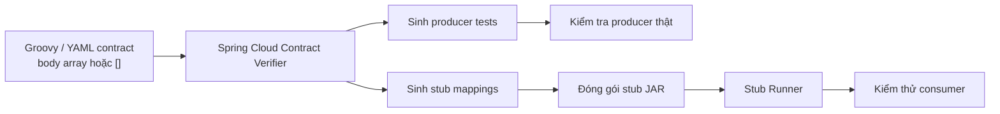

# Phản hồi dạng mảng và danh sách không có phần tử

## 1. Vì sao phải kiểm thử phản hồi dạng mảng?

Trong **Spring Cloud Contract**, hợp đồng mô tả những hành vi HTTP hoặc thông điệp mà **producer** cam kết cung cấp cho **consumer**. Một trong những hành vi dễ bị xem nhẹ nhất là kết quả trả về danh sách: danh sách có phần tử, danh sách rỗng, phần tử có cấu trúc sai hoặc kiểu dữ liệu bất ngờ.

Xét một API tìm kiếm đơn hàng:

```http
GET /api/orders?state=PAID
Accept: application/json
```

Khi có dữ liệu, producer có thể trả:

```json
[
  {"id": 42, "state": "PAID", "totalAmount": 120000},
  {"id": 43, "state": "PAID", "totalAmount": 80000}
]
```

Khi không có đơn hàng phù hợp, API có thể cam kết:

```http
HTTP/1.1 200 OK
Content-Type: application/json

[]
```

**Hai phản hồi trên đều là JSON array hợp lệ**, nhưng kiểm thử phải xác minh thêm số lượng, kiểu dữ liệu, cấu trúc phần tử và ý nghĩa của trường hợp rỗng. Consumer có thể dùng `[]` để hiển thị “Chưa có đơn hàng”. Nếu producer đổi thành `null` hoặc `{}`, mã HTTP vẫn là `200` nhưng consumer có thể lỗi khi duyệt danh sách.

Bài này thuộc chương **Response HTTP** của module Spring Cloud Contract. Nội dung sử dụng cả **Groovy DSL** và **YAML DSL**, minh họa cách sinh kiểm thử phía producer, phát hành **stub**, dùng **Stub Runner** và đưa kiểm tra tương thích vào CI.

## 2. Phân biệt array, object chứa array và trường hợp không có dữ liệu

### 2.1. Các biểu diễn không tương đương

| Phản hồi | Kiểu dữ liệu | Ý nghĩa có thể có | Rủi ro tương thích |
|---|---|---|---|
| `[]` | JSON array rỗng ở root | Kết quả tìm kiếm hợp lệ nhưng không có bản ghi | Consumer phải nhận kiểu list |
| `[{"id":42}]` | JSON array có phần tử | Một tập hợp bản ghi | Cần kiểm tra schema phần tử |
| `{"items":[]}` | JSON object với thuộc tính `items` là array rỗng | Danh sách được bọc cùng metadata | Khác hoàn toàn với root array |
| `{"items":null}` | Object với `items` bằng JSON null | Chưa có dữ liệu, không xác định hoặc API xử lý đặc biệt | Code duyệt `items` có thể lỗi |
| `{}` | Object không có `items` | Thuộc tính bị bỏ qua | Không giống `items: []` |
| `null` | JSON null ở root | Không có đối tượng giá trị | Không phải array |
| `204 No Content` | Không có response body | Một lựa chọn API khác | Consumer không thể đọc JSON array từ body |

Các biểu diễn này **không thể hoán đổi tùy ý** chỉ vì tất cả đều có thể được mô tả là “không có kết quả”. Contract phải kiểm tra biểu diễn mà consumer thực sự sử dụng.

Ví dụ, API tìm kiếm có thể dùng `200 + []` cho danh sách rỗng. Nhưng API `GET /api/orders/9999` lấy **một tài nguyên theo ID** có thể dùng `404 Not Found` khi ID không tồn tại. Quy tắc cho truy vấn tập hợp và quy tắc cho một tài nguyên là hai cam kết khác nhau.

### 2.2. Mảng root so với object bao danh sách

**Array tại root:**

```json
[
  {"id": 42, "state": "PAID"}
]
```

**Object bao array:**

```json
{
  "items": [
    {"id": 42, "state": "PAID"}
  ],
  "total": 1
}
```

Nếu consumer hiện đang deserialize response thành `List<OrderDto>`, việc chuyển sang `{"items": [...]}` thường là **breaking change** dù thông tin nghiệp vụ vẫn hiện diện. Ngược lại, consumer đã dùng `Page<OrderDto>` hoặc DTO bao danh sách có thể cần `items` và `total` luôn tồn tại, kể cả khi mảng rỗng.

### 2.3. Phải công bố ý nghĩa của “rỗng”

Trước khi viết hợp đồng, trả lời:

1. Danh sách rỗng có phải là **kết quả thành công** không?
2. Trường hợp không có dữ liệu trả **`200 + []`**, **`200 + {"items": []}`**, **`204`** hay một mã lỗi?
3. Có cam kết rằng thuộc tính mảng **luôn xuất hiện**, kể cả khi rỗng không?
4. Nếu có phân trang, `total`, `page`, `hasNext` có giá trị gì khi không có kết quả?
5. Thứ tự phần tử có mang ý nghĩa hay chỉ là tập hợp không thứ tự?

Những câu trả lời trên là phần của hợp đồng API. DSL phải phản ánh đúng các quy tắc này thay vì chỉ kiểm tra mã `200`.

## 3. Mô tả JSON array ở root bằng Groovy DSL

Ví dụ producer `order-service` công bố `GET /api/orders?state=PAID`. Dữ liệu test chuẩn bị đúng hai đơn hàng, trả response array ở root:

```groovy
import org.springframework.cloud.contract.spec.Contract

Contract.make {
    description 'Danh sách đơn hàng đã thanh toán ở root JSON array'

    request {
        method GET()
        url '/api/orders?state=PAID'
        headers {
            header 'Accept', 'application/json'
        }
    }

    response {
        status OK()
        headers {
            contentType(applicationJson())
        }
        body([
            [id: 42, state: 'PAID', totalAmount: 120000],
            [id: 43, state: 'PAID', totalAmount: 80000]
        ])
    }
}
```

Trong Groovy, `[...]` có thể biểu diễn **List**. Mỗi `[id: 42, ...]` bên trong là một **Map**, được chuyển thành JSON object. Vì vậy, `body([[id: 42], [id: 43]])` diễn đạt một **array gồm hai object**, không phải object có hai key.

Khi plugin Verifier được cấu hình đúng, Spring Cloud Contract sinh kiểm thử phía producer với request mẫu và kiểm tra response theo kỳ vọng trong DSL. Đồng thời, hợp đồng có thể sinh stub trả body mẫu cho consumer test.

**Điều cần chú ý:** đây là một kịch bản dữ liệu đã chuẩn bị. Nó không khẳng định API thực tế **luôn có đúng hai** đơn hàng `PAID`. Nếu kết quả là dữ liệu động, cần cân nhắc matcher phù hợp và vẫn có test riêng cho các quy tắc nghiệp vụ quan trọng.

### 3.1. Cùng kịch bản bằng YAML DSL

Ví dụ file `get-paid-orders.yml`:

```yaml
description: Danh sách đơn hàng đã thanh toán ở root JSON array
request:
  method: GET
  url: /api/orders?state=PAID
  headers:
    Accept: application/json
response:
  status: 200
  headers:
    Content-Type: application/json
  body:
    - id: 42
      state: PAID
      totalAmount: 120000
    - id: 43
      state: PAID
      totalAmount: 80000
```

Dấu `-` trong YAML thể hiện từng phần tử của sequence. Khi sequence nằm trực tiếp dưới `body`, phản hồi được mô tả là **JSON array tại root**.

### 3.2. Các lỗi hay mắc với array

- Viết `body(id: 42, state: 'PAID')` sẽ mô tả **một JSON object**, không phải array chứa object đó.
- Viết `body([[id: 42]])` mô tả **array có một object**.
- Viết `body([])` mô tả **array rỗng**.
- Viết `body(items: [])` mô tả **object có thuộc tính `items` là array rỗng**.
- Viết `body([[]])` mô tả **array có một phần tử mà phần tử ấy cũng là array rỗng**; không tương đương `[]`.

Khi dùng Groovy DSL, cách đặt dấu ngoặc tròn/vuông tác động trực tiếp đến JSON được sinh. Khi review hợp đồng, hãy đọc phần body như một cấu trúc dữ liệu, không chỉ như chuỗi ký tự.

## 4. Hợp đồng cho danh sách rỗng tại root

### 4.1. Groovy DSL: kiểm tra `200 + []`

Khi lọc `state=CANCELLED` mà fixture không có bản ghi phù hợp, producer phải trả một JSON array rỗng:

```groovy
import org.springframework.cloud.contract.spec.Contract

Contract.make {
    description 'Không có đơn hàng phù hợp thì trả mảng JSON rỗng'

    request {
        method GET()
        url '/api/orders?state=CANCELLED'
        headers {
            header 'Accept', 'application/json'
        }
    }

    response {
        status OK()
        headers {
            contentType(applicationJson())
        }
        body([])
    }
}
```

Hợp đồng này bảo vệ **ba điều quan trọng**:

1. Request cụ thể được coi là hợp lệ và producer trả HTTP `200`.
2. Body là một JSON array, đồng thời **không có phần tử**.
3. Response có `Content-Type` phù hợp để consumer giải mã JSON.

Nếu producer đổi body từ `[]` sang `null` hoặc `{}`, kiểm thử response theo nội dung đã mô tả phải chỉ ra khác biệt. Nếu producer đổi sang `204`, assertion về mã trạng thái và body cũng cần thất bại.

### 4.2. YAML DSL: dấu `[]` là body hợp lệ

```yaml
description: Kết quả tìm kiếm rỗng có status 200 và JSON array
request:
  method: GET
  url: /api/orders?state=CANCELLED
response:
  status: 200
  headers:
    Content-Type: application/json
  body: []
```

Ở đây `body: []` là **giá trị YAML sequence rỗng**, biểu diễn JSON array rỗng. Không nên thay bằng:

```yaml
# Sai mục tiêu nếu API cam kết []:
body: null
```

Và cũng không nên xóa hẳn `body`; việc không mô tả nội dung body trong hợp đồng không tương đương với khẳng định body phải là `[]`.

### 4.3. Đừng dùng matcher quá rộng để kiểm tra “rỗng”

Một matcher chỉ khẳng định giá trị có kiểu **array** có thể cho phép cả `[]` và `[{"id":42}]`. Nếu mục tiêu là kiểm tra **không có phần tử**, hãy giữ một hợp đồng riêng với `body([])` hoặc `body: []` và quan sát kiểm thử sinh ra. Trường hợp cần ràng buộc kích thước chính xác mà DSL hiện tại không thể hiện rõ, có thể bổ sung kiểm thử producer trực tiếp, tránh suy diễn rằng một type matcher luôn xác minh độ dài bằng 0.

## 5. Object chứa danh sách: `items: []` và metadata

Nhiều API trả một object để có chỗ cho metadata phân trang:

```json
{
  "items": [],
  "totalElements": 0,
  "page": 0,
  "pageSize": 20,
  "hasNext": false
}
```

Trong trường hợp này, hợp đồng phải giữ cả **thuộc tính `items`** và các metadata mà consumer dựa vào.

### 5.1. Groovy DSL

```groovy
import org.springframework.cloud.contract.spec.Contract

Contract.make {
    description 'Trang đầu tiên rỗng và metadata phân trang nhất quán'

    request {
        method GET()
        url '/api/orders?state=CANCELLED&page=0&size=20'
    }

    response {
        status OK()
        headers {
            contentType(applicationJson())
        }
        body(
            items: [],
            totalElements: 0,
            page: 0,
            pageSize: 20,
            hasNext: false
        )
    }
}
```

### 5.2. YAML DSL

```yaml
description: Trang kết quả rỗng nhưng vẫn có metadata
request:
  method: GET
  url: /api/orders?state=CANCELLED&page=0&size=20
response:
  status: 200
  headers:
    Content-Type: application/json
  body:
    items: []
    totalElements: 0
    page: 0
    pageSize: 20
    hasNext: false
```

Những điểm cần kiểm tra thêm trong ứng dụng:

- `totalElements = 0` có thực sự tương ứng với điều kiện lọc hiện tại không?
- `page` là chỉ số bắt đầu từ `0` hay từ `1`? Consumer có dùng chỉ số đó không?
- `pageSize` là kích thước đã áp dụng hay số phần tử thực tế của trang?
- `hasNext = false` khi không có kết quả có đúng định nghĩa API không?
- Nếu `items` rỗng, các trường metadata có còn **đúng kiểu** số/boolean không?

Ví dụ này minh họa một quy ước phân trang cụ thể. **Spring Cloud Contract không tự quyết định** tên trường hay cách tính metadata; producer và consumer phải thống nhất trước.

## 6. Kiểm tra array có phần tử: chính xác hay linh hoạt?

Không phải danh sách nào cũng cần so khớp từng phần tử cố định. Chọn phương thức kiểm tra theo **cam kết về thứ tự, số lượng và kiểu dữ liệu**.

| Mục tiêu hợp đồng | Cách tiếp cận | Khi nào phù hợp |
|---|---|---|
| Phải trả một danh sách cố định có 2 bản ghi | Body mẫu cụ thể, kiểm tra các giá trị kỳ vọng | Fixture nhỏ và kịch bản có dữ liệu xác định |
| Phải có ít nhất 1 và nhiều nhất 20 phần tử | `byType` với `minOccurrence`/`maxOccurrence` trong `bodyMatchers` ở vị trí JSONPath phù hợp | Số lượng có thể thay đổi nhưng có giới hạn |
| Mỗi phần tử phải có ID đúng định dạng | JSONPath tới ID từng phần tử và matcher regex | ID do producer sinh động |
| Phải giữ thứ tự mới nhất trước | Assertion/kịch bản về thứ tự với fixture đã kiểm soát | Consumer thực sự dựa vào thứ tự |
| Chỉ yêu cầu danh sách rỗng | Body đúng `[]` hoặc `items: []` | Kiểm tra không có phần tử |
| Phải có schema nhất quán giữa các phần tử | Matcher cho trường/kiểu dữ liệu kèm producer test bổ sung nếu cần | Danh sách động với nhiều bản ghi |

### 6.1. Ví dụ `bodyMatchers` với kích thước danh sách

Giả sử producer trả object có thuộc tính `items` và số bản ghi có thể từ 1 đến 20. Groovy DSL có thể mô tả matcher kiểu/độ dài:

```groovy
import org.springframework.cloud.contract.spec.Contract

Contract.make {
    description 'Danh sách kết quả có tối thiểu 1 và tối đa 20 phần tử'

    request {
        method GET()
        url '/api/orders?state=PAID&size=20'
    }

    response {
        status OK()
        headers {
            contentType(applicationJson())
        }
        body(
            items: [
                [id: 42, state: 'PAID'],
                [id: 43, state: 'PAID']
            ]
        )
        bodyMatchers {
            jsonPath('$.items', byType {
                minOccurrence(1)
                maxOccurrence(20)
            })
        }
    }
}
```

`$.items` là **JSONPath** trỏ tới danh sách trong response. `byType` dựa trên mẫu trong body để xác minh loại dữ liệu; các ràng buộc `minOccurrence` và `maxOccurrence` dùng để mô tả số phần tử khi bộ sinh test hỗ trợ ngữ cảnh collection đó.

**Điểm giới hạn:** matcher về số phần tử **không tự đảm bảo mọi `state` đều là `PAID`, các ID không trùng nhau, hay kết quả được sắp xếp đúng**. Cần thêm ràng buộc cho những trường consumer thực sự dùng hoặc viết producer test bổ sung. Khả năng xử lý JSONPath lồng nhau và cách sinh assertion có thể khác giữa phiên bản, nên cần xem generated tests ở build của dự án.

### 6.2. Matcher cho trường động trong phần tử

Giả sử response body mẫu chứa một mã tham chiếu:

```groovy
response {
    status OK()
    headers {
        contentType(applicationJson())
    }
    body(
        items: [
            [id: 'ORD-42', state: 'PAID']
        ]
    )
    bodyMatchers {
        jsonPath('$.items[0].id', byRegex('ORD-[0-9]+'))
        jsonPath('$.items[0].state', byEquality())
    }
}
```

Ví dụ chỉ kiểm tra **phần tử thứ nhất** vì JSONPath là `$.items[0]`. Nếu producer có thể trả nhiều phần tử, đừng suy ra các phần tử còn lại đều được xác minh. Cần chọn JSONPath phù hợp, viết nhiều assertion hoặc triển khai thêm kiểm thử theo cấu trúc danh sách thực tế.

Trong **response**, matcher giúp **generated producer test** chấp nhận giá trị động theo quy tắc. Nhưng **stub vẫn cần dữ liệu mẫu cụ thể** để trả cho consumer; matcher không khiến stub tự đọc database hay tạo một danh sách khác theo dữ liệu thời gian thực.

### 6.3. Thứ tự array: khi nào cần kiểm tra?

Theo JSON, **array có thứ tự**. Tuy nhiên, việc API có **cam kết** thứ tự nào đó hay không là câu chuyện khác.

- Nếu endpoint có `sort=createdAt,desc` và tài liệu cam kết giảm dần theo thời gian, cần một test với fixture có timestamp khác nhau để phát hiện producer trả sai thứ tự.
- Nếu API trả tập hợp không có quy tắc thứ tự, tránh ràng buộc vị trí của từng bản ghi khi không cần. Có thể dùng matcher phù hợp và kiểm thử tập giá trị ở tầng ứng dụng.
- Nếu consumer phụ thuộc sai vào “phần tử đầu tiên luôn là mới nhất” dù API không hứa, cần thống nhất hợp đồng rõ ràng trước khi cố định test.

Đừng mặc định generated test sẽ so sánh thứ tự array đúng như mong muốn trong **mọi cấu hình**: thư viện JSON assertion và các tùy chọn so khớp của phiên bản đang dùng có thể ảnh hưởng kết quả. Khi thứ tự là yêu cầu nghiệp vụ, hãy kiểm chứng assertion được sinh hoặc bổ sung assertion có ý nghĩa.

## 7. Phân biệt mảng rỗng, `null`, thiếu trường và `204`

### 7.1. Vì sao thay đổi nhỏ có thể phá vỡ consumer?

Ví dụ consumer viết:

```java
List<OrderDto> orders = orderClient.getPaidOrders();
for (OrderDto order : orders) {
    renderOrder(order);
}
```

Nếu `orderClient.getPaidOrders()` giải mã `[]` thành một danh sách rỗng thì vòng lặp chạy 0 lần, đúng như mong đợi. Nếu producer chuyển sang `null`, implementation client có thể trả `null` và vòng lặp phát sinh lỗi. Nếu producer trả `{"items": []}`, bộ giải mã mong `List<OrderDto>` có thể báo sai cấu trúc.

Do đó, **hợp đồng phải nói rõ kiểu dữ liệu ở root** và chỉ chuyển định dạng sau khi có kế hoạch tương thích.

### 7.2. `204 No Content` có được dùng cho danh sách rỗng?

`204` là mã HTTP hợp lệ cho phản hồi **không có body**. Nếu API đã công bố rằng truy vấn rỗng trả `200 + []`, đổi sang `204` có thể là breaking change đối với consumer muốn giải mã JSON array.

Ví dụ hợp đồng mô tả một API **được thiết kế ngay từ đầu** dùng `204`:

```groovy
import org.springframework.cloud.contract.spec.Contract

Contract.make {
    description 'Không có nội dung theo quy ước API này'
    request {
        method GET()
        url '/api/legacy-orders?state=CANCELLED'
    }
    response {
        status NO_CONTENT()
        // Không định nghĩa JSON body cho phản hồi 204.
    }
}
```

Không nên đặt `body([])` trong một response `204`: `204` không được chứa message body theo ngữ nghĩa HTTP. Nếu consumer cần một list để dùng trực tiếp, `200 + []` thường là lựa chọn đơn giản hơn, nhưng điều quyết định vẫn là **cam kết API đã thống nhất**.

### 7.3. Trường `items` mất đi khi serialize

Trong Spring Boot/Jackson, một cấu hình serialization như `@JsonInclude(Include.NON_EMPTY)` có thể loại bỏ collection rỗng khỏi JSON, dẫn tới:

```json
{}
```

thay vì:

```json
{"items":[]}
```

Điều đó có thể làm hỏng contract dù lớp Java vẫn có thuộc tính `items`. Nếu API cam kết field luôn xuất hiện, hãy cấu hình serialization phù hợp và giữ **producer contract test** kiểm tra JSON thực tế, không chỉ kiểm tra Java DTO nội bộ.

## 8. Dữ liệu test và phản hồi có thể tái lập

### 8.1. Chuẩn bị fixture cho hai trạng thái

Để hợp đồng về danh sách có ý nghĩa, producer test cần dữ liệu đã biết:

| Kịch bản | Request | Dữ liệu fixture | Response kỳ vọng |
|---|---|---|---|
| Có kết quả | `GET /api/orders?state=PAID` | Có 2 đơn hàng `PAID` đã biết | Array gồm 2 object |
| Không có kết quả | `GET /api/orders?state=CANCELLED` | Không có đơn hàng `CANCELLED` | `[]` |
| Trang rỗng | `GET /api/orders?state=CANCELLED&page=0&size=20` | Không có kết quả lọc | `{"items":[],"totalElements":0,...}` |
| Một tài nguyên không tồn tại | `GET /api/orders/9999` | Không có ID 9999 | `404` nếu API cam kết |

Fixture phải **cô lập** để các bài test không làm thay đổi kết quả của nhau. Có thể dùng database test riêng, rollback, dữ liệu khởi tạo xác định hoặc mock dependency tại biên thích hợp. Không nên phụ thuộc vào cơ sở dữ liệu dùng chung đang có “tình cờ” hai đơn hàng `PAID`.

### 8.2. Không làm test giòn vì các giá trị không liên quan

Ví dụ response list chứa `createdAt` do server tạo ở thời gian hiện tại. Nếu consumer chỉ cần định dạng ISO-8601, việc cố định `createdAt = 2026-11-24T00:00:00Z` cho producer response có thể khiến test đỏ không cần thiết.

Giải pháp là dùng matcher cho timestamp/UUID ở **phía producer response**, trong khi stub vẫn giữ giá trị mẫu hợp lệ cho consumer. Ngược lại, những trường quan trọng như `state = PAID` hoặc `totalElements = 0` trong kịch bản rỗng nên được xác minh chính xác.

**Đối với array rỗng, quy tắc quan trọng nhất là độ rỗng.** Matcher nới rộng đến mức chấp nhận mọi array có thể làm mất ý nghĩa của test.

## 9. Từ hợp đồng đến generated tests và stub



**Producer side:** từ DSL, plugin sinh test gửi request đến ứng dụng, kiểm tra status, header và body. Nếu hợp đồng nói `[]` mà producer trả `null` hoặc một object, đây là khác biệt cần được phát hiện trước khi phát hành.

**Stub side:** stub sinh từ kịch bản rỗng sẽ trả phản hồi mẫu `[]` cho request khớp. Consumer có thể kiểm tra trạng thái UI hoặc logic như “hiển thị empty state”, “không duyệt phần tử nào”, “không hiển thị nút chi tiết”. Stub được phát hành như artifact có phiên bản để các nhóm dùng cùng kỳ vọng.

**Giới hạn cần nhớ:** một stub trả `[]` không chứng minh producer thật trả `[]`; phải chạy **generated producer test**. Ngược lại, producer test chạy xanh không chứng minh consumer giải mã đúng array rỗng; phải chạy **consumer test với Stub Runner**.

### 9.1. Kịch bản consumer test minh họa

Giả sử Stub Runner đã khởi động stub `order-service` và HTTP client của consumer đã được cấu hình gọi đúng cổng stub:

```java
@Test
void emptyResultShouldShowEmptyState() {
    List<OrderDto> orders = orderClient.findOrders("CANCELLED");

    assertThat(orders).isNotNull();
    assertThat(orders).isEmpty();
    assertThat(viewModel.fromOrders(orders).isEmptyStateVisible()).isTrue();
}
```

Đây là **minh họa assertion nghiệp vụ**, không phải một lớp test độc lập hoàn chỉnh: `orderClient`, `viewModel`, cách khởi động Stub Runner và import Assertion Library được cấu hình trong dự án consumer. Điều quan trọng là test chạy logic consumer thật thay vì chỉ kiểm tra endpoint WireMock trả `200`.

### 9.2. Tích hợp CI để chặn thay đổi không tương thích

Một quy trình phù hợp:

1. Cập nhật hợp đồng Groovy/YAML khi thống nhất yêu cầu response mới.
2. Chạy build producer để sinh và thực thi contract tests, gồm cả kịch bản mảng có dữ liệu và mảng rỗng.
3. Nếu producer test đạt, đóng gói và phát hành stub với phiên bản rõ ràng.
4. Chạy consumer tests bằng Stub Runner với đúng phiên bản stub cần kiểm tra.
5. Nếu một bên đổi `[]` thành `null`, bỏ trường `items` hoặc đổi mảng thành object, CI phải phát hiện qua test và nhóm đánh giá tác động tương thích trước khi triển khai.

Việc chỉ sinh stub rồi để đó trong kho artifact **không bảo đảm phát hiện breaking change**. Kiểm thử cần chạy lại khi producer hoặc contract thay đổi và nên có cách liên kết tới consumer hiện đang triển khai.

## 10. Những lỗi phổ biến và cách phân tích

| Triệu chứng | Nguyên nhân thường gặp | Cách kiểm tra và khắc phục |
|---|---|---|
| Contract mong `[]` nhưng nhận `null` | Controller/service trả null khi không có dữ liệu | Thống nhất quy tắc, trả danh sách rỗng nếu API cam kết |
| Contract mong `items: []` nhưng response là `{}` | Serializer bỏ qua collection rỗng, DTO thiếu getter/field | Kiểm tra JSON thật và cấu hình Jackson |
| Test đỏ vì thứ tự phần tử | Dữ liệu không có sort ổn định hoặc assertion buộc thứ tự không được cam kết | Chốt quy tắc sort; chỉnh kịch bản hoặc matcher |
| Test producer xanh nhưng consumer lỗi deserialize | Chỉ kiểm tra status, hoặc consumer test chưa dùng stub tương ứng | Kiểm tra body/kiểu thật; chạy consumer test với stub version mới |
| Test rỗng xanh dù producer trả một phần tử | Dùng matcher kiểu array nhưng không ràng buộc zero elements | Dùng hợp đồng cụ thể `[]`; xem generated assertions |
| Root `[]` bị viết thành `{"items":[]}` | Nhầm `body([])` và `body(items: [])` | Căn lại theo public API schema |
| Generated test không có dữ liệu như hợp đồng | Fixture sai hoặc trạng thái test bị chia sẻ | Tạo dữ liệu xác định, cô lập và reset giữa test |
| Stub trả danh sách cố định, không giống dữ liệu production | Stub cố ý dùng sample thay cho dữ liệu thật | Test phải tập trung consumer behavior; producer verification kiểm tra ứng dụng thật |
| Consumer xem `204` như JSON rỗng | API đổi từ `200 + []` hoặc client không xử lý body vắng mặt | Chọn một quy ước, có contract riêng và kế hoạch tương thích |
| Matcher mảng chỉ kiểm tra phần tử đầu | JSONPath `$.items[0]` không bao phủ mọi phần tử | Bổ sung matcher/kiểm thử cho các phần tử cần bảo vệ |

## 11. Bài thực hành: bảo vệ API tìm kiếm có kết quả và không có kết quả

**Bối cảnh:** nhóm checkout dùng API `GET /api/orders?state=...` để hiện danh sách đơn hàng và một thông báo khi không có dữ liệu. Producer sắp thay đổi serialization và phân trang. Mục tiêu là giữ đúng hợp đồng cho cả **mảng có phần tử** và **mảng rỗng**.

**Yêu cầu công khai:**

- Kết quả trả ở root là JSON array.
- Có đơn hàng `PAID` thì mỗi phần tử có `id` dạng số và `state` bằng `PAID`.
- Không có đơn hàng `CANCELLED` thì trả `200` với body `[]`.
- Không được đổi thành `null`, `{}` hoặc `204` nếu chưa phối hợp nâng phiên bản.

**Các bước thực hiện:**

1. Viết `get-paid-orders.groovy` cho `GET /api/orders?state=PAID`. Dùng `body([[id: 42, state: 'PAID']])` hoặc thêm phần tử mẫu tùy fixture.
2. Viết `get-empty-cancelled-orders.yml` cho `GET /api/orders?state=CANCELLED` và `body: []`.
3. Thiết lập dữ liệu producer test: ít nhất một đơn hàng `PAID` và không có đơn hàng `CANCELLED`.
4. Sinh và chạy producer contract tests. Thử cố ý trả `null` cho request `CANCELLED`; xác nhận test rỗng phát hiện khác biệt.
5. Đóng gói và phát hành stub artifact đúng phiên bản. Chạy consumer test qua Stub Runner để xác nhận consumer giải mã `[]` thành danh sách rỗng và hiện empty state.
6. Nếu producer chuyển response thành `{"items": []}`, ghi nhận đây là thay đổi cấu trúc và lập kế hoạch tương thích trước khi sửa hợp đồng.

**Câu hỏi tự kiểm tra:**

1. `body([])` và `body([[]])` có giống nhau không? — **Không**. Một bên là mảng rỗng, bên kia là mảng chứa một mảng rỗng.
2. `[]` và `{"items": []}` có tương thích với cùng một client deserialize `List<OrderDto>` không? — **Không thể giả định**; kiểu root đã đổi.
3. Dùng `byType` cho `items` có đủ chứng minh không có phần tử không? — **Không** nếu matcher chỉ kiểm tra kiểu hoặc cho phép kích thước lớn hơn 0; cần bảo vệ điều kiện rỗng.
4. Producer test trả `[]` thành công có đảm bảo giao diện checkout hiển thị “Không có đơn hàng” không? — **Không**; cần consumer test chạy code checkout với Stub Runner.
5. Đổi từ `200 + []` sang `204` có thể là breaking change không? — **Có**, vì consumer có thể cần response JSON array ngay cả khi rỗng.

## 12. Checklist review hợp đồng cho response array

- [ ] Đã xác định response là root array, object chứa array hay body vắng mặt.
- [ ] Có kịch bản trả danh sách rỗng nếu consumer có thể gặp tình huống không có dữ liệu.
- [ ] Phân biệt rõ `[]`, `null`, trường bị thiếu và `204`.
- [ ] Kiểm tra `Content-Type`, mã HTTP và kiểu JSON thực tế.
- [ ] Với danh sách có phần tử, các field và kiểu dữ liệu consumer cần được xác minh.
- [ ] Chỉ kiểm tra thứ tự hoặc số phần tử cố định khi API thực sự cam kết điều đó.
- [ ] Nếu dùng `byType`/JSONPath, đã xem phạm vi phần tử và assertion được sinh.
- [ ] Dữ liệu fixture cho mảng có phần tử và mảng rỗng có thể tái lập, không phụ thuộc thứ tự test.
- [ ] Stub có response mẫu đúng cấu trúc và phiên bản; consumer test đọc đúng kiểu danh sách.
- [ ] CI chạy producer verification và consumer tests, phát hiện thay đổi từ array sang object/null hoặc phản hồi thiếu body.

**Ghi nhớ:** Một danh sách không có phần tử vẫn là **một giá trị có kiểu dữ liệu và ngữ nghĩa rõ ràng**. Khi Spring Cloud Contract kiểm chứng cả **`[... ]`** và **`[]`** thông qua producer tests, stub và CI, hai phía có thể đổi phần triển khai nội bộ mà vẫn phát hiện kịp thời các thay đổi API ảnh hưởng consumer.
