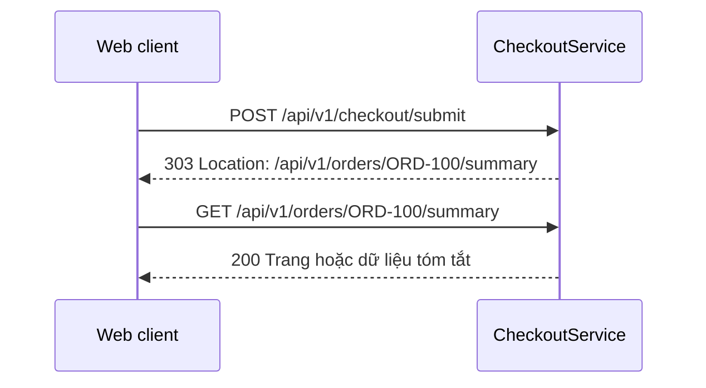
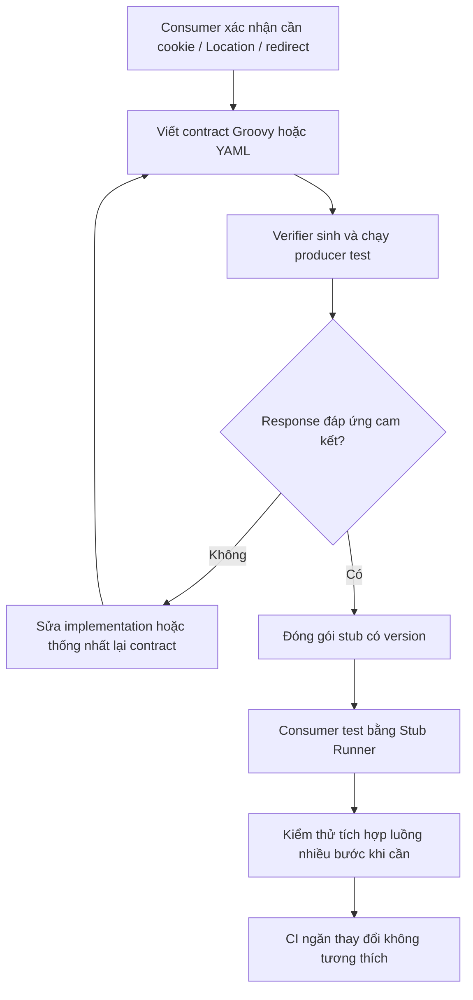

# Cookie, location và chuyển hướng khi thuộc phạm vi kiểm thử

Trong kiểm thử hợp đồng HTTP, chúng ta thường bắt đầu bằng **mã trạng thái**, **Content-Type** và **JSON response**. Tuy nhiên, một số luồng tích hợp chỉ hoạt động đúng khi producer còn trả về **cookie** hoặc header **Location**. Ví dụ, sau khi tạo phiên thanh toán, consumer có thể cần cookie để duy trì phiên; sau khi gửi biểu mẫu, một ứng dụng web có thể cần biết URL phải chuyển tới; sau khi tạo tài nguyên, một dịch vụ khác có thể cần URI của tài nguyên mới.

Bài này thuộc chương **Response HTTP** của **Spring Cloud Contract**. Ta sẽ xác định khi nào cookie, Location và chuyển hướng là **cam kết quan sát được mà consumer thực sự phụ thuộc**, rồi mô tả chúng bằng Groovy/YAML DSL. Những hợp đồng đó có thể dùng để sinh test phía producer, đóng gói stub cho consumer chạy với **Stub Runner** và kiểm tra thay đổi không tương thích trong CI.

Sau bài học, bạn có thể:

- Phân biệt cookie gửi **từ client lên server** và cookie server yêu cầu client lưu bằng `Set-Cookie`.
- Xác định khi nào cần kiểm tra giá trị cookie, thuộc tính cookie hoặc Location của response.
- Viết hợp đồng cho `201 Created` có Location và cho phản hồi chuyển hướng `303 See Other`.
- Chọn đúng mức kiểm thử cho `301`, `302`, `303`, `307`, `308`, tránh suy diễn rằng contract test đã kiểm thử toàn bộ luồng trình duyệt.
- Xử lý giá trị Location động và nhận biết những assertion dễ giòn với `Set-Cookie`.
- Thiết kế các kịch bản producer test, consumer test và kiểm thử tích hợp bổ sung.

## 1. Khi nào các header này thuộc phạm vi hợp đồng?

Một hợp đồng nên mô tả **hành vi mà consumer phải dựa vào** để hoạt động đúng. Cookie, Location và redirect không nhất thiết có trong mọi HTTP contract. Hãy đưa chúng vào khi thiếu hoặc thay đổi chúng khiến consumer thực hiện sai luồng.

Xét ba ví dụ:

| Luồng | Hành vi producer | Consumer phụ thuộc vào điều gì? |
| --- | --- | --- |
| Tạo lượt giữ hàng | `POST /api/v1/reservations` trả `201` cùng `Location` | `OrderService` dùng URI để tra cứu hoặc hủy lượt giữ |
| Bắt đầu phiên thanh toán | `POST /api/v1/checkout/flows` trả cookie phiên | Ứng dụng web gửi lại cookie trong các request tiếp theo |
| Gửi đơn xong và mở trang kết quả | `POST /checkout/submit` trả `303` cùng `Location` | Client điều hướng tới trang kết quả bằng request `GET` |

Ngược lại, nếu một API trả JSON trực tiếp và consumer chỉ dùng nội dung JSON, không có lý do để tự thêm cookie hoặc chuyển hướng vào contract.

**Nguyên tắc:** `status`, `headers`, `cookies` và `body` có thể cùng được mô tả trong response, nhưng chỉ nên ràng buộc những phần mang ý nghĩa tích hợp rõ ràng. Hợp đồng càng ràng buộc vào chi tiết không cần thiết, càng dễ thất bại khi producer thay đổi mà consumer thực tế không bị ảnh hưởng.

## 2. Phân biệt `Cookie` với `Set-Cookie`

Trong HTTP, cookie thường tham gia ít nhất hai bước:

1. **Producer trả response:** server gửi một hoặc nhiều header `Set-Cookie`, đề nghị user agent lưu cookie theo các thuộc tính quy định.
2. **Consumer gửi request tiếp theo:** user agent gửi header `Cookie` nếu cookie phù hợp domain, path, HTTPS, thời gian sống và chính sách của client.

```http
HTTP/1.1 200 OK
Set-Cookie: checkout_flow=FLOW-100; Path=/api/v1; HttpOnly; SameSite=Lax
```

Và khi phù hợp với quy tắc lưu/gửi cookie:

```http
GET /api/v1/checkout/flows/FLOW-100 HTTP/1.1
Cookie: checkout_flow=FLOW-100
```

**Hai header không có cùng cấu trúc:** `Set-Cookie` có thể đi kèm `Path`, `Domain`, `Expires`, `Max-Age`, `Secure`, `HttpOnly` và `SameSite`. Còn header `Cookie` thường chỉ gửi các cặp `tên=giá_trị`. Client không tự gửi lại các thuộc tính `HttpOnly` hoặc `SameSite` trong header Cookie.

| Thành phần | Bên gửi | Công dụng |
| --- | --- | --- |
| `Set-Cookie` | Server, trong **response** | Tạo, cập nhật hoặc xóa cookie ở client theo quy tắc HTTP |
| `Cookie` | Client, trong **request** | Gửi những cookie phù hợp tới server |
| `Path` | Thuộc tính của `Set-Cookie` | Giới hạn phạm vi đường dẫn nơi cookie có thể được gửi |
| `Domain` | Thuộc tính tùy chọn của `Set-Cookie` | Điều khiển phạm vi host phù hợp |
| `Max-Age`/`Expires` | Thuộc tính của `Set-Cookie` | Quy định thời hạn lưu cookie |
| `Secure` | Thuộc tính của `Set-Cookie` | Chỉ gửi cookie qua kết nối bảo mật theo chính sách user agent |
| `HttpOnly` | Thuộc tính của `Set-Cookie` | Ngăn mã JavaScript trang web đọc cookie qua API cookie thông thường |
| `SameSite` | Thuộc tính của `Set-Cookie` | Hạn chế gửi cookie trong các ngữ cảnh khác site |

Ví dụ, `Path=/api/v1` không khiến cookie tự động xuất hiện ở request `GET /admin`. Trong luồng thật, cần kiểm tra path mà consumer sẽ gọi tiếp theo; nếu cookie phải được gửi tới path khác, giá trị `Path` cần được hai bên xem xét.

### Không coi các thuộc tính cookie là bằng chứng bảo mật đầy đủ

Một contract có thể xác minh producer **trả** `Secure`, `HttpOnly` hoặc `SameSite` theo cam kết. Nó không chứng minh trình duyệt đã lưu cookie, session không bị chiếm đoạt, server đã kiểm tra CSRF, hoặc cookie được bảo vệ đúng trong mọi tình huống chuyển site. Các thuộc tính này thuộc một phần của thiết kế bảo mật cần kiểm thử tích hợp và trình duyệt phù hợp.

## 3. Mô tả cookie trong Spring Cloud Contract DSL

Spring Cloud Contract hỗ trợ khối `cookies` trong contract HTTP. Khi chỉ cần kiểm tra **tên và giá trị cookie**, có thể dùng cú pháp ngắn gọn ở response:

```groovy
import org.springframework.cloud.contract.spec.Contract

Contract.make {
    name 'get_user_preferences_cookie'
    description 'Web consumer cần cookie ngôn ngữ để giữ lựa chọn hiển thị'

    request {
        method 'GET'
        url '/api/v1/preferences'
    }

    response {
        status 200
        cookies {
            cookie('ui_language', 'vi')
        }
    }
}
```

Contract này tập trung vào việc producer trả cookie `ui_language=vi`. Trong một ứng dụng thật, cần chuẩn bị trạng thái hoặc fixture để request có thể tạo ra response như vậy. Cú pháp này dành cho **cookie đơn giản**, không diễn đạt tất cả thuộc tính `Path`, `HttpOnly` hoặc `SameSite`.

Với YAML DSL, có thể mô tả cùng tình huống:

```yaml
name: get_user_preferences_cookie
description: Web consumer cần cookie ngôn ngữ để giữ lựa chọn hiển thị
request:
  method: GET
  url: /api/v1/preferences
response:
  status: 200
  cookies:
    ui_language: vi
```

Các ví dụ Groovy và YAML là **hai cách viết cho cùng một kịch bản**; nếu đặt cả hai trong tập contract được plugin đọc, chúng có thể tạo các test/mapping lặp nhau. Hãy chọn định dạng đang dùng trong dự án hoặc quy tắc quản lý rõ ràng.

### Khi phải cam kết thuộc tính cookie, dùng `Set-Cookie`

Nếu consumer cần biết cookie có `Path=/api/v1` hoặc `HttpOnly`, có thể mô tả `Set-Cookie` trực tiếp như một response header:

```groovy
import org.springframework.cloud.contract.spec.Contract

Contract.make {
    name 'checkout_flow_cookie_attributes'
    description 'Web client cần cookie phiên cho những request checkout sau'

    request {
        method 'POST'
        url '/api/v1/checkout/flows'
        headers {
            contentType(applicationJson())
        }
        body([
            orderId: 'ORD-100'
        ])
    }

    response {
        status 201
        headers {
            header('Set-Cookie',
                   'checkout_flow=FLOW-100; Path=/api/v1; HttpOnly; SameSite=Lax')
            header('Location', '/api/v1/checkout/flows/FLOW-100')
        }
    }
}
```

Ở đây, `Location` chỉ URI của **phiên checkout vừa được tạo**, còn `Set-Cookie` yêu cầu user agent lưu một cookie để sử dụng trong phạm vi path tương ứng. Vì status là `201`, đây **không phải yêu cầu chuyển hướng**; client có thể chọn theo Location trong một request tiếp theo khi nghiệp vụ cần.

**Giới hạn của ví dụ:** so sánh nguyên chuỗi `Set-Cookie` có thể giòn nếu server thay đổi thứ tự thuộc tính, thay đổi hạn dùng, thêm thuộc tính không ảnh hưởng consumer hoặc sinh giá trị cookie ngẫu nhiên. Với hệ thống thực, cân nhắc cách matcher hoặc assertion chuyên biệt phù hợp với đúng bảo đảm cần kiểm tra, rồi đối chiếu mã test được sinh bởi phiên bản Spring Cloud Contract đang dùng.

Đừng khai báo cùng một cookie trong cả `cookies` và `headers { header('Set-Cookie', ...) }` của một contract nếu chưa kiểm tra kết quả: cấu hình lặp có thể làm mapping stub hoặc assertion không như mong đợi.

## 4. `Location` trong phản hồi `201 Created`

Khi producer tạo một tài nguyên mới, `201 Created` có thể đi kèm header `Location` cho biết URI của tài nguyên được tạo. Ví dụ consumer đặt một lượt giữ hàng:

```http
POST /api/v1/reservations HTTP/1.1
Content-Type: application/json

{"sku":"SKU-100","quantity":2}
```

Phản hồi giả định:

```http
HTTP/1.1 201 Created
Location: /api/v1/reservations/RES-100
Content-Type: application/json

{"reservationId":"RES-100","status":"HELD"}
```

Một contract Groovy có thể thể hiện:

```groovy
import org.springframework.cloud.contract.spec.Contract

Contract.make {
    name 'create_reservation_with_location'
    description '''
        OrderService tạo lượt giữ hàng và cần Location
        để truy cập tài nguyên vừa tạo.
    '''

    request {
        method 'POST'
        url '/api/v1/reservations'
        headers {
            contentType(applicationJson())
        }
        body([
            sku     : 'SKU-100',
            quantity: 2
        ])
    }

    response {
        status 201
        headers {
            contentType(applicationJson())
            header('Location', '/api/v1/reservations/RES-100')
        }
        body([
            reservationId: 'RES-100',
            status       : 'HELD'
        ])
    }
}
```

Contract này kiểm tra cả ba cam kết có ý nghĩa:

- Producer trả `201` khi thực sự tạo lượt giữ thành công.
- Producer trả `Location` chỉ tới URI mà consumer có thể sử dụng.
- Producer trả dữ liệu tối thiểu mà `OrderService` cần, gồm `reservationId` và `status`.

Lưu ý: HTTP không yêu cầu `Location` chỉ có thể đi cùng `201`, nhưng tại đây nó được thiết kế để chỉ URI tài nguyên mới. Một phản hồi `201` **không tự khiến trình duyệt điều hướng** như các phản hồi thuộc nhóm `3xx`.

### URI tuyệt đối hay tương đối?

Tùy quy ước API, `Location` có thể là URI tuyệt đối (ví dụ `https://api.example.test/api/v1/reservations/RES-100`) hoặc tham chiếu URI tương đối. Consumer phải hiểu và xử lý dạng được producer cam kết.

Không nên ràng buộc hợp đồng vào `localhost`, cổng CI hoặc hostname tạm nếu consumer không phụ thuộc vào chúng. Khi ứng dụng chạy sau reverse proxy, cần kiểm thử thêm cách producer tạo URI theo host và scheme công khai, nhất là khi hệ thống chuyển giữa HTTP và HTTPS.

## 5. `Location` và chuyển hướng HTTP là hai chuyện liên quan nhưng khác nhau

`Location` thường xuất hiện ở phản hồi `3xx` để chỉ mục tiêu chuyển hướng. Nhưng mã status quyết định ngữ nghĩa mà client phải áp dụng.

| Status | Ý nghĩa thực hành | Điều quan trọng khi kiểm thử |
| --- | --- | --- |
| `201 Created` | Tài nguyên được tạo; `Location` có thể chỉ tài nguyên đó | Không mặc định đây là redirect |
| `301 Moved Permanently` | Tài nguyên chuyển lâu dài | Cẩn thận chính sách cache và phương thức khi client theo redirect |
| `302 Found` | Chuyển hướng tạm thời | Hành vi đổi phương thức của một số client có tính lịch sử; không nên dùng nếu cần bảo đảm giữ nguyên POST |
| `303 See Other` | Client lấy kết quả tại URI khác | Thích hợp cho Post/Redirect/Get: sau POST, client thường truy cập đích bằng GET |
| `307 Temporary Redirect` | Chuyển tạm, **giữ nguyên phương thức và body** khi theo redirect | Consumer không được tự đổi POST thành GET |
| `308 Permanent Redirect` | Chuyển lâu dài, **giữ nguyên phương thức và body** khi theo redirect | Cần xem xét tương thích và khả năng cache của client |

Ví dụ, một form gửi `POST` và nhận `303` sẽ dẫn client sang trang kết quả bằng `GET`. Nếu producer đổi thành `307`, client tuân thủ chuẩn có thể gửi **lại POST** tới URI mới, thay đổi hoàn toàn luồng xử lý.

**Đừng đánh đồng “cùng là 3xx” với “cùng hành vi”.** Khi consumer phụ thuộc vào phương thức tiếp theo, status và Location cần được thống nhất như các thành phần quan trọng của hợp đồng.

## 6. Ví dụ Groovy DSL: `303 See Other` sau POST

Giả sử `CheckoutService` xử lý bước hoàn tất đơn, và web client phải mở trang tóm tắt sau khi gửi xác nhận. Hai bên thống nhất:

1. Client gửi `POST /api/v1/checkout/submit` với mã đơn.
2. Producer trả `303 See Other` cùng `Location: /api/v1/orders/ORD-100/summary`.
3. Client chủ động theo redirect bằng `GET`; trang tóm tắt được phục vụ bởi endpoint tương ứng.

Contract cho **phản hồi ban đầu**:

```groovy
import org.springframework.cloud.contract.spec.Contract

Contract.make {
    name 'checkout_submit_redirect_to_summary'
    description '''
        Web client gửi yêu cầu hoàn tất checkout.
        Producer trả 303 để client lấy trang tóm tắt qua GET.
    '''

    request {
        method 'POST'
        url '/api/v1/checkout/submit'
        headers {
            contentType(applicationJson())
        }
        body([
            orderId: 'ORD-100'
        ])
    }

    response {
        status 303
        headers {
            header('Location', '/api/v1/orders/ORD-100/summary')
        }
    }
}
```

Contract này chứng minh producer trả **mã chuyển hướng** và **địa chỉ đích** đã thống nhất. Nó không tự kiểm tra rằng client sẽ:

- đọc được Location;
- gửi request `GET` tới URI mới;
- lưu và gửi lại cookie cần thiết;
- tránh redirect loop;
- hiển thị đúng trang tóm tắt sau cùng.

Đó là công việc của consumer test và các bài test tích hợp luồng nhiều bước. Nếu consumer thật **tự động theo redirect**, cấu hình HTTP client kiểm thử để giữ được **phản hồi đầu tiên** khi muốn assert `303` và `Location`; nếu không, công cụ có thể chỉ hiển thị status `200` của trang đích.

### Tại sao nên có contract cho đích redirect?

Nếu đích `GET /api/v1/orders/ORD-100/summary` cũng do producer cung cấp và consumer phụ thuộc vào response của nó, hãy xem đây là **một tương tác khác** cần contract hoặc test phù hợp. Một contract `303` chỉ kiểm tra rằng response có Location, **không chứng minh URI đó trả trang hợp lệ**.

Sơ đồ luồng:



Hai mũi tên request có thể được bảo vệ bằng hai contract hoặc bằng kiểm thử tích hợp bổ sung khi cần xác minh trạng thái xuyên nhiều request.

## 7. Cookie và redirect trong cùng một phản hồi

Một luồng đăng nhập hoặc checkout có thể đồng thời **đặt cookie** và **yêu cầu chuyển hướng**. Khi đây là phụ thuộc thực tế của consumer, cả hai cần được mô tả.

Ví dụ producer phát hành cookie phiên giả định sau khi tạo phiên web thành công:

```groovy
import org.springframework.cloud.contract.spec.Contract

Contract.make {
    name 'web_session_redirect_with_cookie'
    description '''
        Web consumer nhận cookie phiên và chuyển đến trang dashboard.
        Session được chuẩn bị bằng fixture của môi trường kiểm thử.
    '''

    request {
        method 'POST'
        url '/api/v1/web-sessions'
        headers {
            contentType(applicationJson())
        }
        body([
            loginTicket: 'LOGIN-TICKET-TEST'
        ])
    }

    response {
        status 303
        headers {
            header('Location', '/dashboard')
            header('Set-Cookie',
                   'web_session=SESSION-TEST; Path=/; HttpOnly; Secure; SameSite=Lax')
        }
    }
}
```

`SESSION-TEST` và `LOGIN-TICKET-TEST` là **giá trị giả phục vụ học tập**; không dùng token thật hoặc đưa khóa bí mật vào contract. Trong production, session ID thường phải được tạo động; khi đó test nên xác minh các thuộc tính mà consumer cần và cách client gửi cookie, không bắt buộc ID thật luôn bằng `SESSION-TEST`.

Một khác biệt cần nhớ: cookie có `Secure` thường **không được trình duyệt gửi qua HTTP thông thường**. Nếu stub chạy trên một cổng HTTP local, bài test chỉ đọc header từ response có thể pass nhưng một browser-based test không gửi cookie ở bước tiếp theo như kỳ vọng. Với luồng session web thực, hãy dùng môi trường HTTPS và kiểm thử hành vi user agent phù hợp.

Ngoài ra, `HttpOnly` làm cookie không truy cập được qua API cookie JavaScript thông thường; đây là điều mong muốn với nhiều loại cookie phiên. Nếu consumer yêu cầu JavaScript đọc cookie, cần thiết kế loại cookie khác, không nên bỏ `HttpOnly` khỏi session cookie chỉ để làm test dễ viết.

## 8. Kiểm tra Location động mà không cố định ID ngẫu nhiên

Trong sản phẩm thật, URI của tài nguyên mới thường chứa ID do server tạo: `/api/v1/reservations/RES-48127`, `/api/v1/reservations/RES-48128`, ... Nếu contract đòi một ID duy nhất trong mọi response, test có thể thất bại vì dữ liệu động dù API vẫn thực hiện đúng cam kết.

Với Groovy DSL, có thể dùng giá trị khác nhau giữa **consumer/stub** và **producer/test**:

```groovy
import org.springframework.cloud.contract.spec.Contract

Contract.make {
    name 'create_reservation_dynamic_location'

    request {
        method 'POST'
        url '/api/v1/reservations'
        headers {
            contentType(applicationJson())
        }
        body([
            sku     : 'SKU-100',
            quantity: 2
        ])
    }

    response {
        status 201
        headers {
            header('Location',
                   $(consumer('/api/v1/reservations/RES-100'),
                     producer(regex('/api/v1/reservations/RES-[0-9]+'))))
        }
    }
}
```

Trong **response**:

| Phía | Giá trị trong ví dụ | Vai trò |
| --- | --- | --- |
| `consumer(...)` | `/api/v1/reservations/RES-100` | Stub có giá trị cụ thể, ổn định để trả cho consumer |
| `producer(regex(...))` | `/api/v1/reservations/RES-[0-9]+` | Generated test kiểm tra header Location thực tế của producer theo mẫu |

Đây là **đảo chiều hợp lý** so với request: ở request, consumer thường cần regex để stub nhận nhiều giá trị và producer cần một ví dụ cụ thể để gửi. Ở response, consumer cần một giá trị giả đủ cụ thể để sử dụng và producer có thể bị kiểm tra bằng matcher cho dữ liệu động.

Regex chỉ kiểm tra **định dạng**, chưa chứng minh URI chỉ đúng tài nguyên vừa tạo. Nếu cần bảo đảm “ID trong Location trùng ID trong body” hoặc “GET theo Location trả về đúng tài nguyên”, hãy dùng matcher/biểu thức liên kết dữ liệu được phiên bản DSL hỗ trợ hoặc thêm integration test. Đừng nghĩ chỉ cần hai regex giống nhau là đã kiểm tra tính nhất quán.

## 9. `Set-Cookie` có nhiều thuộc tính: ràng buộc ở mức nào?

Header `Set-Cookie` có thể thay đổi theo môi trường và thời gian:

```http
Set-Cookie: web_session=SESSION-100; Path=/; Max-Age=1800; HttpOnly; Secure; SameSite=Lax
```

Ngày mai, producer có thể thêm `Expires` hoặc đổi thứ tự các thuộc tính trong chuỗi mà vẫn giữ các cam kết thực tế cho consumer. Nếu contract dùng so sánh **nguyên chuỗi**, thay đổi ấy có thể làm test fail không cần thiết.

Hãy xác định **điều gì thật sự quan trọng**:

| Cam kết consumer cần | Cách kiểm tra phù hợp |
| --- | --- |
| Cookie tên `web_session` được trả | Cookie matcher hoặc phân tích `Set-Cookie` theo tên |
| Giá trị cookie có định dạng hợp lệ | Matcher cho giá trị động hoặc kiểm thử cookie response |
| Cookie chỉ được gửi qua HTTPS | Kiểm tra thuộc tính `Secure` và browser/integration test |
| Script không đọc được session cookie | Kiểm tra `HttpOnly` và thử bằng user agent thực |
| Cookie gửi tới đường dẫn checkout | Kiểm tra `Path` và luồng request tiếp theo |
| Cookie có thời hạn đúng quy định | Kiểm tra `Max-Age` hoặc `Expires` theo ngữ nghĩa được cam kết |
| Hết phiên xóa cookie | Kiểm tra phản hồi logout và việc user agent không gửi lại cookie |

Spring Cloud Contract có thể kiểm tra response header hoặc cookie được biểu diễn trong DSL, nhưng **khả năng tách riêng từng thuộc tính và mức matcher cần kiểm tra theo phiên bản cùng chế độ test**. Nếu yêu cầu là kiểm thử những tính chất cookie mà DSL mặc định không diễn đạt thuận tiện, thêm một bài test tích hợp dùng thư viện HTTP/cookie parser thay vì ép một regex lớn làm thay mọi kiểm tra.

### Nhiều cookie trong một response

HTTP cho phép server trả **nhiều header `Set-Cookie` riêng**. Đừng nối nhiều cookie thành một chuỗi phân tách bằng dấu phẩy như các header thông thường: cách biểu diễn này có thể gây sai cách phân tích, nhất là với thuộc tính `Expires` chứa dấu phẩy.

Khi producer phát nhiều cookie, hãy kiểm tra công cụ đang dùng sinh và kiểm chứng **các dòng Set-Cookie riêng** như thế nào. Có thể lựa chọn khối `cookies` cho tên/giá trị và bài kiểm thử HTTP chuyên biệt cho thuộc tính phức tạp nếu cần. Tránh các ví dụ ngắn quá mức khiến người học hiểu sai rằng một chuỗi đơn là đủ cho mọi tình huống đa cookie.

## 10. YAML DSL: phản hồi chuyển hướng và cookie đơn giản

YAML DSL có thể mô tả response status và headers trực tiếp:

```yaml
name: checkout_submit_redirect_yaml
description: Web consumer chuyển sang trang tóm tắt sau khi hoàn tất checkout
request:
  method: POST
  url: /api/v1/checkout/submit
  headers:
    Content-Type: application/json
  body:
    orderId: ORD-100
response:
  status: 303
  headers:
    Location: /api/v1/orders/ORD-100/summary
```

Với cookie đơn giản:

```yaml
name: ui_language_cookie_yaml
description: Web consumer nhận cookie ngôn ngữ
request:
  method: GET
  url: /api/v1/preferences
response:
  status: 200
  cookies:
    ui_language: vi
```

Nếu cần mô tả `Set-Cookie` với thuộc tính cụ thể bằng YAML, có thể dùng header response như trong ví dụ Groovy:

```yaml
response:
  status: 200
  headers:
    Set-Cookie: "ui_language=vi; Path=/; SameSite=Lax"
```

Đoạn cuối là **mảnh cấu hình** để minh họa trường header; cần ghép với `request` đầy đủ và chỉ dùng nếu ứng dụng thật sự cam kết những thuộc tính đó.

Groovy DSL sử dụng `$(consumer(...), producer(...))` cho dữ liệu động; YAML dùng cơ chế matcher và cấu trúc khai báo riêng. Không sao chép nguyên cú pháp Groovy vào chuỗi YAML rồi giả định matcher sẽ hoạt động. Với URI động hoặc cookie sinh ngẫu nhiên, hãy tham khảo đúng schema và tài liệu của phiên bản Spring Cloud Contract dự án sử dụng, sau đó kiểm tra test và stub sinh ra.

## 11. Xác minh producer và kiểm thử consumer với Stub Runner

Một contract test phía producer chủ yếu kiểm tra **một phản hồi ứng với một request**. Với ví dụ `303` và cookie, generated test cần xác minh producer có trả status và header như contract hay không.



Trên dự án Maven đã cấu hình plugin Spring Cloud Contract Verifier, có thể chạy:

```bash
mvn -B -ntp clean verify
```

Với producer test, hãy chắc chắn:

1. Contract được plugin đọc và tạo test thực sự; không có tình huống build xanh vì không sinh test nào.
2. Controller hoặc endpoint thực của producer nhận request mẫu mà contract mô tả.
3. Status `201` hoặc `303` được kiểm đúng; hai status này không hoán đổi được.
4. `Location` trùng với giá trị đã thống nhất hoặc khớp matcher được thiết kế.
5. Cookie response/`Set-Cookie` được kiểm theo đúng thuộc tính nằm trong phạm vi cam kết.

Với consumer, sau khi tải đúng phiên bản stub bằng Stub Runner, nên tạo ít nhất hai nhóm test:

- **Test xử lý phản hồi đầu tiên:** client thấy `303` và Location; nhận cookie hoặc nhận diện trường hợp thiếu cookie; không bị thư viện HTTP âm thầm theo redirect khi test cần quan sát response gốc.
- **Test luồng tiếp theo:** khi cần, client gửi `GET` tới Location; trình duyệt hoặc cookie jar gửi cookie theo Path/Domain/Secure; endpoint tiếp theo xử lý dữ liệu đúng.

Lưu ý: một stub mô phỏng phản hồi có `Set-Cookie` **không tự lưu cookie hộ ứng dụng**. Việc lưu và gửi lại cookie là hành vi của browser, HTTP client hoặc cookie jar đang dùng; còn việc endpoint sau trả dữ liệu đúng là một cam kết riêng hoặc phạm vi kiểm thử tích hợp.

### Ví dụ kiểm tra phản hồi gốc bằng công cụ HTTP

Khi Stub Runner hoặc ứng dụng thử nghiệm đã mở cổng HTTP, có thể kiểm tra trực tiếp phản hồi (địa chỉ cổng dưới đây chỉ là ví dụ):

```bash
curl -i -X POST 'http://localhost:8080/api/v1/checkout/submit' \
  -H 'Content-Type: application/json' \
  -d '{"orderId":"ORD-100"}'
```

Với contract `303` ở trên, kỳ vọng quan sát được là status `303` và header `Location`. Không thêm tùy chọn `-L` trong bước này vì nó yêu cầu `curl` theo redirect và có thể khiến người kiểm thử chỉ thấy trạng thái của response sau. Khi muốn kiểm tra **toàn bộ chuỗi**, có thể theo redirect có kiểm soát và quan sát từng request/response; nếu cookie là một phần của luồng, cần bật cookie jar và cấu hình HTTP/HTTPS thích hợp.

## 12. Những tình huống thường làm contract “xanh giả” hoặc dễ giòn

| Tình huống | Vì sao có vấn đề? | Cách xử lý |
| --- | --- | --- |
| Hợp đồng chỉ kiểm `status 303` | Không bảo đảm client nhận đúng URI đích | Kiểm `Location` nếu consumer cần |
| `201` có Location nhưng test giả định tự redirect | Không đúng ngữ nghĩa HTTP | Phân biệt Location tài nguyên với redirect `3xx` |
| Thay `303` bằng `307` vì đều là `3xx` | Client có thể gửi lại POST thay vì GET | Cam kết rõ status theo luồng |
| Test dùng HTTP client tự theo redirect | Có thể chỉ quan sát `200` cuối cùng | Tắt auto-follow khi cần kiểm response ban đầu |
| Cố định cookie session ngẫu nhiên | Test thất bại vì giá trị thay đổi | Matcher/fixture phù hợp, không gắn vào token thật |
| So nguyên chuỗi `Set-Cookie` khi không cần | Thứ tự thuộc tính hoặc `Expires` thay đổi làm test giòn | Chỉ kiểm các thuộc tính có ý nghĩa với consumer |
| Cookie có `Secure` nhưng test browser dùng HTTP local | Browser không gửi cookie như kỳ vọng | Dùng HTTPS hoặc kiểm tra header trực tiếp tùy mục tiêu |
| Chỉ kiểm response cookie rồi kết luận session hoạt động | Không xác minh cookie được gửi lại hoặc server công nhận session | Thêm test đa bước/browser |
| Stub trả Location trỏ tới endpoint không tồn tại | Contract đầu tiên pass nhưng client thất bại khi theo | Thêm contract/test cho đích chuyển hướng |
| Dùng URL chứa hostname môi trường CI | Test fail khi chuyển môi trường | Cam kết URI phù hợp, dùng biến thể/matcher khi cần |
| Trả nhiều `Set-Cookie` bằng một chuỗi ngăn cách dấu phẩy | Client có thể phân tích sai cookie | Phát và kiểm tra từng header riêng |
| Chỉ kiểm `HttpOnly`, `Secure` rồi kết luận hệ thống an toàn | Chưa kiểm TLS, CSRF, session fixation hay authorization | Thêm security/integration tests |

## 13. Checklist trước khi đưa vào CI

- [ ] Biết **consumer nào** thực sự cần cookie, Location hoặc hành vi redirect.
- [ ] Phân biệt Location của `201` với Location của response `3xx`.
- [ ] Đã chọn chính xác status `301`, `302`, `303`, `307` hoặc `308` theo ngữ nghĩa chuyển hướng cần cam kết.
- [ ] URI trong Location có dạng tương đối/tuyệt đối phù hợp, không chứa hostname môi trường thử nghiệm ngoài ý muốn.
- [ ] Cookie request và response được phân biệt đúng; thuộc tính `Set-Cookie` quan trọng được liệt kê rõ.
- [ ] Không đưa token, ID session thật, mật khẩu hoặc dữ liệu nhạy cảm vào fixture.
- [ ] ID/URI/cookie động được kiểm bằng matcher hoặc dữ liệu thử nghiệm ổn định.
- [ ] Nếu kiểm thuộc tính cookie, đã cân nhắc thứ tự thuộc tính, thời hạn và nhiều `Set-Cookie`.
- [ ] Contract test kiểm response ban đầu; client không vô tình bỏ qua `3xx` khi tự động theo redirect.
- [ ] Có test cho URI đích hoặc luồng nhiều bước khi consumer thực sự phải theo redirect.
- [ ] Đã chạy generated tests phía producer và kiểm tra chúng thực sự được thực thi.
- [ ] Stub được phát hành từ build đã xác minh, consumer dùng đúng version bằng Stub Runner.
- [ ] Có kiểm thử trình duyệt/tích hợp/bảo mật bổ sung cho những cam kết ngoài khả năng một contract HTTP.

### Bài tập thực hành

Giả sử `OrderService` là consumer của `CheckoutService`. Khi một người dùng hoàn tất bước thanh toán, producer phải:

1. Nhận `POST /api/v1/checkout/submit` với body `{"orderId":"ORD-100"}`.
2. Trả `303 See Other` cùng `Location: /api/v1/orders/ORD-100/summary`.
3. Trả cookie `checkout_flow=FLOW-100` với `Path=/api/v1`, `HttpOnly` và `SameSite=Lax`.

Hãy thực hiện:

1. Viết Groovy contract mô tả status, Location và `Set-Cookie` trong cùng một response.
2. Viết lại hợp đồng `303` ở YAML DSL, nêu điểm khác khi muốn kiểm một giá trị cookie động.
3. Giải thích tại sao `303` phù hợp hơn `307` nếu mục đích là chuyển từ POST sang trang kết quả bằng GET.
4. Tạo contract hoặc bài test cho `GET /api/v1/orders/ORD-100/summary`; chỉ ra vì sao contract redirect ban đầu chưa chứng minh URI đích tồn tại.
5. Thay `Location` thành URI có ID động và chọn matcher để producer test không bị phụ thuộc vào một ID cố định.
6. Tạo một bài consumer test chạy với Stub Runner để quan sát status `303`, đọc Location, đọc cookie và theo redirect có kiểm soát.
7. Mô tả bài test browser/tích hợp để kiểm tra cookie được lưu và gửi lại đúng Path; nêu điều gì khác khi cookie có `Secure` và môi trường chỉ chạy HTTP.
8. Cố ý thay `303` bằng `307` hoặc bỏ header Location khỏi producer; chạy lại generated tests và xác định điều khoản contract bị vi phạm.

**Kết quả mong đợi:** bạn xác định được **phần nào của HTTP response là cam kết cần bảo vệ**, mô tả chính xác cookie/Location/redirect bằng Spring Cloud Contract, biết giới hạn của producer contract test và xây dựng những phép thử consumer hoặc tích hợp bổ sung khi luồng yêu cầu nhiều request.

## Tài liệu tham khảo

- [Spring Cloud Contract — HTTP Contracts](https://docs.spring.io/spring-cloud-contract/reference/project-features-contract/http.html): cấu trúc `response`, `headers`, `cookies` trong HTTP DSL.
- [Spring Cloud Contract — Dynamic Properties](https://docs.spring.io/spring-cloud-contract/reference/project-features-contract/dsl-dynamic-properties.html): `consumer`, `producer` và matcher cho dữ liệu động.
- [MDN — Location header](https://developer.mozilla.org/en-US/docs/Web/HTTP/Reference/Headers/Location): ý nghĩa của Location với `201` và `3xx`.
- [MDN — Set-Cookie header](https://developer.mozilla.org/en-US/docs/Web/HTTP/Reference/Headers/Set-Cookie): thuộc tính cookie và quy tắc trình duyệt.
- [MDN — HTTP redirections](https://developer.mozilla.org/en-US/docs/Web/HTTP/Guides/Redirections): sự khác biệt giữa các mã chuyển hướng.
