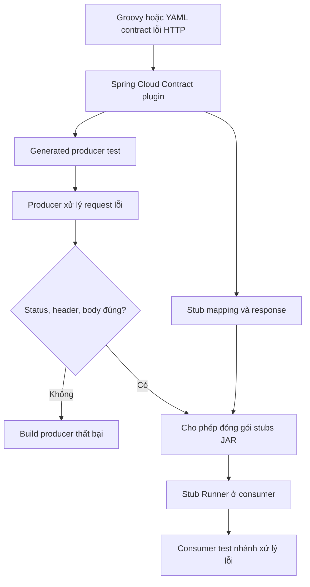

# Thông báo lỗi và cấu trúc lỗi dùng chung

## 1. Vì sao response lỗi cũng là một hợp đồng?

Trong **Spring Cloud Contract**, một hợp đồng (*contract*) bảo vệ hành vi giao tiếp giữa **producer** (dịch vụ cung cấp API) và **consumer** (dịch vụ gọi API). Khi học kiểm thử hợp đồng với Groovy/YAML DSL, ta thường bắt đầu bằng response thành công `200` hoặc `201`. Nhưng consumer còn phải xử lý các trường hợp như không tìm thấy tài nguyên, dữ liệu không hợp lệ, xung đột trạng thái và lỗi hệ thống. **Những response lỗi này cũng là phần giao diện công khai cần được kiểm thử.**

Giả sử màn hình thanh toán muốn phân biệt ba tình huống:

- HTTP `404` với mã `ORDER_NOT_FOUND`: thông báo đơn hàng không tồn tại.
- HTTP `409` với mã `ORDER_ALREADY_PAID`: đề nghị tải lại thông tin thay vì gửi thanh toán lần nữa.
- HTTP `500` với mã `INTERNAL_ERROR`: hiển thị lỗi tạm thời và có thể thử lại theo chính sách.

Nếu một producer đột ngột đổi `code` thành `errorCode`, consumer có thể mất nhánh xử lý dù HTTP status vẫn đúng. Nếu `404` bị đổi thành `200` kèm body báo lỗi, nhiều HTTP client sẽ coi request là thành công. Ngược lại, thay câu tiếng Việt hiển thị lỗi chưa chắc là breaking change nếu consumer chỉ dùng nó để trình bày và phân nhánh bằng `code`.

**Mục tiêu bài học:** thiết kế một định dạng lỗi dùng chung, lựa chọn phần nào cần cam kết chặt, biểu diễn kịch bản lỗi bằng Spring Cloud Contract, sinh producer tests và stub để consumer kiểm thử độc lập, và đặt các kiểm tra đó vào CI nhằm phát hiện thay đổi API không tương thích.

## 2. Phân biệt ba tầng ý nghĩa: HTTP status, mã lỗi, thông báo

Một response lỗi có ba khái niệm bổ trợ nhau:

| Thành phần | Ví dụ | Vai trò | Consumer nên làm gì? |
| --- | --- | --- | --- |
| **HTTP status** | `404` | Phân loại kết quả theo ngữ nghĩa HTTP; ảnh hưởng client, proxy, retry, cache | Dùng để nhận diện nhóm lỗi và xử lý giao thức |
| **Mã lỗi nghiệp vụ** (`code`) | `ORDER_NOT_FOUND` | Định danh ổn định cho điều kiện nghiệp vụ cụ thể | Phân nhánh theo mã đã được cam kết |
| **Thông báo** (`message`) | `Không tìm thấy đơn hàng` | Giúp con người hiểu vấn đề | Hiển thị hoặc ghi nhận; không nên parse chuỗi để quyết định logic |

HTTP status không thay thế `code`: cùng một mã `409` có thể tương ứng `ORDER_ALREADY_PAID`, `ORDER_CANCELLED` hoặc `INVENTORY_CHANGED`. Ngược lại, không nên trả `200` cho mọi kết quả rồi đặt `success: false` trong JSON nếu consumer đang mong chờ đúng ngữ nghĩa HTTP.

Một bảng quy ước tham khảo:

| Trường hợp | HTTP status thường phù hợp | Mã lỗi ví dụ | Ghi chú |
| --- | --- | --- | --- |
| Dữ liệu request sai cú pháp hoặc kiểm tra đầu vào không đạt | `400 Bad Request` | `VALIDATION_ERROR` | Có thể kèm chi tiết theo từng field |
| Chưa có thông tin xác thực hợp lệ | `401 Unauthorized` | `AUTHENTICATION_REQUIRED` | Phối hợp với header `WWW-Authenticate` khi giao thức yêu cầu |
| Đã xác thực nhưng không có quyền | `403 Forbidden` | `ACCESS_DENIED` | Không tiết lộ thông tin nhạy cảm |
| Không tìm thấy tài nguyên | `404 Not Found` | `ORDER_NOT_FOUND` | Tùy chính sách có thể che giấu sự tồn tại của tài nguyên |
| Trạng thái tài nguyên xung đột với hành động | `409 Conflict` | `ORDER_ALREADY_PAID` | Phân biệt với request sai định dạng |
| Giới hạn yêu cầu | `429 Too Many Requests` | `RATE_LIMITED` | Có thể cung cấp `Retry-After` phù hợp |
| Lỗi không mong đợi ở server | `500 Internal Server Error` | `INTERNAL_ERROR` | Không đưa stack trace vào response |

Bảng chỉ là ví dụ: quy tắc chọn `400`/`422`, `404`/`403` hoặc cách retry cần thống nhất theo ngữ nghĩa HTTP và nhu cầu thực của hệ thống. Điều quan trọng là **mỗi tình huống được định nghĩa nhất quán và có contract riêng khi consumer dựa vào nó**.

## 3. Đề xuất một cấu trúc lỗi dùng chung

Một mẫu JSON dễ dùng trong các microservice:

```http
HTTP/1.1 404 Not Found
Content-Type: application/json
```

```json
{
  "code": "ORDER_NOT_FOUND",
  "message": "Không tìm thấy đơn hàng",
  "requestId": "req-7f2a9c",
  "details": []
}
```

Ý nghĩa từng trường:

| Trường | Định dạng | Nên cam kết điều gì? |
| --- | --- | --- |
| `code` | Chuỗi định danh, ví dụ `ORDER_NOT_FOUND` | **Bắt buộc và ổn định** nếu consumer dùng để ra quyết định |
| `message` | Chuỗi cho người đọc | Nếu consumer hiển thị: bảo đảm là chuỗi có ý nghĩa; nội dung chính xác có thể thay đổi theo ngôn ngữ hoặc cách diễn đạt |
| `requestId` | Chuỗi định danh yêu cầu để truy vết | Nếu công khai và consumer cần: bảo đảm có mặt và đúng định dạng; không khóa một ID ngẫu nhiên |
| `details` | Mảng chi tiết, có thể rỗng | Định nghĩa shape và quy tắc xuất hiện theo từng loại lỗi; không bắt field không liên quan phải tồn tại |

Một ví dụ lỗi validation:

```json
{
  "code": "VALIDATION_ERROR",
  "message": "Dữ liệu không hợp lệ",
  "requestId": "req-8e4b1f",
  "details": [
    {
      "field": "quantity",
      "code": "MUST_BE_POSITIVE",
      "message": "Số lượng phải lớn hơn 0"
    },
    {
      "field": "shippingAddress.postalCode",
      "code": "INVALID_FORMAT",
      "message": "Mã bưu chính không hợp lệ"
    }
  ]
}
```

Ở ví dụ này, consumer có thể dùng `details[].field` để tô sáng ô nhập và `details[].code` để chọn hành vi. **Thứ tự phần tử trong `details` không nên bị coi là một cam kết** nếu consumer chỉ lập bản đồ lỗi theo tên field. Hạn chế trả giá trị người dùng đã nhập, dữ liệu riêng tư hoặc mô tả nội bộ trong chi tiết lỗi.

### Cấu trúc thống nhất không có nghĩa mọi trường đều luôn bắt buộc

Hãy định nghĩa rõ trường nào là bắt buộc ở **mọi lỗi**, trường nào chỉ xuất hiện ở một số loại lỗi. Ví dụ:

- Với mọi response lỗi: `code` và `message` có mặt.
- `requestId` có mặt khi đã thống nhất giao thức truy vết, được coi là mã mờ (*opaque*), không chứa thông tin cá nhân.
- `details` có thể là mảng rỗng hoặc vắng mặt, nhưng **phải thống nhất một quy tắc** nếu consumer đang phân biệt hai trạng thái.
- Với `VALIDATION_ERROR`: `details` có thể chứa các đối tượng `field/code/message`; không cần áp đặt cấu trúc này cho `INTERNAL_ERROR`.

Tối thiểu hóa hợp đồng theo điều consumer thực sự sử dụng. Không khóa timestamp, UUID hay nội dung mô tả thay đổi thường xuyên chỉ vì chúng xuất hiện trong JSON mẫu.

## 4. Chọn một chuẩn nhất quán: JSON riêng hay Problem Details?

Nhóm có thể dùng cấu trúc `code/message/requestId/details` ở trên hoặc dùng định dạng **Problem Details for HTTP APIs (RFC 9457)**. Với Problem Details, response thường có media type `application/problem+json` và các trường chuẩn:

```http
HTTP/1.1 404 Not Found
Content-Type: application/problem+json
```

```json
{
  "type": "https://api.example.com/problems/order-not-found",
  "title": "Not Found",
  "status": 404,
  "detail": "Không tìm thấy đơn hàng",
  "instance": "/api/orders/42",
  "code": "ORDER_NOT_FOUND"
}
```

Các trường `type`, `title`, `status`, `detail` và `instance` thuộc mô hình Problem Details; `code` là phần mở rộng nếu hệ thống muốn có mã nghiệp vụ ổn định. `type` cần là định danh loại vấn đề; URI minh họa trên chỉ nhằm giải thích cấu trúc, dự án thật phải chọn URI và chính sách công bố phù hợp. Trong Spring Framework hiện đại, `ProblemDetail` có thể hỗ trợ xây response theo hướng này.

| Phương án | Ưu điểm | Điều phải bảo đảm trong contract |
| --- | --- | --- |
| JSON riêng `code/message/...` | Dễ điều chỉnh theo domain và client hiện hữu | Shape nhất quán, status/header, mã lỗi, quy tắc null/optional |
| RFC 9457 Problem Details | Có mô hình chuẩn cho lỗi HTTP và mở rộng được | `application/problem+json`, ý nghĩa `type`/`status`, extension ổn định |

**Không nên trộn hai định dạng một cách ngẫu nhiên trong cùng API.** Chọn một quy ước có khả năng duy trì; nếu đang chuyển đổi, cần chiến lược tương thích với consumer và kiểm thử cả giai đoạn chuyển tiếp.

## 5. Định nghĩa contract lỗi 404 bằng Groovy DSL

Giả sử `order-service` trả cấu trúc JSON riêng ở mục 3. Khi gọi `GET /api/orders/42` mà không có đơn 42, producer phải trả `404`, `code = ORDER_NOT_FOUND` và các field có kiểu đúng.

Tệp `src/test/resources/contracts/orders/order-not-found.groovy` của producer:

```groovy
import org.springframework.cloud.contract.spec.Contract

Contract.make {
    description 'Không tìm thấy đơn hàng 42'

    request {
        method GET()
        url '/api/orders/42'
        headers {
            accept(applicationJson())
        }
    }

    response {
        status NOT_FOUND()
        headers {
            contentType(applicationJson())
        }
        body([
            code     : 'ORDER_NOT_FOUND',
            message  : 'Không tìm thấy đơn hàng',
            requestId: 'req-demo-42'
        ])
        bodyMatchers {
            jsonPath('$.code', byEquality())
            jsonPath('$.message', byType())
            jsonPath('$.requestId', byRegex('req-[A-Za-z0-9-]+'))
        }
    }
}
```

Điểm cần hiểu:

1. `status NOT_FOUND()` ràng buộc HTTP `404`, không chỉ một chuỗi báo lỗi trong body.
2. `contentType(applicationJson())` yêu cầu JSON response.
3. `code` có matcher bằng giá trị chính xác: đổi sang `RESOURCE_MISSING` là thay đổi giao diện nếu consumer dựa vào `ORDER_NOT_FOUND`.
4. `message` được khớp theo **kiểu** để có thể đổi nội dung diễn đạt nhưng vẫn là chuỗi; nếu client cần một thông điệp tiếng Việt do server cung cấp, hãy kiểm thử thêm locale và quy tắc nội dung ở mức thích hợp.
5. `requestId` là ví dụ cụ thể cho stub; khi kiểm chứng producer, matcher cho phép nhiều ID hợp lệ. Pattern chỉ minh họa quy ước `req-...`, cần thay nếu hệ thống dùng UUID hoặc định dạng khác.

**Lưu ý thiết kế kịch bản:** Endpoint `/api/orders/42` và dữ liệu test “không tìm thấy đơn 42” phải nhất quán với môi trường producer test. Không dùng đồng thời một hợp đồng khác yêu cầu cùng request đó trả `200` trong cùng trạng thái test mà không có cơ chế phân biệt (ví dụ trạng thái dữ liệu, header hay điều kiện setup), vì stub có thể sinh các mapping cạnh tranh. Với một API thực tế, nên dùng ID khác nhau hoặc điều kiện request rõ ràng để phân biệt tình huống.

## 6. Cùng kịch bản bằng YAML DSL

Thay thế bản Groovy ở trên bằng tệp `src/test/resources/contracts/orders/order-not-found.yml`:

```yaml
description: Không tìm thấy đơn hàng 42
request:
  method: GET
  url: /api/orders/42
  headers:
    Accept: application/json
response:
  status: 404
  headers:
    Content-Type: application/json
  body:
    code: "ORDER_NOT_FOUND"
    message: "Không tìm thấy đơn hàng"
    requestId: "req-demo-42"
  matchers:
    body:
      - path: $.code
        type: by_equality
      - path: $.message
        type: by_type
      - path: $.requestId
        type: by_regex
        value: 'req-[A-Za-z0-9-]+'
```

Hai đoạn DSL là **hai cách biểu diễn thay thế nhau của một kịch bản**, không phải hai hợp đồng cần giữ đồng thời để sinh test. YAML diễn đạt HTTP status bằng số `404`, media type bằng giá trị header và matcher bằng đường dẫn JSONPath. Dấu nháy trong YAML giúp tránh việc parser suy luận kiểu không mong muốn cho mã định danh hoặc chuỗi có ký tự đặc biệt.

Tên loại matcher và cách plugin sinh kiểm thử có thể phụ thuộc phiên bản Spring Cloud Contract. Khi chuyển Groovy sang YAML, phải kiểm tra generated producer test và response stub thực tế để bảo đảm `byEquality`, `byType` và `byRegex` vẫn có ý nghĩa tương đương; không coi việc YAML được parse là đủ.

## 7. Triển khai response lỗi thống nhất ở producer

Trong Spring Boot, có thể dùng `@RestControllerAdvice` và `@ExceptionHandler` để ánh xạ exception nghiệp vụ sang response HTTP dùng chung. Ví dụ sau minh họa một triển khai đơn giản cho nhánh `404`; import và các kiểu được đặt cùng ví dụ để làm rõ cơ chế:

```java
import java.util.UUID;
import org.springframework.http.HttpStatus;
import org.springframework.http.ResponseEntity;
import org.springframework.web.bind.annotation.ExceptionHandler;
import org.springframework.web.bind.annotation.RestControllerAdvice;

record ApiError(String code, String message, String requestId) {}

class OrderNotFoundException extends RuntimeException {}

@RestControllerAdvice
class ApiErrorAdvice {

    @ExceptionHandler(OrderNotFoundException.class)
    ResponseEntity<ApiError> orderNotFound(OrderNotFoundException exception) {
        ApiError error = new ApiError(
            "ORDER_NOT_FOUND",
            "Không tìm thấy đơn hàng",
            "req-" + UUID.randomUUID()
        );
        return ResponseEntity.status(HttpStatus.NOT_FOUND).body(error);
    }
}
```

Khi controller/service ném `OrderNotFoundException`, advice trả HTTP `404` với JSON chứa `code`, `message` và `requestId`. Mã request được tạo động nhưng có thể khớp pattern trong contract ở mục 5. Trong hệ thống thực tế, thường lấy request/trace ID từ middleware hoặc tracing context để đồng nhất với log; việc tự tạo trong handler chỉ là minh họa.

Ví dụ này cố ý chưa thêm `details` vì quy ước ở mục 3 coi nó là trường **tùy chọn** cho lỗi không có chi tiết. Nếu tổ chức quyết định `details` luôn bắt buộc (kể cả mảng rỗng), phải sửa DTO, handler và contract tương ứng để giữ một giao diện nhất quán.

Lưu ý phạm vi xử lý: `@RestControllerAdvice` không tự động bao phủ mọi response do tầng bảo mật, servlet filter, reverse proxy hay gateway sinh ra. Với `401`/`403` do Spring Security tạo, hoặc lỗi từ API gateway, cần cấu hình handler tương ứng để bảo đảm cấu trúc lỗi đúng như những gì consumer được hứa. Không nên tuyên bố “mọi lỗi đã đồng nhất” chỉ vì có một advice.

### Không đưa chi tiết nội bộ vào thông báo

Đối với lỗi bất ngờ, không trả ra stack trace, câu truy vấn SQL, đường dẫn file, access token hoặc tên lớp exception cho consumer. Có thể log thông tin chẩn đoán ở phía producer với `requestId`/trace ID và trả:

```json
{
  "code": "INTERNAL_ERROR",
  "message": "Hệ thống tạm thời không thể xử lý yêu cầu",
  "requestId": "req-9d7c"
}
```

Nhờ vậy consumer có thể hiển thị thông báo an toàn và cung cấp mã tra cứu cho bộ phận hỗ trợ. Mã lỗi này không được tự dùng làm tín hiệu “thử lại vô hạn”; chính sách retry cần dựa trên loại thao tác, tính idempotent, HTTP status, thời gian chờ và quy định của hệ thống.

## 8. Thiết kế contract cho các nhóm lỗi khác nhau

Không nên dùng **một hợp đồng 404** để suy ra tất cả response lỗi. Mỗi khác biệt mà consumer thực sự xử lý phải được mô tả bằng kịch bản phù hợp.

### 8.1. Lỗi dữ liệu đầu vào: HTTP 400

Ví dụ endpoint tạo đơn hàng từ chối số lượng bằng 0:

```yaml
description: Từ chối số lượng không hợp lệ
request:
  method: POST
  url: /api/orders
  headers:
    Content-Type: application/json
  body:
    quantity: 0
response:
  status: 400
  headers:
    Content-Type: application/json
  body:
    code: "VALIDATION_ERROR"
    message: "Dữ liệu không hợp lệ"
    details:
      - field: "quantity"
        code: "MUST_BE_POSITIVE"
        message: "Số lượng phải lớn hơn 0"
```

Trong ví dụ, contract kiểm tra một tình huống xác định: request có `quantity = 0` nhận `400` và có chi tiết lỗi tương ứng. Nếu thứ tự nhiều lỗi validation không có ý nghĩa, hãy dùng matcher hoặc các kịch bản thích hợp để tránh khóa thứ tự mảng chỉ vì dữ liệu mẫu. Nếu consumer không phụ thuộc vào đúng câu tiếng Việt, nên dùng matcher về kiểu/định dạng cho `message` thay vì bắt bằng đúng một chuỗi.

### 8.2. Xung đột trạng thái: HTTP 409

Một đơn hàng đã thanh toán mà nhận lại lệnh thanh toán có thể trả:

```json
{
  "code": "ORDER_ALREADY_PAID",
  "message": "Đơn hàng đã được thanh toán",
  "requestId": "req-af19"
}
```

Consumer cần biết đây là xung đột nghiệp vụ, không phải “đơn hàng không tồn tại”. Vì vậy `ORDER_ALREADY_PAID` và HTTP `409` phải được bảo vệ như hai điều kiện khác nhau trong hợp đồng. Nếu client dùng nút “Xem chi tiết thanh toán” thay cho thử lại, chỉ thay `code` cũng có thể làm hành vi người dùng sai.

### 8.3. 401/403 và các phản hồi không do controller sinh

Với `401`, đôi khi giao thức xác thực yêu cầu header `WWW-Authenticate`; với `403`, consumer có thể hiển thị thông điệp không đủ quyền. Nếu những header hoặc status này nằm trong hợp đồng đã công bố, producer phải kiểm chứng **đúng tầng tạo response**. Generated test chỉ gọi controller đã mock bỏ qua security filter sẽ không chứng minh hệ thống trả đúng `401`/`403` trên luồng HTTP thật.

### 8.4. 429 và cách xử lý quá tải

Với `429 Too Many Requests`, nếu consumer dùng `Retry-After` để điều tiết tần suất, hợp đồng phải bảo vệ header này theo đúng dạng đã thống nhất (số giây hoặc ngày HTTP theo quy tắc giao thức). Không kiểm thử chỉ mỗi `code = RATE_LIMITED` nếu cơ chế chờ của consumer phụ thuộc vào header.

## 9. Producer tests và stub cùng bảo vệ định dạng lỗi như thế nào?



**Producer verification** cần chứng minh implementation trả đúng status, content type, mã lỗi và những field đã cam kết. Với handler có ID ngẫu nhiên, phải dùng matcher thích hợp; không bắt ID đúng một giá trị ví dụ.

**Consumer verification** cần chứng minh HTTP client không nhầm `404`/`409` thành thành công, giải mã được body và chọn đúng nhánh xử lý. Stub phải được sinh từ cùng contract đã xác minh, không viết tay một JSON khác rồi gọi đó là hợp đồng.

Với dự án Maven đã cấu hình `spring-cloud-contract-maven-plugin` và test base class phù hợp, có thể chạy:

```bash
./mvnw clean verify
./mvnw install
```

Lệnh `verify` kiểm tra producer theo vòng đời build đã cấu hình; `install` đưa các artifact vào Maven local repository, **nếu** plugin đã attach stubs JAR đúng cấu hình. Với Gradle, chạy những task sinh contract tests và đóng gói stub được phiên bản plugin cung cấp, xác minh chúng thực sự gắn vào `check`/`build`. Không được giả định một lệnh build xanh luôn có nghĩa tất cả generated tests đã chạy.

### Consumer chạy stub bằng Stub Runner

Ví dụ cấu hình cho một lớp kiểm thử Spring Boot ở consumer:

```java
import org.springframework.cloud.contract.stubrunner.StubRunnerProperties;
import org.springframework.cloud.contract.stubrunner.spring.AutoConfigureStubRunner;

@AutoConfigureStubRunner(
    ids = "com.example:order-service:1.5.0:stubs:9090",
    stubsMode = StubRunnerProperties.StubsMode.LOCAL
)
class OrderErrorConsumerTest {
    // Tích hợp HTTP client thật của consumer với http://localhost:9090.
    // Kiểm tra GET /api/orders/42 được xử lý như ORDER_NOT_FOUND.
}
```

Đây là minh họa cách chọn stub, chưa phải lớp test thực thi đầy đủ. Dự án cần có dependency Stub Runner, test framework, cấu hình base URL của client và các assertion. `LOCAL` yêu cầu stubs JAR đã có trong Maven local; nếu CI lấy artifact từ kho từ xa, cần cấu hình repository/mode thích hợp.

Có thể xác nhận response trực tiếp trong lab bằng:

```bash
curl -i -H 'Accept: application/json' http://localhost:9090/api/orders/42
```

Sau đó kiểm tra status `404`, `Content-Type` và body. Consumer test thực tế nên gọi qua **client của ứng dụng**, bởi việc `curl` nhận JSON đúng chưa chứng minh client xử lý exception và phân nhánh nghiệp vụ đúng.

### Những thay đổi producer test phải phát hiện

| Thay đổi | Kỳ vọng | Lý do |
| --- | --- | --- |
| Đổi HTTP `404` thành `200` | **Phải thất bại** | Consumer dựa vào nhánh lỗi HTTP |
| Đổi `ORDER_NOT_FOUND` thành `RESOURCE_MISSING` | **Phải thất bại** | Mã lỗi là giao diện ổn định |
| Đổi `message` sang một câu dịch khác, vẫn là chuỗi | **Nên được phép** theo matcher kiểu | Consumer không parse nguyên văn thông báo |
| Bỏ `code` | **Phải thất bại** | Consumer không còn định danh nghiệp vụ |
| Đổi `requestId` sang chuỗi khác đúng pattern | **Nên được phép** | ID phục vụ truy vết, không cần giống mẫu |
| Trả `requestId` dưới dạng object | **Phải thất bại** nếu schema cam kết chuỗi | Client không đọc được kiểu mong đợi |
| Thêm một trường metadata mới không liên quan | **Nên được phép** nếu phép so khớp JSON cho phép | Hợp đồng không nên ràng buộc dữ liệu thừa |

“Nên được phép” là **yêu cầu thiết kế**, chưa phải bảo đảm của mọi chế độ matcher hoặc plugin version. Hãy đọc mã test được sinh và thử thay đổi trong producer để xác nhận thêm field không làm thất bại không cần thiết, còn bỏ field bắt buộc vẫn gây lỗi.

## 10. Quản lý danh mục mã lỗi và tiến hóa cấu trúc

Khi nhiều service chia sẻ một định dạng lỗi, chỉ thống nhất tên field là chưa đủ. Nhóm cần có một **danh mục mã lỗi** để producer không vô tình phát ra những mã trùng tên nhưng khác ý nghĩa.

Ví dụ:

| Mã lỗi | HTTP status thường dùng | Ý nghĩa ổn định | Consumer xử lý |
| --- | --- | --- | --- |
| `ORDER_NOT_FOUND` | `404` | ID được hỏi không có tài nguyên phù hợp | Hiển thị trạng thái không tìm thấy |
| `ORDER_ALREADY_PAID` | `409` | Không thể thực hiện thanh toán lại ở trạng thái hiện tại | Điều hướng đến thông tin thanh toán |
| `VALIDATION_ERROR` | `400` | Dữ liệu đầu vào không hợp lệ | Hiển thị lỗi theo field nếu có `details` |
| `RATE_LIMITED` | `429` | Yêu cầu vượt mức cho phép | Chờ theo policy, kiểm tra `Retry-After` nếu được cung cấp |
| `INTERNAL_ERROR` | `500` | Lỗi bất ngờ không cung cấp chi tiết nội bộ | Thông báo và cung cấp mã tra cứu |

Với mỗi mã, nên định nghĩa owner, HTTP status dự kiến, những field bắt buộc, có được phép retry hay không và mức độ ổn định mà consumer được kỳ vọng. Danh mục có thể là tài liệu hoặc mã dùng chung, nhưng **không cần ép tất cả microservice phụ thuộc runtime vào một thư viện duy nhất** chỉ để chia sẻ tên enum; điều quan trọng là giữ contract thống nhất và có kiểm thử.

### Thay đổi tương thích và không tương thích

Các thay đổi thường **có thể tương thích** với consumer đủ linh hoạt:

- Thêm field mới mang thông tin bổ sung mà consumer có thể bỏ qua.
- Thay nội dung `message` theo ngôn ngữ hoặc cách diễn đạt, nếu contract bảo vệ kiểu/ý nghĩa thay vì nguyên văn.
- Thêm mã lỗi mới cho **một kịch bản mới** và có cơ chế fallback an toàn với consumer chưa nhận biết mã đó.

Các thay đổi **có nguy cơ breaking change**:

- Đổi tên `code` thành `errorCode` hoặc đổi kiểu từ string thành number.
- Đổi `ORDER_NOT_FOUND` thành một mã khác cho cùng điều kiện khi consumer đã phân nhánh theo mã cũ.
- Thay HTTP `409` thành `200` trong tình huống xung đột mà consumer dựa vào status.
- Xóa `details[].field` khi form của consumer dùng field đó để hiển thị lỗi.
- Thay `message` từ string sang object hoặc đổi quy tắc nullability của trường bắt buộc.

Thêm trường mới không phải lúc nào cũng an toàn: một consumer deserialize JSON bằng chế độ từ chối unknown fields có thể thất bại. Vì vậy producer cần kiểm tra với các consumer đang được hỗ trợ, còn consumer nên cân nhắc cấu hình deserialization chịu được phần mở rộng không ảnh hưởng nghiệp vụ.

### Thông báo đa ngôn ngữ

Nếu hệ thống hỗ trợ `Accept-Language`, chuỗi `message` có thể thay theo ngôn ngữ yêu cầu. Khi đó, không nên buộc tất cả bản dịch phải giống một giá trị mẫu trong producer contract. Mã `code` nên giữ ổn định; consumer có thể dùng `code` để tự bản địa hóa hoặc hiển thị `message` do producer cung cấp theo hợp đồng đã thống nhất. Nếu `message` phải hiển thị trực tiếp cho người dùng, cần đảm bảo văn bản không chứa dữ liệu nhạy cảm và có fallback cho ngôn ngữ không được hỗ trợ.

## 11. Đặt response lỗi vào CI và xác định phạm vi bảo vệ

Quy trình đề xuất cho một phiên bản producer:

1. **Review contract:** đối chiếu HTTP status, mã lỗi, header, field bắt buộc, kiểu, matcher và kịch bản nghiệp vụ; xác nhận với consumer có liên quan.
2. **Sinh và chạy producer tests:** plugin đọc Groovy/YAML DSL, chạy kiểm thử trên endpoint/handler thực tế ở môi trường được cấu hình. Kiểm tra report để chắc chắn các kịch bản lỗi thật sự được thực thi.
3. **Đóng gói và phát hành stub:** chỉ phát hành stubs JAR từ commit/version đã vượt qua kiểm thử producer; log tọa độ artifact và phiên bản plugin.
4. **Consumer chạy Stub Runner:** kiểm tra cách client xử lý status khác `2xx`, đọc `code`, hiển thị `message` và phản ứng với `details`, `Retry-After` nếu có.
5. **Kiểm thử thay đổi:** cố ý sửa status, xóa mã lỗi hoặc đổi kiểu field để đảm bảo pipeline thất bại; thử đổi nội dung message và request ID hợp lệ để tránh báo lỗi giả.

Ví dụ, một job CI có đủ kiểm thử nhánh thành công `200` nhưng không có generated test cho `404` hoặc `409` **chưa bảo vệ đầy đủ** các đường đi consumer đang sử dụng. Nếu error response được gateway hoặc security filter sinh ra, kiểm thử producer cần chạy qua đúng chuỗi xử lý đó; unit test riêng cho advice không thay thế hoàn toàn integration test giao thức.

### Phân biệt lỗi do contract và lỗi do môi trường

| Hiện tượng | Hướng điều tra |
| --- | --- |
| Producer test nhận `200` thay `404` | Kiểm tra dữ liệu test, exception mapping và handler có được gọi không |
| Producer trả HTML thay JSON | Kiểm tra error handler, content negotiation, security/gateway và `Content-Type` |
| Stub Runner trả `404` không có `ORDER_NOT_FOUND` | Có thể request không khớp mapping hoặc stub artifact thiếu hợp đồng, không nhất thiết là response lỗi dự kiến |
| Consumer không đọc được body của `4xx` | Kiểm tra HTTP client có ném exception trước khi parse payload hay không |
| Request ID làm test không ổn định | Xem matcher đang khóa ID mẫu hay chỉ kiểm tra định dạng |
| Build xanh nhưng thiếu test lỗi | Kiểm tra thư mục contract, bộ lọc sinh test, task plugin và số test chạy |

Khi Stub Runner/WireMock trả lỗi vì **không tìm thấy mapping**, response ấy khác với **stub đã được định nghĩa để trả lỗi HTTP 404**. Một consumer test đúng phải kiểm tra cả mã lỗi nghiệp vụ `ORDER_NOT_FOUND` (hoặc các field cần thiết), tránh báo pass chỉ vì tình cờ nhận HTTP `404` từ stub chưa được cấu hình.

## 12. Bài thực hành: thiết kế lỗi thanh toán lặp

Một consumer gọi `POST /api/orders/42/pay` cho đơn hàng đã thanh toán. Giao diện muốn thông báo “Đơn hàng đã thanh toán”, không gửi lại giao dịch và cho phép mở trang chi tiết. Producer hiện trả:

```http
HTTP/1.1 409 Conflict
Content-Type: application/json
```

```json
{
  "code": "ORDER_ALREADY_PAID",
  "message": "Đơn hàng đã được thanh toán",
  "requestId": "req-e2a8"
}
```

**Yêu cầu thực hành:**

1. Viết hợp đồng Groovy hoặc YAML cho request `POST /api/orders/42/pay` và response `409`. Giả sử endpoint trong bài không yêu cầu request body; nếu ứng dụng thực tế cần idempotency key, token hoặc payload, phải đưa vào contract.
2. Giữ mã `ORDER_ALREADY_PAID` bằng equality, nhưng cho phép `message` thay đổi nội dung nếu vẫn là chuỗi, và `requestId` đổi giá trị đúng pattern đã thống nhất.
3. Chạy producer test; cố ý đổi status thành `200` hoặc mã `ORDER_ALREADY_PAID` thành `PAYMENT_ERROR` để kiểm tra test phát hiện.
4. Sinh stub và dùng Stub Runner; viết consumer test xác minh client rẽ đúng nhánh “đã thanh toán” và **không tự động gửi lại lệnh thanh toán**.
5. Bổ sung một contract riêng cho `400 VALIDATION_ERROR` nếu consumer có màn hình nhập dữ liệu và sử dụng `details[].field`.

### Gợi ý hợp đồng YAML

```yaml
description: Không thanh toán lại đơn hàng đã thanh toán
request:
  method: POST
  url: /api/orders/42/pay
response:
  status: 409
  headers:
    Content-Type: application/json
  body:
    code: "ORDER_ALREADY_PAID"
    message: "Đơn hàng đã được thanh toán"
    requestId: "req-demo-pay"
  matchers:
    body:
      - path: $.code
        type: by_equality
      - path: $.message
        type: by_type
      - path: $.requestId
        type: by_regex
        value: 'req-[A-Za-z0-9-]+'
```

Kết quả mong đợi: producer trả `409` với đúng mã lỗi thì generated test pass; producer đổi status hoặc mã lỗi thì test fail. Consumer dùng stub phải xử lý nhánh xung đột dựa trên status và `code`, không dựa vào câu chữ của `message`. Nếu triển khai client của ứng dụng tự retry request `POST` sau mọi lỗi, bài kiểm thử nên phát hiện và chặn việc retry không an toàn đó.

## 13. Checklist rà soát cấu trúc lỗi dùng chung

- [ ] Mỗi nhóm lỗi có HTTP status phản ánh đúng ngữ nghĩa.
- [ ] Có mã lỗi nghiệp vụ ổn định; consumer không parse `message` để quyết định logic.
- [ ] Các field chung (`code`, `message`, `requestId`, `details` nếu có) có kiểu dữ liệu và quy tắc bắt buộc/tùy chọn rõ ràng.
- [ ] Lỗi validation có chi tiết đủ dùng, không lộ thông tin nhạy cảm hoặc dữ liệu nội bộ.
- [ ] Đã thống nhất dùng JSON riêng hay RFC 9457 Problem Details và `Content-Type` tương ứng.
- [ ] Các trường động và nội dung dịch được khớp bằng matcher phù hợp thay vì khóa giá trị ngẫu nhiên.
- [ ] Hợp đồng Groovy/YAML có các nhánh lỗi mà consumer thực sự dùng; producer tests được sinh và chạy.
- [ ] Stub được sinh từ cùng nguồn hợp đồng, consumer test chạy qua Stub Runner và kiểm tra cả status lẫn mã lỗi.
- [ ] Response do security/gateway/filter sinh ra được kiểm tra nếu thuộc phạm vi cam kết.
- [ ] CI phát hiện đổi status, đổi mã, mất field hoặc đổi kiểu không tương thích trước khi phát hành artifact.

**Ghi nhớ:** Cấu trúc lỗi HTTP dùng chung giúp nhiều dịch vụ giao tiếp theo một ngôn ngữ nhất quán, nhưng chỉ có ý nghĩa khi các **cam kết có thể quan sát** được viết thành contract và được kiểm chứng ở cả producer lẫn consumer. Spring Cloud Contract, stub và CI giúp bảo vệ những cam kết đó; HTTP status và mã lỗi cần ổn định, còn thông báo cho người đọc nên được quản lý linh hoạt theo nhu cầu hiển thị.
