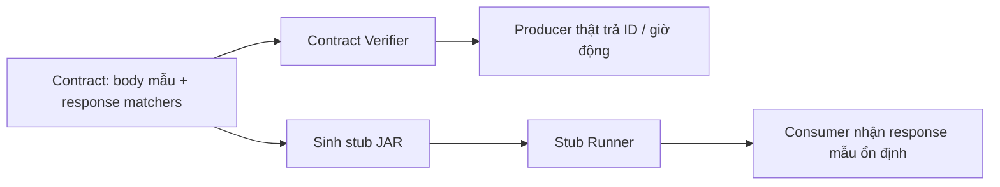
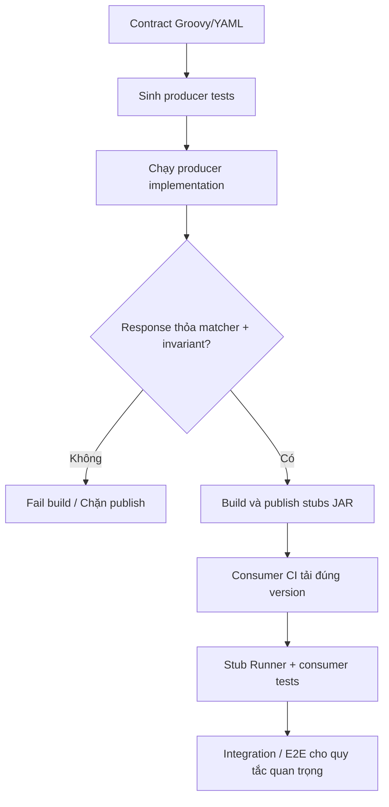

# Giá trị động như mã định danh và thời gian

> **Chương:** Response HTTP  
> **Module:** Spring Cloud Contract (`SPRING_CLOUD_CONTRACT`) — kiểm thử hợp đồng producer–consumer bằng Groovy/YAML DSL, sinh test phía cung cấp, phát hành stub, chạy Stub Runner và tích hợp CI.

## Mục tiêu học tập

Sau bài này, bạn có thể:

1. Nhận diện **response field động** như UUID, mã giao dịch, ngày tạo, timestamp, correlation ID và hiểu vì sao so sánh giá trị cố định dễ tạo test thất bại không cần thiết.
2. Phân biệt **giá trị mẫu trả cho consumer từ stub** với **điều kiện xác minh response thật của producer**.
3. Khai báo `response.bodyMatchers` bằng **Groovy DSL** hoặc `response.matchers.body` bằng **YAML DSL**.
4. Chọn các matcher `by_regex`, `by_type`, `by_date`, `by_time` và `by_timestamp` phù hợp với kiểu dữ liệu cũng như định dạng thời gian.
5. Viết contract giữ nguyên những **bất biến nghiệp vụ** như `status: CREATED`, số lượng, tên trường và mã HTTP, đồng thời cho phép ID/thời gian được sinh động.
6. Hiểu giới hạn của Stub Runner và lên kế hoạch kiểm chứng trên CI để phát hiện thay đổi API không tương thích.

## 1. Vấn đề: hai response hợp lệ có thể khác nhau

Xét luồng tạo đơn hàng: `checkout-service` (consumer) gửi yêu cầu đến `orders-service` (producer):

```http
POST /api/orders HTTP/1.1
Content-Type: application/json
Accept: application/json

{"sku":"BOOK-001","quantity":2}
```

Lần gọi thứ nhất, producer trả:

```http
HTTP/1.1 201 Created
Content-Type: application/json

{
  "orderId": "1d9541da-e454-4584-b45e-750b5bbb3104",
  "createdAt": "2025-01-12T08:30:45Z",
  "status": "CREATED",
  "sku": "BOOK-001",
  "quantity": 2
}
```

Lần gọi sau, cùng request hợp lệ có thể nhận:

```json
{
  "orderId": "cf1e4631-2d85-4287-99c9-55ded5f9d6ce",
  "createdAt": "2025-01-12T08:31:02Z",
  "status": "CREATED",
  "sku": "BOOK-001",
  "quantity": 2
}
```

Sự khác biệt ở `orderId` và `createdAt` là **mong đợi**, vì ứng dụng sinh UUID mới và ghi nhận thời điểm xử lý. Trong khi đó `status`, `sku` và `quantity` vẫn phải thỏa các điều kiện được hai bên thống nhất.

Nếu contract so sánh **nguyên response JSON** với một ví dụ có ID và thời gian cố định, producer test sẽ đỏ dù triển khai đúng. Ngược lại, nếu bỏ hết assertion để test luôn xanh, CI sẽ không phát hiện lỗi đổi `status` thành `FAILED` hoặc biến `quantity` thành chuỗi.

Cách xử lý là **giữ giá trị mẫu để sinh stub** và **khai báo matcher cho những trường động cần xác minh**.

## 2. Ai cần giá trị mẫu, ai cần điều kiện khớp?

Spring Cloud Contract dùng một hợp đồng cho hai mục đích khác nhau:

| Vị trí | Nhu cầu | Với `orderId` / `createdAt` |
| --- | --- | --- |
| **Producer verification test** | Gửi request thật vào producer và kiểm tra response thật | Chấp nhận nhiều giá trị, nhưng phải đúng định dạng đã cam kết |
| **Consumer test với Stub Runner** | Nhận một response dự đoán được để kiểm thử code xử lý HTTP client | Có thể dùng UUID và timestamp **mẫu cố định** từ `response.body` |
| **CI / phát hành stub** | Đảm bảo hợp đồng đã được producer xác minh trước khi consumer phụ thuộc | Sinh test, chạy test, đóng gói và phát hành stub có phiên bản |



Điều quan trọng nhất là phân biệt:

- **Request matchers** ảnh hưởng đến việc stub **chấp nhận request nào**. Producer test cần một request mẫu cụ thể để có thể gọi code thật.
- **Response matchers** ảnh hưởng đến việc **xác minh response producer tạo ra**. Response mẫu còn được sử dụng làm dữ liệu cho stub.
- Nếu chỉ viết `response.body` mà không khai báo matcher, các giá trị động có thể bị xem như kỳ vọng **cố định**.

Vì vậy hai phía không cần trả **cùng một UUID duy nhất**, nhưng chúng cần chia sẻ **cùng một định nghĩa về UUID và những trường không thay đổi**. <https://docs.spring.io/spring-cloud-contract/reference/howto/how-to-provide-dynamic-values.html>

## 3. Contract đầu tiên: response cố định gây vấn đề gì?

Đặt file YAML sau trong producer tại `src/test/resources/contracts/order_created.yml`:

```yaml
name: order_created

request:
  method: POST
  url: /api/orders
  headers:
    Content-Type: application/json
    Accept: application/json
  body:
    sku: BOOK-001
    quantity: 2

response:
  status: 201
  headers:
    Content-Type: application/json
  body:
    orderId: 1d9541da-e454-4584-b45e-750b5bbb3104
    createdAt: "2025-01-12T08:30:45Z"
    status: CREATED
    sku: BOOK-001
    quantity: 2
```

Hợp đồng này rất dễ đọc, nhưng có nhược điểm: nếu producer thực sự dùng `UUID.randomUUID()` và đồng hồ hiện tại, lần chạy test sau trả ID và timestamp khác. Một assertion so sánh đúng từng giá trị sẽ không phù hợp.

Không nên sửa production code để luôn trả `orderId` và `createdAt` từ YAML mẫu. Làm vậy đi ngược ý nghĩa của ID duy nhất và thời gian tạo mới.

Trường hợp khác: nếu nghiệp vụ quy định một ID cố định vì nó là **mã tham chiếu đã biết** (ví dụ đối chiếu đơn hàng có sẵn), so sánh chính xác vẫn là lựa chọn đúng. Sự khác biệt nằm ở *lời hứa nghiệp vụ*, không ở tên trường có chữ `id` hay `date`.

## 4. Giải pháp YAML: response.matchers.body

Giữ `response.body` như dữ liệu mẫu, **bổ sung `response.matchers.body`** để xác minh:

```yaml
name: order_created
description: "Producer tao don hang voi ID va timestamp dong"

request:
  method: POST
  url: /api/orders
  headers:
    Content-Type: application/json
    Accept: application/json
  body:
    sku: BOOK-001
    quantity: 2

response:
  status: 201
  headers:
    Content-Type: application/json
  body:
    orderId: 1d9541da-e454-4584-b45e-750b5bbb3104
    createdAt: "2025-01-12T08:30:45Z"
    status: CREATED
    sku: BOOK-001
    quantity: 2
  matchers:
    body:
      - path: $.orderId
        type: by_regex
        predefined: uuid
      - path: $.createdAt
        type: by_regex
        value: '[0-9]{4}-[0-9]{2}-[0-9]{2}T[0-9]{2}:[0-9]{2}:[0-9]{2}Z'
```

**Ý nghĩa từng thành phần:**

- `path: $.orderId` là **JSONPath** trỏ đến một trường trong response JSON.
- `type: by_regex` yêu cầu giá trị producer trả về khớp một biểu thức chính quy.
- `predefined: uuid` sử dụng mẫu UUID dựng sẵn của Spring Cloud Contract.
- `createdAt` dùng regex cụ thể cho chuỗi dạng `YYYY-MM-DDTHH:mm:ssZ` (UTC, độ chính xác tới giây).
- `status`, `sku` và `quantity` **không có matcher** nên giữ kỳ vọng bằng giá trị mẫu trong body.
- `response.status` vẫn phải là `201` và `Content-Type` phải đáp ứng hợp đồng.

**Regex chỉ kiểm tra hình dạng văn bản.** Biểu thức đơn giản ở trên có thể chấp nhận chuỗi như ngày 99 hoặc tháng 99 nếu khớp số lượng chữ số; nếu nghiệp vụ đòi hỏi ngày giờ hợp lệ hoặc thời điểm sau một mốc cụ thể, cần bổ sung kiểm tra bằng bộ phân tích thời gian hay test nghiệp vụ. Đây là điểm khác biệt giữa "chuỗi đúng hình dạng" và "thời gian hợp lệ".

Giá trị `createdAt` trong body YAML phải được đặt trong dấu nháy để được hiểu rõ là **chuỗi**, tránh sự khác biệt giữa các YAML parser. UUID cũng là chuỗi; ví dụ UUID trên không bị parser biến thành số, nhưng bạn có thể đặt dấu nháy để tăng tính rõ ràng.

### 4.1. Tại sao vẫn phải có giá trị mẫu?

Trong phần `body`, ID và timestamp mẫu phục vụ ít nhất hai việc:

1. **Stub Runner** có response cụ thể để trả cho consumer test.
2. **Người đọc và công cụ sinh contract** biết được cấu trúc, kiểu dữ liệu và một ví dụ hợp lệ.

Như vậy consumer test mặc định có thể nhận **chính UUID mẫu** trong mọi lần gọi. Điều đó hoàn toàn chấp nhận được nếu mục tiêu test là: client parse đúng UUID, đọc timestamp và xử lý `status: CREATED`.

Nếu consumer phải chứng minh **hai lần gọi tạo hai ID khác nhau**, một stub trả mẫu cố định không thể chứng minh quy tắc ấy. Hãy kiểm tra thuộc tính đó ở producer bằng unit/integration test với UUID generator có thể điều khiển hoặc bằng E2E thích hợp. Đừng suy ra "giá trị producer được matcher chấp nhận" đồng nghĩa với "stub tự tạo ngẫu nhiên một giá trị mới".

### 4.2. Tác động của matcher tới assertion

Giả sử producer trả:

```json
{
  "orderId": "e8c54344-bb81-4a90-9f92-b8ca991f2a60",
  "createdAt": "2025-01-12T10:15:30Z",
  "status": "CREATED",
  "sku": "BOOK-001",
  "quantity": 2
}
```

Response này đáp ứng ví dụ vì ID và timestamp đúng mẫu, còn các trường cố định đúng kỳ vọng.

Ngược lại:

```json
{
  "orderId": "not-an-id",
  "createdAt": "tomorrow",
  "status": "FAILED",
  "sku": "BOOK-001",
  "quantity": "2"
}
```

có nhiều lý do thất bại: UUID sai định dạng, thời gian sai, trạng thái khác `CREATED` và số lượng bị đổi thành **string**. Một contract có matcher đúng chỗ vẫn phát hiện những thay đổi phá vỡ giao tiếp.

## 5. Các matcher thời gian được hỗ trợ

Spring Cloud Contract có những matcher chuyên dụng cho ngày, giờ và timestamp. Chúng hữu ích khi producer sử dụng định dạng tương ứng với mẫu chuẩn mà DSL hỗ trợ. <https://docs.spring.io/spring-cloud-contract/reference/project-features-contract/dsl-dynamic-properties.html>

| Matcher YAML | Cách viết Groovy DSL | Ý nghĩa chính | Mẫu minh họa |
| --- | --- | --- | --- |
| `by_date` | `byDate()` | Ngày ISO | `2025-01-12` |
| `by_time` | `byTime()` | Giờ ISO | `08:30:45` |
| `by_timestamp` | `byTimestamp()` | Ngày + giờ theo mẫu ISO mà matcher hỗ trợ | `2025-01-12T08:30:45` |
| `by_regex` | `byRegex(...)` | Mẫu tự định nghĩa | `2025-01-12T08:30:45Z` với regex có `Z` |
| `by_type` | `byType()` | Chỉ kiểm tra kiểu JSON của trường | String / Number / Boolean / Array |
| `by_equality` | `byEquality()` | Giá trị chính xác | `status: CREATED` |

Ví dụ có cả ngày, giờ và timestamp **không kèm offset**:

```yaml
response:
  status: 200
  headers:
    Content-Type: application/json
  body:
    publishedDate: "2025-01-12"
    publishedTime: "08:30:45"
    publishedAt: "2025-01-12T08:30:45"
  matchers:
    body:
      - path: $.publishedDate
        type: by_date
      - path: $.publishedTime
        type: by_time
      - path: $.publishedAt
        type: by_timestamp
```

Đoạn trên là **một ví dụ response thay thế**, không ghép thêm một `response` thứ hai vào cùng hợp đồng ở mục 4.

**Chú ý múi giờ:** `2025-01-12T08:30:45` là thời gian không chứa offset, không đủ thông tin để mọi consumer xác định cùng một thời điểm toàn cầu. Trong API phân tán, nên thống nhất ISO 8601 có offset như `Z` hoặc `+07:00` rồi kiểm tra bằng regex phù hợp, matcher dựng sẵn `iso_8601_with_offset` khi tương thích, hoặc kiểm tra parse timestamp ở tầng ứng dụng. Đừng tự động áp dụng `by_timestamp` cho mọi biến thể timezone khi chưa kiểm chứng generator và pattern thực tế.

### 5.1. Sử dụng mẫu dựng sẵn

YAML `by_regex` có thể dùng `predefined` thay vì viết regex thủ công:

```yaml
response:
  status: 200
  body:
    orderId: 1d9541da-e454-4584-b45e-750b5bbb3104
  matchers:
    body:
      - path: $.orderId
        type: by_regex
        predefined: uuid
```

Ngoài `uuid`, DSL có các mẫu dựng sẵn như `iso_date`, `iso_date_time`, `iso_time`, `iso_8601_with_offset`, `number` và `non_blank`. Tuy nhiên, mỗi mẫu giải quyết một định dạng cụ thể; cần kiểm tra nó có khớp với cách API của bạn xuất dữ liệu hay không.

Với UUID, hãy thống nhất phía consumer cần **canonical UUID 36 ký tự**, ULID, số tự tăng hay một ID dạng chuỗi khác. Không dùng matcher UUID nếu producer trả `ORD-00017`: đó là một hợp đồng khác, không phải lỗi do UUID generator.

## 6. Bản Groovy DSL tương đương

Với cùng request/response của `order_created.yml`, có thể viết thành `order_created.groovy`:

```groovy
org.springframework.cloud.contract.spec.Contract.make {
    name 'order_created'

    request {
        method 'POST'
        url '/api/orders'
        headers {
            contentType(applicationJson())
            header 'Accept': 'application/json'
        }
        body(
            sku: 'BOOK-001',
            quantity: 2
        )
    }

    response {
        status 201
        headers {
            contentType(applicationJson())
        }
        body(
            orderId: '1d9541da-e454-4584-b45e-750b5bbb3104',
            createdAt: '2025-01-12T08:30:45Z',
            status: 'CREATED',
            sku: 'BOOK-001',
            quantity: 2
        )
        bodyMatchers {
            jsonPath('$.orderId',
                byRegex('[0-9a-fA-F]{8}-[0-9a-fA-F]{4}-[0-9a-fA-F]{4}-[0-9a-fA-F]{4}-[0-9a-fA-F]{12}'))
            jsonPath('$.createdAt',
                byRegex('[0-9]{4}-[0-9]{2}-[0-9]{2}T[0-9]{2}:[0-9]{2}:[0-9]{2}Z'))
        }
    }
}
```

Trong Groovy:

- `body(...)` mang giá trị cụ thể để sinh stub.
- `bodyMatchers { jsonPath(..., byRegex(...)) }` chỉ ra phép xác minh cho **trường động của response**.
- Dấu `$` trong JSONPath chỉ **gốc document JSON**, không phải cú pháp biến của Groovy ở đây.
- Chỉ nên giữ **một phiên bản** YAML hoặc Groovy trong thư mục contract nếu chúng cùng biểu diễn một tương tác; giữ cả hai có thể tạo test/stub trùng lặp.

Ngoài `bodyMatchers`, Groovy DSL còn hỗ trợ đặt giá trị động trực tiếp trong `body` bằng `$(consumer(...), producer(...))`. Ý nghĩa là: ở **response**, consumer/stub nhận một mẫu cố định, còn producer test kiểm tra điều kiện như regex. Ví dụ đoạn response body dưới đây dùng **cách thay thế**, không kết hợp đồng thời với body matcher cho cùng trường:

```groovy
response {
    status 201
    headers {
        contentType(applicationJson())
    }
    body(
        orderId: $(
            consumer('1d9541da-e454-4584-b45e-750b5bbb3104'),
            producer(regex('[0-9a-fA-F]{8}-[0-9a-fA-F]{4}-[0-9a-fA-F]{4}-[0-9a-fA-F]{4}-[0-9a-fA-F]{12}'))
        ),
        status: 'CREATED'
    )
}
```

**Chỉ Groovy/Java DSL hỗ trợ dạng giá trị động trực tiếp như `$(...)`.** Với YAML, hãy dùng `matchers`. Việc chọn giữa hai cách là quyết định biểu diễn, không ảnh hưởng đến yêu cầu bất biến của API.

## 7. Triển khai producer có ID và thời gian thực sự động

Ví dụ tối thiểu Spring MVC cho endpoint tạo đơn hàng:

```java
package com.example.orders;

import java.time.Clock;
import java.time.OffsetDateTime;
import java.time.ZoneOffset;
import java.time.format.DateTimeFormatter;
import java.util.UUID;

import org.springframework.http.HttpStatus;
import org.springframework.http.MediaType;
import org.springframework.web.bind.annotation.PostMapping;
import org.springframework.web.bind.annotation.RequestBody;
import org.springframework.web.bind.annotation.ResponseStatus;
import org.springframework.web.bind.annotation.RestController;

@RestController
public class OrdersController {

    private static final DateTimeFormatter API_TIMESTAMP =
        DateTimeFormatter.ofPattern("yyyy-MM-dd'T'HH:mm:ss'Z'");

    private final Clock clock;

    public OrdersController() {
        this(Clock.systemUTC());
    }

    public OrdersController(Clock clock) {
        this.clock = clock;
    }

    @PostMapping(
        path = "/api/orders",
        consumes = MediaType.APPLICATION_JSON_VALUE,
        produces = MediaType.APPLICATION_JSON_VALUE
    )
    @ResponseStatus(HttpStatus.CREATED)
    public CreatedOrder create(@RequestBody CreateOrder request) {
        String id = UUID.randomUUID().toString();
        String timestamp = OffsetDateTime.now(clock).withOffsetSameInstant(ZoneOffset.UTC)
            .format(API_TIMESTAMP);

        return new CreatedOrder(
            id, timestamp, "CREATED", request.sku(), request.quantity()
        );
    }

    public record CreateOrder(String sku, int quantity) {}

    public record CreatedOrder(
        String orderId,
        String createdAt,
        String status,
        String sku,
        int quantity
    ) {}
}
```

Các giả định của ví dụ:

- `UUID.randomUUID()` tạo ID mới ở mỗi lần gọi. Contract kiểm tra định dạng UUID, không yêu cầu giá trị giống mẫu.
- `Clock` có thể được thay bằng clock cố định trong **unit test** khi cần kiểm chứng xử lý thời gian cụ thể.
- Timestamp được biểu diễn theo UTC, kết thúc bằng `Z` và chính xác tới giây; regex trong contract phải thống nhất với định dạng này.
- Controller chỉ minh họa response; nó chưa lưu đơn hàng vào DB, chưa làm validation âm tính hay xử lý trùng đơn. Các hành vi đó cần được kiểm tra riêng.

### 7.1. Lớp cơ sở cho test producer sinh từ contract

Trong dự án producer dùng Contract Verifier và JUnit 5, có thể cấu hình base class:

```java
package com.example.orders;

import io.restassured.module.mockmvc.RestAssuredMockMvc;
import org.junit.jupiter.api.BeforeEach;

public abstract class ContractTestBase {

    @BeforeEach
    void setup() {
        RestAssuredMockMvc.standaloneSetup(new OrdersController());
    }
}
```

Plugin Maven/Gradle cần được cấu hình để các test sinh ra **kế thừa lớp này**, cùng dependency Contract Verifier tương ứng với phiên bản Spring Cloud. Không chạy class này độc lập; nó cung cấp setup cho test tự sinh.

Producer test được tạo từ contract sẽ gửi `POST /api/orders` với request mẫu, nhận `201` và kiểm tra response. `orderId` và `createdAt` khác giá trị mẫu vẫn có thể vượt qua nếu đúng matcher; `status`, `sku` và `quantity` tiếp tục phải đúng.

Khi producer thật đổi `status` thành `PENDING`, đổi `quantity` thành chuỗi hoặc bỏ `orderId`, test phải cho tín hiệu lỗi tương ứng. Đây là mục tiêu của contract verification.

## 8. Giá trị động ở response headers

Không chỉ body, response có thể chứa header động: `Location` chỉ đến resource mới tạo, `ETag` mô tả phiên bản resource, `X-Correlation-Id` để truy vết hoặc header do gateway thêm vào.

Ví dụ API trả một correlation ID mẫu trong response header:

```http
HTTP/1.1 201 Created
Content-Type: application/json
X-Correlation-Id: corr-0042
```

Nếu producer được yêu cầu trả mã theo mẫu `corr-` cộng bốn chữ số, YAML có thể dùng **header matcher**:

```yaml
response:
  status: 201
  headers:
    Content-Type: application/json
    X-Correlation-Id: corr-0042
  body:
    status: CREATED
  matchers:
    headers:
      - key: X-Correlation-Id
        regex: 'corr-[0-9]{4}'
```

Đây là **ví dụ response thay thế**: phải bổ sung header vào implementation producer trước khi chạy test. `response.matchers.headers` dùng danh sách `key` và `regex`, khác với body matcher dùng `path` và `type`.

Một producer test chỉ kiểm tra format của `X-Correlation-Id` **không chứng minh** header ấy bằng đúng giá trị từ request. Nếu yêu cầu là "echo lại X-Correlation-Id", cần kiểm tra mối quan hệ request–response, không chỉ regex.

### 8.1. Echo lại giá trị từ request

Một tình huống thực tế: client gửi `clientReference` và producer phải trả đúng `clientReference` ấy, vốn có thể khác trong mỗi request.

Khi viết Groovy DSL, có thể dùng `fromRequest().body(...)`. Với YAML, Spring Cloud Contract hỗ trợ cách biểu diễn response template bằng cú pháp Handlebars; ví dụ response body rút gọn:

```yaml
request:
  method: POST
  url: /api/echo
  headers:
    Content-Type: application/json
  body:
    clientReference: CLIENT-001

response:
  status: 200
  headers:
    Content-Type: application/json
  body:
    clientReference: "{{{ jsonpath this '$.clientReference' }}}"
```

Ở đây nội dung JSONPath được đánh giá từ request khi Stub Runner xử lý mẫu phản hồi; template không phải một chuỗi cố định mà consumer sẽ nhận theo nghĩa đen. Cần kiểm tra **stub mapping được sinh**, cấu hình response templating tương ứng và producer test thực tế với phiên bản Spring Cloud Contract đang dùng. Cú pháp template giúp mô tả phụ thuộc dữ liệu; nó không tự bảo đảm mọi tính chất nghiệp vụ như ID duy nhất hoặc thời gian tăng dần.

## 9. Khi nào dùng by_type, by_regex hay so sánh chính xác?

| Trường response | Kỳ vọng thực của consumer | Matcher nên chọn | Tránh |
| --- | --- | --- | --- |
| `orderId` là UUID | Định dạng UUID, parse được | `by_regex` với `predefined: uuid` | Ép ID cố định |
| `createdAt` có hậu tố `Z` | Chuỗi UTC dạng đã thống nhất | `by_regex` (hoặc mẫu offset đã xác minh) | Giả định mọi timestamp đều khớp `by_timestamp` |
| `createdDate` không có giờ | Ngày ISO | `by_date` | Dùng regex `.*` |
| `publishedAt` không có offset | ISO date-time theo format DSL | `by_timestamp` | So sánh đúng thời điểm máy chạy test |
| `amount` là số | Chỉ cần JSON Number | `by_type` với body mẫu số | Chấp nhận cả string nếu consumer cần số |
| `amount` phải lớn hơn 0 | Quy tắc nghiệp vụ | Assertion/test riêng hoặc `by_command` có helper | Chỉ dùng `by_type` và tưởng đã kiểm tra số dương |
| `status` phải là `CREATED` | Giá trị ổn định | So sánh chính xác, có thể dùng `by_equality` | Nới thành chuỗi bất kỳ |
| `correlationId` cần có và không rỗng | Chuỗi không rỗng | `by_regex` với `predefined: non_blank` | Bỏ hoàn toàn assertion |
| Field `error` phải null | JSON null là cam kết | `by_null` với dữ liệu mẫu phù hợp | Dùng string `"null"` |

Một matcher `by_type` chỉ quan tâm **kiểu JSON**, ví dụ body mẫu `amount: 1000` là số thì producer có thể trả `-42` mà vẫn đúng kiểu. Nếu consumer cần `amount > 0`, phải có thêm assertion thể hiện quy tắc này.

Một regex kiểu `[0-9a-fA-F-]+` chỉ kiểm tra một nhóm ký tự, **không chứng minh chuỗi là UUID hợp lệ**. Dùng matcher dựng sẵn `uuid` hoặc biểu thức đã mô tả cấu trúc UUID để tránh bỏ lọt lỗi.

### 9.1. Mối quan hệ giữa nhiều trường động

Response có thể chứa:

```json
{
  "orderId": "1d9541da-e454-4584-b45e-750b5bbb3104",
  "resourceUrl": "/api/orders/1d9541da-e454-4584-b45e-750b5bbb3104"
}
```

Hai regex riêng biệt có thể cho cả hai trường đều "đúng định dạng" nhưng giá trị ID **khác nhau**. Nếu cam kết `resourceUrl` phải chứa chính `orderId`, cần kiểm tra **mối quan hệ giữa các trường** qua assertion tùy biến trong test producer hoặc cơ chế DSL phù hợp. Đây là một quy tắc khác với kiểm tra từng field có đúng hình dạng hay không.

Tương tự, `createdAt <= updatedAt` hay `expiresAt > createdAt` là ràng buộc nghiệp vụ theo thời gian; matcher `by_timestamp` không tự so sánh thứ tự hai giá trị.

## 10. Kiểm thử consumer với Stub Runner

Sau khi producer contract verification đạt, build có thể sinh artifact stub, ví dụ:

```text
com.example:orders-service:1.0.0:stubs
```

Consumer dùng Stub Runner tải stub đã phát hành và thử HTTP client của mình. Ví dụ JUnit/Spring:

```java
@SpringBootTest(properties = {
    "orders.base-url=http://localhost:8090"
})
@AutoConfigureStubRunner(
    ids = "com.example:orders-service:1.0.0:stubs:8090",
    stubsMode = StubRunnerProperties.StubsMode.LOCAL
)
class OrdersClientContractTest {

    @Autowired
    OrdersClient client; // Client giả định có sẵn trong dự án consumer

    @Test
    void parseDuocIdVaTimestampTuProducerStub() {
        CreatedOrder order = client.create("BOOK-001", 2);

        UUID.fromString(order.orderId());
        OffsetDateTime.parse(order.createdAt());

        assertEquals("CREATED", order.status());
        assertEquals(2, order.quantity());
    }
}
```

Đoạn test minh họa **ý tưởng gọi client thật** với các lớp `OrdersClient`, `CreatedOrder` chưa trình bày; để chạy cần triển khai client, import và dependency phù hợp. Thuộc tính `orders.base-url` cũng là cấu hình minh họa của ứng dụng. `LOCAL` chỉ hoạt động khi stub đã được cài vào Maven local repository.

Điều consumer test này chứng minh:

- Consumer gửi request khớp stub mapping.
- Consumer parse được `orderId` và `createdAt` từ một JSON response đúng hợp đồng.
- Consumer xử lý `status` và `quantity` đã cam kết.

Điều consumer test này **không chứng minh**: ID của mỗi lần gọi là duy nhất, timestamp phản ánh đồng hồ thật hoặc producer mới nhất đang tuân thủ hợp đồng. Muốn có các bảo đảm ấy, cần producer verification và những unit/integration/E2E test phù hợp.

### 10.1. Vì sao stub thường trả cùng một ID mẫu?

Một stub mặc định được sinh từ YAML có thể trả:

```json
{
  "orderId": "1d9541da-e454-4584-b45e-750b5bbb3104",
  "createdAt": "2025-01-12T08:30:45Z",
  "status": "CREATED",
  "sku": "BOOK-001",
  "quantity": 2
}
```

khi request khớp. Điều này giúp consumer test lặp lại được và không phụ thuộc đồng hồ thực. Nhưng nếu consumer code cần ID thay đổi theo request, nên xây dựng kịch bản stub/template có quan hệ đầu vào–đầu ra, hoặc integration test với producer test environment. Tránh tự tạo "dynamic stub" tùy ý nếu không có cơ chế kiểm chứng nhất quán với producer.

## 11. Đưa bài kiểm tra vào CI và phát hiện API breaking changes

Một luồng CI tham khảo:



Từ thư mục producer, người học có thể chạy:

```bash
mvn clean verify
```

Với plugin Maven đã cấu hình, các contract trong `src/test/resources/contracts` được dùng để sinh producer verification test. Sau khi test đạt, thực hiện `mvn install` hoặc `mvn deploy` theo quy trình dự án để cài/phát hành artifact stub; không nên dùng `-DskipTests` cho bước xác nhận tương thích.

### 11.1. Những thay đổi nào bị phát hiện?

| Thay đổi ở producer | Kết quả mong đợi với contract mục 4 | Lý do |
| --- | --- | --- |
| Trả UUID hợp lệ mới mỗi lần | **PASS** | Đúng mẫu `uuid` |
| Timestamp UTC tăng theo thời gian, vẫn đúng `...Z` | **PASS** | Đúng regex đã cam kết |
| Trả `"orderId": "abc"` | **FAIL** | Sai định dạng UUID |
| Trả `createdAt: "ngay mai"` | **FAIL** | Sai định dạng thời gian |
| Trả `status: "FAILED"` | **FAIL** | Trái giá trị bất biến |
| Bỏ trường `quantity` | **FAIL** | Thiếu trường được mong đợi |
| Chuyển `quantity` từ `2` thành `"2"` | **FAIL** | Sai kiểu và giá trị body |
| Đổi `201` thành `200` | **FAIL** | Sai HTTP status |
| Trả thời gian đúng format nhưng quá khứ vô lý | **Có thể PASS** | Regex không xác minh tính hợp lý thời gian |

Nếu CI cho thấy producer contract test vẫn xanh sau khi phá một bất biến cần được bảo vệ, hãy kiểm tra **matcher đã bị nới quá rộng**, trường bị bỏ khỏi contract hay test bị vô hiệu hóa. Cần làm thất bại một test có chủ đích trước khi dựa vào nó như cổng kiểm soát tương thích.

### 11.2. Quản lý version stub

Consumer test với stub cũ có thể tiếp tục xanh dù implementation producer mới làm sai format. Cần:

1. Chạy producer contract verification **trước khi publish** artifact mới.
2. Gắn version cho stub để consumer biết mình đang kiểm tra API nào.
3. Kiểm tra các consumer còn phụ thuộc contract/version cũ khi thay đổi định dạng.
4. Chỉ cho phép consumer cập nhật version nếu hiểu được response mới.
5. Duy trì unit/integration test cho tính duy nhất của ID, múi giờ, thời gian tăng dần và logic lưu trữ.

Không xem việc thay đổi `createdAt` từ ISO 8601 sang epoch milliseconds là một "thay đổi nhỏ" nếu consumer đang parse string. Đây là **breaking change** dù cả hai đều biểu diễn thời gian.

## 12. Lỗi phổ biến và cách sửa

| Vấn đề | Biểu hiện | Cách xử lý |
| --- | --- | --- |
| Ép ID cố định | Producer test đỏ khi UUID thay đổi | Thêm response matcher `uuid` |
| Regex ID quá lỏng | `orderId: abc` vẫn được chấp nhận | Dùng predefined `uuid` hoặc regex đủ cấu trúc |
| Dùng `by_type` cho mọi thứ | Sai giá trị nghiệp vụ vẫn xanh | Giữ equality cho trường cố định, assertion riêng cho quan hệ |
| Ghép `Z` với `by_timestamp` tùy tiện | Test đỏ dù timestamp có offset hợp lệ | Chọn regex/ISO offset đã kiểm chứng |
| Timestamp thiếu timezone | Hai consumer hiểu thời gian khác nhau | Thống nhất `Z`/offset trong API và test |
| Quên đặt dấu nháy cho ngày YAML | Chuỗi bị parser diễn giải khác | Đặt `createdAt: "..."`, kiểm tra kiểu |
| Sai vị trí matcher | Viết `matchers` ở cấp root hoặc nhầm request/response | Đặt dưới `response.matchers.body` |
| JSONPath sai | Matcher không trỏ đúng field | Dùng `$.orderId`, `$.items[0].id` theo cấu trúc JSON |
| Stub trả ID mẫu cố định | Consumer test không thấy ID thay đổi | Đó là hành vi bình thường của stub; kiểm tra uniqueness ở producer |
| Consumer dùng stub cũ | Consumer xanh nhưng producer mới hỏng | Kiểm tra build, artifact và version stub |
| Producer bị bypass test | Stub publish dù implementation vi phạm | Không bỏ `verify` và chặn publish nếu đỏ |

## 13. Bài tập thực hành

**Bài 1 — Sửa contract giòn.** Với `order_created.yml` ở mục 3, thêm hai response matcher để producer sinh UUID và timestamp UTC mới mà test vẫn đúng. Giải thích tại sao `status` không cần matcher.

**Bài 2 — Chọn kiểu matcher.** Phân loại các trường `requestId` (UUID), `createdDate` (`YYYY-MM-DD`), `createdAt` (ISO có offset), `quantity` (số nguyên phải bằng 2), `price` (số dương) theo kiểu kiểm tra thích hợp. Trường hợp nào phải có assertion nghiệp vụ thay vì chỉ `by_type`?

**Bài 3 — Phát hiện breaking change.** Tạm đổi producer trả `orderId: ORD-9` trong khi contract dùng `predefined: uuid`. Dự đoán assertion bị fail và giải thích vì sao consumer test với stub cũ có thể vẫn xanh.

**Bài 4 — Quan hệ giữa hai trường.** Producer trả `orderId` và `resourceUrl`. Hãy viết một test để bảo đảm `resourceUrl` chứa **chính** `orderId` của cùng response. Tại sao hai regex đúng riêng lẻ là chưa đủ?

**Bài 5 — Thời gian và timezone.** Chuyển `createdAt` từ chuỗi ISO UTC thành epoch milliseconds. Chỉ ra những thay đổi cần có ở contract, DTO consumer, stub version và CI để hai phía chuyển đổi an toàn.

**Bài 6 — Stub Runner.** Viết consumer test parse `orderId` thành `UUID` và `createdAt` thành `OffsetDateTime`. Nhận xét vì sao một test lặp lại nhiều lần với cùng stub response không kiểm chứng được tính duy nhất ID.

## 14. Ghi nhớ

Giá trị động như **mã định danh, correlation ID và thời gian** không nên bị cố định một cách vô ý trong producer verification test. Trong Spring Cloud Contract, phần **response body** cung cấp mẫu có thể dùng cho stub, còn **response matchers** xác định những giá trị thực mà producer được phép trả. Groovy DSL dùng `bodyMatchers` hoặc cặp `consumer/producer` cho giá trị động; YAML DSL dùng `response.matchers.body`.

Một contract hữu ích phải vừa **linh hoạt** ở ID/timestamp, vừa **nghiêm ngặt** ở status, HTTP code, kiểu dữ liệu và điều kiện nghiệp vụ. Producer test chạy trong CI bảo vệ lời hứa API; stub được phát hành sau khi producer verification đạt và được consumer dùng qua Stub Runner. Khi cần kiểm chứng **ID duy nhất, quan hệ các trường hoặc thứ tự thời gian**, bổ sung unit/integration test thay vì giả định matcher định dạng đã bảo đảm tất cả.

## Tài liệu tham khảo

- [Spring Cloud Contract — Dynamic Properties](https://docs.spring.io/spring-cloud-contract/reference/project-features-contract/dsl-dynamic-properties.html) — `bodyMatchers`, `byRegex`, `byTimestamp`, `byType` và YAML matchers.
- [Spring Cloud Contract — How Can I Provide Dynamic Values to a Contract?](https://docs.spring.io/spring-cloud-contract/reference/howto/how-to-provide-dynamic-values.html) — vì sao cần tách dữ liệu mẫu và xác minh giá trị động.
- [Spring Cloud Contract — Contract DSL](https://docs.spring.io/spring-cloud-contract/reference/project-features-contract.html) — biểu diễn hợp đồng producer/consumer.
- [Spring Cloud Contract — YML Schema](https://docs.spring.io/spring-cloud-contract/reference/yml-schema.html) — cấu trúc response matchers trong YAML.
- [Spring Cloud Contract — Stub Runner Core](https://docs.spring.io/spring-cloud-contract/reference/project-features-stubrunner/stub-runner-core.html) — chạy stub với consumer test.
