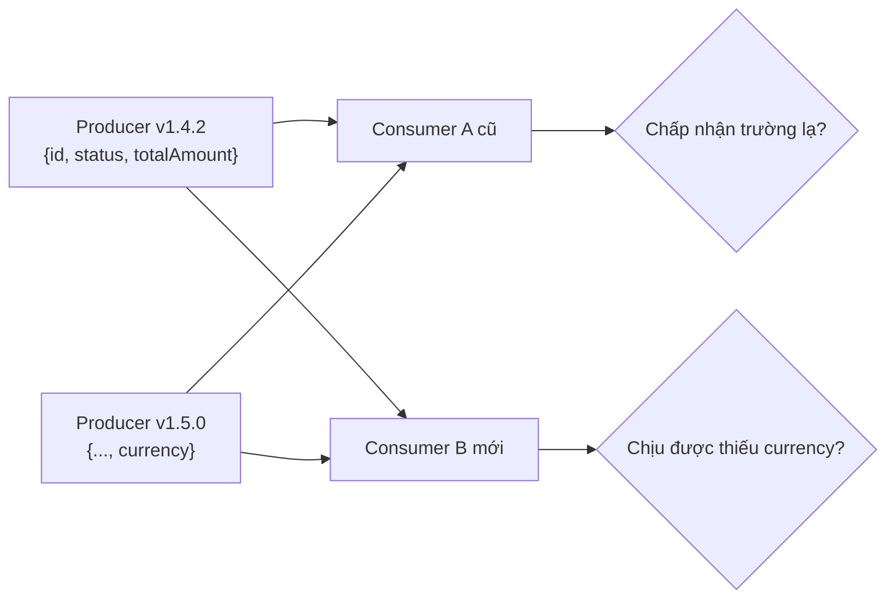
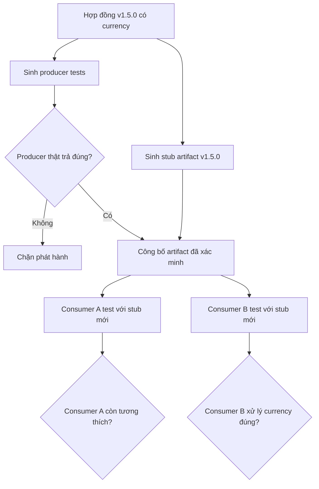
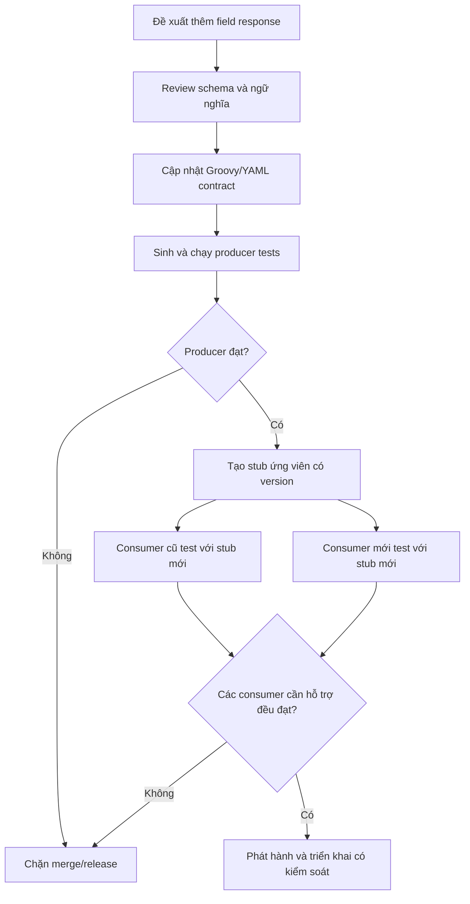

# Trường mới trong response và kiểm tra tương thích

## 1. Thêm một trường JSON có luôn là thay đổi tương thích?

Trong module **SPRING_CLOUD_CONTRACT**, Spring Cloud Contract giúp producer và consumer thống nhất hành vi HTTP hoặc thông điệp bằng **Groovy/YAML DSL**. Từ hợp đồng, công cụ có thể sinh kiểm thử phía producer, đóng gói stub cho consumer sử dụng qua **Stub Runner** và tích hợp vào CI nhằm phát hiện thay đổi API không tương thích.

Với **response HTTP**, một tình huống thường gặp là producer bổ sung trường JSON mà không đổi method, URL hay mã trạng thái. Ví dụ, dịch vụ đơn hàng ban đầu trả:

```http
HTTP/1.1 200 OK
Content-Type: application/json

{
  "id": "ord-1001",
  "status": "CREATED",
  "totalAmount": 125000
}
```

Phiên bản sau bổ sung `currency`:

```http
HTTP/1.1 200 OK
Content-Type: application/json

{
  "id": "ord-1001",
  "status": "CREATED",
  "totalAmount": 125000,
  "currency": "VND"
}
```

Đây là một thay đổi **bổ sung trường** (*additive change*). Tuy nhiên, không thể kết luận “tương thích ngược” chỉ từ việc không xóa các trường cũ. Kết quả phụ thuộc vào **consumer đọc JSON như thế nào**, hợp đồng/schema đang ràng buộc đến đâu và ứng dụng có đang sử dụng những giả định về cấu trúc, kiểu dữ liệu hoặc ý nghĩa giá trị hay không.

Sau bài học, bạn sẽ biết cách:

- Phân biệt thay đổi thêm trường với thay đổi xóa, đổi tên, đổi kiểu hoặc thay đổi ý nghĩa của trường.
- Đánh giá consumer **bỏ qua trường lạ** và consumer **từ chối trường lạ**.
- Mô tả response mới bằng Groovy/YAML DSL, đồng thời giữ rõ những cam kết cũ.
- Dùng producer tests và stub của hai phiên bản để xác minh tính tương thích.
- Thiết kế ma trận CI cho consumer cũ, consumer mới, producer cũ và producer mới.
- Nhận diện những trường hợp một kiểm thử hợp đồng đạt nhưng hệ thống vẫn có nguy cơ lỗi khi triển khai.

## 2. Tương thích phải được đánh giá theo từng phía

### 2.1. Hai câu hỏi khác nhau

**Tương thích ngược của producer mới với consumer cũ:** consumer đang hoạt động với response cũ có tiếp tục xử lý được response mới không?

**Khả năng consumer mới chạy với producer cũ:** consumer đã biết đến trường mới có hoạt động khi trường đó chưa có trong response từ producer cũ không?

Đây là hai câu hỏi khác nhau, đặc biệt khi microservice triển khai theo nhiều đợt, có phiên bản chạy song song hoặc consumer chưa cập nhật ngay.

| Thành phần | Trạng thái ví dụ | Rủi ro cần xét |
| --- | --- | --- |
| Producer v1.4.2 | Trả `id`, `status`, `totalAmount` | Là response mà consumer hiện tại đã quen |
| Producer v1.5.0 | Trả thêm `currency` | Consumer cũ có bỏ qua trường mới không? |
| Consumer A (cũ) | DTO chỉ có ba trường; parser nghiêm ngặt | Có thể lỗi khi nhận `currency` |
| Consumer B (mới) | Hiển thị `currency` | Có xử lý được response thiếu `currency` từ producer cũ không? |

Một thay đổi chỉ có thể gọi là **tương thích với một consumer cụ thể** khi consumer đó xử lý được response mới theo các giả định thực tế của nó. Việc kiểm thử một consumer không bảo đảm tất cả consumer khác cũng có cùng khả năng.

### 2.2. Luồng triển khai



Nếu consumer A được cấu hình chỉ nhận đúng những trường đã biết, **producer mới có thể gây lỗi ngay khi triển khai**. Nếu consumer B coi `currency` là bắt buộc nhưng vẫn kết nối producer cũ, **consumer mới có thể lỗi trong giai đoạn nâng cấp**.

## 3. Phân loại thay đổi của response

| Thay đổi | Ví dụ | Nhận định ban đầu | Điều cần kiểm tra |
| --- | --- | --- | --- |
| Thêm trường mới tùy chọn | Thêm `currency` mà giữ nguyên ba trường cũ | Thường dễ giữ tương thích | Unknown-property handling, schema, cách consumer dùng trường |
| Thêm trường và bắt buộc consumer phải đọc | Consumer mới luôn cần `currency` | Có thể phá khả năng chạy với producer cũ | Có giá trị dự phòng/chuyển tiếp hợp lệ không? |
| Xóa trường | Bỏ `totalAmount` | Thường phá consumer đang dùng trường đó | Có consumer nào còn truy cập trường không? |
| Đổi tên | `totalAmount` thành `amount` | Về thực chất giống xóa rồi thêm | Có giữ alias/trường cũ trong giai đoạn chuyển tiếp không? |
| Đổi kiểu | `totalAmount: 125000` thành `"125000"` | Có nguy cơ phá parser, tính toán | Schema, deserializer, kiểu số |
| Đổi ý nghĩa | `totalAmount` từ VND sang USD nhưng vẫn là số | Rủi ro rất cao dù JSON hợp lệ | Hợp đồng ngữ nghĩa và quy tắc nghiệp vụ |
| Thêm giá trị vào trường enum cũ | `status = PARTIALLY_SHIPPED` | Có thể phá consumer dùng switch/when toàn phần | Consumer có nhánh mặc định và hành vi an toàn không? |
| Thêm trường vào object lồng nhau | `items[].discount` | Vẫn là thay đổi bổ sung, có thể bị từ chối | Parser/schema của từng item |
| Thay đổi status hoặc Content-Type | `200` thành `204`, JSON thành text | Thay đổi lớn hơn việc thêm trường | Client branching, parser và header |

**Không nhầm thay đổi cấu trúc với thay đổi ý nghĩa.** Một response vẫn hợp lệ JSON chưa chắc tương thích nghiệp vụ. Ví dụ, thêm `currency` đồng thời đổi `totalAmount` sang đơn vị nhỏ nhất của tiền tệ khác có thể khiến consumer cũ tính sai dù không gặp lỗi parse.

## 4. Vì sao consumer có thể lỗi khi xuất hiện trường mới?

### 4.1. Consumer chấp nhận trường không biết

Giả sử consumer Java chỉ cần `id` và `status`. Với Jackson, một DTO có thể chủ động cho phép bỏ qua thuộc tính lạ:

```java
import com.fasterxml.jackson.annotation.JsonIgnoreProperties;

@JsonIgnoreProperties(ignoreUnknown = true)
public record OrderView(String id, String status, long totalAmount) {}
```

Với response mới có `currency`, cấu hình này cho phép deserializer bỏ qua trường đó khi tạo `OrderView`. Consumer vẫn đọc được ba trường cũ. Đoạn ví dụ sử dụng Java có hỗ trợ `record` và Jackson tương ứng; trong dự án thực, cách khai báo DTO có thể là class thông thường.

**Giới hạn:** bỏ qua trường không biết chỉ giúp tránh lỗi parse. Nó không bảo đảm giá trị `totalAmount` vẫn mang cùng ý nghĩa hoặc `status` vẫn có các giá trị consumer xử lý được.

### 4.2. Consumer từ chối trường không biết

Một consumer có thể chủ động bật chế độ nghiêm ngặt:

```java
import com.fasterxml.jackson.databind.DeserializationFeature;
import com.fasterxml.jackson.databind.ObjectMapper;

// DTO nghiêm ngặt: không gắn @JsonIgnoreProperties(ignoreUnknown = true).
record StrictOrderView(String id, String status, long totalAmount) {}

ObjectMapper mapper = new ObjectMapper()
    .configure(DeserializationFeature.FAIL_ON_UNKNOWN_PROPERTIES, true);

String responseJson = """
    {
      "id": "ord-1001",
      "status": "CREATED",
      "totalAmount": 125000,
      "currency": "VND"
    }
    """;

StrictOrderView order = mapper.readValue(responseJson, StrictOrderView.class);
```

Vì `StrictOrderView` không khai báo `currency` **và không có cấu hình/annotation bỏ qua thuộc tính lạ**, lời gọi có thể ném `UnrecognizedPropertyException`. Đoạn này là các mảnh mã minh họa, cần đặt phần tạo mapper và giải mã trong phương thức/test khi thực hành.

Không nên mặc định mọi ứng dụng Spring Boot, Jackson, Gson hoặc client TypeScript đều nghiêm ngặt hay đều dung thứ trường lạ. **Cấu hình cụ thể, generated client, validation schema và logic ứng dụng** quyết định kết quả.

### 4.3. JSON Schema có thể chặn thuộc tính mới

Ngay cả khi JSON parser đọc được, consumer có thể kiểm tra response theo JSON Schema:

```json
{
  "type": "object",
  "properties": {
    "id": { "type": "string" },
    "status": { "type": "string" },
    "totalAmount": { "type": "integer" }
  },
  "required": ["id", "status", "totalAmount"],
  "additionalProperties": false
}
```

Với `additionalProperties: false`, JSON chứa `currency` không đạt schema cũ. Vì vậy, “thêm trường không phá API” **không đúng** khi consumer đã công bố hoặc triển khai một schema khép kín. Nếu tổ chức muốn response có thể mở rộng, cần thỏa thuận cách xử lý thuộc tính lạ ngay từ thiết kế.

### 4.4. So sánh toàn bộ JSON cũng có thể làm test lỗi

Một bài consumer test như sau dễ nhạy với trường mới:

```java
assertThat(actualJson).isEqualTo("""
    {"id":"ord-1001","status":"CREATED","totalAmount":125000}
    """);
```

So sánh chuỗi chính xác còn nhạy với thứ tự thuộc tính và khoảng trắng. Nếu consumer chỉ dùng `id` và `status`, nên kiểm tra những thuộc tính đó qua JSON parser hoặc API của consumer, đồng thời kiểm tra schema phù hợp. Tuy nhiên, khi hình dạng response **là một cam kết phải khép kín**, kiểm tra chặt vẫn có ý nghĩa; thay đổi chính sách cần được thỏa thuận giữa hai phía.

## 5. Thiết kế hợp đồng cho response trước và sau khi thêm trường

### 5.1. Hợp đồng phiên bản cũ

Giả sử phiên bản producer `1.4.2` đã công bố hợp đồng Groovy:

```groovy
import org.springframework.cloud.contract.spec.Contract

Contract.make {
    name 'get_order_success'
    description 'Lấy đơn hàng đã tồn tại'

    request {
        method GET()
        url '/api/orders/ord-1001'
    }

    response {
        status 200
        headers {
            contentType(applicationJson())
        }
        body([
            id         : 'ord-1001',
            status     : 'CREATED',
            totalAmount: 125000
        ])
    }
}
```

Hợp đồng này bảo vệ ba thuộc tính consumer đã biết ở thời điểm phát hành. Tùy phiên bản và cách cấu hình assertion của generated producer test, việc producer trả thêm trường có thể được chấp nhận hoặc bị báo là khác body mong đợi. Không nên đoán hành vi matcher: **phải chạy test sinh ra và xem chính xác điều kiện so khớp**.

### 5.2. Hợp đồng phiên bản mới thêm `currency`

Với producer `1.5.0`, API quy định `currency` là mã tiền tệ của `totalAmount`. Hợp đồng mới:

```groovy
import org.springframework.cloud.contract.spec.Contract

Contract.make {
    name 'get_order_success'
    description 'Lấy đơn hàng và đơn vị tiền tệ'

    request {
        method GET()
        url '/api/orders/ord-1001'
    }

    response {
        status 200
        headers {
            contentType(applicationJson())
        }
        body([
            id         : 'ord-1001',
            status     : 'CREATED',
            totalAmount: 125000,
            currency   : 'VND'
        ])
    }
}
```

Điểm cần giữ:

- **Method và URL không đổi:** consumer vẫn gọi `GET /api/orders/ord-1001`.
- **HTTP status, Content-Type không đổi:** response vẫn `200` và JSON.
- **Ba trường cũ giữ nguyên tên, kiểu và ý nghĩa** trong tình huống này.
- **Trường mới có ngữ nghĩa rõ ràng:** `currency = VND` biểu thị đơn vị của `totalAmount`.

Khi sinh producer tests từ hợp đồng mới, việc thiếu hoặc trả sai `currency` phải được phát hiện nếu hợp đồng đang khẳng định giá trị chính xác này. Đây là **kiểm chứng producer đáp ứng bản hợp đồng mới**, chưa tự chứng minh consumer cũ sẽ chấp nhận body có thêm trường.

### 5.3. YAML DSL tương đương

Cùng hành vi response mới cũng có thể viết bằng YAML DSL:

```yaml
name: get_order_success
description: Lấy đơn hàng và đơn vị tiền tệ
request:
  method: GET
  url: /api/orders/ord-1001
response:
  status: 200
  headers:
    Content-Type: application/json
  body:
    id: ord-1001
    status: CREATED
    totalAmount: 125000
    currency: VND
```

Chọn Groovy hoặc YAML theo quy ước dự án; không đưa hai hợp đồng trùng nhau vào cùng vị trí plugin quét cho cùng một tình huống.

## 6. Phân biệt “có trường”, “không có trường” và “trường bằng null”

Giả sử producer mới chưa có thông tin tiền tệ cho một số đơn cũ. Ba response sau không hoàn toàn tương đương:

**Trường không xuất hiện:**

```json
{
  "id": "ord-1001",
  "totalAmount": 125000
}
```

**Trường có mặt với giá trị null:**

```json
{
  "id": "ord-1001",
  "totalAmount": 125000,
  "currency": null
}
```

**Trường có mặt với giá trị rõ ràng:**

```json
{
  "id": "ord-1001",
  "totalAmount": 125000,
  "currency": "VND"
}
```

Một consumer dùng `root.get("currency")`, `root.path("currency")` hoặc DTO nullable có thể phân biệt các trường hợp này theo cách khác nhau. JSON Schema cũng phân biệt thuộc tính `required` với thuộc tính cho phép `null`.

| Thiết kế trường | Ý nghĩa | Kiểm tra tương thích |
| --- | --- | --- |
| Không bắt buộc, có thể vắng mặt | Producer cũ hoặc một nhánh không có thông tin | Consumer mới phải xử lý thiếu trường |
| Bắt buộc nhưng có thể `null` | Trường luôn xuất hiện, dữ liệu chưa xác định | Consumer xử lý `null` như thế nào? |
| Bắt buộc và không `null` | Mọi response cùng loại phải cung cấp giá trị | Producer phải có dữ liệu; consumer cũ vẫn có thể từ chối thuộc tính lạ |

Không nên mặc định `currency = "VND"` cho mọi response thiếu trường nếu hệ thống có nhiều loại tiền tệ. **Giá trị dự phòng phải có quy tắc nghiệp vụ đúng**, không chỉ nhằm tránh lỗi parse.

### 6.1. Thêm trường vào danh sách hoặc object lồng nhau

Ví dụ:

```json
{
  "id": "ord-1001",
  "items": [
    {
      "productId": "SKU-001",
      "quantity": 2,
      "discountAmount": 10000
    }
  ]
}
```

`discountAmount` được thêm vào từng object trong mảng `items`. Consumer có schema nghiêm ngặt cho **phần tử** của mảng vẫn có thể lỗi, dù schema của object ngoài cùng cho phép trường mới. Vì vậy, khi review response, cần xác định chính xác **vị trí** của thuộc tính bổ sung.

## 7. Kiểm tra giá trị động bằng matcher một cách có chủ đích

Nếu response mới bổ sung `updatedAt` là timestamp do producer tạo, buộc so khớp một chuỗi cố định có thể gây false failure:

```groovy
response {
    status 200
    headers {
        contentType(applicationJson())
    }
    body([
        id       : 'ord-1001',
        currency : 'VND',
        updatedAt: '2026-11-01T10:15:30Z'
    ])
    bodyMatchers {
        jsonPath('$.updatedAt',
                 byRegex('\\d{4}-\\d{2}-\\d{2}T\\d{2}:\\d{2}:\\d{2}Z'))
    }
}
```

Đây là ví dụ matcher dạng thời gian UTC không có phần thập phân; nếu API hỗ trợ offset hoặc milliseconds thì phải điều chỉnh biểu thức. Matcher chỉ kiểm tra **hình dạng chuỗi**, không đủ chứng minh timestamp là một thời điểm hợp lệ trong mọi trường hợp.

Cách đọc:

- Stub dành cho consumer có một `updatedAt` mẫu ổn định.
- Generated producer test cần kiểm tra giá trị `updatedAt` trong response thật theo quy tắc matcher được khai báo.
- Các trường `id` và `currency` trong ví dụ vẫn được kiểm tra theo giá trị đã cam kết.

Không nên dùng `byRegex('.*')` cho toàn body hay mọi trường vì nó bỏ qua những thay đổi có ý nghĩa. Nếu mục tiêu là nhận nhiều định dạng ngày giờ, cần mô tả chính xác kiểu và quy tắc mà consumer chấp nhận.

**Lưu ý về kiểm tra tương thích:** matcher đúng không tự biến mọi lần thêm trường thành tương thích. Nó chỉ xác định cách kiểm tra giá trị của trường đang được hợp đồng mô tả.

## 8. Producer test, stub và consumer test kiểm chứng những gì?



| Bước | Câu hỏi được trả lời | Điều chưa được bảo đảm |
| --- | --- | --- |
| Parse/convert Groovy/YAML | Hợp đồng có được công cụ đọc và chuyển đổi không? | Producer thật hoặc consumer thật có tương thích không |
| Generated producer tests | Producer có trả đúng status/header/body được hợp đồng mới mô tả không? | Client cũ có chấp nhận thêm thuộc tính không |
| Stub artifact | Có mô phỏng được response theo phiên bản hợp đồng đã công bố không? | Stub không chứng minh producer thật còn đúng nếu bỏ producer verification |
| Consumer integration test với Stub Runner | Mã consumer có xử lý được response từ stub được chọn không? | Những phiên bản consumer khác chưa chạy test |
| Kiểm thử tích hợp/end-to-end | Các thành phần thực tương tác đúng trong môi trường kiểm thử không? | Các consumer không tham gia hoặc tất cả tình huống sản xuất |

Spring Cloud Contract giúp nối hợp đồng với kiểm thử tự động, nhưng **tính tương thích cần cả hai phía tham gia**. Một producer test xanh không phải “chứng nhận tương thích với mọi consumer”.

## 9. Dùng Stub Runner để kiểm tra consumer cũ với response mới

Giả sử bản phát hành cũ đã có stub:

```text
com.example:orders-producer:1.4.2:stubs
```

Phiên bản mới được công bố độc lập:

```text
com.example:orders-producer:1.5.0:stubs
```

Consumer nên chỉ rõ phiên bản stub cần dùng. Ví dụ test Spring Boot:

```java
import org.junit.jupiter.api.Test;
import org.springframework.beans.factory.annotation.Autowired;
import org.springframework.boot.test.context.SpringBootTest;
import org.springframework.cloud.contract.stubrunner.StubRunnerProperties;
import org.springframework.cloud.contract.stubrunner.spring.AutoConfigureStubRunner;

import static org.assertj.core.api.Assertions.assertThat;

@SpringBootTest(properties = {
    "orders.api.base-url=http://localhost:8090"
})
@AutoConfigureStubRunner(
    ids = "com.example:orders-producer:1.5.0:stubs:8090",
    stubsMode = StubRunnerProperties.StubsMode.REMOTE,
    repositoryRoot = "https://artifacts.example.test/repository/maven-releases"
)
class OrderResponseCompatibilityTest {

    @Autowired
    private OrdersClient ordersClient;

    @Test
    void readsOrderReturnedByNewProducerStub() {
        OrderView order = ordersClient.getOrder("ord-1001");

        assertThat(order.status()).isEqualTo("CREATED");
    }
}
```

**Giả định để chạy ví dụ:** `OrdersClient` và `OrderView` là các kiểu do ứng dụng consumer định nghĩa; client phải lấy base URL từ `orders.api.base-url` và cấu hình dependency kiểm thử, Spring context thích hợp. URL repository là địa chỉ minh họa. Cần thay bằng artifact, credential, phiên bản thư viện và môi trường thực tế.

Nếu `OrdersClient` đang dùng JSON deserializer nghiêm ngặt và DTO không có `currency`, test có thể thất bại ngay khi parse response từ stub `1.5.0`. Đó là tín hiệu có giá trị: **thêm trường đã ảnh hưởng một consumer cụ thể**.

Ngược lại, consumer có thể parse tốt nhưng lại bỏ qua `currency` trong phép tính tiền tệ mà sản phẩm hiện yêu cầu. Vì vậy, consumer mới phải có assertion cho **hành vi** khi dùng trường mới, không chỉ assertion rằng JSON được giải mã thành công.

### 9.1. Cố định phiên bản thay vì luôn lấy bản mới nhất

Trong kiểm thử chặn phát hành, nên ghim version như `1.5.0` để có thể tái lập kết quả. Nếu test luôn tải “latest” hoặc một `SNAPSHOT` thay đổi liên tục, việc một lần chạy thất bại không cho biết lỗi do commit consumer hay do stub đã bị thay thế.

Ghim version **không có nghĩa** là mãi kiểm tra bản cũ. Có thể tạo job riêng chủ động chạy consumer với stub phiên bản ứng viên mới và mở PR nâng version khi đã xác minh tương thích.

## 10. Ma trận kiểm thử trước khi triển khai

Giả sử hai phiên bản producer `P-old`/`P-new` và hai phiên bản consumer `C-old`/`C-new`:

| Consumer / Producer | P-old: không có `currency` | P-new: có `currency` |
| --- | --- | --- |
| C-old bỏ qua thuộc tính lạ | Thường hoạt động nếu ba trường cũ vẫn đúng | Có thể hoạt động; phải chạy consumer test |
| C-old từ chối thuộc tính lạ | Hoạt động với response cũ | Có thể lỗi khi deserialize `currency` |
| C-new coi `currency` là tùy chọn | Có thể hoạt động với giá trị dự phòng đúng nghiệp vụ | Hoạt động khi giá trị và kiểu đúng |
| C-new yêu cầu `currency` bắt buộc | Có thể lỗi do thiếu trường | Hoạt động nếu field luôn hiện diện và có giá trị hợp lệ |

Đừng tự xem ô “thường hoạt động” là kết quả test đạt: còn có các thay đổi về kiểu dữ liệu, cấu hình client hoặc logic khác. **Các ô cần được chạy bằng test thực tế hoặc có bằng chứng tương ứng.**

### 10.1. Thứ tự triển khai giảm rủi ro

Một cách triển khai khi không thể nâng tất cả dịch vụ cùng lúc:

1. **Thống nhất ngữ nghĩa trường mới.** `currency` là đơn vị của `totalAmount`; chuẩn mã ISO 4217 hay quy ước khác phải được quyết định rõ.
2. **Kiểm tra consumer cũ.** Chạy chúng với stub producer mới; sửa parser/schema quá nghiêm ngặt nếu chính sách API cho phép trường mở rộng.
3. **Cho consumer mới chịu được giai đoạn chuyển tiếp.** Nếu nó có thể gặp producer cũ, trường mới phải được xử lý khi vắng mặt; chỉ dùng giá trị mặc định khi hợp lệ theo nghiệp vụ.
4. **Producer phát hành response mới** với hợp đồng và producer tests đã đạt; các consumer chưa nâng vẫn phải chạy đúng.
5. **Consumer mới bắt đầu sử dụng trường mới** khi có bảo đảm producer/route đang cung cấp trường đó hoặc có cơ chế fallback được chấp nhận.
6. **Thu hẹp giai đoạn chuyển tiếp** khi đã biết toàn bộ consumer liên quan sử dụng phiên bản phù hợp.

Nếu không thể tạo fallback an toàn, việc thêm một trường mà consumer mới cần dùng ngay có thể đòi hỏi **điều phối phát hành**, version endpoint hoặc cơ chế thương lượng khả năng (capability negotiation), thay vì giả định mọi phiên bản đều hoán đổi được.

## 11. Tạo chính sách hợp đồng tránh “tương thích trên giấy”

Một nhóm phát triển nên thống nhất trước khi nhận một trường mới:

| Quyết định | Câu hỏi cần chốt | Ví dụ |
| --- | --- | --- |
| Quy tắc bỏ qua unknown fields | Consumer có được từ chối thuộc tính lạ không? | API công bố response mở rộng, consumer bỏ qua trường không dùng |
| Kiểu dữ liệu | Trường là string, number, boolean hay object? | `currency` là string |
| Tính bắt buộc | Field phải luôn có hay có thể vắng? | Producer mới luôn gửi, producer cũ không có |
| Nullability | `null` được phép không? | `currency` không được null trong đơn mới |
| Ngữ nghĩa | Giá trị ảnh hưởng logic nào? | Mã tiền tệ áp dụng cho `totalAmount` |
| Thứ tự và cấu trúc | Consumer có phụ thuộc thứ tự trường hay exact JSON không? | Không nên phụ thuộc thứ tự JSON object |
| Phạm vi phiên bản | Khi nào trường được phát hành? | Stub `1.5.0` và API triển khai tương ứng |
| Kiểm thử | Ai xác nhận thay đổi không phá consumer? | Producer verification + consumer compatibility suite |

Nếu tổ chức dùng OpenAPI/JSON Schema, nên cập nhật tài liệu schema song song với DSL. **Schema mô tả kiểu và ràng buộc**; Spring Cloud Contract bảo vệ những tình huống cụ thể qua test/stub. Hai lớp bổ sung cho nhau, không tự động thay thế toàn bộ trách nhiệm của nhau.

## 12. Lỗi thường gặp khi bổ sung field

| Hiện tượng | Nguyên nhân thường gặp | Hướng xử lý |
| --- | --- | --- |
| Consumer cũ lỗi `UnrecognizedPropertyException` | DTO/mapper từ chối unknown properties | Kiểm tra chính sách tương thích; điều chỉnh DTO/parser khi được phép |
| Consumer dùng JSON Schema báo extra property | `additionalProperties: false` | Đánh giá có cho phép mở rộng schema hay cần version mới |
| Producer test fail khi thêm `currency` | Contract/test assertion chưa cập nhật hoặc producer trả khác giá trị | So sánh DSL, generated tests và response thật |
| Producer test pass nhưng consumer vẫn lỗi | Producer verification không chạy mã consumer | Chạy consumer với stub mới và kiểm tra parser thật |
| Consumer mới lỗi khi gọi producer cũ | Trường mới vắng mặt | Xử lý thiếu trường hoặc điều phối phiên bản triển khai |
| Stub cũ không chứa field mới | Consumer đang ghim artifact cũ | Chọn đúng version stub mới, không sửa đè artifact cũ |
| Field mới luôn `null` ngoài production | Nguồn dữ liệu chưa được chuẩn bị hoặc ánh xạ sai | Tăng test nghiệp vụ/fixture, xác minh nullability |
| Thêm field nhưng đổi ý nghĩa field cũ | Thay đổi không được phản ánh trong test hình dạng JSON | Review ngữ nghĩa và kiểm thử logic tiêu thụ |
| Test so sánh JSON nguyên chuỗi fail | Phụ thuộc thứ tự/whitespace hoặc exact shape | Kiểm tra field và hành vi có ý nghĩa, hoặc giữ strict khi là cam kết |
| CI xanh vì không có contract nào được đọc | Cấu hình quét file sai hoặc generator không chạy | Kiểm tra danh sách contracts/generated tests và artifact |

### 12.1. Khi gặp lỗi, xác định tầng lỗi trước

```text
Contract parse/convert?
    -> Producer có trả đúng response theo contract mới?
        -> Stub v1.5.0 có chứa field mới?
            -> Consumer có parse response mới không?
                -> Logic consumer có sử dụng trường đúng không?
                    -> Các phiên bản triển khai song song có an toàn không?
```

Nếu producer test fail, kiểm tra contract, fixture và response thật trước. Nếu producer test pass nhưng consumer test fail, kiểm tra deserializer, JSON Schema và logic consumer. Nếu tất cả test pass với stub mới nhưng production lỗi, điều tra việc dùng sai phiên bản stub, môi trường thực, hướng route hoặc hành vi chưa có trong hợp đồng.

## 13. Tích hợp kiểm tra tương thích vào CI

Quy trình tham khảo:



**Producer CI** cần xác nhận hợp đồng được quét, generated tests chạy trên producer thật và artifact stub chứa response mới. **Consumer CI** cần chọn đúng phiên bản stub, gọi logic client thật và assert hành vi xử lý response.

Có thể đặt thêm job thử tương thích khi producer chuẩn bị phát hành: build stub ứng viên `1.5.0-rc1` (nếu tổ chức có quy ước này), chạy các consumer quan trọng, rồi chỉ phát hành `1.5.0` khi có kết quả đạt. Cần bảo đảm artifact ứng viên được kiểm tra thực sự tương ứng với artifact chính thức; không chỉ kiểm tra một file JSON do người viết tự gõ tay mà producer không tạo ra.

Không cần công bố stub release mới cho mỗi lần chỉnh văn bản hợp đồng nếu chưa có quyết định phiên bản. Nhưng khi phát hành, **không nên ghi đè stub đã phát hành dưới cùng tọa độ**: consumer cần khả năng chạy lại kiểm thử với chính artifact trước đây.

## 14. Bài thực hành: bổ sung thông tin giao hàng

### Đề bài

Producer `shipping-producer` đang cung cấp `GET /api/shipments/shp-1001`:

```json
{
  "id": "shp-1001",
  "status": "IN_TRANSIT"
}
```

Nhóm muốn bổ sung trường:

```json
{
  "id": "shp-1001",
  "status": "IN_TRANSIT",
  "estimatedDeliveryDate": "2026-12-01"
}
```

Consumer A dùng DTO chỉ có `id`, `status` và từ chối unknown properties. Consumer B muốn hiển thị ngày giao dự kiến nhưng có thể gọi vào một producer cũ không gửi trường này.

**Yêu cầu thực hành:**

1. Viết hợp đồng Groovy hoặc YAML cho response mới; giữ `200`, `Content-Type` và hai trường cũ.
2. Thêm một ví dụ consumer test cho A với stub mới. Dự đoán lỗi và đề xuất phương án tương thích sau khi xác nhận chính sách response mở rộng.
3. Thiết kế cách B xử lý trường vắng mặt: hiển thị “Chưa có dự kiến” hoặc một cách thể hiện được nghiệp vụ chấp thuận; không tự bịa ngày giao.
4. Giải thích vì sao `"2026-12-01"` là **chuỗi ngày** trong JSON, không phải giá trị ngày tháng tự động; nếu cần ràng buộc, hãy kiểm tra định dạng và phép parse.
5. Lập ma trận `P-old/P-new` × `C-A/C-B` và xác định thứ tự triển khai.
6. Nêu hai kiểm thử bổ sung mà generated producer test không thể tự thay thế, ví dụ consumer DTO compatibility và phép tính/hiển thị ngày dự kiến.

### Lời giải tham khảo: YAML DSL

```yaml
name: get_shipment_with_estimated_date
request:
  method: GET
  url: /api/shipments/shp-1001
response:
  status: 200
  headers:
    Content-Type: application/json
  body:
    id: shp-1001
    status: IN_TRANSIT
    estimatedDeliveryDate: "2026-12-01"
```

Hợp đồng này xác nhận producer trả đúng chuỗi ngày được minh họa; trong ứng dụng thực, có thể cần matcher ngày tháng đủ cụ thể và integration test kiểm tra logic tính ngày. Consumer A cần kiểm thử deserialize với response mới; consumer B cần kiểm thử cả trường có mặt **và** vắng mặt nếu trong giai đoạn chuyển tiếp vẫn có thể gặp producer cũ.

### Checklist trước khi kết luận một field mới tương thích

- [ ] Trường mới có tên, kiểu và ý nghĩa được thống nhất.
- [ ] HTTP status, Content-Type và các trường cũ vẫn giữ đúng cam kết.
- [ ] Đã xác định field có thể vắng mặt, null hay bắt buộc theo từng phiên bản.
- [ ] Có kiểm tra unknown fields của những consumer liên quan.
- [ ] Đã xem schema có cho phép thuộc tính mới không.
- [ ] Groovy/YAML DSL mới được sinh và chạy producer tests thành công.
- [ ] Stub artifact mới có đúng response và phiên bản.
- [ ] Consumer test gọi client thật với stub mới, bao gồm xử lý field chưa biết hoặc còn thiếu.
- [ ] Có phương án triển khai song song producer/consumer nếu cần.
- [ ] CI dùng artifact có thể truy vết, không ghi đè bản phát hành cũ.

**Ghi nhớ:** thêm trường vào response là một thay đổi thường có thể triển khai an toàn **khi** hợp đồng giữ nguyên các cam kết cũ và consumer chịu được thuộc tính bổ sung. Spring Cloud Contract xác minh producer và cung cấp stub theo phiên bản; chính consumer test và ma trận triển khai giúp chứng minh mức tương thích mà một ứng dụng thực sự cần.
