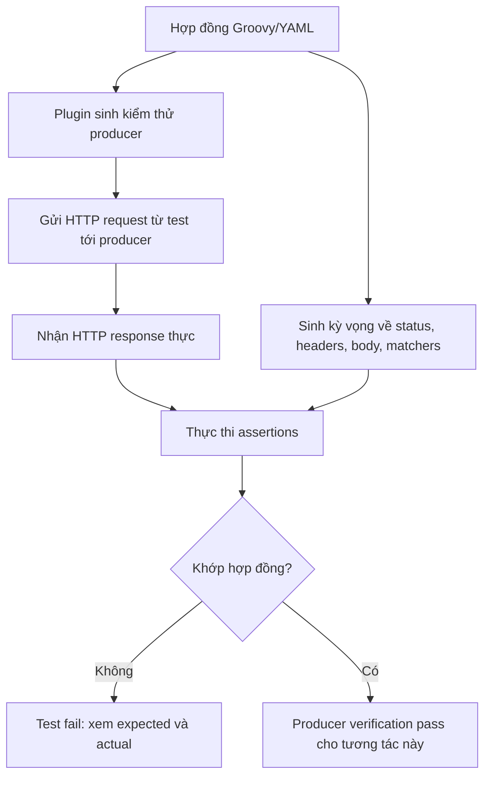
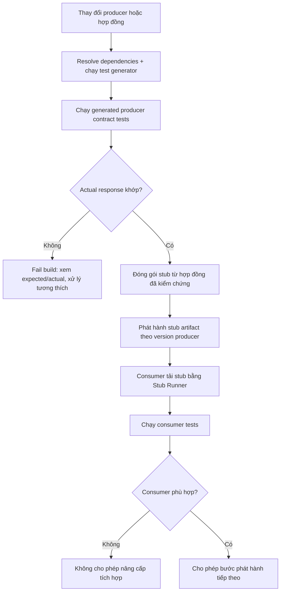

# Đối chiếu phản hồi thực tế với kỳ vọng được sinh

## 1. Vì sao cần đối chiếu phản hồi ở phía producer?

Trong hệ thống nhiều dịch vụ, **producer** cung cấp HTTP API hoặc phát thông điệp, còn **consumer** phụ thuộc vào một số hành vi cụ thể của producer. Với HTTP, consumer không chỉ quan tâm endpoint có gọi được hay không; nó còn cần đúng mã trạng thái, header và cấu trúc dữ liệu.

Giả sử `Order Service` gọi `GET /api/payments/42` của `Payment Service`. Hai bên đã thống nhất phản hồi:

```http
HTTP/1.1 200 OK
Content-Type: application/json

{"paymentId":42,"status":"PAID","currency":"VND"}
```

Nhóm Payment Service thay đổi implementation để trả `"paymentState":"PAID"` thay cho `"status":"PAID"`. Unit test dùng mock nội bộ có thể vẫn thành công, nhưng Order Service không còn đọc được trường `status`. Nếu kiểm thử hợp đồng được chạy trên implementation thật trước khi phát hành, thay đổi đó có thể bị phát hiện ngay tại pipeline của producer.

**Spring Cloud Contract** giúp biến những kỳ vọng được ghi bằng Groovy/YAML DSL thành **kiểm thử tự động phía producer**. Kiểm thử gửi yêu cầu đã mô tả, thu phản hồi thực tế rồi kiểm tra phản hồi đó theo hợp đồng. Từ cùng nguồn hợp đồng, quy trình build có thể sinh stub để consumer kiểm thử qua **Stub Runner** và tích hợp các bước vào CI.

Sau bài học, bạn có thể:

1. Giải thích dòng chảy từ hợp đồng đến kiểm thử producer và phản hồi HTTP thực tế.
2. Phân biệt kiểm tra **status**, **headers**, **body** và **matcher** trong phản hồi.
3. Hiểu trường hợp nào cần so sánh giá trị cố định, trường hợp nào cần ràng buộc linh hoạt.
4. Chẩn đoán kết quả test sai lệch, điều chỉnh hợp đồng hoặc implementation đúng cách.
5. Thiết lập các điều kiện CI để bảo vệ producer–consumer trước thay đổi API không tương thích.

## 2. Kỳ vọng sinh ra và phản hồi thực tế khác nhau thế nào?

Một tương tác HTTP có ít nhất ba lớp cần phân biệt:

| Thành phần | Lấy từ đâu? | Ví dụ |
| --- | --- | --- |
| **Hợp đồng (contract)** | Tệp Groovy/YAML được các nhóm thống nhất | `GET /api/payments/42` phải trả `200`, JSON có `status` |
| **Kỳ vọng kiểm thử được sinh** | Spring Cloud Contract Verifier diễn giải hợp đồng thành assertion trong test | Kiểm tra mã `200`, `Content-Type`, đường dẫn `$.status` |
| **Phản hồi thực tế (actual response)** | Controller/service producer chạy trong môi trường test | Mã trạng thái, header, body do ứng dụng thật tạo ra |

**Đối chiếu** là so sánh phản hồi thực tế với kỳ vọng từ hợp đồng khi test được thực thi. Không phải chỉ so sánh hai chuỗi JSON: một kiểm thử có thể xác minh status, header, kiểu dữ liệu, giá trị cố định, regex hoặc các quy tắc khác.

Sơ đồ tổng quát:



Trong môi trường thực tế, mỗi hợp đồng thường tương ứng một hoặc nhiều tình huống được thực thi theo cấu hình của plugin. Test **pass** chỉ khẳng định những điều kiện đã được mô tả và thực sự chạy; không chứng minh tất cả endpoint, mọi dữ liệu và mọi consumer đều tương thích.

## 3. Viết hợp đồng HTTP với phản hồi mong đợi

Ví dụ Groovy DSL sau ghi lại một trường hợp tra cứu thanh toán thành công:

```groovy
import org.springframework.cloud.contract.spec.Contract

Contract.make {
    description 'Tra cuu mot thanh toan da hoan tat'

    request {
        method GET()
        url '/api/payments/42'
    }

    response {
        status OK()
        headers {
            contentType(applicationJson())
        }
        body(
            paymentId: 42,
            status: 'PAID',
            currency: 'VND'
        )
    }
}
```

Giải thích:

- `request.method GET()` và `request.url` xác định HTTP request được gửi đến producer.
- `response.status OK()` yêu cầu HTTP status `200`.
- `response.headers.contentType(applicationJson())` mô tả kiểu dữ liệu JSON được công bố.
- `response.body` mô tả cấu trúc và giá trị phản hồi consumer cần.

Hợp đồng YAML tương đương:

```yaml
description: Tra cuu mot thanh toan da hoan tat
request:
  method: GET
  url: /api/payments/42
response:
  status: 200
  headers:
    Content-Type: application/json
  body:
    paymentId: 42
    status: PAID
    currency: VND
```

Hai định dạng DSL phục vụ cùng mục tiêu: **mô tả giao diện có thể kiểm thử**. Đừng hiểu rằng `status: PAID` trong body là HTTP status; HTTP status ở cấp `response.status` là số `200`, còn `body.status` là một trường JSON mang trạng thái nghiệp vụ.

### 3.1. Vì sao cần dữ liệu có thể tái lập?

Trong ví dụ, producer test gọi `/api/payments/42`. Môi trường test phải có dữ liệu hoặc cấu hình để yêu cầu này trả kết quả đã thỏa thuận. Nếu database test trống, API có thể trả `404`, khiến contract test thất bại dù logic controller không đổi.

Nhóm producer cần thiết lập fixture trước test, dùng repository/service test phù hợp hoặc cơ chế dữ liệu có thể tái lập. Tuy nhiên, **không được mock chính hành vi đang cần xác minh tới mức test không còn kiểm tra implementation thực**. Mục tiêu là kiểm tra bề mặt HTTP mà consumer dựa vào.

## 4. Test được sinh ra kiểm tra điều gì?

Spring Cloud Contract Maven/Gradle plugin đọc hợp đồng và tạo kiểm thử tương ứng theo test framework/test mode được cấu hình (ví dụ MockMvc). Mã được sinh **phụ thuộc phiên bản plugin, cấu hình và framework**, vì thế tên class, package và câu lệnh assertion có thể khác nhau.

Để hiểu ý nghĩa của kiểm thử sinh ra, hãy xem một bài kiểm thử Spring MVC viết thủ công có **mục tiêu tương đương**:

```java
@SpringBootTest
@AutoConfigureMockMvc
class PaymentHttpExampleTest {
    @Autowired
    MockMvc mockMvc;

    @Test
    void paymentResponseMatchesContract() throws Exception {
        mockMvc.perform(get("/api/payments/42"))
            .andExpect(status().isOk())
            .andExpect(content()
                .contentTypeCompatibleWith(MediaType.APPLICATION_JSON))
            .andExpect(jsonPath("$.paymentId").value(42))
            .andExpect(jsonPath("$.status").value("PAID"))
            .andExpect(jsonPath("$.currency").value("VND"));
    }
}
```

Đây là **mã minh họa tương đương về mục tiêu kiểm thử**, không phải cam kết về mã Java mà Spring Cloud Contract sẽ sinh ra nguyên văn. Ví dụ giả định có đủ import JUnit, Spring Test, `MockMvc` và ứng dụng được khởi động trong test context.

Khi chạy producer verification, nên kiểm tra thực tế các điều kiện sau:

1. **HTTP request** được gửi với đúng method, URL, query, headers và body mà hợp đồng mô tả.
2. **HTTP status** của actual response đúng như kỳ vọng.
3. **HTTP headers** cần thiết, ví dụ `Content-Type`, có giá trị/định dạng thỏa hợp đồng.
4. **Response body** có các trường và giá trị hoặc điều kiện matcher được cam kết.
5. **Generated test đã thật sự được chạy** và kết quả được ghi nhận, không bị skip.

Nếu hợp đồng không mô tả một điều kiện, không nên cho rằng bộ sinh test tự biết điều kiện đó quan trọng với consumer.

## 5. Đối chiếu từng lớp của HTTP response

### 5.1. HTTP status: kết quả của request

Status code thường là điều kiện đầu tiên phải kiểm tra:

| Kỳ vọng trong hợp đồng | Actual response | Kết quả | Vì sao |
| --- | --- | --- | --- |
| `200 OK` | `200 OK` | PASS ở lớp status | Cùng mã trạng thái |
| `201 Created` | `200 OK` | FAIL | Consumer có thể phân biệt việc tạo tài nguyên thành công |
| `404 Not Found` | `200 OK` | FAIL | Consumer có thể xử lý nhầm dữ liệu không tồn tại |
| `204 No Content` | `200 OK` với body | FAIL | Trạng thái và hợp đồng body khác nhau |

Chỉ PASS ở lớp status **không có nghĩa** response đã khớp: `200` với JSON sai schema vẫn có thể làm consumer lỗi.

### 5.2. HTTP headers: cách consumer giải mã hoặc xử lý

Một số header đặc biệt quan trọng:

- `Content-Type`: quyết định cách consumer đọc response JSON, text hoặc binary.
- `Location`: có thể cần khi API tạo tài nguyên và trả `201 Created`.
- Header version, cache hoặc correlation: chỉ nên ràng buộc nếu consumer có yêu cầu cụ thể.

Ví dụ consumer yêu cầu `application/json`; producer trả `text/plain` chứa chuỗi JSON hợp lệ. Dù chuỗi body nhìn giống JSON, client có thể không xử lý như mong đợi do media type sai. Vì thế hợp đồng nên kiểm tra header liên quan.

**Đừng vô tình kiểm tra quá chặt các phần biến động.** Ví dụ một response header có tham số `charset` hoặc một `X-Request-Id` sinh động có thể cần matcher linh hoạt. Mức độ chính xác của so sánh header phụ thuộc khai báo và cơ chế sinh test; hãy xem generated assertion thay vì mặc định rằng công cụ luôn dùng so sánh theo media type.

### 5.3. Response body: giá trị, cấu trúc và kiểu

Response JSON gồm nhiều mức kiểm tra:

| Mức | Ví dụ | Rủi ro nếu chỉ kiểm tra mức thấp hơn |
| --- | --- | --- |
| Tồn tại trường | Có `$.paymentId` | Trường có thể xuất hiện nhưng sai kiểu |
| Kiểu dữ liệu | `paymentId` là số, `status` là chuỗi | Giá trị có thể thuộc miền nghiệp vụ sai |
| Giá trị hoặc miền hợp lệ | `status = PAID` hoặc thuộc tập cho phép | Consumer có thể hiểu sai trạng thái |
| Quan hệ giữa các trường | `status=FAILED` thì có `failureReason` | Cấu trúc hợp lệ nhưng nghiệp vụ không nhất quán |

Với body có object lồng nhau, đường dẫn JSONPath làm rõ trường cần kiểm tra; với mảng, cần xác định consumer có phụ thuộc số lượng, thứ tự hay kiểu từng phần tử không. Không nên suy rằng một hợp đồng có ví dụ mảng hai phần tử tự kiểm tra mọi trường hợp về độ dài và thứ tự.

## 6. Matcher: khi actual value được phép khác dữ liệu mẫu

Trong hệ thống thật, producer có thể tạo `paymentId`, `receiptId`, timestamp hoặc token khác nhau theo mỗi lần chạy. Nếu bắt mọi response bằng đúng giá trị mẫu, test dễ bị **false failure**: ứng dụng vẫn tương thích nhưng test đỏ vì dữ liệu thay đổi hợp lệ.

Spring Cloud Contract hỗ trợ matcher để kiểm tra **kiểu**, **regex** và những điều kiện khác thay cho tất cả giá trị cố định. Ví dụ Groovy DSL:

```groovy
import org.springframework.cloud.contract.spec.Contract

Contract.make {
    description 'Tra cuu thanh toan voi ma bien dong'
    request {
        method GET()
        url '/api/payments/42'
    }
    response {
        status OK()
        headers {
            contentType(applicationJson())
        }
        body(
            paymentId: 42,
            status: 'PAID',
            receiptId: 'RC-1234'
        )
        bodyMatchers {
            jsonPath('$.paymentId', byType())
            jsonPath('$.receiptId', byRegex('RC-[0-9]+'))
        }
    }
}
```

Trong ví dụ:

- `paymentId` có dữ liệu mẫu kiểu số; `byType()` yêu cầu khớp theo kiểu mà matcher hỗ trợ thay vì luôn bắt giá trị `42`.
- `receiptId` phải phù hợp dạng `RC-` theo sau là chữ số; `RC-5678` có thể được chấp nhận, còn `RECEIPT-A` không thỏa regex.
- `status` không có matcher nên hợp đồng vẫn ràng buộc giá trị `PAID` theo cách generator diễn giải body.

YAML DSL tương đương cho `response`:

```yaml
response:
  status: 200
  headers:
    Content-Type: application/json
  body:
    paymentId: 42
    status: PAID
    receiptId: "RC-1234"
  matchers:
    body:
      - path: '$.paymentId'
        type: by_type
      - path: '$.receiptId'
        type: by_regex
        value: 'RC-[0-9]+'
```

**Hai nguyên tắc cần nhớ:**

1. Matcher giải thích **giá trị thế nào là hợp lệ**; nó không tự làm trường bắt buộc thành tùy chọn. Nếu `receiptId` được phép vắng mặt, phải thiết kế thêm các tình huống/điều kiện kiểm thử phù hợp.
2. Matcher cần vừa đủ mạnh để bảo vệ consumer. `byType()` trên một chuỗi có thể cho qua nhiều giá trị không mang ý nghĩa nghiệp vụ; nếu consumer chỉ hiểu `PAID`, `PENDING`, `FAILED`, hãy bảo vệ miền đó bằng điều kiện cụ thể.

### 6.1. Phân biệt dữ liệu mẫu dành cho stub và ràng buộc producer

Một hợp đồng có thể chứa **ví dụ response** để sinh stub và **matcher** để kiểm tra phản hồi từ producer. Hai thứ liên quan nhưng không giống nhau:

- Stub trả một response phù hợp với dữ liệu mẫu/hợp đồng để consumer test xử lý.
- Producer verification kiểm tra actual response dựa trên kỳ vọng/matcher được sinh.

Việc producer test chấp nhận `RC-5678` không có nghĩa stub bắt buộc phải trả giá trị mới đó; stub có thể tiếp tục sử dụng giá trị mẫu `RC-1234`. Consumer cần tự kiểm thử khả năng xử lý các giá trị hợp lệ khác nếu nghiệp vụ yêu cầu.

Không được hiểu một stub hoạt động tốt là bằng chứng implementation producer luôn đúng. **Stub phải được gắn với hợp đồng đã được producer xác minh.**

## 7. Khi nào một thay đổi phản hồi thực sự không tương thích?

Hãy so sánh phản hồi producer với những kỳ vọng mà consumer đang dựa vào.

| Thay đổi actual response | Nguy cơ | Cách hợp đồng có thể bảo vệ |
| --- | --- | --- |
| Xóa `status` | Cao nếu Order Service đọc trường này | Kiểm tra đường dẫn JSON bắt buộc |
| Đổi `paymentId` từ số sang chuỗi | Cao nếu DTO consumer dùng số | Matcher theo kiểu |
| Đổi `200` thành `204` | Cao nếu consumer chờ JSON body | Kiểm tra status và body |
| Đổi `Content-Type` sang `text/plain` | Có thể làm deserializer xử lý sai | Kiểm tra media type |
| Thêm `traceId` | Thường không phá vỡ nếu consumer bỏ qua field lạ | Không khóa các trường không liên quan; kiểm thử decoder của consumer |
| Đổi `receiptId` từ `RC-1234` thành `RC-5678` | Thường an toàn nếu theo cùng định dạng | Matcher regex thay vì cố định một giá trị |
| Đổi `PAID` thành `COMPLETED` | Có thể phá vỡ logic nghiệp vụ | Kiểm tra miền giá trị và thỏa thuận phiên bản |
| Đổi thứ tự phần tử mảng | Phụ thuộc consumer | Kiểm thử thứ tự chỉ khi giao diện cam kết thứ tự |

Một nguyên tắc thực hành: **đưa vào hợp đồng những điều consumer cần, không đưa mọi chi tiết response vào một phép so sánh byte-to-byte**.

Tuy nhiên, việc một trường không xuất hiện trong body mẫu **không tự bảo đảm** cơ chế so sánh JSON của mọi phiên bản sẽ bỏ qua trường thừa; mức độ nghiêm ngặt phụ thuộc loại matcher, cấu hình và test được sinh. Cần kiểm tra generated assertion và chạy tình huống producer thực sự trả thêm trường.

## 8. Những trường hợp phản hồi đặc biệt

### 8.1. `204 No Content`

Nếu API xóa tài nguyên và cam kết `204`, hợp đồng có thể chỉ cần:

```groovy
import org.springframework.cloud.contract.spec.Contract

Contract.make {
    request {
        method DELETE()
        url '/api/payments/42'
    }
    response {
        status NO_CONTENT()
    }
}
```

Với mã `204`, phản hồi theo ngữ nghĩa HTTP **không có content body**. Không nên viết hợp đồng `204` nhưng lại yêu cầu một JSON body như `{"deleted":true}`. Nếu client cần nhận nội dung xác nhận, thiết kế một response khác phù hợp hơn.

### 8.2. `404 Not Found` và response lỗi

Một hợp đồng cho trường hợp không tìm thấy thanh toán:

```groovy
import org.springframework.cloud.contract.spec.Contract

Contract.make {
    description 'Thanh toan khong ton tai'
    request {
        method GET()
        url '/api/payments/999'
    }
    response {
        status NOT_FOUND()
        headers {
            contentType(applicationJson())
        }
        body(
            code: 'PAYMENT_NOT_FOUND',
            message: 'Payment not found'
        )
    }
}
```

Trong API thật, `message` dành cho con người có thể thay đổi theo ngôn ngữ và ngữ cảnh; nếu consumer chỉ dùng `code`, nên cân nhắc không ràng buộc quá chặt câu chữ `message`. Nhưng mã lỗi `PAYMENT_NOT_FOUND` cần được bảo vệ nếu consumer dùng nó để quyết định hành vi.

### 8.3. `201 Created` và `Location`

Nếu producer trả header `Location` để consumer biết URI tài nguyên mới, hãy ghi kỳ vọng đó vào hợp đồng. URI thường có ID biến động, vì vậy điều kiện nên kiểm tra format/path phù hợp thay vì cố định một ID từ môi trường test. Đối với header có giá trị động, cần chọn matcher theo cú pháp của phiên bản DSL đang dùng.

### 8.4. Mảng, `null` và trường tùy chọn

Ba phản hồi có thể mang ngữ nghĩa khác nhau:

```json
{"items":[]}
```

```json
{"items":null}
```

```json
{}
```

- Mảng rỗng: trường tồn tại nhưng không có phần tử.
- `null`: trường tồn tại, giá trị không phải array.
- Vắng mặt: không có key `items`.

Nếu consumer yêu cầu một collection, việc đổi `[]` sang `null` có thể phá vỡ deserialization hoặc logic xử lý. Nếu một trường **tùy chọn**, cần kiểm thử riêng phản hồi có và không có trường, và thống nhất `null` có hợp lệ không. Không nên chỉ dựa vào một mẫu dữ liệu để suy rằng mọi biến thể đã được xác minh.

## 9. Cấu hình kiểm thử producer để đối chiếu phản hồi thực

Giả sử producer sử dụng Spring Boot và Spring MVC. Ngoài tệp hợp đồng, dự án cần:

1. BOM và thư viện Spring Cloud Contract Verifier tương thích với Spring Boot.
2. Maven/Gradle plugin của Spring Cloud Contract, cấu hình sinh test và nguồn hợp đồng.
3. **Test base class** cung cấp Spring test context và cơ chế thực thi request.
4. Dữ liệu/fixture cho các tương tác như `GET /api/payments/42`.

Ví dụ test base class theo hướng sử dụng MockMvc:

```java
@SpringBootTest(webEnvironment = SpringBootTest.WebEnvironment.MOCK)
@AutoConfigureMockMvc
public abstract class ContractTestBase {

    @Autowired
    private MockMvc mockMvc;

    @BeforeEach
    protected void setUp() {
        RestAssuredMockMvc.mockMvc(mockMvc);
    }
}
```

Đây là **mẫu minh họa** sử dụng JUnit Jupiter, Spring Boot Test và thư viện `RestAssuredMockMvc` phù hợp; cần thêm import, fixture và căn phiên bản thư viện thực tế. Tùy chế độ sinh test, plugin có thể yêu cầu cách cấu hình khác (ví dụ `RestAssuredMockMvc.standaloneSetup(...)`, web test mode hoặc test base class riêng). Hãy chọn một cách phù hợp với **mã test được plugin sinh ra**, không sao chép base class từ một phiên bản bất kỳ.

Đoạn cấu hình Maven minh họa cho phần plugin:

```xml
<plugin>
    <groupId>org.springframework.cloud</groupId>
    <artifactId>spring-cloud-contract-maven-plugin</artifactId>
    <version>${spring-cloud-contract.version}</version>
    <extensions>true</extensions>
    <configuration>
        <testFramework>JUNIT5</testFramework>
        <testMode>MOCKMVC</testMode>
        <baseClassForTests>com.example.payment.ContractTestBase</baseClassForTests>
    </configuration>
</plugin>
```

Phần này giả định project đã định nghĩa property `spring-cloud-contract.version` và chọn phiên bản plugin **tương ứng với Spring Cloud Contract dependencies được BOM quản lý**. Đừng lẫn phiên bản plugin với phiên bản stub artifact của một microservice.

Những kiểm thử sinh ra phải sử dụng ứng dụng thật trong test context (controller/serialization/filter liên quan) để có giá trị đối chiếu. Khi data fixture phức tạp, có thể dùng test repository hoặc service fixture; cần giữ dữ liệu nhất quán giữa các lần chạy và tránh phụ thuộc môi trường production.

## 10. Chạy và đọc kết quả của producer verification

Một dự án Maven có thể chạy những lệnh sau sau khi đã cấu hình dependency, plugin và hợp đồng:

```bash
./mvnw clean verify
./mvnw help:effective-pom
./mvnw dependency:tree -Dincludes=org.springframework.cloud
```

Dự án Gradle có thể dùng các lệnh phù hợp với plugin đã cấu hình:

```bash
./gradlew clean test
./gradlew tasks --all
./gradlew dependencyInsight --dependency spring-cloud-contract-verifier --configuration testRuntimeClasspath
```

Những lệnh trên là **hướng dẫn thực hành**, không phải lệnh đã được thực thi để biên soạn bài này. Tên task/goal sinh test có thể khác theo phiên bản và cấu hình Spring Cloud Contract; hãy xem danh sách task hoặc log build của dự án.

Khi test thất bại, đọc thông tin theo thứ tự:

1. **Test nào fail?** Xác định hợp đồng/tình huống tương ứng, tránh xem lỗi tổng quát `BUILD FAILURE` là đủ.
2. **Request nào được gửi?** Kiểm tra method, URL, query, header và body có thực sự khớp hợp đồng không.
3. **Actual HTTP status là gì?** Nếu `404` thay `200`, kiểm tra dữ liệu fixture và routing.
4. **Actual headers có gì khác?** Ví dụ `text/plain` thay `application/json`.
5. **Actual body sai ở đâu?** Kiểm tra đường dẫn JSONPath, giá trị, kiểu và matcher liên quan.
6. **Lỗi đến từ hợp đồng hay implementation?** So sánh yêu cầu thực của consumer trước khi sửa.

Ví dụ một báo cáo lỗi **minh họa**:

```text
Contract: payment-paid
Request: GET /api/payments/42
Expected HTTP status: 200
Actual HTTP status:   200
Expected JSONPath $.status: "PAID"
Actual JSONPath $.status:   <missing>
Actual body: {"paymentId":42,"paymentState":"PAID","currency":"VND"}
```

Lỗi này không liên quan đến status HTTP; chính **đường dẫn JSON được cam kết đã biến mất**. Nếu Order Service còn đọc `status`, cách xử lý phù hợp thường là giữ tương thích (ví dụ tiếp tục trả trường cũ trong giai đoạn chuyển tiếp), chứ không phải xóa assertion `$.status` để làm test xanh.

### Phân biệt lỗi assertion và lỗi chuẩn bị test

| Triệu chứng | Loại vấn đề có thể xảy ra | Kiểm tra |
| --- | --- | --- |
| Test class không sinh ra | Build/plugin chưa đọc hợp đồng hoặc cấu hình sai | Vị trí DSL, plugin goals/tasks, output generated tests |
| Không khởi động được Spring context | Môi trường test chưa hợp lệ | Cấu hình Boot, bean, profile, database/test container |
| Response `404` thay `200` | Sai route hoặc thiếu fixture `paymentId=42` | Controller mapping và dữ liệu test |
| Response `500` | Lỗi thực thi producer | Log exception, dependency và state test |
| `Content-Type` không khớp | Producer serialize hoặc header khác kỳ vọng | Controller `produces`, converter và actual header |
| `$.status` không tìm thấy | Thiếu/đổi tên trường | Actual JSON và DTO serialization |
| `$.receiptId` sai regex | Format ID đã đổi hoặc matcher không phù hợp | Hợp đồng giao tiếp và giá trị thực |
| Test không chạy nhưng CI xanh | Bỏ qua goal/task hoặc test bị skip | Báo cáo số lượng test thực thi, log generator |

**Không sửa hợp đồng một cách máy móc theo actual response.** Nếu implementation phá vỡ kỳ vọng consumer, cập nhật hợp đồng chỉ làm mất lớp bảo vệ. Cần thống nhất thay đổi API, thứ tự triển khai producer–consumer và chính sách version trước khi sửa contract.

## 11. Đối chiếu producer khác gì kiểm thử consumer bằng stub?

Hai hướng kiểm thử thường được sinh ra hoặc hỗ trợ từ cùng hợp đồng nhưng chứng minh những điều **khác nhau**:

| Tiêu chí | Producer verification | Consumer test với Stub Runner |
| --- | --- | --- |
| Đối tượng chạy | Ứng dụng producer thật trong môi trường test | Ứng dụng consumer gọi stub |
| Request | Từ generated producer test | Từ HTTP client thật của consumer |
| Response | **Actual response** do producer tạo | Response mẫu do stub trả |
| Mục đích | Chứng minh producer đáp ứng cam kết | Chứng minh consumer gọi và xử lý đúng giao diện đã mô tả |
| Không thể kết luận | Tất cả consumer đều hoạt động | Producer hiện tại chắc chắn triển khai đúng nếu chưa được verify |

Ví dụ, Order Service có thể dùng Stub Runner nạp stub của Payment Service và xử lý `{"status":"PAID"}` thành công. Nhưng nếu Payment Service đã đổi thành `{"paymentState":"PAID"}`, consumer test vẫn xanh với **stub cũ**. Chỉ producer verification chạy trên implementation hiện tại, với hợp đồng còn yêu cầu `status`, mới trực tiếp phát hiện sai lệch này.

Ngược lại, producer verification đạt nhưng consumer giải mã JSON sai hoặc dùng một endpoint khác vẫn có thể làm hệ thống lỗi. Vì thế cần cả hai phía và quản lý phiên bản stub cẩn thận.

## 12. Tích hợp CI: fail sớm trước khi phát hành stub

Một quy trình CI/CD mẫu:



Nên đặt các điều kiện rõ ràng:

- **Build không được phát hành stub như một cam kết đã xác minh nếu producer tests fail.** Việc kỹ thuật sinh được file stub không đồng nghĩa producer tuân thủ.
- **Kiểm tra số lượng generated tests và tests đã chạy.** Một pipeline xanh khi tất cả contract tests bị skip không mang lại bảo vệ.
- **Pin và ghi nhận phiên bản Contract dependencies/plugin.** Lệch phiên bản có thể khiến test sinh ra hoặc matcher hoạt động khác.
- **Gắn stub với version artifact của producer.** Consumer cần biết nó đang thử giao diện của bản nào.
- **Review việc đổi hợp đồng cùng các consumer liên quan.** Nếu phải thay đổi không tương thích, ưu tiên lộ trình chuyển đổi an toàn hoặc version API rõ ràng.
- **Giữ integration/E2E tests cần thiết.** Contract tests không xác minh đầy đủ mạng, bảo mật ở môi trường triển khai, phân quyền nhiều dịch vụ, database và luồng nghiệp vụ xuyên hệ thống.

Không phải mọi tổ chức đều có pipeline producer và consumer chạy cùng lúc; có thể tách job/repository nhưng vẫn cần cơ chế chia sẻ phiên bản stub, phản hồi kết quả và chặn phát hành khi phát hiện đứt hợp đồng.

## 13. Bài thực hành: tìm sai lệch expected–actual

Giả sử hợp đồng HTTP cho `GET /api/invoices/900` có kỳ vọng:

```yaml
description: Tra cuu hoa don da thanh toan
request:
  method: GET
  url: /api/invoices/900
response:
  status: 200
  headers:
    Content-Type: application/json
  body:
    invoiceId: 900
    status: PAID
    total:
      currency: VND
      amount: 150000
  matchers:
    body:
      - path: '$.invoiceId'
        type: by_type
      - path: '$.total.amount'
        type: by_type
```

Xét các actual responses sau:

| Tình huống | Actual response | Điều cần nhận xét |
| --- | --- | --- |
| A | `200`, JSON có `invoiceId: 901`, `status: PAID`, `total.amount: 150000` | `invoiceId` có matcher theo kiểu, nhưng cần cân nhắc ý nghĩa của ID với request |
| B | `200`, JSON có `invoiceId: "900"`, `status: PAID` | ID đổi từ số sang chuỗi, có thể sai kiểu |
| C | `200`, JSON có `invoiceId: 900`, `state: PAID` | `status` bị đổi tên, có nguy cơ phá vỡ consumer |
| D | `200`, header `Content-Type: text/plain` dù nội dung giống JSON | Header không còn đúng cam kết |
| E | `404` với JSON error | Sai status so với trường hợp đã mô tả; có thể thiếu fixture |

**Câu hỏi:**

1. Trường hợp nào có khả năng làm producer contract test fail? Trường hợp nào cần xem **mã test được sinh** để hiểu phạm vi của matcher?
2. Vì sao trường hợp A có thể pass một số assertion nhưng vẫn đáng xem xét về mặt nghiệp vụ?
3. Nếu muốn producer chấp nhận nhiều giá trị `status` có nghĩa, bạn sẽ chọn matcher nào? Vì sao không dùng `byType()` quá rộng?
4. Với `404`, bạn sẽ kiểm tra fixture trước hay sửa `response.status` thành `404` ngay?
5. Vì sao consumer test dùng stub cũ không thay thế được producer verification của bản mới?

**Gợi ý đáp án:** B, C, D và E thường phải bị phát hiện bởi các điều kiện kiểu/trường/header/status đã mô tả. A minh họa ranh giới giữa matcher linh hoạt và logic nghiệp vụ: `byType()` cho phép một giá trị ID dạng số khác mẫu, nhưng API trả ID không tương ứng với tài nguyên yêu cầu có thể vẫn sai về nghiệp vụ; cần kiểm thử ràng buộc tương ứng nếu consumer phụ thuộc. Khi có nhiều trạng thái hợp lệ, dùng điều kiện giới hạn tập giá trị như regex `PAID|PENDING|FAILED`, không chỉ kiểm tra kiểu chuỗi. Với `404`, xem routing/fixture và xác minh yêu cầu giao diện trước khi quyết định sửa implementation hay hợp đồng. Consumer test với stub không quan sát phản hồi của producer hiện tại.

## 14. Checklist khi review producer contract tests

- Hợp đồng có mô tả đúng HTTP method, URL và dữ liệu request cần thiết để tạo actual response không?
- `response.status`, các header quan trọng và body JSON có phản ánh **kỳ vọng của consumer** không?
- Matcher có bảo vệ **kiểu, định dạng và miền giá trị** thực sự quan trọng mà không khóa dữ liệu động không cần thiết?
- Có phân biệt trường bắt buộc, tùy chọn, `null`, mảng rỗng và trường thừa theo chính sách tương thích?
- Producer test có chạy trên test context đủ thật và có fixture dữ liệu có thể tái lập?
- Generated test có được sinh và chạy đầy đủ trong build, hay một phần bị bỏ qua?
- Khi fail, đã xem rõ **expected–actual** ở status, header và JSONPath trước khi sửa?
- CI có chặn phát hành stub khi producer verification fail và consumer có dùng đúng stub version qua Stub Runner?

**Ghi nhớ:** Hợp đồng Groovy/YAML là nguồn mô tả **expected behavior**; Spring Cloud Contract sinh test để gửi request và đối chiếu **actual HTTP response** của producer với kỳ vọng đó. Một thay đổi API không tương thích phải làm test fail tại điều kiện được cam kết, thay vì chỉ được phát hiện khi các dịch vụ đã triển khai cùng nhau. Stub Runner bổ sung kiểm thử phía consumer, nhưng không thay thế producer verification trên implementation thật.
