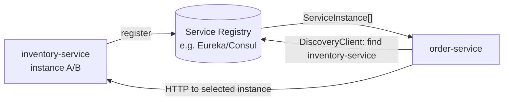
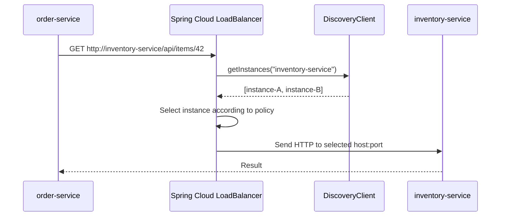

# What Is Spring Cloud Core in the Scope of Spring Cloud Commons and Context?

## 1. Overview

A standalone Spring Boot application typically reads configuration from `application.yml`, manages beans via `ApplicationContext`, and calls internal components directly. When moving to an architecture of multiple independently deployed services, common challenges arise:

- `order-service` needs to find the current address of `inventory-service` when instances scale up, scale down, or change IPs.
- Multiple instances of the same service need requests distributed appropriately.
- Configuration can come from files, environment variables, or a centralized system; the application needs to know which source takes precedence and how updates are handled.
- Versions of Spring Boot, Spring Cloud, and integrated libraries must be compatible to avoid startup failures.

**Spring Cloud** is an ecosystem that adds conventions and tools for common distributed system patterns, built on top of Spring Framework and Spring Boot. In the **SPRING_CLOUD_CORE** module, the word *Core* refers to the **foundational core of Spring Cloud**, specifically **Spring Cloud Commons** and **Spring Cloud Context**; it is not the name of a single starter called “spring-cloud-core”.

| Component | Responsibility | Examples |
| --- | --- | --- |
| Spring Framework / Spring Boot | Container, bean lifecycle, `Environment`, configuration, HTTP server, Actuator | `@Bean`, `@ConfigurationProperties`, `application.yml` |
| **Spring Cloud Commons** | Common contracts for discovery, registration, load balancing integration, and utilities | `DiscoveryClient`, `ServiceInstance`, `ServiceRegistry` |
| **Spring Cloud Context** | Services for managing context, environment, and refreshing beans when configuration changes | `EnvironmentChangeEvent`, `@RefreshScope` |
| Other Spring Cloud projects | Provide concrete implementations for registries, remote configuration, load balancing, gateways, etc. | Eureka, Consul, Config Server, LoadBalancer, Gateway |

**Key takeaway:** Commons provides the *common contracts*, Context provides the *shared mechanisms*, while a concrete system must choose the appropriate backend and dependencies. Having the `DiscoveryClient` interface does not mean a Eureka or Consul server has been installed.

## 2. Spring Cloud Commons: Shared Abstractions

### 2.1. Service discovery: finding services by logical name

Instead of hardcoding `http://10.0.0.18:8080`, the caller uses the name `inventory-service` to look up currently available instances.

- `DiscoveryClient` is the synchronous API for listing service IDs and finding `ServiceInstance` objects.
- `ReactiveDiscoveryClient` provides reactive access.
- `ServiceInstance` describes an instance through its service ID, host, port, URI, metadata, and secure status when available.
- `SimpleDiscoveryClient` uses a statically configured list of instances, useful for exercises without a registry.

Example of reading the instance list:

```java
import org.springframework.cloud.client.ServiceInstance;
import org.springframework.cloud.client.discovery.DiscoveryClient;
import org.springframework.stereotype.Service;

import java.util.List;

@Service
public class InventoryDirectory {
    private final DiscoveryClient discoveryClient;

    public InventoryDirectory(DiscoveryClient discoveryClient) {
        this.discoveryClient = discoveryClient;
    }

    public List<ServiceInstance> availableInstances() {
        return discoveryClient.getInstances("inventory-service");
    }
}
```

`getInstances(...)` may return an empty list. This is a **lookup** operation; it does not send an HTTP request to the target server yet. When multiple discovery providers are present, Spring Cloud has a mechanism to determine client ordering. With typical configuration, adding the appropriate discovery implementation to the classpath is enough for auto-configuration to work; the `@EnableDiscoveryClient` annotation is no longer required in many cases.

### 2.2. Service registry: registering serving instances

On the server side, an instance announces that it is providing `inventory-service` at a specific host/port. Commons defines `Registration` (registration information) and `ServiceRegistry` (including operations such as `register(Registration)` and `deregister(Registration)`). Implementations for Eureka, Consul, or Zookeeper provide the actual behavior.

| Concept | Direction | Purpose |
| --- | --- | --- |
| `DiscoveryClient` | Registry/list → client | Read instance locations |
| `ServiceRegistry` | Instance → registry | Register/deregister, update status if supported |
| `InstancePreRegisteredEvent` / `InstanceRegisteredEvent` | In-application events | React before/after auto-registration |



Auto-registration only makes sense when a suitable registry implementation exists. It can be disabled via `spring.cloud.service-registry.auto-registration.enabled=false` when supported by the implementation. Heartbeats, leases, health checks, and instance eviction policies are the responsibility of each registry system; Commons does not implement them itself.

### 2.3. From discovery to service calls

When `inventory-service` has multiple instances, **Spring Cloud LoadBalancer** can choose an instance for an HTTP client. This is a separate component built on top of the shared abstractions, not a built-in feature provided solely by `DiscoveryClient`.



LoadBalancer includes strategies such as round-robin and random; the instance list can come from `ServiceInstanceListSupplier` combined with discovery. Load balancing **does not guarantee availability on its own**: a backend can go down after being looked up, records may be stale, and timeout/retry/circuit breaker handling must be designed accordingly.

## 3. Spring Cloud Context: Application Context and Runtime Configuration

Spring Boot already provides `Environment`, `PropertySource`, `@Value`, and `@ConfigurationProperties`. Spring Cloud Context adds practical mechanisms for distributed application configuration: environment changes, rebinding certain configurations, refreshing target beans, and bootstrap integration when needed.

### 3.1. Configuration sources

An application can obtain properties from:

- `application.yml` and profile-specific files;
- system properties, environment variables, and command-line arguments;
- external sources via the **Spring Boot Config Data** mechanism;
- a centralized system such as **Spring Cloud Config Server**, if Spring Cloud Config Client is added.

Example in an application that **already includes Config Client**:

```yaml
spring:
  application:
    name: order-service
  config:
    import: "optional:configserver:http://localhost:8888"
```

`optional:` allows the application to continue starting when the Config Server is unreachable; omit the prefix when you want to require loading configuration from that source. This example requires the **Spring Cloud Config Client** dependency and will not work with Commons/Context alone.

The precedence order of property sources depends on Spring Boot, the source type, and the corresponding override configuration. You should not assume "remote configuration always overrides all local configuration" in every situation.

### 3.2. Config Data and bootstrap context

Older Spring Cloud documentation often mentions the **bootstrap application context**, a parent context used to initialize and load configuration sources early via `PropertySourceLocator`. In that model, `bootstrap.yml` commonly appears.

With modern Spring Boot, **`spring.config.import` via the Config Data mechanism is the default way** to connect to Config Server and **does not require `bootstrap.yml`**. To use the traditional bootstrap mechanism, it must be enabled explicitly, for example with `spring-cloud-starter-bootstrap` or the property `spring.cloud.bootstrap.enabled=true` set early enough via an environment/system property.

Therefore, you need to determine whether a project uses **Config Data** or **traditional bootstrap** before troubleshooting missing configuration, double loading, or unexpected precedence.

### 3.3. Changing `Environment` vs. refreshing a bean

| Mechanism | What it can do | What it does not do automatically |
| --- | --- | --- |
| Changing values in `Environment` | Provides the new set of property values | Does not automatically change fields read in constructors of arbitrary beans |
| `EnvironmentChangeEvent` | Announces the list of changed keys; Context can rebind `@ConfigurationProperties` and update logging levels | Does not automatically fetch new remote configuration without a loading mechanism |
| `@RefreshScope` and `RefreshScope` | Evicts the cached target bean so it is recreated on the next call | Does not recreate all dependent beans and does not refresh every type of resource |

A `@RefreshScope` bean is accessed through a **proxy**. The target bean is lazily created on use and stored in a cache. Upon refresh, the cached target is invalidated; the next invocation creates a new target with the updated properties.

```java
import org.springframework.beans.factory.annotation.Value;
import org.springframework.cloud.context.config.annotation.RefreshScope;
import org.springframework.stereotype.Component;

@Component
@RefreshScope
public class BannerProvider {
    private final String message;

    public BannerProvider(@Value("${demo.banner:Hello}") String message) {
        this.message = message;
    }

    public String getMessage() {
        return message;
    }
}
```

If the `demo.banner` property in **a source that the application actually reloads** changes, an appropriate refresh operation causes `BannerProvider` to receive the new value when the target is recreated. Another bean that copied the banner into its own field may still hold the old value.

In an application with Spring Boot Actuator and appropriate Context setup, the refresh endpoint can be enabled:

```yaml
management:
  endpoints:
    web:
      exposure:
        include: health,info,refresh
```

```bash
curl -X POST http://localhost:8080/actuator/refresh
```

The `/actuator/refresh` endpoint typically refreshes eligible configuration sources and `@RefreshScope` beans. Behavior should be verified against the specific version and configuration loading approach. Only enable management endpoints when needed and **protect them with authentication, authorization, and network restrictions**. Refreshing one instance does not mean all instances in the cluster refresh together; Spring Cloud Bus or another deployment mechanism can broadcast notifications more broadly.

**Important limitations:** constructor-bound `@ConfigurationProperties` (including Java records in the documented cases) are not rebound/refreshed like mutable properties beans; completely removing a key may not produce the expected result after refresh; `HikariDataSource` belongs to the group not refreshed by default. Context Refresh also does not support Spring AOT/native image under this mechanism. For database connections and stateful beans, test resource closing/reopening behavior before using it in production.

## 4. Mini Example: `order-service` Calling `inventory-service`

Suppose there are two test backends both serving `GET /api/items/{id}`:

- `http://localhost:8091` — instance A;
- `http://localhost:8092` — instance B.

The goal is to call by **service ID** using Commons and LoadBalancer without needing a Eureka or Consul server yet.

### Step 1: manage versions and dependencies

Use the `spring-cloud-dependencies` BOM from the **release train** compatible with Spring Boot. For example, as of 11/2026, the Spring Cloud Release documentation records the pair **Spring Cloud 2025.1.4 – Spring Boot 4.0.9**; re-verify the compatibility matrix before applying it to a new project.

The Cloud-related Maven configuration, placed into a Spring Boot project that already has the appropriate parent/web dependencies:

```xml
<properties>
    <spring-cloud.version>2025.1.4</spring-cloud.version>
</properties>

<dependencyManagement>
    <dependencies>
        <dependency>
            <groupId>org.springframework.cloud</groupId>
            <artifactId>spring-cloud-dependencies</artifactId>
            <version>${spring-cloud.version}</version>
            <type>pom</type>
            <scope>import</scope>
        </dependency>
    </dependencies>
</dependencyManagement>

<dependencies>
    <dependency>
        <groupId>org.springframework.cloud</groupId>
        <artifactId>spring-cloud-starter-loadbalancer</artifactId>
    </dependency>
</dependencies>
```

This starter provides load balancing integration; if you want to connect to a real registry or Config Server, add the corresponding starters.

### Step 2: configure static instances to learn discovery

In `order-service`'s `application.yml`:

```yaml
spring:
  application:
    name: order-service
  cloud:
    discovery:
      client:
        simple:
          instances:
            inventory-service:
              - uri: http://localhost:8091
              - uri: http://localhost:8092
```

`SimpleDiscoveryClient` reads the list from this configuration. It **does not automatically detect** newly started instances, failing instances, or changed IPs.

### Step 3: create an HTTP client by service ID

Example using `RestClient.Builder` and `@LoadBalanced`:

```java
import org.springframework.cloud.client.loadbalancer.LoadBalanced;
import org.springframework.context.annotation.Bean;
import org.springframework.context.annotation.Configuration;
import org.springframework.web.client.RestClient;

@Configuration(proxyBeanMethods = false)
public class HttpClientConfig {
    @Bean
    @LoadBalanced
    RestClient.Builder loadBalancedRestClientBuilder() {
        return RestClient.builder();
    }
}
```

```java
import org.springframework.cloud.client.loadbalancer.LoadBalanced;
import org.springframework.stereotype.Service;
import org.springframework.web.client.RestClient;

@Service
public class InventoryClient {
    private final RestClient client;

    public InventoryClient(@LoadBalanced RestClient.Builder builder) {
        this.client = builder.build();
    }

    public String getItem(String id) {
        return client.get()
                .uri("http://inventory-service/api/items/{id}", id)
                .retrieve()
                .body(String.class);
    }
}
```

In the URL, `inventory-service` is interpreted by LoadBalancer as a **service ID**, then replaced with the actual host/port of an instance. Do not assume this is a default DNS hostname. Without `@LoadBalanced` or LoadBalancer integration, the request may look up the DNS hostname `inventory-service` and fail.

### Step 4: test and observe

1. Start two backends on ports `8091` and `8092` with distinguishable responses (for example `inventory-A` and `inventory-B`).
2. Call `InventoryClient.getItem("42")` multiple times; observe which backend receives each request.
3. Stop backend A and call again. With a **static** instance list, address A can still be selected, causing a connection error.
4. Replace `SimpleDiscoveryClient` with an appropriate Eureka/Consul implementation in real deployments; the code calling by the name `inventory-service` still relies on the shared abstraction.

The round-robin strategy typically distributes across the two active instances in turn; strict ordering is not guaranteed in all situations because concurrency, caching, and instance selection policies can vary.

## 5. Testing and Operations

| Scenario | How to test | What to verify |
| --- | --- | --- |
| Successful discovery | Mock `DiscoveryClient` or configure `SimpleDiscoveryClient` with two instances | Resolves the right service ID, host/port, and required metadata |
| No instances | Return an empty list for a service ID | Clear error or designed fallback mechanism, without picking an arbitrary address |
| Failing instance | Stop one backend when two backends are configured | Timeout/retry/failover behavior matches actual configuration |
| Configuration change | Update a supported source and trigger a controlled refresh | `@RefreshScope` bean uses the new value after target recreation |
| Non-refreshable bean | Bean reads `@Value` once at initialization | Do not expect fields to change automatically after `EnvironmentChangeEvent` |
| Dependency error | Inspect dependency tree and startup logs | Boot and Cloud BOMs are compatible, no conflicting library versions |

In operations, observability signals should be tied to the exact failing layer: discovery found no instances, load balancer could not select a server, or the HTTP request timed out. Spring Boot Actuator can help monitor health and metrics; Commons provides a discovery health indicator when auto-configuration conditions are met. With large registries, check the cost of calling `getServices` in health checks and the `spring.cloud.discovery.client.health-indicator.use-services-query` option.

To investigate configuration, inspect active profiles, property sources, and precedence via logs or `/actuator/env` and `/actuator/configprops` endpoints when permitted. These endpoints can expose sensitive data; do not expose them publicly. You should also restrict `/actuator/refresh`, `/actuator/env` (especially POST), and `/actuator/serviceregistry` if they are enabled.

### Common Misconceptions

| Misconception | Correct understanding |
| --- | --- |
| “Adding Commons gives you Eureka.” | Commons only provides contracts; Eureka is a separate implementation. |
| “DiscoveryClient sends HTTP requests itself.” | DiscoveryClient looks up instances; the HTTP client performs the request. |
| “You must always use `@EnableDiscoveryClient`.” | Many discovery integrations auto-configure solely via the appropriate dependency. |
| “Refreshing Config Server updates all beans immediately.” | `Environment` and beans must be refreshed properly on each instance. |
| “`@RefreshScope` recreates all dependent beans.” | Only the target bean in that scope is invalidated and recreated when called. |
| “Spring Cloud Config always requires `bootstrap.yml`.” | Config Data via `spring.config.import` does not need a bootstrap file. |
| “The latest Boot works with every Cloud release.” | Choose the release train according to the compatibility matrix and BOM. |

## 6. Connecting the Concepts

When `order-service` needs to call `inventory-service`, Commons provides the way to look up instances by logical name. LoadBalancer uses that list to select an instance, and then the HTTP client executes the request. Context coordinates with Spring Boot so the application reads configuration sources, reacts to changes, and refreshes certain beans when triggered. A registry, Config Server, event broadcasting mechanism, circuit breaker, or gateway are additional components added according to system needs.

Understanding this foundation helps answer three important design questions: **where are services discovered, how is configuration loaded and updated, and how are shared abstractions wired to concrete implementations?**

## 7. Self-Check Questions

1. Why can `DiscoveryClient` not replace a registry server?
2. How do `DiscoveryClient` and `ServiceRegistry` differ in their operations?
3. Why does a service ID with multiple instances need an instance selection mechanism when making HTTP calls?
4. Why might `Environment` change while a bean reading a value in its constructor has not changed yet?
5. When should you use `spring.config.import`, and when do you need the traditional bootstrap model?
6. Does calling `/actuator/refresh` on one instance change the configuration on all instances?
7. Why must Spring Boot and Spring Cloud be managed using a compatible release train?

## 8. Official References

- [Spring Cloud Release Train Reference](https://docs.spring.io/spring-cloud-release/reference/index.html) — release trains and compatible Boot versions.
- [Spring Cloud Commons: Common Abstractions](https://docs.spring.io/spring-cloud-commons/reference/spring-cloud-commons/common-abstractions.html) — discovery, registry, and compatibility verifier.
- [Spring Cloud Context: Application Context Services](https://docs.spring.io/spring-cloud-commons/reference/spring-cloud-commons/application-context-services.html) — bootstrap, environment, and refresh scope.
- [Spring Cloud LoadBalancer](https://docs.spring.io/spring-cloud-commons/reference/spring-cloud-commons/loadbalancer.html) — instance selection and HTTP client integration.
- [Spring Cloud Config Client](https://docs.spring.io/spring-cloud-config/reference/client.html) — Config Data and bootstrap.

*Examples are for educational purposes. When deploying to production, verify the exact documentation version and test the actual behavior of the integrations.*
