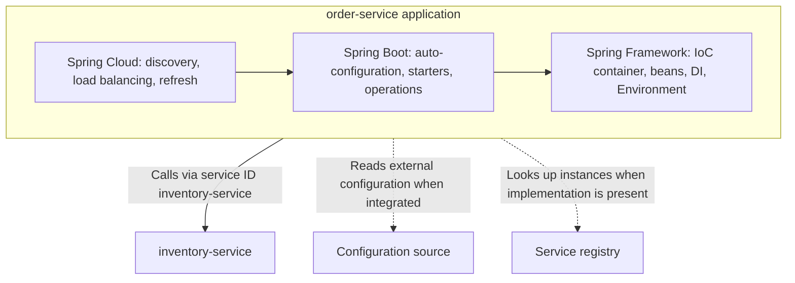
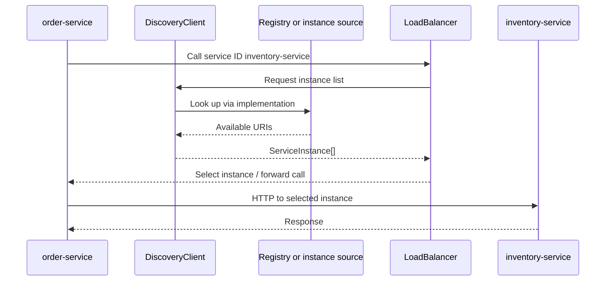

# Distinguishing Spring Framework Core, Spring Boot, and Spring Cloud

## 1. Context and Objectives

A Java application can use **Spring Framework Core** to manage objects and dependencies, use **Spring Boot** to start and operate the application with minimal manual configuration, and then use **Spring Cloud** when the application needs to coordinate with other services in a distributed system. The three names often appear together, yet they solve **three different groups of problems**.

This lesson falls within the scope of **SPRING_CLOUD_CORE**: exploring the core foundations of Spring Cloud in distributed systems, specifically Spring Cloud Commons, Spring Cloud Context, externalized configuration, compatibility with Spring Boot, refresh scope, discovery, service registry, service-to-service communication, and testing and operating shared abstractions.

After completing this lesson, you will be able to:

- Explain what capabilities each layer provides, what it depends on, and when to use it.
- Distinguish dependency injection, auto-configuration, and distributed-system abstractions with concrete examples.
- Identify the components responsible for configuration, service lookup, load balancing, and runtime configuration updates.
- Choose appropriate dependencies and understand the roles of the Spring Boot BOM and the Spring Cloud release train.
- Avoid confusing capabilities provided by an abstraction with capabilities that only exist when the corresponding implementation is added.

## 2. The Three-Layer Model

Consider an `order-service` that processes orders and calls `inventory-service`:



The diagram illustrates **capability usage relationships**; it does not mean every Boot application must install Spring Cloud or that every Spring Cloud component automatically starts a registry/config server.

| Criterion | Spring Framework Core | Spring Boot | Spring Cloud |
| --- | --- | --- | --- |
| Primary question | How are components inside an application created, wired, and managed? | How do you package, configure, run, and observe an application quickly and consistently? | How do distributed services discover one another, receive configuration, and coordinate? |
| Notable capabilities | IoC, dependency injection, bean lifecycle, `ApplicationContext`, `Environment`, resources, events | Starters, auto-configuration, embedded server depending on application type, externalized configuration, Actuator | `DiscoveryClient`, `ServiceRegistry`, Spring Cloud LoadBalancer, `@RefreshScope`, Config/Bus integrations, and other distributed solutions |
| Unit of concern | Objects and configuration within a single application context | A buildable, runnable, operable application | Relationships among multiple services and their infrastructure sources |
| Example | Inject `OrderRepository` into `OrderService` | Run a web application with `SpringApplication.run(...)` | Call `http://inventory-service` through a load balancer and a discovery source |
| Can be used standalone? | Spring Framework can be used without Boot | Yes; a Boot application does not require Cloud | Common Spring Cloud integrations run on compatible Spring Boot/Framework versions |

**Key takeaway:** Spring Boot does not replace Spring Framework; it builds on top of Spring Framework. Spring Cloud continues to use that foundation to standardize a number of distributed system needs.

## 3. Spring Framework Core: The Foundation Inside an Application

### 3.1. IoC, beans, and dependency injection

**Inversion of Control (IoC)** shifts the responsibility for instantiating and assembling objects from business code to the container. **Dependency Injection (DI)** is a way for the container to supply dependencies to an object. In Spring, `ApplicationContext` manages beans, their lifecycles, scopes, and dependency relationships.

```java
@Repository
class OrderRepository {
    long countPending() {
        return 12L; // Illustrative example; in practice queries data.
    }
}

@Service
class OrderService {
    private final OrderRepository repository;

    OrderService(OrderRepository repository) {
        this.repository = repository; // Constructor injection.
    }

    long pendingOrders() {
        return repository.countPending();
    }
}
```

`@Repository` and `@Service` mark beans that can be discovered via component scanning. Spring creates `OrderRepository` and passes it into `OrderService`'s constructor. In this example, **nothing is specific to Spring Cloud yet**; this is the foundational mechanism of Spring Framework.

Foundational concepts to distinguish:

- **Bean:** an object managed by the Spring container; not every object created with `new` is a bean.
- **Application context:** the space that manages beans, configuration, and several core Spring services.
- **Scope:** defines the lifecycle and access semantics of a bean, such as `singleton`, `prototype`, or request scope in web applications; `refresh` is an additional scope provided by Spring Cloud Context.
- **`Environment` / `PropertySource`:** a unified interface for reading properties from configuration sources with a defined precedence order.
- **`@Configuration` / `@Bean`:** a way to define beans when component scanning is not used or cannot be used.

### 3.2. Does Spring Framework automatically become a microservice application?

No. The container and DI solve **organizing code and components within a single application**. To accept HTTP requests, the application needs a web stack; to connect to a database, it needs the corresponding dependencies and configuration; to know the address of a remote instance, it needs a discovery mechanism or address configuration. Spring Framework provides many libraries beyond Core, but the name **Spring Framework Core** in this lesson refers to the foundational IoC, bean, and configuration layer, not the entire Spring ecosystem.

## 4. Spring Boot: Packaging and Operating a Spring Application

Spring Boot reduces repetitive configuration, provides conditional defaults, and supports running a Spring application in a consistent way.

```java
@SpringBootApplication
public class OrderApplication {
    public static void main(String[] args) {
        SpringApplication.run(OrderApplication.class, args);
    }
}
```

`@SpringBootApplication` combines capabilities such as application configuration, component scanning, and enabling auto-configuration. **Auto-configuration** inspects dependencies, existing beans, and properties to register appropriate configurations; it does not mean Boot automatically provisions all types of external infrastructure.

Three mechanisms commonly used together:

1. **Starter dependencies:** groups of dependencies by need, such as `spring-boot-starter-web` or `spring-boot-starter-actuator`.
2. **Auto-configuration:** conditional default configuration that can be overridden or customized per case.
3. **Externalized configuration:** reading values from files, environment variables, command-line arguments, and supported sources through Boot/Spring's configuration system.

Example `application.yml` of a Boot application:

```yaml
spring:
  application:
    name: order-service

server:
  port: 8080

orders:
  timeout: 3s
```

The application can bind `orders.timeout` into a `@ConfigurationProperties` object. The ability to load configuration from files and the environment **already exists in Spring Boot**; you do not need Spring Cloud Config just to read `application.yml`.

For operations, Spring Boot Actuator can provide health, metrics, and diagnostic information when the appropriate dependencies, configuration, and access controls are added. Actuator **is not** a service registry and does not automatically help one service find the address of another service.

## 5. Spring Cloud: Abstractions for Distributed Systems

Spring Cloud is an ecosystem of integration projects built on Spring, among which very important core modules include **Spring Cloud Commons** and **Spring Cloud Context**. Many capabilities such as Config, Gateway, Bus, or integrations with discovery technologies are **separate components**, added when needed.

### 5.1. Spring Cloud Commons: one contract for multiple implementations

Commons defines abstractions that application code can depend on instead of tying tightly to a single provider:

| Abstraction / Component | Responsibility | Limitations to remember |
| --- | --- | --- |
| `DiscoveryClient` | Lists `ServiceInstance` objects by service ID | Requires an implementation or a static instance list; the interface itself does not run a registry |
| `ReactiveDiscoveryClient` | Reactive variant of discovery | Useful only when a matching implementation is present |
| `ServiceRegistry` | Abstracts instance registration/deregistration operations | Not every discovery client allows or needs the application to self-register |
| Spring Cloud LoadBalancer | Selects an instance when calling via service ID | Requires instances from discovery/configuration; does not automatically mean retry, circuit breaker, or registry are included |
| Compatibility checks and supporting context mechanisms | Help integrate the right version set and initialization behavior | Do not replace the official release train compatibility matrix |

Example code using only the `DiscoveryClient` contract:

```java
@RestController
class InstanceController {
    private final DiscoveryClient discoveryClient;

    InstanceController(DiscoveryClient discoveryClient) {
        this.discoveryClient = discoveryClient;
    }

    @GetMapping("/inventory-instances")
    List<String> inventoryInstances() {
        return discoveryClient.getInstances("inventory-service")
                .stream()
                .map(instance -> instance.getUri().toString())
                .toList();
    }
}
```

Business code does not name Eureka, Consul, or Kubernetes explicitly. However, **an implementation** of discovery is needed for results to reflect real instances. In a learning environment, `SimpleDiscoveryClient` can be used with a fixed URI list; in real systems, the implementation must match the infrastructure.

### 5.2. How does discovery differ from service registry and load balancing?

Typical flow when `order-service` calls `inventory-service`:



The diagram is logical; instance selection, reusing cached lists, and forwarding requests depend on the specific HTTP client and LoadBalancer integration.

- **Registry** stores/serves as the source of truth for available instances; **discovery** reads that information.
- **Service registration** is the operation of declaring an instance to the registry if the chosen technology requires or supports it.
- **Client-side load balancing** selects an instance on the caller side; server-side load balancing lives in an external proxy/load balancer.
- **HTTP communication** is still handled by a client such as `RestClient`/`WebClient`; discovery and load balancer add routing by service name.

For instance, the string `http://inventory-service` can act as a **logical service ID** when the HTTP client is configured to use Spring Cloud LoadBalancer. If a standard HTTP client without that integration is used, the hostname is simply resolved via DNS as usual; no magic transformation happens just because the project contains Spring Cloud.

### 5.3. Spring Cloud Context: configuration lifecycle and refresh scope

Spring Cloud Context adds mechanisms supporting the application context when configuration changes, notably `@RefreshScope`. A bean in refresh scope can be recreated after a refresh event to read new configuration values. This differs from a regular `singleton`, which does not recreate itself just because a configuration file changed.

```java
@RefreshScope
@RestController
class BannerController {
    @Value("${orders.banner:Welcome}")
    private String banner;

    @GetMapping("/banner")
    String banner() {
        return banner;
    }
}
```

When the property source has been updated **and** the refresh mechanism is triggered properly, Spring Cloud can evict the cached target instance in refresh scope; the next access creates a new bean and injects the new `orders.banner` value. In other words, refresh is typically tied to **recreating the bean/proxy**, not a mechanism that mutates every field of every existing singleton.

Important limitations:

- Not every bean type or every property is refreshable; components holding long-lived connections or state especially need testing.
- Editing a configuration file does not guarantee an immediate refresh. A mechanism to update the property source and an appropriate trigger are required.
- Some versions/integrations support an Actuator endpoint such as `/actuator/refresh`; the endpoint must be enabled and protected, never left publicly open indiscriminately.
- Spring Cloud Bus can help broadcast events to multiple instances when integrated; it is not a built-in feature of `@RefreshScope` alone.
- Applications must check consistency during the window when instances update configuration at different times.

### 5.4. Externalized configuration: Boot Config Data and Spring Cloud Config

Two related concepts with different responsibilities:

| Component | Problem solved |
| --- | --- |
| Spring Boot externalized configuration / Config Data | Loads, merges, and prioritizes properties from supported sources at application startup |
| Spring Cloud Config Server | Provides centralized configuration for multiple applications, typically backed by a managed config repository |
| Spring Cloud Config Client | Integrates an application with Config Server through the appropriate configuration mechanism |
| Spring Cloud Context refresh | Supports updating and recreating certain beans when configuration has changed and refresh is triggered |

Example **client** configuration when the appropriate Spring Cloud Config Client starter has been added:

```yaml
spring:
  application:
    name: order-service
  config:
    import: optional:configserver:http://localhost:8888
```

`optional:` allows the application to proceed according to Config Data import semantics if Config Server is unreachable in the corresponding situation. For systems that require centralized configuration to run properly, decide explicitly whether optional or mandatory mode should be used. The `spring.config.import` syntax is the modern Config Data integration path; `bootstrap.yml` belongs to the legacy bootstrap mechanism or configurations that explicitly enable bootstrap, and you should not assume every project needs that file.

**Distinguish two points in time:** fetching configuration at startup does not mean continuous runtime configuration synchronization; runtime changes require a designed and tested refresh/redeployment mechanism.

## 6. Example Connecting the Three Layers in One Service

Suppose `order-service` exposes an ordering API and needs to find `inventory-service`'s endpoint.

### 6.1. Dependency set by responsibility

In a Maven project using the Spring Boot parent or Boot dependency management, the following dependencies illustrate each layer's role:

```xml
<dependencies>
    <!-- Spring Boot: web server and REST MVC -->
    <dependency>
        <groupId>org.springframework.boot</groupId>
        <artifactId>spring-boot-starter-web</artifactId>
    </dependency>

    <!-- Spring Cloud: client-side load balancing -->
    <dependency>
        <groupId>org.springframework.cloud</groupId>
        <artifactId>spring-cloud-starter-loadbalancer</artifactId>
    </dependency>

    <!-- An infrastructure-appropriate discovery starter can be added, if needed. -->
</dependencies>
```

Spring Framework enters the application through Spring Boot's foundational dependencies. The LoadBalancer starter brings instance selection capability; to use a real registry, you need to **add** an appropriate discovery implementation. The example below uses a static list to clarify the concept without having to run an external registry.

### 6.2. Defining static instances for a practice environment

```yaml
spring:
  application:
    name: order-service
  cloud:
    discovery:
      client:
        simple:
          instances:
            inventory-service:
              - uri: http://localhost:8081
              - uri: http://localhost:8082
```

This is a sample configuration for `SimpleDiscoveryClient`. The two URLs are only assumed endpoints; for actual calls to succeed, two `inventory-service` instances providing the corresponding API must be running. In production, the static mechanism can be replaced by an appropriate discovery implementation or DNS/service discovery provided by the platform.

### 6.3. Calling a service ID via a LoadBalancer-enabled HTTP client

The following example applies to a **compatible** Spring Framework/Boot/Cloud combination **that supports `RestClient`**:

```java
@Configuration
class ClientConfiguration {
    @Bean
    @LoadBalanced
    RestClient.Builder inventoryRestClientBuilder() {
        return RestClient.builder();
    }
}

@Service
class InventoryClient {
    private final RestClient client;

    InventoryClient(@LoadBalanced RestClient.Builder builder) {
        this.client = builder.build();
    }

    boolean inStock(String sku) {
        Boolean result = client.get()
                .uri("http://inventory-service/api/stock/{sku}", sku)
                .retrieve()
                .body(Boolean.class);
        return Boolean.TRUE.equals(result);
    }
}
```

Looking at this example, you can pinpoint the exact responsibilities:

1. **Spring Framework Core** creates and injects `ClientConfiguration`, `RestClient.Builder`, and `InventoryClient` as beans.
2. **Spring Boot** prepares the application context, web startup mechanism, and auto-configurations matching the present dependencies.
3. **Spring Cloud Commons/LoadBalancer** allows the client to use a service ID to select an instance from the configured discovery source.
4. **The HTTP client** performs the actual connection; if inventory is down or returns errors, the program still needs to handle timeouts, error responses, and appropriate fault-tolerance policies.

This example demonstrates the mechanism and does not include the API definition on the `inventory-service` side. If there is only a single stable DNS address provided by infrastructure, a regular HTTP client may already suffice; Cloud LoadBalancer is an option when client-side instance selection is needed.

## 7. Compatibility Management: Boot Version vs. Cloud Release Train

Spring Framework, Spring Boot, and Spring Cloud are released under **different versioning schemes**. Do not guess that the three projects share version numbers or that any Spring Cloud release works properly with every Spring Boot version.

When building a project:

1. Choose a supported Spring Boot version based on runtime, JDK, and project dependency requirements.
2. Check the **official compatibility matrix** of Spring Cloud to pick the release train supporting that Boot version.
3. Use the Boot parent/Boot BOM for the Spring Boot dependency family and import the corresponding `spring-cloud-dependencies` BOM for Spring Cloud modules.
4. Explicitly declare the needed starters; inspect the dependency tree to detect incompatible forced versions.
5. Start the application and address compatibility verifier warnings/errors at the root cause rather than disabling the check to keep running.

The Maven snippet below illustrates **where to declare the BOM**, where `${spring-cloud.version}` must be replaced with a verified compatible release train; the project must also declare its own Boot parent/BOM:

```xml
<properties>
    <spring-cloud.version>COMPATIBLE_RELEASE_TRAIN</spring-cloud.version>
</properties>

<dependencyManagement>
    <dependencies>
        <dependency>
            <groupId>org.springframework.cloud</groupId>
            <artifactId>spring-cloud-dependencies</artifactId>
            <version>${spring-cloud.version}</version>
            <type>pom</type>
            <scope>import</scope>
        </dependency>
    </dependencies>
</dependencyManagement>
```

Version numbers are not hardcoded in this lesson because the support matrix changes across releases. The BOM manages dependency versions; **it does not automatically enable Config Server, discovery, LoadBalancer, or the refresh endpoint** without the required components and configuration.

## 8. When to Use Which Layer?

| Situation | Well-founded choice | Explanation |
| --- | --- | --- |
| Need DI, lifecycle management, and bean configuration in a library | Spring Framework Core | Only the container mechanism is needed; creating a Boot app is not mandatory |
| Building a standalone REST API with a database and health checks | Spring Boot on Spring Framework | Starters, auto-configuration, and Actuator are usually sufficient |
| Multiple services need dynamic instance lookup and call distribution | Spring Boot + appropriate Spring Cloud discovery/LoadBalancer | Cloud adds distributed service abstractions; a real discovery implementation is required |
| Multiple services want centralized configuration | Spring Boot + Spring Cloud Config (if this solution is chosen) | Config Server/Client is a specific implementation, not a mandatory part of Spring Cloud Commons |
| Need to change certain configuration values while the app is running | Spring Cloud Context and an appropriate refresh mechanism | Must design triggers, refresh limits, and cross-instance consistency |
| Running on Kubernetes with Service DNS and ConfigMap/Secret already in place | Evaluate platform features before adding Spring Cloud | Many needs may already be solved by the platform; Spring Cloud is chosen based on integration needs |

Note: **Spring Cloud does not imply a specific cloud provider**, nor does it automatically turn every application into a microservice architecture. Architectural decisions also involve domain boundaries, data, deployment, networking, observability, and operations.

## 9. Testing and Operating at the Right Layer

For a service using Spring Cloud abstractions, test according to the separated layers of responsibility:

| Testing level | What to verify | Approach |
| --- | --- | --- |
| Spring Framework | Beans are created properly, constructors are injected, properties are bound | Unit tests for logic and context tests when verifying bean configuration |
| Spring Boot | App starts with expected profile, endpoints/health and external config are valid | `@SpringBootTest`, verify Actuator and the actual config sources used |
| Spring Cloud discovery | Service ID lookup returns expected instances; handles empty lists | Use static instance config/test doubles, then test with the real implementation |
| Spring Cloud LoadBalancer | Can select an instance, URI resolves properly, behavior when an instance is unreachable | Integration tests with test endpoints and verification of timeout/error handling |
| Spring Cloud Context | Does updating property source + triggering refresh give target beans the new value? | Test before/after refresh; also verify beans that do not support refresh |
| Compatibility and operations | Valid dependencies/versions, system can diagnose config/discovery failures | Check compatibility, health/logs/metrics, timeouts, and access levels on sensitive endpoints |

Three common failure examples show why diagnosing at the right layer matters:

- **`NoSuchBeanDefinitionException`:** review component scanning, bean definitions, and auto-configuration conditions first; do not assume it is a discovery error.
- **`inventory-service` not found:** verify whether the HTTP client has LoadBalancer integration, whether an instance source exists, and whether the service ID matches.
- **Configuration changed but API still returns old value:** check whether the property source was updated, whether a refresh was triggered, whether the bean works with `@RefreshScope`, and whether it was accessed again.

In operations, avoid logging configuration secrets, control access to Actuator endpoints that can mutate state, and set explicit timeouts for network calls. Config refresh or discovery does not replace retry strategies, circuit breakers, and idempotency handling; those concerns must be designed separately.

## 10. Common Misconceptions

| Incorrect statement | Correct understanding |
| --- | --- |
| “Spring Boot is a framework that replaces Spring Framework.” | Boot uses Spring Framework's features and adds convenient configuration, startup, and operations. |
| “Whenever you use Spring Boot, you already have Spring Cloud.” | Cloud is a set of optional dependencies/integrations for distributed needs. |
| “Having `DiscoveryClient` means a registry is running.” | Interface and implementation are separate; a registry and registration process require a concrete solution. |
| “Just adding the LoadBalancer starter load-balances all URLs.” | The HTTP client needs proper integration, must use a service ID, and must have an instance list to select from. |
| “Config Server is mandatory for externalized configuration.” | Boot already has externalized configuration; Config Server is one option for centralized configuration. |
| “Editing a YAML file automatically updates all singletons.” | An update/refresh mechanism is required, and not every bean or property is refreshable. |
| “The Spring Cloud version must match the Spring Boot version.” | Choose according to the compatibility matrix and release train; do not match version numbers by name. |

## 11. Connecting the Concepts in a Real Architecture

In an ordering system comprising `order-service`, `inventory-service`, and `payment-service`:

- **Framework Core** helps each service manage `OrderService`, `InventoryClient`, `PaymentClient`, and configuration beans in a controlled manner.
- **Boot** helps each service start as an independent application, load environment-specific configuration, expose health/metrics, and package consistently.
- **Cloud Commons** lets code call services through abstractions like `DiscoveryClient`; **Cloud LoadBalancer** can select inventory/payment instances when an instance source is available.
- **Cloud Context** supports handling certain runtime configuration changes, while **Cloud Config** is added only if the team decides to manage centralized configuration using that mechanism.

If all of Spring Cloud were temporarily removed, each Boot service could still start and serve APIs with its own configuration; the difference is that the applications would need **another way** to discover endpoints, manage centralized configuration, or distribute calls when the system requires it. If Boot were removed, Spring Framework could still manage beans, but the team would have to organize much more initialization, dependency wiring, and operations themselves.

## 12. Official References

- [Spring Framework — IoC Container](https://docs.spring.io/spring-framework/reference/core/beans.html): beans, dependency injection, and application context.
- [Spring Boot — Externalized Configuration](https://docs.spring.io/spring-boot/reference/features/external-config.html): external configuration, precedence order, and Config Data.
- [Spring Boot — Auto-configuration](https://docs.spring.io/spring-boot/reference/using/auto-configuration.html): how Boot decides auto-configuration.
- [Spring Cloud Commons](https://docs.spring.io/spring-cloud-commons/reference/): discovery, load balancing, common abstractions.
- [Spring Cloud Context](https://docs.spring.io/spring-cloud-commons/reference/spring-cloud-commons/application-context-services.html): bootstrap context and refresh scope.
- [Spring Cloud Config](https://docs.spring.io/spring-cloud-config/reference/): Config Server/Client and distributed configuration.
- [Spring Cloud — Project overview and release trains](https://spring.io/projects/spring-cloud): look up current versions and compatibility relationships with Spring Boot.

**Remember:** *Spring Framework Core manages components inside an application; Spring Boot standardizes how to build, configure, and operate an application; Spring Cloud provides abstractions and integrations when multiple applications need to work together.*
