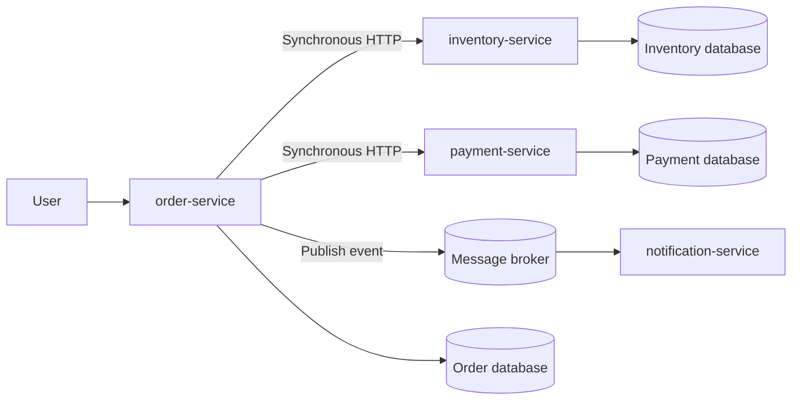
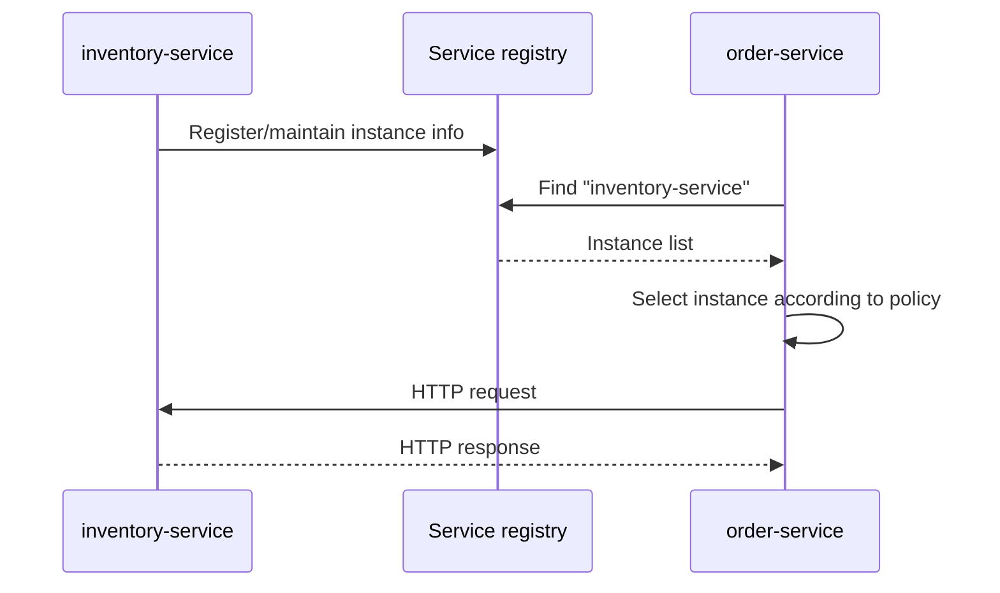
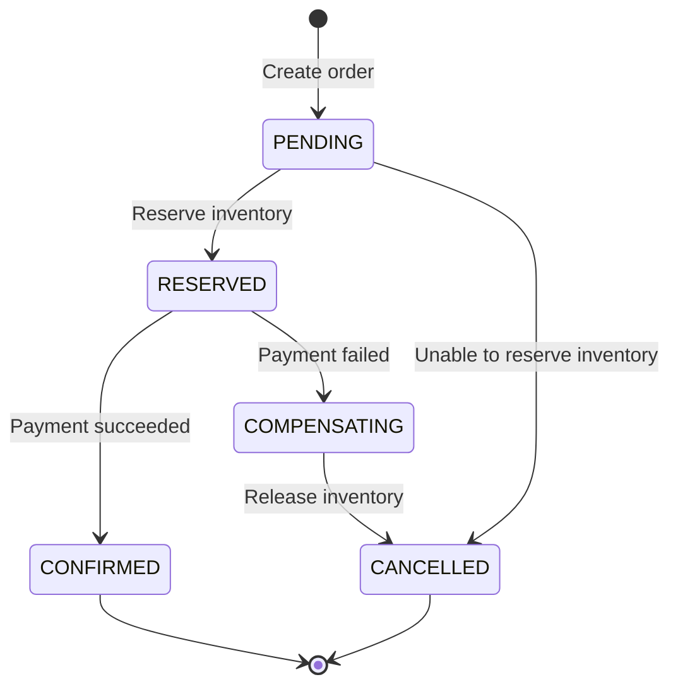
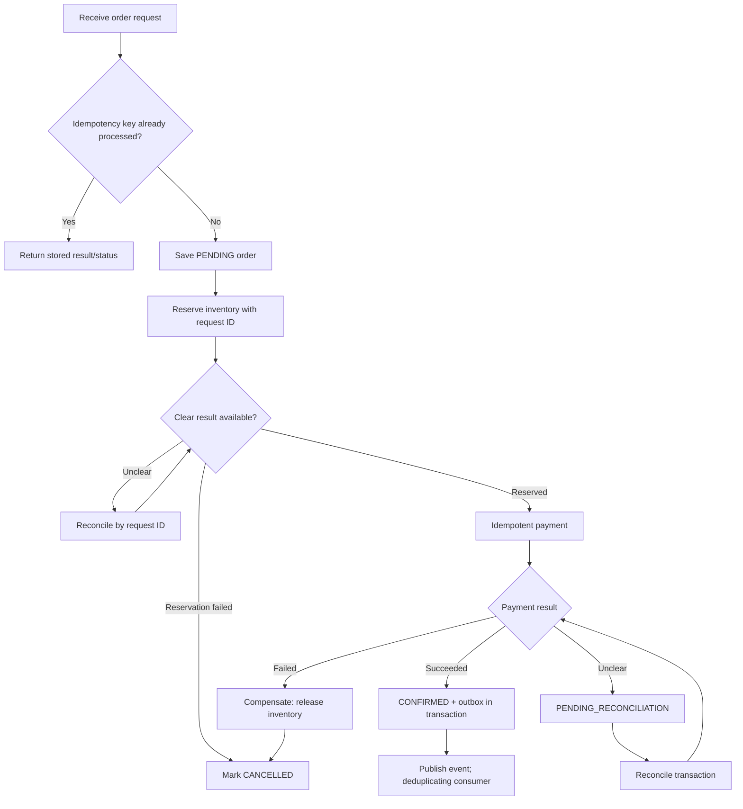

# Foundational Challenges of Distributed Applications

In an application running in a single process, a function call usually has a clear outcome: it succeeds or throws an error. When a business operation spans multiple services, networks, and data stores, the same call can be slow, partially fail, be processed twice, or succeed without the caller ever receiving a response. That is why distributed systems require a different design approach from monolithic applications.

This lesson belongs to the **Overview** chapter of **SPRING_CLOUD_CORE**. The focus is on identifying core challenges, choosing appropriate mitigations, and understanding the shared abstractions Spring Cloud provides via **Spring Cloud Commons**, **Spring Cloud Context**, and Spring Boot's externalized configuration mechanism. These libraries form the foundation for locating services, selecting instances, managing configuration, and operating services; they do not automatically guarantee business consistency or eliminate network failures.

## Learning Objectives

After this lesson, you will be able to:

1. Distinguish single-process failures from **partial failures** in a multi-service system.
2. Explain why timeouts, deadlines, controlled retries, idempotency, and load limiting are necessary.
3. Describe how **service discovery**, **service registry**, and load balancing enable services to communicate when instance addresses change.
4. Analyze the trade-offs among data consistency, availability, latency, and scalability.
5. Understand the role of externalized configuration, runtime configuration changes, version compatibility, and system observability.
6. Connect each problem area to Spring Cloud Core and build an appropriate testing strategy.

## 1. An End-to-End Scenario: Order Processing

Consider an e-commerce system composed of the following services:

- `order-service`: receives order requests and manages order state.
- `inventory-service`: checks and reserves inventory.
- `payment-service`: creates and confirms payments.
- `notification-service`: sends notifications via an event queue.

`order-service` needs to know where to call `inventory-service`, wait for a response within a reasonable time, handle uncertain payment outcomes, and avoid creating two orders when a user clicks the place-order button twice. If a service is redeployed, an instance's address can change right in the middle of a processing flow.



Each service owns its own data. A transaction in `order-service`'s database does not automatically cover operations already performed in `inventory-service` or `payment-service`.

| Scenario | Observable symptom | Practical risk |
| --- | --- | --- |
| Inventory instance replaced | Connection to old address fails | Unable to find a healthy instance |
| Payment completes but response is lost | `order-service` hits a timeout | Retrying may charge the customer twice |
| Inventory reserved but payment declined | Operation partially completed | Inventory stays held indefinitely without compensation |
| Many requests arrive simultaneously | Some instances become overloaded | Cascading latency increases |
| Configuration changed at runtime | Instances read different values | Inconsistent behavior |
| Error occurs, but logs span four services | Difficult to trace the root cause | Slow detection and recovery |

### Characteristics That Make It Hard

A distributed system typically faces four realities simultaneously:

- **No shared memory or global clock.** Each process only knows its local state; server clocks can drift from one another.
- **Networks have latency and can fail intermittently.** Packets can arrive late, be dropped, be duplicated, or be blocked by intermediary devices.
- **Components change independently.** Instances are added, removed, upgraded, or restarted.
- **There is no single cross-system transaction by default.** Databases, message brokers, and remote services each have their own commit mechanisms.

Therefore, the design must explicitly answer three questions: *What happens if a step produces no response? What happens if that step succeeded even though we think it failed? What happens if the same operation is received multiple times?*

## 2. Partial Failures, Timeouts, and Latency

### 2.1. A timeout does not tell you the business outcome

Suppose `order-service` sends a payment request and waits up to two seconds. When two seconds elapse, there are at least three possibilities:

1. The request never reached `payment-service`.
2. The request arrived but has not finished processing yet.
3. The payment succeeded, and only the response was lost or delayed.

All three can manifest as the exact same timeout error on the caller side. Therefore, **a timeout means “outcome unknown within the waiting window,” not “the operation never happened.”** This is why idempotency and the ability to query business state must be designed in.

Distinguish error types to decide how to handle them:

| Error type | Examples | Common handling approach |
| --- | --- | --- |
| Connection error | Connection refused, DNS resolution failure | Check discovery and networking; may try another instance |
| Timeout | No response received within the limit | Record uncertain outcome; retry only when the operation is safe |
| HTTP 429 / overload | Service rejects due to rate limit exceeded | Slow down, honor `Retry-After` when present |
| Transient HTTP 503 | Service temporarily unavailable | Bounded retry with backoff, if appropriate |
| 4xx business error | Out of stock, invalid request | Return business outcome; do not retry blindly |
| Data or programming bug | Schema mismatch, NullPointerException | Fix the root cause; retrying usually does not help |

HTTP status codes are only initial signals. Each service's API contract must specify which errors are retriable and which business states require reconciliation.

### 2.2. Set a deadline for the entire request

A *timeout* is usually the time limit for a single operation; a *deadline* is the final point by which the entire request must finish. For example, an ordering API with a 2.5-second budget cannot grant 2 seconds each to the inventory call, the payment call, and three sequential retries.

An illustrative budget breakdown:

| Stage | Target budget |
| --- | ---: |
| Input validation and preprocessing | 100 ms |
| Inventory reservation | 600 ms |
| Payment | 1,000 ms |
| Persist order state | 200 ms |
| Network and processing buffer | 600 ms |
| **Total** | **2,500 ms** |

These numbers are only design examples; measure actual latency—especially p95/p99 percentiles—and adjust accordingly. When remaining deadline is short, the system should stop work that can no longer finish in time or transition to a trackable asynchronous state.

### 2.3. Retries can make an outage worse

Retries are appropriate when an error is transient and the operation is safe to repeat. However, if three layers each retry three times, a single original request can amplify into up to 27 calls at the deepest layer. When a service is already overloaded, that adds extra load and prolongs recovery time.

Practical guidelines:

- Only retry errors defined as transient by the API contract.
- Cap the retry count and total duration according to the original request's deadline.
- Use **exponential backoff with jitter** so clients do not retry in lockstep.
- Prefer placing retries at a single layer with sufficient context, avoiding overlapping retries across multiple layers.
- For write operations with side effects, use an idempotency key or a reconciliation mechanism before retrying.

A **circuit breaker** temporarily stops calling a consistently failing dependency; a **bulkhead** isolates resources across call groups; **rate limiting** and **load shedding** reject excess requests early when capacity is exceeded. These are complementary design patterns; they do not guarantee any single request will succeed.

## 3. Changing Service Addresses: Discovery, Registry, and Load Balancing

A hardcoded URL like `http://10.0.1.12:8080` quickly becomes unreliable when instances are scaled, change IPs, move hosts, or are removed from the cluster. Applications need to work with a **logical service name** such as `inventory-service`.

### 3.1. Three roles to distinguish

- **Service registration:** an instance declares its identity and address to a registry, or is registered on its behalf by the infrastructure platform.
- **Service discovery:** the caller queries the discovery system to retrieve currently available instances of a service.
- **Load balancing:** selecting an instance from the list and routing the request to it.



There are two common models: **client-side load balancing** (the client picks from an instance list) and **server-side load balancing** (the client sends through a proxy/load balancer). In Kubernetes, Services and DNS can provide stable addresses and traffic distribution; not every system needs to run its own application-level registry.

### 3.2. Spring Cloud's shared abstractions

**Spring Cloud Commons** provides common contracts that keep the service-calling layer less coupled to a specific discovery provider:

| Abstraction | Responsibility | What it does not do automatically |
| --- | --- | --- |
| `DiscoveryClient` | Finds service names and lists `ServiceInstance` objects | Does not promise instances will always be healthy |
| `ReactiveDiscoveryClient` | Discovers services via a reactive API | Does not replace network error management |
| `ServiceInstance` | Represents an instance's host, port, metadata, and secure status | Does not guarantee the business endpoint will respond |
| `ServiceRegistry` and `Registration` | Models instance registration/deregistration when supported by the implementation | Does not create a physical registry |
| Spring Cloud LoadBalancer | Selects an instance for calls via HTTP client integration | Does not replace timeouts, idempotency, or load control |

A corresponding discovery implementation must be present and configured. `DiscoveryClient` is an abstraction layer; using Eureka, Consul, Kubernetes, or another source depends on the actual architecture and dependencies.

### 3.3. Example of calling a service by logical name

When an application has Spring Cloud LoadBalancer and an appropriate instance source, a `RestClient.Builder` annotated with `@LoadBalanced` can be configured:

```java
import org.springframework.cloud.client.loadbalancer.LoadBalanced;
import org.springframework.context.annotation.Bean;
import org.springframework.context.annotation.Configuration;
import org.springframework.web.client.RestClient;

@Configuration
class ClientConfiguration {
    @Bean
    @LoadBalanced
    RestClient.Builder inventoryRestClientBuilder() {
        return RestClient.builder();
    }
}
```

```java
import org.springframework.cloud.client.loadbalancer.LoadBalanced;
import org.springframework.stereotype.Service;
import org.springframework.web.client.RestClient;

@Service
class InventoryClient {
    private final RestClient client;

    InventoryClient(@LoadBalanced RestClient.Builder builder) {
        this.client = builder.build();
    }

    InventoryAvailability getAvailability(String sku) {
        return client.get()
                .uri("http://inventory-service/internal/items/{sku}/availability", sku)
                .retrieve()
                .body(InventoryAvailability.class);
    }
}

record InventoryAvailability(String sku, boolean available) {}
```

The host portion `inventory-service` here is a **service ID**, not a fixed DNS name or IP. LoadBalancer needs an instance list to resolve it. For learning and testing without a registry, Spring Cloud Commons provides **SimpleDiscoveryClient** backed by static configuration:

```yaml
spring:
  cloud:
    discovery:
      client:
        simple:
          instances:
            inventory-service:
              - uri: http://localhost:8082
```

The example uses a single instance at `localhost:8082`. When running in containers or other environments, update the URI accordingly. Static configuration is useful for experimentation; environments where instances change frequently typically use infrastructure discovery or a dedicated registry.

**Limitation to remember:** finding an instance does not mean that instance is still alive when the request arrives. Discovery information can lag; readiness, health checks, timeouts, and empty-list handling must still be designed. Do not retry indefinitely just waiting for a service to appear.

## 4. Availability Depends on the Call Chain

If answering one request requires `order-service` to receive responses from three other services, the entire flow fails when even a single link is unavailable. In a simple model, suppose four required components each have an independent 99.9% availability probability; the probability that all four are available simultaneously is approximately:

```text
0.999 × 0.999 × 0.999 × 0.999 ≈ 0.9960 = 99.60%
```

This is only an illustrative model: real outages are often correlated, and availability also depends on topology, recovery time, and error handling. The key point is that **synchronous dependency chains add points of failure**.

Not every task needs to be synchronous. For an order, the user needs prompt feedback that the order was accepted; sending an email can happen afterward via a message broker. However, moving to asynchronous processing introduces new challenges: duplicate deliveries, event ordering, and eventual consistency.

### Choosing communication style by business requirement

| Characteristic | Synchronous (HTTP/RPC) | Asynchronous (message/event) |
| --- | --- | --- |
| Immediate result | Suitable when an instant answer is required | Typically returns an accepted status |
| Runtime coupling | Caller waits for receiver | Can reduce direct coupling |
| Error management | Timeout, retry, circuit breaker | Redelivery, dead-letter queue, consumer retry |
| Data consistency | No built-in cross-service transactions | Typically requires eventual consistency |
| Primary complexity | Latency and dependency chains | Duplicates, ordering, observing processing flows |

Do not move everything onto a message broker just to avoid timeouts. Base the decision on user expectations, success semantics, and tolerance for delayed results.

## 5. Data Lives in Multiple Places: Consistency and Distributed Transactions

### 5.1. The non-simultaneous commit problem

Consider the ordering flow:

1. `order-service` creates an order with status `PENDING`.
2. `inventory-service` reserves an item.
3. `payment-service` confirms payment.
4. `order-service` transitions the order to `CONFIRMED`.

If step 3 succeeds but step 4 fails, the payment database and the order database temporarily reflect two different states. A `@Transactional` annotation in `order-service` only manages transactions for resources coordinated by its transaction manager; it does not turn a series of HTTP calls into an ACID transaction across services.

### 5.2. Choosing the consistency level intentionally

- **Strong consistency:** once an operation is confirmed, readers observe state satisfying the chosen consistency rule; usually increases coordination and can raise latency.
- **Eventual consistency:** replicas or services may diverge temporarily but converge once synchronization succeeds.
- **Read-your-writes:** users can read back their own changes right after a confirmed operation, even while other components are still synchronizing.

These guarantees must be specified per flow. For example, preventing inventory from going negative may be a strict **invariant**; displaying purchase counts a few seconds behind may be acceptable.

**CAP** addresses the trade-off between consistency and availability *during a network partition* under the theorem's technical definitions. Do not interpret CAP as a "pick any two of three" rule for all situations, or use it as a substitute for analyzing latency, data models, and business requirements.

### 5.3. Sagas and compensating actions

A **Saga** breaks a business process into local transactions. If a step fails, the system executes compensating actions rather than expecting a cross-service database rollback:



A Saga can be **orchestrated** by a coordinator or **choreographed** through events. Both approaches must define expiration times, retries, idempotency, reconciliation procedures, and handling when a compensation step itself fails. A "refund" is a new business action; a transaction that already occurred cannot always be reversed cleanly.

### 5.4. Transactional outbox

A common bug occurs when saving an order succeeds, but the process crashes right before publishing the `OrderCreated` event. If saving data and publishing a message are two separate actions, they can get out of sync.

The **transactional outbox** pattern writes both the order record and the event record inside a single local database transaction. Another process reads the outbox and forwards the event to the broker. This reduces the risk of "database committed without an event"; however, the relay process may publish duplicates, so consumers must still handle duplicate messages. This pattern requires an outbox relay mechanism, delivery tracking, and backlog monitoring.

Spring Cloud Core does not provide distributed transactions for this business logic itself. Choose storage, messaging, and deployment approaches that match your data contract.

## 6. Duplicate Messages, Ordering, and Idempotency

In asynchronous systems, **at-least-once delivery** can deliver the same message multiple times. For HTTP requests, clients can also send duplicates when responses are lost or users retry actions. Therefore, consumers and write endpoints must be designed so that repeats do not create unintended side effects.

An **idempotency key** is a stable identifier for the same business operation. For example, a payment API accepts the header `Idempotency-Key: order-782-payment-v1`. The server must store this key **durably**, tied to the request and its corresponding outcome; if it receives the same key and same payload again, it returns the recorded outcome or an in-progress status. If the same key arrives with a different payload, it returns a conflict error per the API contract.

Illustrative flow:

```text
Receive request (idempotency key, payload)
    |
    v
Check/claim key ownership via UNIQUE constraint in DB
    |-- Completed with same payload --> return stored result
    |-- In progress ------------------> return appropriate status / ask to retry later
    |-- Same key, different payload --> reject as conflict
    |
    v
Execute business operation using appropriate transaction/design
    |
    v
Persist result durably and return response
```

Merely "querying whether the key exists and then inserting" without a **unique constraint** and concurrency handling still leaves a race condition when two requests arrive simultaneously. With external payment providers, you must also use provider-contract idempotency or reconcile status by transaction ID before triggering side effects again.

**Message ordering** must also be scoped explicitly. Two events `OrderCancelled` and `OrderConfirmed` can arrive out of publication order if they travel across multiple partitions or consumers. Use per-aggregate versions/sequences, optimistic locking, and a state machine to reject invalid state transitions; do not assume the broker provides global ordering.

## 7. Externalized Configuration and Runtime Changes

A distributed application typically runs across dev, staging, and production environments, multiple regions, and multiple instances. Hardcoding URLs, timeouts, or load limits in source code forces a rebuild/redeploy for every adjustment and easily creates drift across environments.

### 7.1. Externalized configuration

**Spring Boot** allows loading configuration from `application.yml`, environment variables, command-line arguments, and other `ConfigData` sources according to precedence rules. For example:

```yaml
app:
  inventory:
    timeout: 800ms
    reserve-limit: 20
management:
  endpoints:
    web:
      exposure:
        include: health,info
```

These values should be managed per environment, validated at startup, and monitored when changed. Secrets must not appear in public config examples, source control, or logs. Moving configuration out of source code does not automatically update it inside running beans.

When using a centralized configuration source like Spring Cloud Config, you must also consider config source availability, caching/fallback, credentials, rollout procedures, and synchronization timing across instances. Premature or incompatible configuration can cause widespread outages.

### 7.2. Refresh scope in Spring Cloud Context

**Spring Cloud Context** provides `@RefreshScope` for beans that need to pick up updated configuration after a valid refresh event. Example:

```java
import org.springframework.beans.factory.annotation.Value;
import org.springframework.cloud.context.config.annotation.RefreshScope;
import org.springframework.stereotype.Component;

@Component
@RefreshScope
class DisplayMessage {
    private final String message;

    DisplayMessage(@Value("${app.display-message:Welcome}") String message) {
        this.message = message;
    }

    String current() {
        return message;
    }
}
```

A bean in refresh scope can be recreated when the scope's cache is invalidated; the new object reads current configuration from `Environment`. **Editing a configuration file or data source does not mean refresh happens automatically.** A mechanism to reload the environment and trigger a refresh compatible with the active version/integration is required. In supported setups, Actuator can expose a refresh endpoint; if enabled, it must be strictly protected with authentication, authorization, and access restrictions.

Practical limitations to understand:

- `@RefreshScope` does not update every object in the JVM instantaneously; in-flight requests using the old instance may finish with the old value.
- Not every bean or resource can be refreshed safely; long-lived connections, caches, and custom-managed resources need lifecycle review.
- Some configuration changes require a **restart/rolling deployment** to reach a consistent state.
- Changes affecting data contracts or business rules require versioned rollouts and a rollback plan.

Clearly separate **startup-only configuration**, **refreshable configuration**, and **configuration requiring redeployment**. The period during which instances temporarily run with two sets of configuration must be accounted for in the design.

## 8. Version Compatibility and Independent Changes

Microservices cannot be assumed to upgrade simultaneously. During a rolling deployment, old and new versions typically coexist; APIs and schemas must accommodate that overlap window.

### 8.1. Compatibility between Spring Boot and Spring Cloud

**Spring Cloud is released in release trains.** Each release train is compatible only with published ranges of Spring Boot versions. You cannot grab the latest version of every individual starter and expect them to run together.

In Maven projects, Spring Cloud versions are typically managed via a BOM:

```xml
<dependencyManagement>
    <dependencies>
        <dependency>
            <groupId>org.springframework.cloud</groupId>
            <artifactId>spring-cloud-dependencies</artifactId>
            <version>${spring-cloud.version}</version>
            <type>pom</type>
            <scope>import</scope>
        </dependency>
    </dependencies>
</dependencyManagement>
```

`spring-cloud.version` is a project variable that must be set according to Spring Cloud's **official compatibility matrix** for the Spring Boot version in use. Example LoadBalancer dependency:

```xml
<dependency>
    <groupId>org.springframework.cloud</groupId>
    <artifactId>spring-cloud-starter-loadbalancer</artifactId>
</dependency>
```

The BOM manages compatible dependency versions within a release train, but it does not guarantee that application code, API contracts, or external dependencies will be compatible. When upgrading, run application context startup tests, integration tests, API contract tests, and multi-version rollout tests. Built-in compatibility checks can fail fast when an unsupported version combination is used.

### 8.2. Evolving contracts between services

For example, a new version of `inventory-service` adds a `warehouseId` field. A safe evolution approach adds optional fields while preserving the semantics of existing fields during the transition period; avoid renaming or changing the meaning of fields in ways that break older clients. For events and database schemas, the **expand → migrate → contract** pattern can be used: add the new structure, migrate producers/consumers, and only remove the old structure once no dependencies remain.

Distinguish two compatibility layers: **library runtime compatibility** (Spring Boot ↔ Spring Cloud) and **business contract compatibility** (service ↔ service). Compatibility at one layer does not substitute for the other.

## 9. Security in Service-to-Service Communication

Splitting an application into multiple processes adds network hops and multiple access-control points. Finding a service name via discovery does not prove the caller is authorized to perform a business operation.

Concerns to address include service-to-service authentication, resource/action authorization, propagating user identity when needed, transport security (TLS, potentially mTLS), secret lifecycles, and securing internal endpoints. Do not share overly broad privileged accounts just because services reside on the same network.

In particular, endpoints that can alter system state—such as configuration refresh endpoints—must restrict access. Avoid writing access tokens, API keys, payment details, or sensitive data into logs and traces. Security policies must be enforced consistently across instances and across asynchronous processing paths.

## 10. Observability and Operations: Knowing Where Failures Happen

An order request may traverse four processes. Logs from `order-service` alone do not reveal whether a timeout came from DNS, connection pooling, queuing, SQL, or an overloaded downstream service.

Three complementary observability pillars:

| Signal | Helps answer |
| --- | --- |
| **Metrics** | How are error rates, latency, throughput, and saturation changing? |
| **Traces** | Which services/spans did a request pass through, and which step was slow? |
| **Structured logs** | At the moment of an event, what decision did the application make and what error occurred? |

Spring Boot Actuator and the Micrometer ecosystem provide the foundation for metrics, health information, and observation/tracing when paired with appropriate dependencies, configuration, and collection backends. Spring Cloud Commons and starters can integrate with these signals depending on the version; merely adding a dependency does not automatically yield complete dashboards or tracing.

Helpful practices:

- Track **RED** for APIs: request rate, error rate, duration; add saturation for CPU, thread pools, connection pools, and queues.
- Propagate trace IDs/correlation IDs across synchronous requests and messages where appropriate.
- Distinguish **liveness** (whether the process should be restarted) from **readiness** (whether an instance should receive new traffic). Do not use a single health endpoint for every decision.
- Define measurable SLIs/SLOs, such as the percentage of order requests succeeding within the deadline; configure alerts around user impact and error budgets.
- Monitor instance counts in discovery, open circuit breakers, timeouts, retries, and queue depth—not just CPU.
- Ensure logs and traces do not leak secrets and do not add excessive overhead during an outage.

A common failure mode is a **retry storm**: downstream slows down → upstream times out → concurrent retries spike → downstream gets even more overloaded. Metrics on traffic volume, retry counts, and latency help identify this feedback loop.

## 11. Testing What the Happy Path Misses

A test that only verifies `200 OK` does not prove a system can survive partial failures. The testing strategy should align with service boundaries and business invariants.

| Test layer | Representative cases | Outcome to prove |
| --- | --- | --- |
| Unit tests | Order state transition logic | Disallow invalid `CANCELLED → CONFIRMED` transitions |
| Integration tests | Database transactions, idempotency keys | Two duplicate requests do not create two transactions |
| Contract tests | Old client calling new server | Fields, error codes, and semantics remain compatible |
| Discovery/load balancing tests | Instance disappears, empty list | Client fails clearly or switches instances in a controlled way |
| Fault injection | Timeouts, 503s, lost response after commit | No duplicate side effects; reconciliation works |
| Messaging tests | Redelivered messages, out-of-order events | Consumer preserves valid state |
| Configuration tests | Missing/invalid values, refresh, two-version rollout | Startup or changes fail in a controlled way |
| Load/soak tests | Higher concurrency, queue buildup, retry storms | Latency targets and resource limits hold |

For HTTP testing, a mock server like WireMock can simulate latency and error codes. When behavior depends on real databases, brokers, or service registries, use an isolated integration environment such as Testcontainers or equivalent test infrastructure. **Failure after commit but before sending the response** is an especially important test case for verifying idempotency.

Distinguish library testing from architecture testing: Spring Cloud LoadBalancer may pick an instance properly, yet inventory reservation still fails if the business operation is not idempotent.

## 12. Putting the Pieces Together into an Operable Design

Returning to the ordering system, a sound design can follow these steps:

1. The client sends `POST /orders` with an idempotency key; `order-service` persists a `PENDING` order in a local transaction and returns a tracking ID.
2. The service locates `inventory-service` via service discovery or a stable infrastructure address. The HTTP client enforces timeouts, deadlines, and resource limits.
3. Inventory reserves stock using a unique request ID. If no response is received, the caller queries reservation status or safely retries per the contract.
4. Payment uses a dedicated transaction/idempotency key. If the outcome is uncertain, the order moves to a state requiring reconciliation rather than automatically assuming failure.
5. When payment succeeds, `order-service` commits the `CONFIRMED` state together with an outbox record. The relay publishes the event to the broker; the notification consumer tolerates duplicate events.
6. If payment fails, the Saga workflow releases the reserved inventory. Compensating steps are recorded, retried with bounds, and alerted if overdue.
7. Every major step logs correlation IDs and emits metrics. Changes to URLs, timeouts, or feature flags roll out through a controlled configuration process.
8. Each upgrade validates Boot–Cloud compatibility, API compatibility, and coexistence of old and new versions during rolling deployments.



The diagram describes *logical states*, not a promise that every step finishes immediately. The reconciliation path needs time bounds, controlled retries, manual monitoring when thresholds are exceeded, and clear termination rules; never create an infinite loop inside a single HTTP request.

### Problem-to-Spring-Cloud-Capability Map

| Foundational problem | Mechanism / Concept | Role of Spring Cloud Core |
| --- | --- | --- |
| Unknown instance location | Discovery, service ID, registry | Commons provides `DiscoveryClient`, `ServiceInstance`, `ServiceRegistry` |
| Multiple instances need traffic distribution | Client-side load balancing | Integrates Spring Cloud LoadBalancer with discovery/HTTP clients |
| Environment-specific configuration | Externalized configuration, ConfigData | Spring Boot provides the base; Spring Cloud Context adds context/refresh mechanisms |
| Runtime configuration changes | Refresh lifecycle | `@RefreshScope`, refresh integration when supported and enabled |
| Coordinating library versions | Release train, BOM, compatibility checks | Spring Cloud defines supported Spring Boot ranges and dependency management |
| Timeouts, retry storms, overload | Deadlines, retry policies, isolation | Requires proper HTTP client settings and resilience libraries/patterns; Commons does not replace the full strategy |
| Data skew across services | Saga, outbox, idempotency | Must be solved at the business layer and storage/messaging infrastructure |
| Unknown source of latency | Metrics, tracing, health | Integrates with Spring Boot Actuator, Micrometer, and observability backends |
| Insecure communication | AuthN/AuthZ, TLS, secrets | Requires Spring Security, infrastructure, and proper protection policies |

## 13. Common Pitfalls

**“Adding discovery eliminates connection errors.”** Discovery only finds candidates; an instance can die right after lookup. Readiness checks, timeouts, load balancing, and sensible fallbacks are still needed.

**“A timeout means the server did nothing.”** The response may be lost after the server committed. Write operations require idempotency and reconciliation.

**“Just retrying increases reliability.”** Poorly configured retries amplify load and cause duplicates. Filter errors, cap attempts, enforce deadlines, use backoff, and ensure repeat safety.

**“`@Transactional` synchronizes all databases.”** Local transactions do not span HTTP calls. Use invariants, Saga/outbox patterns, and recoverable business states.

**“Editing `application.yml` updates every bean with new values.”** Externalized configuration and refresh are distinct mechanisms; some changes require bean recreation or restarts.

**“Putting everything on a message broker achieves eventual consistency.”** The system must have convergence workflows, idempotent consumers, handling for loss/duplication/reordering, and backlog monitoring.

**“Dependency compatibility is enough for a rolling upgrade.”** You also need API, event, and schema compatibility, plus multi-version coexistence.

## 14. Self-Check Questions and Practice Exercise

1. `order-service` calls payment and times out after two seconds. Which states might have occurred? Why should it not immediately retry with a brand-new transaction?
2. What are the differences among `DiscoveryClient`, `ServiceRegistry`, and a load balancer? What happens when discovery returns an empty list?
3. Why can multi-layer retries turn a minor glitch into a system-wide outage? How would you bound retries against a deadline?
4. If inventory reservation succeeds but payment is declined, what states and compensating steps must be persisted so they can be retried safely?
5. When a timeout setting changes in a centralized source, what conditions make a bean actually receive the new value? When is a rolling restart needed?
6. A team upgrades Spring Boot while keeping the same Spring Cloud release train. What information and tests should be checked before deploying?
7. Design an integration test that sends two concurrent requests with the same idempotency key. What database constraints and final outcomes must hold?

**Mini exercise:** sketch a `POST /reservations` API that calls `payment-service` and `notification-service`. Specify the request deadline, idempotency key, state when payment is uncertain, compensation flow, outbox event, three metrics to monitor, and two fault-injection scenarios. Then indicate which parts can rely on Spring Cloud Commons/Context and which parts must be solved through business design.

## Key Takeaways

A reliable distributed application must **model the unknown**: networks can go silent, states can diverge, operations can repeat, and versions can be heterogeneous. Spring Cloud Core helps standardize critical integration points such as discovery, registry, load balancing, context, and configuration. System quality still depends on concrete business decisions: time bounds, idempotency, local transactions, reconciliation, observability, and testing partial failures.
