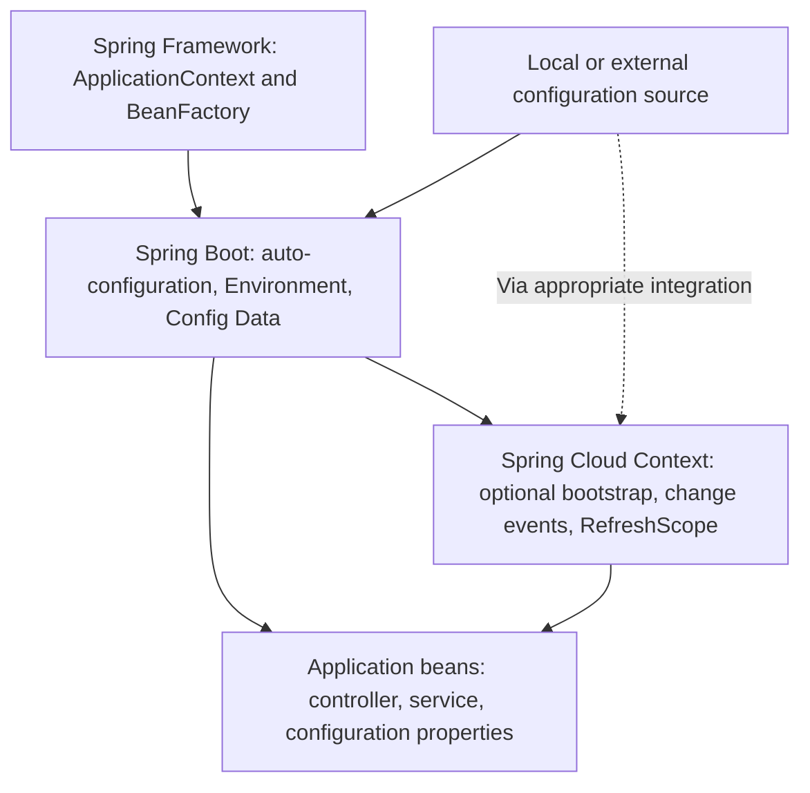
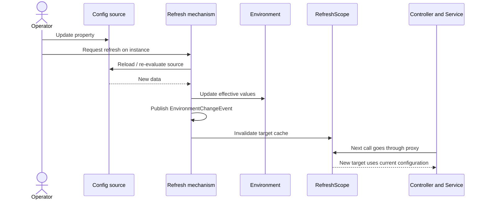

# Role of Spring Cloud Context for ApplicationContext

## 1. Context and Objectives

In Spring Boot, `ApplicationContext` is the heart of the Spring IoC container: it creates and manages beans, performs dependency injection, provides `Environment`, publishes events, and manages the application lifecycle. For a standalone service, configuration is typically read at startup and stays unchanged until the next deployment.

In a distributed system, a service may run across multiple instances, receive configuration from external sources, update operational parameters without stopping the entire system, and require shared mechanisms for infrastructure libraries to participate in initialization. **Spring Cloud Context** adds configuration integration, `Environment` change tracking, and selective bean refreshing onto the existing `ApplicationContext` foundation. It does not replace Spring Framework, Spring Boot, or the IoC container.

This lesson belongs to **SPRING_CLOUD_CORE**, the Spring Cloud foundation for distributed systems: Spring Cloud Commons, Context, externalized configuration, Spring Boot compatibility, along with testing and operations. This lesson focuses on **the relationship between Spring Cloud Context and ApplicationContext**; discovery, service registry, and service-to-service communication are related abstractions, but not Context's primary responsibility.

Learning objectives:

- Distinguish the responsibilities of `ApplicationContext`, Spring Boot, and Spring Cloud Context.
- Understand bootstrap context, Config Data, `EnvironmentChangeEvent`, and `@RefreshScope`.
- Explain why changing a property does not mean all beans update automatically.
- Implement, test, and diagnose an example of updating configuration remotely.
- Recognize limitations regarding versions, security, and consistency during refresh.

## 2. ApplicationContext Remains the Main Container

Spring `ApplicationContext` manages bean definitions, creates instances, wires dependencies, applies scopes, invokes lifecycle hooks, and provides the `ApplicationEvent` mechanism. `Environment` inside the context aggregates `PropertySource` instances such as configuration files, environment variables, command-line arguments, and sources added by integrated libraries.

Spring Boot builds the application on top of that: auto-configuring beans based on the classpath, reading Config Data, and creating the main context of a web or batch application. When an appropriate Spring Cloud dependency is added, **Spring Cloud Context registers additional components** to integrate with existing Spring mechanisms. Controllers, services, and repositories remain Spring-managed beans in the familiar way.



The diagram depicts **functional relationships**; it does not mean every Spring Cloud application creates an extra application context.

| Component | Responsibility | Remember |
| --- | --- | --- |
| Spring `ApplicationContext` | IoC, bean lifecycle, events, scope management | The actual container running the application. |
| Spring Boot `Environment` / Config Data | Aggregates and determines precedence of configuration sources | Effective property values depend on `PropertySource` ordering. |
| Spring Cloud Context | Bootstrap integration, change notifications, and refresh scope | Additional mechanism; applies only to matching beans and integrations. |
| Spring Cloud Commons | Abstractions such as `DiscoveryClient`, `ServiceRegistry` | Not synonymous with Spring Cloud Context. |
| Spring Cloud Config Client | Connects and loads configuration provided by Config Server | A common external configuration source; not the only source. |

For example, when a service reads `app.greeting.message` from Config Server, Spring Boot and the configuration integration bring the value into `Environment`; Spring Cloud Context can assist in updating the value and recreating beans; Spring `ApplicationContext` still manages the entire application lifecycle.

## 3. What Does Spring Cloud Context Add?

### 3.1. Preparing configuration from external sources

An `Environment` holds multiple `PropertySource` objects. When multiple sources declare the same key, the higher-precedence source determines the value. Spring Cloud provides extension points such as `PropertySourceLocator` and integrates with configuration libraries to bring properties from external infrastructure into the application.

Applications typically use the appropriate starter instead of writing a custom `PropertySourceLocator`. Exact configuration loading behavior depends on the Spring Boot version, Spring Cloud version, and whether the application uses Config Data or traditional bootstrap.

### 3.2. Change notifications via EnvironmentChangeEvent

`EnvironmentChangeEvent` describes the keys that have changed. Listeners can react; Spring Cloud mechanisms support rebinding eligible `@ConfigurationProperties` beans and updating certain infrastructure settings, such as logging levels.

**Publishing the event alone does not automatically reload all configuration sources.** The new value must first be present in `Environment` via an appropriate reload mechanism. The event also does not automatically recreate every singleton or clear caches across all beans.

### 3.3. Refreshing beans with RefreshScope

`@RefreshScope` is a special scope from Spring Cloud Context. Annotated beans are typically accessed through a **proxy**. When the scope is refreshed, the cached target object is evicted; the next access creates a new target object reading the current configuration in `Environment`.

This mechanism is useful when a bean stores configuration in fields initialized via constructor or `@Value`. Refresh **does not re-run the entire ApplicationContext creation process**, does not replace all beans, and does not force in-flight requests to switch to the new object immediately.

### 3.4. Integration with the ApplicationContext lifecycle

Context leverages Spring's built-in event system, scopes, and dependency injection. Spring Cloud infrastructure libraries can register beans and listeners via Spring Boot auto-configuration, enabling shared capabilities like configuration and refresh to work seamlessly with the application.

## 4. Bootstrap Context and Main Application Context

In Spring Cloud's **traditional bootstrap** model, an early context is created, usually acting as the **parent** of the main application context. It prepares property sources and required infrastructure components before the main context finishes initializing. The bootstrap context has its own configuration and bean scope.

Since Spring Cloud **2020.0**, legacy bootstrap is no longer enabled by default in standard setups. Modern versions can use the **Spring Boot Config Data API**, such as `spring.config.import=configserver:`, to load external configuration. If an integration truly requires bootstrap, `spring-cloud-starter-bootstrap` or the documented activation method for that specific version can be used.

| Aspect | Main application context | Bootstrap context if enabled |
| --- | --- | --- |
| Purpose | Runs business logic and application infrastructure | Prepares certain configuration and infrastructure beans early |
| Timing | Main application initialization | Created before the main context |
| Relationship | Contains controllers, services, repositories, etc. | Typically acts as parent under the legacy bootstrap model |
| Required? | Yes | No; depends on version and integration approach |

Therefore, **do not assume every application with Spring Cloud Context has two contexts**, or that every application using Config Server needs `bootstrap.yml`. When `PropertySourceLocator` runs and the order in which configuration sources load also vary across releases. When upgrading, consult the documentation for the exact release train in use.

## 5. Two Distinct Steps: Updating Environment and Updating Beans

Suppose the initial configuration is:

```yaml
app:
  greeting:
    message: "Hello"
  rate-limit:
    requests-per-minute: 100
```

A change in an external source only means **the input value may change**. Whether a bean receives the new value is a separate question.

### 5.1. The new value must enter Environment

A supported refresh request can cause the application to reload or re-evaluate configuration sources, identify changed keys, and publish an `EnvironmentChangeEvent`. Mutable `@ConfigurationProperties` beans supported by the rebind mechanism can have their corresponding fields updated. Do not assume immutable records or all forms of constructor binding can rebind in place.

### 5.2. Regular singletons do not re-run their constructors automatically

```java
@Service
public class GreetingService {
    private final String message;

    public GreetingService(@Value("${app.greeting.message:Hello}") String message) {
        this.message = message;
    }

    public String greeting() {
        return message;
    }
}
```

In the snippet above, `message` is captured into a `final` field when the instance is created. Even if `Environment` changes, the constructor does not run again automatically.

If the service needs to recreate the object from new configuration, you can use:

```java
@Service
@RefreshScope
public class GreetingService {
    private final String message;

    public GreetingService(@Value("${app.greeting.message:Hello}") String message) {
        this.message = message;
    }

    public String greeting() {
        return message;
    }
}
```

In the second version, callers of the service typically hold a **stable proxy**, while the target can be recreated after refreshing the scope. `@RefreshScope` is not needed on every bean; use it only when you want to change the object's lifecycle.

### 5.3. Typical refresh flow



This is the conceptual flow when an appropriate refresh mechanism is present. Exact processing order, property diffing, and loaded sources vary by version. Calling `RefreshScope` refresh is also **different from** the `refresh()` method used in the `ConfigurableApplicationContext` lifecycle.

## 6. Example: Service Receiving a New Greeting from Config Server

The following example uses Spring Boot, Spring Cloud Config Client, Actuator, and Spring Cloud Context. Goal: change `app.greeting.message` in the remote configuration source, ask an instance to refresh, and observe the new response from the REST API.

### 6.1. Dependencies

Maven needs Spring Boot starters and the Spring Cloud BOM from a **release train compatible with Spring Boot**. The `spring-cloud.version` property in the example must be declared according to the actual version chosen by the project:

```xml
<dependencyManagement>
    <dependencies>
        <dependency>
            <groupId>org.springframework.cloud</groupId>
            <artifactId>spring-cloud-dependencies</artifactId>
            <version>${spring-cloud.version}</version>
            <type>pom</type>
            <scope>import</scope>
        </dependency>
    </dependencies>
</dependencyManagement>

<dependencies>
    <dependency>
        <groupId>org.springframework.boot</groupId>
        <artifactId>spring-boot-starter-web</artifactId>
    </dependency>
    <dependency>
        <groupId>org.springframework.boot</groupId>
        <artifactId>spring-boot-starter-actuator</artifactId>
    </dependency>
    <dependency>
        <groupId>org.springframework.cloud</groupId>
        <artifactId>spring-cloud-starter-config</artifactId>
    </dependency>
</dependencies>
```

Spring Cloud Config Client brings in the needed Context integrations; there is no need to manually create another `ApplicationContext`.

### 6.2. Configuration

```yaml
spring:
  application:
    name: greeting-service
  config:
    import: "optional:configserver:http://localhost:8888"

app:
  greeting:
    message: "Hello from local"

management:
  endpoints:
    web:
      exposure:
        include: "health,info,refresh"
```

`spring.config.import` illustrates Config Data integration. `optional:` allows the application to start when Config Server is unavailable, though of course it cannot receive remote configuration until connected. The local value helps test the fallback source; the effective value depends on source precedence. Import syntax and endpoint exposure capabilities must match the project's version.

### 6.3. Service and Controller

```java
import org.springframework.beans.factory.annotation.Value;
import org.springframework.cloud.context.config.annotation.RefreshScope;
import org.springframework.stereotype.Service;

@Service
@RefreshScope
public class GreetingService {
    private final String message;

    public GreetingService(@Value("${app.greeting.message:Hello}") String message) {
        this.message = message;
    }

    public String greeting() {
        return message;
    }
}
```

```java
import org.springframework.web.bind.annotation.GetMapping;
import org.springframework.web.bind.annotation.RequestMapping;
import org.springframework.web.bind.annotation.RestController;

@RestController
@RequestMapping("/api/greeting")
public class GreetingController {
    private final GreetingService service;

    public GreetingController(GreetingService service) {
        this.service = service;
    }

    @GetMapping
    public String greeting() {
        return service.greeting();
    }
}
```

The controller holds a reference to the service proxy. After a refresh completes successfully, the next call can receive a new service target and the current `message` value.

### 6.4. Trying it out

1. Start a Config Server with configuration for `greeting-service` and start the application.
2. Call `GET /api/greeting`, and note the initial value.
3. Update `app.greeting.message` in **the configuration source that Config Server actually serves**, and verify Config Server returns the new value.
4. Request a refresh on the **application instance**:

   ```bash
   curl -X POST http://localhost:8080/actuator/refresh
   ```

5. Call the API again:

   ```bash
   curl http://localhost:8080/api/greeting
   ```

The response from the refresh endpoint may list the changed keys. If no keys changed, check the returned configuration, property precedence order, profiles, and source loading setup. Editing the `application.yml` of a running process **does not automatically guarantee** that refresh will re-read that file.

**Operations:** the `/actuator/refresh` endpoint can modify application state; in production, restrict access and use proper authentication and authorization. The unauthenticated `curl` command above is for development environments only. Each instance has its own context, `Environment`, and cache; refreshing instance A does not mean instance B has updated. If changes need to propagate to multiple instances, an appropriate coordination mechanism is needed, such as integrating Spring Cloud Bus when deployed.

## 7. Comparing Mechanisms Through a Reference Table

| Mechanism | When configuration changes | Is the target bean recreated? |
| --- | --- | --- |
| `Environment.getProperty(...)` at handling time | Reads the effective value currently in `Environment` | No |
| Singleton receiving `@Value` via constructor | Usually keeps the already-injected value | No |
| Mutable `@ConfigurationProperties` supported by rebind | May update fields after a suitable change/event | Not necessarily |
| `@RefreshScope` with refresh scope | Clears target cache, recreates on next call | Yes, lazily |
| Application restart | Rebuilds context and beans with new configuration | Yes, all beans |

Cases requiring caution:

- Placing `@RefreshScope` on a `@Configuration` class does not automatically make all beans created by its `@Bean` methods refreshable.
- Beans holding network connections, connection pools, or managed resources may not support safe reinitialization; verify closing behavior, recreation, and version-specific limits.
- Refresh does not provide an atomic update transaction across all requests or the entire cluster. During transition, different requests may observe two configuration versions.
- Completely removing a property from a configuration source may not behave as expected for bound beans; verify behavior and use explicit values when disabling options.
- Changes to bean definitions, dependency graphs, or code still typically require redeployment and restart. Refresh scope does not replace that.

## 8. Testing and Diagnostics

### 8.1. Testing the RefreshScope lifecycle

A test independent of Config Server can use `@SpringBootTest`, `ConfigurableApplicationContext`, and a high-precedence `MapPropertySource`. Add a value to the source, call `RefreshScope.refreshAll()`, verify the service; change the value in the source, call `refreshAll()` again, and verify the service returns the new result.

```java
@SpringBootTest
class GreetingRefreshTest {
    @Autowired ConfigurableApplicationContext context;
    @Autowired RefreshScope refreshScope;
    @Autowired GreetingService greetingService;

    @Test
    void readsNewValueAfterRefresh() {
        Map<String, Object> values = new HashMap<>();
        values.put("app.greeting.message", "Before change");
        context.getEnvironment().getPropertySources()
                .addFirst(new MapPropertySource("test-override", values));

        refreshScope.refreshAll();
        assertThat(greetingService.greeting()).isEqualTo("Before change");

        values.put("app.greeting.message", "After change");
        refreshScope.refreshAll();
        assertThat(greetingService.greeting()).isEqualTo("After change");
    }
}
```

This illustrative test assumes imports for JUnit 5, AssertJ, Spring Test, `java.util.Map`, `HashMap`, `MapPropertySource`, and `RefreshScope` are present. Isolate the test context or remove the temporary `PropertySource` after the test to avoid affecting other tests. This test only proves the target bean can be recreated from `Environment`; a separate integration test is needed to verify Config Server and HTTP `/actuator/refresh`.

### 8.2. Checklist for diagnosing why refresh had no effect

1. **Source:** Is Config Server serving the right application, profile, and label, and returning the new property?
2. **Environment:** Is the new property effective, or is it overridden by a higher-precedence source?
3. **Version:** Is the project using bootstrap or Config Data? Are dependencies and BOM compatible with Spring Boot?
4. **Refresh:** Was the refresh endpoint or mechanism invoked successfully? Does the bean have `@RefreshScope` or a corresponding rebind mechanism?
5. **Other caches:** Is another singleton holding a copy of the old value or caching an object that needs recreation?
6. **Instance:** Which instance did the request hit, and which instances have been refreshed?

When using logs or Actuator for diagnostics, avoid exposing sensitive information such as tokens, passwords, or connection strings from `Environment`.

## 9. Compatibility and Operational Limitations

Spring Cloud Context **does not** register services into a registry automatically, does not update every application in a cluster automatically, and does not provide a shared `ApplicationContext` across processes. Discovery/registry abstractions belong to Spring Cloud Commons and corresponding integrations.

Points to check against the **exact deployed version**:

- **Spring Cloud BOM and Spring Boot:** choose the release train according to the official compatibility matrix; do not mix versions arbitrarily.
- **Bootstrap and Config Data:** older guides using `bootstrap.yml` may not fit applications using `spring.config.import`.
- **Actuator:** having Spring Cloud Context on the classpath does not guarantee the HTTP refresh endpoint is exposed or authorized.
- **AOT / native image:** context refresh has limitations; under AOT/native configurations per Spring Cloud guidance, refresh should be disabled, e.g., `spring.cloud.refresh.enabled=false`.
- **Consistency:** refresh can recreate beans and affect in-flight requests; important changes require monitoring, rollback plans, and cross-instance coordination.

## 10. Summary and Self-Check Questions

> `ApplicationContext` is the container that manages beans. `Environment` provides the effective configuration values. Spring Cloud Context adds configuration integration, change notifications, and refreshing for beans designed for it.

When asked to "change configuration without restarting," verify **both conditions**: the new value has entered `Environment`, and the bean serving requests can read or recreate itself from that value. One condition holding does not guarantee the other holds.

Self-check questions:

1. Why might a singleton using constructor `@Value` return stale data after `Environment` has changed?
2. How does `EnvironmentChangeEvent` differ from `RefreshScope.refreshAll()`?
3. What is the role of the bootstrap context, and when does an application use Config Data without `bootstrap.yml`?
4. When two instances return different results after a refresh, what should be checked?
5. Why must you choose a Spring Cloud release train compatible with Spring Boot before deploying this mechanism?
